<p align="center">
  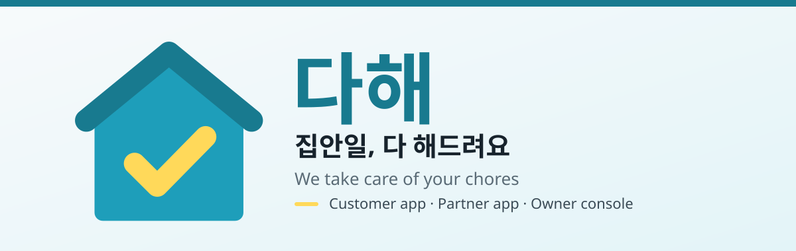
</p>

<p align="center">
  <a href="README.md">English</a> · <b>한국어</b>
</p>

<p align="center">
  <a href="https://github.com/EricWijesinghe/Dahae/actions/workflows/ci.yml"></a>
  <a href="LICENSE"></a>
  
  
</p>

<h1 align="center">다해 (Dahae)</h1>

<p align="center"><b>예약, 결제, 파트너 정산, 백업까지. 가사 서비스 회사가 자기 서버에 직접 설치하는 예약 플랫폼이에요.</b></p>

<p align="center">이 문서는 <a href="README.md">영어 README</a>의 한국어 번역이에요. 나라별 팩: 한국 (사용 가능) · 영국, 아일랜드, 호주, 뉴질랜드, 싱가포르 (계획)</p>

---

## 누구를 위한 프로그램인가요

| 대상 | 얻는 것 |
|---|---|
| **고객** | 앱에서 서비스와 가격을 보고, 날짜를 고르고, 결제하고, 청소가 어디까지 왔는지 봐요. 채팅으로 상담도 해요. |
| **파트너 (청소 기사)** | 배정된 일감을 보고, 현장에서 출근 체크인을 하고, 정산 내역을 확인해요. 팀원도 전화번호로 초대할 수 있어요. |
| **사장님** | 웹 콘솔에서 견적과 예약을 처리하고, 파트너를 배정하고, 결제와 정산을 확인해요. 백업과 자동 업데이트는 서버가 알아서 해요. |

## 우리 회사에 설치하기 (3단계)

<details open>
<summary><b>1단계. 서버와 도메인 빌리기</b></summary>

- 서버 임대 회사에서 **Ubuntu 24.04, CPU 2개, 메모리 4 GB** 서버를 빌려요 (22.04 와 Debian 12 도 설치돼요). 설치 프로그램은 메모리 1 GB 이상에서 실행돼요.
- 서버와 도메인 비용은 업체와 시기에 따라 달라요. 가입 전에 업체 요금표를 확인하세요.
- 서버 방화벽에서 **22, 80, 443 포트**를 열어요.
- 자세히: [0. 한 번에 설치하기](docs/guide/00-한번에-설치.md) ①②

</details>

<details open>
<summary><b>2단계. 설치 명령 한 줄 붙여넣기</b></summary>

서버의 검은 화면(브라우저 SSH 연결)에 아래 한 줄을 붙여넣고, 도메인과 이메일을 입력해요. 설치 주소는 개발자가 알려 줘요.

```bash
curl -fsSL <설치 주소> | sudo bash
```

검은 화면이 어렵다면, 개발자가 주는 설치 페이지로 설치 내용을 만들어 서버 만들기 화면에 붙여넣는 방법도 있어요 ([0번 안내서](docs/guide/00-한번에-설치.md)의 "다른 방법").

끝나면 `https://도메인/admin/` 주소와 **설치 코드**가 나와요. 브라우저에서 그 주소를 열고, 설치 코드로 사장님 계정을 만들어요. 처음 로그인하면 2단계 인증(휴대폰 인증 앱)을 설정해요.

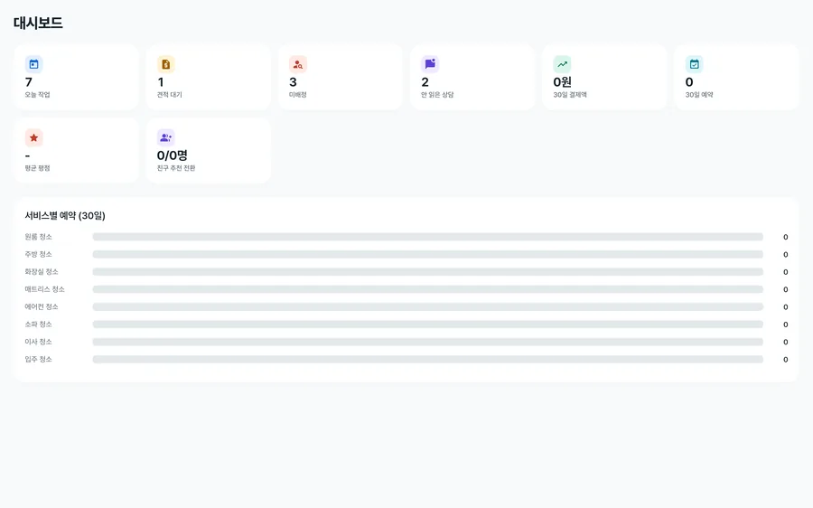

- 자세히: [0. 한 번에 설치하기](docs/guide/00-한번에-설치.md) ③④, [1. 서버 설치 (자세히)](docs/guide/01-서버-설치.md)

</details>

<details open>
<summary><b>3단계. 설정 마법사로 회사 정보와 연동 키 넣기</b></summary>

콘솔의 **[설정]** 메뉴에서 카드를 위에서부터 하나씩 채워요.

1. **사업장 정보**: 상호, 대표, 사업자 정보, 대표 색과 로고
2. **결제 (PortOne)**: 상점 아이디, API 시크릿, 채널 키, 웹훅 시크릿을 붙여넣고 저장해요. 저장한 키는 암호화되어 서버에 보관돼요.
3. **문자 · 알림톡 (Solapi)**: API 키와 발신번호
4. **로그인과 앱 푸시**: 카카오, 네이버, 구글, 애플, Firebase (쓰는 것만)
5. **백업**: 외부 저장소를 연결하면 매일 암호화된 백업을 한 부 더 보관해요. 안 해도 서버 안 백업(14일)은 계속돼요.

저장한 뒤 카드의 **연결 확인**을 눌러 초록색 "연결됨"이 나오면 끝이에요 (저장한 카드는 사장님 계정만 확인할 수 있어요).

<p align="center">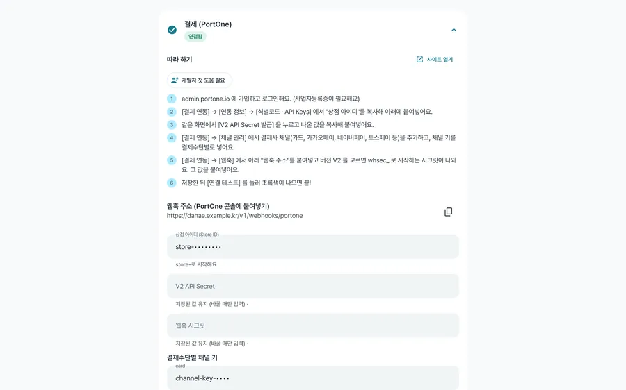<br><sub>결제 연동 카드 (데모 데이터)</sub></p>

- 자세히: [2. 설정 마법사](docs/guide/02-설정-마법사.md), [결제 연동 설정 가이드](docs/guide/payments-setup.md), [6. 알림톡 템플릿 등록](docs/guide/06-알림톡-템플릿-등록.md)

</details>

## 화면 미리보기

실제 앱과 콘솔 화면을 캡처한 이미지예요. 화면의 가게 소식, 예약, 주소, 이름, 매출과 평점은 모두 **데모 데이터**예요.

**고객 앱**

<table>
  <tr>
    <td align="center">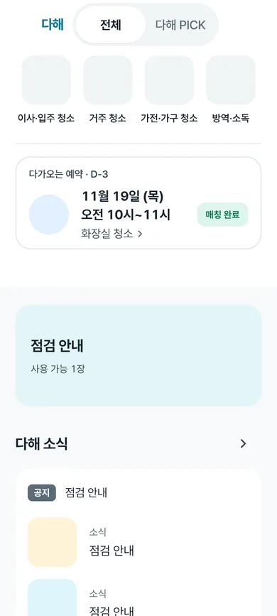<br><sub>홈</sub></td>
    <td align="center">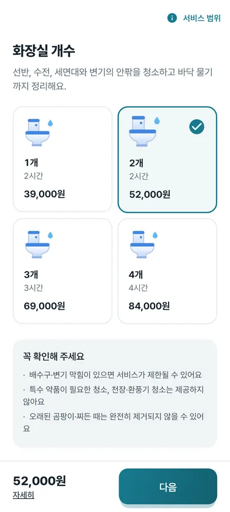<br><sub>서비스 고르기</sub></td>
    <td align="center">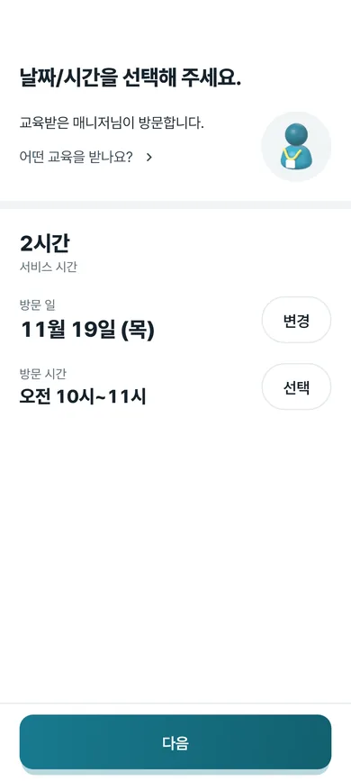<br><sub>예약</sub></td>
    <td align="center">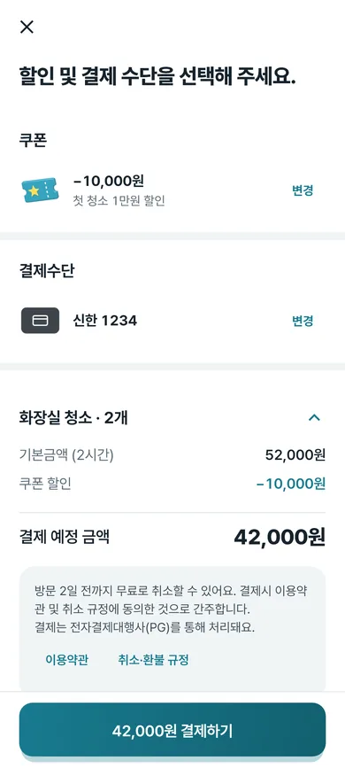<br><sub>결제</sub></td>
    <td align="center">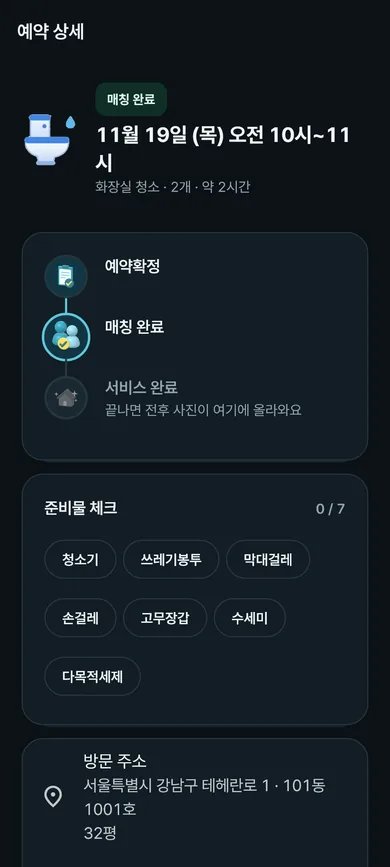<br><sub>진행 상황</sub></td>
  </tr>
</table>

**파트너 앱**

<table>
  <tr>
    <td align="center">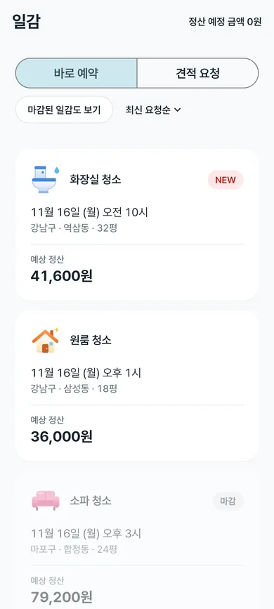<br><sub>일감 목록</sub></td>
    <td align="center">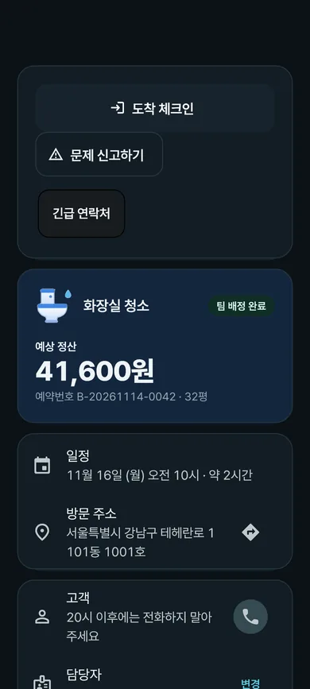<br><sub>일감 상세 · 출근 체크인</sub></td>
  </tr>
</table>

**사장님 콘솔**

<table>
  <tr>
    <td align="center"><br><sub>대시보드 (데모 데이터)</sub></td>
  </tr>
</table>

**예약 흐름 (고객 앱, 화면 5장을 이어 붙인 미리보기)**

<p align="center">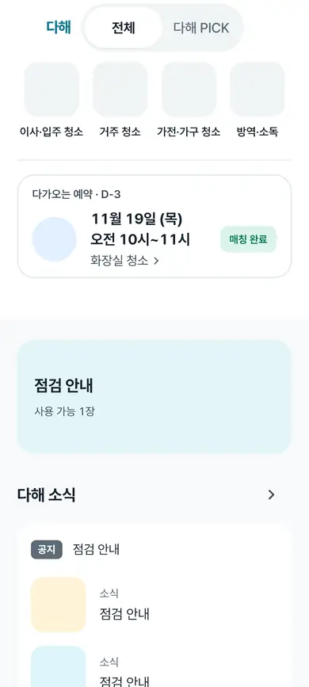</p>

## 주요 기능

전체 목록과 코드 위치는 [기능 카탈로그](docs/FEATURES.md)에 있어요.

### 예약
- 서비스마다 정해진 가격과 카탈로그 기준 가격 계산
- 개수로 고르는 서비스(에어컨·소파 등)는 옵션별 개수와 다중 할인으로 계산
- 이사·입주 청소는 견적을 받고, 예약금(견적의 10%)을 먼저 받아요
- 예약 일정 변경과 취소 (취소 정책에 따른 환불 계산)
- 대기 명단, 정기 구독과 자동 갱신, 성수기 요금, 팁

### 결제와 정산
- PortOne V2 결제: 카드, 간편결제, 계좌이체, 가상계좌 (채널 설정에 따라 켜고 꺼요)
- 서명을 확인한 웹훅 수신과 결제 대사 (맞지 않는 결제를 찾아줘요)
- 현금영수증과 세금계산서 발행
- 포인트와 쿠폰
- 파트너 정산: 기본은 사장님이 은행 앱으로 직접 이체하고 완료를 기록해요. 토스페이먼츠 지급대행을 연결하면 자동 지급도 할 수 있어요.
- 부가세와 원천징수 내보내기 (CSV)

### 직원과 품질
- 직원 계정과 2단계 인증 (휴대폰 인증 앱)
- 파트너 팀원 초대 (전화번호로 초대하고, 배정된 일감만 보여요)
- 평점과 품질 기록, 노쇼 관리
- 활동 기록 (감사 로그)

### 보안과 개인정보
- 연동 키와 민감한 값은 암호화해서 보관해요
- 인증 코드 요청과 로그인 시도 횟수를 제한하고, 실패가 반복되면 점점 길게 잠가요
- 웹훅 서명 검증, 요청 중복 방지
- 개인정보 열람과 삭제 요청 처리, 탈퇴 때 간편 로그인 연결 해제
- 보관 기간 설정, 암호 유출 목록 검사

### 백업과 운영
- 매일 새벽 3시 30분 서버 백업 (14일 보관)
- 외부 저장소(S3 호환)에 암호화 백업 보관. 서버를 잃어도 `.env` 파일과 함께 복구할 수 있어요.
- 매주 월요일 새벽 4시 자동 업데이트. 업데이트 전에 백업하고, 실패하면 이전 버전으로 되돌려요.
- 서명된 컨테이너 이미지, 자동 HTTPS 인증서 (Caddy)
- `dahae` 명령: 상태 확인, 로그, 백업, 복구, 업데이트, 되돌리기, 외부 가동 확인
- 한국어와 영어 화면 (서버가 보내는 문자와 알림도 받는 사람의 언어로 보내요)

### 대화와 알림
- 고객, 파트너, 사장님 사이 실시간 채팅과 견적 카드
- 앱 푸시 (FCM), 문자 (Solapi SMS), 카카오 알림톡
- **상담 도우미 (선택 기능)**: 직원이 없을 때, 또는 설정에 따라 항상 먼저, 고객 채팅에 답해요. 끄는 것도 설정에서 해요.
  - 답을 만들기 위해 고객이 채팅에 쓴 내용이 외부 응답 API 제공사로 전송돼요. 개인정보 처리방침은 이 제공사를 미국 법인으로 적어요. 그래서 가입할 때 고객에게 **국외 이전 동의**를 받아요. 가입할 때 동의는 필수이고, 철회는 아직 앱에서 할 수 없어요 ([알려진 한계](docs/SECURITY-AND-PRIVACY.md#known-gaps-and-open-items)).
  - 자세한 내용은 [개인정보 처리방침](website/privacy.html)의 국외 이전 항목을 보세요.

## 보안 한눈에 보기

- 연동 키(결제, 문자, 간편 로그인, 푸시 등)는 암호화해서 보관해요. 결제 키는 처음 저장하거나 잠금을 풀 때 사장님 2단계 인증을 거쳐요.
- 직원 계정은 TOTP 2단계 인증을 쓰고, 로그인 실패가 반복되면 잠가요.
- 인증 코드 요청과 로그인에 속도 제한이 있어요. 결제와 지급 웹훅은 서명을 확인해요.
- 고객의 개인정보 열람·삭제 요청과 보관 기간 설정을 시스템에서 처리해요.
- 통제 항목, 근거 코드, 알려진 공백은 [보안과 개인정보](docs/SECURITY-AND-PRIVACY.md)에 있어요. 취약점 신고는 [SECURITY.md](SECURITY.md)를 보세요.

## 구조

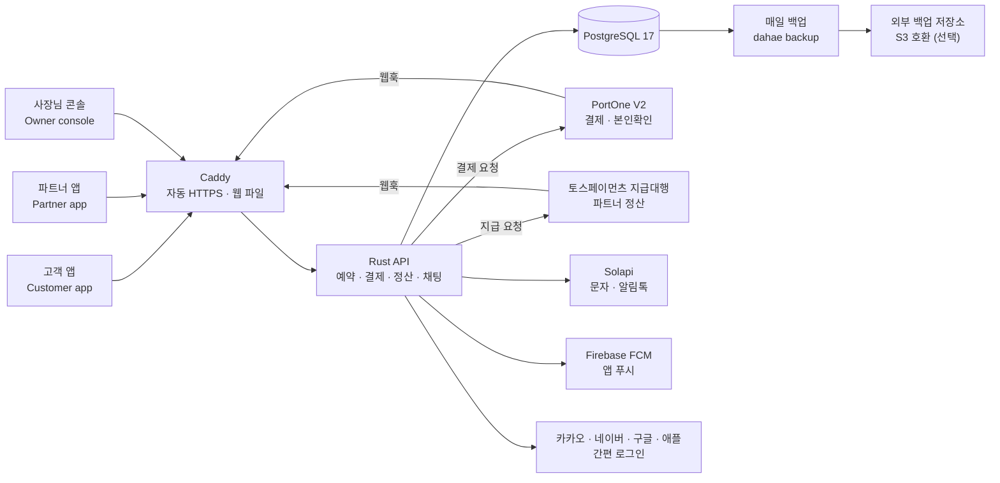

## 문서 / Documentation

| 문서 | 무엇이 들어 있나요 |
|---|---|
| [기능 카탈로그](docs/FEATURES.md) | 고객, 파트너, 사장님, 시스템이 하는 일을 기능별로 정리하고, 코드 위치와 알려진 한계를 적었어요 (한국어·영어) |
| [아키텍처](docs/ARCHITECTURE.md) | 구성 요소, 요청과 데이터 흐름, 배포 구조, 현재 상태 (영어 본문, [한국어 요약](docs/ARCHITECTURE.ko.md)) |
| [보안과 개인정보](docs/SECURITY-AND-PRIVACY.md) | 신뢰 경계, 인증, 권한, 암호화, 개인정보 흐름, 알려진 공백 (한국어·영어) |
| [보안 정책](SECURITY.md) | 취약점 신고 방법과 범위 |
| [운영 가이드](docs/OPERATIONS.md) | 설치 뒤 할 일, `dahae` 명령, 백업, 업데이트와 채널 (한국어·영어) |
| [장애 대응 런북](docs/RUNBOOK.md) | 증상별 첫 확인 순서와 복구 절차 (한국어·영어) |
| [품질과 검사](docs/QUALITY.md) | 테스트 구성과 수, CI 게이트, 릴리스 파이프라인, 알려진 공백 |
| [API 색인](docs/api/README.md) | 경로 목록과 공통 규칙 (멱등성, 오류 형식, 버전) |
| [클라우드 배포 안내](docs/guide/08-클라우드-배포.md) | 내 클라우드 계정에 서버를 만들고, 도메인을 연결하고, 설치하고, 외부 백업을 붙이는 순서 (한국어·영어) |
| [안내서 모음](docs/guide/README.ko.md) | 사장님과 설치 담당을 위한 단계별 안내서 (한국어) |
| [배포 상세](docs/DEPLOY.md) | 배포와 운영 절차 세부 |
| [라이선스](LICENSE), [제3자 고지](THIRD_PARTY_NOTICES.md) | 사용 조건과 포함된 외부 구성요소의 라이선스 |

## 자주 묻는 질문

**Q. 비용은 얼마나 드나요?**
서버와 도메인 비용은 업체 요금표를 따라요. 결제 수수료와 문자·알림톡 요금은 각 회사(PortOne, Solapi 등)의 요금표를 따라요. 이 프로그램의 사용 조건은 저장소의 [LICENSE](LICENSE)를 보고, 도입 전에 개발자와 따로 확인하세요.

**Q. 설치하기 전에 무엇을 신청해야 하나요?**
- **사업자등록증과 통신판매업 신고증**: 사업장 정보와 결제 심사에 필요해요.
- **PortOne (결제)**: 가입하고 PG사 심사를 받아요. 심사 기간은 회사 기준이에요.
- **Solapi (문자)**: 가입하고 발신번호를 등록해요. 알림톡을 쓰려면 카카오 비즈니스 채널과 템플릿 승인도 필요해요 ([06번 안내서](docs/guide/06-알림톡-템플릿-등록.md)).
- **토스페이먼츠 지급대행**: 파트너 정산을 자동으로 지급할 때만 필요해요. 기본은 직접 이체예요.
- **Firebase, 카카오·네이버·구글·애플 개발자 계정**: 앱 푸시와 간편 로그인을 쓸 때만 필요해요.

자세한 순서와 준비물은 [설정 마법사](docs/guide/02-설정-마법사.md)에 있어요.

**Q. 업데이트는 어떻게 되나요?**
매주 월요일 새벽 4시에 자동으로 업데이트해요. 업데이트 전에 백업을 먼저 하고, 새 버전이 응답하지 않으면 이전 버전으로 자동으로 되돌려요. 직접 하려면 서버에서 `sudo dahae update`, 되돌리려면 `sudo dahae rollback` 을 입력해요.

**Q. 백업은 어떻게 되나요?**
- 매일 새벽 3시 30분에 서버 안에 백업하고 14일 동안 보관해요.
- 외부 저장소(S3 호환)를 연결하면 매일 암호화된 백업을 한 부 더 보관해요.
- 백업 파일은 서버의 `/opt/malkkeum/.env` 안의 `DATA_KEY`로 암호화돼요. **이 파일을 따로 안전한 곳에 보관해 두세요.** 이 파일이 없으면 백업을 열 수 없어요. `sudo dahae keys-backup` 은 이 파일을 비밀번호로 잠근 사본을 만들어요.

**Q. 서버가 고장 나면 어떻게 하나요?**
새 서버를 빌려 같은 방식으로 설치한 뒤, 보관해 둔 `.env` 파일과 외부 백업으로 되살려요 (`sudo dahae restore-offsite`). 외부 백업이 없으면 서버 안 백업만 남아 있어요. 그래서 외부 저장소 연결을 권해요. 서버가 꺼졌을 때 알림을 받으려면 `dahae heartbeat` 로 외부 가동 확인 주소를 연결하세요 ([7. 운영 명령어](docs/guide/07-운영-명령어.md)).

**Q. 고객 앱과 파트너 앱은 어떻게 배포하나요?**
사장님 회사 이름으로 App Store와 Google Play에 올려요. 절차는 [3. 앱 출시](docs/guide/03-앱-출시.md)에 있어요.

## 문제가 생겼을 때

| 증상 | 해결 |
|---|---|
| 설치 중 "80/443 포트를 다른 프로그램이 쓰고 있어요" | [0번 안내서 문제 표](docs/guide/00-한번에-설치.md#문제가-생기면)를 보고 다른 웹 서버를 끄세요 |
| 주소를 열면 "안전하지 않음" | 도메인 연결이 아직 반영되지 않았어요. 10~30분 뒤 다시 열어 보세요. |
| 사이트가 열리지 않아요 | 서버에서 `sudo dahae status`, `sudo dahae logs` 를 입력하세요 ([7. 운영 명령어](docs/guide/07-운영-명령어.md)) |
| 업데이트 뒤에 이상해요 | `sudo dahae rollback` 으로 이전 버전으로 돌아가세요 |
| 결제 카드에 "연결됨"이 안 나와요 | [결제 연동 설정 가이드](docs/guide/payments-setup.md) 3번 웹훅 점검을 해 보세요 |

운영 방법 전체는 [docs/DEPLOY.md](docs/DEPLOY.md)에 있어요.

## 안내서 모음

설치와 운영 안내서는 [docs/guide/README.ko.md](docs/guide/README.ko.md)에 한 줄 설명과 함께 모아 두었어요.

## 개발자용

**필요한 것:** Rust 1.99.1 (`backend/rust-toolchain.toml`), Flutter 3.47.9 (`.github/actions/flutter-setup`), PostgreSQL 17, Python 3.11 이상

```bash
# 서버: backend/.env 에 DATABASE_URL, JWT_SECRET, DATA_KEY, PUBLIC_BASE_URL, DEV_MODE=1 을 넣고
cd backend && cargo run -p api          # 마이그레이션을 적용하고 :8080 에서 실행

# 앱
cd app && flutter pub get
cd apps/customer && flutter run --dart-define=API_BASE=http://localhost:8080
```

- 구조: `app/` (Flutter: customer, partner, console 앱과 `packages/`), `backend/` (Rust API), `deploy/` (설치 프로그램, Docker, Caddy), `website/`, `docs/`
- 테스트와 검사 명령은 [CONTRIBUTING.md](CONTRIBUTING.md)에 있어요. CI는 `.github/workflows/ci.yml`에서 돌아요.

## 기여와 보안

- 기여 방법: [CONTRIBUTING.md](CONTRIBUTING.md)
- 보안 문제는 공개 이슈로 올리지 마세요. 저장소의 **Security → Report a vulnerability** 또는 [직접 신고 양식](https://github.com/EricWijesinghe/Dahae/security/advisories/new)을 쓰세요. 자세한 내용은 [SECURITY.md](SECURITY.md)에 있어요.

## 라이선스

이 소프트웨어는 저작권자 Eric Wijesinghe(EricWijesinghe@hotmail.com)의 독점 소프트웨어이며, 모든 권리는 저작권자에게 있습니다. 소프트웨어와 소스 코드, 디자인, 로고, 문서의 권리와 저작권자가 만든 모든 개선물은 저작권자에게 있어요. 사용 권리는 저작권자와 맺은 서면 라이선스 계약으로만 주어집니다.

- 라이선스 조건: [LICENSE](LICENSE) (정본은 영문이며 파일 상단에 한국어 요약이 있어요)
- 소유권 고지: [NOTICE](NOTICE)
- 상업 라이선스 계약서 양식: [docs/legal/COMMERCIAL-LICENSE-AGREEMENT.md](docs/legal/COMMERCIAL-LICENSE-AGREEMENT.md) (서명 전 변호사 검토 필요)
- 법적 문서 안내: [docs/legal/README.md](docs/legal/README.md)
- 제3자 구성요소와 각 라이선스: [THIRD_PARTY_NOTICES.md](THIRD_PARTY_NOTICES.md)
- '다해'와 'Dahae' 이름과 로고는 저작권자의 상표(™)이며 라이선스로 부여되지 않아요.
- 소스 코드는 공개로 볼 수 있지만, 보거나 복제해도 라이선스가 부여되지 않아요 (LICENSE 1.4조 및 3.1조).
- 라이선스 문의와 사용 허가 요청: EricWijesinghe@hotmail.com

<p align="center">© 2026 Eric Wijesinghe</p>
