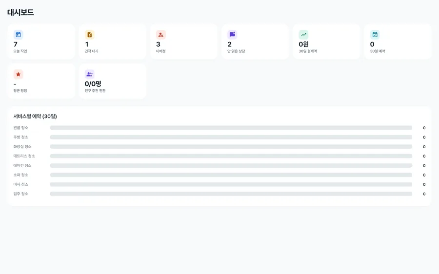
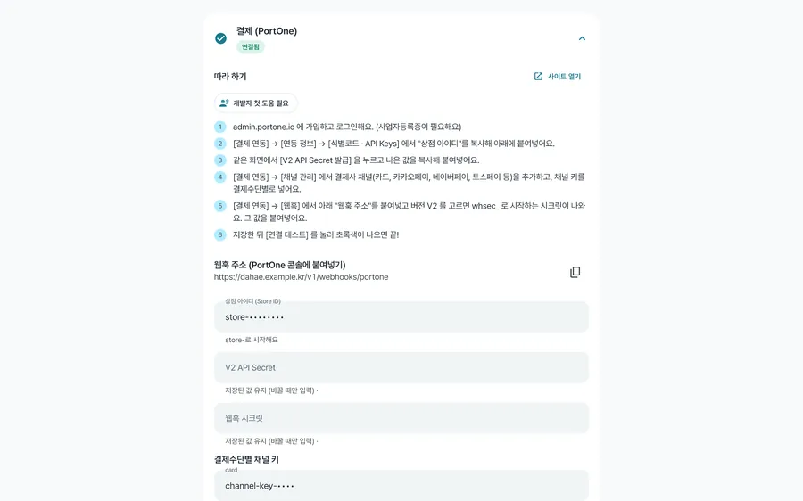
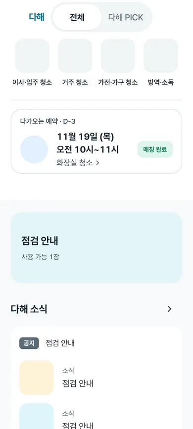
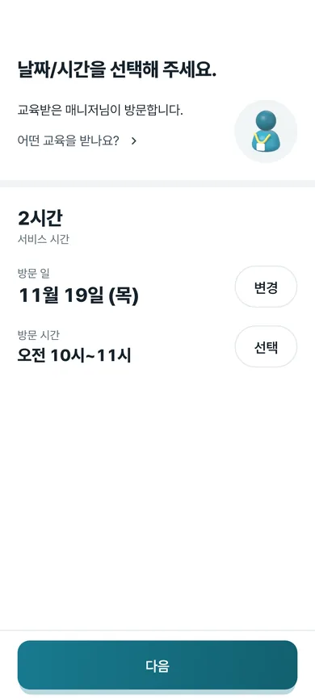
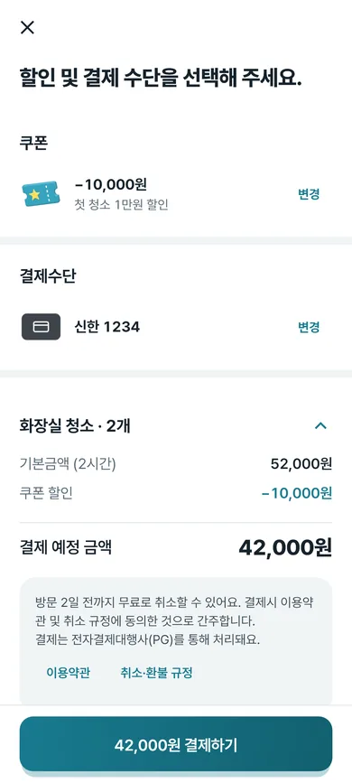
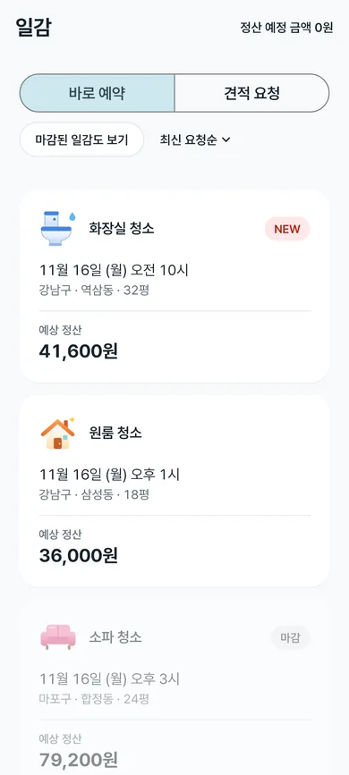
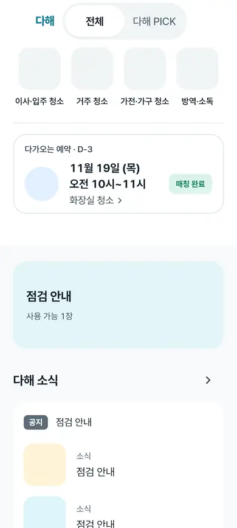
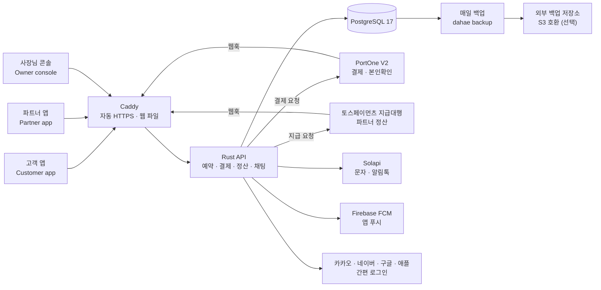
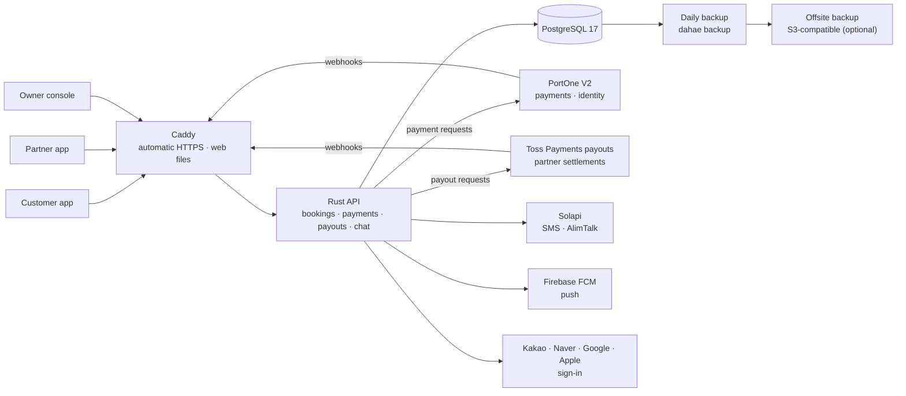

<p align="center">
  
</p>

<p align="center">
  <b>한국어</b> · <a href="#english">English</a>
</p>

<p align="center">
  <a href="https://github.com/EricWijesinghe/Dahae/actions/workflows/ci.yml"></a>
  <a href="LICENSE"></a>
  
  
</p>

<h1 align="center">다해 (Dahae)</h1>

<p align="center"><b>예약, 결제, 파트너 정산, 백업까지. 집청소 회사를 운영하는 사장님이 자기 서버에 직접 설치하는 집청소 플랫폼이에요.</b></p>

---

## 누구를 위한 프로그램인가요

| 대상 | 얻는 것 |
|---|---|
| **고객** | 앱에서 서비스와 가격을 보고, 날짜를 고르고, 결제하고, 청소가 어디까지 왔는지 봐요. 채팅으로 상담도 해요. |
| **파트너 (청소 기사)** | 배정된 일감을 보고, 현장에서 출근 체크인을 하고, 정산 내역을 확인해요. 팀원도 전화번호로 초대할 수 있어요. |
| **사장님** | 웹 콘솔에서 견적과 예약을 처리하고, 파트너를 배정하고, 결제와 정산을 확인해요. 백업과 자동 업데이트는 서버가 알아서 해요. |

## 우리 회사에 설치하기 (3단계)

<details open>
<summary><b>1단계. 서버와 도메인 빌리기</b></summary>

- 서버 임대 회사에서 **Ubuntu 24.04, CPU 2개, 메모리 4 GB** 서버를 빌려요. 메모리 2 GB 가 최소예요.
- 비용은 대략 **서버 월 1.5~3만 원**, **도메인(예: `myshop.co.kr`) 연 1~2만 원**이에요. 회사와 시기에 따라 달라요.
- 서버 방화벽에서 **22, 80, 443 포트**를 열어요.
- 자세히: [0. 한 번에 설치하기](docs/guide/00-한번에-설치.md) ①②

</details>

<details open>
<summary><b>2단계. 설치 명령 한 줄 붙여넣기</b></summary>

서버의 검은 화면(브라우저 SSH 연결)에 아래 한 줄을 붙여넣고, 도메인과 이메일을 입력해요. 설치 주소는 개발자가 알려 줘요.

```bash
curl -fsSL <설치 주소> | sudo bash
```

검은 화면이 어렵다면, 개발자가 주는 설치 페이지로 설치 내용을 만들어 서버 만들기 화면에 붙여넣는 방법도 있어요 ([0번 안내서](docs/guide/00-한번에-설치.md)의 "다른 방법").

끝나면 `https://도메인/admin/` 주소와 **설치 코드**가 나와요. 브라우저에서 그 주소를 열고, 설치 코드로 사장님 계정을 만들어요. 처음 로그인하면 2단계 인증(휴대폰 인증 앱)을 설정해요.



- 자세히: [0. 한 번에 설치하기](docs/guide/00-한번에-설치.md) ③④, [1. 서버 설치 (자세히)](docs/guide/01-서버-설치.md)

</details>

<details open>
<summary><b>3단계. 설정 마법사로 회사 정보와 연동 키 넣기</b></summary>

콘솔의 **[설정]** 메뉴에서 카드를 위에서부터 하나씩 채워요.

1. **사업장 정보**: 상호, 대표, 사업자 정보, 대표 색과 로고
2. **결제 (PortOne)**: 상점 아이디, API 시크릿, 채널 키, 웹훅 시크릿을 붙여넣고 저장해요. 저장한 키는 암호화되어 서버에 보관돼요.
3. **문자 · 알림톡 (Solapi)**: API 키와 발신번호
4. **로그인과 앱 푸시**: 카카오, 네이버, 구글, 애플, Firebase (쓰는 것만)
5. **백업**: 외부 저장소를 연결하면 매일 암호화된 백업을 한 부 더 보관해요. 안 해도 서버 안 백업(14일)은 계속돼요.

카드마다 **[연결 테스트]**가 자동으로 돌아서, 초록색 "연결됨"이 나오면 끝이에요.

<p align="center"><br><sub>결제 연동 카드 (데모 데이터)</sub></p>

- 자세히: [2. 설정 마법사](docs/guide/02-설정-마법사.md), [결제 연동 설정 가이드](docs/guide/payments-setup.md), [6. 알림톡 템플릿 등록](docs/guide/06-알림톡-템플릿-등록.md)

</details>

## 화면 미리보기

실제 앱과 콘솔 화면을 캡처한 이미지예요. 화면의 가게 소식, 예약, 주소, 이름, 매출과 평점은 모두 **데모 데이터**예요.

**고객 앱**

<table>
  <tr>
    <td align="center"><br><sub>홈</sub></td>
    <td align="center"><br><sub>서비스 고르기</sub></td>
    <td align="center"><br><sub>예약</sub></td>
    <td align="center"><br><sub>결제</sub></td>
    <td align="center"><br><sub>진행 상황</sub></td>
  </tr>
</table>

**파트너 앱**

<table>
  <tr>
    <td align="center"><br><sub>일감 목록</sub></td>
    <td align="center"><br><sub>일감 상세 · 출근 체크인</sub></td>
  </tr>
</table>

**사장님 콘솔**

<table>
  <tr>
    <td align="center"><br><sub>대시보드 (데모 데이터)</sub></td>
  </tr>
</table>

**예약 흐름 (고객 앱, 화면 5장을 이어 붙인 미리보기)**

<p align="center"></p>

## 주요 기능

### 예약
- 서비스마다 정해진 가격과 카탈로그 기준 가격 계산
- 이사·입주 청소는 견적을 받고, 예약금(견적의 10%)을 먼저 받아요
- 예약 일정 변경과 취소 (취소 정책에 따른 환불 계산)
- 대기 명단, 정기 구독과 자동 갱신, 성수기 요금, 팁

### 결제와 정산
- PortOne V2 결제: 카드, 간편결제, 계좌이체, 가상계좌 (채널 설정에 따라 켜고 꺼요)
- 서명을 확인한 웹훅 수신과 결제 대사 (맞지 않는 결제를 찾아줘요)
- 현금영수증과 세금계산서 발행
- 포인트와 쿠폰
- 파트너 정산: 기본은 사장님이 은행 앱으로 직접 이체하고 완료를 기록해요. 토스페이먼츠 지급대행을 연결하면 자동 지급도 할 수 있어요.
- 부가세와 원천징수 내보내기 (CSV)

### 직원과 품질
- 직원 계정과 2단계 인증 (휴대폰 인증 앱)
- 파트너 팀원 초대 (전화번호로 초대하고, 배정된 일감만 보여요)
- 평점과 품질 기록, 노쇼 관리
- 활동 기록 (감사 로그)

### 보안과 개인정보
- 연동 키와 민감한 값은 암호화해서 보관해요
- 인증 코드 요청과 로그인 시도 횟수를 제한하고, 실패가 반복되면 점점 길게 잠가요
- 웹훅 서명 검증, 요청 중복 방지
- 개인정보 열람과 삭제 요청 처리, 탈퇴 때 간편 로그인 연결 해제
- 보관 기간 설정, 암호 유출 목록 검사

### 백업과 운영
- 매일 새벽 3시 30분 서버 백업 (14일 보관)
- 외부 저장소(S3 호환)에 암호화 백업 보관. 서버를 잃어도 `.env` 파일과 함께 복구할 수 있어요.
- 매주 월요일 새벽 4시 자동 업데이트. 업데이트 전에 백업하고, 실패하면 이전 버전으로 되돌려요.
- 서명된 컨테이너 이미지, 자동 HTTPS 인증서 (Caddy)
- `dahae` 명령: 상태 확인, 로그, 백업, 복구, 업데이트, 되돌리기, 외부 가동 확인
- 한국어와 영어 화면 (서버가 보내는 문자와 알림도 받는 사람의 언어로 보내요)

### 대화와 알림
- 고객, 파트너, 사장님 사이 실시간 채팅과 견적 카드
- 앱 푸시 (FCM), 문자 (Solapi SMS), 카카오 알림톡
- **상담 도우미 (선택 기능)**: 직원이 없을 때, 또는 설정에 따라 항상 먼저, 고객 채팅에 답해요. 끄는 것도 설정에서 해요.
  - 답을 만들기 위해 고객이 채팅에 쓴 내용이 미국에 있는 외부 서비스로 전송돼요. 그래서 고객에게 **국외 이전 동의**를 받고, 동의하지 않으면 이 기능을 쓸 수 없어요.
  - 자세한 내용은 [개인정보 처리방침](website/privacy.html)의 국외 이전 항목을 보세요.

## 구조



## 자주 묻는 질문

**Q. 비용은 얼마나 드나요?**
서버 월 1.5~3만 원, 도메인 연 1~2만 원 정도예요 (대략). 결제 수수료와 문자·알림톡 요금은 각 회사(PortOne, Solapi 등)의 요금표를 따라요. 이 프로그램의 사용 조건은 저장소의 [LICENSE](LICENSE)를 보고, 도입 전에 개발자와 따로 확인하세요.

**Q. 설치하기 전에 무엇을 신청해야 하나요?**
- **사업자등록증과 통신판매업 신고증**: 사업장 정보와 결제 심사에 필요해요.
- **PortOne (결제)**: 가입하고 PG사 심사를 받아요. 심사에 보통 3~10일 걸려요.
- **Solapi (문자)**: 가입하고 발신번호를 등록해요. 1~2일 걸려요. 알림톡을 쓰려면 카카오 비즈니스 채널과 템플릿 승인도 필요해요 ([06번 안내서](docs/guide/06-알림톡-템플릿-등록.md)).
- **토스페이먼츠 지급대행**: 파트너 정산을 자동으로 지급할 때만 필요해요. 기본은 직접 이체예요.
- **Firebase, 카카오·네이버·구글·애플 개발자 계정**: 앱 푸시와 간편 로그인을 쓸 때만 필요해요.

자세한 순서와 준비물은 [설정 마법사](docs/guide/02-설정-마법사.md)에 있어요.

**Q. 업데이트는 어떻게 되나요?**
매주 월요일 새벽 4시에 자동으로 업데이트해요. 업데이트 전에 백업을 먼저 하고, 새 버전이 응답하지 않으면 이전 버전으로 자동으로 되돌려요. 직접 하려면 서버에서 `sudo dahae update`, 되돌리려면 `sudo dahae rollback` 을 입력해요.

**Q. 백업은 어떻게 되나요?**
- 매일 새벽 3시 30분에 서버 안에 백업하고 14일 동안 보관해요.
- 외부 저장소(S3 호환)를 연결하면 매일 암호화된 백업을 한 부 더 보관해요.
- 백업 파일은 서버의 `/opt/malkkeum/.env` 안의 `DATA_KEY`로 암호화돼요. **이 파일을 따로 안전한 곳에 보관해 두세요.** 이 파일이 없으면 백업을 열 수 없어요.

**Q. 서버가 고장 나면 어떻게 하나요?**
새 서버를 빌려 같은 방식으로 설치한 뒤, 보관해 둔 `.env` 파일과 외부 백업으로 되살려요 (`sudo dahae restore-offsite`). 외부 백업이 없으면 서버 안 백업만 남아 있어요. 그래서 외부 저장소 연결을 권해요. 서버가 꺼졌을 때 알림을 받으려면 `dahae heartbeat` 로 외부 가동 확인 주소를 연결하세요 ([7. 운영 명령어](docs/guide/07-운영-명령어.md)).

**Q. 고객 앱과 파트너 앱은 어떻게 배포하나요?**
사장님 회사 이름으로 App Store와 Google Play에 올려요. 절차는 [3. 앱 출시](docs/guide/03-앱-출시.md)에 있어요.

## 문제가 생겼을 때

| 증상 | 해결 |
|---|---|
| 설치 중 "80/443 포트를 다른 프로그램이 쓰고 있어요" | [0번 안내서 문제 표](docs/guide/00-한번에-설치.md#문제가-생기면)를 보고 다른 웹 서버를 끄세요 |
| 주소를 열면 "안전하지 않음" | 도메인 연결이 아직 반영되지 않았어요. 10~30분 뒤 다시 열어 보세요. |
| 사이트가 열리지 않아요 | 서버에서 `sudo dahae status`, `sudo dahae logs` 를 입력하세요 ([7. 운영 명령어](docs/guide/07-운영-명령어.md)) |
| 업데이트 뒤에 이상해요 | `sudo dahae rollback` 으로 이전 버전으로 돌아가세요 |
| 결제 카드에 "연결됨"이 안 나와요 | [결제 연동 설정 가이드](docs/guide/payments-setup.md) 3번 웹훅 점검을 해 보세요 |

운영 방법 전체는 [docs/DEPLOY.md](docs/DEPLOY.md)에 있어요.

## 안내서 모음

설치와 운영 안내서는 [docs/guide/README.md](docs/guide/README.md)에 한 줄 설명과 함께 모아 두었어요.

## 개발자용

**필요한 것:** Rust 1.99.1 (`backend/rust-toolchain.toml`), Flutter 3.47.9 (`.github/actions/flutter-setup`), PostgreSQL 17, Python 3.11 이상

```bash
# 서버: backend/.env 에 DATABASE_URL, JWT_SECRET, DATA_KEY, PUBLIC_BASE_URL, DEV_MODE=1 을 넣고
cd backend && cargo run -p api          # 마이그레이션을 적용하고 :8080 에서 실행

# 앱
cd app && flutter pub get
cd apps/customer && flutter run --dart-define=API_BASE=http://localhost:8080
```

- 구조: `app/` (Flutter: customer, partner, console 앱과 `packages/`), `backend/` (Rust API), `deploy/` (설치 프로그램, Docker, Caddy), `website/`, `docs/`
- 테스트와 검사 명령은 [CONTRIBUTING.md](CONTRIBUTING.md)에 있어요. CI는 `.github/workflows/ci.yml`에서 돌아요.

## 기여와 보안

- 기여 방법: [CONTRIBUTING.md](CONTRIBUTING.md)
- 보안 문제는 공개 이슈로 올리지 마세요. 저장소의 **Security → Report a vulnerability** 를 쓰거나, 아래 연락처로 알려 주세요. 자세한 내용은 [SECURITY.md](SECURITY.md)에 있어요.
  - 보안 문의 연락처: `[운영자가 채울 연락처]`

## 라이선스

Proprietary. All rights reserved. 자세한 내용은 [LICENSE](LICENSE)를 보세요.

---

<a id="english"></a>

<p align="center">
  <a href="#다해-dahae">한국어</a> · <b>English</b>
</p>

# Dahae (다해), English

**Bookings, payments, partner payouts and backups for a home-cleaning business. Each owner runs it on their own server.**

Dahae is a home-services platform for the Korean market. It has a customer app, a partner (cleaner) app, a web owner console and a Rust API. A business installs it on its own Linux server with one command, then fills in its payment and messaging keys in a setup wizard.

Screenshots use demo data: sample shop news, bookings, names and dashboard figures.

## Who it is for

| Who | What they get |
|---|---|
| **Customers** | Browse services and prices, book a date, pay in the app, follow the job's progress, and chat with the team. |
| **Partners (cleaners)** | See assigned jobs, check in on site, review settlements. Team members can be invited by phone number. |
| **Owner** | Handle quotes and bookings in a web console, assign partners, check payments and payouts. Backups and weekly updates run on the server. |

## Set up for your company in 3 steps

1. **Rent a server and a domain.** Ubuntu 24.04 with 2 vCPU and 4 GB RAM (2 GB minimum). Roughly KRW 15,000–30,000 per month for the server and KRW 10,000–20,000 per year for a domain. Prices vary by provider. Open ports 22, 80 and 443. See [guide 0](docs/guide/00-한번에-설치.md) (Korean).
2. **Run the installer.** Paste one command on the server, `curl -fsSL <install address> | sudo bash`, where the install address comes from the developer, then enter your domain and an email. If a black terminal is hard to use, the developer can give you an install page that builds the same setup for pasting into the server's "user data" box when you create it (see the "other way" section of [guide 0](docs/guide/00-한번에-설치.md)). Open `https://your-domain/admin/` and create the owner account with the setup code the installer prints. See [guide 0](docs/guide/00-한번에-설치.md) and [guide 1](docs/guide/01-서버-설치.md) (Korean).
3. **Use the setup wizard.** In the console, open **[Settings]** and fill in business details, PortOne payments (paste the keys and save; they are stored encrypted), Solapi SMS, social sign-in, Firebase push and an optional offsite backup. Each card runs a connection test when you save. See [the setup wizard guide](docs/guide/02-설정-마법사.md) (Korean) and [payment setup](docs/guide/payments-setup.md) (bilingual).

## Features

- **Booking:** fixed prices from the catalogue, quotes for move-in and move-out with a 10% deposit, rescheduling, cancellation with refunds under the cancellation policy, waitlist, subscriptions with renewals, peak pricing, tips.
- **Payments and payouts:** PortOne V2 checkout (cards, easy-pay, bank transfer, virtual account; channels set per method), signed webhooks, payment reconciliation, cash receipts, tax invoices, points and coupons. Partner payouts are recorded manually by default, or sent automatically through Toss Payments payouts. VAT and withholding exports as CSV.
- **Staff and quality:** staff accounts with two-factor sign-in (TOTP), lockout after repeated failures, partner team invites by phone, ratings and quality records, no-show tracking, audit log.
- **Security and privacy:** encrypted storage of integration keys, rate limits and escalating lockouts on sign-in and codes, signature checks on webhooks, privacy requests, account deletion that also unlinks social sign-in, retention settings, a breached-password check.
- **Backups and operations:** daily server backup at 03:30 (14 days kept), encrypted offsite backup to any S3-compatible bucket, weekly automatic update at Monday 04:00 with backup first and rollback if the new version does not respond, signed container images, automatic HTTPS (Caddy), the `dahae` command (status, logs, backup, restore, update, rollback, heartbeat).
- **Messaging:** real-time chat with quote cards, app push (FCM), SMS and KakaoTalk AlimTalk through Solapi, Korean and English.
- **Support helper (optional):** answers customer chat when staff are away, or first when the owner chooses. It can be turned off in settings. Chat text is sent to a US-based external service to produce replies, so customers are asked for consent to cross-border transfer. See the [privacy policy](website/privacy.html).

## System overview



## FAQ

**What does it cost?** Roughly KRW 15,000–30,000 per month for a server and KRW 10,000–20,000 per year for a domain. Payment fees and SMS charges follow the rates of PortOne, Solapi and the other providers. For the terms of use of this software, read [LICENSE](LICENSE) and confirm with the developer before you adopt it.

**What do I need to sign up for?** A business registration and mail-order sales registration (needed for the business details and payment review); a PortOne account with payment-channel review (3–10 days); a Solapi account with a registered sender number (1–2 days), plus a KakaoTalk business channel if you use AlimTalk; a Toss Payments payouts contract only if you want automatic payouts; Firebase and social sign-in developer accounts only if you use push or social sign-in. See [guide 2](docs/guide/02-설정-마법사.md) (Korean).

**How do updates work?** The server updates itself every Monday at 04:00. It backs up first and rolls back if the new version does not respond. You can run `sudo dahae update` or `sudo dahae rollback` yourself.

**How do backups work?** A backup runs daily at 03:30 and is kept for 14 days on the server. If you connect an S3-compatible bucket, an encrypted copy is also stored there every day. Backups are encrypted with the `DATA_KEY` in `/opt/malkkeum/.env`, so keep a copy of that file somewhere safe.

**What if the server breaks?** Rent a new server, install the same way, then restore with the saved `.env` file and an offsite backup (`sudo dahae restore-offsite`). Without the `.env` file, backups cannot be opened. Connect a heartbeat URL with `dahae heartbeat` to be told when the server goes down.

## Troubleshooting

Use `sudo dahae status` and `sudo dahae logs` on the server first. The guides are in [docs/guide/README.md](docs/guide/README.md) (Korean; English titles listed there). Operations details are in [docs/DEPLOY.md](docs/DEPLOY.md).

## Developer section

Requirements: Rust 1.99.1 (`backend/rust-toolchain.toml`), Flutter 3.47.9 (`.github/actions/flutter-setup`), PostgreSQL 17, Python 3.11+.

```bash
cd backend && cargo run -p api          # applies migrations, serves on :8080
cd app && flutter pub get && cd apps/customer && flutter run --dart-define=API_BASE=http://localhost:8080
cd backend && cargo clippy --all-targets -- -D warnings && cargo test
```

Layout: `app/` (Flutter workspace: customer, partner and console apps, shared packages), `backend/` (Rust workspace), `deploy/` (installer, Docker Compose, Caddy), `website/`, `docs/`. Full check list: [CONTRIBUTING.md](CONTRIBUTING.md). CI: `.github/workflows/ci.yml`.

## Contributing and security

- Contributing: [CONTRIBUTING.md](CONTRIBUTING.md)
- Security: report privately through **Security → Report a vulnerability** on this repository, or contact `[maintainer to fill in]`. See [SECURITY.md](SECURITY.md).

## License

Proprietary. All rights reserved. See [LICENSE](LICENSE).

<p align="center"><a href="#다해-dahae">Back to 한국어</a></p>
