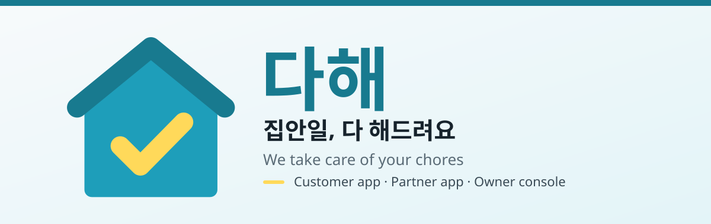
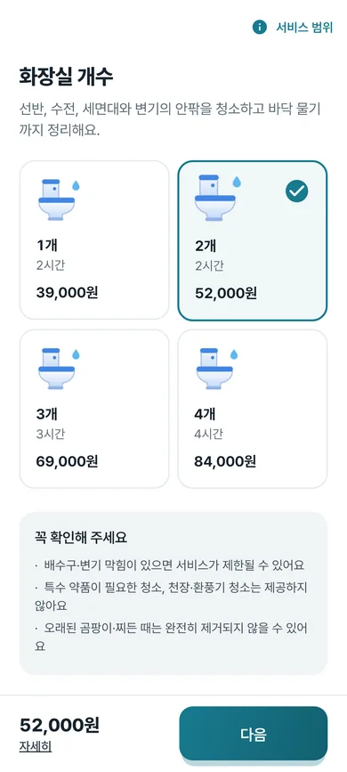
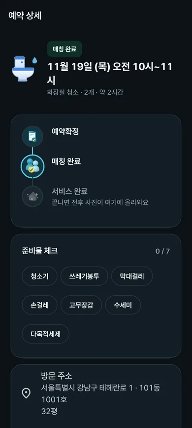
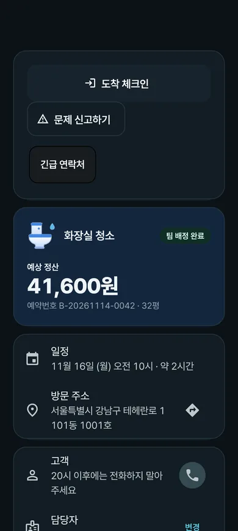
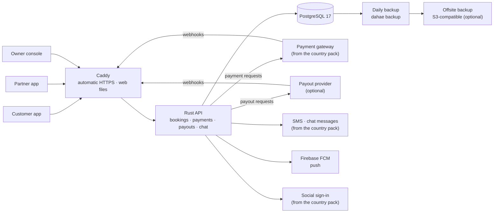

<p align="center">
  
</p>

<p align="center">
  <b>English</b> · <a href="README.ko.md">한국어</a>
</p>

<p align="center">
  <a href="https://github.com/EricWijesinghe/Dahae/actions/workflows/ci.yml"></a>
  <a href="LICENSE"></a>
  
  
</p>

<h1 align="center">Dahae</h1>

<p align="center"><b>A home-services booking platform you install on your own server: bookings, payments, partner payouts, chat and backups in one package.</b></p>

<p align="center">Country packs: <b>Korea (available)</b> · UK, Ireland, Australia, New Zealand, Singapore (planned)</p>

---

## What Dahae is

Dahae is a complete booking system for a home-services business, such as home cleaning, appliance cleaning or move-in and move-out cleaning. The business runs it on a Linux server it rents itself, so its customer data stays on its own machine. One install gives you:

| Who | What they get |
|---|---|
| **Customers** | A mobile app and web app: browse services and prices, pick a date, pay, follow the job's progress and chat with the team. |
| **Partners (the people who do the work)** | A partner app: see assigned jobs, check in on site, send quotes, review payouts. Team members can be invited by phone number. |
| **The owner** | A web console: handle quotes and bookings, assign partners, check payments and payouts, set prices and business details. Backups and updates run on the server by themselves. |

## Country packs

A country pack holds what differs from one country to the next: payment gateways, SMS and chat messaging, social sign-in, address search, currency and tax rules, business identifiers, legal templates and languages. Since 1.6.6 the Korean rules (VAT and withholding rates, rounding, cancellation defaults, consent kinds, banks, service areas) live in a built-in Korea pack that the server checks when it starts. There is no country choice yet: every install runs the Korea pack, in Korean won, on Korea time. When more packs ship, the owner will pick the country in the setup wizard.

| Country | Status | What the pack covers |
|---|---|---|
| **Korea (KR)** | **Available** | PortOne V2 and Toss Payments checkout, Toss Payments payouts, Solapi SMS and KakaoTalk AlimTalk, Kakao, Naver, Google and Apple sign-in, PASS identity check, Korean VAT and withholding exports, Korean legal templates, Korean and English screens |
| UK, Ireland, Australia, New Zealand, Singapore | **Planned** | Not built yet. Their providers are being chosen; nothing here works for these countries today. |

An existing server records its country facts once (country, currency, time zone, languages, and the time of its first live payment, which will lock the country once a country choice exists); a fresh install leaves them for the setup wizard's future country step. What is built and what is planned is in [Architecture §9](docs/ARCHITECTURE.md#9-country-packs-roadmap). Countries are added one pack at a time, and a pack is listed as available only once it ships in a release.

## Editions

Dahae is the international edition: English first, with countries added as packs. A server follows one signed release stream, called an edition. The installer carries a signed edition table: `dahae` is the default and the one every server follows unless told otherwise; `uzipsa` is a separate Korea-first edition, offered only to the servers listed for it. Details: [Deployment §12](docs/DEPLOY.md#12-editions).

## Install in one command

1. **Rent a server and a domain.** Ubuntu 24.04 (22.04 and Debian 12 also work). 2 vCPU and 4 GB RAM are recommended; the installer needs at least 1 GB. Open ports 22, 80 and 443 in the provider's firewall.
2. **Run the installer** in the server's terminal (most providers have a "browser SSH" button) and answer two questions, your domain and an email address:

   ```bash
   curl -fsSL <install address> | sudo bash
   ```

   The install address comes with your licence. No terminal? The install page builds the same setup as "user data" that you paste into the provider's server-creation screen, and the install starts as soon as the server boots.
3. **Create the owner account.** The installer prints `https://your-domain/admin/` and a one-time **setup code**. Open the address, enter the code, and set up two-factor sign-in with an authenticator app.

Step by step: [Install in one go](docs/guide/00-install.md). The installer's own messages are in Korean today; English messages come with the first pack outside Korea.

## Set up in the browser

Everything after the install is done in the console, not in files or the terminal. Open **Settings** and fill the cards from top to bottom:

1. **Business details:** name, brand colour, logo and the business information your country requires on the website.
2. **Payments:** paste the gateway keys and save. Keys are stored encrypted, and saving or unlocking a payment key needs the owner's two-factor code.
3. **Messaging, sign-in and push:** SMS and chat-message keys, social sign-in, Firebase push (only the ones you use).
4. **Offsite backup (optional):** any S3-compatible bucket gets an encrypted copy every day.

Each card has a **connection test**; a green "Connected" means it works. Guide: [Setup wizard](docs/guide/02-setup-wizard.md).

<p align="center"><br><sub>A payment card in Settings (Korea pack, demo data)</sub></p>

## Automatic updates

- The server updates itself every Monday at 04:00. It takes a backup first and rolls back by itself if the new version does not answer.
- Images are signed, and the installer and the updater check the signature before running anything.
- The owner can also press **Update now** in the console, or run `sudo dahae update` and `sudo dahae rollback` on the server.
- A daily backup runs at 03:30 and is kept for 14 days on the server.

## Security

- Integration keys (payments, messaging, sign-in, push) are stored encrypted (AES-256-GCM) and locked after saving.
- Staff accounts use TOTP two-factor sign-in, with escalating lockouts after repeated failures. Sign-in and code requests are rate limited.
- Payment and payout webhooks are signature-checked, and money moves only after the server confirms the payment with the gateway.
- Customers' access and deletion requests, and retention periods, are handled in the system.
- Controls, the code behind each one, and the known gaps: [Security and privacy](docs/SECURITY-AND-PRIVACY.md). To report a vulnerability, see [SECURITY.md](SECURITY.md).

## Screenshots

Captured from the real apps with the Korea pack and **demo data**: the shop news, bookings, addresses, names, sales and ratings are all samples.

<table>
  <tr>
    <td align="center"><br><sub>Home</sub></td>
    <td align="center"><br><sub>Choose a service</sub></td>
    <td align="center"><br><sub>Book</sub></td>
    <td align="center"><br><sub>Pay</sub></td>
    <td align="center"><br><sub>Progress</sub></td>
  </tr>
  <tr>
    <td align="center"><br><sub>Partner: jobs</sub></td>
    <td align="center"><br><sub>Partner: check-in</sub></td>
    <td align="center" colspan="3"><br><sub>Owner console</sub></td>
  </tr>
</table>

## Features

The full list, with code locations and known limits, is in the [feature catalogue](docs/FEATURES.md#english).

- **Booking:** fixed prices from the catalogue, per-option counts with a multi-item discount, quotes with a deposit for larger jobs, rescheduling, cancellation with refunds under the cancellation policy, waitlist, subscriptions with renewals, peak pricing, tips.
- **Payments and payouts:** hosted gateway checkout, signed webhooks, daily reconciliation, receipts and tax documents, points and coupons. Partner payouts are recorded manually by default, or sent automatically where the pack has a payout provider. VAT and withholding exports as CSV.
- **Staff and quality:** staff accounts with two-factor sign-in, partner team invites, ratings and quality records, no-show tracking, audit log.
- **Privacy:** access and deletion requests, account deletion that also unlinks social sign-in, retention settings, a breached-password check.
- **Operations:** daily backups, encrypted offsite backup, weekly signed updates with automatic rollback, automatic HTTPS (Caddy), and the `dahae` command (status, logs, backup, restore, update, rollback, heartbeat).
- **Messaging:** real-time chat with quote cards, app push (FCM), SMS and chat messages through the pack's provider. Push, inbox and SMS messages go out in the recipient's language; KakaoTalk AlimTalk templates stay Korean, because they are pre-approved word for word.
- **Support helper (optional):** answers customer chat when staff are away, or first when the owner chooses, and can be turned off in Settings. Its replies are AI-generated: chat text is sent to Anthropic, PBC (USA) to produce them, so customers consent to that transfer when they sign up ([known gaps](docs/SECURITY-AND-PRIVACY.md#known-gaps-and-open-items)).

## System overview



In the Korea pack the payment gateway is PortOne V2 or Toss Payments, the payout provider is Toss Payments, messaging is Solapi, and sign-in is Kakao, Naver, Google and Apple.

## Documentation

| Document | What is in it |
|---|---|
| [Guides](docs/guide/README.md) | Step-by-step guides for owners and installers: install, setup wizard, operations ([한국어](docs/guide/README.ko.md)) |
| [Manual book](docs/manual/README.md) | Click-by-click manual for owners and admins, every screen and field, as a PDF too ([한국어](docs/manual/ko/00-cover.md)) |
| [Feature catalogue](docs/FEATURES.md#english) | What owners, customers, partners and the system do, with code locations and known limits |
| [Architecture](docs/ARCHITECTURE.md) | Components, request and data flows, deployment layout, country-pack roadmap ([한국어 요약](docs/ARCHITECTURE.ko.md)) |
| [Security and privacy](docs/SECURITY-AND-PRIVACY.md) | Trust boundaries, authentication, authorisation, encryption, personal data flows, known gaps |
| [Security policy](SECURITY.md) | How to report a vulnerability, and what is in scope |
| [Operations guide](docs/OPERATIONS.md#english) and [incident runbook](docs/RUNBOOK.md#english) | Day-to-day operations, and first checks by symptom |
| [Quality and checks](docs/QUALITY.md) | Test layers and counts, CI gates, release pipeline, known gaps |
| [API index](docs/api/README.md) | Endpoint list and shared rules (idempotency, error shape, versioning) |
| [Deployment details](docs/DEPLOY.md) | Release and delivery detail for developers |
| [License](LICENSE) and [third-party notices](THIRD_PARTY_NOTICES.md) | Terms of use and licences of bundled components |

## FAQ

**What does it cost to run?** Server and domain prices depend on the provider you choose. Payment fees and message charges follow your providers' rates. For the terms of use of this software, read [LICENSE](LICENSE).

**Can I use it outside Korea?** Not yet for live business. The Korea pack is the only one available, so payments, messaging and legal templates are Korean. The planned packs are listed above.

**What if the server breaks?** Rent a new server, install the same way, then restore with the saved `.env` file and an offsite backup (`sudo dahae restore-offsite`). Backups are encrypted with the `DATA_KEY` in `/opt/malkkeum/.env`, so keep a copy of that file somewhere safe; `sudo dahae keys-backup` makes a password-locked copy. Connect a heartbeat URL with `sudo dahae heartbeat` to hear when the server goes down.

**How are the customer and partner apps published?** Under the business's own name in the App Store and Google Play. See guide [3. App store release](docs/guide/03-app-release.md) and the [store listing](docs/store/listing-en.md).

## Developer section

Requirements: Rust 1.99.1 (`backend/rust-toolchain.toml`), Flutter 3.47.9 (`.github/actions/flutter-setup`), PostgreSQL 17, Python 3.11+.

```bash
cd backend && cargo run -p api          # applies migrations, serves on :8080
cd app && flutter pub get && cd apps/customer && flutter run --dart-define=API_BASE=http://localhost:8080
cd backend && cargo clippy --all-targets -- -D warnings && cargo test
```

Layout: `app/` (Flutter workspace: customer, partner and console apps, shared packages), `backend/` (Rust workspace), `deploy/` (installer, Docker Compose, Caddy), `website/`, `docs/`. Full check list: [CONTRIBUTING.md](CONTRIBUTING.md). CI: `.github/workflows/ci.yml`.

## Contributing and security

- Contributing: [CONTRIBUTING.md](CONTRIBUTING.md)
- Report vulnerabilities privately, not in public issues: **Security → Report a vulnerability** on this repository, or the [direct form](https://github.com/EricWijesinghe/Dahae/security/advisories/new). See [SECURITY.md](SECURITY.md).

## Licence

This software is proprietary to its copyright holder, Eric Wijesinghe (EricWijesinghe@hotmail.com). All rights reserved. The software, its source code, designs, logos and documentation, and all improvements made by or for the copyright holder, belong to the copyright holder. Use rights are granted only by a separate written licence agreement.

- Licence terms: [LICENSE](LICENSE) (the English text governs; a Korean summary is at the top of the file)
- Ownership notice: [NOTICE](NOTICE)
- Commercial licence agreement template: [docs/legal/COMMERCIAL-LICENSE-AGREEMENT.md](docs/legal/COMMERCIAL-LICENSE-AGREEMENT.md) (have it reviewed by a lawyer before signing)
- Guide to the legal documents: [docs/legal/README.md](docs/legal/README.md#english)
- Third-party components and their licences: [THIRD_PARTY_NOTICES.md](THIRD_PARTY_NOTICES.md)
- The names and logos Dahae and 다해 are trademarks (™) of the copyright holder and are not licensed.
- The source is publicly visible. Viewing or cloning it grants no licence (LICENSE sections 1.4 and 3.1).
- Licensing inquiries, permission requests and security contact: EricWijesinghe@hotmail.com

<p align="center">© 2026 Eric Wijesinghe</p>
