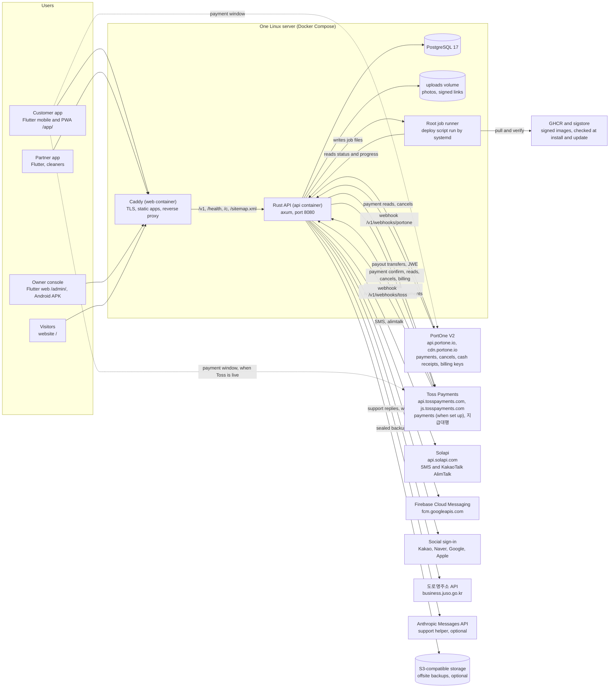
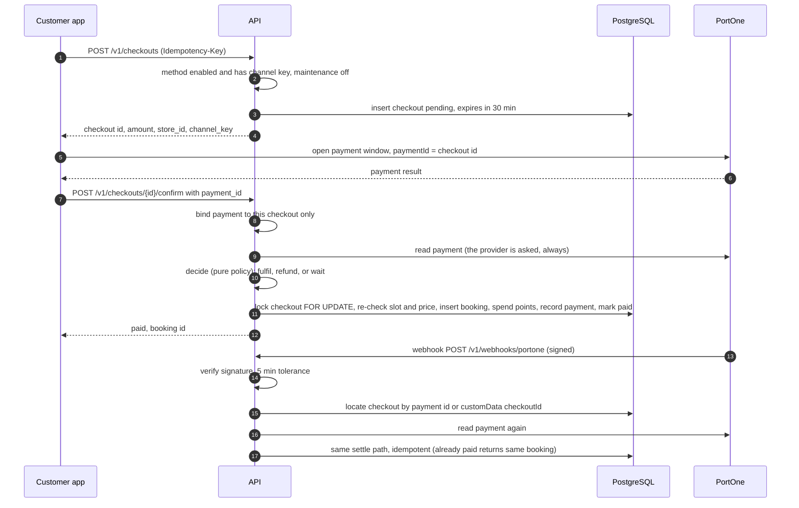
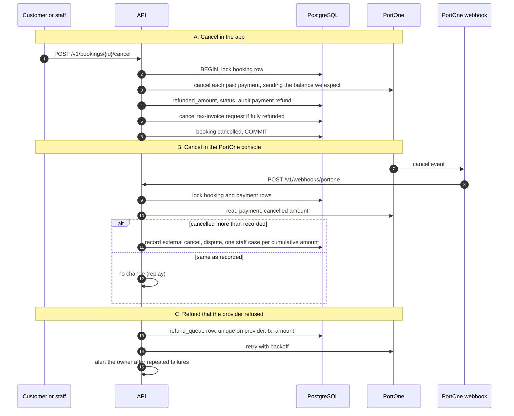
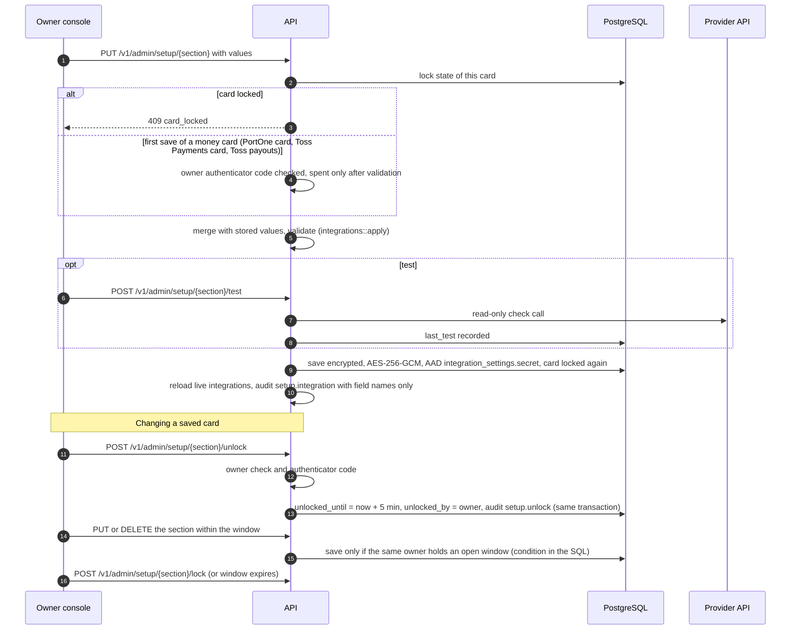
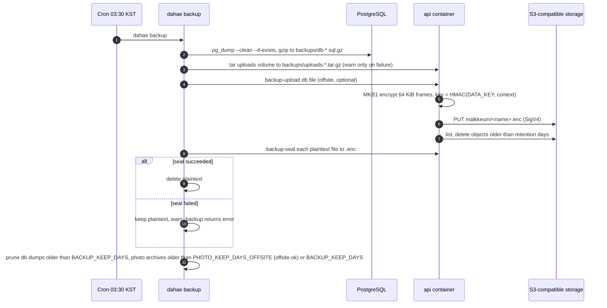
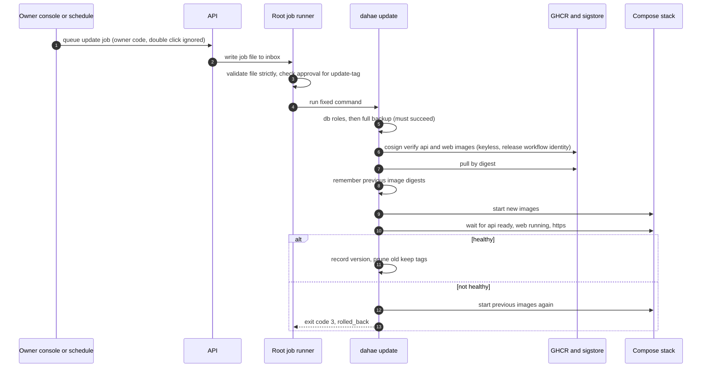

# Architecture / 아키텍처

> Engineering reference for Dahae (다해), a self-hosted home-cleaning platform. Every claim cites the code it describes.
> Status is stated per feature. Items marked **planned** or **unverified** are not production-proven.

## 요약 (Korean summary)

다해는 청소 업체 한 곳이 자기 서버 한 대에 설치해 운영하는 예약·결제·파트너 배정 시스템입니다.

- **구성**: 고객 앱(모바일·웹 PWA), 파트너(청소 기사) 앱, 사장님 콘솔(관리자 웹·Android), Rust API, PostgreSQL 17, Caddy 웹 서버 한 개로 이루어진 Docker Compose 스택입니다. 설치와 업데이트는 `dahae` 명령(설치 스크립트)으로 합니다.
- **돈의 흐름**: 결제는 PortOne, 토스페이먼츠(직접 연동), 또는 둘 다가 처리합니다. 사장님이 콘솔에서 설정한 결제사의 결제수단이 모두 고객에게 보이고, 결제수단마다 PortOne 에 채널 키가 있으면 PortOne, 없으면 토스페이먼츠로 갑니다. 결제와 저장 카드는 시작한 결제사에 고정되어 확인·환불·대사가 그 결제사로 갑니다. 서버는 결제 결과를 항상 결제사에 직접 다시 확인하고, 앱이나 웹훅 본문은 금액 근거로 쓰지 않습니다. 기사 정산은 주 1회(수요일) 지급 날짜로 계산하며, 지급대행(Toss)은 아직 샌드박스 검증 전입니다.
- **비밀 키**: PortOne·Toss·문자 발송 키는 콘솔에서 붙여 넣고, 암호화(AES-256-GCM)해 DB에 저장한 뒤 카드처럼 잠급니다. PortOne 카드, 토스페이먼츠 결제 카드, 토스 지급대행 카드를 처음 저장할 때와 잠금 해제할 때 사장님의 인증 앱 코드를 요구하며, 저장과 해제는 모두 감사 기록됩니다.
- **백업**: 매일 03:30 DB와 사진을 덤프해 같은 키에서 파생한 키로 봉인(MKB1)합니다. 봉인이 끝나면 평문은 지웁니다. 외부 S3 호환 저장소 업로드는 선택 사항입니다.
- **업데이트**: 이미지는 cosign으로 서명되어 있고, 설치·업데이트 때 서명을 확인합니다. DB 백업이 실패하면 업데이트를 시작하지 않고, 새 버전이 응답하지 않으면 직전 버전으로 되돌립니다.
- **고객 상담 도우미**: 외부 API(Anthropic Messages API)를 호출하는 상담 응답 기능이 있습니다. 전화번호와 이메일은 전송 전에 가리고, 국외 이전 필수 동의가 가입 때 받아집니다. 상세는 [§5.1](#51-backend-crates-backendcrates)의 `ai.rs`를 보세요.
- **진행 중 (feat/ntd-redesign, 병합 중)**: 홈 4개 서비스 묶음, 개수(counts) 가격, 이사·입주 견적 흐름, 묶음 관리 API와 콘솔 편집이 feat/ntd-redesign 브랜치에 있습니다 (병합 중). 본 문서는 이를 시스템의 일부로 기술합니다. 해당 파일은 병합 후 링크가 연결됩니다.

---

## 1. Scope and status

| Area | Status in this branch | Evidence |
|---|---|---|
| Card payments via PortOne V2 (checkout, confirm, webhook, daily diff) | Built. Live use needs the owner's PortOne keys | [`routes/checkouts.rs`](../backend/crates/api/src/routes/checkouts.rs), [`routes/webhooks.rs`](../backend/crates/api/src/routes/webhooks.rs), [`routes/checkout_recon.rs`](../backend/crates/api/src/routes/checkout_recon.rs) |
| Payments via Toss Payments (direct; alone or next to PortOne, set up in the console) | Built. Live use needs the owner's Toss contracts and keys; checks that need real test keys are in [payments-setup §6](guide/payments-setup.md#6-토스페이먼츠로-결제받기-단독-또는-portone과-함께) | [`routes/checkouts.rs`](../backend/crates/api/src/routes/checkouts.rs), `providers/toss_payments.rs`, [`integrations.rs`](../backend/crates/api/src/integrations.rs) |
| Partner payouts, manual transfer | Built, default mode | [`providers/payout.rs`](../backend/crates/api/src/providers/payout.rs) |
| Partner payouts via Toss 지급대행 | Built. **Sandbox verification not done** (see [§7](#7-known-limits-and-open-items)) | [`DEPLOY.md` §7](DEPLOY.md#7-toss-payouts-지급대행-sandbox-verification) |
| Encrypted integration keys with lock and unlock | Built | [`routes/setup.rs`](../backend/crates/api/src/routes/setup.rs), [`integrations.rs`](../backend/crates/api/src/integrations.rs) |
| Offsite backup to S3-compatible storage | Built, optional | [`backup.rs`](../backend/crates/api/src/backup.rs) |
| PITR (pgBackRest WAL archive) | Optional, off by default | [`deploy/wal`](../deploy/wal), [`CHANGELOG.md`](../CHANGELOG.md) (Unreleased) |
| Installer, `dahae` CLI, signed images, rollback | Built | [`deploy/install.sh`](../deploy/install.sh) |
| Customer support helper | Built, optional, needs the owner's API key | [`backend/crates/api/src/ai.rs`](../backend/crates/api/src/ai.rs) |
| Home groups, counts pricing, move-in/out quote, console group and counts editor | On `feat/ntd-redesign`, being merged | see [§5.3](#53-the-ntd-redesign-branch-featntd-redesign) |

---

## 2. Context diagram



Notes:
- Only Caddy listens on the public ports (80, 443). `/ready` and `/metrics` return 404 at the edge ([`deploy/Caddyfile`](../deploy/Caddyfile)).
- Outbound provider calls and their hosts are listed in the code, not in configuration: [`providers/portone.rs`](../backend/crates/api/src/providers/portone.rs) (`API`), [`providers/payout.rs`](../backend/crates/api/src/providers/payout.rs) (`TOSS_API`), [`providers/sms.rs`](../backend/crates/api/src/providers/sms.rs), [`providers/fcm.rs`](../backend/crates/api/src/providers/fcm.rs), [`providers/social.rs`](../backend/crates/api/src/providers/social.rs), [`address.rs`](../backend/crates/api/src/address.rs).
- Dev mode (`DEV_MODE=1`) replaces these with in-process fakes; the production compose file sets `DEV_MODE: "0"` ([`deploy/docker-compose.yml`](../deploy/docker-compose.yml)).

---

## 3. Containers and deployment

### 3.1 Services

Source: [`deploy/docker-compose.yml`](../deploy/docker-compose.yml). The same file is written by `install.sh` (`write_compose`); CI fails if the two drift (comment in the compose file).

| Service | Image | Role | Memory | PIDs | Capabilities |
|---|---|---|---|---|---|
| `db` | `postgres:17` | Application database, `cleaning` DB, role `app` (superuser for admin and backup) | 768 MB | 200 | `cap_add`: CHOWN, DAC_OVERRIDE, FOWNER, SETGID, SETUID (entrypoint fixes data ownership, then drops to `postgres`) |
| `api` | `ghcr.io/ericwijesinghe/malkkeum-api` (built from [`backend/Dockerfile`](../backend/Dockerfile)) | Rust API, background jobs, migrations at start | 512 MB | 256 | none. Runs as uid 10001 |
| `web` | `malkkeum-web` (built from [`deploy/web.Dockerfile`](../deploy/web.Dockerfile)) | Caddy 2.11.9 with the website, both Flutter web builds and the font mirror | 384 MB | 256 | `cap_add`: NET_BIND_SERVICE only |
| `uptime-kuma` | `louislam/uptime-kuma:2.1.1` | Optional monitor, profile `monitoring`, bound to 127.0.0.1:3001 | 320 MB | 128 | none |

The API uses `DB_MAX_CONNECTIONS=20`; PostgreSQL runs with `max_connections=50` and `shared_buffers=256MB` (both in the compose file). `api` and `web` raise the open-file limit to 65,536 (`ulimits: nofile`): every signed-in app keeps a `/ws` socket open, one file in the API and two in Caddy, and Docker's default 1,024 would stall near 1,000 apps. The default caps add up to 1,664 MB (1,984 MB with the monitor), within a 2 GB VPS.

### 3.2 Volumes and host paths

| Mount | Type | Used by | Purpose |
|---|---|---|---|
| `dbdata` | named volume | `db` | PostgreSQL data |
| `uploads` | named volume | `api` at `/data/uploads` | Customer and partner photos ([`routes/uploads.rs`](../backend/crates/api/src/routes/uploads.rs)) |
| `caddydata`, `caddyconfig` | named volumes | `web` | Certificates and Caddy config |
| `caddylogs` | named volume | `web` | JSON access log, 10 MB x 14 files, query strings dropped ([`deploy/Caddyfile`](../deploy/Caddyfile)) |
| `kumadata` | named volume | `uptime-kuma` | Monitor data |
| `/opt/malkkeum/jobs/inbox` | host bind, rw | `api` | The API writes server job files here |
| `/opt/malkkeum/jobs/status`, `out` | host bind, ro | `api` | Job state and results written by the root job runner |
| `/opt/malkkeum/jobs/public` | host bind, ro | `web` at `/srv/ops-progress` | Live progress of a server job, served only under a 128-bit token |

### 3.3 Hardening

Applied to every service through the `x-hardened` anchor in [`deploy/docker-compose.yml`](../deploy/docker-compose.yml):

- `read_only: true`: writes go only to named volumes and tmpfs (`/tmp`; `api` has `/tmp` at 64 MB).
- `cap_drop: [ALL]` and `security_opt: ["no-new-privileges:true"]`, with the per-service `cap_add` above.
- Memory and PID limits on every service. No CPU caps, because a cap above the host's core count stops `docker compose up` on a 1-vCPU server (comment in the compose file).
- Log rotation: 10 MB per file, 14 files, `json-file` driver.
- Database startup flags: `log_min_duration_statement=500`, `log_lock_waits=on`, `password_encryption=scram-sha-256`, `archive_mode` switched by `WAL_ARCHIVE_MODE` (off by default).
- API health probe `api --ready` checks the database and migrations ([`backend/Dockerfile`](../backend/Dockerfile), [`backend/crates/api/src/main.rs`](../backend/crates/api/src/main.rs)).

Host-level hardening is in the installer: `ufw` (22, 80, 443 only, after confirmation), fail2ban for SSH, unattended security upgrades, optional SSH key-only login ([`deploy/install.sh`](../deploy/install.sh), `harden_host`).

### 3.4 Edge routing (Caddy)

Source: [`deploy/Caddyfile`](../deploy/Caddyfile).

| Path | Served by |
|---|---|
| `/v1/*`, `/health`, `/.well-known/assetlinks.json`, `/.well-known/apple-app-site-association` | API (`reverse_proxy api:8080`) |
| `/c/*`, `/sitemap.xml`, `/robots.txt`, `/notices.xml`, search-console verification files | API (server-rendered SEO pages, [`seo.rs`](../backend/crates/api/src/seo.rs)) |
| `/ops-progress/<32 hex>` | Static file from `/srv/ops-progress`, `no-store` |
| `/webfonts/*` | Static, immutable cache (fallback fonts for Flutter) |
| `/admin/*` | Owner console (`/srv/console`), `no-cache` |
| `/app/*` | Customer web app (`/srv/app`), `no-cache` |
| everything else | Website (`/srv/website`), with the seller details template included from `/v1/public/seller-info` |

Other edge rules: two Content-Security-Policies (one for apps and API pages, a strict one for the website), HSTS, `X-Frame-Options: DENY`, `Permissions-Policy` with camera, microphone and USB disabled. A static maintenance page is served with status 503 when the API is down. There is no edge rate limit on `/v1/auth/*`; the app-level limits apply (see [§7](#7-known-limits-and-open-items)).

### 3.5 Startup sequence

`api::serve()` ([`backend/crates/api/src/lib.rs`](../backend/crates/api/src/lib.rs)):

1. Read config from environment ([`config.rs`](../backend/crates/api/src/config.rs)).
2. Run pending migrations on a dedicated connection with no statement timeout. Migrations are additive; `set_ignore_missing(true)` lets the previous image start after a rollback.
3. Seed, move legacy encrypted values, and ensure the setup code.
4. Load saved integration sections and overlay them on the env values ([`integrations::load`](../backend/crates/api/src/integrations.rs)).
5. Start 15 spawned tasks, including the WebSocket listener (see [§5.1](#51-backend-crates-backendcrates); `jobs.rs` tracks 12 of them for health), then serve on `BIND_ADDR`.

---

## 4. Request and data flows

### 4.1 Booking and payment (checkout, confirm, webhook, settlement)

Code: [`routes/checkouts.rs`](../backend/crates/api/src/routes/checkouts.rs) (`create`, `confirm`, `settle`, `apply`, `fulfil`), [`routes/checkout_policy.rs`](../backend/crates/api/src/routes/checkout_policy.rs) (pure `decide` and `bind`), [`routes/webhooks.rs`](../backend/crates/api/src/routes/webhooks.rs), [`routes/payments.rs`](../backend/crates/api/src/routes/payments.rs).



Rules visible in the code:

- **Provider is the source of truth.** `settle` always calls the provider; the client request and the webhook body carry only an id ([`checkouts.rs`, `settle` doc comment](../backend/crates/api/src/routes/checkouts.rs)).
- **One payment, one checkout.** `bind` refuses a payment id that belongs to another checkout, before anything is read or refunded ([`checkout_policy.rs`](../backend/crates/api/src/routes/checkout_policy.rs)).
- **Decision is pure.** `decide` maps (checkout status, expiry, provider status, amount match, binding) to one action: `Fulfil`, `FulfilLate`, `RefundMismatch`, `RefundClosed`, `MarkAwaitingDeposit`, `MarkExpired`, `Nothing` ([`checkout_policy.rs`](../backend/crates/api/src/routes/checkout_policy.rs)).
- **Money moves only for PAID payments.** A paid payment that cannot be fulfilled is refunded, with the reason stored ([`checkouts.rs`, `unfulfilled`](../backend/crates/api/src/routes/checkouts.rs)).
- **Webhook responses.** Infrastructure errors return 5xx so PortOne re-sends; business refusals are logged and acknowledged ([`webhooks.rs`, `handle_payment`](../backend/crates/api/src/routes/webhooks.rs)).
- **Virtual accounts.** A `VIRTUAL_ACCOUNT_ISSUED` status moves the checkout to `awaiting_deposit` (`MarkAwaitingDeposit`).
- **Idempotency.** `checkouts` POST routes are wrapped in `replayable` ([`idempotency.rs`](../backend/crates/api/src/idempotency.rs)): keys are scoped to the verified user and path, bound to the body hash, and kept for 24 h. Only final answers are stored.
- **Payment methods.** A method is offered only when an admin switched it on and its PortOne channel key is set ([`payments.rs`, `ensure_enabled`](../backend/crates/api/src/routes/payments.rs)).
- **Checkout lifetime.** `CHECKOUT_TTL_MIN` = 30 ([`checkouts.rs`](../backend/crates/api/src/routes/checkouts.rs)).

**Two optional gateways, pinned per row.** PortOne and Toss Payments sit side by side behind `Providers` (enum dispatch on `Gateway`, codes `portone` and `tosspayments`); an install may set up either one or both. PortOne is configured with an API secret and a store id (env or console) and serves a method only when that method has a channel key. Toss Payments is offered while its console card (integration section `tosspayments`) is saved, valid and has `active` on (a card saved without the switch is stored on with live keys, off with test keys). A new one-off checkout goes to `Integrations::gateway_for(method)`: PortOne when it serves the method, else Toss when offered, else the method is not listed. A new saved card goes to `Integrations::billing_gateway()`: PortOne when `billing_ready` (a `card_billing` or legacy `card` key), else Toss when offered with its 자동결제 pair, else card saving is off. `GET /v1/payments/methods` names each method's gateway (card while saved cards are on: the gateway that saves them; only card is ever `billing`) and leaves Toss out for apps that do not send `?gateways=…tosspayments` (v1.5.1), and `GET /v1/admin/setup` lists `payment_gateways`, PortOne first. These rules only decide where *new* checkouts and newly saved cards go. Each checkout and saved card stores its gateway when it is created (`checkouts.gateway`, `payment_methods.gateway`), and `payments.provider` / `refund_queue.provider` were already per row (`portone`, `tosspayments`, `tosspayments_billing` for saved-card charges on the 자동결제 MID). Confirm, webhooks, reconciliation, refunds and saved-card charges always follow the row, never the switch, so a payment started on PortOne finishes and refunds on PortOne after any setup change. Toss differs in three places: the hosted success page `/pay/toss-success.html` captures the payment through the public `POST /v1/checkouts/{id}/toss-confirm` (the server confirms with its own stored amount), the orderId is always our own id so `paymentKey` is never stored, and the adapter maps Toss statuses into the PortOne-shaped `PaymentInfo`, so `checkout_policy.rs` is unchanged. Identity (PASS) stays on PortOne; cash receipts for Toss payments come from the Toss window. Toss payment webhooks arrive on `/v1/webhooks/tosspayments` (payouts keep `/v1/webhooks/toss`) and are only a hint: the handler re-reads the payment by orderId.

Recovery when the confirm or the webhook never arrives: the reconciler ([`reconciler.rs`](../backend/crates/api/src/reconciler.rs), [`checkout_recon.rs`](../backend/crates/api/src/routes/checkout_recon.rs)) runs when a PortOne API secret or a Toss Payments card is configured. It re-checks open checkouts on their own gateway, re-checks checkouts that the gateway reports paid but that are unfinished after 24 h (stopping at 30 days), and runs a daily diff of the previous KST day's payments against local rows per gateway (PortOne, then Toss `/v1/transactions` per MID) (`payment_diff_pass`, interval `PAYMENT_DIFF_INTERVAL_SECS`, default 3600).

Settlement to partners happens at job completion (§4.3).

### 4.2 Refund and cancel sync

Code: [`routes/bookings.rs`](../backend/crates/api/src/routes/bookings.rs) (`cancel_owned`, `apply_cancel`, `refund_locked`), [`routes/webhooks.rs`](../backend/crates/api/src/routes/webhooks.rs) (`sync_cancellation`), [`util.rs`](../backend/crates/api/src/util.rs) (`refund_durably`).



- Cancellation refunds once, under the booking row lock, against the provider's cancellable balance ([`bookings.rs`, `refund_locked`](../backend/crates/api/src/routes/bookings.rs)). The `refund_checked` call sends the balance we expect, so a retry cannot refund twice.
- Tip payments are not refunded by the booking cancel (`kind <> 'tip'`).
- Compensating refunds for failed fulfilment go through `refund_queue`: recorded before the provider call, retried with backoff, one row per (provider, tx, amount) ([`util.rs`](../backend/crates/api/src/util.rs)).
- The cancel policy (fee by days before the visit) is in [`domain/src/cancel_policy.rs`](../backend/crates/domain/src/cancel_policy.rs); the customer sees a preview first (`GET /v1/bookings/{id}/cancel-preview`).
- Tax-invoice requests are cancelled with a full refund; an already-issued request is left for the owner to cancel at Hometax and writes an audit row (CHANGELOG, Unreleased).

### 4.3 Partner job: accept, assignment, completion, payout

Code: [`routes/partner_jobs.rs`](../backend/crates/api/src/routes/partner_jobs.rs), [`routes/booking_core.rs`](../backend/crates/api/src/routes/booking_core.rs) (`complete_job`), [`routes/payouts.rs`](../backend/crates/api/src/routes/payouts.rs), [`payout_sync.rs`](../backend/crates/api/src/payout_sync.rs), [`domain/src/partner.rs`](../backend/crates/domain/src/partner.rs), [`payout.rs`](../backend/crates/api/src/payout.rs).

```mermaid
sequenceDiagram
  autonumber
  participant PAR as Partner app
  participant MEM as Team member app
  participant API as API
  participant DB as PostgreSQL
  participant TOSS as Toss 지급대행
  participant OWN as Owner console
  PAR->>API: POST /v1/partner/jobs/{id}/accept
  API->>API: phone bound, quality gate, visible to this pro
  API->>DB: lock pro schedule, conditional claim (no pro yet, confirmed, no clash)
  API-->>PAR: accepted, or already_taken or schedule_overlap
  PAR->>API: POST /v1/partner/jobs/{id}/assign (optional team member)
  API->>DB: member active, no clash, status team_assigned
  MEM->>API: POST /v1/member/jobs/{id}/check-in
  MEM->>API: POST /v1/member/jobs/{id}/complete (or partner)
  API->>DB: check-in gate (override needs reason, audited), completion report, status completed
  API->>DB: settlements row: gross, fee, net, payout_date (or waiting_balance for quotes)
  Note over OWN,TOSS: Weekly run, owner action with recent step-up
  OWN->>API: payouts run for a date
  API->>DB: pending settlements due by date, grouped per pro into payouts (requested)
  alt manual mode (default)
    OWN->>API: confirm transfer made from the bank app
    API->>DB: state paid
  else toss mode
    API->>TOSS: POST /v2/payouts (JWE body)
    API->>DB: state sent
    loop every 10 min
      API->>TOSS: GET payout (payout_sync)
    end
    API->>DB: state paid or failed, customer and owner notified
  end
```

- **Visibility and claim.** A pro sees only jobs they may take. Accept is one conditional `UPDATE`, under a per-pro schedule lock; a job already claimed returns `already_taken` ([`partner_jobs.rs`, `accept`](../backend/crates/api/src/routes/partner_jobs.rs)).
- **Overlap.** `schedule_overlap` refuses a second live job for the same pro or member on the same date and window, including reassignment and reschedules ([`partner_jobs.rs`](../backend/crates/api/src/routes/partner_jobs.rs)).
- **Training gate.** Off by default; `training_gate_enabled` turns it on (CHANGELOG, Unreleased).
- **Completion.** `complete_job` refuses a job dated after today (`job_not_started`), writes the report, the settlement, the points and the customer notice in one transaction ([`booking_core.rs`](../backend/crates/api/src/routes/booking_core.rs)).
- **Quote jobs.** Settlement state is `waiting_balance` until the customer's balance is paid; the payout date is then empty.
- **Fee and date.** Gross minus `pros.fee_bps` (default 2,000 bps = 20%, [`partner.rs`](../backend/crates/domain/src/partner.rs) `DEFAULT_FEE_BPS`). Payout date is the next Wednesday strictly after completion (`payout_date`).
- **Run.** `run_payouts` takes a transaction-scoped advisory lock, groups due settlements per pro, and refuses future dates. It requires a recent owner step-up ([`payouts.rs`](../backend/crates/api/src/routes/payouts.rs)). Only pros with a verified payout account are included.
- **Transitions.** `requested or sent -> paid` (manual confirm), `requested -> sent -> paid` (Toss), `requested or sent -> failed`, `failed -> requested`; `paid` is terminal ([`payout.rs`](../backend/crates/api/src/payout.rs), pure `next`).
- **Toss mode.** Requires `TOSS_PAYOUTS_ENABLED=1`, a saved and tested key, and a registered seller per pro ([`DEPLOY.md` §7](DEPLOY.md#7-toss-payouts-지급대행-sandbox-verification)). The webhook only triggers a poll ([`routes/webhooks.rs`, `toss`](../backend/crates/api/src/routes/webhooks.rs)).
- **Money is never sent by the sync job.** `payout_sync` only reads transfer status ([`payout_sync.rs`](../backend/crates/api/src/payout_sync.rs)).

### 4.4 Integration key paste, lock and unlock

Code: [`routes/setup.rs`](../backend/crates/api/src/routes/setup.rs) (`put_section`, `clear_section`, `unlock_section`, `try_unlock`, `lock_section`, `test_section`), [`integrations.rs`](../backend/crates/api/src/integrations.rs) (`lock_state`, `save_section`, `load`), [`crypto.rs`](../backend/crates/api/src/crypto.rs).



- **What is stored.** One row per section in `integration_settings` holds the whole section as one encrypted JSON value. Secrets are never returned: the console gets a mask (`MASK`) ([`integrations.rs`](../backend/crates/api/src/integrations.rs)).
- **Encryption.** AES-256-GCM with a random 96-bit nonce per value; `v1:` prefix; the column label is bound as AAD, so a value moved to another column does not decrypt ([`crypto.rs`](../backend/crates/api/src/crypto.rs)). Legacy values without the prefix are still read.
- **Lock is enforced in SQL.** `save_section` updates only when the unlock window is open and belongs to the saving owner, and it clears the window in the same statement ([`integrations.rs`](../backend/crates/api/src/integrations.rs)). Two saves racing in one window cannot both pass.
- **Unlock is owner-only and time-boxed.** `UNLOCK_TTL_SECS = 300` ([`setup.rs`](../backend/crates/api/src/routes/setup.rs)). Success and failure are audited; the failure record stores the reason code only.
- **Live reload.** A save reloads the process immediately; other replicas reload every 60 s ([`lib.rs`, `spawn_settings_refresh`](../backend/crates/api/src/lib.rs)).
- **Empty values.** A cleared card keeps its row, locked and empty, and counts as not saved ([`integrations.rs`, `load`](../backend/crates/api/src/integrations.rs)).
- **Payment channel keys.** Each PortOne method needs its channel key (`channel-key-*` fields) before it appears to customers (see §4.1).

### 4.5 Backup: seal, offsite upload, restore

Code: [`deploy/install.sh`](../deploy/install.sh) (`cmd_backup`, `seal_local`, `cmd_restore`, `cmd_restore_offsite`, `cmd_keys_backup`, schedules in `write_schedules`), [`backend/crates/api/src/backup.rs`](../backend/crates/api/src/backup.rs), [`backend/crates/api/src/keys_bundle.rs`](../backend/crates/api/src/keys_bundle.rs), [`backend/crates/api/src/routes/keys.rs`](../backend/crates/api/src/routes/keys.rs).



- **Format.** `MKB1` magic, 8-byte random nonce prefix, frames of 64 KiB, each frame authenticated with a last-frame flag, so truncation and reordering fail ([`backup.rs`](../backend/crates/api/src/backup.rs)).
- **Key.** Derived from `DATA_KEY` by HMAC-SHA256 with a fixed context string ([`backup.rs`, `file_key`](../backend/crates/api/src/backup.rs)). Losing `DATA_KEY` loses the backups.
- **Atomic writes.** Output goes to `.part` and is renamed into place ([`backup.rs`, `convert`](../backend/crates/api/src/backup.rs)).
- **Dependent steps.** Update, rollback and restore stop when sealing fails, so a plaintext copy is never silently left behind for a rollback that then fails.
- **Offsite is optional and non-fatal.** A failed upload is recorded in backup status and does not hide a good local dump.
- **Retention.** Offsite default 30 days, maximum 3650 (`BACKUP_RETENTION_DEFAULT`, `BACKUP_RETENTION_MAX` in [`integrations.rs`](../backend/crates/api/src/integrations.rs)). Local retention in `install.sh`: database dumps `BACKUP_KEEP_DAYS` (14); photo archives `PHOTO_KEEP_DAYS_OFFSITE` (3) when that run's photo upload is logged as `offsite backup uploaded`, otherwise 14. Photo archives are full copies each night, so 14 of them filled a 50 GB disk at about 3 GB of photos.
- **Key escrow, two ways.**
  - The API keys bundle (`POST /v1/admin/keys/bundle`, owner authenticator code each time) seals `DATA_KEY` and `JWT_SECRET` as `MKK1` (PBKDF2-HMAC-SHA256, 600 000 rounds, AES-256-GCM) under a server-generated passphrase, then proves it opens with an upload test ([`keys_bundle.rs`](../backend/crates/api/src/keys_bundle.rs)).
  - `dahae keys-backup` seals `.env` with a passphrase of at least 12 characters (`openssl enc -aes-256-cbc -pbkdf2 -iter 600000`) and asks the owner to confirm in a terminal that the copy is stored off the server ([`install.sh`](../deploy/install.sh), `cmd_keys_backup`, `key_escrow_confirm`).
- **Restore.** `dahae restore` and `dahae restore-offsite` open backups into a scratch copy and delete it afterwards; `dahae keys-restore` puts the two keys back on a fresh server.

### 4.6 Update and rollback

Code: [`deploy/install.sh`](../deploy/install.sh) (`cmd_update`, `pull_images`, `verify_image`, `set_images`, `wait_healthy`, `cmd_rollback`, `stable_seasoned`), [`deploy/agent.sh`](../deploy/agent.sh) (root job runner), [`backend/crates/api/src/host_jobs.rs`](../backend/crates/api/src/host_jobs.rs), [`.github/workflows/release.yml`](../.github/workflows/release.yml).



- **Signing.** Images are signed by digest with cosign keyless from the release workflow on `v*` tags ([`release.yml`](../.github/workflows/release.yml)). `verify_image` refuses an image whose signature does not match the release identity; `IMAGE_VERIFY=off` exists only for unsigned test repositories ([`install.sh`](../deploy/install.sh)).
- **Stable channel holds.** On the stable channel, a new digest must be seen for 24 hours before the scheduled update applies it (`stable_seasoned`, [`install.sh`](../deploy/install.sh)).
- **Schedule.** Default auto-update on Mondays at 04:00 KST, after the backup; configurable with `dahae update-schedule` (`write_schedules`, `cmd_update_schedule`).
- **Rollback.** `dahae rollback` backs up first, then starts `PREV_API_IMAGE` and `PREV_WEB_IMAGE`. Database migrations are not reversed; the previous image runs against the newer, additive schema ([`install.sh`](../deploy/install.sh), `cmd_rollback`; [`lib.rs`, `migrate`](../backend/crates/api/src/lib.rs)).
- **Approval.** Jobs that change the version (`update-tag`, rollback) or the domain (`domain-set`) need an owner approval code on the server; the job runner checks it ([`deploy/agent.sh`](../deploy/agent.sh) header comment). The console sends the code with `POST /v1/admin/host/jobs/{id}/approve`, which writes `inbox/<id>.approve`.
- **Former domains.** After `dahae domain`, the API records the old host as an alias ([`domains.rs`](../backend/crates/api/src/domains.rs), settings row `domains`), adds it to CORS, and answers Caddy's on-demand TLS question (`/internal/tls-ask`). Caddy's `https://` catch-all site serves aliases like the main domain and redirects only website pages; nothing about aliases is in compose or `.env`.
- **Job file format.** The API writes one file per job (`id`, `kind`, `arg`, optional `token`). The runner accepts only known keys, rejects duplicates and stale ids (older than 15 min), and never interprets file content as shell ([`deploy/agent.sh`](../deploy/agent.sh), [`host_jobs.rs`](../backend/crates/api/src/host_jobs.rs)). Kinds the API writes: `status-refresh`, `backup-now`, `update`, `update-skip`, `channel`, `restart`, `schedule`, `heartbeat`, `domain-check`, `domain-set`, `host-approval-enroll`; the runner also handles `update-tag`, `rollback`, `logs` and `offsite-list` ([`deploy/agent.sh`](../deploy/agent.sh)).
- **Release gate.** A tag publishes nothing unless CI and the install end-to-end test pass on the same commit; the release workflow pins actions to commit SHAs ([`release.yml`](../.github/workflows/release.yml) header).

---

## 5. Module map

### 5.1 Backend crates (`backend/crates/`)

Workspace: [`backend/Cargo.toml`](../backend/Cargo.toml). Two crates: `api` (HTTP, jobs, providers, storage) and `domain` (pure rules, no I/O).

**`domain`** ([`backend/crates/domain/src`](../backend/crates/domain/src))

| Module | Responsibility |
|---|---|
| `booking.rs` | Booking status values: consultation 0, confirmed 1, team_assigned 2, completed 3, cancelled -1 |
| `catalog.rs` | Service and pricing types: `Fixed`, `Unit`, `Quote` (and `Counts` on the NTD branch) |
| `quote.rs` | Quote and estimate rules (move-in/out formula numbers are configuration) |
| `pricing.rs`, `peak.rs`, `coupon.rs`, `points.rs` | Price, peak surcharge, coupon and points rules |
| `cancel_policy.rs` | Cancellation fee by days before the visit |
| `partner.rs` | Job visibility, payout math (`payout`), weekly payout date |
| `subscription.rs`, `household.rs`, `schedule.rs`, `waitlist.rs`, `tip.rs` | Recurring visits, household profile, slots, waitlist, tips |
| `cash_receipt.rs`, `tax.rs`, `finance.rs` | Cash receipts, tax invoices, VAT and withholding rules, finance aggregates |
| `growth.rs`, `feed.rs`, `quality.rs`, `training.rs` | Referrals, feed, partner quality score, training gate |
| `money.rs`, `error.rs`, `payee_identifier.rs` | `Won` type, domain errors, payee identifier rules |

**`api`** ([`backend/crates/api/src`](../backend/crates/api/src))

| Group | Modules | Responsibility |
|---|---|---|
| HTTP surface | [`routes/`](../backend/crates/api/src/routes) (`mod.rs` mounts every router) | Handlers under `/v1`, `/v1/admin`, `/v1/partner`, `/v1/member`, plus `/ws` and `/realtime/ticket` |
| Payments | `routes/checkouts.rs`, `checkout_policy.rs`, `checkout_recon.rs`, `webhooks.rs`, `payments.rs`, `cash_receipts.rs`, `tax_invoices.rs`, `tips.rs` | Checkout settle, pure policy, reconcile and diff, webhooks, payment methods, receipts |
| Bookings and jobs | `routes/bookings.rs`, `booking_core.rs`, `partner_jobs.rs`, `partner.rs`, `member.rs`, `cases.rs`, `chat.rs`, `subscriptions.rs` | Booking lifecycle, job claim and completion, team members, disputes, chat, subscriptions |
| Money out | `payout.rs` (state machine), `payout_sync.rs`, `routes/payouts.rs`, `routes/finance*.rs`, `providers/payout.rs`, `providers/toss_jwe.rs`, `providers/toss_webhook.rs` | Settlement runs, transfers, Toss status sync and signature check |
| Secrets and setup | `crypto.rs`, `integrations.rs`, `routes/setup.rs`, `routes/keys.rs`, `keys_bundle.rs`, `totp.rs`, `owner.rs`, `auth.rs`, `lockout.rs` | Encrypted sections and card lock, key bundle, authenticator codes, sign-in |
| Ops and backup | `backup.rs`, `host_jobs.rs`, `ops.rs`, `ops_alerts.rs`, `renewals.rs`, `metrics.rs`, `lifecycle.rs`, `telemetry.rs`, `client_errors.rs`, `analytics.rs` | Offsite backup, server job queue, owner alerts, status, metrics, graceful stop, app error reports |
| Background jobs | `jobs.rs` (runner), `reconciler.rs`, `payout_sync.rs`, `renewals.rs`, `retention.rs`, `noshow.rs`, `points.rs`, `marketing.rs`, `quality.rs`, `routes/waitlist.rs`, `routes/subscription_engine.rs`, `sms_outbox.rs`, `realtime.rs` (outbox) | Periodic passes; each is a session advisory lock, so one replica runs a pass at a time |
| Providers | `providers.rs` (dispatch, fakes in dev mode), `providers/portone.rs`, `portone_cash_receipt.rs`, `toss_payments.rs`, `payout.rs`, `sms.rs`, `fcm.rs`, `social.rs`, `apple.rs` | Adapters behind one interface |
| Notifications and live events | `realtime.rs`, `realtime_ticket.rs`, `realtime_heartbeat.rs`, `sms_outbox.rs` | WebSocket hub, `pg_notify` fan-out, durable outbox, dead-letter after 8 attempts |
| Edge and limits | `ratelimit.rs`, `idempotency.rs`, `config.rs`, `contract.rs`, `error.rs` | Per-IP and per-user limits, idempotency, env config, error envelope |
| Public content | `seo.rs`, `app_links.rs`, `address.rs`, `uploads.rs`, `seller` route, `config` route | SEO pages, app links, address search, photo upload with signed links |
| Support helper | [`ai.rs`](../backend/crates/api/src/ai.rs), `ai/errors.rs`, `routes/chat.rs` | Optional customer support replies (see below) |
| Settings | `settings_registry.rs`, `routes/settings.rs` | Owner-editable business limits, read from DB with env as the seed |
| Privacy | `privacy.rs`, `routes/privacy_requests.rs`, `retention.rs`, `demo/` | Consent versions, data requests, retention purge, demo data |

Migrations: [`backend/migrations`](../backend/migrations), 105 files on this branch, latest `0375_pro_payee_identifier.sql`. Migration check in CI: [`scripts/ci/check-migrations.py`](../scripts/ci/check-migrations.py).

**Support helper, as implemented.** When staff are away, or always when the owner chose "always first", the helper replies to a customer's chat message through the Anthropic Messages API (`ANTHROPIC_BASE_URL`, default `https://api.anthropic.com`). Facts from the code:
- Phone numbers and e-mail addresses are masked before the text leaves the server ([`ai.rs`](../backend/crates/api/src/ai.rs), around the "PIPA overseas transfer" comment).
- Replies are capped per member per day (default 40) and per shop per day (default 1000); the owner sets these in the console (`DEFAULT_MEMBER_DAILY_CAP`, `DEFAULT_DAILY_CAP`).
- A reply that states a won amount, refund or discount not found in shop data is replaced by a handoff line ([`ai.rs`](../backend/crates/api/src/ai.rs), CHANGELOG Unreleased).
- The overseas-transfer consent (`overseas_transfer`) is required at signup and withdrawable later. Withdrawing it stops FCM push and the AI chat for that customer (`privacy::overseas_allowed`, checked in `realtime.rs` `try_push` and `ai.rs` `answer`); the customer app shows its notice ([`privacy.rs`](../backend/crates/api/src/privacy.rs) `CONSENTS`, [`signup_consent.dart`](../app/apps/customer/lib/screens/signup_consent.dart)). The public privacy notice lists the transfer ([`website/privacy.html`](../website/privacy.html), section 6).
- The helper is off until the owner saves an API key in the setup wizard (`AI_FIELDS`, [`integrations.rs`](../backend/crates/api/src/integrations.rs)).
- See [§7](#7-known-limits-and-open-items) for a wording conflict on withdrawal.

### 5.2 App packages (`app/`)

Dart workspace: [`app/pubspec.yaml`](../app/pubspec.yaml) lists `packages/ui`, `packages/core`, `apps/customer`, `apps/partner`, `apps/console`, `packages/test_support`.

| Path | Responsibility | Entry points |
|---|---|---|
| [`app/packages/ui`](../app/packages/ui) | Design tokens, theme, components, brand scope, contrast checks | [`lib/src/tokens.dart`](../app/packages/ui/lib/src/tokens.dart), [`lib/src/theme.dart`](../app/packages/ui/lib/src/theme.dart), [`lib/src/components/`](../app/packages/ui/lib/src/components) |
| [`app/packages/core`](../app/packages/core) | API client, session, pager, checkout and payment window, push, realtime, localized strings (ARB files), models | [`lib/src/api.dart`](../app/packages/core/lib/src/api.dart), [`lib/src/checkout_service.dart`](../app/packages/core/lib/src/checkout_service.dart), [`lib/src/payment_launcher.dart`](../app/packages/core/lib/src/payment_launcher.dart), [`lib/src/portone_webview.dart`](../app/packages/core/lib/src/portone_webview.dart), [`lib/src/realtime.dart`](../app/packages/core/lib/src/realtime.dart) |
| [`app/apps/customer`](../app/apps/customer) | Customer app: booking, quote, payments, wallet, chat, subscriptions; web build at `/app/` | [`lib/main.dart`](../app/apps/customer/lib/main.dart), [`lib/screens/`](../app/apps/customer/lib/screens) |
| [`app/apps/partner`](../app/apps/partner) | Partner (cleaner) app: job feed, accept, quotes, schedule, team | [`lib/main.dart`](../app/apps/partner/lib/main.dart), [`lib/outbox.dart`](../app/apps/partner/lib/outbox.dart) |
| [`app/apps/console`](../app/apps/console) | Owner console: setup wizard, finance, partners, catalogue, alerts; web at `/admin/`, Android APK | [`lib/main.dart`](../app/apps/console/lib/main.dart), [`lib/screens/setup.dart`](../app/apps/console/lib/screens/setup.dart) |
| [`app/packages/test_support`](../app/packages/test_support) | Shared test helpers | |
| [`app/tool`](../app/tool) | `gen_arb.py` and `strings_*.py` generate the ARB strings; `font_subset.py` builds the Korean font subset | [`tool/gen_arb.py`](../app/tool/gen_arb.py) |

Build rules: web builds use `--wasm --no-web-resources-cdn` and `flutter pub get --enforce-lockfile` ([`deploy/web.Dockerfile`](../deploy/web.Dockerfile)), so the CSP needs no `unsafe-eval` and no CDN hosts.

### 5.3 The NTD redesign branch (`feat/ntd-redesign`)

Being merged. Read from that branch; the files are not on master yet, so the paths below are not links.

- **Home groups.** Four service groups: `moving`, `living`, `appliance`, `disinfection`, each with a chooser (`move`, `list` or `direct`). Public `GET /v1/service-groups` lists the active groups and their members; owner `GET` and `PUT /v1/admin/service-groups/{code}` read and edit them; the PUT writes an audit row. The `move` chooser's config maps a new build to `move_in`, an older one to `move_out`, and lists the allowed home types. Studio is left out of the home list (`content.hidden_from_home`) but stays in the catalogue for existing bookings. The tile badge is HOT over N (`derive_badge`). The customer app falls back to built-in groups when the list is empty or unreadable. Files: `backend/crates/domain/src/service_group.rs`, `backend/crates/api/src/routes/service_groups.rs`, migrations `0234_service_groups.sql` and `0236_counts_service_groups.sql`. Customer side: `app/apps/customer/lib/screens/service_groups.dart`, `app/packages/core/lib/src/service_groups.dart`.
- **Counts pricing.** A `Counts` pricing type: one count per option, a per-option cap (`max_each`, default 20), a multi-item discount in basis points that applies from two items, and a 60-minute minimum. Booking column `unit_counts` (migration `0230`); catalogue prices and counts for subscriptions and mattress in `0231` to `0233`. Files: `backend/crates/domain/src/catalog.rs`, `backend/crates/domain/src/pricing.rs` (`price_booking_with`), `app/apps/customer/lib/screens/service_counts.dart`.
- **Move-in and move-out quote.** Layout and cleaning type drive an estimate (`POST /v1/quote/estimate`, `backend/crates/domain/src/quote.rs`). The home type is stored with the quote answers (`HomeType`). The chooser is `move_chooser.dart`; the estimate is shown before the booking step. Pyeong ranges per layout are a stated shortcut (`quote_size_note.dart`), not yet confirmed by the owner.
- **Owner console.** The catalogue's service groups tab edits the four groups (`catalog_groups.dart`), and the counts dialog edits counts pricing (`catalog_counts.dart`). The booking detail shows the counts line (`booking_labels.dart`).
- **Partner app.** The job list and job detail show counts from `unit_counts` (`app/apps/partner/lib/job_labels.dart`). Older aircon jobs without `unit_counts` read the old answers (a stated shortcut in that file).
- **Peak surcharge on fixed and subscription visits** (CHANGELOG Unreleased, `apply_to_fixed`, default off) is on master already.

---

## 6. Key design decisions

Each entry: decision, why (from the code or CHANGELOG), consequence.

### ADR-01 Single server, one compose stack, one domain
- **Decision.** One VPS runs Postgres, API and Caddy in Docker Compose behind one domain; Caddy terminates TLS.
- **Why.** The customer is a single cleaning company that owns its server; the installer must work without an operator ([`deploy/Caddyfile`](../deploy/Caddyfile), CHANGELOG 1.0.0).
- **Consequence.** One API replica. Per-process rate limits multiply with replicas ([`ratelimit.rs`](../backend/crates/api/src/ratelimit.rs) shortcut). Upgrading to several replicas needs the shared counters first.

### ADR-02 The payment provider is the source of truth
- **Decision.** `settle` asks PortOne for the payment every time; client and webhook supply only the payment id.
- **Why.** Money decisions must not depend on unsigned or replayed input ([`checkouts.rs`](../backend/crates/api/src/routes/checkouts.rs) `settle` comment).
- **Consequence.** One extra provider call per confirm or webhook. Retries are safe because settlement is idempotent.

### ADR-03 Pure decision, separate effects
- **Decision.** The settle policy is a pure function (`decide`, `bind`) returning an action; the caller carries it out.
- **Why.** The policy has the most edge cases (paid late, wrong amount, closed checkout, virtual account) and needs unit tests without a database ([`checkout_policy.rs`](../backend/crates/api/src/routes/checkout_policy.rs)).
- **Consequence.** New payment states are added to one function and its tests.

### ADR-04 Durable refunds with a queue
- **Decision.** A compensating refund is written to `refund_queue` before the provider is called, retried with backoff, unique per (provider, tx, amount).
- **Why.** A charge succeeded but the local write did not: the refund must survive a crash and never be sent twice ([`util.rs`](../backend/crates/api/src/util.rs), CHANGELOG 1.4.0).
- **Consequence.** Customers may see "refund in progress" until the provider confirms.

### ADR-05 Booking and money in one transaction; notifications through an outbox
- **Decision.** The booking, payment record, points spend and checkout status commit together. Notifications are queued in the same transaction (`enqueue`) or stored in an outbox.
- **Why.** A committed booking must always reach the customer, even after a crash ([`booking_core.rs`](../backend/crates/api/src/routes/booking_core.rs), [`sms_outbox.rs`](../backend/crates/api/src/sms_outbox.rs)).
- **Consequence.** Notification delivery is at-least-once; the outbox dead-letters a text after 8 failed attempts and raises an owner alert.

### ADR-06 Field encryption with column-bound AAD; keys saved from the console
- **Decision.** Secrets are encrypted with AES-256-GCM under `DATA_KEY`, and the column label is authenticated data. Provider keys are saved from the setup wizard, not only from env.
- **Why.** A database dump alone must not expose bank accounts, provider keys or TOTP secrets; the owner should not edit server files ([`crypto.rs`](../backend/crates/api/src/crypto.rs), [`integrations.rs`](../backend/crates/api/src/integrations.rs), CHANGELOG 1.4.0 and Unreleased).
- **Consequence.** `DATA_KEY` is the single point of loss. It is protected by the keys bundle, `keys-backup`, and the offsite backups that depend on it. Sections that no longer decrypt are skipped with a warning, not fatal ([`integrations.rs`, `load`](../backend/crates/api/src/integrations.rs)).

### ADR-07 Money-changing actions need the owner's authenticator code
- **Decision.** Staff sign-in needs TOTP; payouts, bank reveal and privacy requests need a recent step-up; card changes and unlocks need an authenticator code; finance exports are not step-up gated (open item); the first save of a money card and each unlock need a fresh owner code.
- **Why.** A stolen session must not move money ([`routes/setup.rs`](../backend/crates/api/src/routes/setup.rs), [`routes/payouts.rs`](../backend/crates/api/src/routes/payouts.rs), CHANGELOG Security).
- **Consequence.** Owners type a code more often; the console explains each prompt.

### ADR-08 Backups sealed with a key derived from DATA_KEY; plaintext removed after sealing
- **Decision.** Local and offsite backups use the MKB1 format with a key derived from `DATA_KEY`. Plaintext is removed only after a successful seal.
- **Why.** A stolen disk or bucket reveals nothing; a failed seal keeps the plaintext so no backup is lost ([`backup.rs`](../backend/crates/api/src/backup.rs), [`install.sh`](../deploy/install.sh) `seal_local`).
- **Consequence.** Restores need `DATA_KEY`. A restore on a new server needs the keys bundle first.

### ADR-09 Signed images, verified by the installer and the updater
- **Decision.** Images are signed with cosign keyless from the release workflow, and `dahae update` refuses unsigned images.
- **Why.** The server pulls code from a registry; the owner should not run an image nobody signed ([`release.yml`](../.github/workflows/release.yml), [`install.sh`](../deploy/install.sh) `verify_image`).
- **Consequence.** An unsigned test image needs `IMAGE_VERIFY=off`, which the installer warns about.

### ADR-10 Additive migrations; rollback keeps the database
- **Decision.** Migrations only add; rollback starts the previous image on the newer schema.
- **Why.** Rollback must work after a bad update without restoring a backup ([`lib.rs`, `migrate`](../backend/crates/api/src/lib.rs), [`install.sh`](../deploy/install.sh) `cmd_rollback`, the "expand, then contract" note in the same file).
- **Consequence.** Columns are removed only in a later release. CI checks migrations ([`scripts/ci/check-migrations.py`](../scripts/ci/check-migrations.py)).

### ADR-11 No root shell from the web; a file spool to a fixed job set
- **Decision.** The API never runs host commands. It writes a job file to a spool directory; a root runner accepts a fixed set of kinds and never evaluates the file as shell.
- **Why.** A web bug must not reach root ([`deploy/agent.sh`](../deploy/agent.sh) header, [`host_jobs.rs`](../backend/crates/api/src/host_jobs.rs)).
- **Consequence.** New server operations need a code change in both the runner and the job list.

### ADR-12 Each background pass runs on one replica at a time
- **Decision.** Periodic jobs take a session advisory lock on a dedicated connection; a crash releases it.
- **Why.** Several replicas must not double-charge, double-send or double-refund ([`jobs.rs`](../backend/crates/api/src/jobs.rs) `lead`).
- **Consequence.** Job health is reported per job, and stalled jobs raise an owner alert.

### ADR-13 Settings in the database; env is only the seed
- **Decision.** Business limits and alert thresholds are owner-editable, validated and audited.
- **Why.** The owner changes limits without a server restart ([`settings_registry.rs`](../backend/crates/api/src/settings_registry.rs), CHANGELOG Unreleased).
- **Consequence.** Two sources of truth; the registry defines which env value seeds which setting.

### ADR-14 No third-party error or analytics SDK
- **Decision.** App crash and error reports go to the API's own `client_errors` table; analytics batches go to `analytics.rs`.
- **Why.** Fewer processors to disclose; the privacy notice lists only the processors in use (CHANGELOG 1.4.0).
- **Consequence.** Engineers see app errors only through the console and the API logs.

---

## 7. Known limits and open items

Each item is stated as the code and documents state it, with the owner-facing action where one exists.

| # | Item | Where | Status |
|---|---|---|---|
| 1 | Toss payouts are not verified against a sandbox: JWE body acceptance, amount sub-fields, idempotency header, seller response fields | [`providers/payout.rs`](../backend/crates/api/src/providers/payout.rs) (shortcut), [`DEPLOY.md` §7](DEPLOY.md#7-toss-payouts-지급대행-sandbox-verification) | Open. Mode stays `manual` until verified |
| 2 | Toss webhook signature: the code verifies HMAC-SHA256 with the security key, but the code's own comment asks for one live test webhook. [`DEPLOY.md` §7](DEPLOY.md#7-toss-payouts-지급대행-sandbox-verification) step 6 requires a valid signature, and its line 334 says no signature scheme is documented. Confirm in a live test | [`providers/toss_webhook.rs`](../backend/crates/api/src/providers/toss_webhook.rs) | Open. Confirm once in a sandbox before live payouts |
| 3 | Rate limits are per process; the general bucket multiplies with replicas | [`ratelimit.rs`](../backend/crates/api/src/ratelimit.rs) (shortcut) | Fine for one replica |
| 4 | No edge rate limit on `/v1/auth/*` (the stock Caddy image has no rate-limit module) | [`deploy/Caddyfile`](../deploy/Caddyfile) (shortcut) | App-level buckets apply; an edge module is a later option |
| 5 | Card billing: decline codes beyond the spec's error types need one live test charge | [`portone.rs`](../backend/crates/api/src/providers/portone.rs) (shortcut) | Open until a live test charge |
| 6 | Cash receipts stay off until the owner enables them after the PortOne sandbox check | CHANGELOG Fixed | Owner setting |
| 7 | Customer web push and support helper depend on the overseas-transfer consent. The public privacy notice says the consent can be withdrawn in the app, but `CONSENTS` marks it required and the consent screen says it cannot be withdrawn | [`privacy.rs`](../backend/crates/api/src/privacy.rs), [`website/privacy.html`](../website/privacy.html), [`signup_consent.dart`](../app/apps/customer/lib/screens/signup_consent.dart) | Fixed: withdrawal is allowed and push and the AI chat check the consent. Legal text and code agree |
| 8 | Customer app: move-in and move-out size ranges are rough norms, not confirmed by the owner | NTD branch `quote_size_note.dart` (shortcut) | Open |
| 9 | Partner app does not show verification status or checklist | CHANGELOG Added | Open |
| 10 | Partner training gate is off by default: partners have no way yet to publish or complete training | CHANGELOG Unreleased | Owner setting, off |
| 11 | Point-in-time recovery needs `WAL_ARCHIVE_MODE` and an S3 bucket; the restore step is not in the setup wizard | [`deploy/wal`](../deploy/wal), CHANGELOG Unreleased | Optional, engineer path |
| 12 | Store apps build and sign on GitHub Actions (store-apps.yml) | [guide 11](guide/11-앱-직접-빌드.md) | Closed |
| 13 | NTD branch: its migrations (`0230` to `0237`) sort below migrations already on master (`0240` to `0375`). Confirm the migrator applies out-of-order versions on a database that has already run `0375` before merging | `feat/ntd-redesign` `backend/migrations/` | Check before merge |
| 14 | Consent policy version is `2026-11-17`, matching the policy texts' 시행일 ([`privacy.rs`](../backend/crates/api/src/privacy.rs) `CONSENT_VERSION`). Bump it with any text change | [`privacy.rs`](../backend/crates/api/src/privacy.rs) | Done |

---

## 8. Where to check things

| Claim | Tests |
|---|---|
| Checkout settle, idempotent confirm, webhook handling | [`tests/payments.rs`](../backend/crates/api/tests/payments.rs), [`tests/payments_e2e.rs`](../backend/crates/api/tests/payments_e2e.rs), [`tests/payment_integrity.rs`](../backend/crates/api/tests/payment_integrity.rs), [`tests/webhooks.rs`](../backend/crates/api/tests/webhooks.rs), [`tests/checkout_recon.rs`](../backend/crates/api/tests/checkout_recon.rs) |
| Cancel and refund | [`tests/cancel_refund.rs`](../backend/crates/api/tests/cancel_refund.rs), [`tests/cancel_policy.rs`](../backend/crates/api/tests/cancel_policy.rs) |
| Partner payouts and job flow | [`tests/payouts.rs`](../backend/crates/api/tests/payouts.rs), [`tests/payout_flow.rs`](../backend/crates/api/tests/payout_flow.rs), [`tests/host_jobs.rs`](../backend/crates/api/tests/host_jobs.rs) |
| Key lock and unlock | [`tests/setup_lock.rs`](../backend/crates/api/tests/setup_lock.rs), [`tests/setup.rs`](../backend/crates/api/tests/setup.rs), [`tests/keys_bundle.rs`](../backend/crates/api/tests/keys_bundle.rs) |
| Backup seal and restore | [`scripts/ci/backup-drill.sh`](../scripts/ci/backup-drill.sh), [`scripts/ci/installer-selftest.sh`](../scripts/ci/installer-selftest.sh), [`deploy/e2e-install.sh`](../deploy/e2e-install.sh) |
| Migrations | [`scripts/ci/check-migrations.py`](../scripts/ci/check-migrations.py), [`tests/migrate_rollback.rs`](../backend/crates/api/tests/migrate_rollback.rs) |
| Cross-owner authorization | [`tests/authz.rs`](../backend/crates/api/tests/authz.rs) |
| Caddy configuration | [`scripts/ci/caddy-check.sh`](../scripts/ci/caddy-check.sh) |
| CI workflows | [`.github/workflows/ci.yml`](../.github/workflows/ci.yml) (backend, supply chain, secrets, app analyze and tests, goldens, shell, migrations, native), [`e2e.yml`](../.github/workflows/e2e.yml) (install end to end), [`release.yml`](../.github/workflows/release.yml) |

Related documents: [DEPLOY.md](DEPLOY.md) (operator steps), [guide/](guide/README.md) (owner guides), [payments-reference.md](guide/payments-reference.md), [CHANGELOG.md](../CHANGELOG.md), [SECURITY.md](../SECURITY.md), [privacy-retention.md](privacy-retention.md).
