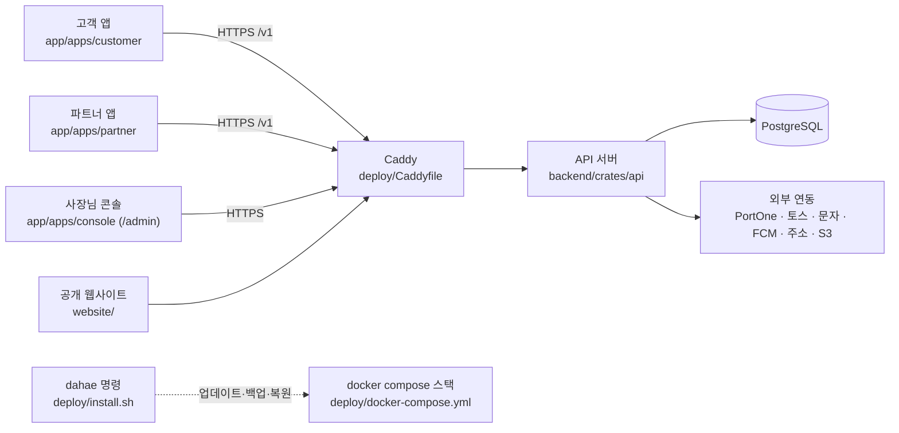

# 다해 기능 카탈로그 · Dahae feature catalogue

> 이 문서는 저장소 코드에 실제로 있는 기능만 적어요. 코드에 없는 기능은 여기에 넣지 않아요. 만들지 않은 것은 "의도적으로 뺀 것"에 적었어요.
> This catalogue lists only what the code in this repository does. Features not in the code are left out; see "Left out on purpose".
> 모든 항목의 주요 파일은 저장소 안의 상대 링크예요. 확인이 필요한 부분은 마지막 [확인이 필요한 점](#확인이-필요한-점) 과 [Known limits](#known-limits) 에 모았어요.

---

# 한국어

## 한눈에 보기

다해는 한국 홈클리닝 업체가 **자기 서버에 직접 설치해서** 쓰는 예약·결제·정산 플랫폼이에요. 터미널에서 설치 명령을 한 번 실행하고 두 가지 질문(도메인, 이메일)에 답하면 서버가 올라가요. 나머지는 사장님 콘솔의 설정 마법사에서 연동 키를 넣어요.

설치 전 준비물:

- Ubuntu 22.04·24.04 또는 Debian 12 서버 한 대 (설치 프로그램이 확인해요)
- 관리자 권한(sudo)으로 실행할 수 있는 터미널이나 SSH 접속
- 도메인 하나. 도메인이 이 서버의 공인 IP를 가리켜야 해요 (설치 중에 확인해요)
- 서버의 80·443 포트를 다른 프로그램이 쓰지 않아야 해요

| 구성 | 무엇을 하나 | 주로 쓰는 사람 | 위치 |
|---|---|---|---|
| **고객 앱** | 서비스 고르기, 견적·예약·결제, 정기 구독, 후기, 상담 | 고객 | [`app/apps/customer`](../app/apps/customer) |
| **파트너 앱** | 일감 수락, 출근·퇴근 체크인, 완료 사진, 견적, 수익·정산 확인 | 파트너(청소 기사), 팀원 | [`app/apps/partner`](../app/apps/partner) |
| **사장님 콘솔** | 설정 마법사, 예약·재무·정산·직원·품질·백업·알림 관리 | 사장님(소유자), 직원 | [`app/apps/console`](../app/apps/console) |
| **API 서버** | 모든 규칙·결제·알림·권한의 원천 (Rust, PostgreSQL) | 세 앱과 웹이 호출 | [`backend/crates/api`](../backend/crates/api) |
| **도메인 규칙** | 가격·할인·정산·세금·구독 계산 (I/O 없는 순수 함수) | (내부) | [`backend/crates/domain`](../backend/crates/domain) |
| **웹·HTTPS** | 공개 사이트, 콘솔 웹판, 자동 HTTPS, 보안 헤더 | 방문자, 사장님 | [`deploy/Caddyfile`](../deploy/Caddyfile) |
| **설치·관리 명령** | 한 줄 설치, `dahae` 명령(업데이트·백업·복원·되돌리기) | 사장님(서버 관리) | [`deploy/install.sh`](../deploy/install.sh) |

플랫폼 폴더 (코드에 있는 것만): 고객 앱은 android, ios, web, windows, macos, linux; 파트너 앱은 android, ios, windows; 콘솔은 android, ios, macos, web, windows ([`app/apps`](../app/apps)).

## 기능 묶음

표의 "사용자"는 누가 이 기능을 쓰는지예요. 고객, 파트너, 팀원, 직원(상담원·관리자), 사장님(소유자), 시스템(자동 작업) 중에서 골라요. 모든 경로는 `/v1` 아래 있어요 ([`routes/mod.rs`](../backend/crates/api/src/routes/mod.rs)).

### 1. 고객 예약과 견적

| 기능 | 한 줄 설명 | 사용자 | 주요 파일 |
|---|---|---|---|
| 서비스 목록과 가격 | 공개 서비스 목록, 예약 가능 시간, 견적 미리보기를 제공해요. | 고객 | [`routes/catalog.rs`](../backend/crates/api/src/routes/catalog.rs) |
| 예약 만들기·보기·취소 | 결제와 함께 예약을 만들고, 취소 미리보기 후 취소해요. | 고객 | [`routes/bookings.rs`](../backend/crates/api/src/routes/bookings.rs) |
| 일정 변경 | 방문 날짜·시간을 바꿔요. 바뀐 금액은 서버가 다시 계산해요. | 고객 | [`routes/bookings.rs`](../backend/crates/api/src/routes/bookings.rs) |
| 취소 정책 | 취소 수수료 규칙을 사장님이 바꿀 수 있고, 기본값은 파일로 들어 있어요. | 고객, 사장님 | [`domain/src/cancel_policy.rs`](../backend/crates/domain/src/cancel_policy.rs), [`cancel_policy_default.json`](../backend/crates/domain/src/cancel_policy_default.json) |
| 시간대 용량 | 시간대별 예약 가능 수를 사장님이 정해요. | 사장님, 고객 | [`routes/admin_content.rs`](../backend/crates/api/src/routes/admin_content.rs) (`slot-capacity`) |
| 피크 요금 | 공휴일·시간대 할증을 설정하고 예약 가격에 반영해요. | 사장님, 고객 | [`domain/src/peak.rs`](../backend/crates/domain/src/peak.rs) |
| 쿠폰 | 쿠폰을 발급하고 서비스별로 검사해요. 할인은 예약 계산에서만 적용돼요. | 고객, 사장님 | [`domain/src/coupon.rs`](../backend/crates/domain/src/coupon.rs), [`routes/me.rs`](../backend/crates/api/src/routes/me.rs) |
| 대기 예약 | 꽉 찬 시간에 대기 신청을 받고, 자리가 나면 15분 동안 자리를 잡아 줘요. | 고객 | [`routes/waitlist.rs`](../backend/crates/api/src/routes/waitlist.rs) |
| 집 정보 (가구) | 예약마다 집 구성(가구·평수 등)을 저장해요. | 고객 | [`domain/src/household.rs`](../backend/crates/domain/src/household.rs), [`routes/bookings.rs`](../backend/crates/api/src/routes/bookings.rs) |
| 주소록 | 여러 주소를 저장하고 예약 때 골라요. | 고객 | [`routes/me.rs`](../backend/crates/api/src/routes/me.rs) (`/me/addresses`) |
| 홈 피드 | 게스트와 로그인 고객에게 맞춘 홈 구성을 서버가 정렬해요. | 고객 | [`routes/feed.rs`](../backend/crates/api/src/routes/feed.rs), [`domain/src/feed.rs`](../backend/crates/domain/src/feed.rs) |
| 예약 메모 | 예약에 메모를 남기고 파트너와 주고받아요. | 고객, 파트너 | [`routes/bookings.rs`](../backend/crates/api/src/routes/bookings.rs) (`notes`), [`routes/partner_jobs.rs`](../backend/crates/api/src/routes/partner_jobs.rs) (`memo`) |

### 2. 결제·환불·영수증

| 기능 | 한 줄 설명 | 사용자 | 주요 파일 |
|---|---|---|---|
| 결제 수단 목록 | 10가지 결제 수단(카드, 간편결제, 삼성·애플페이, 계좌이체, 가상계좌, 휴대폰)을 목록으로 관리하고 사장님이 켜고 꺼요. | 고객, 사장님 | [`routes/payments.rs`](../backend/crates/api/src/routes/payments.rs) |
| 결제사: PortOne, 토스페이먼츠, 또는 둘 다 | 둘 다 선택이에요. 고객은 설정된 결제사의 결제수단을 모두 봐요. 결제수단마다 PortOne 에 채널 키가 있으면 PortOne, 없으면 토스페이먼츠로 가고, 결제·저장 카드·환불은 시작한 결제사에 남아요. | 고객, 사장님 | [`integrations.rs`](../backend/crates/api/src/integrations.rs) (`gateway_for`, `billing_gateway`), [`routes/payments.rs`](../backend/crates/api/src/routes/payments.rs) |
| 일회성 결제 (체크아웃) | 결제 의도를 만들고, 결제 후 서버가 PortOne에서 결제를 확인해 예약을 만들어요. 체크아웃은 30분 뒤 만료돼요. | 고객 | [`routes/checkouts.rs`](../backend/crates/api/src/routes/checkouts.rs), [`routes/checkout_policy.rs`](../backend/crates/api/src/routes/checkout_policy.rs) |
| 결제 확인 원칙 | 결제 금액과 상태가 맞을 때만 예약을 만들어요. 맞지 않으면 결제를 환불해요. | 시스템 | [`routes/checkouts.rs`](../backend/crates/api/src/routes/checkouts.rs) (`settle`, `give_back`) |
| 가상계좌 입금 | 가상계좌를 발급받고 입금 대기 상태를 보여 줘요. | 고객 | [`routes/checkouts.rs`](../backend/crates/api/src/routes/checkouts.rs), `app/apps/customer/lib/screens/virtual_account.dart` |
| 카드 등록 (정기 결제용) | 빌링키를 등록해 다음 결제에 쓰고, 삭제할 수 있어요. | 고객 | [`routes/me.rs`](../backend/crates/api/src/routes/me.rs) (`/me/payment-methods`), [`website/pay/billing.html`](../website/pay/billing.html) |
| 본인인증 | PortOne 본인인증 세션을 만들고 결과를 확인해요. | 고객 | [`routes/me.rs`](../backend/crates/api/src/routes/me.rs) (`/me/identity*`), [`providers/portone.rs`](../backend/crates/api/src/providers/portone.rs), [`website/pay/identity.html`](../website/pay/identity.html) |
| 예약금 (견적형) | 견적형 서비스는 예약금(기본 10%)을 내야 예약이 확정돼요. | 고객 | [`routes/bookings.rs`](../backend/crates/api/src/routes/bookings.rs) (`deposit`), [`domain/src/quote.rs`](../backend/crates/domain/src/quote.rs) (`deposit_bps` 기본 1000) |
| 잔금 | 나머지 금액을 따로 결제해요. | 고객 | [`routes/bookings.rs`](../backend/crates/api/src/routes/bookings.rs) (`balance`) |
| 환불 | 전액 환불을 PortOne에 요청해요. 실패하면 알림을 남기고 재시도해요. | 사장님, 직원, 시스템 | [`routes/bookings.rs`](../backend/crates/api/src/routes/bookings.rs) (`refund_all`), [`util.rs`](../backend/crates/api/src/util.rs) (`refund_durably`) |
| 환불 재시도 큐 | 실패한 보상 환불과 결제 누락 건을 주기적으로 다시 처리해요. | 시스템 | [`reconciler.rs`](../backend/crates/api/src/reconciler.rs), [`routes/checkout_recon.rs`](../backend/crates/api/src/routes/checkout_recon.rs) |
| 결제 웹훅 | PortOne 웹훅을 받아 결제·취소 상태를 맞춰요. 토스 웹훅은 지급 상태 동기화만 다시 실행해요. | 시스템 | [`routes/webhooks.rs`](../backend/crates/api/src/routes/webhooks.rs) |
| 결제 목록 (콘솔) | 고객별·상태별 체크아웃을 보고 실패 건을 확인해요. | 사장님, 직원 | [`routes/checkout_recon.rs`](../backend/crates/api/src/routes/checkout_recon.rs) |
| 포인트 | 적립·사용·환불 복구·만료·조정을 원장으로 관리해요. 현금 충전은 없어요. | 고객, 사장님 | [`points.rs`](../backend/crates/api/src/points.rs), [`domain/src/points.rs`](../backend/crates/domain/src/points.rs) |
| 팁 | 완료된 일감에 팁을 주면 저장된 결제 수단으로 결제하고, 전액이 파트너 정산에 더해져요. 프리셋 5,000 / 10,000 / 20,000원, 최대 300,000원. | 고객, 파트너 | [`routes/tips.rs`](../backend/crates/api/src/routes/tips.rs), [`domain/src/tip.rs`](../backend/crates/domain/src/tip.rs) |
| 현금영수증 | 결제 때 요청받고, 결제 완료 시 발행하고, 전액 환불 시 취소해요. 기본은 꺼져 있고 `PORTONE_CASH_RECEIPTS=1` 또는 콘솔 설정으로 켜요. | 고객, 사장님 | [`routes/cash_receipts.rs`](../backend/crates/api/src/routes/cash_receipts.rs), [`providers/portone_cash_receipt.rs`](../backend/crates/api/src/providers/portone_cash_receipt.rs) |
| 세금계산서 요청 | 사업자 고객이 요청을 남기면 사장님이 CSV 파일로 내보내 홈택스에서 직접 발행하고, 승인번호를 기록해요. 시스템이 발행하지 않아요. | 고객, 사장님 | [`routes/tax_invoices.rs`](../backend/crates/api/src/routes/tax_invoices.rs) |
| 중복 요청 방지 | `Idempotency-Key` 헤더로 결제·예약 POST의 중복 실행을 막고, 같은 응답을 24시간 돌려줘요. | 시스템 | [`idempotency.rs`](../backend/crates/api/src/idempotency.rs) |

### 3. 정기 구독

| 기능 | 한 줄 설명 | 사용자 | 주요 파일 |
|---|---|---|---|
| 정기 청소 구독 | 1주, 2주, 4주 간격으로 같은 서비스를 예약해요. | 고객 | [`routes/subscriptions.rs`](../backend/crates/api/src/routes/subscriptions.rs), [`domain/src/subscription.rs`](../backend/crates/domain/src/subscription.rs) |
| 방문 건너뛰기·옮기기 | 한 번의 방문만 건너뛰거나 날짜를 옮겨요. | 고객, 사장님 | [`routes/subscriptions.rs`](../backend/crates/api/src/routes/subscriptions.rs) (`visits/{visit}/skip`, `reschedule`) |
| 자동 방문 계획과 자동 결제 | 몇 분마다 한 번 돌아 앞으로 방문을 잡고, 내일 방문을 결제해요. 결제가 실패하면 예약을 만들지 않아요. | 시스템 | [`routes/subscription_engine.rs`](../backend/crates/api/src/routes/subscription_engine.rs) |
| 결제 실패 재시도와 일시 정지 | 실패하면 정해진 시간 뒤 재시도하고, 연속 실패가 기준을 넘으면 구독을 멈춰요. | 시스템 | [`routes/subscription_engine.rs`](../backend/crates/api/src/routes/subscription_engine.rs) |
| 구독 할인 정책 | 구독 할인율을 사장님이 정해요. | 사장님 | [`routes/subscriptions.rs`](../backend/crates/api/src/routes/subscriptions.rs) (`policy/subscription`) |
| 구독 지표 | 월 반복 매출(MRR), 이탈, 일할 매출을 보여 줘요. | 사장님 | [`routes/subscriptions.rs`](../backend/crates/api/src/routes/subscriptions.rs) (`subscriptions/metrics`) |
| 파트너의 구독 고객 보기 | 파트너는 담당 구독 고객의 지역만 보고 연락처는 보지 않아요. | 파트너 | [`routes/subscriptions.rs`](../backend/crates/api/src/routes/subscriptions.rs) (`partner_routes`) |

### 4. 파트너 업무와 정산

| 기능 | 한 줄 설명 | 사용자 | 주요 파일 |
|---|---|---|---|
| 파트너 프로필·선호 | 서비스, 지역, 일정 선호를 설정해요. | 파트너 | [`routes/partner.rs`](../backend/crates/api/src/routes/partner.rs) (`/me`, `/prefs`) |
| 일감 받기·배정 | 일감을 보고 수락하거나, 사장님이 파트너에게 배정해요. | 파트너, 사장님 | [`routes/partner_jobs.rs`](../backend/crates/api/src/routes/partner_jobs.rs) (`accept`, `assign`) |
| 견적 제출 | 견적형 일감에 최종 견적을 올려요. 고객 확정은 예약금으로 해요. | 파트너 | [`routes/partner_jobs.rs`](../backend/crates/api/src/routes/partner_jobs.rs) (`quote`, `quotes`) |
| 일정 변경 요청 | 파트너가 일정 변경을 요청해요. | 파트너 | [`routes/partner_jobs.rs`](../backend/crates/api/src/routes/partner_jobs.rs) (`reschedule`) |
| 출근·퇴근 체크인 | 방문 시작과 끝 시간을 기록해요. 시간은 직원 화면에 보여요. | 파트너, 팀원 | [`routes/site.rs`](../backend/crates/api/src/routes/site.rs), [`routes/member.rs`](../backend/crates/api/src/routes/member.rs) |
| 출입 코드 | 공동현관 등 출입 코드를 방문 당일에만 보여 줘요. 공개할 때마다 감사 기록을 남겨요. | 파트너, 팀원 | [`routes/site.rs`](../backend/crates/api/src/routes/site.rs) (`entry-code`), [`safety.rs`](../backend/crates/api/src/safety.rs) |
| 완료 처리와 사진 | 완료 사진을 올리고 일감을 완료해요. 사진은 위치 정보(EXIF)를 지우고 저장해요. | 파트너, 팀원 | [`routes/member.rs`](../backend/crates/api/src/routes/member.rs) (`complete`), [`routes/uploads.rs`](../backend/crates/api/src/routes/uploads.rs), [`image_meta.rs`](../backend/crates/api/src/image_meta.rs) |
| 노쇼 감시 | 도착 예정 시간이 지나도 체크인이 없으면 사건을 열고 직원에게 알려요. 다른 파트너로 바꿀 수 있어요. | 시스템, 직원 | [`noshow.rs`](../backend/crates/api/src/noshow.rs) |
| 수익·정산 보기 | 기간별 수익과 정산 내역을 파트너 앱에서 봐요. | 파트너 | [`routes/finance.rs`](../backend/crates/api/src/routes/finance.rs) (`earnings`), [`routes/partner.rs`](../backend/crates/api/src/routes/partner.rs) (`settlements`) |
| 지급 상태 흐름 | 지급은 요청됨 → 발송됨 → 지급 완료, 또는 실패(재시도 가능)만 허용해요. 지급 완료는 되돌릴 수 없어요. | 사장님, 시스템 | [`payout.rs`](../backend/crates/api/src/payout.rs), [`routes/payouts.rs`](../backend/crates/api/src/routes/payouts.rs) |
| 지급 방식 | 기본은 수동(사장님이 은행 앱에서 보내고 확인). 설정하면 토스 지급대행으로 보내요. 토스 연동은 샌드박스에서 아직 검증하지 않았어요. | 사장님 | [`providers/payout.rs`](../backend/crates/api/src/providers/payout.rs) |
| 지급 상태 동기화 | 토스에 열려 있는 지급 건의 상태를 주기적으로 물어봐요. 돈을 새로 보내지는 않아요. | 시스템 | [`payout_sync.rs`](../backend/crates/api/src/payout_sync.rs) |
| 정산 보류 | 정산을 보류 상태로 바꾸거나 되돌려요. 보류 상태가 되면 재무 집계에서 빠져요. | 사장님, 직원 | [`routes/admin_content.rs`](../backend/crates/api/src/routes/admin_content.rs) (`settlements/{id}/hold`) |
| 원천징수 계산 | 파트너 세무 구분에 따라 원천징수 금액을 계산해요. | 사장님 | [`domain/src/tax.rs`](../backend/crates/domain/src/tax.rs) (`payout_withholding`, `business_withholding`) |
| 파트너 계좌 | 지급 계좌 번호를 암호화해 저장하고, 사장님은 필요할 때만 열어 봐요. | 파트너, 사장님 | [`routes/partner.rs`](../backend/crates/api/src/routes/partner.rs) (`payout-account`), [`crypto.rs`](../backend/crates/api/src/crypto.rs) |

### 5. 팀과 직원 관리

| 기능 | 한 줄 설명 | 사용자 | 주요 파일 |
|---|---|---|---|
| 역할 | 고객, 파트너, 팀원, 관리자(staff_admin), 상담원(staff_consultant)으로 나눠요. 관리자 권한은 토큰이 아니라 매번 DB에서 확인해요. | 시스템 | [`auth.rs`](../backend/crates/api/src/auth.rs) |
| 팀원 관리 | 파트너가 팀원을 초대하고 관리해요. | 파트너 | [`routes/partner.rs`](../backend/crates/api/src/routes/partner.rs) (`team`) |
| 팀원 승인 | 새 팀원은 사장님이 승인하기 전까지 일감과 주소를 볼 수 없어요. 팀장은 승인할 수 없어요. | 사장님 | [`routes/member_approval.rs`](../backend/crates/api/src/routes/member_approval.rs) |
| 팀원 작업 | 배정받은 일감을 보고 체크인·완료를 해요. | 팀원 | [`routes/member.rs`](../backend/crates/api/src/routes/member.rs) |
| 직원 초대와 비밀번호 재설정 | 한 번만 쓰는 6자리 문자 코드(24시간, 여러 번 틀리면 무효)로 직원을 초대하고 비밀번호를 재설정해요. | 사장님, 직원 | [`routes/staff_sms.rs`](../backend/crates/api/src/routes/staff_sms.rs) |
| 직원 2단계 인증 | 직원 로그인 뒤에 TOTP 코드로 2단계 인증을 해요. 일회용 복구 코드도 있어요. | 직원, 사장님 | [`routes/staff_mfa.rs`](../backend/crates/api/src/routes/staff_mfa.rs), [`totp.rs`](../backend/crates/api/src/totp.rs) |
| 직원 켜기·끄기 | 직원 계정을 활성·비활성으로 바꿔요. | 사장님 | [`routes/admin_content.rs`](../backend/crates/api/src/routes/admin_content.rs) (`staff/{id}/active`) |
| 파트너 검증 체크리스트 | 신원, 세무 구분, 경력, 비상연락처 4가지를 확인하고 직원 정보를 저장해요. | 사장님 | [`routes/pro_verification.rs`](../backend/crates/api/src/routes/pro_verification.rs) |
| 사장님 계정 | 소유자 계정 하나가 계정, 직원 권한, 서버 설정 변경을 맡아요. 소유자 이전도 가능해요. | 사장님 | [`owner.rs`](../backend/crates/api/src/owner.rs), [`routes/owner.rs`](../backend/crates/api/src/routes/owner.rs) |
| 감사 기록 | 돈·개인정보·설정 변경처럼 코드가 감사 기록을 남기도록 한 작업(예: 정산 보류, 고객 정보 열람·삭제, 연동 설정 저장과 잠금 해제, 소유자 이전)을 감사 로그에 남기고 콘솔에서 봐요. | 사장님 | [`routes/audit.rs`](../backend/crates/api/src/routes/audit.rs), [`routes/mod.rs`](../backend/crates/api/src/routes/mod.rs) (`audit`) |

### 6. 품질·후기·사건

| 기능 | 한 줄 설명 | 사용자 | 주요 파일 |
|---|---|---|---|
| 파트너 품질 점수 | 최근 90일의 평점, 체크인, 예약, 사건을 모아 점수를 매겨요. | 시스템, 파트너, 사장님 | [`quality.rs`](../backend/crates/api/src/quality.rs), [`domain/src/quality.rs`](../backend/crates/domain/src/quality.rs) |
| 자동 일시 정지와 경고 | 점수가 사장님이 정한 기준 아래로 내려가면 배정을 멈추고, 파트너에게 한 번 알려요. 사장님이 해제할 수 있어요. | 시스템, 사장님 | [`quality.rs`](../backend/crates/api/src/quality.rs), [`routes/admin_content.rs`](../backend/crates/api/src/routes/admin_content.rs) (`quality-thresholds`, `pros/{id}/quality`) |
| 후기 작성 | 완료된 예약에 후기를 남겨요. | 고객 | [`routes/bookings.rs`](../backend/crates/api/src/routes/bookings.rs) (`review`) |
| 후기 신고와 심사 | 후기를 신고하고, 사장님이 승인하거나 숨겨요. | 고객, 사장님 | [`routes/growth.rs`](../backend/crates/api/src/routes/growth.rs) (`reviews/{id}/report`, `decision`, `author`) |
| 파트너 후기 보기 | 파트너는 자기 후기를 봐요. | 파트너 | [`routes/partner.rs`](../backend/crates/api/src/routes/partner.rs) (`reviews`) |
| 사건(클레임·분쟁) | 고객과 파트너가 예약에 대해 사건을 열고, 직원이 배정·메모·정리해요. 환불과 정산 보류는 관리자만 해요. | 고객, 파트너, 직원 | [`routes/cases.rs`](../backend/crates/api/src/routes/cases.rs) |

### 7. 사장님 콘솔과 분석

| 기능 | 한 줄 설명 | 사용자 | 주요 파일 |
|---|---|---|---|
| 대시보드 | 관리자 대시보드 화면이에요. 데이터는 `/admin/dashboard`에서 받아요. | 사장님, 직원 | [`routes/admin.rs`](../backend/crates/api/src/routes/admin.rs) (`dashboard`), [`dashboard.dart`](../app/apps/console/lib/screens/dashboard.dart) |
| 예약 관리 | 예약 목록과 상세를 보고, 상태를 바꾸고, 견적을 보내요. | 사장님, 직원 | [`routes/admin.rs`](../backend/crates/api/src/routes/admin.rs) (`bookings`, `send-quote`), [`bookings.dart`](../app/apps/console/lib/screens/bookings.dart) |
| 재무 요약과 차트 | 기간별 요약, 시계열, 파트너·서비스별 표를 보여 줘요. 모든 화면과 내보내기가 같은 숫자를 써요. | 사장님 | [`routes/finance.rs`](../backend/crates/api/src/routes/finance.rs), [`finance.dart`](../app/apps/console/lib/screens/finance.dart) |
| 회계용 내보내기 | 원장, 월별, 정산, 부가세 추정, 원천징수, 세금계산서 CSV를 내려받아요. 세법 규칙은 회계사 확인이 필요해요. | 사장님 | [`routes/finance.rs`](../backend/crates/api/src/routes/finance.rs) (`finance/export/*`), [`routes/tax_invoices.rs`](../backend/crates/api/src/routes/tax_invoices.rs), [`docs/finance-tax.md`](finance-tax.md) |
| 지급명세서·급여 자료 | 원천징수 대상 파트너의 지급명세서 CSV를 만들어요. 급여 계산은 하지 않아요. | 사장님 | [`routes/finance_payroll.rs`](../backend/crates/api/src/routes/finance_payroll.rs) |
| 정산 관리 | 정산 목록, 지급 요청, 지급 확인, 실패 재시도를 해요. | 사장님 | [`routes/payouts.rs`](../backend/crates/api/src/routes/payouts.rs), [`routes/admin_content.rs`](../backend/crates/api/src/routes/admin_content.rs) (`settlements`) |
| 서비스·요금 설정 | 서비스 목록, 요금표, 견적 공식, 피크 요금, 쿠폰을 바꿔요. | 사장님 | [`routes/admin_content.rs`](../backend/crates/api/src/routes/admin_content.rs), [`settings_registry.rs`](../backend/crates/api/src/settings_registry.rs) |
| 운영 설정 값 | 그룹별 한도와 임계치를 바꿔요. 한 번에 모두 검사하고, 바뀐 항목마다 감사 기록을 남겨요. | 사장님 | [`routes/settings.rs`](../backend/crates/api/src/routes/settings.rs), [`settings_registry.rs`](../backend/crates/api/src/settings_registry.rs) |
| 퍼널과 코호트 분석 | 가입·예약 퍼널과 가입 월별 코호트를 업무 테이블에서 계산해요. | 사장님 | [`analytics.rs`](../backend/crates/api/src/analytics.rs) (`analytics/funnel`, `cohorts`) |
| 유입 경로 | 첫 방문의 UTM과 추천 정보를 가입 때 한 번 저장하고, 출처별로 보여 줘요. | 사장님 | [`acquisition.rs`](../backend/crates/api/src/acquisition.rs) |
| 감사 로그 조회 | 감사 로그를 조회해요. | 사장님 | [`routes/audit.rs`](../backend/crates/api/src/routes/audit.rs) |
| 갱신 일정 | 도메인, 키 검사, 인증서 같은 갱신 항목의 기한을 관리하고, 30일 전과 7일 전에 문자로 알려요. | 사장님 | [`renewals.rs`](../backend/crates/api/src/renewals.rs), [`routes/renewals.rs`](../backend/crates/api/src/routes/renewals.rs) |

### 8. 알림과 메시지

| 기능 | 한 줄 설명 | 사용자 | 주요 파일 |
|---|---|---|---|
| 실시간 이벤트 | WebSocket으로 예약·채팅·알림 변화를 바로 보내요. 여러 서버 노드에서도 맞춰요. | 모든 앱 | [`realtime.rs`](../backend/crates/api/src/realtime.rs), [`routes/mod.rs`](../backend/crates/api/src/routes/mod.rs) (`/ws`) |
| 앱 푸시 | Firebase(FCM)로 앱 푸시를 보내요. 실시간 연결이 없을 때 대신 보내요. | 모든 앱 | [`providers/fcm.rs`](../backend/crates/api/src/providers/fcm.rs), [`realtime.rs`](../backend/crates/api/src/realtime.rs) |
| 문자와 알림톡 | 솔라피(Solapi)로 문자와 알림톡을 보내요. 실패하면 최대 8번 시도(처음 시도 포함)하고, 그래도 안 되면 실패 기록을 남기고 사장님에게 알려요. | 시스템 | [`sms_outbox.rs`](../backend/crates/api/src/sms_outbox.rs), [`providers/sms.rs`](../backend/crates/api/src/providers/sms.rs) |
| 알림 문구 편집 | 알림 종류와 언어별 문구를 사장님이 고치고 미리보기 해요. | 사장님 | [`routes/notify_templates.rs`](../backend/crates/api/src/routes/notify_templates.rs), [`i18n.rs`](../backend/crates/api/src/i18n.rs) |
| 인앱 알림함 | 알림 목록을 보고 읽음 처리해요. | 모든 앱 | [`routes/me.rs`](../backend/crates/api/src/routes/me.rs) (`/me/notifications`) |
| 고객·파트너 상담 채팅 | 고객과 파트너는 각각 직원과만 대화해요. 사진을 보낼 수 있어요. | 고객, 파트너, 직원 | [`routes/chat.rs`](../backend/crates/api/src/routes/chat.rs), [`uploads.rs`](../backend/crates/api/src/routes/uploads.rs) |
| 고객 문의 도우미 | 직원이 없을 때 또는 항상 먼저, 문의에 답하는 도우미예요. 아래 [고객 문의 도우미](#9-고객-문의-도우미) 를 보세요. | 고객, 파트너, 직원 | [`ai.rs`](../backend/crates/api/src/ai.rs) |

### 9. 고객 문의 도우미

이 기능은 다해가 제공하는 **고객 문의 도우미**예요. 사장님 설정(콘솔 → 설정 마법사 → 도우미 카드)에서 API 키를 넣고 켜요. 키가 없으면 꺼져 있고, 채팅 화면에는 "AI 상담원이 꺼져 있어요"라고 나와요 ([`app_ko.arb`](../app/packages/core/lib/l10n/app_ko.arb)).

| 항목 | 코드가 하는 일 | 주요 파일 |
|---|---|---|
| 응답 시점 | `offline`: 직원이 없거나 영업시간 밖일 때만 답해요. `always_first`: 항상 먼저 답하고, 직원이 답하거나 일시 중지하면 물러나요. | [`ai.rs`](../backend/crates/api/src/ai.rs) (`Mode`, `should_answer`) |
| 답변 범위 | 매장 정보와 이 고객의 예약 정보만 근거로 써요. 가격, 할인, 일정, 직원 이름을 지어내지 말라고 규칙에 적어 둬요. 답은 평문 최대 5문장이에요. | [`ai.rs`](../backend/crates/api/src/ai.rs) (`RULES`) |
| 할 수 없는 일 | 예약을 바꾸거나 취소하거나 새로 잡을 수 없어요. 환불, 할인, 보상을 약속하지 않아요. | [`ai.rs`](../backend/crates/api/src/ai.rs) (`RULES`) |
| 사람에게 넘기기 | 규칙이 불만, 환불, 취소 수수료 분쟁, 파손, 부상, 결제 문제를 사람에게 넘기라고 지시해요. 모델이 넘기거나 근거 검사에 걸리면 직원이 확인하겠다고 답하고 사건 한 건을 열어요. 주제를 분류하는 것은 코드가 하지 않아요. | [`ai.rs`](../backend/crates/api/src/ai.rs) (`handoff_text`), [`routes/cases.rs`](../backend/crates/api/src/routes/cases.rs) (`open_from_ai`) |
| 근거 검사 | 답변에 매장 정보나 예약에 없는 금액, 또는 환불·할인 표현이 있으면 버리고 사람에게 넘겨요. | [`ai.rs`](../backend/crates/api/src/ai.rs) (`check_reply`), [`growth.rs`](../backend/crates/domain/src/growth.rs) (`ungrounded_claim`) |
| 연락처 가리기 | 고객이 쓴 전화번호 같은 연락처는 외부 응답 API에 보내기 전에 가려요. | [`growth.rs`](../backend/crates/domain/src/growth.rs) (`redact_contacts`), [`ai.rs`](../backend/crates/api/src/ai.rs) (주석) |
| 사용량 한도 | 대화방당 시간당 12회, 회원(고객·파트너)당 하루 40회, 매장 하루 1,000회가 기본이에요. 콘솔에서 바꿔요. | [`ai.rs`](../backend/crates/api/src/ai.rs) (`DEFAULT_*_CAP`) |
| 일시 중지 | 직원이 대화방별로 도우미를 멈출 수 있어요. 바꾼 기록은 감사 로그에 남아요. | [`routes/chat.rs`](../backend/crates/api/src/routes/chat.rs) (`threads/{id}/ai`) |
| 표시 | 도우미 답변에는 "AI" 표시가 붙어요. 메시지에 `ai: true` 표시가 있어요. | [`routes/chat.rs`](../backend/crates/api/src/routes/chat.rs), `app/packages/core/lib/l10n/app_ko.arb` (`aiBadge`) |
| 보관 기간 | 도우미 대화는 기본 180일 뒤 지워요. 설정 키는 `ai_chat_retention_days`예요. | [`retention.rs`](../backend/crates/api/src/retention.rs), [`settings_registry.rs`](../backend/crates/api/src/settings_registry.rs) |
| 국외 이전 고지 | 응답은 미국에 있는 외부 응답 API 제공사를 거쳐 만들어요. 보내는 것은 고객이 입력한 문장과 상담 맥락이에요. 고지 내용은 개인정보처리방침 6항에 있어요. | [`website/privacy.html`](../website/privacy.html) |
| 동의 | 가입 때 "국외 이전" 동의를 필수로 받아요. 이 동의는 철회할 수 없어요. 아래 [확인이 필요한 점](#확인이-필요한-점)을 보세요. | [`privacy.rs`](../backend/crates/api/src/privacy.rs) (`CONSENTS`, `update_consents`), `app/apps/customer/lib/screens/signup_consent.dart` |

### 10. 개인정보와 동의

| 기능 | 한 줄 설명 | 사용자 | 주요 파일 |
|---|---|---|---|
| 동의 기록 | 약관, 개인정보, 국외 이전은 필수, 마케팅과 위치 정보는 선택이에요. 동의는 추가만 되고 지우지 않아요. 최신 정책 버전(`CONSENT_VERSION`)과 다르면 인정하지 않아요. | 고객 | [`privacy.rs`](../backend/crates/api/src/privacy.rs), [`routes/me.rs`](../backend/crates/api/src/routes/me.rs) (`/me/consents`) |
| 위치 정보 동의 | 위치기반서비스 이용약관은 "현재 위치 사용" 전에 따로 받아요. | 고객 | [`privacy.rs`](../backend/crates/api/src/privacy.rs) (`LOCATION`) |
| 내 정보 내려받기 | 고객이 자기 데이터를 JSON으로 받아요. | 고객 | [`privacy.rs`](../backend/crates/api/src/privacy.rs) (`export`), [`routes/me.rs`](../backend/crates/api/src/routes/me.rs) (`/me/export`) |
| 계정 삭제 | 고객이 계정을 지우면 개인정보를 익명화하고, 세션과 기기와 업로드 파일을 지워요. 종료된 예약 기록은 주소와 방문 메모 등을 지운 채 남아요. | 고객 | [`privacy.rs`](../backend/crates/api/src/privacy.rs) (`delete_account`), [`routes/me.rs`](../backend/crates/api/src/routes/me.rs), [`website/delete-account.html`](../website/delete-account.html) |
| 정보주체 요청 처리 (콘솔) | 고객을 전화번호로 찾고, 열람(내보내기)이나 삭제를 해요. TOTP 확인은 5분 안에 해야 하고, 삭제는 고객 전화번호를 다시 입력해야 해요. | 사장님 | [`routes/privacy_requests.rs`](../backend/crates/api/src/routes/privacy_requests.rs) |
| 자동 파기 | 매시간 보관 기간이 지난 자료를 지워요. 실패하면 다음 시간에 다시 해요. 무엇을 언제 지우는지는 문서에 있어요. | 시스템 | [`retention.rs`](../backend/crates/api/src/retention.rs), [`docs/privacy-retention.md`](privacy-retention.md) |
| 광고 발송 게이트 | 광고성 알림은 마케팅 동의가 있을 때만 보내요. 밤 21시부터 아침 8시(KST)에는 보내지 않고, 주 단위 발송 상한이 있어요. 광고 문자에는 "(광고)"와 수신거부 안내가 붙어요. | 사장님, 시스템 | [`marketing.rs`](../backend/crates/api/src/marketing.rs) |
| 애플 탈퇴 알림 | 애플이 보낸 계정 해지 알림을 받아 해당 고객 계정을 정리해요. | 시스템 | [`routes/auth.rs`](../backend/crates/api/src/routes/auth.rs) (`auth/apple/notifications`), [`privacy.rs`](../backend/crates/api/src/privacy.rs) (`apple_notification`) |
| 분석 동의와 익명 수집 | 앱은 사용자가 동의한 뒤에만 분석 이벤트를 보내요. 사용자 ID와 자유 입력은 보내지 않고, 설치마다 바뀌는 무작위 ID 하나는 보내요. 90일 뒤 지워요. | 고객, 파트너 | [`analytics.rs`](../backend/crates/api/src/analytics.rs) |

### 11. 보안

| 기능 | 한 줄 설명 | 사용자 | 주요 파일 |
|---|---|---|---|
| 로그인·인증번호 잠금 | IP와 계정 쌍으로 잠그고, 계정 단위로도 넓게 잠가요. 점점 길어지는 대기 시간을 써요. | 시스템 | [`lockout.rs`](../backend/crates/api/src/lockout.rs) |
| 요청 제한 | IP별로 요청 수를 제한해요. 인증, 업로드, 공개 쓰기 경로는 따로 제한해요. | 시스템 | [`ratelimit.rs`](../backend/crates/api/src/ratelimit.rs) |
| 사장님 TOTP 확인 | 사장님 권한이 필요한 요청마다 TOTP 코드를 한 번씩 요구해요. 쓴 코드는 다시 쓸 수 없어요. | 사장님 | [`owner.rs`](../backend/crates/api/src/owner.rs) (`X-Owner-Totp`) |
| 민감 정보 암호화 | 계좌 번호, 출입 코드, 키 값을 AES-GCM으로 암호화해 저장해요. | 시스템 | [`crypto.rs`](../backend/crates/api/src/crypto.rs), [`safety.rs`](../backend/crates/api/src/safety.rs), [`integrations.rs`](../backend/crates/api/src/integrations.rs) |
| 업로드 검사 | 파일 머리 바이트로 종류를 확인하고, 이름을 무작위로 바꾸고, 서명된 짧은 주소로만 보여 줘요. | 시스템 | [`routes/uploads.rs`](../backend/crates/api/src/routes/uploads.rs), [`image_meta.rs`](../backend/crates/api/src/image_meta.rs) |
| 비밀번호 검사 | 유출된 비밀번호 목록(`breached_passwords.txt`)에 있으면 쓰지 못하게 해요. | 시스템 | [`auth.rs`](../backend/crates/api/src/auth.rs) (`BREACHED_PASSWORDS`) |
| 세션 관리 | 기기별 세션을 보고 끊어요. 모든 기기에서 로그아웃할 수 있어요. | 모든 사용자 | [`routes/auth.rs`](../backend/crates/api/src/routes/auth.rs) (`sessions`, `logout-all`), [`routes/owner.rs`](../backend/crates/api/src/routes/owner.rs) (`sign-out-all`) |
| 연동 키 잠금 | 연동 카드는 저장하면 잠기고, 사장님이 확인을 거쳐 5분 동안만 풀 수 있어요. 결제 연동과 토스 지급 카드는 처음 저장할 때 사장님 TOTP 코드도 확인해요. 잠그기와 풀기는 모두 감사 기록이 남아요. | 사장님 | [`routes/setup.rs`](../backend/crates/api/src/routes/setup.rs) (`unlock`, `lock`, `UNLOCK_TTL_SECS`) |
| 키 묶음 봉인 | 복원에 꼭 필요한 두 키(`DATA_KEY`, `JWT_SECRET`)를 비밀번호로 잠근 파일로 만들어요. PBKDF2 600,000회를 써요. | 사장님 | [`keys_bundle.rs`](../backend/crates/api/src/keys_bundle.rs), [`routes/keys.rs`](../backend/crates/api/src/routes/keys.rs) |
| 보안 헤더와 민감 경로 차단 | 콘텐츠 보안 정책(CSP), 로그에서 토큰과 서명 값을 가리고, `/metrics`와 `/ready`는 바깥에 열지 않아요. | 시스템 | [`deploy/Caddyfile`](../deploy/Caddyfile) |
| 컨테이너 강화 | 모든 컨테이너는 읽기 전용 파일 시스템과 권한 상승 금지를 쓰고, Linux 권한은 기본으로 모두 뺀 뒤 필요한 것만 다시 줘요(cap_add). | 시스템 | [`deploy/docker-compose.yml`](../deploy/docker-compose.yml) |
| 이미지 서명 확인 | 설치와 업데이트는 cosign으로 서명을 확인한 뒤에만 이미지를 받아요. 확인하지 못하면 멈춰요. | 사장님 | [`deploy/install.sh`](../deploy/install.sh) (`verify_image`), [`release.yml`](../.github/workflows/release.yml) |
| 멱등성 | 같은 `Idempotency-Key`의 중복 결제·예약 요청은 한 번만 처리해요. | 시스템 | [`idempotency.rs`](../backend/crates/api/src/idempotency.rs) |
| 측정 지표 보호 | `/metrics`는 `METRICS_TOKEN`을 설정하면 그 bearer 토큰이 있어야 읽고, 설정하지 않으면 서버 안(루프백) 접속만 읽을 수 있어요. Caddy가 인터넷에서 막아요([`deploy/Caddyfile`](../deploy/Caddyfile) 82–83행). 라벨은 경로 템플릿만 써서 개인 정보가 새지 않아요. | 시스템, 사장님 | [`metrics.rs`](../backend/crates/api/src/metrics.rs) |

### 12. 백업

| 기능 | 한 줄 설명 | 사용자 | 주요 파일 |
|---|---|---|---|
| 매일 백업 | 매일 새벽 3시 30분에 데이터베이스를 백업해요. 사진 파일도 함께 묶어요. | 시스템 | [`deploy/install.sh`](../deploy/install.sh) (`cmd_write_cron`, `cmd_backup`) |
| 외부 백업 | S3 호환 저장소에 올려요. 올리기 전에 DATA_KEY로 암호화해요(`MKB1` 형식). | 시스템, 사장님 | [`backup.rs`](../backend/crates/api/src/backup.rs) |
| 보관 기간 | 외부 백업은 기본 30일 동안 두고, 최대 3,650일까지 바꿀 수 있어요. | 사장님 | [`integrations.rs`](../backend/crates/api/src/integrations.rs) (`BACKUP_RETENTION_DEFAULT`) |
| 복원 | 로컬 백업 또는 외부 백업에서 복원해요. 복원 전에 터미널에서 `yes`를 입력해야 해요. `--yes`로 이 확인을 생략할 수 있어요. | 사장님 | [`deploy/install.sh`](../deploy/install.sh) (`cmd_restore`, `cmd_restore_offsite`) |
| 키 묶음 백업 | 복원 때 필요한 두 키를 따로 보관해요. 서버를 잃어도 키를 되찾을 수 있어요. | 사장님 | [`deploy/install.sh`](../deploy/install.sh) (`keys-backup`, `keys-restore`), [`keys_bundle.rs`](../backend/crates/api/src/keys_bundle.rs) |
| WAL 보관 (선택) | 설정하면 데이터베이스 변경 기록을 이어서 보관하고, 일요일마다 전체 백업을 해요. | 시스템 | [`deploy/wal`](../deploy/wal), [`deploy/install.sh`](../deploy/install.sh) (`WAL_ARCHIVE_MODE`) |
| 백업 실패 알림 | 백업이 실패하면 사장님에게 알려요. | 시스템, 사장님 | [`ops_alerts.rs`](../backend/crates/api/src/ops_alerts.rs), [`deploy/install.sh`](../deploy/install.sh) (`alert backup`) |

### 13. 업데이트와 운영

| 기능 | 한 줄 설명 | 사용자 | 주요 파일 |
|---|---|---|---|
| 업데이트 | `dahae update`로 새 버전을 받아요. 먼저 백업하고, 새 버전이 응답하지 않으면 이전 버전으로 되돌려요. | 사장님 | [`deploy/install.sh`](../deploy/install.sh) (`cmd_update`, `cmd_rollback`) |
| 되돌리기 | `dahae rollback`으로 이전 버전 이미지로 돌아가요. | 사장님 | [`deploy/install.sh`](../deploy/install.sh) (`cmd_rollback`) |
| 채널 | 안정(stable)과 베타(beta) 채널 중에서 고르고, 채널 설치 주소도 달라요. | 사장님 | [`deploy/install.sh`](../deploy/install.sh) (`cmd_channel`) |
| 자동 업데이트 | 요일과 시각을 정하면 그때 업데이트해요. 백업과 같은 잠금을 써서 겹치지 않아요. | 시스템, 사장님 | [`deploy/install.sh`](../deploy/install.sh) (`cmd_update_schedule`, `cmd_auto_update`) |
| 콘솔에서 서버 작업 | 콘솔에서 백업 실행, 업데이트, 채널 변경, 재시작 같은 작업을 요청해요. 요청은 작업 파일이 되고, 서버의 실행 스크립트가 정해진 종류만 실행해요. | 사장님 | [`host_jobs.rs`](../backend/crates/api/src/host_jobs.rs), [`host_status.rs`](../backend/crates/api/src/host_status.rs), [deploy 폴더](../deploy) |
| 운영 상태 | 외부 연동별 마지막 성공과 실패, 디스크, 데이터베이스 상태를 보여 줘요. 오류 코드만 저장하고 제공사 메시지는 저장하지 않아요. | 사장님 | [`ops.rs`](../backend/crates/api/src/ops.rs), [`routes/ops.rs`](../backend/crates/api/src/routes/ops.rs) |
| 사장님 알림 | 실패, 백업 문제, 디스크 부족을 콘솔, 문자, 푸시로 알려요. 같은 사건은 쿨다운 동안 한 번만 보내요. 밤 시간(KST)에는 보류했다가 아침에 보내요. | 사장님 | [`ops_alerts.rs`](../backend/crates/api/src/ops_alerts.rs) |
| 외부 가동 확인 | healthchecks.io 같은 주소로 5분마다 살아 있음을 알려요. `dahae heartbeat`로 설정해요. | 사장님 | [`deploy/install.sh`](../deploy/install.sh) (`cmd_heartbeat`) |
| 선택형 모니터링 | Uptime Kuma를 `monitoring` 프로필로 띄울 수 있어요. 기본 실행에는 없어요. | 사장님 | [`deploy/docker-compose.yml`](../deploy/docker-compose.yml) |
| 측정 지표 | Prometheus 형식으로 요청 수와 오류 수를 보여 줘요. | 사장님 (운영자) | [`metrics.rs`](../backend/crates/api/src/metrics.rs) |
| 원격 설정 | 기능 켜기·끄기, 점검 모드, 앱 최소 버전을 공개 설정 문서로 보내요. 앱은 30초 동안 캐시해요. | 모든 앱, 사장님 | [`routes/config.rs`](../backend/crates/api/src/routes/config.rs) |
| 앱 오류 보고 | 앱이 오류를 보내면 개인 정보를 가리고 저장해요. 콘솔에서 최근 오류를 봐요. | 시스템, 사장님 | [`client_errors.rs`](../backend/crates/api/src/client_errors.rs) |
| 데모 데이터 | `dahae demo load`로 한국어 샘플 데이터를 채우고, `dahae demo clear`로 그 데이터만 지워요. | 사장님, 개발자 | [`demo/mod.rs`](../backend/crates/api/src/demo/mod.rs), [`routes/demo_admin.rs`](../backend/crates/api/src/routes/demo_admin.rs) |

### 14. 설치와 설정 마법사

| 기능 | 한 줄 설명 | 사용자 | 주요 파일 |
|---|---|---|---|
| 한 줄 설치 | 도메인과 이메일 두 질문에 답하면 Docker, 보안 키, HTTPS, 매일 백업, `dahae` 명령까지 설치해요. 설치 경로는 `/opt/malkkeum`이에요. | 사장님(서버 관리자) | [`deploy/install.sh`](../deploy/install.sh) |
| 서버 점검 | 운영체제(Ubuntu 22.04·24.04, Debian 12), CPU 구조, 메모리, 디스크, 점유된 포트를 확인해요. | 사장님 | [`deploy/install.sh`](../deploy/install.sh) (`preflight`) |
| 자동 HTTPS | Caddy가 인증서를 받고 갱신해요. 내부 인증서는 테스트용이에요. | 시스템 | [`deploy/Caddyfile`](../deploy/Caddyfile) |
| 서버 보안 기본값 | 자동 보안 업데이트, fail2ban, 방화벽, SSH 키 로그인 확인을 설정할 수 있어요. 비밀번호 로그인을 끄기 전에 키가 있는지 확인해요. | 사장님 | [`deploy/install.sh`](../deploy/install.sh) (`harden_host`, `firewall_setup`, `ssh_keyonly_check`) |
| `dahae` 명령 | 상태, 업데이트, 백업, 복원, 되돌리기, 로그, 채널, 알림 설정을 한 명령으로 해요. | 사장님 | [`deploy/install.sh`](../deploy/install.sh) (`write_cli`) |
| 처음 설정 코드 | 설치 때 12자리 코드를 보여 줘요. 7일 안에 사장님 계정을 만들 때 써요. 다시 만들 수 있어요. | 사장님 | [`deploy/install.sh`](../deploy/install.sh) (`setup_code`), [`routes/setup.rs`](../backend/crates/api/src/routes/setup.rs) |
| 처음 관리자 만들기 | 설치 코드를 넣고 첫 관리자(사장님) 계정을 만들어요. | 사장님 | [`routes/setup.rs`](../backend/crates/api/src/routes/setup.rs) (`setup/admin`) |
| 설정 마법사 | 연동 카드 11개(결제, 문자, 푸시, 카카오, 네이버, 구글, 애플, 도우미, 백업, 지급, 주소)를 콘솔에서 입력해요. 키 파일도 올려요. | 사장님 | [`routes/setup.rs`](../backend/crates/api/src/routes/setup.rs), [`integrations.rs`](../backend/crates/api/src/integrations.rs) (`Section::ALL`), [`app/apps/console/lib/screens/setup.dart`](../app/apps/console/lib/screens/setup.dart) |
| 연결 테스트 | 카드마다 [연결 확인] (PortOne 은 [API 키 확인]) 을 눌러 연결을 확인해요. 잠긴 카드도 저장된 값으로 확인할 수 있어요. 결과는 저장돼요. | 사장님 | [`routes/setup.rs`](../backend/crates/api/src/routes/setup.rs) (`setup/{section}/test`) |
| 사업자 정보 | 상호, 고객센터 연락처, 운영 시간 등 판매자 정보를 입력해요. 공개 사이트의 판매자 정보 블록에 나와요. | 사장님 | [`routes/setup.rs`](../backend/crates/api/src/routes/setup.rs) (`setup/business`), [`routes/seller.rs`](../backend/crates/api/src/routes/seller.rs) |
| 앱 링크 | 안드로이드 지문과 애플 팀 ID를 넣으면 네이버 로그인 복귀 주소를 앱으로 연결해요. | 사장님 | [`app_links.rs`](../backend/crates/api/src/app_links.rs), [`setup_app_links.dart`](../app/apps/console/lib/screens/setup_app_links.dart) |
| 결제 수단 설정 | 결제 수단을 켜고 꺼요. 수단마다 결제사가 보이고, PortOne 채널 키도 토스페이먼츠도 없으면 켤 수 없어요. | 사장님 | [`routes/payments.rs`](../backend/crates/api/src/routes/payments.rs), [`setup_pay_methods.dart`](../app/apps/console/lib/screens/setup_pay_methods.dart) |
| 심사용 계정 | 앱스토어 심사용 계정과 샘플 데이터를 만들고 기간을 정해요. | 사장님 | [`routes/setup.rs`](../backend/crates/api/src/routes/setup.rs) (`setup/review`) |
| 설정 안내 글 | 마법사 각 단계의 안내 글과 서식을 보여 줘요. | 사장님 | [`setup_guides.dart`](../app/apps/console/lib/screens/setup_guides.dart), [`setup_formats.dart`](../app/apps/console/lib/screens/setup_formats.dart) |

### 15. 외부 연동 (업체가 자기 키를 콘솔에서 연결)

모든 키는 콘솔 설정 마법사에서 입력해요. 입력값은 AES-GCM으로 암호화해 `integration_settings`에 저장하고, 재시작 없이 바로 반영해요. 환경 변수는 개발자용 대체 수단이에요 ([`integrations.rs`](../backend/crates/api/src/integrations.rs)).

| 연동 | 무엇에 쓰나 | 콘솔 입력 항목 (코드 기준) | 주요 파일 |
|---|---|---|---|
| PortOne V2 결제·본인인증 | 결제, 빌링키, 본인인증, 현금영수증 | 상점 ID, API 시크릿, 웹훅 시크릿, 결제 수단별 채널 키, 현금영수증 켜기 | [`providers/portone.rs`](../backend/crates/api/src/providers/portone.rs), [`integrations.rs`](../backend/crates/api/src/integrations.rs) |
| 토스페이먼츠 지급대행 | 파트너 정산 지급 | 지급 모드, 시크릿 키, 보안 키(JWE 암호화) | [`providers/payout.rs`](../backend/crates/api/src/providers/payout.rs), [`providers/toss_jwe.rs`](../backend/crates/api/src/providers/toss_jwe.rs), [`providers/toss_webhook.rs`](../backend/crates/api/src/providers/toss_webhook.rs) |
| 솔라피 문자·알림톡 | 문자, 알림톡, 인증번호 | API 키, API 시크릿, 발신번호, 카카오 채널 ID, 템플릿 | [`providers/sms.rs`](../backend/crates/api/src/providers/sms.rs), [`sms_outbox.rs`](../backend/crates/api/src/sms_outbox.rs) |
| Firebase 앱 푸시 | 앱 푸시 알림 | 서비스 계정 키 파일 | [`providers/fcm.rs`](../backend/crates/api/src/providers/fcm.rs) |
| 도로명주소 검색 | 주소 검색 (승인키는 서버에만 있어요) | 승인키 | [`routes/address.rs`](../backend/crates/api/src/routes/address.rs), [`address.rs`](../backend/crates/api/src/address.rs) |
| S3 호환 백업 저장소 | 외부 백업 보관 | 엔드포인트, 리전, 버킷, 접근 키, 비밀 키, 보관 일수 | [`backup.rs`](../backend/crates/api/src/backup.rs) |
| 카카오 로그인 | 소셜 로그인, 계정 삭제 때 연결 해제 | 앱 ID, 관리자 키(선택) | [`providers/social.rs`](../backend/crates/api/src/providers/social.rs) |
| 네이버 로그인 | 소셜 로그인 | 클라이언트 ID, 클라이언트 시크릿 | [`providers/social.rs`](../backend/crates/api/src/providers/social.rs) |
| 구글 로그인 | 소셜 로그인 | 클라이언트 ID 목록 | [`providers/social.rs`](../backend/crates/api/src/providers/social.rs) |
| 애플 로그인 | 소셜 로그인, 탈퇴 때 토큰 취소 | 클라이언트 ID 목록, 팀 ID, 키 ID, 개인 키(선택) | [`providers/apple.rs`](../backend/crates/api/src/providers/apple.rs) |
| 고객 문의 도우미 | 문의 응답 | API 키, 모델, 응답 모드, 사용량 한도 | [`ai.rs`](../backend/crates/api/src/ai.rs) |

### 16. 공개 웹사이트와 검색

| 기능 | 한 줄 설명 | 사용자 | 주요 파일 |
|---|---|---|---|
| 공개 사이트 | 소개, 파트너 모집, 결제 확인, 약관, 개인정보처리방침, 위치 약관, 탈퇴 안내 페이지가 있어요. | 방문자 | [`website/`](../website) (`index.html`, `partners.html`, `privacy.html`, `terms.html`, `location-terms.html`, `delete-account.html`) |
| 지역·서비스 랜딩 페이지 | 서비스 × 지역 페이지(`/c/...`)를 요청 때마다 DB에서 만들어요. | 방문자 | [`seo.rs`](../backend/crates/api/src/seo.rs) |
| 사이트맵·robots·공지 피드 | `sitemap.xml`, `robots.txt`, 공지 RSS를 제공해요. | 방문자, 검색 엔진 | [`seo.rs`](../backend/crates/api/src/seo.rs) |
| 검색 엔진 인증 파일 | 구글·네이버 인증 파일을 설정값으로 제공해요. | 사장님 | [`seo.rs`](../backend/crates/api/src/seo.rs), [`Caddyfile`](../deploy/Caddyfile) (`@verify`) |
| 결제 페이지 | 카드 등록, 본인인증, 결제 확인을 웹 페이지에서 해요. | 고객 | [`website/pay`](../website/pay) |
| 네이버 로그인 복귀 | `auth/naver` 페이지가 로그인 결과를 앱으로 넘겨요. | 고객 | [`website/auth/naver`](../website/auth/naver) |
| 앱 연결 파일 | `.well-known`의 Android 앱 링크와 애플 유니버설 링크 파일을 제공해요. | 시스템 | [`app_links.rs`](../backend/crates/api/src/app_links.rs) |
| 유지보수 페이지 | 점검 중에는 점검 안내 페이지를 보여 줘요. | 방문자 | [`website/maintenance.html`](../website/maintenance.html) |

### 17. 고객 화면 (홈과 주문 흐름)

| 기능 | 한 줄 설명 | 사용자 | 주요 파일 |
|---|---|---|---|
| 홈 | 서비스를 4개 묶음으로 보여 줘요: 이사·입주 청소, 거주 청소, 가전·가구 청소, 방역·소독. 묶음 목록은 `GET /v1/service-groups`로 받고, 비어 있거나 읽지 못하면 앱에 든 기본 묶음을 써요. 묶음 칸에는 안에 든 서비스의 N·HOT 표시를 붙이고, HOT이 우선이에요. 스튜디오는 홈에서 숨기고 기존 예약용으로 남겨 둬요. | 고객 | [`home.dart`](../app/apps/customer/lib/screens/home.dart), [`home_sections.dart`](../app/apps/customer/lib/screens/home_sections.dart), `app/apps/customer/lib/screens/service_groups.dart`, `app/packages/core/lib/src/service_groups.dart` |
| 개수로 고르는 서비스 | 에어컨·소파처럼 개수를 고르는 서비스는 옵션마다 −/+로 개수를 정해요. 두 개 이상 고르면 다중 할인을 적용해요. 옵션마다 상한이 있고(기본 20개), 소요 시간은 최소 60분이에요. 방역·소독처럼 한 번만 고르는 옵션은 탭해서 켜고 꺼요. | 고객 | `app/apps/customer/lib/screens/service_counts.dart`, [`catalog.rs`](../backend/crates/domain/src/catalog.rs) (`Pricing::Counts`) |
| 이사·입주 견적 | 이사·입주 청소를 고르면 먼저 신축인지 구축인지 물어요. 신축은 입주 청소, 구축은 이사 청소로 이어져요. 집 유형(원룸·투룸, 아파트, 빌라·주택)을 고르고 집 구조와 짐 상태를 답하면 예상 견적을 보여 줘요. 최종 가격은 상담에서 정하고, 예약금(기본 견적의 10%)으로 확정해요. | 고객 | `app/apps/customer/lib/screens/move_chooser.dart`, [`quote_flow.dart`](../app/apps/customer/lib/screens/quote_flow.dart), [`quote_review.dart`](../app/apps/customer/lib/screens/quote_review.dart) |
| 거주 청소 | 욕실과 주방은 기존 가격 방식 그대로예요. 창문은 작은 창·큰 창을 개수로 고르고, 집 전체는 집 유형과 집 구조를 물어 견적을 내요. | 고객 | `app/apps/customer/lib/screens/service_groups.dart`, [`quote_flow.dart`](../app/apps/customer/lib/screens/quote_flow.dart) |
| 서비스 범위 | 평면도와 구역 탭으로 서비스가 닿는 곳을 보여 줘요. | 고객 | [`service_scope.dart`](../app/apps/customer/lib/screens/service_scope.dart) |
| 예약 흐름 | 서비스, 주소, 날짜·시간, 결제까지 단계별로 진행해요. | 고객 | [`booking_flow.dart`](../app/apps/customer/lib/screens/booking_flow.dart), [`pay_flow.dart`](../app/apps/customer/lib/screens/pay_flow.dart) |
| 예약 상세 | 예약 상태를 보고 취소와 일정 변경을 요청해요. 취소 화면은 서버가 계산한 위약금과 환불액을 보여 줘요. | 고객 | [`booking_detail.dart`](../app/apps/customer/lib/screens/booking_detail.dart), `app/apps/customer/lib/screens/cancel_booking_sheet.dart` |
| 공지 | 홈 소식 줄에서 공지를 맨 위에 두고 게시일을 보여 줘요. | 고객 | [`content_rail.dart`](../app/apps/customer/lib/screens/content_rail.dart) |
| 후기 | 별점은 아이콘으로 보여 주고, 후기 전체를 보는 화면이 있어요. 신고는 후기마다 더보기 메뉴에서 해요. | 고객 | `app/apps/customer/lib/screens/reviews.dart`, `app/apps/customer/lib/screens/review_carousel.dart` |
| 구독 | 정기 구독을 만들고 관리해요. | 고객 | [`subscribe.dart`](../app/apps/customer/lib/screens/subscribe.dart), [`subscriptions.dart`](../app/apps/customer/lib/screens/subscriptions.dart) |
| 지갑 | 지갑 화면이에요. | 고객 | [`wallet.dart`](../app/apps/customer/lib/screens/wallet.dart), [`payments.dart`](../app/apps/customer/lib/screens/payments.dart) |
| 더보기 | 결제수단·결제 내역·정기 구독을 위에 묶고, 테마 선택과 버전 정보·법적 고지를 아래에 둬요. 개인정보 화면과 사업자 정보 화면으로 이어져요. | 고객 | [`more.dart`](../app/apps/customer/lib/screens/more.dart), [`privacy.dart`](../app/apps/customer/lib/screens/privacy.dart) |

### 18. 파트너 앱 화면

| 기능 | 한 줄 설명 | 사용자 | 주요 파일 |
|---|---|---|---|
| 일감 목록과 상세 | 받을 수 있는 일감과 배정된 일감을 봐요. | 파트너, 팀원 | [`jobs.dart`](../app/apps/partner/lib/screens/jobs.dart), [`job_detail.dart`](../app/apps/partner/lib/screens/job_detail.dart) |
| 일정 | 주간 일정을 봐요. | 파트너 | [`schedule.dart`](../app/apps/partner/lib/screens/schedule.dart) |
| 견적 | 견적을 올려요. | 파트너 | [`quotes.dart`](../app/apps/partner/lib/screens/quotes.dart) |
| 방문 현장 작업 | 체크인, 체크아웃, 출입 코드, 길 안내. | 파트너, 팀원 | [`site_actions.dart`](../app/apps/partner/lib/screens/site_actions.dart), [`navigate.dart`](../app/apps/partner/lib/screens/navigate.dart) |
| 완료 | 완료 사진을 올리고 일감을 끝내요. | 파트너, 팀원 | [`complete.dart`](../app/apps/partner/lib/screens/complete.dart) |
| 수익 | 기간별 수익과 정산을 봐요. | 파트너 | [`earnings.dart`](../app/apps/partner/lib/screens/earnings.dart) |
| 품질 카드 | 내 품질 점수와 개선 팁을 봐요. | 파트너 | [`quality_card.dart`](../app/apps/partner/lib/screens/quality_card.dart) |
| 팀원 | 팀원 화면. | 팀원 | [`member.dart`](../app/apps/partner/lib/screens/member.dart) |

### 19. 사장님 콘솔 화면

| 화면 | 무엇을 하나 | 주요 파일 |
|---|---|---|
| 예약·고객·사람 | 예약 목록, 고객 목록, 파트너 목록과 상세 | [`bookings.dart`](../app/apps/console/lib/screens/bookings.dart), [`people.dart`](../app/apps/console/lib/screens/people.dart), [`people_profile.dart`](../app/apps/console/lib/screens/people_profile.dart) |
| 상담함·사건 | 고객과 파트너의 상담 스레드, 사건 처리 | [`inbox.dart`](../app/apps/console/lib/screens/inbox.dart), [`cases.dart`](../app/apps/console/lib/screens/cases.dart) |
| 재무·세무 | 재무 요약, 세무 내보내기 | [`finance.dart`](../app/apps/console/lib/screens/finance.dart), [`finance_tax.dart`](../app/apps/console/lib/screens/finance_tax.dart) |
| 정산·지급 | 지급 계정, 판매자 등록 | [`payout_seller_dialog.dart`](../app/apps/console/lib/screens/payout_seller_dialog.dart) |
| 구독 | 구독 목록과 지표 | [`subscriptions.dart`](../app/apps/console/lib/screens/subscriptions.dart) |
| 마케팅·캠페인 | 캠페인 발송과 예약 | [`marketing.dart`](../app/apps/console/lib/screens/marketing.dart), [`campaigns.dart`](../app/apps/console/lib/screens/campaigns.dart) |
| 성장·포인트·유입 | 추천 보상, 포인트 원장, 유입 경로 | [`growth.dart`](../app/apps/console/lib/screens/growth.dart), [`points_ledger.dart`](../app/apps/console/lib/screens/points_ledger.dart), [`acquisition.dart`](../app/apps/console/lib/screens/acquisition.dart) |
| 후기 신고 | 신고 처리 | [`review_reports.dart`](../app/apps/console/lib/screens/review_reports.dart) |
| 정보주체 요청 | 열람·삭제 요청 처리 | [`privacy_requests.dart`](../app/apps/console/lib/screens/privacy_requests.dart) |
| 갱신 일정 | 갱신 항목 | [`renewals.dart`](../app/apps/console/lib/screens/renewals.dart) |
| 운영 | 상태, 알림, 서버 작업 | [`ops.dart`](../app/apps/console/lib/screens/ops.dart) |
| 규칙·설정 | 취소 정책, 서비스 규칙, 알림 문구 | [`cancel_policy.dart`](../app/apps/console/lib/screens/cancel_policy.dart), [`rules.dart`](../app/apps/console/lib/screens/rules.dart), [`notify_templates.dart`](../app/apps/console/lib/screens/notify_templates.dart) |
| 감사 | 감사 로그 | [`audit.dart`](../app/apps/console/lib/screens/audit.dart) |
| 직원·계정 | 직원 초대, 직원 승인, 사장님 계정 | [`staff_invite.dart`](../app/apps/console/lib/screens/staff_invite.dart), [`member_approvals.dart`](../app/apps/console/lib/screens/member_approvals.dart), [`owner_account.dart`](../app/apps/console/lib/screens/owner_account.dart) |

## 최근 반영 중인 고객 화면 (feat/ntd-redesign)

아래 항목은 `feat/ntd-redesign` 브랜치에서 병합 중인 작업이에요. 위 17번 표의 해당 행이 이 작업을 설명해요. 이 문서가 있는 master 브랜치에는 아직 없어서 **상대 링크를 걸지 않았어요**. 병합 후 경로를 다시 확인하세요.

| 기능 | 한 줄 설명 | 파일 (브랜치 기준) |
|---|---|---|
| 홈 4개 서비스 묶음 | 홈을 이사·입주 청소, 거주 청소, 가전·가구 청소, 방역·소독 4개로 나눠요. 제목·순서·아이콘·구성 서비스·표시 여부는 사장님이 콘솔 [카탈로그 · 상품 묶음]에서 바꿔요. | `app/apps/customer/lib/screens/service_groups.dart`, `backend/crates/api/src/routes/service_groups.rs`, `backend/crates/domain/src/service_group.rs`, `backend/migrations/0234_service_groups.sql` |
| 개수형 가격 | 옵션별 개수를 고르고(−/+), 2개 이상이면 다중 할인을 적용해요. 옵션 상한과 최소 60분을 지켜요. | `app/apps/customer/lib/screens/service_counts.dart`, `backend/crates/domain/src/catalog.rs` (`Pricing::Counts`), `backend/crates/domain/src/pricing.rs` (`price_booking_with`) |
| 이사·입주 견적 흐름 | 신축은 입주, 구축은 이사 청소로 나눠 질문하고, 집 유형을 골라 예상 견적을 보여 줘요. 최종 가격은 상담으로 정하고 예약금(기본 10%)으로 확정해요. | `app/apps/customer/lib/screens/move_chooser.dart`, `quote_flow.dart`, `quote_review.dart`, `backend/crates/domain/src/quote.rs` |
| 콘솔 묶음·개수 편집 | 카탈로그 가격 탭에서 개수형 서비스의 옵션 이름·가격·소요 시간·최대 개수·할인율(콘솔 입력은 0–50%)을 고쳐요. 상품 묶음 탭에서 묶음을 고쳐요. 예약 상세에 개수를 보여 줘요. | `app/apps/console/lib/screens/catalog_counts.dart`, `app/apps/console/lib/screens/catalog_groups.dart`, `app/apps/console/lib/booking_labels.dart` |
| 파트너 앱 개수 표시 | 일감 목록과 일감 상세에 개수를 보여 줘요. | `app/apps/partner/lib/job_labels.dart`, `app/apps/partner/lib/screens/job_detail.dart`, `app/apps/partner/lib/screens/jobs.dart` |

## 확인이 필요한 점

아래는 코드와 문서가 어긋나거나 아직 검증되지 않은 부분이에요. 오픈 전에 확인하세요.

1. **국외 이전 동의 확인 시점.** 가입 때 국외 이전 동의는 필수이고 철회할 수 없어요 ([`privacy.rs`](../backend/crates/api/src/privacy.rs) `CONSENTS`, `update_consents`). 그런데 도우미 응답 함수 [`ai.rs`](../backend/crates/api/src/ai.rs) `answer()`는 응답 전에 고객의 동의 상태를 확인하지 않아요. 개인정보처리방침 6항([`website/privacy.html`](../website/privacy.html) 82행)은 "동의하지 않으면 해당 기능(푸시 알림, AI 상담)을 사용할 수 없고"라고 쓰지만, 코드는 푸시와 AI 응답 모두 동의 상태를 확인하지 않아요. FCM(Google, 미국)은 방침 72행과 79행에서 국외 이전으로 적혀 있어요.
2. **세무 내보내기.** 세법 규칙은 `ACCOUNTANT` 표시가 있고 회계사 확인이 필요해요 ([`domain/src/tax.rs`](../backend/crates/domain/src/tax.rs), [`docs/finance-tax.md`](finance-tax.md)).
3. **세금계산서·지급명세서 양식.** 홈택스 업로드 양식은 확인되지 않았다고 코드에 적혀 있어요 ([`routes/tax_invoices.rs`](../backend/crates/api/src/routes/tax_invoices.rs)). 지급명세서·간이지급명세서 양식도 미검증이에요 ([`domain/src/tax.rs`](../backend/crates/domain/src/tax.rs) 177행, [`routes/finance_payroll.rs`](../backend/crates/api/src/routes/finance_payroll.rs) 25행). 주민등록번호는 아직 받지 않아요 (`tax.rs` 178행).
4. **현금영수증.** 샌드박스 검증 전이라 기본은 꺼져 있어요 ([`routes/cash_receipts.rs`](../backend/crates/api/src/routes/cash_receipts.rs)).
5. **토스 지급대행은 미검증.** 샌드박스에서 지급 한 건을 끝까지 검증하지 않았어요. 요청 본문의 금액 필드, 멱등성 헤더 이름, 암호화 본문 형식은 문서에 없어서 미검증이에요 ([`providers/payout.rs`](../backend/crates/api/src/providers/payout.rs) 상단 `shortcut` 주석). 웹훅은 보안 키로 서명을 확인한 뒤 지급 상태 동기화만 다시 실행해요 ([`routes/webhooks.rs`](../backend/crates/api/src/routes/webhooks.rs)). 서명 규격과 키 바이트는 실 웹훅으로 확인하기 전까지 미검증이에요 ([`providers/toss_webhook.rs`](../backend/crates/api/src/providers/toss_webhook.rs) 3행). 보안 키가 없고 개발 모드(`DEV_MODE`)이면 서명 없이 받아요 (`routes/webhooks.rs` 51행).
6. **외부 백업 저장소의 국외 가능성.** 개인정보처리방침은 백업 저장소가 국외일 수 있다고 적어요. 실제 위치는 운영자가 정해요.
7. **알림톡 채널.** 코드 주석은 Solapi 공지를 근거로 친구톡이 2025-12-31에 끝났다고 해요. 운영 전 확인하세요. 그래서 광고는 푸시와 문자만 써요 ([`marketing.rs`](../backend/crates/api/src/marketing.rs) 상단 주석).
8. **국외 이전 동의 철회.** 방침은 국외 이전 동의를 거절하고 철회할 수 있다고 쓰지만([`website/privacy.html`](../website/privacy.html) 82행), 코드는 가입 때 이 동의를 필수로 받고 ([`privacy.rs`](../backend/crates/api/src/privacy.rs) 161–167행 `check_signup_consents`), 필수 동의의 철회 요청을 거부해요 (같은 파일 134–137행). 방침과 코드를 맞춰야 해요.
9. **요청 제한은 서버 프로세스마다.** 일반 요청 제한 버킷과 채팅 푸시 간격은 프로세스 메모리에 있어서, API 서버를 여러 대 띄우면 한도가 서버 수만큼 늘어요 ([`ratelimit.rs`](../backend/crates/api/src/ratelimit.rs) 7행, [`routes/chat.rs`](../backend/crates/api/src/routes/chat.rs) 143행). 인증·업로드 제한은 DB에도 남아요.
10. **엣지 요청 제한 없음.** `/v1/auth/*`에는 Caddy 단계 요청 제한이 없어요. 그래서 [11. 보안](#11-보안)의 "요청 제한"은 앱 안의 제한만 말해요 ([`deploy/Caddyfile`](../deploy/Caddyfile) 30행).
11. **2027–2028 휴일 표.** 이 두 해의 공휴일은 법령과 음력 달력을 보고 손으로 계산했고, 한국천문연구원 공개 표와는 아직 대조하지 않았어요 ([`domain/src/peak.rs`](../backend/crates/domain/src/peak.rs) 29행).
12. **부가세 납부 기한.** 모든 사업자에게 법인 분기 달을 쓰고 있어요. 코드 주석은 개인 사업자는 1·7월에만 신고한다고 하며, 그 달을 설정으로 바꾸라고 적어 두었어요 ([`ops_alerts.rs`](../backend/crates/api/src/ops_alerts.rs) 254–255행).
13. **개편 전 화면 사진.** README 홈 사진(`docs/assets/readme/customer-home.webp`)과 스토어 사진(`docs/store/screenshots/`)은 개편 전 홈을 보여 줘요. 스토어 사진은 `scripts/store/generate.sh`로 다시 만들어요.

## 의도적으로 뺀 것

- 코드에 없는 기능(예: 자동 세금계산서 발행, 급여 계산, 현금 충전, 파트너 간 채팅).
- 특정 고객사, 인증, 수치 성과, 가격, 연락처.
- 도우미의 모델 이름과 벤더 이름은 본문에 쓰지 않았어요. 방침 문서(`website/privacy.html`) 6항에 있어요.
- 개발용 가짜 결제 제공자(`dev` 경로)와 테스트 데이터 세부.

---

# English

## At a glance

Dahae is a booking, payment and payout platform that a Korean home-cleaning company **runs on its own server**. Run one install command in a terminal, once, and answer two questions (domain, email) to bring the server up. Everything else is entered in the owner console's setup wizard.

Before you install:

- One Linux server: Ubuntu 22.04 or 24.04, or Debian 12 (the installer checks this)
- A terminal with sudo rights, or SSH access to the server
- A domain whose address points to the server's public IP (checked during install)
- Ports 80 and 443 free on the server

| Part | What it does | Main users | Location |
|---|---|---|---|
| **Customer app** | Choose services, quote, book, pay, subscribe, review, chat | Customers | [`app/apps/customer`](../app/apps/customer) |
| **Partner app** | Accept jobs, check in and out, completion photos, quotes, earnings | Partners (cleaners), team members | [`app/apps/partner`](../app/apps/partner) |
| **Owner console** | Setup wizard; bookings, finance, payouts, staff, quality, backups, alerts | Owner, staff | [`app/apps/console`](../app/apps/console) |
| **API server** | Source of all rules, payments, notifications and permissions (Rust, PostgreSQL) | The three apps and the web | [`backend/crates/api`](../backend/crates/api) |
| **Domain rules** | Pricing, discounts, payouts, tax, subscriptions as pure functions | (internal) | [`backend/crates/domain`](../backend/crates/domain) |
| **Web and HTTPS** | Public site, console web build, automatic HTTPS, security headers | Visitors, owner | [`deploy/Caddyfile`](../deploy/Caddyfile) |
| **Install and operate** | One-line installer, `dahae` command (update, backup, restore, rollback) | Owner (server admin) | [`deploy/install.sh`](../deploy/install.sh) |

Platform folders present in the code: customer app android, ios, web, windows, macos, linux; partner app android, ios, windows; console android, ios, macos, web, windows ([`app/apps`](../app/apps)).

The diagram in the Korean part above applies to both languages.

## Capability groups

"Users" names who uses the capability: customer, partner, team member, staff (consultant or admin), owner, or system (automatic work). All API paths sit under `/v1` ([`routes/mod.rs`](../backend/crates/api/src/routes/mod.rs)).

### 1. Customer booking and quotes

| Capability | One line | Users | Main file |
|---|---|---|---|
| Service list and prices | Public service list, bookable slots and estimate preview. | Customer | [`routes/catalog.rs`](../backend/crates/api/src/routes/catalog.rs) |
| Create, view, cancel bookings | Create a booking with payment, preview the cancellation, then cancel. | Customer | [`routes/bookings.rs`](../backend/crates/api/src/routes/bookings.rs) |
| Reschedule | Change date and time; the server recalculates the amount. | Customer | [`routes/bookings.rs`](../backend/crates/api/src/routes/bookings.rs) |
| Cancellation policy | Owner-editable fee rules; defaults ship as a file. | Customer, owner | [`domain/src/cancel_policy.rs`](../backend/crates/domain/src/cancel_policy.rs), [`cancel_policy_default.json`](../backend/crates/domain/src/cancel_policy_default.json) |
| Slot capacity | Owner sets how many bookings each time slot takes. | Owner, customer | [`routes/admin_content.rs`](../backend/crates/api/src/routes/admin_content.rs) (`slot-capacity`) |
| Peak pricing | Holiday and time-of-day surcharges applied to the booking price. | Owner, customer | [`domain/src/peak.rs`](../backend/crates/domain/src/peak.rs) |
| Coupons | Issue coupons and check them per service. Discounts apply only in booking calculation. | Customer, owner | [`domain/src/coupon.rs`](../backend/crates/domain/src/coupon.rs), [`routes/me.rs`](../backend/crates/api/src/routes/me.rs) |
| Waitlist | Waiting list for full slots; a freed seat is held for 15 minutes. | Customer | [`routes/waitlist.rs`](../backend/crates/api/src/routes/waitlist.rs) |
| Household details | Home details stored per booking. | Customer | [`domain/src/household.rs`](../backend/crates/domain/src/household.rs), [`routes/bookings.rs`](../backend/crates/api/src/routes/bookings.rs) |
| Saved addresses | Several addresses, picked at booking. | Customer | [`routes/me.rs`](../backend/crates/api/src/routes/me.rs) (`/me/addresses`) |
| Home feed | Server-ranked home content for guests and signed-in customers. | Customer | [`routes/feed.rs`](../backend/crates/api/src/routes/feed.rs), [`domain/src/feed.rs`](../backend/crates/domain/src/feed.rs) |
| Booking notes | Notes on a booking, shared with the partner. | Customer, partner | [`routes/bookings.rs`](../backend/crates/api/src/routes/bookings.rs), [`routes/partner_jobs.rs`](../backend/crates/api/src/routes/partner_jobs.rs) (`memo`) |

### 2. Payments, refunds and receipts

| Capability | One line | Users | Main file |
|---|---|---|---|
| Payment methods | Ten methods (cards, easy-pay, Samsung and Apple Pay, bank transfer, virtual account, phone); owner switches each on or off. | Customer, owner | [`routes/payments.rs`](../backend/crates/api/src/routes/payments.rs) |
| One-off checkout | Checkout intent, PortOne confirm, the server checks the payment and then creates the booking. Checkouts expire after 30 minutes. | Customer | [`routes/checkouts.rs`](../backend/crates/api/src/routes/checkouts.rs), [`routes/checkout_policy.rs`](../backend/crates/api/src/routes/checkout_policy.rs) |
| Settlement rule | A booking is created only when amount and status match; otherwise the payment is refunded. | System | [`routes/checkouts.rs`](../backend/crates/api/src/routes/checkouts.rs) (`settle`, `give_back`) |
| Virtual account | Virtual account issued and waiting-for-deposit state shown. | Customer | [`routes/checkouts.rs`](../backend/crates/api/src/routes/checkouts.rs), `app/apps/customer/lib/screens/virtual_account.dart` |
| Saved card for recurring payment | Billing key registered, used for later charges, deletable. | Customer | [`routes/me.rs`](../backend/crates/api/src/routes/me.rs) (`/me/payment-methods`), [`website/pay/billing.html`](../website/pay/billing.html) |
| Identity verification | PortOne identity session created and result checked. | Customer | [`routes/me.rs`](../backend/crates/api/src/routes/me.rs) (`/me/identity*`), [`providers/portone.rs`](../backend/crates/api/src/providers/portone.rs), [`website/pay/identity.html`](../website/pay/identity.html) |
| Deposit (quote-based services) | Quote-based bookings are confirmed by a deposit, 10% by default. | Customer | [`routes/bookings.rs`](../backend/crates/api/src/routes/bookings.rs) (`deposit`), [`domain/src/quote.rs`](../backend/crates/domain/src/quote.rs) (`deposit_bps` default 1000) |
| Balance | The remaining amount is paid separately. | Customer | [`routes/bookings.rs`](../backend/crates/api/src/routes/bookings.rs) (`balance`) |
| Refunds | Full refund requested from PortOne; failures raise an alert and are retried. | Owner, staff, system | [`routes/bookings.rs`](../backend/crates/api/src/routes/bookings.rs) (`refund_all`), [`util.rs`](../backend/crates/api/src/util.rs) (`refund_durably`) |
| Refund and recovery queue | Failed compensating refunds and unfinished checkouts are retried periodically. | System | [`reconciler.rs`](../backend/crates/api/src/reconciler.rs), [`routes/checkout_recon.rs`](../backend/crates/api/src/routes/checkout_recon.rs) |
| Payment webhooks | PortOne webhooks update payment and cancellation state; Toss webhooks only trigger a payout status sync. | System | [`routes/webhooks.rs`](../backend/crates/api/src/routes/webhooks.rs) |
| Checkout list (console) | Checkouts by customer and status; failed ones are visible. | Owner, staff | [`routes/checkout_recon.rs`](../backend/crates/api/src/routes/checkout_recon.rs) |
| Points | Earn, spend, restore on refund, expire and adjust; loyalty only, no cash top-up. | Customer, owner | [`points.rs`](../backend/crates/api/src/points.rs), [`domain/src/points.rs`](../backend/crates/domain/src/points.rs) |
| Tips | Tip after a completed job, charged to the saved method; the full amount goes into the partner's payout. Presets 5,000, 10,000, 20,000 won; maximum 300,000 won. | Customer, partner | [`routes/tips.rs`](../backend/crates/api/src/routes/tips.rs), [`domain/src/tip.rs`](../backend/crates/domain/src/tip.rs) |
| Cash receipts | Asked at checkout, issued on settlement, cancelled on full refund. Off by default; enabled by `PORTONE_CASH_RECEIPTS=1` or the console. | Customer, owner | [`routes/cash_receipts.rs`](../backend/crates/api/src/routes/cash_receipts.rs), [`providers/portone_cash_receipt.rs`](../backend/crates/api/src/providers/portone_cash_receipt.rs) |
| Tax invoice requests | Business customers leave details; the owner exports a file, issues on the national tax portal by hand, and records the approval number. The system does not issue. | Customer, owner | [`routes/tax_invoices.rs`](../backend/crates/api/src/routes/tax_invoices.rs) |
| Idempotency | `Idempotency-Key` stops duplicate payment and booking POSTs; the stored response is replayed for 24 hours. | System | [`idempotency.rs`](../backend/crates/api/src/idempotency.rs) |

### 3. Subscriptions

| Capability | One line | Users | Main file |
|---|---|---|---|
| Regular cleaning subscription | Same service every 1, 2 or 4 weeks. | Customer | [`routes/subscriptions.rs`](../backend/crates/api/src/routes/subscriptions.rs), [`domain/src/subscription.rs`](../backend/crates/domain/src/subscription.rs) |
| Skip or move one visit | Skip a single visit or move its date. | Customer, owner | [`routes/subscriptions.rs`](../backend/crates/api/src/routes/subscriptions.rs) (`visits/{visit}/skip`, `reschedule`) |
| Visit planning and charging | Periodic pass plans visits ahead and charges tomorrow's visit; a failed charge creates no booking. | System | [`routes/subscription_engine.rs`](../backend/crates/api/src/routes/subscription_engine.rs) |
| Retry and auto-pause | Failed charges retry after a set delay; repeated failures pause the subscription. | System | [`routes/subscription_engine.rs`](../backend/crates/api/src/routes/subscription_engine.rs) |
| Subscription discount policy | Owner sets the subscription discount. | Owner | [`routes/subscriptions.rs`](../backend/crates/api/src/routes/subscriptions.rs) (`policy/subscription`) |
| Subscription metrics | Monthly recurring revenue, churn and prorated revenue. | Owner | [`routes/subscriptions.rs`](../backend/crates/api/src/routes/subscriptions.rs) (`subscriptions/metrics`) |
| Partner view of subscribers | Partners see only the district of subscribers they serve, no contact details. | Partner | [`routes/subscriptions.rs`](../backend/crates/api/src/routes/subscriptions.rs) |

### 4. Partner work and payouts

| Capability | One line | Users | Main file |
|---|---|---|---|
| Partner profile and preferences | Services, areas and schedule preferences. | Partner | [`routes/partner.rs`](../backend/crates/api/src/routes/partner.rs) (`/me`, `/prefs`) |
| Accept and assign jobs | Partner accepts a job, or the owner assigns one. | Partner, owner | [`routes/partner_jobs.rs`](../backend/crates/api/src/routes/partner_jobs.rs) (`accept`, `assign`) |
| Quotes | Partner submits the final quote for a quote-based job. | Partner | [`routes/partner_jobs.rs`](../backend/crates/api/src/routes/partner_jobs.rs) (`quote`, `quotes`) |
| Reschedule request | Partner asks to move a job. | Partner | [`routes/partner_jobs.rs`](../backend/crates/api/src/routes/partner_jobs.rs) (`reschedule`) |
| Check-in and check-out | Records visit start and end; times are visible to staff. | Partner, team member | [`routes/site.rs`](../backend/crates/api/src/routes/site.rs), [`routes/member.rs`](../backend/crates/api/src/routes/member.rs) |
| Entry codes | Door codes shown on the visit day only; every reveal is audited. | Partner, team member | [`routes/site.rs`](../backend/crates/api/src/routes/site.rs) (`entry-code`), [`safety.rs`](../backend/crates/api/src/safety.rs) |
| Completion and photos | Completion photos uploaded; EXIF and GPS metadata are removed before storage. | Partner, team member | [`routes/member.rs`](../backend/crates/api/src/routes/member.rs) (`complete`), [`routes/uploads.rs`](../backend/crates/api/src/routes/uploads.rs), [`image_meta.rs`](../backend/crates/api/src/image_meta.rs) |
| No-show watch | If no check-in after the grace period, a case opens and staff are alerted; the job can move to another matching partner. | System, staff | [`noshow.rs`](../backend/crates/api/src/noshow.rs) |
| Earnings and settlements | Period earnings and settlement history in the partner app. | Partner | [`routes/finance.rs`](../backend/crates/api/src/routes/finance.rs) (`earnings`), [`routes/partner.rs`](../backend/crates/api/src/routes/partner.rs) (`settlements`) |
| Payout states | Requested, sent, paid, failed (retryable). Paid is terminal. | Owner, system | [`payout.rs`](../backend/crates/api/src/payout.rs), [`routes/payouts.rs`](../backend/crates/api/src/routes/payouts.rs) |
| Payout methods | Manual by default (owner transfers from the bank app and confirms); or Toss payouts when configured (not yet verified in a sandbox). | Owner | [`providers/payout.rs`](../backend/crates/api/src/providers/payout.rs) |
| Payout status sync | Open Toss payouts are polled; no new money is sent by sync. | System | [`payout_sync.rs`](../backend/crates/api/src/payout_sync.rs) |
| Settlement hold | A settlement can be held and released; held items are not paid. | Owner, staff | [`routes/admin_content.rs`](../backend/crates/api/src/routes/admin_content.rs) (`settlements/{id}/hold`) |
| Withholding | Withholding amounts by the partner's tax type. | Owner | [`domain/src/tax.rs`](../backend/crates/domain/src/tax.rs) (`payout_withholding`, `business_withholding`) |
| Partner bank account | Account number encrypted at rest; owner reveals only when needed. | Partner, owner | [`routes/partner.rs`](../backend/crates/api/src/routes/partner.rs) (`payout-account`), [`crypto.rs`](../backend/crates/api/src/crypto.rs) |

### 5. Team and staff

| Capability | One line | Users | Main file |
|---|---|---|---|
| Roles | Customer, partner, team member, staff admin, staff consultant. Admin rights are checked against the database on every request. | System | [`auth.rs`](../backend/crates/api/src/auth.rs) |
| Team management | Partner invites and manages team members. | Partner | [`routes/partner.rs`](../backend/crates/api/src/routes/partner.rs) (`team`) |
| Team member approval | New members see no jobs or addresses until the owner approves; the team lead cannot approve. | Owner | [`routes/member_approval.rs`](../backend/crates/api/src/routes/member_approval.rs) |
| Team member work | Assigned jobs, check-in and completion. | Team member | [`routes/member.rs`](../backend/crates/api/src/routes/member.rs) |
| Staff invites and password resets | One-time six-digit SMS code (24 hours, burned after wrong guesses). | Owner, staff | [`routes/staff_sms.rs`](../backend/crates/api/src/routes/staff_sms.rs) |
| Staff two-factor | TOTP second factor after the password at staff sign-in; one-time recovery codes. | Staff, owner | [`routes/staff_mfa.rs`](../backend/crates/api/src/routes/staff_mfa.rs), [`totp.rs`](../backend/crates/api/src/totp.rs) |
| Staff activation | Staff accounts can be switched active or inactive. | Owner | [`routes/admin_content.rs`](../backend/crates/api/src/routes/admin_content.rs) (`staff/{id}/active`) |
| Partner verification checklist | Four checks (identity, tax type, experience, emergency contact) and employee profile. | Owner | [`routes/pro_verification.rs`](../backend/crates/api/src/routes/pro_verification.rs) |
| Owner account | One owner account handles accounts, staff roles and server settings; ownership can be transferred. | Owner | [`owner.rs`](../backend/crates/api/src/owner.rs), [`routes/owner.rs`](../backend/crates/api/src/routes/owner.rs) |
| Audit log | Actions the code writes to the audit log (for example settlement holds, customer data export and deletion, integration saves and unlocks, owner transfer) are viewable in the console. | Owner | [`routes/audit.rs`](../backend/crates/api/src/routes/audit.rs), [`routes/mod.rs`](../backend/crates/api/src/routes/mod.rs) (`audit`) |

### 6. Quality, reviews and cases

| Capability | One line | Users | Main file |
|---|---|---|---|
| Partner quality score | Score from the last 90 days of ratings, check-ins, bookings and cases. | System, partner, owner | [`quality.rs`](../backend/crates/api/src/quality.rs), [`domain/src/quality.rs`](../backend/crates/domain/src/quality.rs) |
| Auto-pause and warning | Below the owner's floor, offers pause and the partner is notified once; the owner can lift a pause. | System, owner | [`quality.rs`](../backend/crates/api/src/quality.rs), [`routes/admin_content.rs`](../backend/crates/api/src/routes/admin_content.rs) |
| Reviews | Customers review completed bookings. | Customer | [`routes/bookings.rs`](../backend/crates/api/src/routes/bookings.rs) (`review`) |
| Review reports and moderation | Reviews can be reported; the owner approves or hides them. | Customer, owner | [`routes/growth.rs`](../backend/crates/api/src/routes/growth.rs) |
| Partner reviews | Partners see their own reviews. | Partner | [`routes/partner.rs`](../backend/crates/api/src/routes/partner.rs) (`reviews`) |
| Cases (claims and disputes) | Customers and partners open cases on bookings; staff assign, note and settle. Refunds and holds are admin-only. | Customer, partner, staff | [`routes/cases.rs`](../backend/crates/api/src/routes/cases.rs) |

### 7. Owner console and analytics

| Capability | One line | Users | Main file |
|---|---|---|---|
| Dashboard | Admin dashboard screen; data from `/admin/dashboard`. | Owner, staff | [`routes/admin.rs`](../backend/crates/api/src/routes/admin.rs) (`dashboard`), [`dashboard.dart`](../app/apps/console/lib/screens/dashboard.dart) |
| Booking management | List and detail, status changes, quotes sent. | Owner, staff | [`routes/admin.rs`](../backend/crates/api/src/routes/admin.rs), [`bookings.dart`](../app/apps/console/lib/screens/bookings.dart) |
| Finance summary and charts | Period summary, time series and per-partner and per-service tables; every screen and export uses the same numbers. | Owner | [`routes/finance.rs`](../backend/crates/api/src/routes/finance.rs), [`finance.dart`](../app/apps/console/lib/screens/finance.dart) |
| Accountant exports | Ledger, monthly, settlements, VAT estimate, withholding and tax-invoice CSVs. Tax rules need accountant confirmation. | Owner | [`routes/finance.rs`](../backend/crates/api/src/routes/finance.rs), [`routes/tax_invoices.rs`](../backend/crates/api/src/routes/tax_invoices.rs), [`docs/finance-tax.md`](finance-tax.md) |
| Payroll and withholding statements | Withholding statement CSV for withheld partners. Payroll is not calculated by the system. | Owner | [`routes/finance_payroll.rs`](../backend/crates/api/src/routes/finance_payroll.rs) |
| Payout management | List payouts, request, confirm, retry failed ones. | Owner | [`routes/payouts.rs`](../backend/crates/api/src/routes/payouts.rs), [`routes/admin_content.rs`](../backend/crates/api/src/routes/admin_content.rs) (`settlements`) |
| Services and pricing | Services, price tables, quote formula, peak pricing and coupons. | Owner | [`routes/admin_content.rs`](../backend/crates/api/src/routes/admin_content.rs), [`settings_registry.rs`](../backend/crates/api/src/settings_registry.rs) |
| Operating settings | Limits and thresholds by group; all-or-nothing validation; each change audited. | Owner | [`routes/settings.rs`](../backend/crates/api/src/routes/settings.rs), [`settings_registry.rs`](../backend/crates/api/src/settings_registry.rs) |
| Funnel and cohort analysis | Sign-up and booking funnel and monthly sign-up cohorts, computed from business tables. | Owner | [`analytics.rs`](../backend/crates/api/src/analytics.rs) (`analytics/funnel`, `cohorts`) |
| Acquisition sources | First-touch UTM and referral data stored once at sign-up. | Owner | [`acquisition.rs`](../backend/crates/api/src/acquisition.rs) |
| Audit log viewer | Browse the audit log. | Owner | [`routes/audit.rs`](../backend/crates/api/src/routes/audit.rs) |
| Renewal calendar | Due dates for domains, key tests and certificates; texts sent 30 and 7 days before. | Owner | [`renewals.rs`](../backend/crates/api/src/renewals.rs), [`routes/renewals.rs`](../backend/crates/api/src/routes/renewals.rs) |

### 8. Notifications and messaging

| Capability | One line | Users | Main file |
|---|---|---|---|
| Live events | WebSocket delivery of booking, chat and notification changes; works across server replicas. | All apps | [`realtime.rs`](../backend/crates/api/src/realtime.rs), [`routes/mod.rs`](../backend/crates/api/src/routes/mod.rs) (`/ws`) |
| App push | Firebase Cloud Messaging push, used as fallback when no live connection. | All apps | [`providers/fcm.rs`](../backend/crates/api/src/providers/fcm.rs), [`realtime.rs`](../backend/crates/api/src/realtime.rs) |
| SMS and AlimTalk | Sent through Solapi; up to 8 attempts in total, the first included; if all fail, the failure is recorded and the owner is alerted. | System | [`sms_outbox.rs`](../backend/crates/api/src/sms_outbox.rs), [`providers/sms.rs`](../backend/crates/api/src/providers/sms.rs) |
| Notification text editor | Owner edits and previews text per event and language. | Owner | [`routes/notify_templates.rs`](../backend/crates/api/src/routes/notify_templates.rs), [`i18n.rs`](../backend/crates/api/src/i18n.rs) |
| In-app inbox | List and mark notifications read. | All apps | [`routes/me.rs`](../backend/crates/api/src/routes/me.rs) (`/me/notifications`) |
| Customer and partner chat | Each talks only to staff; photos can be sent. | Customer, partner, staff | [`routes/chat.rs`](../backend/crates/api/src/routes/chat.rs), [`uploads.rs`](../backend/crates/api/src/routes/uploads.rs) |
| Customer support helper | Answers enquiries when staff are away, or first if the owner chose so. Described in section 9. | Customer, partner, staff | [`ai.rs`](../backend/crates/api/src/ai.rs) |

### 9. Customer support helper

This is Dahae's **customer support helper**. The owner turns it on in the setup wizard (console, helper card) by entering an API key. Without a key it stays off; the chat screen then says the helper is off ([`app_ko.arb`](../app/packages/core/lib/l10n/app_ko.arb)).

| Item | What the code does | Main file |
|---|---|---|
| When it answers | `offline`: only when no staff is connected or outside business hours. `always_first`: always answers first; staff take over by replying or pausing it. | [`ai.rs`](../backend/crates/api/src/ai.rs) (`Mode`, `should_answer`) |
| What it may use | Only the shop's facts and this customer's booking. The rules forbid inventing prices, discounts, availability or staff names. Replies are plain text, at most five short sentences. | [`ai.rs`](../backend/crates/api/src/ai.rs) (`RULES`) |
| What it cannot do | Cannot change, cancel or book. Never promises refunds, discounts or compensation. | [`ai.rs`](../backend/crates/api/src/ai.rs) (`RULES`) |
| Handing to people | The rules tell the model to hand off complaints, refunds, cancellation-fee disputes, damage, injury and payment problems. When the model hands off, or the grounding check trips, the reply says staff will check and a case is opened. The code does not classify topics. | [`ai.rs`](../backend/crates/api/src/ai.rs) (`handoff_text`), [`routes/cases.rs`](../backend/crates/api/src/routes/cases.rs) (`open_from_ai`) |
| Grounding check | A reply that states an amount not found in the shop data or booking, or a refund or discount term, is discarded and handed to staff. | [`ai.rs`](../backend/crates/api/src/ai.rs) (`check_reply`), [`growth.rs`](../backend/crates/domain/src/growth.rs) (`ungrounded_claim`) |
| Contact masking | Contact numbers the customer typed are masked before anything goes to the external response API. | [`growth.rs`](../backend/crates/domain/src/growth.rs) (`redact_contacts`), [`ai.rs`](../backend/crates/api/src/ai.rs) (comment) |
| Usage caps | Defaults: 12 replies per thread per hour, 40 per member (customer or partner) per day, 1,000 per shop per day. Owner-editable. | [`ai.rs`](../backend/crates/api/src/ai.rs) (`DEFAULT_*_CAP`) |
| Pause | Staff can pause the helper per thread; the change is audited. | [`routes/chat.rs`](../backend/crates/api/src/routes/chat.rs) (`threads/{id}/ai`) |
| Labelling | Helper replies carry an "AI" badge and an `ai: true` marker. | [`routes/chat.rs`](../backend/crates/api/src/routes/chat.rs), `app/packages/core/lib/l10n/app_ko.arb` (`aiBadge`) |
| Retention | Helper conversations are deleted after 180 days by default (`ai_chat_retention_days`). | [`retention.rs`](../backend/crates/api/src/retention.rs), [`settings_registry.rs`](../backend/crates/api/src/settings_registry.rs) |
| Cross-border notice | Replies are produced through an external response API provider based in the United States. What is sent is the text the customer typed and the conversation context. The notice is section 6 of the privacy policy. | [`website/privacy.html`](../website/privacy.html) |
| Consent | Overseas-transfer consent is required at sign-up and cannot be withdrawn. See "Known limits" below. | [`privacy.rs`](../backend/crates/api/src/privacy.rs) (`CONSENTS`, `update_consents`), `app/apps/customer/lib/screens/signup_consent.dart` |

### 10. Privacy and consents

| Capability | One line | Users | Main file |
|---|---|---|---|
| Consent records | Terms, privacy and overseas transfer are required at signup; overseas transfer, marketing and location can be withdrawn later (withdrawing overseas transfer stops push and the AI chat). Records are appended, never deleted; a stale policy version does not count. | Customer | [`privacy.rs`](../backend/crates/api/src/privacy.rs), [`routes/me.rs`](../backend/crates/api/src/routes/me.rs) (`/me/consents`) |
| Location consent | Location terms are asked separately before "use my current location". | Customer | [`privacy.rs`](../backend/crates/api/src/privacy.rs) (`LOCATION`) |
| Data export | Customer downloads their data as JSON. | Customer | [`privacy.rs`](../backend/crates/api/src/privacy.rs) (`export`), [`routes/me.rs`](../backend/crates/api/src/routes/me.rs) (`/me/export`) |
| Account deletion | Personal data is anonymised, sessions, devices and uploads are removed; closed booking records stay with address and visit notes removed. | Customer | [`privacy.rs`](../backend/crates/api/src/privacy.rs) (`delete_account`), [`website/delete-account.html`](../website/delete-account.html) |
| Data-subject requests (console) | Look up a customer by phone, export or delete; TOTP step-up within five minutes; deletion needs the phone number typed again. | Owner | [`routes/privacy_requests.rs`](../backend/crates/api/src/routes/privacy_requests.rs) |
| Automatic purge | Hourly purge of expired data; a failed step is retried next run. | System | [`retention.rs`](../backend/crates/api/src/retention.rs), [`docs/privacy-retention.md`](privacy-retention.md) |
| Advertising gate | Marketing messages only with marketing consent, not 21:00 to 08:00 KST, and under a weekly cap; SMS ads carry "(광고)" and an opt-out line. | Owner, system | [`marketing.rs`](../backend/crates/api/src/marketing.rs) |
| Apple account-deletion notices | Apple's revocation notices are processed against the matching customer. | System | [`routes/auth.rs`](../backend/crates/api/src/routes/auth.rs), [`privacy.rs`](../backend/crates/api/src/privacy.rs) (`apple_notification`) |
| Analytics consent and anonymity | The apps send analytics only after opt-in; no user id or free text; rows older than 90 days are purged. | Customer, partner | [`analytics.rs`](../backend/crates/api/src/analytics.rs) |

### 11. Security

| Capability | One line | Users | Main file |
|---|---|---|---|
| Login and OTP lockout | Locks per IP and account pair, and a wider account-level lock; growing back-off. | System | [`lockout.rs`](../backend/crates/api/src/lockout.rs) |
| Request rate limits | Per-IP limits; auth, uploads and public write routes have their own buckets. | System | [`ratelimit.rs`](../backend/crates/api/src/ratelimit.rs) |
| Owner TOTP per request | Every owner-only request needs a fresh TOTP code; a used code cannot be used again. | Owner | [`owner.rs`](../backend/crates/api/src/owner.rs) (`X-Owner-Totp`) |
| Encryption at rest | Bank account numbers, entry codes and integration keys are encrypted with AES-GCM. | System | [`crypto.rs`](../backend/crates/api/src/crypto.rs), [`safety.rs`](../backend/crates/api/src/safety.rs), [`integrations.rs`](../backend/crates/api/src/integrations.rs) |
| Upload checks | File type from magic bytes, random names, served only through short signed links. | System | [`routes/uploads.rs`](../backend/crates/api/src/routes/uploads.rs), [`image_meta.rs`](../backend/crates/api/src/image_meta.rs) |
| Breached-password check | Passwords on a breached list are refused. | System | [`auth.rs`](../backend/crates/api/src/auth.rs) (`BREACHED_PASSWORDS`) |
| Sessions | Devices and sessions can be listed and ended; sign out everywhere is available. | All users | [`routes/auth.rs`](../backend/crates/api/src/routes/auth.rs), [`routes/owner.rs`](../backend/crates/api/src/routes/owner.rs) (`sign-out-all`) |
| Integration-key lock | Each integration card locks after saving; the owner unlocks it for five minutes. The PortOne card, the Toss Payments card and a Toss payout card also need the owner's TOTP code on the first save. Locks and unlocks are audited. | Owner | [`routes/setup.rs`](../backend/crates/api/src/routes/setup.rs) (`unlock`, `lock`, `UNLOCK_TTL_SECS`) |
| Keys bundle | The two keys a restore needs (`DATA_KEY`, `JWT_SECRET`) sealed under a passphrase with PBKDF2 at 600,000 iterations. | Owner | [`keys_bundle.rs`](../backend/crates/api/src/keys_bundle.rs), [`routes/keys.rs`](../backend/crates/api/src/routes/keys.rs) |
| Edge headers and blocked paths | Content Security Policy, tokens and signatures redacted from logs; `/metrics` and `/ready` are not public. | System | [`deploy/Caddyfile`](../deploy/Caddyfile) |
| Hardened containers | Read-only root filesystem, no privilege gain, all Linux capabilities dropped unless listed. | System | [`deploy/docker-compose.yml`](../deploy/docker-compose.yml) |
| Image signature check | Install and update verify the cosign signature before pulling; stop if it cannot be verified. | Owner | [`deploy/install.sh`](../deploy/install.sh) (`verify_image`), [`release.yml`](../.github/workflows/release.yml) |
| Idempotency | The same `Idempotency-Key` never runs a payment or booking twice. | System | [`idempotency.rs`](../backend/crates/api/src/idempotency.rs) |
| Metrics protection | `/metrics` needs the `METRICS_TOKEN` bearer token when it is set; with no token, only loopback peers can read it. Caddy blocks it from the internet ([`deploy/Caddyfile`](../deploy/Caddyfile) lines 82–83). Labels use route templates only. | System, owner | [`metrics.rs`](../backend/crates/api/src/metrics.rs) |

### 12. Backups

| Capability | One line | Users | Main file |
|---|---|---|---|
| Daily backup | Database backup at 03:30 every day, uploads archived with it. | System | [`deploy/install.sh`](../deploy/install.sh) (`cmd_write_cron`, `cmd_backup`) |
| Offsite backup | Uploaded to an S3-compatible bucket after encryption with DATA_KEY (`MKB1` format). | System, owner | [`backup.rs`](../backend/crates/api/src/backup.rs) |
| Retention | Offsite copies kept 30 days by default; up to 3,650 days. | Owner | [`integrations.rs`](../backend/crates/api/src/integrations.rs) (`BACKUP_RETENTION_DEFAULT`) |
| Restore | From a local or offsite backup; the terminal asks you to type `yes` first; `--yes` skips that prompt. | Owner | [`deploy/install.sh`](../deploy/install.sh) (`cmd_restore`, `cmd_restore_offsite`) |
| Keys bundle backup | The two restore keys kept separately, so the keys can be recovered if the server is lost. | Owner | [`deploy/install.sh`](../deploy/install.sh) (`keys-backup`, `keys-restore`), [`keys_bundle.rs`](../backend/crates/api/src/keys_bundle.rs) |
| WAL archiving (optional) | When enabled, database change logs are archived and a full base backup runs weekly on Sunday. | System | [`deploy/wal`](../deploy/wal), [`deploy/install.sh`](../deploy/install.sh) (`WAL_ARCHIVE_MODE`) |
| Backup failure alert | Failed backups alert the owner. | System, owner | [`ops_alerts.rs`](../backend/crates/api/src/ops_alerts.rs), [`deploy/install.sh`](../deploy/install.sh) (`alert backup`) |

### 13. Updates and operations

| Capability | One line | Users | Main file |
|---|---|---|---|
| Update | `dahae update` takes a backup first and rolls back to the previous version if the new one does not answer. | Owner | [`deploy/install.sh`](../deploy/install.sh) (`cmd_update`, `cmd_rollback`) |
| Rollback | `dahae rollback` returns to the previous image. | Owner | [`deploy/install.sh`](../deploy/install.sh) (`cmd_rollback`) |
| Channels | Stable or beta; the install address differs per channel. | Owner | [`deploy/install.sh`](../deploy/install.sh) (`cmd_channel`) |
| Scheduled update | A chosen weekday and time; shares the lock with backups so they never overlap. | System, owner | [`deploy/install.sh`](../deploy/install.sh) (`cmd_update_schedule`, `cmd_auto_update`) |
| Server jobs from the console | Owner queues backup, update, channel, restart and similar jobs; a request becomes a job file, and the server-side script executes only the listed kinds. | Owner | [`host_jobs.rs`](../backend/crates/api/src/host_jobs.rs), [`host_status.rs`](../backend/crates/api/src/host_status.rs), [deploy 폴더](../deploy) |
| Operations status | Last success and failure per integration, disk and database figures; only short error codes stored. | Owner | [`ops.rs`](../backend/crates/api/src/ops.rs), [`routes/ops.rs`](../backend/crates/api/src/routes/ops.rs) |
| Owner alerts | Failures, backup problems and low disk reach the console, SMS and push; cooldown per incident; quiet hours (KST) hold messages until morning. | Owner | [`ops_alerts.rs`](../backend/crates/api/src/ops_alerts.rs) |
| External liveness check | Heartbeat URL (for example healthchecks.io) pinged every five minutes; set with `dahae heartbeat`. | Owner | [`deploy/install.sh`](../deploy/install.sh) (`cmd_heartbeat`) |
| Optional monitoring | Uptime Kuma under the `monitoring` profile; not started by default. | Owner | [`deploy/docker-compose.yml`](../deploy/docker-compose.yml) |
| Metrics | Prometheus text format for request and error counts. | Operator | [`metrics.rs`](../backend/crates/api/src/metrics.rs) |
| Remote configuration | Feature flags, maintenance mode and minimum app versions in one public document; apps cache it for 30 seconds. | All apps, owner | [`routes/config.rs`](../backend/crates/api/src/routes/config.rs) |
| App error reports | Apps send errors; personal data is scrubbed; latest errors visible in the console. | System, owner | [`client_errors.rs`](../backend/crates/api/src/client_errors.rs) |
| Demo data | `dahae demo load` fills Korean sample data; `dahae demo clear` removes only what load wrote. | Owner, developer | [`demo/mod.rs`](../backend/crates/api/src/demo/mod.rs), [`routes/demo_admin.rs`](../backend/crates/api/src/routes/demo_admin.rs) |

### 14. Installer and setup wizard

| Capability | One line | Users | Main file |
|---|---|---|---|
| One-line install | Two questions (domain, email) then Docker, security keys, HTTPS, daily backup and the `dahae` command. Install folder is `/opt/malkkeum`. | Owner (server admin) | [`deploy/install.sh`](../deploy/install.sh) |
| Server check | Operating system (Ubuntu 22.04 and 24.04, Debian 12), CPU architecture, memory, disk, ports in use. | Owner | [`deploy/install.sh`](../deploy/install.sh) (`preflight`) |
| Automatic HTTPS | Caddy obtains and renews certificates; an internal certificate option exists for testing. | System | [`deploy/Caddyfile`](../deploy/Caddyfile) |
| Host hardening defaults | Automatic security updates, fail2ban, firewall, SSH key-login check before password login is turned off. | Owner | [`deploy/install.sh`](../deploy/install.sh) (`harden_host`, `firewall_setup`, `ssh_keyonly_check`) |
| `dahae` command | Status, update, backup, restore, rollback, logs, channel, alert settings. | Owner | [`deploy/install.sh`](../deploy/install.sh) (`write_cli`) |
| First setup code | A 12-character code shown at install, valid seven days for creating the owner account; can be renewed. | Owner | [`deploy/install.sh`](../deploy/install.sh) (`setup_code`), [`routes/setup.rs`](../backend/crates/api/src/routes/setup.rs) |
| First admin | Create the first admin (owner) account with the setup code. | Owner | [`routes/setup.rs`](../backend/crates/api/src/routes/setup.rs) (`setup/admin`) |
| Setup wizard | Eleven integration cards (payments, SMS, push, Kakao, Naver, Google, Apple, helper, backup, payouts, address); key files can be uploaded. | Owner | [`routes/setup.rs`](../backend/crates/api/src/routes/setup.rs), [`integrations.rs`](../backend/crates/api/src/integrations.rs) (`Section::ALL`), [`setup.dart`](../app/apps/console/lib/screens/setup.dart) |
| Connection test | Each card has a test button; the result is saved. | Owner | [`routes/setup.rs`](../backend/crates/api/src/routes/setup.rs) (`setup/{section}/test`) |
| Business details | Company name, support phone and email, support hours; shown in the seller-information block on the public site. | Owner | [`routes/setup.rs`](../backend/crates/api/src/routes/setup.rs) (`setup/business`), [`routes/seller.rs`](../backend/crates/api/src/routes/seller.rs) |
| App links | Android fingerprint and Apple team id link the Naver sign-in return address to the app. | Owner | [`app_links.rs`](../backend/crates/api/src/app_links.rs), [`setup_app_links.dart`](../app/apps/console/lib/screens/setup_app_links.dart) |
| Payment methods setup | Channel key per method; the real gateway refuses a method without its channel key. | Owner | [`routes/payments.rs`](../backend/crates/api/src/routes/payments.rs), [`setup_pay_methods.dart`](../app/apps/console/lib/screens/setup_pay_methods.dart) |
| Store review account | Creates a review account with sample data for store reviewers, for a set number of days. | Owner | [`routes/setup.rs`](../backend/crates/api/src/routes/setup.rs) (`setup/review`) |
| Setup guides | Step-by-step guidance and format hints inside the wizard. | Owner | [`setup_guides.dart`](../app/apps/console/lib/screens/setup_guides.dart), [`setup_formats.dart`](../app/apps/console/lib/screens/setup_formats.dart) |

### 15. Integrations (owner links their own keys in the console)

Every key is entered in the console wizard. Values are encrypted with AES-GCM in `integration_settings` and take effect without a restart. Environment variables remain as a developer fallback ([`integrations.rs`](../backend/crates/api/src/integrations.rs)).

| Integration | Used for | Console fields (per code) | Main file |
|---|---|---|---|
| PortOne V2 payments and identity | Payments, billing keys, identity, cash receipts | Store ID, API secret, webhook secret, channel keys per method, cash-receipt switch | [`providers/portone.rs`](../backend/crates/api/src/providers/portone.rs), [`integrations.rs`](../backend/crates/api/src/integrations.rs) |
| Toss Payments payouts | Partner payouts | Payout mode, secret key, security key (JWE) | [`providers/payout.rs`](../backend/crates/api/src/providers/payout.rs), [`providers/toss_jwe.rs`](../backend/crates/api/src/providers/toss_jwe.rs), [`providers/toss_webhook.rs`](../backend/crates/api/src/providers/toss_webhook.rs) |
| Solapi SMS and AlimTalk | SMS, AlimTalk, verification codes | API key, API secret, sender number, Kakao channel id, templates | [`providers/sms.rs`](../backend/crates/api/src/providers/sms.rs), [`sms_outbox.rs`](../backend/crates/api/src/sms_outbox.rs) |
| Firebase push | App push | Service-account key file | [`providers/fcm.rs`](../backend/crates/api/src/providers/fcm.rs) |
| Road-name address search | Address search; the confirm key stays on the server | Confirm key | [`routes/address.rs`](../backend/crates/api/src/routes/address.rs), [`address.rs`](../backend/crates/api/src/address.rs) |
| S3-compatible backup storage | Offsite backups | Endpoint, region, bucket, access key, secret key, retention days | [`backup.rs`](../backend/crates/api/src/backup.rs) |
| Kakao sign-in | Social sign-in; unlink on account deletion | App id, admin key (optional) | [`providers/social.rs`](../backend/crates/api/src/providers/social.rs) |
| Naver sign-in | Social sign-in | Client id, client secret | [`providers/social.rs`](../backend/crates/api/src/providers/social.rs) |
| Google sign-in | Social sign-in | Client id list | [`providers/social.rs`](../backend/crates/api/src/providers/social.rs) |
| Apple sign-in | Social sign-in; token revocation on deletion | Client id list, team id, key id, private key (optional) | [`providers/apple.rs`](../backend/crates/api/src/providers/apple.rs) |
| Customer support helper | Enquiry replies | API key, model, response mode, usage caps | [`ai.rs`](../backend/crates/api/src/ai.rs) |

### 16. Public website and search

| Capability | One line | Users | Main file |
|---|---|---|---|
| Public site | Home, partner recruitment, payment pages, terms, privacy policy, location terms, account-deletion guide. | Visitors | [`website/`](../website) |
| Area and service landing pages | Service by district pages (`/c/...`) built per request from the database. | Visitors | [`seo.rs`](../backend/crates/api/src/seo.rs) |
| Sitemap, robots, notices feed | `sitemap.xml`, `robots.txt`, notices RSS. | Visitors, search engines | [`seo.rs`](../backend/crates/api/src/seo.rs) |
| Search-engine verification files | Google and Naver verification files served from settings. | Owner | [`seo.rs`](../backend/crates/api/src/seo.rs), [`Caddyfile`](../deploy/Caddyfile) (`@verify`) |
| Payment pages | Card registration, identity verification, payment confirmation on the web. | Customer | [`website/pay`](../website/pay) |
| Naver sign-in return | Page that hands the sign-in result back to the app. | Customer | [`website/auth/naver`](../website/auth/naver) |
| App link files | Android app links and Apple universal link files under `.well-known`. | System | [`app_links.rs`](../backend/crates/api/src/app_links.rs) |
| Maintenance page | Shown during maintenance. | Visitors | [`website/maintenance.html`](../website/maintenance.html) |

### 17. Customer app screens

| Capability | One line | Users | Main file |
|---|---|---|---|
| Home | Services in four groups: move-in and move-out cleaning, home cleaning, appliance and furniture cleaning, disinfection. The group list comes from `GET /v1/service-groups`; if it is empty or unreadable, the app uses its built-in groups. Each group tile shows the N or HOT badge of its members (HOT wins). Studio is hidden from home and kept for existing bookings. | Customer | [`home.dart`](../app/apps/customer/lib/screens/home.dart), [`home_sections.dart`](../app/apps/customer/lib/screens/home_sections.dart), `app/apps/customer/lib/screens/service_groups.dart`, `app/packages/core/lib/src/service_groups.dart` |
| Counted services | Appliance services such as air-conditioner and sofa take a count per option with −/+ steppers. Two or more items get a multi-item discount. Each option has a cap (20 by default) and a booking takes at least 60 minutes. Disinfection options that can be taken once toggle on and off. | Customer | `app/apps/customer/lib/screens/service_counts.dart`, [`catalog.rs`](../backend/crates/domain/src/catalog.rs) (`Pricing::Counts`) |
| Move-in and move-out quote | Choosing move-in or move-out cleaning asks first whether the home is new or older: new means move-in cleaning, older means move-out cleaning. Pick a home type (one- or two-room, apartment, villa or house), answer the layout and luggage questions, and see an estimate. The final price is agreed in chat, and a deposit (10% by default) confirms it. | Customer | `app/apps/customer/lib/screens/move_chooser.dart`, [`quote_flow.dart`](../app/apps/customer/lib/screens/quote_flow.dart), [`quote_review.dart`](../app/apps/customer/lib/screens/quote_review.dart) |
| Home cleaning | Bathroom and kitchen keep their existing pricing. Windows are chosen by count (small and large). Whole-home cleaning asks the home type and layout, then gives a quote. | Customer | `app/apps/customer/lib/screens/service_groups.dart`, [`quote_flow.dart`](../app/apps/customer/lib/screens/quote_flow.dart) |
| Service scope | Floor plan and area tabs show where the service reaches. | Customer | [`service_scope.dart`](../app/apps/customer/lib/screens/service_scope.dart) |
| Booking flow | Service, address, date and time, payment, step by step. | Customer | [`booking_flow.dart`](../app/apps/customer/lib/screens/booking_flow.dart), [`pay_flow.dart`](../app/apps/customer/lib/screens/pay_flow.dart) |
| Booking detail | Booking status, with cancel and reschedule requests. The cancel sheet shows the fee and refund the server calculates. | Customer | [`booking_detail.dart`](../app/apps/customer/lib/screens/booking_detail.dart), `app/apps/customer/lib/screens/cancel_booking_sheet.dart` |
| Notices | The notice goes first in the home news list, with its posting date. | Customer | [`content_rail.dart`](../app/apps/customer/lib/screens/content_rail.dart) |
| Reviews | Star ratings are icons. A full review list screen exists. Reports go through each review's overflow menu. | Customer | `app/apps/customer/lib/screens/reviews.dart`, `app/apps/customer/lib/screens/review_carousel.dart` |
| Subscriptions | Create and manage regular subscriptions. | Customer | [`subscribe.dart`](../app/apps/customer/lib/screens/subscribe.dart), [`subscriptions.dart`](../app/apps/customer/lib/screens/subscriptions.dart) |
| Wallet | Wallet screen. | Customer | [`wallet.dart`](../app/apps/customer/lib/screens/wallet.dart), [`payments.dart`](../app/apps/customer/lib/screens/payments.dart) |
| More | Payment methods, payment history and subscriptions at the top; theme choice, version and legal notices at the bottom. Leads to the privacy and business information screens. | Customer | [`more.dart`](../app/apps/customer/lib/screens/more.dart), [`privacy.dart`](../app/apps/customer/lib/screens/privacy.dart) |

### 18. Partner app screens

| Capability | One line | Users | Main file |
|---|---|---|---|
| Jobs | Available and assigned jobs, job detail. | Partner, team member | [`jobs.dart`](../app/apps/partner/lib/screens/jobs.dart), [`job_detail.dart`](../app/apps/partner/lib/screens/job_detail.dart) |
| Schedule | Weekly schedule. | Partner | [`schedule.dart`](../app/apps/partner/lib/screens/schedule.dart) |
| Quotes | Submit quotes. | Partner | [`quotes.dart`](../app/apps/partner/lib/screens/quotes.dart) |
| On-site actions | Check-in, check-out, entry code, navigation. | Partner, team member | [`site_actions.dart`](../app/apps/partner/lib/screens/site_actions.dart), [`navigate.dart`](../app/apps/partner/lib/screens/navigate.dart) |
| Completion | Upload completion photos and finish the job. | Partner, team member | [`complete.dart`](../app/apps/partner/lib/screens/complete.dart) |
| Earnings | Period earnings and settlements. | Partner | [`earnings.dart`](../app/apps/partner/lib/screens/earnings.dart) |
| Quality card | Own quality score and tips. | Partner | [`quality_card.dart`](../app/apps/partner/lib/screens/quality_card.dart) |
| Team member | Team member screen. | Team member | [`member.dart`](../app/apps/partner/lib/screens/member.dart) |

### 19. Owner console screens

| Screen | What it does | Main file |
|---|---|---|
| Bookings, customers, partners | Lists and details | [`bookings.dart`](../app/apps/console/lib/screens/bookings.dart), [`people.dart`](../app/apps/console/lib/screens/people.dart), [`people_profile.dart`](../app/apps/console/lib/screens/people_profile.dart) |
| Inbox and cases | Chat threads, case handling | [`inbox.dart`](../app/apps/console/lib/screens/inbox.dart), [`cases.dart`](../app/apps/console/lib/screens/cases.dart) |
| Finance and tax | Summary, tax exports | [`finance.dart`](../app/apps/console/lib/screens/finance.dart), [`finance_tax.dart`](../app/apps/console/lib/screens/finance_tax.dart) |
| Payouts | Payout seller registration | [`payout_seller_dialog.dart`](../app/apps/console/lib/screens/payout_seller_dialog.dart) |
| Subscriptions | List and metrics | [`subscriptions.dart`](../app/apps/console/lib/screens/subscriptions.dart) |
| Marketing | Campaigns and scheduling | [`marketing.dart`](../app/apps/console/lib/screens/marketing.dart), [`campaigns.dart`](../app/apps/console/lib/screens/campaigns.dart) |
| Growth, points, acquisition | Referral rewards, points ledger, sources | [`growth.dart`](../app/apps/console/lib/screens/growth.dart), [`points_ledger.dart`](../app/apps/console/lib/screens/points_ledger.dart), [`acquisition.dart`](../app/apps/console/lib/screens/acquisition.dart) |
| Review reports | Report handling | [`review_reports.dart`](../app/apps/console/lib/screens/review_reports.dart) |
| Data-subject requests | Export and deletion requests | [`privacy_requests.dart`](../app/apps/console/lib/screens/privacy_requests.dart) |
| Renewals | Renewal items | [`renewals.dart`](../app/apps/console/lib/screens/renewals.dart) |
| Operations | Status, alerts, server jobs | [`ops.dart`](../app/apps/console/lib/screens/ops.dart) |
| Rules and settings | Cancellation policy, service rules, notification text | [`cancel_policy.dart`](../app/apps/console/lib/screens/cancel_policy.dart), [`rules.dart`](../app/apps/console/lib/screens/rules.dart), [`notify_templates.dart`](../app/apps/console/lib/screens/notify_templates.dart) |
| Audit | Audit log | [`audit.dart`](../app/apps/console/lib/screens/audit.dart) |
| Staff and owner account | Staff invites, member approvals, owner account | [`staff_invite.dart`](../app/apps/console/lib/screens/staff_invite.dart), [`member_approvals.dart`](../app/apps/console/lib/screens/member_approvals.dart), [`owner_account.dart`](../app/apps/console/lib/screens/owner_account.dart) |

## Customer flow changes in review (feat/ntd-redesign)

These are being merged from the `feat/ntd-redesign` branch. The master branch does not contain the new files yet, so the paths in the table are plain code, **not relative links**. Re-check the paths after the merge.

| Capability | One line | File (on the branch) |
|---|---|---|
| Four service-group home | Home split into four groups: moving, living, appliance, disinfection; read from public `/v1/service-groups`; the owner edits titles, order, icons, members and shown flag in the console under Catalogue > Service groups. | `app/apps/customer/lib/screens/service_groups.dart`, `backend/crates/api/src/routes/service_groups.rs`, `backend/crates/domain/src/service_group.rs`, `backend/migrations/0234_service_groups.sql` |
| Counts pricing | Per-option counts (stepper); two or more items take a multi-item discount; option cap and 60-minute minimum apply. The owner edits options, prices, minutes, caps and discount in the console. | `app/apps/customer/lib/screens/service_counts.dart`, `backend/crates/domain/src/catalog.rs` (`Pricing::Counts`), `backend/crates/domain/src/pricing.rs` (`price_booking_with`) |
| Move-in and move-out quote flow | New-build homes get move-in, older homes move-out; home type chosen; estimate shown; final price agreed in chat and confirmed by a deposit (10% by default). | `app/apps/customer/lib/screens/move_chooser.dart`, `quote_flow.dart`, `quote_review.dart`, `backend/crates/domain/src/quote.rs` |
| Console group and counts editor | Catalogue > Pricing edits counts services; Catalogue > Service groups edits the home groups. Booking detail shows the counts line. | `app/apps/console/lib/screens/catalog_counts.dart`, `app/apps/console/lib/screens/catalog_groups.dart`, `app/apps/console/lib/booking_labels.dart` |
| Partner counts line | Job list and job detail show the counts line. | `app/apps/partner/lib/job_labels.dart`, `app/apps/partner/lib/screens/job_detail.dart`, `app/apps/partner/lib/screens/jobs.dart` |

## Known limits

Items where code and documents disagree, or where behaviour is not yet verified. Check before opening.

1. **Consent is not checked before push or the helper.** The privacy policy ([`website/privacy.html`](../website/privacy.html) line 82) says that declining the overseas transfer means push notifications and the helper cannot be used. The code checks no overseas-transfer consent before FCM push or the helper's `answer()` ([`ai.rs`](../backend/crates/api/src/ai.rs)). FCM (Google, US) is also listed as an overseas transfer at lines 72 and 79.
2. **Tax rules need an accountant.** Rules marked `ACCOUNTANT` are not verified against statute text ([`domain/src/tax.rs`](../backend/crates/domain/src/tax.rs), [`docs/finance-tax.md`](finance-tax.md)).
3. **Tax-invoice and withholding-statement layouts are unverified.** The 홈택스 upload layout for tax invoices is unverified ([`routes/tax_invoices.rs`](../backend/crates/api/src/routes/tax_invoices.rs)). The withholding statement layouts (지급명세서, 간이지급명세서) are unverified too ([`domain/src/tax.rs`](../backend/crates/domain/src/tax.rs) line 177, [`routes/finance_payroll.rs`](../backend/crates/api/src/routes/finance_payroll.rs) line 25). The payee's resident registration number is not collected yet (`tax.rs` line 178).
4. **Cash receipts are off by default** until sandbox verification ([`routes/cash_receipts.rs`](../backend/crates/api/src/routes/cash_receipts.rs)).
5. **Toss payouts are unverified.** Not tested end to end in a sandbox. The request amount fields, the idempotency header name and the encrypted body format are not documented, so they are unverified ([`providers/payout.rs`](../backend/crates/api/src/providers/payout.rs), `shortcut` note at the top). Webhooks are checked against the security key and then only trigger a payout status sync ([`routes/webhooks.rs`](../backend/crates/api/src/routes/webhooks.rs)). The signature scheme and key bytes stay unverified until one live webhook is checked ([`providers/toss_webhook.rs`](../backend/crates/api/src/providers/toss_webhook.rs) line 3). With no security key in development mode (`DEV_MODE`), unsigned webhooks are accepted (`routes/webhooks.rs` line 51).
6. **Backup storage location** may be outside Korea; the privacy policy says so and the operator chooses it.
7. **Advertising channel.** The code comment says, citing a Solapi notice, that AlimTalk friend-talk ended on 2025-12-31, so campaigns use push and SMS only. Confirm before go-live ([`marketing.rs`](../backend/crates/api/src/marketing.rs) header).
8. **Overseas-transfer consent cannot be withdrawn in code.** The policy says it can be declined and withdrawn ([`website/privacy.html`](../website/privacy.html) line 82). The code requires it at sign-up ([`privacy.rs`](../backend/crates/api/src/privacy.rs) `check_signup_consents`, lines 161–167) and refuses to withdraw a required consent (`update_consents`, lines 134–137). The policy and the code must be aligned.
9. **Rate limits are per process.** The general request bucket and the chat push gap live in process memory, so N API replicas allow about N times the limit ([`ratelimit.rs`](../backend/crates/api/src/ratelimit.rs) line 7, [`routes/chat.rs`](../backend/crates/api/src/routes/chat.rs) line 143). Auth and upload limits also keep counters in Postgres.
10. **No edge rate limit on `/v1/auth/*`.** The stock Caddy image has no rate-limit module, so [11. Security](#11-security) "Request rate limits" covers app-level limits only ([`deploy/Caddyfile`](../deploy/Caddyfile) line 30).
11. **2027–2028 holiday table.** These two years are hand-derived from the statute and the lunar calendar and are not yet checked against the KASI published table ([`domain/src/peak.rs`](../backend/crates/domain/src/peak.rs) line 29).
12. **VAT due dates.** Everyone gets the corporate quarter months. The code comment says individual taxpayers file in January and July only, and that the months should become a setting; until then they are fixed ([`ops_alerts.rs`](../backend/crates/api/src/ops_alerts.rs) lines 254–255).
13. **Pre-redesign screenshots.** The README home image (`docs/assets/readme/customer-home.webp`) and the store screenshots (`docs/store/screenshots/`) show the old home. Regenerate the store set with `scripts/store/generate.sh`.

## Left out on purpose

- Features not in code (automatic tax-invoice issuance, payroll calculation, cash top-up, partner-to-partner chat).
- Customer names, certifications, performance figures, prices and contact details.
- The helper's model and vendor names are not in the body; the privacy policy (`website/privacy.html`, section 6) names the processor.
- The development-only fake payment provider and sample-data details.
