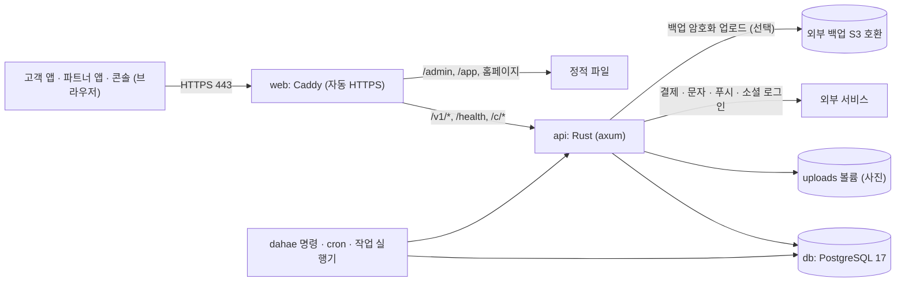

# 다해 운영 가이드 · Dahae operations guide

> 대상 / Audience: 사장님(서버 운영자) · 엔지니어와 리뷰어 / owners who run the server, engineers and reviewers.
> 장애가 났을 때는 먼저 [RUNBOOK.md](RUNBOOK.md) 를 보세요. 이 문서는 평소 운영 방법과 구조를 설명해요.
> 명령과 동작은 모두 코드에서 확인했어요. 출처는 각 항목 옆의 파일 링크예요.
> Engineering summary: this page describes how the stack is installed, updated, backed up, monitored and kept
> running. Every claim points at the file that implements it. Incident steps are in [RUNBOOK.md](RUNBOOK.md).

## 목차 · Contents

1. [구성 · Architecture](#1-구성--architecture)
2. [설치 · Install](#2-설치--install)
3. [dahae 명령 · CLI](#3-dahae-명령--cli)
4. [업데이트와 채널 · Updates and channels](#4-업데이트와-채널--updates-and-channels)
5. [되돌리기 · Rollback](#5-되돌리기--rollback)
6. [백업 · Backups](#6-백업--backups)
7. [복원 연습 · Restore drill](#7-복원-연습--restore-drill)
8. [모니터링 · Monitoring](#8-모니터링--monitoring)
9. [로그 · Logs](#9-로그--logs)
10. [점검 모드 · Maintenance mode](#10-점검-모드--maintenance-mode)
11. [확장 메모 · Scaling notes](#11-확장-메모--scaling-notes)
12. [키 관리와 교체 · Keys and rotation](#12-키-관리와-교체--keys-and-rotation)
13. [제거 · Uninstall](#13-제거--uninstall)

---

## 1. 구성 · Architecture

한 대의 서버에 Docker 컨테이너 세 개가 올라가요. 설치 파일: [deploy/install.sh](../deploy/install.sh) 의 `write_compose`
(서버에는 `/opt/malkkeum/docker-compose.yml` 로 써요). 개발용 원본은 [deploy/docker-compose.yml](../deploy/docker-compose.yml) 이에요.



| 구성 요소 | 역할 | 근거 |
|---|---|---|
| `db` (postgres:17) | 모든 예약·고객·정산 데이터 | [deploy/install.sh](../deploy/install.sh) `write_compose` |
| `api` (Rust) | 앱과 콘솔이 쓰는 API, 웹훅, 백업·작업 명령 | [backend/crates/api/src/main.rs](../backend/crates/api/src/main.rs), [backend/crates/api/src/routes/mod.rs](../backend/crates/api/src/routes/mod.rs) |
| `web` (Caddy) | HTTPS, 웹사이트, 콘솔(`/admin/`), 고객 웹앱(`/app/`), API 전달 | [deploy/Caddyfile](../deploy/Caddyfile) |
| `uptime-kuma` (선택) | 외부 가동 확인 화면, 기본은 꺼짐 | `profiles: [monitoring]` in [deploy/install.sh](../deploy/install.sh) |
| 작업 실행기 | API 가 넘긴 서버 작업(업데이트, 재시작 등)을 root 로 실행 | root 작업 실행 스크립트 (`deploy/` 폴더), systemd 단위는 `write_units` in [deploy/install.sh](../deploy/install.sh) |

설정 값과 비밀 키는 `/opt/malkkeum/.env` 에 있어요 (권한 600). 연동 키(결제, 문자 등)는 콘솔 설정 마법사에서 입력하고
`DATA_KEY` 로 암호화해서 데이터베이스에 저장해요. 근거: [backend/crates/api/src/integrations.rs](../backend/crates/api/src/integrations.rs),
[docs/PROGRESS.md](PROGRESS.md) (설계 결정).

---

## 2. 설치 · Install

### 준비물
- 서버: Ubuntu 22.04 / 24.04 또는 Debian 12, x86_64 또는 arm64. 최소 1 GB (설치 프로그램 기준), 권장 2 vCPU · 4 GB RAM ([docs/DEPLOY.md](DEPLOY.md) 서버 크기).
  설치 프로그램은 약 1 GB 미만 메모리에서 멈춰요 (`MIN_RAM_KB`, [deploy/install.sh](../deploy/install.sh)). 메모리가 2 GB 미만이고 스왑이 없으면 2 GB 스왑 파일을 만들어요 (디스크가 모자라거나 `/swapfile` 이 이미 있으면 만들지 않고 경고만 해요).
- 디스크 여유 5 GB 이상 (재설치는 2 GB). 같은 파일: `DISK_FRESH_KB`, `DISK_UPGRADE_KB`.
- 도메인 하나와 그 도메인의 A 레코드가 서버 IP 를 가리킬 것. 클라우드 방화벽에서 22, 80, 443 포트를 열 것.
  80·443 을 다른 프로그램이 쓰고 있으면 설치가 멈춰요 (`preflight`).

### 설치 명령
채널에 따라 주소가 달라요 (설치 파일 맨 위 주석):

```bash
# 안정 채널 (기본) — 손님을 받는 서버는 이것
curl -fsSL https://raw.githubusercontent.com/EricWijesinghe/Dahae-install/main/install.sh | sudo bash
# 베타 채널 — 먼저 써 보는 버전
curl -fsSL https://raw.githubusercontent.com/EricWijesinghe/Dahae-install/beta/install.sh | sudo bash
```

설치 파일은 배포 저장소 `EricWijesinghe/Dahae-install` 에 올라가요. 배포 과정은 [.github/workflows/release.yml](../.github/workflows/release.yml) 이 맡아요.
질문은 두 개뿐이에요: 도메인(예: `myshop.co.kr`), 인증서 안내를 받을 이메일(없으면 Enter).

### 설치가 하는 일
1. 서버 점검 (메모리, 디스크, 포트, 아키텍처) 과 Docker 설치 (`get.docker.com`), Docker Compose 2.20 이상 확인.
2. 보안 키 생성 (`DB_PASSWORD`, `JWT_SECRET`, `DATA_KEY`, 설치 코드) 후 `.env` 를 600 권한으로 저장.
3. 서버 보호: 자동 보안 업데이트, fail2ban (10분 안에 SSH 로그인 5번 실패 → 1시간 차단), ufw 방화벽 (확인 후 켜요: 22·80·443만 허용),
   SSH 키 로그인이 있으면 비밀번호 로그인 끄기를 물어봐요. 근거: `harden_host`, `write_f2b_jail` in [deploy/install.sh](../deploy/install.sh), [docs/DEPLOY.md](DEPLOY.md) §1.
4. 이미지 서명 확인 도구 `cosign` 을 고정 버전(`COSIGN_VERSION`)과 SHA-256 으로 받고, 이미지를 서명 확인 후 내려받아요.
5. `dahae` 명령, `malkkeum` 별칭, 예약 작업, 로그 회전, 작업 실행기 설치.
6. 서비스 시작 후 상태 확인. 끝나면 콘솔 주소와 설치 코드를 보여 줘요.

설치를 다시 실행하면 **업데이트**가 돼요: 백업 → 새 버전 → 응답 확인 → 실패하면 이전 버전으로 되돌려요. 설정과 데이터는 그대로예요.

### 설치 뒤 바로 할 일
1. 브라우저에서 `https://도메인/admin/` 을 열고 설치 코드로 사장님 계정을 만들어요. 설치 코드는 설치할 때 만들어져서 그때부터 7일 동안 쓸 수 있어요. 지났으면 `sudo dahae setup-code --renew` 로 새로 받으세요.
2. 콘솔 **설정** 에서 결제·문자·로그인 연동을 차례로 넣고 [연결 확인] 을 눌러요 (PortOne 은 [API 키 확인]) ([docs/guide/02-설정-마법사.md](guide/02-설정-마법사.md)).
3. `sudo dahae keys-backup` 으로 비밀 키 사본을 만들고, 사본과 비밀번호를 서버 밖에 보관한 뒤 확인 문구를 입력해요.
4. 외부 백업을 연결해요 (콘솔 **설정 > 외부 백업**, [§6](#6-백업--backups)).
5. `sudo dahae heartbeat <가동 확인 주소>` 로 외부 가동 확인을 켜요 ([§8](#8-모니터링--monitoring)).

### 무인 설치 (엔지니어용)
설치 파일 맨 위 주석에 환경 변수가 정리돼 있어요: `MALKKEUM_DOMAIN`, `MALKKEUM_EMAIL`, `MALKKEUM_CHANNEL`,
`MALKKEUM_HEARTBEAT_URL`, `MALKKEUM_ANSWERS` (`DOMAIN=`, `EMAIL=` 줄 파일). `DAHAE_*` 이름도 같이 쓸 수 있어요 (`main()`).
`MALKKEUM_SKIP_SIGNATURE=1` 은 서명 없는 테스트 저장소 전용이에요. 설치 파일은 `MALKKEUM_TLS=internal`(테스트 전용) 도 받아요.

---

## 3. dahae 명령 · CLI

`sudo dahae help` 로 같은 목록을 볼 수 있어요. 명령 목록은 [deploy/install.sh](../deploy/install.sh) 의 `USAGE` 와 `main()` 의 `case` 에서 가져왔어요.
예전 이름 `malkkeum` 도 똑같이 동작해요 (`ln -sf dahae malkkeum`).

| 명령 | 하는 일 | 확인 방법 · 주의 |
|---|---|---|
| `dahae status` | 컨테이너 상태, 앱·HTTPS, 가동 확인, 외부 백업, 비밀 키 사본 점검 | 줄마다 ✔ 또는 ! |
| `dahae update [태그]` | 백업 → 새 이미지 받기·서명 확인 → 시작 → 응답 확인 (기본 180초), 실패하면 자동 되돌리기 | 종료 코드 3 = 되돌렸어요 |
| `dahae rollback` | 마지막 업데이트 전 이미지로 되돌리기 (데이터는 그대로) | [§5](#5-되돌리기--rollback) |
| `dahae channel stable\|beta` | 채널 바꾸고 바로 업데이트 | |
| `dahae version` | 채널, 이미지 태그, 실행 중인 버전 | |
| `dahae backup` | 지금 바로 백업 (DB + 사진) | 실패하면 종료 코드 1 |
| `dahae restore 파일 [--yes]` | 백업으로 되돌리기 (DB + 사진) | 확인 문구 `yes` 입력 |
| `dahae restore-offsite [이름] [--yes]` | 외부 백업 목록, 또는 내려받아 되돌리기 | 확인 문구 `yes` |
| `dahae load 파일.tar` | 미리 받아 둔 이미지 묶음 불러오기 (인터넷 없이 업데이트) | 서명 확인을 건너뛰어요 (설치 파일이 알려 줘요) |
| `dahae heartbeat <https 주소>\|off` | 외부 가동 확인 주소 저장, 테스트 핑 | https 만 받아요 |
| `dahae domain <새 도메인> [--yes]` | 서비스 주소 바꾸기: `.env` 백업 → `DOMAIN` 변경 → api·web 다시 시작 → 새 주소로 `/health` 확인 (5분까지) | 실패하면 `.env` 를 되돌리고 종료 코드 3. 예전 주소는 계속 응답해요 |
| `dahae host-approval enroll <사장님 계정 번호>\|status` | 서버 승인 코드 만들기 (인증 앱 6자리) | 버전 올리기·되돌리기·도메인 바꾸기 승인에 써요. 콘솔에서도 만들 수 있어요 |
| `dahae owner-reset` | 서버 승인 코드 지우기 | 확인 문구 `초기화` |
| `dahae applinks --android-sha256 …  --apple-team-id …` | 네이버 로그인 앱 링크 설정 | 개발자가 값을 알려 줘요 |
| `dahae demo load [--force]` / `dahae demo clear` | 체험용 데이터 넣기 / 지우기 (실제 고객 데이터는 지우지 않아요) | `demo clear` 는 확인 문구 `yes` |
| `dahae logs [api\|web\|db]` | 최근 200줄을 보고 계속 따라가요 (기본 api) | Ctrl+C 로 나가요 |
| `dahae setup-code [--renew]` | 사장님 계정 설치 코드 보기 (설치할 때부터 7일) | `--renew` 는 새 코드 |
| `dahae update-schedule mon@04:00\|off` | 자동 업데이트 요일·시각 (또는 끄기) | 예약표를 다시 써요 |
| `dahae keys-backup` | `.env` 를 비밀번호로 잠근 사본 만들기 (12자 이상) | 보관 확인 문구 입력 |
| `dahae keys-restore 파일 [--yes]` | 새 서버에 예전 `DATA_KEY`·`JWT_SECRET` 넣기 | `restore-offsite` 보다 먼저 |
| `dahae alert update\|backup\|ssh [수]` | 예약 작업 실패나 SSH 차단 증가를 외부 가동 확인 주소로 알리기 | 가동 확인 주소가 있어야 해요 |
| `dahae uninstall [--yes]` | 서비스 끄기 (데이터와 백업 유지) | [§13](#13-제거--uninstall) |
| `dahae uninstall --purge --confirm 도메인` | 데이터·백업·키까지 모두 삭제 | 되돌릴 수 없어요 |

화면에 보이지 않는 명령(cron 과 설치 프로그램이 씀): `auto-update` (예약 업데이트), `write-cron` (예약표 다시 쓰기), `prepare` (설치 전 준비).

근거: 명령 처리 [deploy/install.sh](../deploy/install.sh) `main()`, 백업 `cmd_backup` / `cmd_restore`, 확인 문구 `confirm()`
(`--yes` 가 없으면 터미널에서 문구를 입력해야 통과해요).

---

## 4. 업데이트와 채널 · Updates and channels

### 채널
- `stable` (기본): 안정 버전. `beta`: 먼저 써 보는 버전. 채널은 `.env` 의 `CHANNEL` 과 `VERSION` 에 기록돼요.
- 릴리스 태그 `vX.Y.Z` 는 이미지 태그 `X.Y.Z`, `beta`, 그리고 정식 버전일 때만 `stable`, `latest` 를 받아요.
  `beta` 와 버전 태그(`X.Y.Z-beta.N`)를 받아요. `stable`·`latest` 는 받지 않아요. 근거: [.github/workflows/release.yml](../.github/workflows/release.yml) 의 `Channels` 주석과 태그 계산 줄.
- 릴리스 태그는 `master` 에 있는 커밋에서만 만들어요 (`guard` 작업).
- 발행 전에 [ci.yml](../.github/workflows/ci.yml) 과 [e2e.yml](../.github/workflows/e2e.yml) 이 태그 커밋에서 통과해야 해요. [release-tools.yml](../.github/workflows/release-tools.yml) 은 워크플로 파일 검사라서 발행 조건은 아니에요.

### 자동 업데이트
- 기본: 매주 월요일 04:00 (한국 시간). `dahae update-schedule` 로 바꾸거나 끌 수 있어요. 근거: `cmd_write_cron`, `write_schedules` in [deploy/install.sh](../deploy/install.sh).
- 자동 업데이트는 먼저 점검해요: (1) 건너뛰기 표시가 있으면 이번 차례는 건너뛰어요, (2) 기다리는 작업이 있으면 미뤄요,
  (3) 안정 채널은 새 이미지를 처음 본 뒤 24시간을 기다려요 (`stable_seasoned`). 근거: `cmd_auto_update` in [deploy/install.sh](../deploy/install.sh).
- 실패하면 `dahae alert update` 가 외부 가동 확인 주소로 알려요.

### 수동 업데이트
```bash
sudo dahae update            # 현재 채널의 최신 이미지
sudo dahae update vX.Y.Z     # 특정 태그 (엔지니어 지시가 있을 때)
```
순서: 백업 → 이미지 받기 → 서명 확인 → 새 이미지로 시작 → 응답 확인. 응답이 3분 안에 없으면 이전 이미지로 되돌려요.
이전 이미지는 `.env` 의 `PREV_API_IMAGE`, `PREV_WEB_IMAGE` 에 기록해 둬요 (`cmd_update`).

### 이미지 서명 확인
설치와 업데이트는 `cosign` 키 없는 서명을 확인해요. 서명 주체는 배포 저장소의 `release.yml` 워크플로이고, 태그 `v` 에서 만든 것만 받아요
(`verify_image`, `signer_re` in [deploy/install.sh](../deploy/install.sh)). 서명이 없으면 전환하지 않고 현재 버전을 그대로 둬요.

### 서버 작업 요청 (API)
사장님 인증을 거친 요청은 `POST /v1/admin/host/jobs` 로 들어가 작업 파일이 되고, 작업 실행기가 root 로 실행해요.
허용된 종류는 다음뿐이에요: `backup-now`, `update`, `update-skip`, `channel stable|beta`, `restart api|web|db|all`, `schedule`,
`heartbeat <https 주소>|off`, `domain-check <도메인>`, `domain-set <도메인>`, `host-approval-enroll`
(근거: [backend/crates/api/src/host_jobs.rs](../backend/crates/api/src/host_jobs.rs), [deploy/agent.sh](../deploy/agent.sh) `job_args_ok`).
상태 확인(`status-refresh`)과 DNS 확인(`domain-check`)을 빼면 모든 종류에 사장님의 TOTP 인증 코드가 필요해요 (`needs_owner`).
`host-approval-enroll` 의 계정 번호는 서버가 요청한 사장님 번호로 채워요. 결과(DNS 확인 JSON, 인증 앱 주소)는
`GET /v1/admin/host/jobs/{id}/output` 으로 10분 동안 읽을 수 있어요 (인증 앱 주소는 요청한 사장님만).

버전을 올리거나 되돌리는 작업(`update-tag`, `rollback`)과 도메인 바꾸기(`domain-set`)는 서버 승인 코드가 있어야 실행돼요.
콘솔은 코드를 `POST /v1/admin/host/jobs/{id}/approve` 로 보내고, 작업 실행기가 확인해요. 승인은 10분 안에 해야 하고,
한 시간 안에 10번 틀리면 승인이 잠겨요 (`APPROVAL_TTL_SEC`, `APPROVAL_FAIL_MAX`, root 작업 실행 스크립트 (`deploy/` 폴더)).
`update-tag` 는 설치 기록보다 낮은 버전을 거부해요 (`tag_newer`). 승인 칸에 두지 못한 작업은 이유(승인 코드 없음,
잠김, 다른 작업이 기다리는 중)를 상태의 `step` 에 남기고 거부돼요.
이 보호는 서버 승인 코드를 만든 뒤부터예요. 만들기 전에는 `host-approval-enroll` 을 받은 첫 요청이 코드를 만들어요. 그래서
API 가 탈취되면 스스로 코드를 만들고 도메인 바꾸기를 승인할 수 있어요. 설치 직후 콘솔 설정에서 서버 승인 코드를 먼저 만드세요.

**설치된 서버는 한 번 설치 줄을 다시 실행해야 해요.** 작업 실행기와 `dahae` 명령은 서버의 파일이라 `dahae update` 가 바꾸지
않아요. 이 기능 전 서버에서 `domain-set` 은 이유 없이 `rejected` 로 끝나요. 설치 줄(웹 SSH 또는 AWS SSM Run Command)을 한 번
다시 실행하면 데이터는 그대로 두고 새 실행기와 명령이 들어가요.

### 도메인 바꾸기 · Domain move
콘솔 설정 > 도메인에서 해요 (DNS 확인 → 사장님 코드 → 서버 승인 코드). 터미널에서는 `sudo dahae domain 새도메인`.
- 예전 도메인은 그대로 응답해요: API, 결제 페이지, 앱 링크, 로그인 콜백, 앱 화면, 검색용 페이지. 웹사이트 페이지만 새 주소로 302 (임시 이동이라 되돌려도 브라우저가 헤매지 않아요).
  설치된 앱이 POST·웹소켓·결제 완료 확인을 예전 주소로 계속 하기 때문이에요 (redirect 를 따라가지 않아요).
- 예전 도메인의 인증서는 처음 접속할 때 Caddy 가 받아요. API 가 예전 도메인 목록에 있는 이름만 허락해요
  (`/internal/tls-ask`, 밖에서는 404). compose 나 `.env` 에는 예전 도메인이 없어요.
- 실패하면 `.env` 를 되돌리고 `rolled_back` 으로 끝나요. 실패한 새 주소는 예전 도메인 목록에 남아 있어도 해롭지 않아요.
- 끝난 뒤 콘솔의 체크리스트(PortOne·토스 웹훅, PG 사이트 주소, 네이버 콜백 **추가**, 검색 등록, 스토어 주소, GitHub `store` 변수)를
  따라 바꾸세요. 새 스토어 빌드가 나오고 최소 앱 버전을 올린 뒤에만 예전 도메인을 은퇴시키세요. DNS 의 예전 A 레코드도 그때까지 둬요.

### 데이터 구조 변경 규칙 (엔지니어)
데이터베이스 변경은 추가만 해요 (확장 후 축소, expand/contract). 되돌리기가 이전 버전을 새 구조 위에서 돌리기 때문이에요.
근거: [docs/DEPLOY.md](DEPLOY.md) §2, 마이그레이션 검사 [scripts/ci/check-migrations.py](../scripts/ci/check-migrations.py).

---

## 5. 되돌리기 · Rollback

- `sudo dahae rollback`: 마지막 업데이트 직전 이미지로 돌아가요. 되돌리기 전에 백업을 먼저 해요 (`cmd_rollback`).
- **데이터는 되돌리지 않아요.** 되돌린 뒤에도 업데이트 뒤에 들어온 예약은 그대로예요. 데이터까지 과거로 돌리려면 `dahae restore` 를 써요 ([§6](#6-백업--backups)).
- 업데이트 기록이 없으면 "되돌릴 이전 버전 기록이 없어요" 라고 나와요.
- **주의: 저장된 카드 암호화는 한 방향이에요.** 마이그레이션 0326 은 처음 시작할 때 저장된 카드의 빌링 키를 암호화해요.
  이전 버전은 평문 키를 읽으므로, 이 뒤로 되돌리면 저장 카드 결제와 탈퇴 시 키 삭제가 깨져요. 이때는 앞으로 가거나 업데이트 전 백업으로 복원하세요.
  근거: [docs/DEPLOY.md](DEPLOY.md) §2 (Saved cards are a one-way step).
- **주의: 토스 정산이 결과를 기다리는 동안에는 1.5 에서 1.4 로 되돌리지 마세요.** 마이그레이션 0472·0473 이 더한 정산 상태를 1.4 는 몰라요.
  토스가 응답하지 않은 송금(요청·송금 상태)이나 주인이 '안 보냄'으로 확인한 실패 정산이 남아 있으면, 1.4 가 그 작업의 예약 취소를 받아 환불하거나
  새 키로 다시 보내서 같은 정산이 두 번 나갈 수 있어요. 그래서 `dahae rollback` 은 이런 정산이 한 건이라도 있거나 확인하지 못하면 멈추고 건수를 알려 줘요.
  콘솔 [정산]에서 상태 확인으로 토스 결과가 정리된 뒤 다시 하세요.
- **주의: 토스페이먼츠 결제를 쓰는 동안 토스 이전 버전으로 되돌리지 마세요.** 마이그레이션 0500~0502 는 그대로 두어도 괜찮지만, 이전 버전은
  토스페이먼츠 결제를 PortOne 에서 찾다가 만료 처리하고, 토스 환불을 하지 못해요. 먼저 콘솔에서 **사용: 새 결제를 토스페이먼츠로 받기** 를 끄고,
  진행 중이거나 입금을 기다리는 토스 결제, 대기 중인 토스 환불이 하나도 없을 때까지 기다린 뒤 되돌리세요.

---

## 6. 백업 · Backups

### 세 가지 백업
| 종류 | 언제 | 어디 | 암호화 | 보관 | 근거 |
|---|---|---|---|---|---|
| 서버 안 백업 | 매일 03:30 (한국 시간), 업데이트·되돌리기·복원 전 | `/opt/malkkeum/backups/db-*.sql.gz.enc`, `uploads-*.tar.gz.enc` | AES-256-GCM (`DATA_KEY` 에서 만든 파일 키) | 14일 (수정 시각 기준) | `cmd_backup`, `BACKUP_KEEP_DAYS` in [deploy/install.sh](../deploy/install.sh), [backend/crates/api/src/backup.rs](../backend/crates/api/src/backup.rs) |
| 외부 백업 (선택) | 서버 안 백업 직후 | 콘솔 **설정 > 외부 백업** 의 S3 호환 저장소 | 같은 형식(`MKB1`) | 기본 30일, 최대 3650일 | `BACKUP_RETENTION_DEFAULT` in [backend/crates/api/src/integrations.rs](../backend/crates/api/src/integrations.rs) |
| 비밀 키 사본 | 설치 직후, 키가 바뀐 뒤 | 서버 밖 (USB, 비밀번호 관리자 등) | 사용자 비밀번호 (openssl AES-256-CBC, PBKDF2 600,000회) | 사장님이 보관 | `cmd_keys_backup` |

- 외부 백업 실패는 서버 안 백업을 가리지 않아요. 외부 백업이 실패하면 경고만 남겨요 (`cmd_backup`, [`upload_cmd`](../backend/crates/api/src/backup.rs)).
- 외부 백업은 암호화된 파일을 `malkkeum/<이름>.enc` 로 올리고, 보관 기간이 지난 **자기가 만든** `.enc` 만 지워요 (`expired`).
- 서버 안 백업 파일을 봉인하지 못하면 평문을 남기고 명령을 실패로 끝내요. 평문 덤프에는 고객 정보가 있어서, 봉인되지 않은 파일은 업데이트·되돌리기·복원을 막아요.

### 외부 백업 연결 (콘솔)
콘솔 **설정 > 외부 백업** 카드에 입력: 엔드포인트, 리전, 버킷, 접근 키, 비밀 키, 보관 일수(선택).
[docs/guide/02-설정-마법사.md](guide/02-설정-마법사.md) 6번에 단계가 있어요. 연결 후 `sudo dahae status` 에 "외부 백업 정상"이 나와야 해요
(`cmd_status` 는 `backups/backup.log` 끝 40줄에서 `offsite backup uploaded` 를 찾아요).

### 백업 목록과 수동 백업
```bash
sudo dahae backup                       # 지금 바로 (DB + 사진)
sudo ls /opt/malkkeum/backups           # 서버 안 백업 목록
sudo dahae restore-offsite              # 외부 백업 목록
tail -n 50 /opt/malkkeum/backups/backup.log   # 백업 기록
```

### 비밀 키 (가장 중요)
- `DATA_KEY` 는 연동 키(결제, 문자 등), 사진 링크 서명, **외부 백업 파일**을 열어요. `DATA_KEY` 를 잃으면 외부 백업을 열 수 없어요.
  `.env` 는 백업에 들어가지 않아요 ([docs/DEPLOY.md](DEPLOY.md) §2).
- `sudo dahae keys-backup` 은 `.env` 를 비밀번호로 잠근 사본을 `backups/keys-*.env.enc` 로 만들어요.
  끝나면 "서버 밖에 보관했어요" 를 직접 입력해야 기록돼요 (`--yes` 로는 확인되지 않아요, `key_escrow_confirm`).
  `dahae status` 는 이 확인이 없으면 경고해요.

---

## 7. 복원 연습 · Restore drill

**사장님용 복원 연습 명령은 없어요.** 복원은 현재 데이터를 덮어쓰기 때문에, 실서버에서 연습하지 말고 연습용 서버에서 하세요.
이 저장소에 있는 연습 도구는 엔지니어용이에요: [scripts/ci/backup-drill.sh](../scripts/ci/backup-drill.sh).
이 스크립트는 소스 저장소, `pg_dump`, 빌드된 `api` 바이너리가 필요하고, 덤프를 봉인·열기·복원한 뒤 모든 테이블의 행 수를 비교해요.

권장 절차 (사장님이 해도 되는 범위):
1. 같은 채널로 연습용 서버를 설치해요 (도메인은 다른 것).
2. 연습용 서버에 `sudo dahae keys-restore` 로 예전 키를 넣고, 외부 백업을 연결한 뒤 `sudo dahae restore-offsite` 로 최근 백업을 복원해요.
3. 콘솔에서 예약 수와 고객 수를 실서버와 비교해요.
4. 결과를 날짜와 함께 기록해요.

WAL 보관을 켠 경우(엔지니어 설정) 시점 복원은 `pgbackrest` 명령을 직접 실행해야 해요 ([§11](#11-확장-메모--scaling-notes) 와 [docs/DEPLOY.md](DEPLOY.md) §2).

---

## 8. 모니터링 · Monitoring

### 콘솔 상태 화면 (시스템 상태)
콘솔 **시스템 상태** 화면 ([app/apps/console/lib/screens/ops.dart](../app/apps/console/lib/screens/ops.dart)) 은 `GET /v1/admin/ops/status` 를 읽어요 ([backend/crates/api/src/ops.rs](../backend/crates/api/src/ops.rs) `status`, [backend/crates/api/src/routes/ops.rs](../backend/crates/api/src/routes/ops.rs)).

| 점검 항목 | 기준 (기본값) | 근거 |
|---|---|---|
| 데이터베이스 | 응답 여부, 응답 시간(ms), 용량 | `db` check |
| 서버 디스크 | 여유 10% 미만이면 빨강, 20% 미만이면 노랑 | `disk_level`, `DISK_LOW_PCT`, `DISK_WARN_PCT` |
| 자동 백업 | 마지막 백업 26시간 넘으면 노랑, 36시간 넘으면 빨강 | `backup_level` |
| 서버 오류 (24시간) | 20건 이상 노랑, 100건 이상 빨강 | `errors_level` |
| 결제 확인 필요 (24시간) | 자동 처리가 멈춘 결제가 있으면 빨강 | `payments` check, `payment_stuck` |
| 결제 알림 (웹훅) | 서명 실패 1건 이상 노랑, 3건 이상 빨강 | `signature_level` |
| 외부 서비스 8종 | 설정 안 됨은 노랑, 최근 24시간 실패 후 성공이 없으면 빨강 | `INTEGRATIONS`, `integration_level` |
| 백그라운드 작업 | 멈춘 작업이 있는지 | `jobs` |
| 발송 실패 (재시도 끝) | 시스템 상태 **백그라운드 작업** 의 `notify_outbox` 줄: "발송 실패 N건 (재시도 끝)" | `sms_dead_letters`, [ops.dart](../app/apps/console/lib/screens/ops.dart) `_Jobs` |

디스크와 백업 기준은 콘솔 **설정 > 운영** 에서 더 엄격하게 바꿀 수 있어요 (값은 `settings_registry` 가 정해요, 더 느슨하게는 못 바꿔요).
외부 서비스 8종은 결제(PortOne), 문자(Solapi), 푸시(Firebase), 카카오·네이버·구글·애플 로그인, 외부 백업이에요.

### 사장님 알림
12개 규칙 (`RULES`, [backend/crates/api/src/ops_alerts.rs](../backend/crates/api/src/ops_alerts.rs)): 문자 발송 실패, 푸시 실패, 결제 연동 실패, 결제 자동 처리 실패,
PortOne 결제 내역 불일치, 소셜 로그인 실패, 계정 보안 이상, 자동 백업 누락, 디스크 부족, 기사님 미배정 예약, 당일 취소 증가, 부가세 신고 기한.
문자 재시도를 다 쓴 뒤의 `sms_dead_letter` 알림도 따로 있어요 (`ops_alerts.rs` 193행).
알림은 상담함, 사장님 휴대폰 문자, 직원 앱 푸시로 가요. 같은 문제는 6시간에 한 번만 보내요 (`COOLDOWN_HOURS`).
조용한 시간(기본 밤 10시 ~ 아침 7시, 한국 시간)에는 보내지 않아요. 조용한 시간이 끝나면 그때 걸려 있는 항목을 규칙별로 한 번씩 보내요. 알림 받을 번호를 비우면 사업장 고객센터 번호로 가요.

### 외부 가동 확인 (heartbeat)
서버는 자기가 멈춘 것을 스스로 알릴 수 없어요. 그래서 바깥 서비스가 지켜봐요.
1. 가동 확인 서비스 (예: healthchecks.io) 에서 체크를 만들어요: 주기 5분, 유예 15분 ([docs/DEPLOY.md](DEPLOY.md) §8).
2. `sudo dahae heartbeat https://…` 로 주소를 저장해요. 끄려면 `dahae heartbeat off`.
3. cron 이 5분마다 `https://도메인/health` 가 `"ok":true` 를 돌려줄 때만 핑을 보내요 ([deploy/install.sh](../deploy/install.sh) `write_heartbeat`). 실패 기록은 `backups/heartbeat.log` 에 남아요.
4. 설정이 없으면 `dahae status` 가 경고해요.

서버가 전부 멈추면 핑이 끊기고, 가동 확인 서비스가 알려 줘요. 서버 안의 문제(문자, 결제)는 위 콘솔 알림으로 알려요.

### 선택: Uptime Kuma (모니터링 프로필)
`.env` 에 `COMPOSE_PROFILES=monitoring` 을 넣고 `docker compose up -d` 를 하면 Uptime Kuma 가 켜져요.
주소는 `127.0.0.1:3001` 뿐이라 SSH 터널로만 볼 수 있어요. Caddy 로는 노출하지 않아요 ([deploy/install.sh](../deploy/install.sh) `uptime-kuma`).

### 외부 HTTP 점검 (선택, 무료 서비스)
`GET https://도메인/health` 를 5분마다 보고, 응답 본문에 `"ok":true` 가 있는지 확인하세요 ([docs/DEPLOY.md](DEPLOY.md) §8). 프록시가 죽은 것도 잡아요.

### 지표 (엔지니어)
`GET /metrics` 는 Prometheus 형식이에요. 공개 Caddy 에서는 404 예요 ([deploy/Caddyfile](../deploy/Caddyfile) `@internal`).
접근은 `METRICS_TOKEN`(32자 이상) 베어러 토큰이거나, 토큰이 없으면 api 컨테이너 안(루프백)에서만 가능해요. 호스트에는 포트를 열지 않아요 ([backend/crates/api/src/metrics.rs](../backend/crates/api/src/metrics.rs)).
지표 목록은 [docs/DEPLOY.md](DEPLOY.md) §9 에 있어요.

> 주의: 설치된 `docker-compose.yml` 은 `api` 에 `METRICS_TOKEN` 을 넘기지 않아요 (`write_compose`). 토큰을 쓰려면 엔지니어 확인이 필요해요 ([§12](#12-키-관리와-교체--keys-and-rotation)).

---

## 9. 로그 · Logs

- `sudo dahae logs` (api), `sudo dahae logs web`, `sudo dahae logs db`: 최근 200줄 + 계속 따라가요.
- 앱 로그는 JSON 한 줄씩이에요 (`LOG_FORMAT=json`). 모든 응답에 `x-request-id` 가 붙어요. 오류 응답 본문에도 `error.request_id` 가 있어요 ([docs/DEPLOY.md](DEPLOY.md) §9). 개발자에게 전달할 때 이 값을 같이 보내 주세요.
- 컨테이너 로그는 파일당 10 MB, 14개까지 남아요 (`x-logging`, [deploy/install.sh](../deploy/install.sh)).
- Caddy 접근 로그는 `caddylogs` 볼륨의 `/var/log/caddy/access.log` 에 있어요 (10 MB × 14). 토큰이나 서명이 들어가는 쿼리 값(`ticket`, `token`, `sig`, `code`, `state`)은 기록 전에 지워요 ([deploy/Caddyfile](../deploy/Caddyfile)).
- 예약 작업 기록: `backups/backup.log`, `backups/update.log`, `backups/heartbeat.log`, `backups/wal.log`. 매주 회전하고 8개까지 남겨요 (`/etc/logrotate.d/dahae`).

---

## 10. 점검 모드 · Maintenance mode

- 켜는 곳: 콘솔 **시스템 상태** 화면의 점검 모드 카드 ([app/apps/console/lib/screens/platform.dart](../app/apps/console/lib/screens/platform.dart) `FlagsCard`). 안내 문구는 200자까지예요.
- 서버가 하는 일 ([backend/crates/api/src/routes/config.rs](../backend/crates/api/src/routes/config.rs)):
  - 새 예약(`POST /v1/bookings`), 정기 구독 만들기, 대기 예약 수락, 예약 결제 시작을 **막아요** (503 `maintenance`).
  - 기존 예약 조회, 취소, 이미 만든 예약의 결제는 계속 돼요.
  - 콘솔, 설정, 웹훅, 설치 관련 경로는 막지 않아요 (`OPEN_PREFIXES`). 사장님이 점검을 끌 수 있어야 하니까요.
- 앱: 고객 앱의 견적 보내기·결제·정기 구독 신청 버튼이 점검 중에 꺼져요 ([quote_flow.dart](../app/apps/customer/lib/screens/quote_flow.dart), [checkout.dart](../app/apps/customer/lib/screens/checkout.dart), [subscribe.dart](../app/apps/customer/lib/screens/subscribe.dart)). 앱은 `/v1/config` 문서의 `maintenance` 값을 읽어요.
- 기능 스위치: 같은 화면에서 기능을 따로 끌 수 있어요 (`booking`, `payments`, `chat`, `ai`). 꺼진 기능의 경로는 503 과 `*_disabled` 코드를 돌려줘요. `ai`: 고객 상담 도우미 스위치. 켜면 상담 응답 요청을 외부 AI 서비스(Anthropic Messages API, 국외 이전)로 보내요. 가입 시 필수 '개인정보 국외 이전 동의'(`overseas_transfer`)를 받지만, 응답마다 동의를 확인하지는 않아요 ([backend/crates/api/src/ai.rs](../backend/crates/api/src/ai.rs), [docs/SECURITY-AND-PRIVACY.md](SECURITY-AND-PRIVACY.md)).
- 웹사이트 자체는 API 가 멈춰도 점검 안내 페이지를 보여 줘요 ([deploy/Caddyfile](../deploy/Caddyfile) `handle_errors`).

---

## 11. 확장 메모 · Scaling notes

- 기본 구성은 한 대 서버에 컨테이너 세 개예요. 설치 파일은 CPU 상한을 두지 않아요 (1 vCPU 서버에서 `docker compose up` 이 실패하지 않도록).
- 메모리 상한 (설치 파일 기준): 데이터베이스 768 MB, API 512 MB, 웹 256 MB. 데이터베이스 설정은 `shared_buffers=256MB`, `max_connections=50` ([deploy/install.sh](../deploy/install.sh) `db` 서비스).
- API 의 데이터베이스 연결 풀은 20개예요 (`DB_MAX_CONNECTIONS`). 근거: [backend/crates/api/src/config.rs](../backend/crates/api/src/config.rs).
- **API 를 여러 개 띄우면** 일반 요청 제한 (`ratelimit.rs`) 은 프로세스마다 따로 세어져요. 인증과 업로드 제한은 데이터베이스가 공유해요. 실시간 이벤트는 PostgreSQL `LISTEN/NOTIFY` 로 퍼져요 ([docs/DEPLOY.md](DEPLOY.md) §9). 그래서 기본은 한 개 실행을 권장해요.
- 사진은 `uploads` 볼륨에 쌓여요. 백업에도 사진이 같이 들어가서 디스크가 커져요. 어디에도 연결되지 않은 사진은 30일 뒤 지워요 (`UPLOAD_ORPHAN_DAYS`).
- 용량 수치는 이 저장소에 공개된 벤치마크가 없어요. 부하 시험 도구는 [scripts/load/loadtest.py](../scripts/load/loadtest.py) 에 있어요. 수치를 약속하기 전에 직접 재 보세요.
- 디스크가 부족해지는 주된 원인은 사진, 백업(14일), Docker 이미지예요. 이미지 정리는 현재와 이전 버전 태그를 남기는 방식으로 돼요 (`prune_keep_tags`).

---

## 12. 키 관리와 교체 · Keys and rotation

| 키 | 어디에 쓰이나 | 교체 방법 (지원 범위) |
|---|---|---|
| `DATA_KEY` | 연동 키 암호화, 서버 안·외부 백업 암호화, 사진 링크 서명 | **사장님 절차 없음.** 저장소에 재암호화 명령이 없어요. 바꾸면 저장된 연동 키를 읽지 못하고(해당 연동은 건너뛰어요, `integrations.rs` `load`), 이전 백업을 열 수 없어요. 개발자와 상의 없이 바꾸지 마세요. |
| `JWT_SECRET` | 로그인 토큰 서명 | 로테이션은 `JWT_PREVIOUS_SECRET` 로 지원해요 ([backend/crates/api/src/config.rs](../backend/crates/api/src/config.rs)), 하지만 설치된 `api` 는 이 변수를 받지 않아요 (`write_compose`). **개발자가 해야 해요.** |
| `DB_PASSWORD`, `API_DB_PASSWORD` | 데이터베이스 접속 (`app` 관리 계정, `dahae_api` 앱 계정) | `dahae update` 가 `dahae_api` 계정을 `.env` 의 값으로 다시 맞춰요 (`db_roles`). 교체는 개발자 확인 후에 하세요. |
| 연동 키 (PortOne, Solapi, Toss, FCM, 소셜 로그인, 외부 백업 S3) | 각 서비스 | 서비스 쪽에서 새로 발급하고 콘솔 **설정** 에 다시 입력한 뒤 [연결 확인] 을 눌러요 (PortOne 은 [API 키 확인]). 입력값은 `DATA_KEY` 로 암호화돼요. |
| 웹훅 시크릿 | 결제 알림 서명 검사 | PortOne 콘솔과 **설정 > 결제** 에서 같은 값으로 맞춰요. |
| 승인 코드 (TOTP) | 서버 작업 승인 | `dahae owner-reset` 후 `dahae host-approval enroll <번호>` 로 새로 만들어요. |
| 비밀 키 사본 비밀번호 | `keys-backup` 파일 | 새 사본을 만들면 옛 사본은 쓸 수 없어요. 새 사본을 보관하고 옛 것은 기록에 남겨 두세요. |
| 사장님 세션 | 로그인 | 콘솔 **내 계정 > 모든 기기에서 로그아웃** (`POST /v1/me/sign-out-all`, [backend/crates/api/src/routes/owner.rs](../backend/crates/api/src/routes/owner.rs)). |

의심되면 [RUNBOOK.md](RUNBOOK.md) 의 "비밀 키가 새었을 수 있어요" 를 따르세요.

---

## 13. 제거 · Uninstall

- `sudo dahae uninstall`: 서비스를 끄고, 예약 작업과 `dahae` 명령을 지워요. 데이터, `.env`, 백업은 남겨요. 설치 명령을 다시 실행하면 이어서 써요.
- `sudo dahae uninstall --purge --confirm 도메인`: 데이터베이스, 사진, 인증서, `/opt/malkkeum` (백업과 키 포함)을 지워요. **되돌릴 수 없어요.** 외부 백업은 그대로지만, 옛 `DATA_KEY` 가 있어야 열 수 있어요. Docker 자체는 남겨 둬요.
- `--yes` 는 일반 제거에만 통해요. 데이터 삭제는 도메인을 직접 입력해야 해요 (`purge_ok`).
- 서버와 도메인 요금은 따로 해지해야 멈춰요 ([docs/guide/07-운영-명령어.md](guide/07-운영-명령어.md) §10).

---

# English

Short English mirror of the sections above. Commands and behaviour are identical; the Korean text is the reference
when the two differ, and both are checked against the same code.

## 1. Architecture
One server runs three containers: `db` (PostgreSQL 17), `api` (Rust, axum) and `web` (Caddy: automatic HTTPS, website,
console at `/admin/`, customer web app at `/app/`, reverse proxy for `/v1`). Sources: [deploy/install.sh](../deploy/install.sh) `write_compose`,
[deploy/Caddyfile](../deploy/Caddyfile), [backend/crates/api/src/routes/mod.rs](../backend/crates/api/src/routes/mod.rs).
Secrets live in `/opt/malkkeum/.env` (mode 600). Integration keys are entered in the console setup wizard and stored encrypted with `DATA_KEY`
([backend/crates/api/src/integrations.rs](../backend/crates/api/src/integrations.rs)).

## 2. Install
- Supported: Ubuntu 22.04 / 24.04, Debian 12; x86_64 or arm64. Recommended 2 vCPU and 4 GB RAM; minimum 1 GB for the installer (it stops below about 1 GB). Below 2 GB RAM with no swap, it creates a 2 GB swap file (skipped if the disk is short or `/swapfile` exists).
  Needs 5 GB free disk on a first install (2 GB on a re-run). Ports 22, 80, 443 must be reachable; a domain A record must point at the server.
- Stable: `curl -fsSL https://raw.githubusercontent.com/EricWijesinghe/Dahae-install/main/install.sh | sudo bash`; beta uses the `beta` branch in place of `main`.
- The installer asks for the domain and an optional e-mail, creates keys, installs Docker, hardens the host (unattended upgrades, fail2ban: 1-hour ban after 5 failed SSH logins in 10 minutes, ufw only after confirmation), verifies the cosign signature of the images, installs the `dahae` command and the schedules, and starts the stack.
- Re-running the installer is an update: backup, new images, health check, automatic rollback on failure. Data and settings are kept.
- After install: open `https://DOMAIN/admin/`, enter the setup code (created at install, valid 7 days from then; `sudo dahae setup-code --renew` for a new one), fill the setup wizard, run `sudo dahae keys-backup` and store the copy off the server, connect offsite backup, and set a heartbeat.
- Unattended options (`MALKKEUM_DOMAIN`, `MALKKEUM_EMAIL`, `MALKKEUM_CHANNEL`, `MALKKEUM_HEARTBEAT_URL`, `MALKKEUM_ANSWERS`; `DAHAE_*` also accepted) are listed at the top of [deploy/install.sh](../deploy/install.sh). `MALKKEUM_SKIP_SIGNATURE=1` is for unsigned test registries only.

## 3. dahae commands
The full list is in `USAGE` and `main()` of [deploy/install.sh](../deploy/install.sh). Key commands: `status`, `update [tag]`, `rollback`,
`channel stable|beta`, `version`, `backup`, `restore FILE [--yes]`, `restore-offsite [NAME] [--yes]`, `load FILE.tar`, `heartbeat URL|off`,
`host-approval enroll|status`, `owner-reset`, `applinks`, `demo load|clear`, `logs [api|web|db]`, `setup-code [--renew]`,
`update-schedule mon@04:00|off`, `keys-backup`, `keys-restore FILE [--yes]`, `alert update|backup|ssh`, `uninstall [--yes]`, `uninstall --purge --confirm DOMAIN`.
Destructive commands ask you to type a word (`yes`, `초기화`, or the domain for purge); `--yes` skips that only where the code allows it.
Cron-only commands: `auto-update`, `write-cron`; installer-only: `prepare`.

## 4. Updates and channels
- Channels: `stable` (default) and `beta`. Release tags `vX.Y.Z` publish `X.Y.Z`, `beta`, and, for non-prerelease tags, `stable` and `latest`. `vX.Y.Z-beta.N` publishes `X.Y.Z-beta.N` and `beta`, never `stable` or `latest` ([.github/workflows/release.yml](../.github/workflows/release.yml)). Tags must point at a commit on `master`.
- Automatic update: Monday 04:00 Korea time by default. It skips when a skip marker exists or a job is waiting, and on the stable channel it waits 24 hours after first seeing a new image (`stable_seasoned`, `cmd_auto_update`).
- Images are accepted only with a valid cosign keyless signature from the release workflow of the signer repository (`verify_image`). Images loaded from a tar (`dahae load`) skip this check.
- Owner-authenticated server jobs (`POST /v1/admin/host/jobs`; no console screen for this exists on this branch): `backup-now`, `update`, `update-skip`, `channel`, `restart api|web|db|all`, `schedule`. Every kind except status refresh needs the owner's TOTP code ([backend/crates/api/src/host_jobs.rs](../backend/crates/api/src/host_jobs.rs)).
- Version-raising and rollback jobs in the server job runner (root job script in the `deploy/` folder) need the server approval code, valid for 10 minutes; 10 wrong codes in an hour lock approvals.
- Schema changes are additive (expand, then contract later), because a rollback runs the previous release on the migrated schema ([docs/DEPLOY.md](DEPLOY.md) §2).

## 5. Rollback
`sudo dahae rollback` restores the images recorded before the last update (`PREV_API_IMAGE`, `PREV_WEB_IMAGE`) after taking a backup. It never removes data. Migration 0326 makes saved-card key sealing one-way: after it runs, a rollback breaks saved-card charges. Roll forward, or restore the pre-update backup ([docs/DEPLOY.md](DEPLOY.md) §2).

Do not roll 1.5 back to 1.4 while a Toss payout waits on Toss. Migrations 0472 (`toss_ref`) and 0473 (`owner_not_sent_at`, `toss_memo`) add payout states 1.4 does not know: with a payout `failed` with `owner_not_sent_at` set, or `requested`/`sent` with a `failure_reason` (a send with no answer), 1.4 lets a cancel refund the job and may re-send under a new key, so the same payout can go out twice. `dahae rollback` refuses while any such payout exists, or when it cannot run the check, and prints the count (`payouts_settled_for_rollback` in [deploy/install.sh](../deploy/install.sh)). Settle them with the status check in the console's 정산 page first.

## 6. Backups
- Local: daily at 03:30 Korea time and before every update, rollback and restore. Files are sealed with AES-256-GCM (`MKB1` format, key derived from `DATA_KEY`) and kept 14 days by modification time ([deploy/install.sh](../deploy/install.sh) `cmd_backup`, [backend/crates/api/src/backup.rs](../backend/crates/api/src/backup.rs)). If sealing fails, the plaintext stays and the command fails; update, rollback and restore refuse to run.
- Offsite (optional): console **설정 > 외부 백업** (S3-compatible). Default retention 30 days, maximum 3650 ([backend/crates/api/src/integrations.rs](../backend/crates/api/src/integrations.rs)). An offsite failure is logged and does not hide the local backup.
- Keys: `dahae keys-backup` writes a passphrase-locked copy of `.env` (at least 12 characters, PBKDF2 with 600,000 iterations). The owner must type the escrow confirmation in a terminal; `--yes` does not record it.
- Restore: `dahae restore backups/db-….sql.gz.enc` takes a pre-restore backup, stops the API, applies the SQL in one transaction as the app role, swaps the photo archive, and restarts the API. `restore-offsite` downloads and decrypts a named offsite backup first. Lost `DATA_KEY` means offsite backups cannot be opened.
- Objectives (without WAL archiving): recovery point up to 24 hours; recovery time about 1 hour on a fresh server ([docs/DEPLOY.md](DEPLOY.md) §2). WAL archiving (engineer setup, [deploy/wal/](../deploy/wal/)) targets about 5 minutes.

## 7. Restore drill
There is no owner-level drill command. The repository drill is [scripts/ci/backup-drill.sh](../scripts/ci/backup-drill.sh) (engineer tool: needs source, `pg_dump`, a built `api`). Recommended owner practice: restore the latest offsite backup into a separate staging server, compare booking and customer counts, and record the date. Never rehearse on the production server.

## 8. Monitoring
- Console **시스템 상태** (`GET /v1/admin/ops/status`): database, disk (red under 10 % free, yellow under 20 %), backup age (yellow after 26 h, red after 36 h), 5xx count in 24 h, stuck payments, webhook signature failures, eight external services, background jobs, SMS dead letters. Thresholds can be tightened in **설정 > 운영** ([backend/crates/api/src/ops.rs](../backend/crates/api/src/ops.rs), [backend/crates/api/src/ops_alerts.rs](../backend/crates/api/src/ops_alerts.rs)).
- Owner alerts: 12 rules plus `sms_dead_letter`, sent to the console inbox, the owner's phone by SMS, and staff push. Six-hour cooldown per rule; quiet hours 22:00–07:00 Korea time by default.
- Heartbeat: `sudo dahae heartbeat https://…` (https only). Cron pings every 5 minutes, but only when `https://DOMAIN/health` returns `"ok":true` ([deploy/install.sh](../deploy/install.sh) `write_heartbeat`).
- Optional Uptime Kuma: set `COMPOSE_PROFILES=monitoring`; it listens on `127.0.0.1:3001` only.
- Metrics: `/metrics` and `/ready` return 404 at the public edge ([deploy/Caddyfile](../deploy/Caddyfile)). Scraping needs `METRICS_TOKEN` (32+ bytes), or a loopback peer when no token is set ([backend/crates/api/src/metrics.rs](../backend/crates/api/src/metrics.rs)). The installed compose file does not pass `METRICS_TOKEN` to the API (see the note in section 8 of the Korean part).

## 9. Logs
`sudo dahae logs [api|web|db]`. API logs are JSON lines with `x-request-id`. Container logs rotate at 10 MB × 14. Caddy access logs (in the `caddylogs` volume) drop every query string (admin lookups carry phone numbers, names and addresses) and redact ops-progress tokens; they keep 14 files and 3 months at most. Job logs are in `backups/*.log`, rotated weekly, eight kept.

## 10. Maintenance mode
Switch: console **시스템 상태**, maintenance card (message up to 200 characters). While on, the API refuses new bookings, new subscriptions, waitlist acceptance and booking checkouts (503 `maintenance`). Existing bookings, cancellations and payments on existing bookings continue. Console, settings, webhooks and setup stay open ([backend/crates/api/src/routes/config.rs](../backend/crates/api/src/routes/config.rs)). Customer app quote, checkout and subscription-signup buttons are disabled ([quote_flow.dart](../app/apps/customer/lib/screens/quote_flow.dart), [subscribe.dart](../app/apps/customer/lib/screens/subscribe.dart)). Feature switches (`booking`, `payments`, `chat`, `ai`) work the same way per feature. `ai` is the customer support helper: when on, support replies are sent to an external AI service (Anthropic Messages API, cross-border transfer). Signup requires the `overseas_transfer` consent, but consent is not checked for each reply ([backend/crates/api/src/ai.rs](../backend/crates/api/src/ai.rs), [docs/SECURITY-AND-PRIVACY.md](SECURITY-AND-PRIVACY.md)).

## 11. Scaling notes
Single host, three containers, no CPU caps, memory caps of 768 MB (db), 512 MB (api), 256 MB (web). API database pool 20; PostgreSQL `max_connections=50`. Run one API replica by default: the general rate limit is per process, and realtime events use PostgreSQL `LISTEN/NOTIFY` ([docs/DEPLOY.md](DEPLOY.md) §9). Photos and backups drive disk growth. No published capacity numbers exist in this repository; the load tool is [scripts/load/loadtest.py](../scripts/load/loadtest.py).

## 12. Keys and rotation
| Key | Rotation support |
|---|---|
| `DATA_KEY` | No re-encryption command exists. Changing it makes stored integration secrets and existing backups unreadable. Developer-only decision. |
| `JWT_SECRET` | `JWT_PREVIOUS_SECRET` is supported by the API ([backend/crates/api/src/config.rs](../backend/crates/api/src/config.rs)) but the installed compose file does not pass it. Developer-only. |
| `DB_PASSWORD`, `API_DB_PASSWORD` | `dahae update` re-applies the app role password from `.env`. Confirm with the developer first. |
| Provider keys | Issue new keys at the provider, re-enter in the console wizard, run the connection test. |
| Owner sessions | Console **내 계정 > 모든 기기에서 로그아웃** (`POST /v1/me/sign-out-all`). |
If a leak is suspected, follow the leak entry in [RUNBOOK.md](RUNBOOK.md).

## 13. Uninstall
`sudo dahae uninstall` stops services and keeps data. `sudo dahae uninstall --purge --confirm DOMAIN` deletes databases, photos, certificates and `/opt/malkkeum` including backups and keys. It cannot be undone. Cancel the server and domain separately to stop charges.
