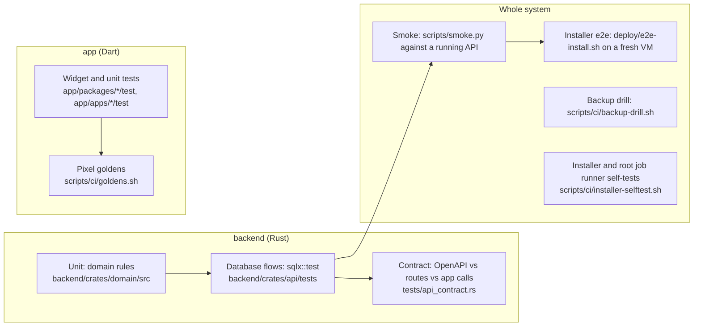
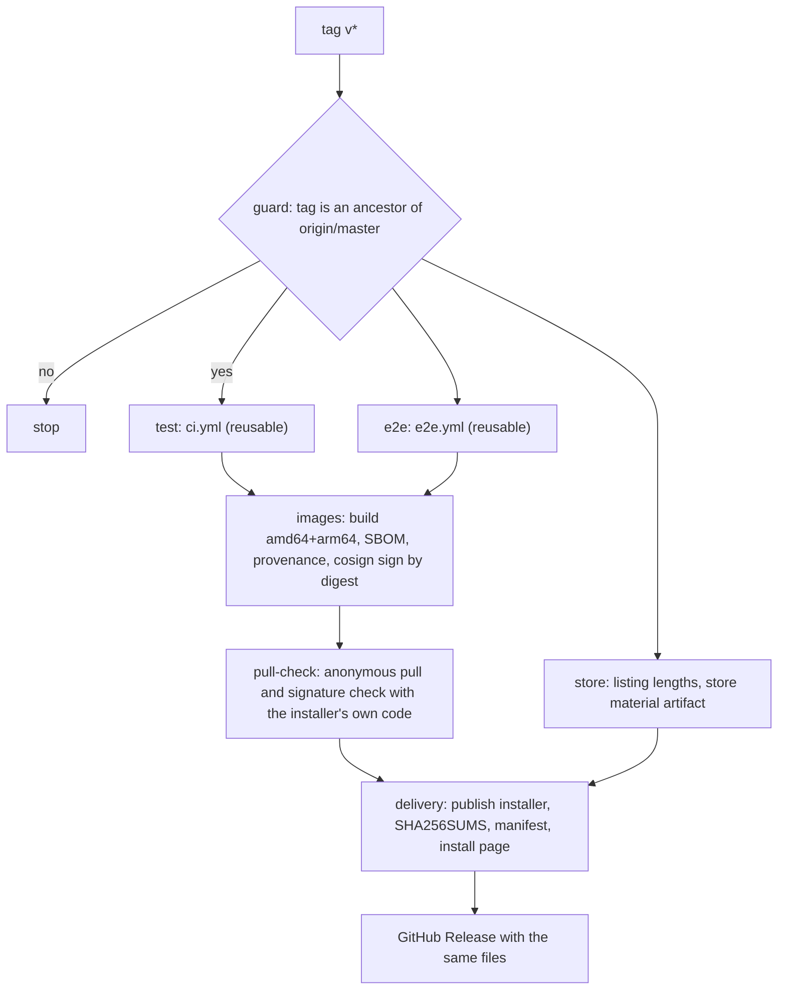

# Engineering quality

> Test strategy, CI gates job by job, the release pipeline, and code conventions. Every claim links to the file
> it comes from. Counts were taken from the tree at this revision; the recount commands are in
> [Test inventory](#test-inventory). The API index is in [docs/api/README.md](api/README.md).

## 요약 (Korean summary)

- 자동 테스트는 Rust 테스트 함수 1,092개(도메인 168, API 389 `#[test]` + `#[sqlx::test]` 515 + `#[tokio::test]` 20),
  Flutter 위젯·단위 테스트 555개(`testWidgets` 384, `test(` 171), 설치 스크립트 자가 검사 244개,
  루트 작업 실행기 자가 검사 141개가 있습니다.
- CI(`.github/workflows/ci.yml`)는 push와 pull request마다 실행됩니다. 포맷·clippy(`-D warnings`)·Rust 테스트
  (PostgreSQL 17 필요), 스모크 테스트, 백업 복구 연습, 공급망 검사(cargo-deny), 비밀 검사(gitleaks),
  Dart 분석·위젯 테스트·픽셀 비교, 셸 검사(shellcheck, actionlint), 마이그레이션 규칙, 네이티브 빌드 설정 검사를 돌립니다.
- 설치 종단 간 테스트(`.github/workflows/e2e.yml`)는 실제 `deploy/install.sh`를 깨끗한 GitHub 호스트 VM에서 실행하고,
  설치·사용·백업·복원·업데이트·실패 시 롤백·제거까지 확인합니다. 서버 이미지는 고위험 취약점 검사를 거칩니다.
- 릴리스(`.github/workflows/release.yml`)는 `master`에서 만든 `v*` 태그에서만 시작하고, CI와 설치 테스트가 통과해야
  이미지를 올립니다. 수동 실행(브랜치)은 시험 실행만 하고 이미지나 배포는 하지 않습니다. 이미지는 digest 기준으로 cosign 서명되며, 설치 스크립트는 서명이 없는 이미지를 거부합니다.
- 알려진 공백은 [Known gaps](#known-gaps)에 적었습니다. 커버리지 측정은 없고, Android 스토어 빌드 서명은 아직 CI 밖에서 합니다.

## Test layers



| Layer | What it proves | Where | Runs in |
|---|---|---|---|
| Domain unit tests | Pricing, schedule, money, tax, cancellation and similar rules | `#[test]` in [`backend/crates/domain/src`](../backend/crates/domain/src) | `cargo test --locked` (ci `backend`) |
| API database flows | Route behaviour, tested against a real PostgreSQL 17 with all migrations applied (`#[sqlx::test(migrations = "../../migrations")]`, 515 tests) | [`backend/crates/api/tests`](../backend/crates/api/tests) (69 files) | `cargo test --locked` (ci `backend`) |
| API contract | The OpenAPI spec, the mounted routes and the Flutter call sites agree; idempotent and paged operations say so | [`api_contract.rs`](../backend/crates/api/tests/api_contract.rs), [`contract_wire.rs`](../backend/crates/api/tests/contract_wire.rs) | `cargo test --locked` |
| Smoke | Sign-up, booking with coupon and payment, first-come accept race, completion and settlement, quote flow, chat, cancellation | [`scripts/smoke.py`](../scripts/smoke.py) (docstring lists the paths) | ci `backend` (API on 127.0.0.1:18080), e2e step 9 |
| Widget and unit (Flutter) | Screens, flows, parsing, accessibility checks | `app/packages/{core,ui}`, `app/apps/{customer,partner,console}` | ci `app-test` (matrix) |
| Pixel goldens | Visual regressions against baselines made on the CI runner | [`scripts/ci/goldens.sh`](../scripts/ci/goldens.sh), [`goldens.yml`](../.github/workflows/goldens.yml) | ci `goldens` |
| Installer self-test | Pure installer functions, the embedded `dahae` CLI, compose parity; no root needed | [`scripts/ci/installer-selftest.sh`](../scripts/ci/installer-selftest.sh) | ci `shell` |
| Root job runner self-test | The root job runner, with a fake CLI and no Docker. It is run at the end of the installer self-test | [`scripts/ci/agent-selftest.sh`](../scripts/ci/agent-selftest.sh) | from installer self-test (line 536) |
| Installer e2e | Real install as root, owner use, backup and restore, upgrade, broken-release rollback, update, uninstall | [`deploy/e2e-install.sh`](../deploy/e2e-install.sh) | [`e2e.yml`](../.github/workflows/e2e.yml) |
| Backup drill | Dump, offsite seal and open, restore, compare row counts | [`scripts/ci/backup-drill.sh`](../scripts/ci/backup-drill.sh) | ci `backend` |
| Release tooling | Signing, bundle and install-page scripts, listing lengths, workflow pins | [`scripts/release`](../scripts/release), [`docs/store/check_listings.py`](../docs/store/check_listings.py) | [`release-tools.yml`](../.github/workflows/release-tools.yml) |

Load testing is a separate tool, [`scripts/load/loadtest.py`](../scripts/load/loadtest.py) (with its own tests). It is not a CI gate.

## Test inventory

Counts at this revision (`master` tree).

| Suite | Count | Where |
|---|---|---|
| Rust `#[test]` | 557 (domain 168, api 389) | `backend/crates/*/src` and `backend/crates/api/tests` |
| Rust `#[sqlx::test]` | 515 | `backend/crates/api` (all database flows) |
| Rust `#[tokio::test]` | 20 | `backend/crates/api` |
| **Rust total** | **1,092** | |
| Flutter `testWidgets(` | 384 | see per-package table |
| Flutter `test(` | 171 | see per-package table |
| **Flutter total** | **555** | |
| Installer self-test assertions (`t`/`nt` calls) | 244 | [`installer-selftest.sh`](../scripts/ci/installer-selftest.sh) |
| Root job runner self-test assertions | 141 | [`agent-selftest.sh`](../scripts/ci/agent-selftest.sh) (run inside the installer self-test) |
| Installer e2e steps | 11 (1 to 10, with 5b) | [`e2e-install.sh`](../deploy/e2e-install.sh) |
| Migrations | 105 files | [`backend/migrations`](../backend/migrations) |

Flutter by package:

| Package | `testWidgets(` | `test(` |
|---|---|---|
| `app/packages/core` | 43 | 107 |
| `app/packages/ui` | 52 | 13 |
| `app/apps/customer` | 168 | 26 |
| `app/apps/partner` | 28 | 11 |
| `app/apps/console` | 93 | 14 |

`app/packages/test_support` holds test helpers and has no tests of its own. Store screenshot tests
(`test/store_screenshots`) carry the tag `store_screenshots` and are excluded from CI.

Recount (from the repository root; these are attribute counts, not executed-test counts):

```bash
rg -o '#\[test\]' backend | wc -l
rg -o '#\[sqlx::test' backend | wc -l
rg -o '#\[tokio::test' backend | wc -l
rg -o 'testWidgets\(' app/packages app/apps | wc -l
rg -o '\btest\(' app/packages app/apps | wc -l
```

The `feat/ntd-redesign` branch adds Flutter tests under `app/` that are not in this tree yet. Recount after that merge.

## CI gates

Workflow: [`.github/workflows/ci.yml`](../.github/workflows/ci.yml). Runs on push to `master`,
on every pull request, weekly (new RustSec advisories), and from `release.yml` before anything is published.
All jobs run on `ubuntu-24.04` (GitHub-hosted).

On pull requests a `changes` job reads the diff. It skips the backend jobs unless `backend/`, the smoke script,
the backup drill or `ci.yml` changed, and the app jobs unless `app/`, the action folder, the goldens script or
`ci.yml` changed. Skipped jobs are reported as skipped; whether they satisfy required checks is set in branch protection, not in this repository. Pushes, the weekly run and releases run everything.

| Job | Gate | What it checks | Files |
|---|---|---|---|
| `backend` | Rust | Formatting of the Rust files a PR changes (`rustfmt --check --edition 2024`); `cargo clippy --locked --all-targets -- -D warnings`; `cargo test --locked` | [`backend/rust-toolchain.toml`](../backend/rust-toolchain.toml) (Rust 1.99.1) |
| `backend` | Smoke | Builds the API, starts it with `DEV_MODE=1`, runs `scripts/smoke.py` | [`smoke.py`](../scripts/smoke.py) |
| `backend` | Backup | Dump, seal and open, restore into a fresh database, compare row counts (PostgreSQL 17 client) | [`backup-drill.sh`](../scripts/ci/backup-drill.sh) |
| `supply-chain` | cargo-deny | RustSec advisories, licences, banned crates, sources | [`backend/deny.toml`](../backend/deny.toml) |
| `secrets` | gitleaks v8.30.1 (pinned by digest) | Secret scan with the repository's rules | [`.github/gitleaks.toml`](../.github/gitleaks.toml) |
| `app-analyze` | Dart | `dart analyze --fatal-infos`; formatting of changed Dart files (generated `gen/` excluded) | [`flutter-setup`](../.github/actions/flutter-setup) |
| `app-test` | Flutter | `flutter test --exclude-tags store_screenshots,manual_screenshots` for `core`, `ui`, `customer`, `partner`, `console` (matrix, fail-fast off) | `app/` |
| `goldens` | Pixel | `scripts/ci/goldens.sh check`: any pixel change or missing baseline fails | [`goldens.sh`](../scripts/ci/goldens.sh) |
| `shell` | Shell and installer | shellcheck on `deploy/install.sh`, `deploy/e2e-install.sh`, `deploy/publish-delivery.sh`, `scripts/ci/*.sh`; installer self-test; pinned versions agree (Rust, Flutter, cosign); Caddyfile parses with every installer setting; actionlint on all workflows (pinned 1.7.12) | [`check-pins.sh`](../scripts/ci/check-pins.sh), [`caddy-check.sh`](../scripts/ci/caddy-check.sh) |
| `migrations` | Migration rules | Gate unit tests, then `check-migrations.py --base origin/<base>` | [`check-migrations.py`](../scripts/ci/check-migrations.py) |
| `native` | Store build config | Static checks of iOS and Android store-build files (plists, entitlements, pbxproj, gradle) and web/CSP rules | [`check-native.py`](../scripts/ci/check-native.py) |

### Migration rules

`check-migrations.py` fails when:

- two migrations share a number, or a name is not `NNNN_snake_case.sql`;
- a migration that exists on the base ref was edited, renamed or deleted (sqlx stores a checksum per version);
- a new migration creates a non-concurrent index, or adds a constraint without `NOT VALID`, on a large table;
- a `CREATE INDEX CONCURRENTLY` file lacks the `-- no-transaction` first line or holds more than one statement.

The non-concurrent index and `NOT VALID` rule does not apply when the same file creates the table.

Its known limit: statements are split on `;` after comments are stripped, so a literal `;` or `--` inside a string
literal confuses it. The file header says to keep migrations free of both. The full rules are in the header of
[`check-migrations.py`](../scripts/ci/check-migrations.py) (lines 1 to 16). [CONTRIBUTING.md](../CONTRIBUTING.md) and the
pull request template summarise them.

### API contract tests

Covered in [docs/api/README.md](api/README.md#contract-checks). In short: every mounted route is in the spec, every
spec operation is mounted, every Flutter HTTP call in `app/` names a documented route, and idempotent and paged
operations document their header and parameters.

## Installer end to end

[`e2e.yml`](../.github/workflows/e2e.yml) builds both server images (`backend/Dockerfile`, `deploy/web.Dockerfile`)
on the runner, pushes them to a local registry, and scans them with Anchore. A HIGH or CRITICAL vulnerability that
has a fixed version fails the run. Findings without a fix are not reported (`only-fixed: true`). Then it runs [`deploy/e2e-install.sh`](../deploy/e2e-install.sh),
which uses the real installer the way an owner would:

| Step | Checks |
|---|---|
| 1 | First install with the real installer |
| 2 | Services answer over HTTPS |
| 3 | Owner account, console sign-in, setup wizard |
| 4 | Backup and restore round trip |
| 5 | Re-running `install.sh` is a safe upgrade |
| 5b | A queued job is run by the root job runner |
| 6 | A broken release rolls back by itself |
| 7 | A good release updates normally |
| 8 | Heartbeat and app links without editing `.env` |
| 9 | `scripts/smoke.py` against the installed stack |
| 10 | Uninstall with purge |

The script also checks that an API outage gets the static maintenance page. On failure the workflow prints the
last 200 lines of the update log.

## Release pipeline

[`.github/workflows/release.yml`](../.github/workflows/release.yml). Triggered by a `v*` tag, or by hand as a
dry run on a branch (tests, install e2e and the listing check only).



- **Tag guard.** The tag must point at a commit on `master`; a tag on a feature branch never reaches a server.
- **Images.** Tags `<version>` and `beta` on every release; `stable` and `latest` only without a prerelease suffix.
  Signed with cosign keyless (GitHub OIDC) by the multi-arch index digest, never a movable tag.
- **Pull check.** Both packages must pull without a login and carry `linux/amd64` and `linux/arm64`. The signature
  check runs the `dahae` CLI that `install.sh` writes, on this tag.
- **Delivery.** Runs in the `release-delivery` environment. The manifest key only signs; keys live in temp files that
  are removed at the end. The host key for GitHub is fingerprint-checked before use. The installer and signed
  files go to the public delivery repository (`DIST_REPO`) and a tag there.
- **Environments.** `release-cosign` and `release-delivery` must be set up in GitHub (required reviewer, `v*` tags)
  before the first tag. Details: [docs/DEPLOY.md](DEPLOY.md#2-releases-and-channels).
- **Install-time verification.** `install.sh` and `dahae update` refuse an image without a valid cosign signature
  (`verify_image` in [`deploy/install.sh`](../deploy/install.sh); cosign version pinned to match the workflow).
- **Store apps.** Android and iOS store builds run in [store-apps.yml](../.github/workflows/store-apps.yml) (manual, [guide 11](guide/11-store-app-builds.md)).

## Pull request checks

[`PULL_REQUEST_TEMPLATE.md`](../.github/PULL_REQUEST_TEMPLATE.md) asks for: a `<type>: <description>` title, tests for
new logic, additive migrations that pass `check-migrations.py`, `installer-selftest.sh` after an installer or compose
change, Korean and English strings through `app/tool/strings_*.py`, regenerated legal pages, regenerated goldens
after a visual change, and no secrets or machine-specific paths.

## Code conventions

- Setup, local stack and test commands: [CONTRIBUTING.md](../CONTRIBUTING.md).
- Branches `feat/`, `fix/`, `docs/` from `master`. Commit messages `<type>: <description>`, types
  `feat fix refactor docs test chore perf ci`.
- User-visible strings are edited in `app/tool/strings_*.py`, never in `.arb` files or generated localisation code.
  Generated code is produced by [`app/tool/gen_arb.py`](../app/tool/gen_arb.py).
- Released migrations are immutable; schema changes are expand/contract so a rollback can run the previous release.
- Vulnerabilities are reported privately: [SECURITY.md](../SECURITY.md).
- Pinned versions: GitHub Actions are pinned to commit SHAs (checked by
  [`check_workflows.py`](../scripts/release/check_workflows.py)); Rust is pinned in `rust-toolchain.toml` and the
  API image uses the same version (checked by `check-pins.sh`).
- Dependency updates come from Dependabot ([`.github/dependabot.yml`](../.github/dependabot.yml)).

## Known gaps

Stated plainly so reviewers can weigh them.

- **No coverage measurement.** No workflow runs a coverage tool or sets a coverage threshold.
- **No nextest.** CI runs `cargo test --locked`.
- **Root job runner self-test is not its own CI job.** It runs inside `installer-selftest.sh`, which CI runs in the `shell` job.
- **Goldens need a human.** New baselines come from the `goldens` workflow (manual dispatch), then are committed.
- **Android store signing is local.** See the release pipeline note above.
- **Load tests are not gated.** `scripts/load` is run by hand.
- **Migration gate is a text check.** It parses SQL with simple rules and has the limit noted above.
- **Counts move.** The redesign branch changes the Flutter counts; recount after merging.
