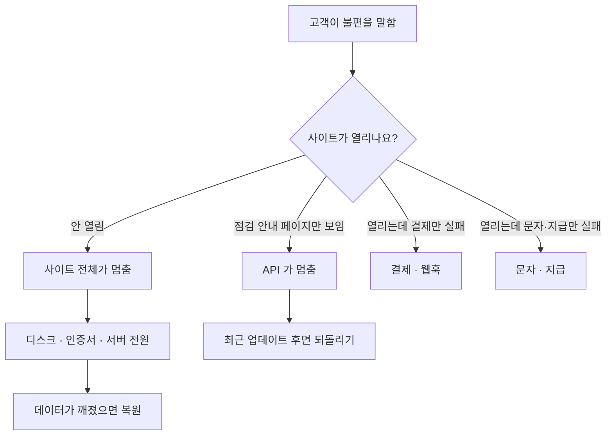

# 다해 장애 대응 런북 · Dahae incident runbook

> 대상 / Audience: 사장님(서버 운영자) 우선, 엔지니어는 각 항목의 "개발자에게 연락할 때" 를 보세요.
> 서버에서 명령을 칠 때는 항상 `sudo` 를 붙이고, 터미널은 콘솔 화면의 **브라우저에서 SSH 연결** 을 쓰면 돼요.
> 평소 운영 방법은 [OPERATIONS.md](OPERATIONS.md) 에 있어요. 명령 목록은 [deploy/install.sh](../deploy/install.sh) 의 `USAGE` 가 기준이에요.
> Engineering note: every command and screen below is taken from the code it names. Where the code and the operations
> guide disagree, the entry says so.

## 먼저 할 일 (1분) · First two minutes

1. 콘솔 **시스템 상태** 를 열어 빨간 항목을 봐요 ([OPERATIONS.md §8](OPERATIONS.md#8-모니터링--monitoring)).
2. 서버에서 `sudo dahae status` 를 실행해요.
3. 원인이 보이면 아래 해당 항목으로 가세요. 모르겠으면 `sudo dahae logs` 화면을 캡처해서 개발자에게 보내세요.



| 증상 | 바로 갈 곳 |
|---|---|
| 사이트가 아예 안 열림, 인증서 경고 | [1. 사이트 전체 중단](#1-사이트-전체-중단-site-down) · [5. 인증서 문제](#5-인증서-문제-certificate-problems) |
| 점검 안내 페이지만 나오고 앱이 오류 | [2. API 중단](#2-api-중단-api-down) |
| 결제가 안 되거나 결제는 됐는데 예약이 없음 | [3. 결제 실패](#3-결제-실패-payments-failing) · [4. 결제 알림 안 옴](#4-결제-알림웹훅이-오지-않아요-webhooks-not-arriving) |
| 기사님 지급이 실패 | [6. 지급 실패](#6-지급-실패-payouts-failing) |
| 문자나 인증번호가 안 감 | [7. 문자 실패](#7-문자-실패-sms-failing) |
| 디스크 여유 부족 경고 | [8. 디스크 부족](#8-디스크-부족-disk-full) |
| 데이터를 잘못 지웠거나 깨짐 | [9. 데이터베이스 복원](#9-데이터베이스-복원이-필요해요-database-restore-needed) |
| 비밀 키가 밖으로 샜을 수도 있음 | [10. 비밀 키 유출 의심](#10-비밀-키가-새었을-수-있어요-suspected-key-leak) |
| 고객이 탈퇴나 개인정보 열람·삭제를 요청 | [11. 탈퇴·개인정보 요청](#11-탈퇴개인정보-요청-data-deletion-request) |

---

## 1. 사이트 전체 중단 (site down)

**증상:** 브라우저에서 `https://도메인` 이 열리지 않아요. 아무 페이지도 안 나와요. 가동 확인 서비스에서 "중단" 알림이 와요.

**먼저 확인**
1. 다른 기기(휴대폰 데이터 등)에서도 안 열리는지 봐요.
2. 서버 화면(호스팅 회사의 웹 콘솔)에서 서버가 켜져 있는지 봐요. 꺼졌으면 전원을 켜고 1~2분 기다려요. Docker 는 서버가 켜지면 서비스를 다시 올려요 (`restart: unless-stopped`, [deploy/install.sh](../deploy/install.sh)).
3. `sudo dahae status` 를 실행해요. `앱 정상` 이 나오면 서버는 살아 있고, 인증서나 주소 문제일 수 있어요 ([5번](#5-인증서-문제-certificate-problems)).
4. `sudo dahae logs web` 로 웹 서버 기록을 봐요.

**조치**
- 서버가 꺼진 적이 없고 `dahae status` 의 컨테이너가 모두 떠 있지 않으면: 콘솔 **시스템 상태** 가 열리는지 보고, 안 열리면 2번 항목을 보세요.
- 웹 서버(`web`)만 떠 있지 않으면 서버에서 다시 시작해요 (`dahae` 에는 재시작 명령이 없어요):
  ```bash
  sudo docker compose -f /opt/malkkeum/docker-compose.yml --env-file /opt/malkkeum/.env restart web
  ```
  WAL 보관을 켰다면 `-f /opt/malkkeum/wal/docker-compose.wal.yml` 도 같이 넣어야 해요. 확실하지 않으면 개발자에게 물으세요.
- 방금 업데이트한 뒤라면 [2번](#2-api-중단-api-down) 의 되돌리기를 보세요.

**개발자에게 연락할 때:** 서버를 재시작해도 30분 안에 안 돌아오면. `sudo dahae logs web` 과 `sudo dahae status` 화면을 같이 보내세요.

---

## 2. API 중단 (api down)

**증상:** 사이트에는 "점검 중" 안내 페이지가 나와요 (서버가 자동으로 보여 줘요, [deploy/Caddyfile](../deploy/Caddyfile)). 앱은 "서버에 연결할 수 없어요" 라고 해요. `dahae status` 에 `앱 응답 없음` 이 나와요.

**먼저 확인**
1. `sudo dahae status`: 컨테이너 목록에서 `api` 가 `running` 인지 봐요.
2. `sudo dahae logs` 로 마지막 오류를 봐요. 데이터베이스 연결 오류가 보이면 시스템 상태의 **데이터베이스** 항목도 확인하세요.
3. 디스크가 꽉 찼는지 [8번](#8-디스크-부족-disk-full) 을 봐요.
4. 마지막 업데이트가 최근 몇 시간 안이라면 자동으로 되돌렸는지 `sudo dahae logs` 와 `sudo dahae version` 을 봐요. 업데이트가 실패하면 자동으로 이전 버전으로 돌아가고 종료 코드 3 으로 알려요 ([OPERATIONS.md §5](OPERATIONS.md#5-되돌리기--rollback)).

**조치**
- 최근 업데이트 때문이라면: `sudo dahae rollback` (데이터는 그대로예요. 저장 카드 주의점은 [OPERATIONS.md §5](OPERATIONS.md#5-되돌리기--rollback)).
- API 만 다시 시작하려면 (WAL 보관을 껐을 때):
  ```bash
  sudo docker compose -f /opt/malkkeum/docker-compose.yml --env-file /opt/malkkeum/.env restart api
  ```
- 디스크나 데이터베이스가 원인이면 그 항목으로 가세요. 다시 시작해도 계속 죽으면 더 시도하지 마세요. 다시 시작을 반복하면 로그가 쌓여 원인을 찾기 어려워져요.

**개발자에게 연락할 때:** 롤백 뒤에도 응답이 없거나, `dahae logs` 에 `panic` 같은 오류가 반복될 때. 기록 화면과 `sudo dahae version` 결과를 보내세요.

---

## 3. 결제 실패 (payments failing)

**증상:** 고객이 결제하면 오류가 나요. 또는 시스템 상태의 **결제 확인 필요** 가 빨강이에요. 알림 규칙 "결제 연동 실패" 나 "결제 자동 처리 실패" 문자가 와요.

**먼저 확인**
1. 콘솔 **시스템 상태 > 결제 확인 필요** 의 건수와, 외부 서비스의 **결제 (PortOne)** 줄의 마지막 실패 사유를 봐요 (`last_error` 는 짧은 코드로만 남아요).
2. PortOne 관리자 화면에서 해당 결제가 **결제 완료**인지 확인해요. 고객이 돈을 냈는지가 기준이에요.
3. 설정 카드가 바뀌었는지 봐요: 콘솔 **설정 > 결제 (PortOne)** 에서 [API 키 확인] 을 눌러요. 실패하면 키를 다시 입력하세요 ([docs/guide/02-설정-마법사.md](guide/02-설정-마법사.md)).

**조치**
- 결제는 됐는데 예약이 없으면: 서버가 1분마다(`reconcile_interval_secs` 기본 60초, [backend/crates/api/src/reconciler.rs](../backend/crates/api/src/reconciler.rs)) 확인해서 예약을 만들어요. 몇 분을 기다려 보세요. 계속 안 되면 PortOne 관리자 화면에서 해당 결제를 **직접 환불**하고 고객에게 알리세요 (콘솔 안내 문구와 같아요).
- 환불이 실패한 건은 서버가 다시 시도해요 (`refund_queue`). 자동으로 안 풀리면 개발자에게 알리세요.
- 결제 수단이 안 보이면: 콘솔 **설정 > 결제 수단** 에서 그 수단을 켰는지, 채널 키가 있는지 확인하세요.
- 점검 모드가 켜져 있으면 예약 결제가 막혀요 ([OPERATIONS.md §10](OPERATIONS.md#10-점검-모드--maintenance-mode)).

**개발자에게 연락할 때:** PortOne 에서 결제 완료인데 예약이 2시간 넘게 안 생길 때, 또는 환불이 연속 실패할 때. 결제 번호와 시각을 보내세요.

---

## 4. 결제 알림(웹훅)이 오지 않아요 (webhooks not arriving)

**증상:** 시스템 상태의 **결제 알림 (웹훅)** 이 노랑이나 빨강이에요 ("서명 실패 N건"). 또는 PortOne·토스에서 보낸 알림이 반영되지 않아요.

**구조:** 웹훅은 서명을 확인하고, 실제 결제 상태는 공급사에 다시 물어봐요. 알림만으로는 돈을 옮기지 않아요 ([backend/crates/api/src/routes/webhooks.rs](../backend/crates/api/src/routes/webhooks.rs)).
- PortOne: `https://도메인/v1/webhooks/portone` (서명 시크릿: 콘솔 **설정 > 결제 (PortOne)** 의 웹훅 시크릿).
- 토스 지급: `https://도메인/v1/webhooks/toss` (서명 키: 콘솔 **설정 > 파트너 지급** 의 보안 키).

**먼저 확인**
1. 공급사 관리 화면의 웹훅 주소가 위와 **글자 하나까지** 같은지 봐요 (`https://` 와 도메인 철자).
2. 콘솔 **설정** 의 웹훅 시크릿을 공급사 화면의 값과 비교해요. 복사할 때 앞뒤 공백이 들어가기 쉬워요.
3. `sudo dahae logs` 에서 `portone webhook rejected` 또는 `toss webhook rejected: bad signature` 를 찾아요. 이 줄이 있으면 서명이 틀린 거예요.

**조치**
- 시크릿이 틀렸으면: 공급사에서 값을 다시 복사해 콘솔에 넣고 [연결 확인]. 웹훅 시크릿이 없으면 운영 모드에서는 모든 알림을 거절해요 (`provider_not_configured`).
- 공급사 화면에서 실패한 알림을 **다시 보내기** 할 수 있으면 보내세요. 서버는 같은 알림을 두 번 받아도 안전하게 처리해요 (정산은 잠금으로 막아요).
- 주소가 맞는데 기록에 아무것도 없으면: 방화벽 (`sudo ufw status`: 443 이 열려 있어야 해요) 과 클라우드 방화벽을 확인하세요. Caddy 접근 기록에서 `/v1/webhooks` 요청이 보이는지 확인할 수 있어요 (`caddylogs` 볼륨; 엔지니어 도움이 필요할 수 있어요).

**개발자에게 연락할 때:** 서명이 맞는데도 거절되거나, 알림이 실제로 도착했는데 기록이 없을 때. 공급사 알림 번호와 시각을 보내세요.

---

## 5. 인증서 문제 (certificate problems)

**증상:** 브라우저가 "연결이 안전하지 않아요" 라고 해요. `dahae status` 에 `HTTPS 인증서가 아직 없어요` 가 나와요.

**원인 대부분:** 도메인의 A 레코드가 이 서버를 가리키지 않거나, 80·443 포트가 막혀 있어요. 인증서는 Caddy 가 자동으로 받고 갱신해요 ([deploy/Caddyfile](../deploy/Caddyfile)).

**먼저 확인**
1. 도메인의 A 레코드가 서버 IP 와 같은지 봐요. 서버 IP 는 `sudo dahae status` 가 아니라 호스팅 회사 화면에서 확인하세요. 서버에서는 `dig +short 도메인` 으로 A 레코드를 볼 수 있어요 (`dnsutils` 가 설치돼 있어요).
2. 클라우드 방화벽과 `sudo ufw status` 에서 22, 80, 443 이 열려 있는지 봐요.
3. `sudo dahae logs web` 에서 인증서 발급 오류를 봐요.

**조치**
- DNS 를 고쳤다면 몇 분 기다려요. 자동으로 발급돼요. `sudo dahae status` 로 다시 확인하세요.
- 같은 오류가 계속 나도 웹 서버를 여러 번 다시 시작하지 마세요. 발급 시도가 쌓여요. 한 번 고친 뒤 기다리세요.
- `www` 주소가 안 열리면 `www` A 레코드가 없어서 그래요. 본 주소 `https://도메인` 은 영향이 없어요.

**개발자에게 연락할 때:** A 레코드와 방화벽이 맞는데 30분 넘게 인증서가 없을 때.

---

## 6. 지급 실패 (payouts failing)

**증상:** 기사님이 지급을 못 받았다고 해요. 콘솔 **정산** 에서 지급 건이 `실패` 나 `발송됨` 상태로 멈춰 있어요. 알림 "결제 자동 처리 실패" 나 "지급" 관련 문구가 와요.

**구조 (먼저 알아 두세요)**
- 지급 상태는 `요청됨 → 발송됨 → 지급 완료` 또는 `실패` 예요. **지급 완료는 되돌릴 수 없어요** ([backend/crates/api/src/payout.rs](../backend/crates/api/src/payout.rs)).
- 지급 방식은 `수동` (사장님이 은행에서 직접 보내고 콘솔에서 확인) 또는 `토스` 예요. 방식은 콘솔 **설정 > 파트너 지급** 에 있어요 ([docs/DEPLOY.md](DEPLOY.md) §7).
- 콘솔 **정산** 화면의 버튼: **이체 완료로 표시** (수동 방식의 지급 완료), **토스로 지급 요청**, **상태 확인** (토스 쪽 상태를 다시 물어봐요), **다시 시도**, **실패로 표시** (사유 입력).
- 버튼은 최근 인증 코드 확인(TOTP) 뒤에만 눌려요 ([backend/crates/api/src/routes/payouts.rs](../backend/crates/api/src/routes/payouts.rs) `act`).

**먼저 확인**
1. 해당 건이 `발송됨` 이면 **재시도 누르지 마세요.** 토스에 이미 송금이 됐을 수 있어요. **동기화** 를 먼저 누르세요.
2. 토스 방식이면 설정 카드의 [연결 확인] 이 통과하는지 봐요.
3. `sudo dahae logs` 에서 지급 관련 오류를 봐요.

**조치**
- 수동 방식: 은행 이체가 끝났으면 **이체 완료로 표시**, 못 보냈으면 **실패로 표시** 에 사유를 적으세요.
- 토스 방식에서 `요청됨` 이고 오류가 난 건: **다시 시도** 는 송금이 안 됐다는 것을 확인한 뒤에만 누르세요. 확실하지 않으면 개발자에게 먼저 물으세요.
- 기사님 계좌가 틀렸으면 기사님 정보를 고친 뒤 새로 지급하세요. 지급 계좌 열람은 기록으로 남아요.

**개발자에게 연락할 때:** 토스 화면에서 송금 상태와 콘솔 상태가 다를 때, 또는 `재시도` 를 눌러도 같은 오류가 날 때.

---

## 7. 문자 실패 (SMS failing)

**증상:** 인증번호가 안 와요. 예약 알림 문자가 안 가요. 시스템 상태의 **외부 서비스 > 문자 · 알림톡 (Solapi)** 이 빨강이에요. 알림 "문자(SMS) 발송 실패" 가 와요.

**구조:** 인증번호는 대기열에 넣지 않고 바로 보내요. 실패하면 0.5초 뒤 한 번 더 보내고, 또 실패하면 앱에 오류를 보여 줘요. 예약 알림 문자는 대기열에 넣고 자동으로 다시 보내요. 여덟 번 실패하면 "발송 실패 (재시도 끝)" 으로 표시되고 사장님께 알려요 ([backend/crates/api/src/sms_outbox.rs](../backend/crates/api/src/sms_outbox.rs)).

**먼저 확인**
1. 콘솔 **설정 > 문자 · 알림톡 (Solapi)** 에서 [연결 확인].
2. 발신번호가 Solapi 에서 승인됐는지, 알림톡 템플릿이 승인됐는지 봐요 ([docs/guide/06-알림톡-템플릿-등록.md](guide/06-알림톡-템플릿-등록.md)).
3. 시스템 상태 **백그라운드 작업** 의 "발송 실패 N건 (재시도 끝)" 을 봐요.

**조치**
- 키가 틀렸으면 Solapi 에서 키를 새로 만들어 입력하고 [연결 확인].
- 발신번호나 템플릿이 승인되지 않았으면 승인부터 받으세요. 승인 전에는 문자가 나가지 않아요.
- 발송 실패로 끝난 문자는 콘솔에서 다시 보낼 수 없어요. 다시 보내는 기능이 없어요. 고객이 필요하면 전화나 앱 알림으로 알려 주세요.

**개발자에게 연락할 때:** 연결 확인은 통과하는데 문자가 계속 실패할 때, 또는 발송 실패 건수가 계속 늘 때.

---

## 8. 디스크 부족 (disk full)

**증상:** 시스템 상태의 **서버 디스크** 가 노랑(20% 미만) 이나 빨강(10% 미만). 또는 API 가 안 뜨고 `dahae logs db` 에 쓰기 오류가 보여요. 알림 "디스크 부족" 이 와요.

**먼저 확인**
```bash
df -h /opt/malkkeum                          # 전체 여유
sudo du -sh /opt/malkkeum/backups            # 백업 크기
sudo du -sh /var/lib/docker/volumes/* 2>/dev/null | sort -h | tail   # 볼륨 (사진, 데이터베이스)
sudo docker system df                         # 이미지와 볼륨 요약
```

**원인별 조치**
- **백업**이 큰 경우: 서버 안 백업은 자동으로 지워져요: DB 덤프는 14일 뒤예요. 사진 묶음은 그날 백업의 사진이 외부 백업에 올라가면 3일이 지난 것을 모두 지우고, 아니면 14일 뒤 지워요 ([OPERATIONS.md §6](OPERATIONS.md#6-백업--backups)). 외부 백업이 **켜져 있는 것을 확인한 뒤에만** 오래된 `.enc` 를 직접 지우세요. 외부 백업이 없으면 지우지 마세요. 자동 정리는 묶음마다 외부 사본을 확인하지 않아요.
- **Docker 이미지**: `sudo docker image prune` 은 태그가 없는 이미지를 지워요. `.env` 의 `PREV_API_IMAGE`·`PREV_WEB_IMAGE` 가 가리키는 이미지는 롤백에 쓰니 따로 지우지 마세요. 다른 명령(`docker system prune -a`)은 쓰지 마세요.
- **사진**: 어디에도 연결되지 않은 사진은 30일 뒤 자동으로 지워요. 사진이 계속 늘면 디스크를 늘리는 게 맞아요.
- **데이터베이스 볼륨이 가득 찼다면** 서버를 늘리는 것이 가장 안전해요. 엔지니어 없이 파일을 직접 지우지 마세요.
- **WAL 보관을 켰다면** 아카이브가 실패하면 WAL 파일이 디스크에 쌓여요 ([docs/DEPLOY.md](DEPLOY.md) §2). `pgbackrest` 확인이 필요해요.

**금지:** `.env`, `backups/keys-*.env.enc`, `backups/*.enc` 중 외부 백업이 없는 것을 지우는 일.

**개발자에게 연락할 때:** 정리 후에도 여유가 10% 아래이거나, 데이터베이스 볼륨이 원인일 때.

---

## 9. 데이터베이스 복원이 필요해요 (database restore needed)

**언제:** 실수로 예약이나 고객 데이터를 지웠거나, 업데이트 뒤 데이터가 깨졌을 때. **복원하면 그 시점 이후의 예약과 고객 변경은 사라져요.** 꼭 필요할 때만 하세요.

**기준:** 서버 안 백업은 하루 한 번(03:30)과 업데이트 직전에 만들어져요. 그래서 최악의 경우 하루치 데이터를 잃을 수 있어요 (외부 백업도 같아요). WAL 보관을 켠 서버는 약 5분 단위로 복원할 수 있어요 (엔지니어가 설정해야 해요).

**절차**
1. 복원을 알리세요. 고객 예약을 받지 않도록 **점검 모드** 를 켜세요 ([OPERATIONS.md §10](OPERATIONS.md#10-점검-모드--maintenance-mode)).
2. 서버에서 백업 목록을 보세요:
   ```bash
   sudo dahae restore-offsite          # 외부 백업 목록 (있을 때)
   sudo ls /opt/malkkeum/backups       # 서버 안 백업
   ```
3. 되돌릴 백업을 고르세요. 파일 이름의 날짜와 시각을 보세요.
4. 서버 안 백업이면:
   ```bash
   sudo dahae restore backups/db-20261110-033000.sql.gz.enc
   ```
   "현재 데이터를 … 로 되돌릴까요?" 에 `yes` 를 입력하세요. 되돌리기 전에 현재 상태를 먼저 백업해요.
5. 외부 백업이면:
   ```bash
   sudo dahae restore-offsite 이름
   ```
6. `✔ 복원 완료` 가 나오면 콘솔에서 예약과 고객 수를 확인하고 점검 모드를 끄세요.

**중요**
- DB 복원이 실패하면 데이터는 복원 전 그대로예요. 사진 복원이 실패하면 DB 는 이미 복원된 상태예요. 복원 뒤 앱이 응답하지 않아도 DB 는 이미 복원된 상태예요. 어느 경우든 오류 화면을 개발자에게 보내세요.
- 외부 백업을 열려면 **같은 `DATA_KEY`** 가 필요해요. 서버를 새로 설치했다면 먼저 `sudo dahae keys-restore 파일` 을 실행하세요 ([OPERATIONS.md §6](OPERATIONS.md#6-백업--backups)).
- 서버 자체를 잃었을 때: 새 서버에 설치 → 예전 `.env` 또는 키 사본 복원 → 콘솔에서 외부 백업 연결 → `restore-offsite`. 보통 1시간 안팎이 걸려요 ([docs/DEPLOY.md](DEPLOY.md) §2).
- 시점 복원(WAL)은 `dahae` 명령에 없어요. 엔지니어가 `pgbackrest` 로 해야 해요.

**개발자에게 연락할 때:** 필요한 시점의 백업이 없을 때, 복원이 오류로 멈출 때, 또는 시점 복원이 필요할 때.

---

## 10. 비밀 키가 새었을 수 있어요 (suspected key leak)

**증상과 신호:** 낯선 로그인 알림, 인증 잠금 알림 ("계정 보안 이상"), 웹훅 서명 실패가 갑자기 늘어남, 공급사에서 낯선 거래 알림.

**즉시 할 일 (순서대로)**
1. 콘솔 **내 계정 > 모든 기기에서 로그아웃** 을 눌러요 (사장님 세션 전부 끊어요). 직원 비밀번호도 **직원** 화면에서 재설정하세요.
2. 새 키가 필요한 것을 정리하세요. 아래 표를 보세요.
3. 연동 키(결제, 문자, 푸시, 소셜 로그인, 토스 보안 키, 외부 백업 S3)는 각 서비스 화면에서 **새로 발급**하고, 콘솔 **설정** 에 다시 넣고 [연결 확인] 을 누르세요 (PortOne 은 [API 키 확인]). 옛 키는 서비스 화면에서 폐기하세요.
4. 서버 승인 코드가 새어 나갔을 수 있으면: `sudo dahae owner-reset` 으로 지우고 `sudo dahae host-approval enroll <사장님 계정 번호>` 로 다시 만드세요. 인증 앱에 새 키를 넣어요.
5. 바뀐 뒤에는 `sudo dahae keys-backup` 으로 새 사본을 만들고, 옛 사본은 안전하게 버리세요 (확인 문구도 다시 입력해요).
6. 콘솔 **활동 기록** (감사 기록) 에서 최근 로그인과 설정 변경을 보고, 모르는 항목을 개발자에게 보내세요.

**하지 말 것**
- `.env` 를 손으로 고치지 마세요. 잘못 고치면 모든 연동이 멈춰요.
- `DATA_KEY` 를 바꾸지 마세요. 저장된 연동 키와 외부 백업을 열 수 없게 돼요. 바꾸는 방법은 저장소에 없어요 ([OPERATIONS.md §12](OPERATIONS.md#12-키-관리와-교체--keys-and-rotation)).

**개발자에게 연락할 때: 반드시.** `JWT_SECRET`(로그인 토큰 키), `DATA_KEY`, 데이터베이스 비밀번호 교체는 사장님이 혼자 하면 안 되고 개발자가 해야 해요. 유출 범위와 시각을 같이 알려 주세요.

---

## 11. 탈퇴·개인정보 요청 (data deletion request)

**언제:** 고객이 탈퇴하거나, 자기 정보를 보여 달라(열람), 지워 달라(삭제)고 요청할 때. 개인정보 보호법에 따른 요청이에요.

**절차**
1. 요청한 사람이 본인인지 확인하세요. 가입된 전화번호로 확인하는 것이 기본이에요.
2. 콘솔 **탈퇴·개인정보 요청** 을 열어 전화번호로 고객을 찾아요 ([backend/crates/api/src/routes/privacy_requests.rs](../backend/crates/api/src/routes/privacy_requests.rs)).
3. **열람**(내보내기) 요청이면 JSON 또는 CSV 로 내려받아 고객에게 전달하세요. 내보내기는 최근 5분 안의 인증 코드를 요구해요.
4. **삭제** 요청이면: 최근 인증 코드 확인 → 고객 전화번호를 다시 입력 → 실행. 삭제는 관리자 계정만 할 수 있어요.
5. 실행 결과는 **처리 기록** 에 남아요 (내용 없이 종류와 처리 결과만).

**삭제되는 것과 남는 것**: 이름, 이메일, 전화번호, 주소, 결제 수단(공급사 쪽 카드 키 포함), 알림, 로그인 토큰은 지워요. 완료된 예약의 주소와 방문 메모도 정리해요. 돈과 감사 기록은 법에 따라 남아요. 자세한 표는 [docs/privacy-retention.md](privacy-retention.md) 에 있어요.

**주의**
- 열린 예약이 있는 고객은 예약이 끝날 때까지 개인 정보가 남아요.
- **파트너(기사님) 탈퇴와 내보내기는 아직 콘솔에서 할 수 없어요.** 파트너 요청은 개발자에게 보내세요.
- 삭제는 되돌릴 수 없어요. 고객이 "잘못 눌렀다" 고 하면 다시 가입을 안내하세요.

**개발자에게 연락할 때:** 파트너 탈퇴나 내보내기가 필요할 때, 또는 공급사 카드 키 삭제가 실패해서 `billing_key_delete_failed` 가 나올 때 (재시도해도 안 되면).

---

# English

Same incidents in English. Korean above is the reference text. Commands are identical.

## First two minutes
Open the console **시스템 상태** (system status) and note red items. On the server run `sudo dahae status`. If unclear, run `sudo dahae logs`, capture the output, and send it to the developer.

| Symptom | Go to |
|---|---|
| Whole site does not load, certificate warning | [1](#1-site-down) · [5](#5-certificate-problems) |
| Maintenance page only, apps error | [2](#2-api-down) |
| Payments fail, or paid but no booking | [3](#3-payments-failing) · [4](#4-webhooks-not-arriving) |
| Partner payouts fail | [6](#6-payouts-failing) |
| SMS or login codes do not arrive | [7](#7-sms-failing) |
| Disk low | [8](#8-disk-full) |
| Data deleted or corrupt | [9](#9-database-restore-needed) |
| Possible key leak | [10](#10-suspected-key-leak) |
| Customer deletion or access request | [11](#11-data-deletion-request) |

<a id="1-site-down"></a>
## 1. Site down
**Symptoms:** `https://DOMAIN` does not open for any device; the heartbeat service reports the server down.
**Check:** is the server powered on (host web console)? Does `sudo dahae status` show the containers running? `sudo dahae logs web`.
**Fix:** power on and wait 1–2 minutes (containers restart automatically, `restart: unless-stopped`). If only `web` is down, `docker compose -f /opt/malkkeum/docker-compose.yml --env-file /opt/malkkeum/.env restart web` (add the WAL override file if WAL archiving is on). If it was just updated, see 2.
**Call the developer** if the server is up and the site is still down after 30 minutes; send `dahae logs web` and `dahae status`.

<a id="2-api-down"></a>
## 2. API down
**Symptoms:** the website shows the static maintenance page; apps say the server cannot be reached; `dahae status` says `앱 응답 없음`.
**Check:** `sudo dahae status`; `sudo dahae logs` for database or disk errors; disk at 0 % (see 8); whether an update ran recently (`sudo dahae version`). A failed update rolls back automatically and exits with code 3.
**Fix:** after a recent update, `sudo dahae rollback` (data is kept; read the saved-card warning in OPERATIONS §5). Otherwise restart `api` with `docker compose ... restart api` (WAL off; see the Korean note for WAL on). Do not restart repeatedly if logs show the same error.
**Call the developer** when rollback does not help or the logs show repeated crashes.

<a id="3-payments-failing"></a>
## 3. Payments failing
**Symptoms:** checkout errors; console **결제 확인 필요** is red; "결제 연동 실패" or "결제 자동 처리 실패" alerts.
**Check:** the console payment item and PortOne's merchant console (is the payment actually completed?); **설정 > 결제 (PortOne)** → API 키 확인.
**Fix:** a paid checkout without a booking is re-checked by the server every 60 seconds (`reconcile_interval_secs`, default 60); wait a few minutes. If it stays stuck, refund in the PortOne console and tell the customer. Failed refunds are retried from the refund queue.
**Call the developer** when a payment is completed at PortOne but no booking appears after two hours, or refunds keep failing. Send the payment id and time.

<a id="4-webhooks-not-arriving"></a>
## 4. Webhooks not arriving
**Symptoms:** console **결제 알림 (웹훅)** is yellow or red ("서명 실패 N건"); provider changes are not reflected.
**Endpoints:** PortOne `https://DOMAIN/v1/webhooks/portone` (webhook secret in **설정 > 결제 (PortOne)**); Toss `https://DOMAIN/v1/webhooks/toss` (security key in **설정 > 파트너 지급**).
**Check:** the URL at the provider matches exactly; the secret matches (watch for pasted spaces); `sudo dahae logs` for `portone webhook rejected` or `toss webhook rejected: bad signature`.
**Fix:** copy the secret again and run 연결 확인; resend failed events from the provider if it offers that. Replays are safe: the server re-reads the payment and settlement is locked.
**Call the developer** when signatures look correct but are rejected, or events arrive with no record.

<a id="5-certificate-problems"></a>
## 5. Certificate problems
**Symptoms:** browser warns the connection is not secure; `dahae status` says the HTTPS certificate is not there yet.
**Causes:** the domain's A record does not point at this server, or ports 80/443 are blocked (cloud firewall or `sudo ufw status`). Caddy issues and renews certificates automatically ([deploy/Caddyfile](../deploy/Caddyfile)).
**Fix:** correct DNS, wait a few minutes, re-run `sudo dahae status`. Do not restart the web container repeatedly; attempts pile up. A missing `www` record only affects `www`.
**Call the developer** when DNS and firewall are correct and no certificate appears after 30 minutes.

<a id="6-payouts-failing"></a>
## 6. Payouts failing
**Model:** states are requested → sent → paid, or failed. Paid is final. Methods: manual (owner transfers and confirms) or Toss. Buttons: confirm, send, sync, retry, fail (reason); each needs a recent TOTP step-up ([backend/crates/api/src/routes/payouts.rs](../backend/crates/api/src/routes/payouts.rs)).
**Rule:** if an item is `발송됨` (sent), do not press retry. Press sync first. Retry only when you are sure no transfer was made.
**Call the developer** when the Toss status and the console differ, or retry keeps failing.

<a id="7-sms-failing"></a>
## 7. SMS failing
**Model:** login codes are sent at once, not queued; one retry after 0.5 s, then the app shows an error. Booking messages are queued and retried automatically; after eight attempts they are marked dead-lettered (shown as "발송 실패 N건 (재시도 끝)" under 시스템 상태 **백그라운드 작업**) and the owner is alerted ([backend/crates/api/src/sms_outbox.rs](../backend/crates/api/src/sms_outbox.rs)).
**Check:** **설정 > 문자 · 알림톡 (Solapi)** → 연결 확인; sender number and templates approved at Solapi ([docs/guide/06-알림톡-템플릿-등록.md](guide/06-알림톡-템플릿-등록.md)); the failed-send count under 시스템 상태 **백그라운드 작업**.
**Fix:** re-enter keys; get sender numbers and templates approved first.
**Call the developer** when the test passes but messages keep failing or the failed-send count keeps growing.

<a id="8-disk-full"></a>
## 8. Disk full
**Check:** `df -h /opt/malkkeum`, `sudo du -sh /opt/malkkeum/backups`, `sudo docker system df`.
**Fix:** server backups are deleted automatically: database dumps after 14 days, after a backup whose photo archive reached offsite storage, photo archives older than 3 days are removed (otherwise after 14). Delete old `.enc` backups by hand only when an offsite backup is confirmed; the automatic cleanup does not check each archive's own offsite copy. `sudo docker image prune` removes untagged images only; do not run `docker system prune -a`. Unlinked photos are removed after 30 days. If the database volume is full, add disk; do not delete database files by hand. With WAL archiving on, a failing archive piles WAL up on disk.
**Never delete:** `.env`, `backups/keys-*.env.enc`, or backups that have no offsite copy.
**Call the developer** when space stays under 10 % after cleanup.

<a id="9-database-restore-needed"></a>
## 9. Database restore needed
**Warning:** a restore discards everything after the chosen backup. Turn on maintenance mode first.
**Recovery point:** at 03:30 daily and before each update. Without WAL archiving you can lose up to a day. WAL archiving (engineer setup) gives about five minutes.
**Steps:** `sudo dahae restore-offsite` (list) or `sudo ls /opt/malkkeum/backups`; then `sudo dahae restore backups/<file>.sql.gz.enc` (type `yes`) or `sudo dahae restore-offsite <name>`; check counts in the console; turn maintenance off.
**Fresh server:** install, then `sudo dahae keys-restore <keys file>` (same DATA_KEY), connect offsite backup, then `restore-offsite`. About one hour on a fresh VPS ([docs/DEPLOY.md](DEPLOY.md) §2).
**Point-in-time restore** is not a `dahae` command; an engineer runs pgBackRest.
**Call the developer** when the backup you need is missing, the restore stops with an error, or you need a point-in-time restore.

<a id="10-suspected-key-leak"></a>
## 10. Suspected key leak
**Do now, in order:** (1) console 내 계정 → 모든 기기에서 로그아웃; reset staff passwords from the 직원 screen. (2) Issue new keys at each provider (payments, SMS, push, social sign-in, Toss security key, offsite S3), enter them in **설정**, run 연결 확인, revoke the old ones there. (3) If the approval code leaked: `sudo dahae owner-reset`, then `sudo dahae host-approval enroll <owner account id>`. (4) `sudo dahae keys-backup` again and confirm escrow. (5) Review the audit log in the console.
**Do not:** edit `.env` by hand; change `DATA_KEY` (stored secrets and backups become unreadable).
**Call the developer, always,** for `JWT_SECRET`, `DATA_KEY` and database password changes. Send the scope and time.

<a id="11-data-deletion-request"></a>
## 11. Data deletion request
**Steps:** confirm identity by the registered phone; console 탈퇴·개인정보 요청 → look up by phone → export (JSON or CSV) if requested (needs a TOTP step-up within five minutes) → delete (admin only; step-up; type the phone number back). Results are logged without personal details.
**Kept by law:** money and audit records. Open bookings keep personal fields until they close. Partner (pro) deletion and export are not in the console; send those to the developer ([docs/privacy-retention.md](privacy-retention.md)).
**Call the developer** for partner requests, or when a card key cannot be deleted at the provider (`billing_key_delete_failed`) and a retry fails.

## Checked against code
Command names and confirmations: [deploy/install.sh](../deploy/install.sh). Alerts and thresholds: [backend/crates/api/src/ops_alerts.rs](../backend/crates/api/src/ops_alerts.rs), [backend/crates/api/src/ops.rs](../backend/crates/api/src/ops.rs). Deletion rules: [docs/privacy-retention.md](privacy-retention.md).
