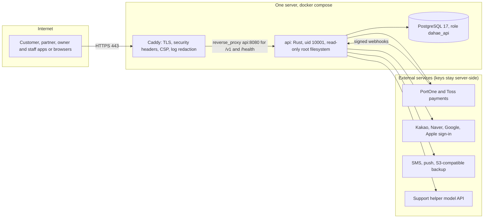
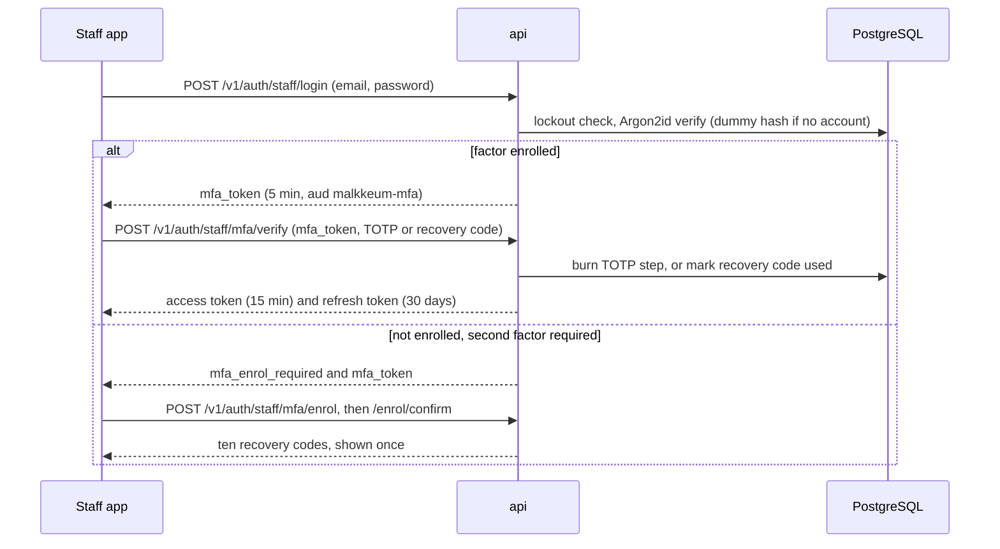
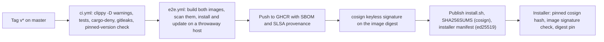

# 보안과 개인정보 / Security and privacy model

Status: describes the code on branch `docs/industry-docs` (the current develop line) as read on 2026-11-16. Every claim links to the file that implements it. Where the code and a product statement disagree, the disagreement is listed in [Known gaps](#known-gaps-and-open-items) instead of being smoothed over.

Related: [root SECURITY.md](../SECURITY.md) (how to report a vulnerability), [privacy-retention.md](privacy-retention.md) (retention and deletion tables), [store/data-safety.md](store/data-safety.md), [store/app-privacy.md](store/app-privacy.md), [website/privacy.html](../website/privacy.html) (customer-facing notice).

---

## 한국어 요약

이 문서는 다해 서버가 무엇을 보호하고 어떤 장치로 보호하는지를 **코드 기준으로** 설명합니다. 각 주장에는 실제 파일 링크가 있습니다. 코드와 안내문이 다른 부분은 숨기지 않고 [알려진 한계](#known-gaps-and-open-items)에 적었습니다.

- **로그인**: 고객과 파트너는 휴대폰 인증번호(6자리, 3분 유효, 한 번만 사용 가능)나 소셜 로그인(카카오·네이버·구글·애플)으로 들어옵니다. 사장님과 직원은 비밀번호에 더해 인증 앱(TOTP) 코드가 필요하며, 이 2단계 인증은 기본으로 켜져 있고 개발 모드가 아니면 끌 수 없습니다.
- **권한**: 역할(고객, 파트너, 팀원, 직원, 관리자)과 소유자 확인을 서버가 매 요청마다 합니다. 사장님 전용 작업은 요청마다 인증 앱 코드를 받고, 돈이나 개인정보를 다루는 작업은 최근 5분 안의 재인증(step-up)을 요구합니다.
- **비밀 값**: 서버는 시작할 때 필수 환경 변수를 검사합니다. 콘솔 설정 마법사에서 저장한 결제·문자 키는 암호화해 두고, 저장 뒤에는 `••••`로만 보여 주며, 다시 바꾸려면 사장님이 잠금을 풀어야 합니다.
- **암호화**: AES-256-GCM을 쓰고, 칼럼마다 목적을 인증 데이터(AAD)로 묶어 다른 칼럼으로 옮기면 복호화가 실패합니다. 조회만 필요한 값은 비밀 키로 만든 해시(HMAC)로 저장합니다.
- **기록**: 직원 활동 기록(`audit_log`)과 동의 기록(`user_consents`)은 데이터베이스 트리거로 수정과 삭제가 막혀 있습니다. 데모 데이터 초기화만 예외입니다.
- **개인정보**: 필요한 항목만 받고, 보관 기간이 지난 값은 매시간 자동으로 지우며, 탈퇴하면 주문 기록은 남기되 개인 식별 정보는 지웁니다. 동의는 버전별로 기록하고, 국외 이전 항목은 동의 대상입니다. 열람과 삭제 요청은 콘솔에서 처리하고 모두 기록합니다.
- **서버 설치**: 방화벽(22·80·443만 열기), fail2ban, 자동 보안 업데이트, SSH 비밀번호 로그인 끄기 점검을 설치 프로그램이 합니다. 이미지는 서명을 확인한 뒤에만 실행합니다.
- **공급망**: 기반 이미지와 GitHub 액션을 고정(digest·커밋 SHA), cargo-deny, gitleaks, 이미지 취약점 검사, cosign 키리스 서명, SBOM·출처 증명, 설치 매니페스트에 서명합니다. 설치 프로그램은 이 서명을 확인하지 않습니다.
- **확인이 필요한 부분**: 상담 도우미가 고객 동의를 기능 단위로 확인하는 코드는 없습니다. 웹소켓의 구 방식(주소창 토큰) 경로는 직원 세션 종료를 확인하지 않습니다. 머지 예정인 고객 앱 리디자인 브랜치는 가입 화면에서 필수 동의 수집을 뺐습니다. 자세한 목록은 [알려진 한계](#known-gaps-and-open-items) 절에 있습니다.
- **취약점 신고**: 공개 이슈를 만들지 말고 저장소의 비공개 취약점 신고를 쓰세요. 절차는 [SECURITY.md](../SECURITY.md)에 있습니다.

---

## English summary

This document explains what the server protects and how, grounded in the code. Each claim links to the implementing file. Where code and product text disagree, the difference is listed under [Known gaps](#known-gaps-and-open-items).

Scope: the Rust API (`backend/crates/api`), its domain crate, PostgreSQL schema (`backend/migrations`), the Caddy edge and the Docker stack (`deploy/`), the one-command installer and `dahae` CLI (`deploy/install.sh`), release and CI workflows (`.github/workflows`), and the Flutter apps as far as they touch security (`app/`). The customer UI redesign on `feat/ntd-redesign` is read-only input: it is summarised where it changes a security or privacy behaviour, and it is not the basis for any claim below unless marked.

### 1. Trust boundaries

- Only Caddy publishes ports to the network. `uptime-kuma` binds 127.0.0.1:3001 only. The API port is not published; `/ready` and `/metrics` return 404 at the edge ([deploy/Caddyfile](../deploy/Caddyfile) lines 82-84; [deploy/docker-compose.yml](../deploy/docker-compose.yml) `ports` entries).
- The API connects as `dahae_api`, a non-superuser role; `app` stays the admin and backup role ([deploy/docker-compose.yml](../deploy/docker-compose.yml) `api` environment).
- Every container has `cap_drop: [ALL]`, `no-new-privileges`, a read-only root filesystem, and memory and process caps ([deploy/docker-compose.yml](../deploy/docker-compose.yml) `x-hardened`). The API image runs as `USER app` ([backend/Dockerfile](../backend/Dockerfile) line 19).

### 2. Authentication

#### 2.1 Phone code (customers and partners)

| Rule | Value | Where |
|---|---|---|
| Code | 6 digits, random | [auth.rs `otp_code`](../backend/crates/api/src/auth.rs) |
| Lifetime | 180 s | [routes/auth.rs](../backend/crates/api/src/routes/auth.rs) `OTP_TTL_SECS` |
| Resend cooldown per number | 60 s | `OTP_RESEND_COOLDOWN_SECS` |
| Codes per number | 5 per hour | `OTP_MAX_PER_HOUR` |
| Codes overall | 3,000 per hour (SMS-pumping ceiling) | `OTP_GLOBAL_PER_HOUR` |
| Wrong guesses per code | 5, counted atomically before comparing | `OTP_MAX_ATTEMPTS`, `consume_otp` |
| Use | Once: the row is deleted by the request that matches | `consume_otp` |
| Stored form | SHA-256 of pepper, phone and code; pepper is `OTP_PEPPER`, falling back to `JWT_SECRET` | [auth.rs `otp_hash`](../backend/crates/api/src/auth.rs), [config.rs `otp_key`](../backend/crates/api/src/config.rs) |
| Guessing across codes | Per (IP, phone) lockout, 5 free failures, then exponential delay up to 1 hour | [lockout.rs](../backend/crates/api/src/lockout.rs), `verify_otp` |

The phone must be a Korean mobile number ([auth.rs `normalize_phone`](../backend/crates/api/src/auth.rs)). Development mode returns the code in the response, and startup refuses dev mode unless `PUBLIC_BASE_URL` is a loopback or private address ([config.rs](../backend/crates/api/src/config.rs), `from_env`).

A store-review account can be given a fixed phone and 6-digit code for up to 30 days (default 14). While active, that number skips the SMS and still goes through the normal `otp_codes` limits. The setting needs an admin session (`Admin`, staff_admin role), audited as `setup.review_account`, and cleared by `setup.review_account_cleared` ([routes/setup.rs](../backend/crates/api/src/routes/setup.rs) `put_review`, `review_code_hash`).

#### 2.2 Social sign-in

[routes/auth.rs `social_login`](../backend/crates/api/src/routes/auth.rs) accepts `kakao`, `naver`, `google` or `apple` only. Each token is checked before any account is found or created:

| Provider | Check | Where |
|---|---|---|
| Kakao | Token sent to the Kakao API (`access_token_info`, then `user/me`) | [providers/social.rs](../backend/crates/api/src/providers/social.rs) `kakao` |
| Naver | Code exchanged with the app secret; profile read from the Naver API | `naver` in the same file |
| Google | RS256 id token against Google's JWKS; issuer, audience (one of `GOOGLE_CLIENT_IDS`) and expiry | `verify_id_token`, `id_claims_ok` |
| Apple | RS256 id token against Apple's JWKS; issuer, audience (one of `APPLE_CLIENT_IDS`), expiry, nonce | same, `apple` |

When a token carries a nonce, the raw nonce the app sent must match ([providers/social.rs `nonce_ok`](../backend/crates/api/src/providers/social.rs)). Apple's server-to-server notifications are checked for signature, issuer, audience, freshness and a `jti` ([providers/apple.rs `decode_notification`](../backend/crates/api/src/providers/apple.rs)); an unsigned or foreign notification gets 401 ([routes/auth.rs `apple_notifications`](../backend/crates/api/src/routes/auth.rs)). A social token is at most 4,096 bytes.

The provider refresh token (Naver's, and Apple's from the authorization-code exchange) is kept only to revoke the sign-in when the account is deleted, encrypted with the `social_tokens` purpose label ([routes/auth.rs `store_social_token`](../backend/crates/api/src/routes/auth.rs)).

#### 2.3 Identity (PASS 본인인증)

Identity verification uses PortOne. The server only accepts an identity-session id issued to the same customer and unused, re-checks it with PortOne, burns it, and stores `sha256(CI)` as `ci_hash` ([routes/me.rs](../backend/crates/api/src/routes/me.rs), `verify_identity`). See [Known gaps](#known-gaps-and-open-items) for the unkeyed hash.

#### 2.4 Staff (직원): password, TOTP, recovery codes

- **Password**: Argon2id with the crate defaults ([auth.rs `hash_password`](../backend/crates/api/src/auth.rs), [backend/crates/api/Cargo.toml](../backend/crates/api/Cargo.toml) `argon2 = 0.5`). Minimum 12 characters, maximum 256 bytes, and rejected if on the bundled 10k common-password list (`check_password_policy`, `data/breached_passwords.txt`). Verification runs on a blocking pool with at most 4 concurrent hashes ([auth.rs `verify_password_blocking`](../backend/crates/api/src/auth.rs)).
- **Second factor is required** for every staff role. `STAFF_MFA_REQUIRED` defaults to on; `0` is refused unless `DEV_MODE=1` ([config.rs `staff_mfa_required_from`](../backend/crates/api/src/config.rs)). A staff row without an enrolled factor gets no session ([routes/auth.rs `staff_usable`](../backend/crates/api/src/routes/auth.rs)).
- **TOTP**: RFC 6238, HMAC-SHA1, 6 digits, 30-second steps, one step of drift each way, 160-bit secret ([totp.rs](../backend/crates/api/src/totp.rs)). The secret is encrypted with the `staff.totp_secret` purpose label ([routes/staff_mfa.rs](../backend/crates/api/src/routes/staff_mfa.rs) `enrol_start`). Each accepted step is recorded in `totp_last_step`, so one code works once, and parallel submissions cannot both pass ([staff_mfa.rs `factor_accepted`](../backend/crates/api/src/routes/staff_mfa.rs)).
- **Recovery codes**: ten per set, 80 bits each, base32 with dashes, stored as SHA-256 of the normalised text, each usable once ([owner.rs `new_code`, `code_hash`](../backend/crates/api/src/owner.rs), [routes/staff_mfa.rs](../backend/crates/api/src/routes/staff_mfa.rs)).
- **Lockouts**: five wrong passwords lock the staff account for 15 minutes ([routes/auth.rs `staff_login`](../backend/crates/api/src/routes/auth.rs)); five wrong second factors do the same ([staff_mfa.rs `record_failure`](../backend/crates/api/src/routes/staff_mfa.rs)). A password that passes but whose second factor is still pending does not reset the counter, so a password holder cannot retry codes forever (comment in `staff_login`).
- **Invites and password resets** send a one-time 6-digit code by SMS (or the admin copies it). A code lives 24 hours, is burned after 5 wrong tries, and at most 5 codes per staff member per day with a 60-second cooldown ([routes/staff_sms.rs](../backend/crates/api/src/routes/staff_sms.rs) constants, `consume_attempt`, `check_cooldown`). Redeeming a code sets the password and revokes every refresh token; access tokens already issued last up to 15 minutes ([routes/staff_sms.rs](../backend/crates/api/src/routes/staff_sms.rs) `redeem`).

#### 2.5 Sessions and tokens

| Token | Format | Lifetime | Revocation |
|---|---|---|---|
| Access | JWT, HS256, `iss` and `aud` both `malkkeum-api`, `sub`, role, staff session epoch (`ep`) | 15 minutes ([auth.rs](../backend/crates/api/src/auth.rs) `ACCESS_TTL_MIN`) | Staff: epoch bump ends every session at the next request. Others: wait for expiry |
| Refresh | 256-bit random hex; only SHA-256 is stored (`refresh_tokens.token_hash`) | 30 days (`REFRESH_TTL_DAYS`) | Rotated on each use; reuse of a rotated token revokes the whole family |
| MFA challenge | JWT, `aud` `malkkeum-mfa`, 5 minutes | `MFA_TTL_MIN` | Accepted only by the staff second-factor routes; the normal token check rejects it |
| Socket ticket | 30 seconds, deleted on first use | [realtime_ticket.rs](../backend/crates/api/src/realtime_ticket.rs) | Single use (but see [Known gaps](#known-gaps-and-open-items) item 3 for the deprecated token path) |

Verification accepts the current JWT secret and, during rotation, `JWT_PREVIOUS_SECRET` ([config.rs `jwt_keys`](../backend/crates/api/src/config.rs)). Tokens allow 30 seconds of clock skew ([auth.rs](../backend/crates/api/src/auth.rs) `CLOCK_SKEW_SECS`). Refresh reuse is logged to `audit_log` as `auth.refresh_reuse` and sent to the owner's alert channel ([routes/auth.rs `reject_reuse`](../backend/crates/api/src/routes/auth.rs)). Signed-in users (any role) can list their signed-in devices and sign out one or all ([routes/auth.rs `sessions`, `revoke_session`, `logout_all`](../backend/crates/api/src/routes/auth.rs)).

Deleted customers, removed team members and staff without a factor cannot refresh ([routes/auth.rs `ensure_active`](../backend/crates/api/src/routes/auth.rs)). Suspended partners can still sign in, so the app can explain the suspension (comment in the same file).

#### 2.6 Owner (사장님) gate

The owner is the one staff admin whose row has `is_owner` set. The flag is read live from the database on every owner request, never from the token ([owner.rs](../backend/crates/api/src/owner.rs) module comment, `is_owner`).

- Owner-only requests carry a TOTP in the `X-Owner-Totp` header. The code is checked and then spent in a separate step, so one code authorises one request and a typo does not cost a code ([owner.rs `check_owner`, `burn_totp`](../backend/crates/api/src/owner.rs)). A reused step returns 409 `totp_reused`.
- Owner routes: claim (only while no owner exists, and only with the claimant's own code), transfer to another active admin (both codes needed, one transaction), recovery-code reissue, password change (which ends all sessions), sign-out-everywhere, integration unlocks, key-bundle creation, and demo clear ([routes/owner.rs](../backend/crates/api/src/routes/owner.rs), [routes/keys.rs](../backend/crates/api/src/routes/keys.rs), [routes/demo_admin.rs](../backend/crates/api/src/routes/demo_admin.rs)).
- **Lost second factor**: the owner signs in with the password plus a one-time reset code printed on the server by `api owner-reset`. Codes last 60 minutes, only the hash is stored, and a new code voids older unused ones ([owner.rs `issue_reset_code`, `reset_cli`](../backend/crates/api/src/owner.rs), [routes/owner.rs `reset_with_code`](../backend/crates/api/src/routes/owner.rs)). Using it clears the second factor and ends every session.
- **Alerts**: lockouts, refresh reuse and second-factor failures feed the `auth_suspicious` alert ([ops.rs `auth_abuse`](../backend/crates/api/src/ops.rs)); the owner's alert phone is masked when shown ([owner.rs `mask_phone`](../backend/crates/api/src/owner.rs)).

### 3. Authorization

#### 3.1 Extractors

Every handler declares who may call it through an extractor. The router has no global authorization layer; the checks are per handler, and the live database state is checked where the token could be stale ([auth.rs](../backend/crates/api/src/auth.rs), `FromRequestParts` impls).

| Extractor | Accepts | Source |
|---|---|---|
| `Auth` | Any valid, live token (staff tokens also checked against the session epoch) | [auth.rs `verify_access_live`](../backend/crates/api/src/auth.rs) |
| `Customer`, `Pro`, `Member` | That role only | `role_extractor!` |
| `Staff` | `staff_admin` or `staff_consultant` | same |
| `Admin` | `staff_admin` only | same |
| `OwnerTotp` | `Admin` whose row has the live owner flag, with a fresh TOTP | [owner.rs](../backend/crates/api/src/owner.rs) |
| `OwnerEnrolledTotp` | Same, but only needs an enrolled factor (recovery-code reissue) | same |

Money and privacy actions do not trust the token's role: `live_admin` and `live_staff_role` read the stored role, and a missing or deactivated staff row is 401 ([auth.rs](../backend/crates/api/src/auth.rs) `live_staff_role`, `live_admin`).

#### 3.2 Step-up (최근 재인증)

`require_recent_stepup` requires a TOTP or recovery code proven within `STEP_UP_MINUTES` = 5 ([routes/staff_mfa.rs](../backend/crates/api/src/routes/staff_mfa.rs) line 169). It guards:

- payouts: run, reveal bank account, and each payout action ([routes/payouts.rs](../backend/crates/api/src/routes/payouts.rs));
- pro payee identifier reveal ([routes/pro_verification.rs](../backend/crates/api/src/routes/pro_verification.rs) `reveal_payee_identifier`);
- customer export and deletion from the console ([routes/privacy_requests.rs](../backend/crates/api/src/routes/privacy_requests.rs)).

Step-up is skipped only when second factors are off, which configuration allows only in dev mode.

#### 3.3 Ownership (cross-owner checks)

Every `:id` route that serves a booking, chat thread or partner job is expected to answer 403 or 404 when the caller is not the record's owner. [backend/crates/api/tests/authz.rs](../backend/crates/api/tests/authz.rs) (`cross_owner_requests_are_refused_and_change_nothing`) runs a table of 27 requests from a second customer and a second partner against one record. It first proves the owner can reach the same paths, so a wrong path cannot pass as a refusal. It then checks that the booking row is unchanged. Covered groups: booking routes (customer side), chat thread routes (members only) and partner job routes. Routes outside this table, such as checkout and payment routes, are not exercised by this test.

Role-separation tests include: a consultant cannot read the audit log, look up or export customers, or search customers ([tests/authz.rs](../backend/crates/api/tests/authz.rs), [tests/audit.rs](../backend/crates/api/tests/audit.rs) `audit_is_owner_only`, [tests/auth_mfa.rs](../backend/crates/api/tests/auth_mfa.rs)). Note: the audit test is named "owner only", but the handler requires the `Admin` role, not the owner flag ([routes/audit.rs](../backend/crates/api/src/routes/audit.rs) `list`).

### 4. Secrets handling

#### 4.1 Environment secrets, checked at startup

[config.rs `from_env`](../backend/crates/api/src/config.rs) refuses to start on any of these:

| Variable | Rule |
|---|---|
| `JWT_SECRET` | At least 32 bytes |
| `JWT_PREVIOUS_SECRET`, `OTP_PEPPER` | If set, at least 32 bytes |
| `DATA_KEY` | Exactly 64 hex characters (32 bytes) |
| `METRICS_TOKEN` | If set, at least 32 bytes; empty means loopback-only scraping |
| `DEV_MODE` | Refused with a public `PUBLIC_BASE_URL` |
| `STAFF_MFA_REQUIRED=0` | Refused unless `DEV_MODE` |
| `APPLE_TEAM_ID`, Apple `.p8` key | Shape-checked; the key's `Debug` output is redacted ([config.rs `AppleSignInKey`](../backend/crates/api/src/config.rs)) |

`DATA_KEY` is the root of the encryption design: field keys, digests, file-URL signatures and backup keys all derive from it (section 5).

#### 4.2 Console-saved integration keys

The setup wizard stores each card (PortOne, Solapi, push, Kakao, Naver, Google, Apple, support helper, backups, payouts, Juso) as one encrypted JSON object in `integration_settings` ([integrations.rs](../backend/crates/api/src/integrations.rs) module comment, `save_section`, `load`).

- **Masking**: secrets and map values are shown as `••••`; identifiers and switches show in full ([integrations.rs `preview`](../backend/crates/api/src/integrations.rs)). Service-account files show only the client e-mail.
- **Keys are server-side only**: the public config endpoint returns feature flags, maintenance text and app versions, nothing else ([routes/config.rs `public_document`](../backend/crates/api/src/routes/config.rs)).
- **Lock and unlock**: a saved card is locked. Re-saving needs an owner unlock, which lasts `UNLOCK_TTL_SECS` = 5 minutes, is recorded as `setup.unlock`, and is bound to the owner who unlocked ([routes/setup.rs `unlock_section`, `try_unlock`, `put_section`](../backend/crates/api/src/routes/setup.rs)). The save statement itself checks the open window, so two racing saves cannot both pass ([integrations.rs `save_section`](../backend/crates/api/src/integrations.rs)). Failed unlocks are audited with a reason and no secret. An open window with no recorded owner fails closed ([integrations.rs `lock_state`](../backend/crates/api/src/integrations.rs)).
- **Money cards**: the first save of a PortOne card or a Toss payout card needs the owner's TOTP ([routes/setup.rs `put_section`](../backend/crates/api/src/routes/setup.rs)).
- **Toss mode gating**: payouts open only when the env switch is on and the last connection test passed for that exact key, in the same mode (`test_` cannot unlock a `live_` key). The test result stores a keyed fingerprint of the key, not the key ([integrations.rs `toss_ready`, `key_fingerprint`](../backend/crates/api/src/integrations.rs)).
- **Restore keys**: the two secrets a restore cannot run without (`DATA_KEY`, `JWT_SECRET`) can be sealed into a bundle under a random passphrase that the server shows once. The format is AES-256-GCM with a PBKDF2-HMAC-SHA256 key at 600,000 iterations. Creating a bundle needs the owner TOTP ([keys_bundle.rs](../backend/crates/api/src/keys_bundle.rs), [routes/keys.rs](../backend/crates/api/src/routes/keys.rs)).

### 5. Encryption

#### 5.1 Field encryption

[crypto.rs](../backend/crates/api/src/crypto.rs) uses AES-256-GCM with a fresh 96-bit random nonce per write. Each stored value starts with `v1:` and is bound to a purpose label as associated data (`aad`), so a ciphertext copied to another column fails to decrypt (tests `ciphertext_is_bound_to_its_column`, `payee_identifier_is_bound_to_its_own_column`).

| Purpose label | Column | Written by |
|---|---|---|
| `payout_accounts.account_enc` | Partner bank account for payouts | [routes/partner.rs](../backend/crates/api/src/routes/partner.rs) |
| `cash_receipts.identity_enc` | Identity for cash receipts | [routes/cash_receipts.rs](../backend/crates/api/src/routes/cash_receipts.rs) |
| `bookings.access_code_enc` | Entry code for the visit | [routes/bookings.rs](../backend/crates/api/src/routes/bookings.rs), [safety.rs](../backend/crates/api/src/safety.rs) |
| `staff.totp_secret` | Staff TOTP secret | [routes/staff_mfa.rs](../backend/crates/api/src/routes/staff_mfa.rs) |
| `social_tokens.refresh_token_enc` | Provider refresh token (for revocation) | [routes/auth.rs](../backend/crates/api/src/routes/auth.rs) |
| `integration_settings.secret` | Console-saved keys | [integrations.rs](../backend/crates/api/src/integrations.rs) |
| `payment_methods.billing_key` | Saved-card billing key | [crypto.rs `seal_billing_key`](../backend/crates/api/src/crypto.rs), called from [billing_keys.rs](../backend/crates/api/src/billing_keys.rs) and [routes/me.rs](../backend/crates/api/src/routes/me.rs) |
| `pro_profiles.emergency_contact_enc` | Partner emergency contact | [routes/pro_verification.rs](../backend/crates/api/src/routes/pro_verification.rs) |
| `pro_profiles.payee_identifier_enc` | Payee identifier: 주민등록번호 or 사업자등록번호 | same |

Two behaviours to know:

- **Legacy values**: rows written before `v1:` are still decrypted without associated data, so old rows keep working until rewritten. Billing keys are the exception: a prefix-less value is never charged ([crypto.rs `open_billing_key`](../backend/crates/api/src/crypto.rs)).
- **Payee identifier**: the console shows only its kind and last four digits; the full value needs an admin session and a recent step-up and is returned with `Cache-Control: no-store` after an audit row is written in the same transaction ([routes/pro_verification.rs](../backend/crates/api/src/routes/pro_verification.rs) `reveal_payee_identifier`).

#### 5.2 Keyed digests (lookups without plaintext)

| Digest | Derivation | Used for |
|---|---|---|
| Phone pepper (`hmac:`) | HMAC-SHA256 over the phone, with a pepper derived from `DATA_KEY` and label `malkkeum/referral-phone/v1` | Referral phone after account deletion ([crypto.rs `phone_digest`](../backend/crates/api/src/crypto.rs)) |
| Billing key digest | HMAC-SHA256, label `malkkeum/billing-key/v1` | One live card per key (unique index) ([crypto.rs `billing_key_digest`](../backend/crates/api/src/crypto.rs)) |
| Secret digest | HMAC-SHA256 truncated to 128 bits, label `malkkeum/secret-digest/v1` | Connection-test match for a saved key ([crypto.rs `secret_digest`](../backend/crates/api/src/crypto.rs)) |
| URL signing key | HMAC-SHA256 over `DATA_KEY` | Signed upload links ([routes/uploads.rs](../backend/crates/api/src/routes/uploads.rs) `sign`) |

Plain SHA-256 is used for values that are already random (refresh tokens, recovery codes, reset codes). Passwords use Argon2id. OTP codes use the peppered construction in section 2.1.

#### 5.3 Transport and at-rest backups

- HTTPS only, through Caddy with automatic certificates; HSTS for one year with `includeSubDomains` ([deploy/Caddyfile](../deploy/Caddyfile) header block).
- Offsite backups are sealed before upload in the `MKB1` stream format: AES-256-GCM, 64 KiB frames, each frame's nonce and last-frame flag authenticated, so truncation and reordering fail ([backup.rs](../backend/crates/api/src/backup.rs) module comment, `encrypt_stream`). The file key is an HMAC of `DATA_KEY` with a context label, not `DATA_KEY` itself (`file_key`). Restoring offsite backups therefore needs `DATA_KEY`, which is why the keys bundle exists (section 4.2).
- Uploaded photos: magic bytes are checked, EXIF, XMP, IPTC and text metadata (including GPS) are removed before storage, names are random, and files are served only through HMAC-signed links that expire within one to two hours. JPEG keeps only an EXIF orientation tag, so photos are not rotated ([routes/uploads.rs](../backend/crates/api/src/routes/uploads.rs), [image_meta.rs](../backend/crates/api/src/image_meta.rs) `strip`, lines 3 and 79-82).

### 6. Audit and consent records

#### 6.1 Audit log

- Writer: `audit()` inserts `actor_role`, `actor_id`, `action`, `target` and JSON `data` ([routes/mod.rs](../backend/crates/api/src/routes/mod.rs) `audit`). Money actions write their row in the same transaction as the money record, so a failed audit write rolls the record back (for example `payout.reveal`, `finance.export`; see [docs/privacy-retention.md](privacy-retention.md)). Refunds are the exception: the gateway call happens first (Known gap 9).
- Append-only: migration [0320](../backend/migrations/0320_audit_append_only.sql) puts `BEFORE UPDATE OR DELETE` and `BEFORE TRUNCATE` triggers on `audit_log` and `user_consents`. The same guard pattern protects the points ledger ([0090](../backend/migrations/0090_points_ledger.sql)).
- Exception: demo clear switches these triggers off inside its own transaction and turns them back on before commit ([demo/mod.rs](../backend/crates/api/src/demo/mod.rs) `set_append_only_guards`).
- Staff reads of customer contact details are recorded as `customer.pii_view` (booking detail) and `customer.pii_list` (customer search) ([routes/admin.rs](../backend/crates/api/src/routes/admin.rs), [routes/admin_content.rs](../backend/crates/api/src/routes/admin_content.rs)). Other actions include `setup.unlock`, `setup.integration_cleared`, `owner.claimed`, `owner.transferred`, `owner.password_changed`, `staff.mfa_failed`, `customer.export`, `customer.delete` and `auth.refresh_reuse`.
- Viewing: `GET /v1/admin/audit` is newest-first, cursor-paged, filterable by actor, action prefix, target and Seoul calendar day, and returns recorded `data` as plain text, truncated to `MAX_DATA_CHARS` characters, so the console cannot interpret it ([routes/audit.rs](../backend/crates/api/src/routes/audit.rs)).

#### 6.2 Consent records

- `user_consents` rows are `(user, kind, version, granted)`; the newest row per kind is the current state ([privacy.rs](../backend/crates/api/src/privacy.rs) `latest`, `state_of`).
- Kinds: `terms`, `privacy`, `overseas_transfer` (required); `marketing` and `location` (optional, withdrawable) ([privacy.rs `CONSENTS`](../backend/crates/api/src/privacy.rs)).
- A consent counts only for the current `CONSENT_VERSION`. A version bump sets `reconsent_required` ([privacy.rs](../backend/crates/api/src/privacy.rs) `state_of`).
- Signup refuses without every required consent, and the account and its consent rows are written in one transaction, so a refused signup leaves nothing behind ([privacy.rs `check_signup_consents`, `record_signup`](../backend/crates/api/src/privacy.rs), [routes/auth.rs `open_account`](../backend/crates/api/src/routes/auth.rs)).
- Marketing messages are dropped unless `marketing_allowed` is true for the current version ([realtime.rs](../backend/crates/api/src/realtime.rs) `notify`, [privacy.rs `marketing_allowed`](../backend/crates/api/src/privacy.rs)). Transactional messages are not affected.

### 7. Rate limits, lockouts and edge protection

#### 7.1 Application limits

[ratelimit.rs](../backend/crates/api/src/ratelimit.rs) counts requests per client address in a sliding minute:

| Bucket | Paths | Default per minute | Durable across restarts and replicas |
|---|---|---|---|
| `auth` | `/v1/auth/*` | 20 (`RATE_LIMIT_AUTH_PER_MIN`) | Yes (Postgres `rate_limits`) |
| `upload` | `/v1/uploads` | 30 (`RATE_LIMIT_UPLOAD_PER_MIN`) | Yes; also 100 per user per day (`UPLOAD_DAILY_QUOTA`) |
| `ingest` | `/v1/client-errors`, `/v1/events` | 120 | No |
| `address_search` | `/v1/address/search` | 120 | No |
| `webhook` | `/v1/webhooks/toss` | 120 | No |
| `general` | everything else | 300 (`RATE_LIMIT_GENERAL_PER_MIN`) | No |

The client address is the right-most `X-Forwarded-For` entry only when `TRUSTED_PROXY` is set; otherwise it is the socket peer ([ratelimit.rs `client_ip`](../backend/crates/api/src/ratelimit.rs)). If the shared counter cannot be read, the request is let through on the in-memory verdict (logged). Some costly endpoints also have a per-user limiter (`UserLimiter`, [ratelimit.rs](../backend/crates/api/src/ratelimit.rs)); the address-search cap per user is in [routes/address.rs](../backend/crates/api/src/routes/address.rs), and the chat-thread daily cap is `MAX_CHAT_THREADS_PER_DAY` ([config.rs](../backend/crates/api/src/config.rs)).

#### 7.2 Login and OTP lockouts

[lockout.rs](../backend/crates/api/src/lockout.rs) keeps two counters per attempt in Postgres (`auth_lockouts`):

- the (IP, account) pair: 5 free failures, then locks;
- the account alone (login kinds, not OTP): 15 free failures, then locks against a distributed guesser.

Lock length is 30 seconds, doubling, capped at 1 hour. Failures are forgotten after an hour of quiet. Counters live in `auth_lockouts` ([migration 0127](../backend/migrations/0127_auth_lockouts.sql)). For staff, the account key only delays a request, by at most 5 seconds (`MAX_DELAY`); the refusal for staff comes from the account's own `locked_until` in [routes/auth.rs `staff_login`](../backend/crates/api/src/routes/auth.rs) ([lockout.rs](../backend/crates/api/src/lockout.rs) module comment).

#### 7.3 Other limits

- Request body: 1 MB JSON, 16 KB for auth, 12 MB for uploads, 64 KB for anonymous ingest ([contract.rs](../backend/crates/api/src/contract.rs) constants, [routes/mod.rs](../backend/crates/api/src/routes/mod.rs)).
- Request timeout 30 seconds ([routes/mod.rs](../backend/crates/api/src/routes/mod.rs) `REQUEST_TIMEOUT`).
- Idempotency: money-moving POSTs take an `Idempotency-Key`, scoped to the caller and path, bound to the body hash, replayed for 24 hours; server errors and refusals release the key ([idempotency.rs](../backend/crates/api/src/idempotency.rs) module comment).
- Database: per-statement and idle-transaction timeouts ([config.rs `DbSettings`](../backend/crates/api/src/config.rs)).
- Edge: Caddy removes the `Authorization` and `Cookie` headers and drops every query string (phone numbers, names and addresses from admin lookups included) and masks ops-progress tokens before writing its access log, and keeps 14 files of 10 MB for at most 3 months ([deploy/Caddyfile](../deploy/Caddyfile) `log` block). The stock Caddy image has no rate-limit module, so there is no edge limit on `/v1/auth/*`; a shortcut comment in the same file records this.
- Feature switches: a database error lets the request through. Flags are documented as not a security boundary ([routes/config.rs `enforce`](../backend/crates/api/src/routes/config.rs)).

### 8. Web security headers and CSP

Set by [deploy/Caddyfile](../deploy/Caddyfile) on every response:

| Header | Value |
|---|---|
| `Strict-Transport-Security` | `max-age=31536000; includeSubDomains` |
| `X-Content-Type-Options` | `nosniff` |
| `X-Frame-Options` | `DENY` |
| `Referrer-Policy` | `strict-origin-when-cross-origin` |
| `Permissions-Policy` | camera, microphone, USB off; geolocation for own pages only |
| `Cross-Origin-Opener-Policy` | `same-origin-allow-popups` (for payment popups) |
| `Server` | removed |

Two Content Security Policies, chosen by path:

- **App policy** (API, apps, console, payment pages): `default-src 'self'`; `script-src 'self' 'unsafe-inline' 'wasm-unsafe-eval' https://cdn.portone.io`; no `unsafe-eval`; `frame-src` and `form-action` allow `https:` because payment windows come from many gateways; `frame-ancestors 'none'`. `script-src` contains `'unsafe-inline'` for the payment pages and the Flutter bootstrap; see [Known gaps](#known-gaps-and-open-items).
- **Website policy** (static pages): no `unsafe-inline` scripts; two inline snippets are allowed by SHA-256 hash; `frame-src 'none'`; `connect-src 'self'`; `object-src 'none'`; `base-uri 'self'`; `frame-ancestors 'none'`.

CI checks that the website policy exists and that each inline script on a page has its hash in the policy ([scripts/ci/check-native.py](../scripts/ci/check-native.py), lines 527-541). CORS allows only the origins in `ALLOWED_ORIGINS` and the methods, headers and cursor header the API uses ([routes/mod.rs](../backend/crates/api/src/routes/mod.rs) `router`). With `METRICS_TOKEN` set, only the bearer token is accepted. Without it, only loopback peers are accepted ([metrics.rs `allowed`](../backend/crates/api/src/metrics.rs)).

### 9. Server hardening (installer)

[deploy/install.sh](../deploy/install.sh) is for Ubuntu 22.04 and 24.04 and Debian 12. Its host steps are in `harden_host` (line 232). What it does, and when:

| Step | Behaviour | Where |
|---|---|---|
| Unattended security updates | Periodic update and unattended-upgrade enabled | `write_auto_upgrades` |
| fail2ban (sshd jail) | `maxretry = 5`, `findtime = 10m`, `bantime = 1h` | `write_f2b_jail` |
| Firewall (ufw) | Asks first. If enabled: allow 22, 80, 443; deny incoming; allow outgoing. Existing active firewall: only rules are added | `firewall_setup` |
| SSH password login | Checked with `sshd -T`. Turned off only when the chosen account already has a public key and the operator confirms. Written as a drop-in named `00-` so it is read first | `ssh_keyonly_check`, `write_keyonly_dropin` |
| Image signature | cosign binary installed only if its SHA-256 matches the pinned value for the architecture; each image must verify before it is used, and the verified digest is what runs | `install_cosign`, `verify_image` |
| Job runner script | Pinned SHA-256 of the script, compared before the install continues; a mismatch stops it | [install.sh](../deploy/install.sh) lines 1230-1233 |
| Updates | Weekly by default (Monday 04:00, Asia/Seoul); a backup is taken first and the previous version is restored if the new one does not answer | `write_schedules`, `cmd_update` |

Install and upgrade paths are exercised by [deploy/e2e-install.sh](../deploy/e2e-install.sh) in CI ([.github/workflows/e2e.yml](../.github/workflows/e2e.yml)).

### 10. Supply chain

| Control | Implementation |
|---|---|
| Base images pinned by digest | [backend/Dockerfile](../backend/Dockerfile) lines 3 and 11; [deploy/web.Dockerfile](../deploy/web.Dockerfile) lines 9, 35, 46 |
| Action versions pinned to commit SHA | [release.yml](../.github/workflows/release.yml) comment; `scripts/release/check_workflows.py` (run by [release-tools.yml](../.github/workflows/release-tools.yml)) |
| Pinned tool versions agree everywhere | [scripts/ci/check-pins.sh](../scripts/ci/check-pins.sh) (run by ci.yml) |
| Dependency advisories, licences, sources | [backend/deny.toml](../backend/deny.toml); CI job `supply-chain` ([ci.yml](../.github/workflows/ci.yml) line 110). Two advisories are accepted with written reasons |
| Secret scan | gitleaks with default rules and a narrow allowlist ([.github/gitleaks.toml](../.github/gitleaks.toml)); CI job `secrets` |
| Lints | `cargo clippy --locked --all-targets -- -D warnings` ([ci.yml](../.github/workflows/ci.yml) line 74) |
| Image vulnerability gate | Anchore scan of both images; fails on HIGH or CRITICAL with a fix available ([e2e.yml](../.github/workflows/e2e.yml) lines 70-75) |
| Signed images | cosign keyless (OIDC) on the image digest ([release.yml](../.github/workflows/release.yml) line 139) |
| SBOM and provenance | BuildKit SBOM and SLSA provenance attached to the image index ([release.yml](../.github/workflows/release.yml) lines 133-135) |
| Signed installer files | `SHA256SUMS` gets a cosign bundle; `installer_manifest.json` gets an ed25519 signature ([deploy/publish-delivery.sh](../deploy/publish-delivery.sh) `sign_release`, [scripts/release/make-manifest.sh](../scripts/release/make-manifest.sh), [scripts/release/verify-manifest.sh](../scripts/release/verify-manifest.sh)) |
| Dependency updates | Weekly Dependabot for cargo, pub, GitHub Actions and Docker ([.github/dependabot.yml](../.github/dependabot.yml)) |

Note the verification split: the reference verifier is [scripts/release/verify-manifest.sh](../scripts/release/verify-manifest.sh). The consumer that holds the public key, per [make-manifest.sh](../scripts/release/make-manifest.sh) line 3, is the desktop helper, which is outside this repository. [deploy/install.sh](../deploy/install.sh) runs no manifest check. Postgres is pinned by tag only (`postgres:17` in [docker-compose.yml](../deploy/docker-compose.yml)); the file says a major bump is never automatic.

### 11. Privacy by design (PIPA)

#### 11.1 Data minimisation

- Analytics: anonymous per-install id, allowlisted event names; no user id, free text or contact data; sent only after the user opts in (checked in the app, not on the server) ([analytics.rs](../backend/crates/api/src/analytics.rs) header).
- Client error reports are capped and scrubbed of personal data before storage ([client_errors.rs](../backend/crates/api/src/client_errors.rs) header).
- Names are masked for display (`김*은`) and phones are shown as the first three and last four digits ([auth.rs `mask_name`](../backend/crates/api/src/auth.rs), [owner.rs `mask_phone`](../backend/crates/api/src/owner.rs)).
- Entry codes (door codes) are decrypted only on the visit day in Seoul time, and are erased 24 hours after the job ends or is cancelled ([safety.rs](../backend/crates/api/src/safety.rs) `reveal_allowed`, `CODE_RETENTION_HOURS`, `purge_codes`).

#### 11.2 Retention and purge

[retention.rs](../backend/crates/api/src/retention.rs) runs hourly. Each run logs counts. A failed step is retried on the next run. The job is registered in [jobs.rs](../backend/crates/api/src/jobs.rs) with a 4-hour staleness limit, after which it is reported as stalled.

| Target | Rule |
|---|---|
| Login codes | Older than 1 day |
| Refresh tokens | Expired, or revoked more than 1 day ago |
| Analytics events | Older than 90 days (`analytics::RETENTION_DAYS`) |
| Chat messages in threads the helper answered | Older than `AI_CHAT_RETENTION_DAYS`, default 180 |
| Orphan uploads | Older than `UPLOAD_ORPHAN_DAYS`, default 30; file removed before its row |
| Unpaid checkout snapshots of deleted customers | Older than 30 days: booking snapshot and virtual account cleared; row kept ([retention.rs](../backend/crates/api/src/retention.rs) lines 35-42) |
| Closed bookings of deleted customers | Personal fields cleared |
| Partner deletions requested by Apple and blocked by an open job or payout | Retried until no open job or payout |

The full table, including the 5-year rule for payment and tax records and open questions, is in [privacy-retention.md](privacy-retention.md).

#### 11.3 Account deletion (탈퇴)

`delete_account` ([privacy.rs](../backend/crates/api/src/privacy.rs)) anonymises the user row and runs one transaction. It removes contact data, sign-in identities, addresses, devices, notifications, uploads and review text, and deletes the saved-card billing key at PortOne first; if that fails, nothing changes and the call returns 503. It ends subscriptions and waitlist places. It keeps payment, tip, receipt, tax-invoice and payout records linked to the anonymised row, keeps the consent log, and keeps the referral phone only as a keyed digest. It is safe to run twice. Provider unlinks (Apple revoke, Kakao unlink, Naver delete) run after commit, best effort.

A direct partner deletion blocked by an open job or payout returns 409 and is not queued ([routes/partner.rs `delete_pro`](../backend/crates/api/src/routes/partner.rs), lines 61-82). An Apple `account-delete` notification that is blocked is queued (`deletion_requested_at`, [privacy.rs](../backend/crates/api/src/privacy.rs) lines 482-495 and 543) and completed by the retention job once no job or payout is open ([retention.rs](../backend/crates/api/src/retention.rs) line 42).

#### 11.4 Customer rights and staff requests

- Customers: export (`GET /v1/me/export`), consent management (`GET/PUT /v1/me/consents`), deletion (`DELETE /v1/me`) ([routes/me.rs](../backend/crates/api/src/routes/me.rs), [privacy.rs `export_doc`](../backend/crates/api/src/privacy.rs)).
- Console: an admin finds a customer by phone, exports JSON or CSV, or deletes after retyping the customer's phone. Export and deletion need `Admin` and a 5-minute step-up. Each request writes a `privacy_requests` row with kind, customer, staff member and outcome, with no personal detail ([routes/privacy_requests.rs](../backend/crates/api/src/routes/privacy_requests.rs), migration [0157](../backend/migrations/0157_privacy_requests.sql)).

#### 11.5 Cross-border transfer and processors

- The customer notice lists the processors and transfers in sections 5 and 6 ([website/privacy.html](../website/privacy.html) lines 67-81): Google (push, United States), the support helper's model provider (United States), and the backup storage operator (location set by the operator).
- Signup asks for `overseas_transfer` as a required consent. The server checks only that the kind is listed as required and granted for the current version ([privacy.rs `CONSENTS`](../backend/crates/api/src/privacy.rs)); it does not check the wording of the text shown.

### 12. Customer support helper (상담 도우미)

The helper answers customer chat when staff are away, or always first if the owner chooses ([ai.rs](../backend/crates/api/src/ai.rs) module comment, `Mode`). It is off unless the owner saves its integration card with a key ([ai.rs `answer`](../backend/crates/api/src/ai.rs)).

- What is sent: the customer's chat text, with runs of four or more digits and e-mail-shaped words replaced by `***` ([domain growth.rs `redact_contacts`](../backend/crates/domain/src/growth.rs)), the thread's booking summary, and shop data such as prices and hours. Staff messages go through the same redaction ([ai.rs](../backend/crates/api/src/ai.rs) around lines 205-215; test `customer_contact_numbers_are_masked_before_the_model_sees_them`).
- Limits: reply caps (`Caps`, `within_caps`); a reached cap stops the model call, not the chat.
- Consent: see [Known gaps](#known-gaps-and-open-items). The README and the customer notice say the feature needs the overseas-transfer consent, and the signup flow requires that consent, but the answer path does not check consent for each customer.
- Retention of its messages: `AI_CHAT_RETENTION_DAYS` (section 11.2).

### Known gaps and open items

Each item states what the code does. None is fixed in this document.

1. **Helper consent is not checked per use.** [ai.rs `answer`](../backend/crates/api/src/ai.rs) does not read `user_consents`. Consent for `overseas_transfer` is required at signup, so every new customer has it, but a customer who signed up before a version bump, or a future change to the consent rule, would not be stopped. The README sentence "동의하지 않으면 이 기능을 쓸 수 없어요" ([README.md](../README.md) line 158) describes a per-feature check that is not in the code. Either add the check or change the sentence.
2. **Customer app redesign drops signup consent (merge risk).** On `feat/ntd-redesign` the phone and social sign-in screens no longer send `consents`, and `signup_consent.dart` is removed from the tree ([app/apps/customer/lib/screens/auth.dart](../app/apps/customer/lib/screens/auth.dart) on that branch). The backend on `docs/industry-docs` returns `required_consent` for a new customer without them ([privacy.rs `check_signup_consents`](../backend/crates/api/src/privacy.rs)). The redesign branch's [routes/auth.rs](../backend/crates/api/src/routes/auth.rs) has no consent handling at all, so the mismatch appears only after the merge. Verify the merged signup path before release.
3. **Deprecated socket token path skips the staff session check.** [realtime_ticket.rs `authenticate_socket`](../backend/crates/api/src/realtime_ticket.rs) still accepts `?token=` and calls `verify_access`, which does not read the staff epoch. The ticket path is correct. [auth.rs](../backend/crates/api/src/auth.rs) says every long-lived connection must use the live check. A shortcut comment in `realtime_ticket.rs` marks the branch for removal.
4. **`ci_hash` is an unkeyed SHA-256** ([routes/me.rs](../backend/crates/api/src/routes/me.rs) line 167). Elsewhere the code uses keyed digests for values an attacker could guess. The CI value is opaque and carrier-issued, so the practical risk is lower, but the pattern differs.
5. **Debug output of secrets.** `Config` and `Integrations` derive `Debug` with no redaction ([config.rs](../backend/crates/api/src/config.rs) line 8, [integrations.rs](../backend/crates/api/src/integrations.rs) line 21). A search found no place that logs them. Redacting `Debug` would make this safe by construction.
6. **Content Security Policy allows inline scripts in the app policy.** `script-src` has `'unsafe-inline'` for the payment pages and Flutter's bootstrap ([deploy/Caddyfile](../deploy/Caddyfile)). No hashes are possible because Flutter rewrites its bootstrap on each build.
7. **No edge rate limit on `/v1/auth/*`.** Declared as a shortcut in [deploy/Caddyfile](../deploy/Caddyfile). Application buckets apply.
8. **Audit and consent rows are not purged, and no period is set.** [privacy-retention.md](privacy-retention.md) says the retention period for money-action rows awaits accountant review.
9. **Refund ordering.** A refund goes to the gateway before its audit row is written. If the audit write then fails, the gateway may have refunded while the local books show payment. [privacy-retention.md](privacy-retention.md) records this.
10. **Owner-only wording.** The audit viewer and the audit test say "owner only", but the code checks the `staff_admin` role, not the owner flag ([routes/audit.rs](../backend/crates/api/src/routes/audit.rs)). Decide which is intended.
11. **Store-review account** can be set to a fixed phone and code for up to 30 days ([routes/setup.rs](../backend/crates/api/src/routes/setup.rs)). It is audited and needs an admin session, but it is a deliberate bypass of SMS for a named phone; close it after review.
12. **Image tags not digest-pinned in Compose.** `postgres:17` and `louislam/uptime-kuma:2.1.1` are tags ([deploy/docker-compose.yml](../deploy/docker-compose.yml)).
13. **Manifest consumer lives outside this repository.** [scripts/release/verify-manifest.sh](../scripts/release/verify-manifest.sh) is in this repository, but the desktop helper that holds the public key and runs the check is not, and [deploy/install.sh](../deploy/install.sh) runs no manifest check. See section 10.
14. **`CONSENT_VERSION` is `2026-11-19`** ([privacy.rs](../backend/crates/api/src/privacy.rs) line 20). That date is after today's date (2026-11-16). Confirm it is the intended policy version before release, because every stored consent with another version stops counting.
15. **Health endpoint is public.** `/health` is proxied to the API. `/ready` and `/metrics` are not ([deploy/Caddyfile](../deploy/Caddyfile) lines 82-87).
16. **Order of work pending.** The 34 hardening work-package list referred to in the review brief was not found in this worktree, so this document does not cite it.

### 13. Verification

Tests named in this document, under [backend/crates/api/tests](../backend/crates/api/tests) and in `src` `#[cfg(test)]` modules:

- Authentication: `auth.rs`, `auth_hardening.rs`, `auth_lockout.rs`, `auth_mfa.rs`, `staff_sms.rs`, `otp_pepper.rs`, `hardening.rs`, `public_limits.rs`.
- Authorization: `authz.rs`, `audit.rs`, `identity.rs`.
- Encryption and payouts: `payee_identifier.rs`, `payouts.rs`, `payout_flow.rs`, `payment_integrity.rs`, [crypto.rs](../backend/crates/api/src/crypto.rs) tests, [backup.rs](../backend/crates/api/src/backup.rs) tests.
- Privacy: `account_deletion.rs`, `privacy.rs`, `privacy_requests.rs`.
- Secrets and setup: `setup.rs`, `setup_lock.rs`, `settings_registry.rs`, [integrations/tests.rs](../backend/crates/api/src/integrations/tests.rs), [config.rs](../backend/crates/api/src/config.rs) tests.
- Helper: `ai.rs` (fake model endpoint; masking test in [ai.rs](../backend/crates/api/src/ai.rs)).
- Release tooling: [scripts/release/test-release-tools.sh](../scripts/release/test-release-tools.sh) (tampered manifest and missing signature cases).

Run in CI: `ci.yml` (backend tests against a migrated database, clippy, cargo-deny, gitleaks), `e2e.yml` (image scan and installer end-to-end), `release-tools.yml` (signing scripts and workflow pins).

### Key files

| Area | File |
|---|---|
| Tokens, roles, password policy | [backend/crates/api/src/auth.rs](../backend/crates/api/src/auth.rs) |
| Login, OTP, social, refresh | [backend/crates/api/src/routes/auth.rs](../backend/crates/api/src/routes/auth.rs) |
| Staff TOTP, step-up | [backend/crates/api/src/routes/staff_mfa.rs](../backend/crates/api/src/routes/staff_mfa.rs) |
| Owner gate and recovery | [backend/crates/api/src/owner.rs](../backend/crates/api/src/owner.rs), [backend/crates/api/src/routes/owner.rs](../backend/crates/api/src/routes/owner.rs) |
| Field crypto and digests | [backend/crates/api/src/crypto.rs](../backend/crates/api/src/crypto.rs) |
| Integration keys and locks | [backend/crates/api/src/integrations.rs](../backend/crates/api/src/integrations.rs), [backend/crates/api/src/routes/setup.rs](../backend/crates/api/src/routes/setup.rs) |
| Rate limits and lockouts | [backend/crates/api/src/ratelimit.rs](../backend/crates/api/src/ratelimit.rs), [backend/crates/api/src/lockout.rs](../backend/crates/api/src/lockout.rs) |
| Consent and deletion | [backend/crates/api/src/privacy.rs](../backend/crates/api/src/privacy.rs), [backend/crates/api/src/retention.rs](../backend/crates/api/src/retention.rs) |
| Audit | [backend/crates/api/src/routes/mod.rs](../backend/crates/api/src/routes/mod.rs), [backend/crates/api/src/routes/audit.rs](../backend/crates/api/src/routes/audit.rs), [backend/migrations/0320_audit_append_only.sql](../backend/migrations/0320_audit_append_only.sql) |
| Cross-owner tests | [backend/crates/api/tests/authz.rs](../backend/crates/api/tests/authz.rs) |
| Edge and CSP | [deploy/Caddyfile](../deploy/Caddyfile), [deploy/docker-compose.yml](../deploy/docker-compose.yml) |
| Installer | [deploy/install.sh](../deploy/install.sh) |
| Release signing | [.github/workflows/release.yml](../.github/workflows/release.yml), [deploy/publish-delivery.sh](../deploy/publish-delivery.sh) |
| Supply chain gates | [backend/deny.toml](../backend/deny.toml), [.github/workflows/ci.yml](../.github/workflows/ci.yml), [.github/gitleaks.toml](../.github/gitleaks.toml) |

### Reporting a vulnerability

Use the private route in [SECURITY.md](../SECURITY.md). Do not open a public issue.
