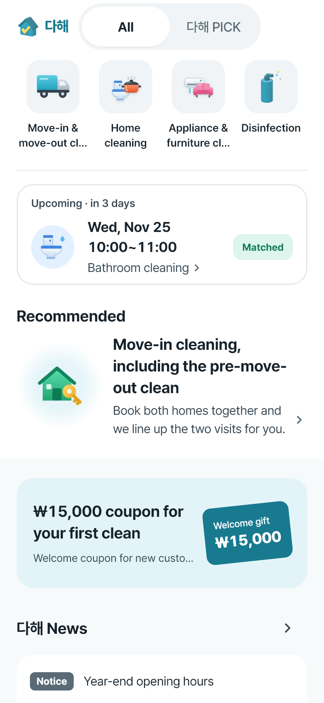
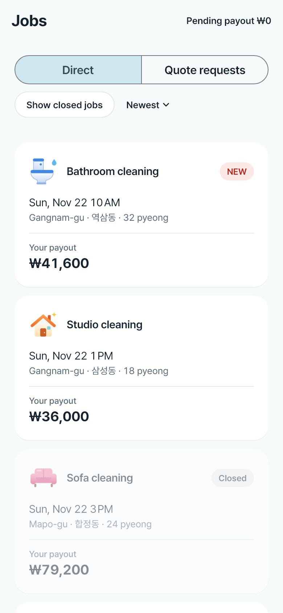
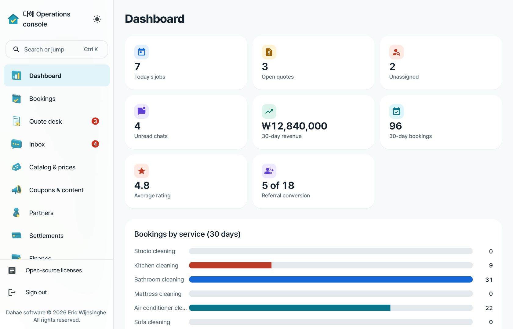

# 01. What Dahae is

## In this chapter

What kind of program Dahae is, which parts it is made of, and who can see what. You do not click anything yet. Just read.

## Before you start

- Nothing. This chapter is reading only.

## 1.1 Dahae in one line

Dahae is a home-cleaning platform that handles **bookings, payments, partner payouts and backups** in one place. The owner of a cleaning company **installs it on the company's own server**. Customer data is stored on the server the owner chooses.

| Who | What they get |
|---|---|
| **Customers** | Browse services and prices, book a date, pay in the app, follow the job's progress, and chat with the team |
| **Partners (cleaners)** | See assigned jobs, check in on site, review settlements. Team members can be invited by phone number |
| **Owner** | Handle quotes and bookings in a web console, assign partners, check payments and payouts. Backups and weekly updates run on the server |

## 1.2 The parts of Dahae

Dahae has five parts. All of them use **one domain** (for example `example.co.kr`).

| Part | Who uses it | Where to open it |
|---|---|---|
| **Server** | Every app connects to it. Nobody uses it directly | One server in a cloud (AWS or another) |
| **Admin console** | Owner, admins, consultants | `https://example.co.kr/admin/` (PC or phone browser; can be installed like an app) |
| **Customer app** | Customers | Android and iPhone app. Web version at `https://example.co.kr/app/` |
| **Partner app** | Cleaners and their team members | Android and iPhone app |
| **Website** | First-time visitors | `https://example.co.kr/` (company page, terms of use, privacy policy) |

### What is inside the server

Everything runs on one server. You do not rent a separate database.

| Piece | What it does |
|---|---|
| Web server (Caddy) | Receives connections from outside. Gets and renews the HTTPS security certificate automatically. Web traffic comes in on ports 80 and 443 |
| API | The brain used by the customer app, partner app and console. Handles bookings, payments, payouts and chat |
| Database (PostgreSQL 17) | Stores every record. Reachable only from inside the server |
| Backup | Makes a backup on the server every day at 03:30 (kept 14 days). Can also send copies to outside storage (chapter 17) |

### Outside services Dahae connects to

You connect these services under **[Setup]** in the console (Part 3).

| Connection | What it does | Chapter |
|---|---|---|
| PortOne V2 | Payments, identity checks | 11 |
| Toss Payments | Payments (optional), automatic partner payouts (optional) | 12, 13 |
| Solapi | SMS, KakaoTalk AlimTalk | 14 |
| Kakao, Naver, Google, Apple | Social sign-in | 15 |
| Firebase | App push notifications | 16 |
| S3-compatible storage (Cloudflare R2 and others) | Offsite backup | 17 |

## 1.3 Who can see what (roles)

| Role | Label on screen | Uses | What they can do |
|---|---|---|---|
| Owner | **Owner** | Console | Every menu. Only the owner can make the first save of a payment card (PortOne, Toss Payments) or unlock it |
| Admin | **Admin** | Console | Every menu (except the owner-only actions) |
| Consultant | **Consultant** | Console | Only the menus marked "everyone" in the table below |
| Partner and team member | - | Partner app | Only their own assigned jobs and their own payouts |
| Customer | - | Customer app | Only their own bookings, payments and chats |
| Developer (licensor) | - | Server, builds | Installs the server, builds the apps, deploys and maintains. Gets into the console only if the owner creates an admin account under **[Staff]** |

> **Warning** The owner account must be created **by the owner personally** (chapter 6). Its authenticator app is the key that guards the payment cards. If someone else creates it, that key ends up on their phone.

### Console menus and who sees them

In the same order as the console's side menu. Each menu is explained in chapter 8 and Part 4.

| Menu | Who sees it |
|---|---|
| **[Dashboard]** | Everyone |
| **[Bookings]** | Everyone |
| **[Quote desk]** | Everyone |
| **[Inbox]** | Everyone |
| **[Catalog & prices]** | Everyone |
| **[Coupons & content]** | Everyone |
| **[Partners]** | Everyone |
| **[Settlements]** | Everyone |
| **[Finance]** | Admins and owner |
| **[Subscriptions]** | Everyone |
| **[Customers]** | Everyone |
| **[Staff]** | Admins and owner |
| **[My account]** | Admins and owner |
| **[Setup]** | Admins and owner |
| **[Operating rules]** | Admins and owner |
| **[Notification text]** | Admins and owner |
| **[System status]** | Everyone |
| **[Activity log]** | Admins and owner |
| **[Account deletion and data requests]** | Everyone |
| **[Renewal calendar]** | Admins and owner |

("Everyone" = owner, admins and consultants)

## 1.4 Main features

### Bookings
- A fixed price per service, prices calculated from the catalogue
- Services chosen by count (air conditioners, sofas and so on) are priced per option count with a multi-item discount
- Move-in and move-out cleaning starts with a quote, and a deposit (10% of the quote) is taken first
- Rescheduling and cancellation (refunds follow the cancellation policy)
- Waitlist, subscriptions with renewals, peak pricing, tips

### Payments and payouts
- PortOne V2 checkout: cards, easy-pay, bank transfer, virtual account (turned on and off per channel)
- Toss Payments checkout (optional: PortOne stays as it is and only new payments go to Toss Payments; you can switch back to PortOne at any time)
- Payment reconciliation that finds payments that do not match
- Cash receipts and tax invoices
- Points and coupons
- Partner payouts: by default the owner transfers money in a banking app and records it as done. With Toss Payments payouts connected, payouts can be sent automatically
- VAT and withholding exports (CSV)

### Staff and quality
- Staff accounts with two-step sign-in (phone authenticator app)
- Partner team invites (invited by phone number; they see only assigned jobs)
- Ratings and quality records, no-show tracking
- Activity log

### Security and privacy
- Integration keys and sensitive values are stored encrypted
- Sign-in attempts and code requests are limited, with longer lockouts after repeated failures
- Data access and deletion requests; account deletion also unlinks social sign-in
- Retention settings, a breached-password check

### Backups and operations
- Daily server backup at 03:30 (kept 14 days)
- Encrypted backup to outside (S3-compatible) storage
- Automatic update every Monday at 04:00. A backup is made first, and if the new version does not respond, the old version comes back automatically
- HTTPS certificates issued and renewed automatically
- Korean and English screens (texts and notifications go out in the receiver's language)

### Chat and notifications
- Real-time chat between customers, partners and the owner, with quote cards
- App push, SMS, KakaoTalk AlimTalk
- **Support helper (optional):** answers customer chat when staff are away, or always first if set so. You can turn it off in setup (chapter 16)

> **Warning** With the support helper on, what customers write in chat is sent to an external response API provider (the privacy policy names it as a US company). That is why customers agree to the cross-border transfer when they sign up. Withdrawing that consent is not yet possible in the app.

## If something goes wrong

| If this happens | Do this |
|---|---|
| Only a few menus show in the console | You may be signed in as a consultant. Menus marked "Admins and owner" in the table above show only to admins |
| You cannot save a payment card | Only the owner account can make the first save of a payment card (chapters 9 and 11) |
| A feature your company needs is not in the list | A feature that is not in this book does not exist yet. Ask the developer |
