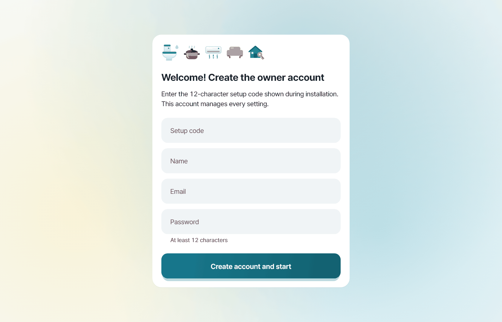
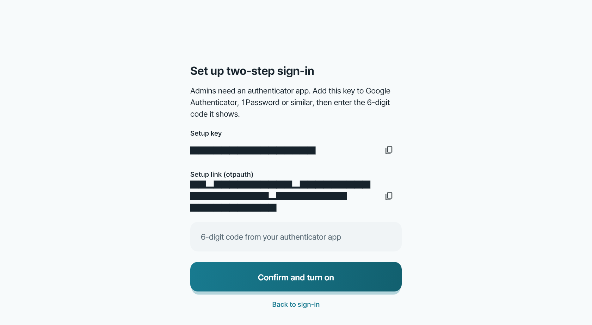
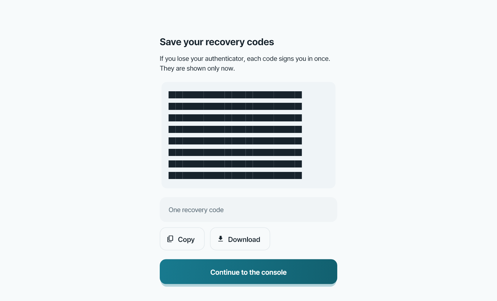
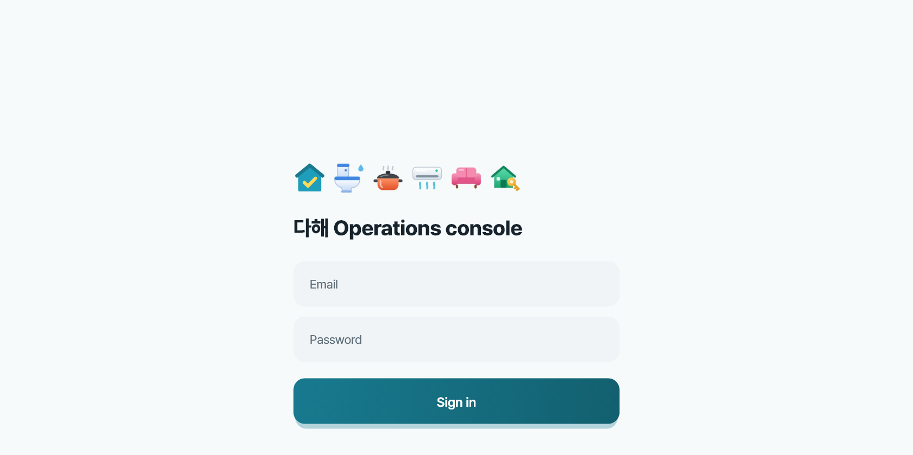
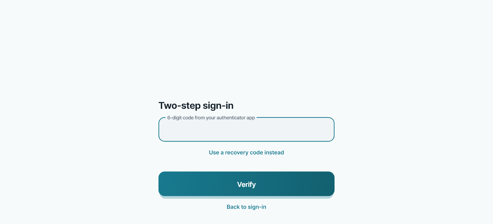

# 06. Owner account and two-step sign-in

## In this chapter

**[Owner]** Use the setup code to create the **owner account** in the console, turn on **two-step sign-in** with the authenticator app on your phone, and keep the **recovery codes** safe. Finally, install the console like an app on your PC and phone.

## Before you start

- The 12-character **setup code** (looks like `XXXX-XXXX-XXXX`, 6.2)
- The **owner's phone** with an authenticator app (2.1)
- A computer and browser (Chrome or Edge recommended)
- The **email address** for the owner account
- A password manager app, paper and a pen (for the recovery codes)
- Time: about 15 minutes

## 6.1 Why the owner must create it

> **Warning** The owner must create the owner account **personally**. Do not ask the developer to do it for you.

- Whoever creates the owner account gets the **owner authenticator code** on their phone.
- That code is needed for the first save of a payment card (PortOne, Toss Payments) and to unlock it (chapter 9).
- If the developer creates the account, that key lands on the developer's phone. So the developer guides you on a call, and you type.
- Later, you can give the developer a separate admin account under **[Staff]** (chapter 20).

## 6.2 Get the setup code

The setup code has 12 characters and looks like `ABCD-2345-EFGH`. Where you find it depends on how the server was installed.

| Install method | Where the setup code is |
|---|---|
| AWS one command (chapter 4) | Shown by a command on the server screen (steps below) |
| Install page (chapter 7) | The code under **3. 설치 인증 코드** (setup code) on the install page |
| One-line install in a black screen (chapter 7) | The `설치 코드:` (setup code) line on the finish screen |

### If the server was installed on AWS

Usually the developer looks up the code on the server and reads it out on the call. To see it yourself:

1. Open the Session Manager black window as in 5.5.
2. Paste the line below and press Enter.

   ```
   sudo dahae setup-code
   ```

3. One line with a code like `XXXX-XXXX-XXXX` appears. Write it on paper.

**You should now see:** one line with the 12-character code.

> **Note** The setup code works for **7 days from the install**. After 7 days, type `sudo dahae setup-code --renew` on the server screen to get a new code. (Some older guides say "2 hours"; the actual program uses 7 days.) Once the owner account exists, the code is no longer used.

## 6.3 Create the owner account

1. On a computer, open `https://example.co.kr/admin/` in the browser (with your domain).
2. The **Welcome! Create the owner account** screen appears.



3. In **Setup code**, type the 12-character code. Dashes are optional. Upper or lower case does not matter.
4. In **Name**, type the owner's name.
5. In **Email**, type the email for the owner account. You sign in with this email.
6. In **Password**, type a password of **at least 12 characters**. Make it with the password manager and save it right away.
7. Click **[Create account and start]**.

**You should now see:** the **Set up two-step sign-in** screen right away. You do not need to sign in separately.

> **Tip** Very common passwords (on the breached-password list) are refused, with the message **Please check the highlighted value**. Use another password.

## 6.4 Turn on two-step sign-in

Admin accounts must use an authenticator app. This screen has no QR code; you type the **setup key** into the authenticator app.



1. Click the copy icon to the right of **Setup key** to copy the key, or copy the key's letters onto paper exactly.
2. Open the authenticator app on your phone.
3. Tap the add-account button in the app (usually **+**).
4. Choose **Enter a setup key** (the wording differs between apps, for example "Enter key").
5. For the account name, type something you will recognise (for example `Dahae console`).
6. In the key box, type the console's **Setup key**. No spaces, exactly as shown.
7. If there is a key type, choose **Time based**.
8. Tap **Add** in the app.
9. The app shows a **6-digit number**. It changes every 30 seconds.
10. Back in the console, type the number you see now in **6-digit code from your authenticator app**.
11. Click **[Confirm and turn on]**.

**You should now see:** the **Save your recovery codes** screen.

> **Tip** Password managers such as 1Password also accept the **Setup link (otpauth)**, copied and pasted. If unsure, use the setup key.

> **Warning** Once the **setup key** is in the authenticator app, do not keep it on paper or in notes. Anyone with this key can make your 6-digit codes.

## 6.5 Save the recovery codes

If you lose your phone or the authenticator app is deleted, one recovery code signs you in once. There are **10** codes, and they are shown **only on this screen**.



1. Click **[Download]** to save them as a file on the computer. If the device cannot save files, click **[Copy]** and paste them into the password manager.
2. Also copy all the codes onto paper.
3. Keep the paper somewhere safe away from the server and the phone, such as a safe.
4. In **One recovery code**, type **any one** of the codes you just got. This step checks that you kept them. (The code is not used up here.)
5. Click **[Continue to the console]**.

**You should now see:** the console home (dashboard) with the side menu.

> **Warning** Owner actions (such as saving payment cards) stay locked until this check is done. If it fails, you can do it again on the **[My account]** screen (chapter 8).

> **Warning** Do not photograph the recovery codes into your phone's gallery or send them over KakaoTalk.

## 6.6 Signing in next time

1. Open `https://example.co.kr/admin/`.
2. The **다해 Operations console** sign-in screen appears. (The "다해" in this title stays the same even after you change the company name.)



3. In **Email**, type the owner account email.
4. Type the **Password**.
5. Click **[Sign in]**.
6. The **Two-step sign-in** screen appears.



7. Open the authenticator app and type the 6-digit number you see now in **6-digit code from your authenticator app**.
8. Click **[Verify]**.

**You should now see:** the console dashboard.

### Without your phone (sign in with a recovery code)

1. On the two-step sign-in screen, click **[Use a recovery code instead]**.
2. In **Recovery code**, type one of the codes you kept.
3. Click **[Verify]**.

- A used recovery code cannot be used again. Cross it off on the paper.
- After signing in, get new codes with **[Make new recovery codes]** under **[My account]** (chapter 8).
- To go back to the authenticator code, click **[Use an authenticator code instead]**. To start over, click **[Back to sign-in]**.

### If you see "Enter your server address"

The console is web-only, so the browser and the console installed as in 6.8 never ask for a server address. This screen appears only in a separate console program that the developer builds.

1. On the **Enter your server address** screen, type the server address starting with `https://`, such as `https://example.co.kr`.
2. Click **[Save and continue]**.
3. To change the address later, click **[Change server address]** under the sign-in form.

## 6.7 Make a copy of the secret keys (do not skip)

> **Warning** Without the server's secret key file (`/opt/malkkeum/.env`), **offsite backups cannot be restored.** If the server is lost, the keys are lost with it, so a copy of the keys must be kept off the server.

You make the key copy yourself in the console, with the owner account you just set up.

1. Click **[System status]** in the left menu and scroll down to the **Server update** card.
2. Under **Recovery** → **Download the secret key copy**, type a **lock password** of at least 12 characters in **Passphrase (12 characters or more)**, and the same in **Passphrase again**.
3. Click **[Make and download]**, enter your owner code and click **[Continue]**.
4. The browser downloads a file named like `dahae-keys-date-time.env.enc`. Keep it on a USB stick or in the password manager.
5. Write the lock password **in a different place from the file** (for example the password manager).
6. In the **Kept off the server** window, click **[Kept off the server]**.

**You should now see:** **Recorded as kept off the server.** under the card. Every step and message is in chapter 26 (Recovery: download the secret key copy) and chapter 27, 27.4.

> **Warning** Do not paste the key copy file or the lock password into KakaoTalk or an email body.

## 6.8 Install the console like an app

The console opens in a browser with nothing to install, and can be **installed like an app**. Once installed, a "다해 관리자" (Dahae admin) icon appears.

> **Note** The browser button names below have not yet been checked on every device (**to be confirmed**). They can differ slightly between browser versions.

### Windows PC (Edge or Chrome)

1. Open `https://example.co.kr/admin/` in **Edge** or **Chrome**.
2. Click the **Install app** icon (⊕) at the right end of the address bar.
3. Click **Install**.
4. If there is no icon, open the browser menu (⋯ or ⋮) > **Apps** (or **Install app**) > **Install this site as an app**.


**You should now see:** a **다해 관리자** icon in the Start menu and on the taskbar.

### Android phone (Chrome)

1. Open the console address in **Chrome**.
2. Tap **⋮** at the top right.
3. Tap **Install app** (or **Add to Home screen**).

### iPhone (Safari)

1. Open the console address in **Safari**.
2. Tap the **Share** button at the bottom.
3. Tap **Add to Home Screen**.

**You should now see:** a console icon on the phone's home screen (it may show the short name "다해 관리") that opens the sign-in screen.

> **Tip** After an update, close the installed console app once and open it again.

## If something goes wrong

| What the screen says | Meaning and fix |
|---|---|
| **That setup code is not right** | Check the code again. Codes never use the digits 0 and 1 or the letters O, I and L, so a look-alike is a different character |
| `sudo dahae setup-code` on the server screen shows **설치 코드 기간(7일)이 지났어요. 새로 받으려면: dahae setup-code --renew** (the setup code's 7 days are over; get a new one with --renew) | Type `sudo dahae setup-code --renew` to get a new code |
| **This setup code expired (valid for 7 days). …** | Get a new code with `sudo dahae setup-code --renew` on the server screen, or ask the developer for one |
| **Password needs at least 12 characters** | Make the password 12 characters or longer |
| **Please check the highlighted value** | Check the email is well formed, the name is not empty, and the password is not a very common one |
| **Wrong email or password** (while creating the account) | The owner account already exists. Sign in on the sign-in screen |
| **That code does not match. Check that your phone's clock is right, then try again.** | Set the phone's date and time to **automatic**, and type a fresh number as soon as it appears. The setup key may also have been typed wrong |
| **Too many attempts. Wait a few minutes and try again.** | Wait a few minutes and try again |
| **Sign-in expired. Start again from the password step.** | Click **[Back to sign-in]** and start again from the email and password |
| **That code does not match the recovery codes you were just shown** | Type one of the 10 codes just shown, exactly, without spaces |
| **This device cannot save the file here. Copy the codes and keep them safe.** | Click **[Copy]** and paste them into the password manager |
| You lost both the phone and the recovery codes | You cannot fix this alone. Contact the developer (**to be confirmed**: the owner account recovery procedure) |
