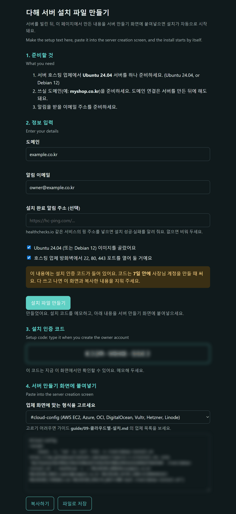

# 07. Other clouds, in brief

## In this chapter

A short guide to installing Dahae with another server provider (Naver Cloud, Lightsail, Google, Azure, Vultr and others) instead of the AWS one-command launch (chapter 4). The easiest way is to paste the text made on the **install page** into the provider's create-server screen. You type no commands in a black screen.

> **Note** If you installed on AWS, skip this chapter and go to chapter 8.

## Before you start

- A server provider account (payment method added)
- Your domain and the sign-in for its DNS management screen (chapter 5)
- An email for notices
- The **install page** file from the developer (`dahae-install-page.html`)
- (Optional) an address for an install-finished notice (a ping URL from a service such as healthchecks.io)
- Time: about 30 minutes + 10–30 minutes of waiting for the install

## 7.1 Choose the server size

| Item | Choose |
|---|---|
| Operating system | **Ubuntu 24.04 LTS** (Ubuntu 22.04 and Debian 12 also work; Amazon Linux, Oracle Linux and CentOS do not) |
| Size (recommended) | **2 CPUs (2 vCPU), 4 GB memory** |
| Size (minimum) | 1 GB memory. Below 2 GB the installer adds 2 GB of swap on disk, but it is slow. For a server that takes real customers, choose the recommended size |
| Disk | 50 GB is enough (a new install needs at least 5 GB free) |
| Region | Seoul (Korea) |
| CPU type | x86_64 (amd64) or arm64 |
| Ports to open | **22** (server access), **80** and **443** (certificates and web; required) |

- Attach a **fixed IP** if you can. If the IP changes, the A records must be changed too.
- You do not need a managed database (RDS and the like). The database runs inside the server.

## 7.2 Make the install text on the install page

The install page is in Korean with short English lines. The English meaning of each label is given in brackets.

1. Save the `dahae-install-page.html` file from the developer on your computer.
2. Double-click it to open it in a browser (Chrome or Edge).
3. The **다해 서버 설치 파일 만들기** (make the Dahae server install file) page opens.
4. Under **2. 정보 입력** (enter your details), type your domain (for example `example.co.kr`) in **도메인** (domain).
5. In **알림 이메일** (notice email), type your email.
6. (Optional) In **설치 완료 알림 주소 (선택)** (install-finished notice address, optional), paste a ping URL. Leave it empty if you have none. With it, you are told whether the install succeeded or failed.
7. Tick **Ubuntu 24.04 (또는 Debian 12) 이미지를 골랐어요** (I chose the Ubuntu 24.04 or Debian 12 image).
8. Tick **호스팅 업체 방화벽에서 22, 80, 443 포트를 열어 둘 거예요** (I will open ports 22, 80 and 443 in the provider's firewall).
9. Click **[설치 파일 만들기]** (make install file).
10. Write down the 12-character code under **3. 설치 인증 코드** (setup code). It is shown **only on this screen**. You need it to create the owner account in chapter 6.
11. Under **4. 서버 만들기 화면에 붙여넣기** (paste into the server creation screen), in **업체 화면에 맞는 형식을 고르세요** (choose the format for your provider), choose the format for your provider (table in 7.3).
12. Click **[복사하기]** (copy). (To keep it as a file, click **[파일로 저장]**, save to file.)



**You should now see:** under the button, "만들었어요. 설치 코드를 메모하고, 아래 내용을 서버 만들기 화면에 붙여넣으세요." (Done. Note the setup code and paste the text below into the server creation screen.), and the box below filled with the install text.

> **Warning** The install text contains the setup code. Use the code **within 7 days** to create the owner account. Once the account exists, delete this page and the copied text.

## 7.3 Where to paste it, by provider

On the provider's **create server** screen, find the field below and paste the text copied in 7.2. Providers rename screens often, so if a name differs, look for the closest one.

| Provider | Field to paste into | Format to choose | How sure we are |
|---|---|---|---|
| AWS Lightsail | Launch script | `#!/bin/bash` | Medium (screen name to be confirmed) |
| AWS EC2 | Advanced details › User data | `#cloud-config` | High |
| Google Compute Engine | Management › Startup script | `#!/bin/bash` | Medium |
| Microsoft Azure | Advanced › Custom data | `#cloud-config` | Medium |
| Oracle Cloud (OCI) | Show advanced options › Paste cloud-init script | `#cloud-config` | Medium |
| DigitalOcean | Advanced options › User data | `#cloud-config` | Medium |
| Vultr | Additional Features › User data | `#cloud-config` | Medium |
| Hetzner | Cloud config | `#cloud-config` | Medium |
| Linode (Akamai) | Add User Data | `#cloud-config` | Low to medium |
| Naver Cloud | Server › Init Script (초기화 스크립트) | `#!/bin/bash` | Medium |
| NHN Cloud | User script (사용자 스크립트) | **to be confirmed** | Low |
| Kakao Cloud, KT Cloud, Gabia, Cafe24 | No confirmed field | Browser SSH one line (7.4) | - |

After pasting:

1. Check again that the operating system is **Ubuntu 24.04**.
2. Open **22, 80 and 443** in the firewall (security group, firewall rules, ACG).
3. Click the create button.
4. Note the server's **public IP**. Attach a fixed IP if you can.
5. Add the A records (`@`, `www`) with that IP, as in chapter 5.
6. Wait **10–30 minutes**. The install runs inside the server by itself.
7. Open `https://example.co.kr/health` in a browser.

**You should now see:** text starting with `{"ok":true`. Go to chapter 6 and create the owner account.

> **Warning** On **Google Compute Engine**, the startup script runs every time the server starts. Empty that field once the install is finished.

> **Note** Some providers, such as DigitalOcean, do not let you edit the field after the server is created. If you made a mistake, delete the server and create a new one.

## 7.4 No field to paste into: the browser SSH one-liner

1. In 7.2, under **업체 화면에 맞는 형식을 고르세요**, choose **브라우저 SSH 한 줄** (browser SSH one line).
2. Click **[복사하기]** (copy).
3. On the provider's screen, create an Ubuntu 24.04 server. Open firewall ports 22, 80 and 443.
4. On the server screen, click **SSH in browser** (or "console") to open a black screen.
5. Paste the copied line and press Enter. The setup code and domain are already in it.
6. Wait. A new server can take about 10 minutes at first.

### If the install says the domain does not point to this server yet

The installer prints its messages in Korean ("도메인이 아직 이 서버를 가리키지 않아요").

- The screen shows **the value you need to add**, like `A 레코드   example.co.kr   →   3.38.12.34`.
- Fix it on the DNS screen as in chapter 5, wait a few minutes, then press **Enter** in the black screen to check again.
- To do it later, type `s`. The install carries on, and the certificate is issued automatically once the domain is connected.

### The finish screen

When the install is finished, a screen like this appears.


```
✔ 설치가 끝났어요!   (채널: stable)

1) 브라우저에서 이 주소를 여세요:   https://example.co.kr/admin/
2) 설치 코드를 입력하고 사장님 계정을 만드세요:

       설치 코드:  ABCD-2345-EFGH

3) [설정] 메뉴에서 결제·문자·로그인 연동을 차례로 연결하세요.
```

In English: (1) open this address in a browser; (2) type the setup code (설치 코드) and create the owner account; (3) connect payments, SMS and sign-in one by one under the [Setup] menu.

- If it says `앱은 정상이에요. HTTPS 인증서는 아직이에요.` (the app is fine; no HTTPS certificate yet), the domain connection has not spread yet. A few minutes later, check `sudo dahae status` for "HTTPS 정상" (HTTPS is working).
- The notice at the bottom about making a key copy and keeping it off the server is done in 6.7.

## 7.5 What the server does by itself afterwards

| What | When |
|---|---|
| Backup on the server (kept 14 days) | Every day at 03:30 |
| Automatic update (a backup first; if the new version does not respond, the old one comes back automatically) | Every Monday at 04:00 |
| HTTPS certificate issue and renewal | Automatic |

Running the install again is safe. It keeps the settings and data and only updates.

## If something goes wrong

| If this happens | Do this |
|---|---|
| `https://domain/health` does not open | Check you waited 10–30 minutes and that the A record equals the server IP (https://dnschecker.org) |
| Ports 80 and 443 are blocked | Check 80 and 443 are open in the provider's firewall (security group, firewall rules) |
| Amazon Linux or another OS was installed | Delete the server and create a new one with **Ubuntu 24.04** |
| There is no field to paste into | Use the browser SSH one-liner in 7.4 |
| "관리자 권한이 필요해요" (administrator rights needed) | Check you pasted the line exactly as the page made it (it must contain `sudo`) |
| "80/443 포트를 다른 프로그램이 쓰고 있어요" (another program uses ports 80/443) | Another web server is installed on the server. Tell the developer |
| "남은 디스크가 … 최소 5 GB 가 필요해요" (at least 5 GB free disk needed) | Choose a server with a bigger disk |
| "서비스가 시작되지 않았어요" (the service did not start) | Take a screenshot of `sudo dahae logs` and send it to the developer (Ctrl+C stops it). Running the install again is safe |
| The install failed | If you added an install-finished notice address, check the notice, and send the `sudo dahae logs` screen to the developer |
