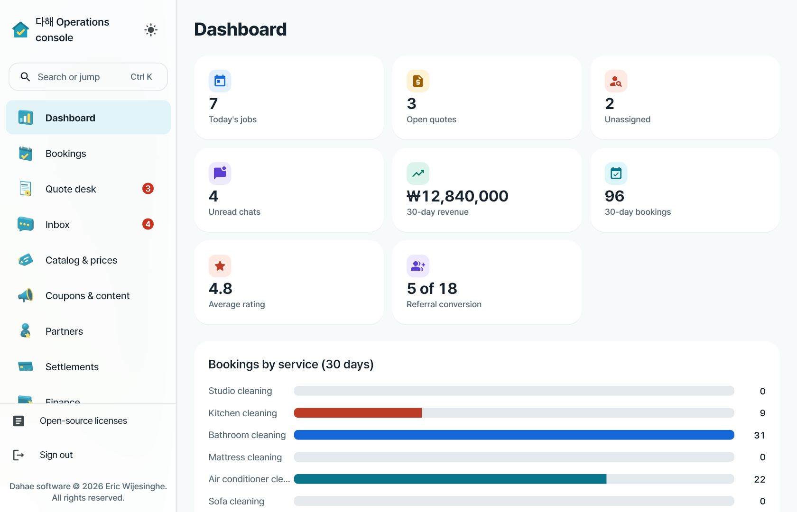
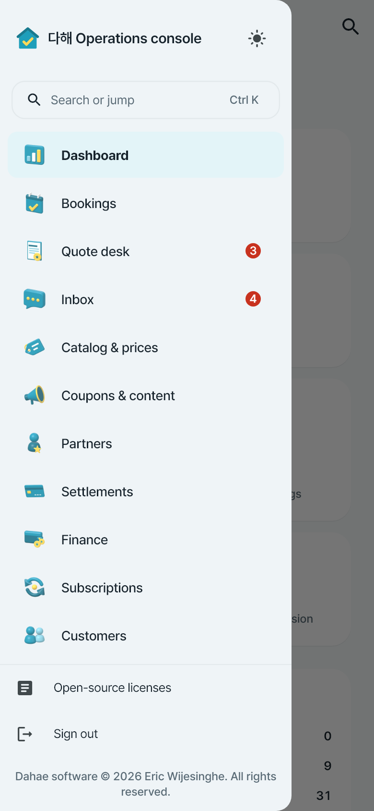
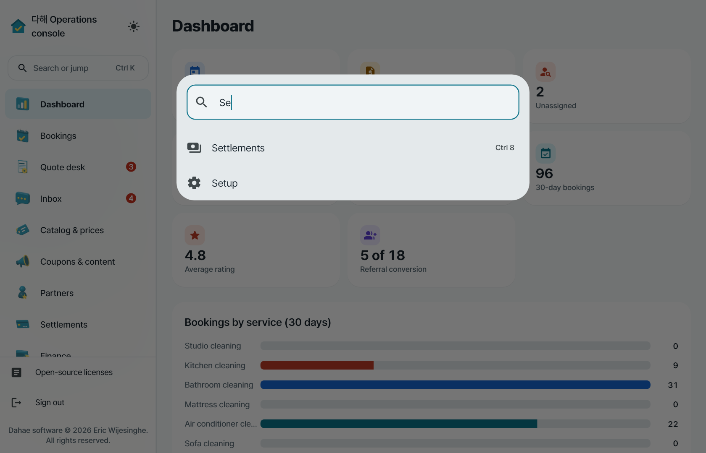
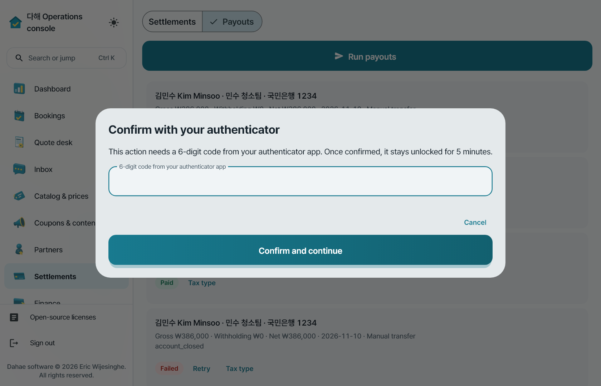
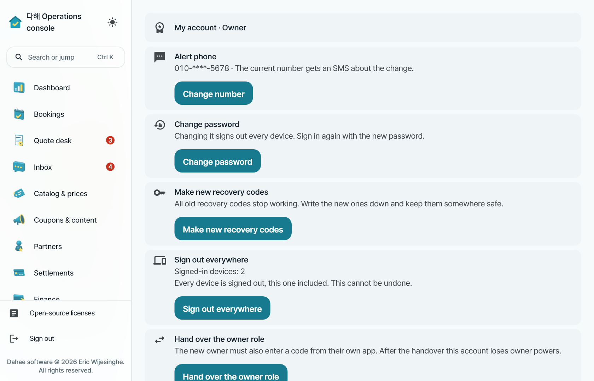

# 08. Console tour

**In this chapter:** see how the admin console is laid out and what each menu item does.
You also learn the quick-jump keys, the code prompt that appears before sensitive actions, and the **[My account]** page.

> **Before you start**
> - The owner account email and password you created in chapter 6
> - The phone with your authenticator app (the app that shows 6-digit codes)
> - Chrome or Edge on a computer. A phone browser also works.

---

## 8.1 The layout

The console has two layouts, depending on the width of the screen.

**On a computer (wide screen)**

1. Open the console address (for example `https://example.co.kr/admin/`) and sign in as in chapter 6.
2. Look at the left side. At the top is the title **다해 Operations console** (the product name stays in Korean, see chapter 28) and the theme button. Its picture shows the current mode: auto (A), sun or moon.
3. Below it is the **[Search or jump]** box. It shows `Ctrl K` on the right.
4. Below that, the menu items run down the side. The item you are on is highlighted.
5. At the bottom of the menu are **[Open-source licenses]**, **[Sign out]** and the copyright line.
6. The large area on the right shows the page you picked.

**You should now see:** the menu on the left and the **[Dashboard]** on the right.

**On a phone (narrow screen)**

1. Tap the three-line button (☰) at the top left.
2. The menu drawer slides in from the left. It holds the same items as the computer menu.
3. Tap an item. The drawer closes and that page opens.
4. The top bar shows the name of the page you are on.
5. The magnifier button at the top right opens the **[Search or jump]** window (8.3).

> **Tip** Change light or dark mode with the theme button at the top (**[Change theme]**). Pick **[System]**, **[Light]** or **[Dark]**.

> **Tip** The console has no language button. If your computer (browser) language is English it shows English; any other language shows Korean.

---

## 8.2 Every menu item

The items appear in this order. When "Who sees it" says **Admins only**, a Consultant account does not see that item at all.
The owner is also an admin, so the owner sees all 20 items.

| # | Menu item | What it is for | Who sees it | More |
|---|---|---|---|---|
| 1 | **[Dashboard]** | Today's jobs, open quotes, unread chats and other numbers at a glance | Everyone | Ch. 19 |
| 2 | **[Bookings]** | The booking list and booking details | Everyone | Ch. 19 |
| 3 | **[Quote desk]** | Answer quote requests. A red number shows open quotes | Everyone | Ch. 19 |
| 4 | **[Inbox]** | Customer chats. A red number shows unread chats | Everyone | Ch. 19 |
| 5 | **[Catalog & prices]** | Create and edit services and prices | Everyone | Ch. 18 |
| 6 | **[Coupons & content]** | Coupons, content, growth and campaigns | Everyone | Ch. 22 |
| 7 | **[Partners]** | Partner (cleaner) list and profiles | Everyone | Ch. 20 |
| 8 | **[Settlements]** | Partner settlements and payouts | Everyone | Ch. 21 |
| 9 | **[Finance]** | Finance overview, tax data, downloads | Admins only | Ch. 21 |
| 10 | **[Subscriptions]** | Recurring cleaning subscriptions | Everyone | Ch. 19 |
| 11 | **[Customers]** | Customer list and points | Everyone | Ch. 20 |
| 12 | **[Staff]** | Invite and manage console staff (admins, consultants) | Admins only | Ch. 20 |
| 13 | **[My account]** | Your own security settings, owner handover | Admins only | 8.5 |
| 14 | **[Setup]** | Get ready to launch: business profile, payments, SMS, sign-in and other connections | Admins only | Ch. 9–17 |
| 15 | **[Operating rules]** | Number rules: business limits, marketing sends, points, partner quality, server and alert thresholds | Admins only | Ch. 23 |
| 16 | **[Notification text]** | The text customers and cleaning teams see in app alerts and the inbox | Admins only | Ch. 23 |
| 17 | **[System status]** | Server health, connected services, updates | Everyone | Ch. 26 |
| 18 | **[Activity log]** | Who changed what, and when | Admins only | Ch. 23 |
| 19 | **[Account deletion and data requests]** | Find a customer by phone number, give a data copy (CSV) or delete the account | Everyone (deletion: admins only) | Ch. 23 |
| 20 | **[Renewal calendar]** | Renewal dates for domains, hosting, store and SMS accounts. A text goes out 30 and 7 days before each date | Admins only | Ch. 23 |

> **Warning** A Consultant account misses the 8 admin-only items and sees 12. So the item numbers (and the number keys below) differ from the owner's screen.

---

## 8.3 Jump quickly: the Search or jump window

**Go to a menu item**

1. Hold `Ctrl` and press `K`. (On a Mac, `⌘ Command` + `K` also works.)
   You can also click the **[Search or jump]** box at the top left.
2. A window with a text box opens. The box says **Type a section or booking number** in grey.
3. Type part of the item's name. Example: `Settle`
4. Only matching items stay in the list. Press `Enter` for the top one, or click another one.

**You should now see:** the window closes and that page opens.

**Open a booking by its number**

1. Press `Ctrl` + `K`.
2. Type at least 3 characters of the booking number. When no menu name matches, the list shows **Open booking: (your text)**.
3. Click that line or press `Enter`.

**You should now see:** the console switches to **[Bookings]** and opens that booking's detail page.

**Number keys**

- `Ctrl` + `1` to `Ctrl` + `9` jump to the 1st to 9th item in your menu.
- The Search or jump list shows the key (for example `Ctrl 1`) next to each of the first nine items.
- On the owner's screen: `Ctrl` + `1` Dashboard, `Ctrl` + `2` Bookings, `Ctrl` + `3` Quote desk, `Ctrl` + `4` Inbox … `Ctrl` + `9` Finance.

---

## 8.4 Signing out, and the code before sensitive actions

**[Sign out]**

1. Go to the bottom of the left menu (on a phone, the ☰ drawer).
2. Click **[Sign out]**.

**You should now see:** the sign-in page.

> **Warning** On a shared computer, always **[Sign out]** when you finish.

**The window "Confirm with your authenticator"**

Some actions that touch money or personal data ask for an authenticator code again, even while you are signed in.
Examples: viewing a partner's bank account, showing a partner's full identifier, running payouts, downloading finance data, exporting or deleting a customer's data.

1. Click the action. The **Confirm with your authenticator** window opens.
2. On your phone, open the authenticator app and find the console entry you added in chapter 6.
3. Type its 6 digits into **6-digit code from your authenticator app**.
4. Click **[Confirm and continue]**.

**You should now see:** the window closes and the action goes ahead.
After one confirmation, the window does not appear again for 5 minutes.

> **Tip** The console has three similar code windows. All of them take the same 6 digits from your authenticator app.
> - **Confirm with your authenticator**: before the sensitive actions above
> - **Enter your code**: before actions on the **[My account]** page (8.5)
> - **Owner authenticator code**: on the **[Setup]** page, to unlock a card or save a payment card the first time (chapter 9)

---

## 8.5 My account

1. Click **[My account]** in the left menu.
2. If the top card says **My account · Owner**, you are signed in as the owner.

**You should now see:** the cards **Alert phone**, **[Change password]**, **[Make new recovery codes]**, **[Sign out everywhere]** and **[Hand over the owner role]**, one under the other.

> **Warning** If the top card says **Finish two-step sign-in and saving your recovery codes before owner actions open up.**, finish two-step sign-in and saving recovery codes first (chapter 6).
> If you received recovery codes but have not confirmed them, the card **[I wrote down my recovery codes]** appears. Click it and type one of the codes you wrote down.

Every button on this page opens the **Enter your code** window. Type the 6 digits from your authenticator app into **6-digit code** and click **[Continue]**. Each code works once.

### Alert phone

The owner's mobile number for important alerts by SMS. If none is set, the card says **Not set. Add one to get important alerts by SMS.**

1. On the **Alert phone** card, click **[Change number]**.
2. Type the number into **Mobile number starting with 010**.
3. Click **[Change number]** at the bottom of the window.
4. In **Enter your code**, type the 6 digits and click **[Continue]**.

**You should now see:** **Alert number updated** at the bottom of the screen. The old number gets an SMS about the change.

### Change password

1. On the **[Change password]** card, click **[Change password]**.
2. Fill in **Current password** and **New password**. The new password needs at least 12 characters.
3. Click **[Change password]** at the bottom of the window.
4. In **Enter your code**, type the 6 digits and click **[Continue]**.

**You should now see:** **Password changed. Please sign in again.** and the sign-in page. Every device is signed out.

### Make new recovery codes

Get new recovery codes (used if you lose your phone). All old codes stop working.

1. Click **[Make new recovery codes]**.
2. In the **Are you sure?** window, click **[Make new recovery codes]**.
3. In **Enter your code**, type the 6 digits and click **[Continue]**.
4. The **New recovery codes** window lists the codes. Write all of them on paper. (The **[Copy]** button copies them.)
5. Click **[I wrote down my recovery codes]**.
6. In **Confirm you saved the codes**, type one of the codes into **One recovery code** and click **[Continue]**.

**You should now see:** **Recovery codes confirmed**.

### Sign out everywhere

Use this if a phone or computer is lost. The card shows **Signed-in devices**.

1. Click **[Sign out everywhere]**.
2. In the **Are you sure?** window, click **[Sign out everywhere]**.
3. In **Enter your code**, type the 6 digits and click **[Continue]**.

**You should now see:** **Please sign in again**. This device is signed out too. This cannot be undone.

### Hand over the owner role

Give the owner role to another admin. Your account then loses owner powers.

1. Check that the new owner is already an admin under **[Staff]** and has finished two-step sign-in (chapter 20).
2. Click **[Hand over the owner role]**.
3. Pick the person in **New owner**.
4. Ask them to read out the 6 digits from the authenticator app on **their** phone.
5. Type those digits into **New owner's 6-digit code** and click **[Hand over the owner role]**.
6. In **Enter your code**, type the 6 digits from **your own** app and click **[Continue]**.

**You should now see:** **Owner role handed over. This account no longer has owner actions.**

> **Warning** With no other active admin, you see **No other active admin to hand over to** and cannot hand over.

### Signed in as an admin who is not the owner

The top card says **Only the owner can change account security and server settings.**
If nobody is owner yet, the **Claim the owner role** card and the **[Make me the owner]** button appear.
Only an admin who finished two-step sign-in and saved recovery codes can press it.

---

## If something goes wrong

| What you see | Why | What to do |
|---|---|---|
| No **[Setup]**, **[Staff]** or **[Finance]** in the menu | You signed in with a Consultant account | Sign in with an admin account |
| **That code does not match. Check that your phone's clock is right, then try again.** | The code changed, or the phone clock is wrong | Set the phone's date and time to automatic and type a fresh code |
| **Too many attempts. Wait a few minutes and try again.** | Several wrong codes | Wait a few minutes, then try again |
| **Sign-in expired. Start again from the password step.** | Your sign-in ended | Sign out and sign in again |
| **That code was already used. Wait about 30 seconds for the next code** | The same code was typed twice | Wait for a new code in the app |
| The console shows Korean | Your browser language is not English | Set the browser language to English and reload |
| The **[My account]** page looks broken or its buttons look wrong | Possibly a layout problem (to be confirmed) | Widen the browser window; if it stays, tell your developer |
