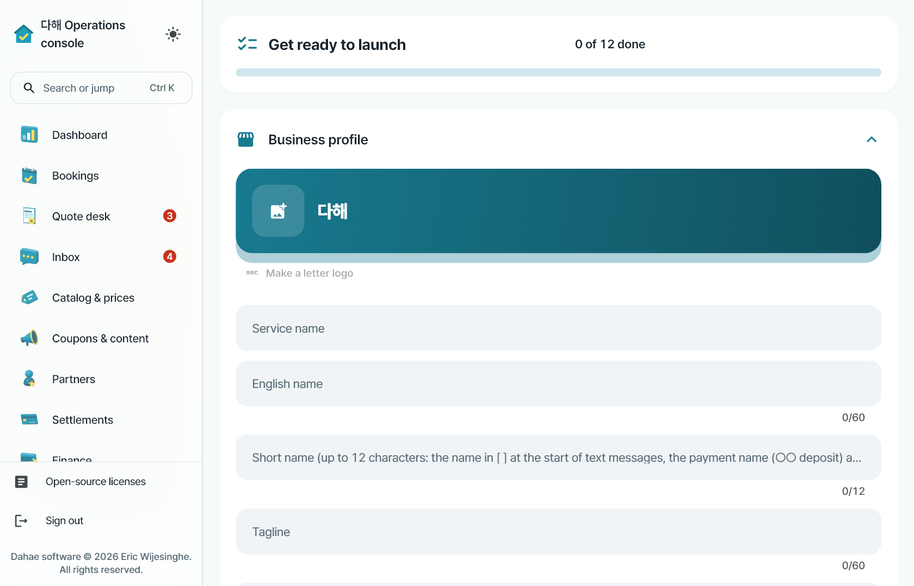
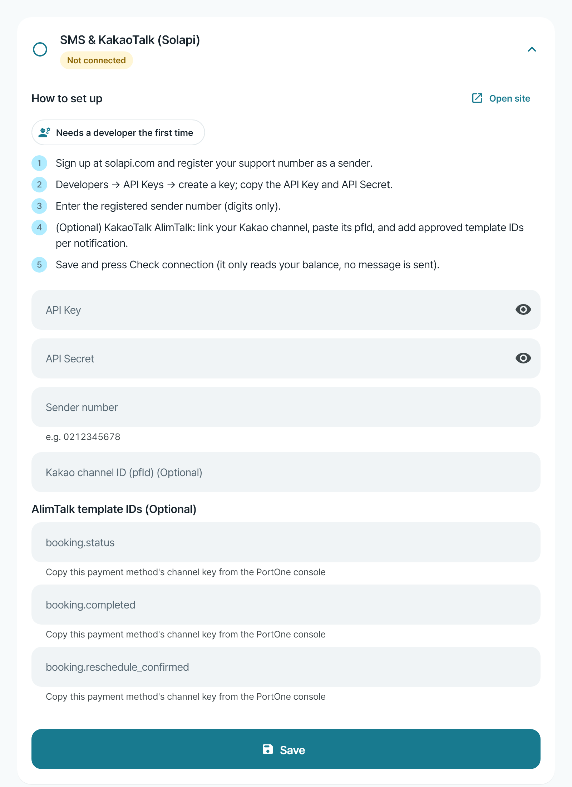
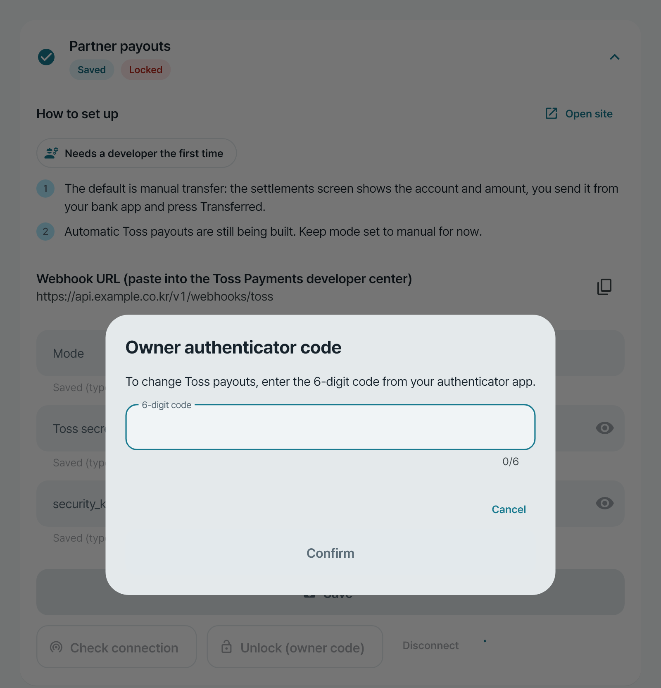
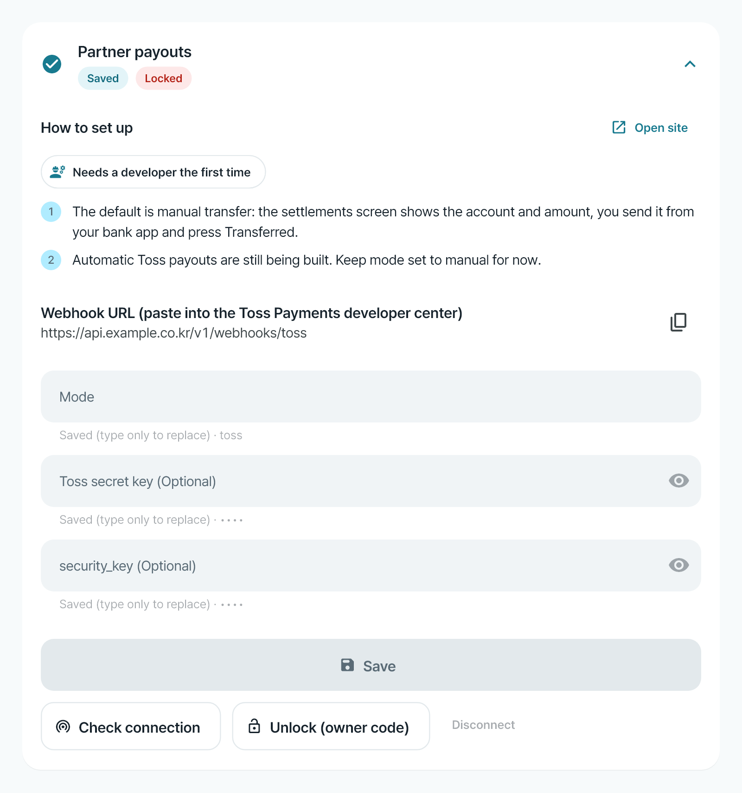
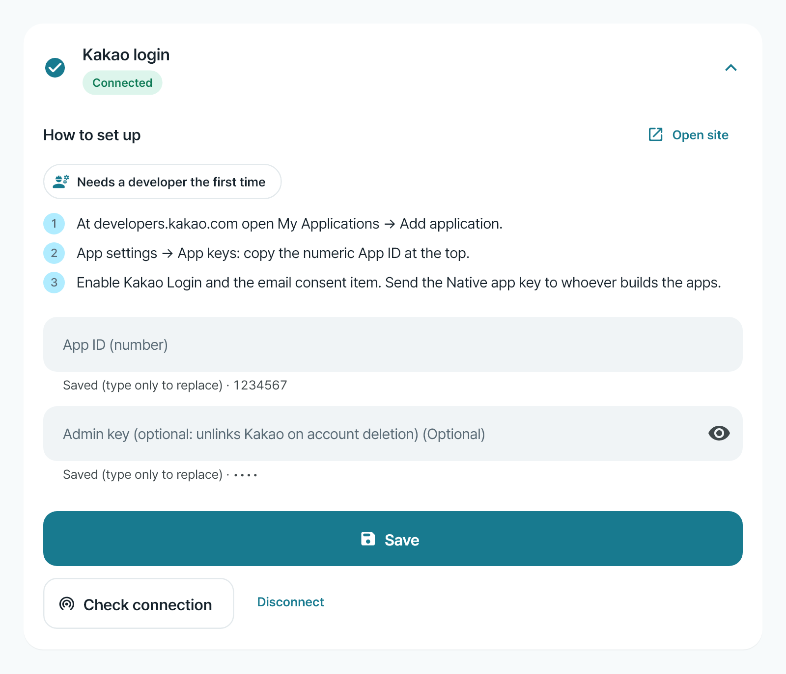
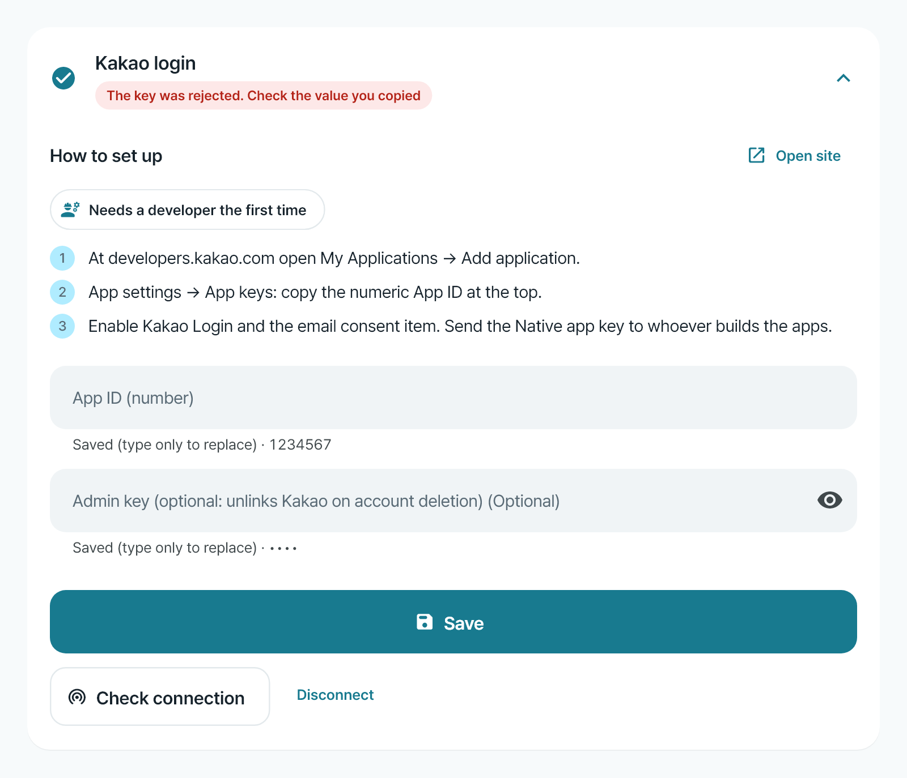

# 09. How the Setup page works

**In this chapter:** learn how a card on the **[Setup]** page is laid out, how to enter and save values, why a saved card locks and how to unlock it, and how to read a connection check.
Chapters 10 to 17 explain what goes into each card. The steps in this chapter work the same way on every card.

> **Before you start**
> - Signed in to the console with the owner account (chapter 6)
> - The phone with your authenticator app
> - A notepad to hold keys for a moment while you copy them (delete them afterwards)

> **Warning** Never send keys (password-like values) by KakaoTalk, SMS or email. The safest way is to copy each key on the provider's site and paste it straight into the console.

---

## 9.1 Open the Setup page

1. Click **[Setup]** in the left menu. (Only admins see it.)
2. The top card is titled **Get ready to launch**.
3. To the right of the title is a count such as **0 of 13 done**, with a progress bar under it.

**You should now see:** the **Get ready to launch** title, the count, and the **Business profile** card under it.

- The count covers 13 items: the **Business profile** and 12 outside-service cards. It goes up when you save the service name or save values on a card. Passing the connection check does not matter here. Cards filled in when the server was installed count too.
- When all 13 are done, the title changes to **Everything is ready!**
- You do not need every card to open for business. See "Must do, can wait" in 9.8.

> **Warning** If the line **Test mode: no real payments or messages are sent** appears under the progress bar, the server runs in test mode. If you see it on your real business server, tell your developer.

---

## 9.2 Card order

From top to bottom, the Setup page shows:

| # | Card | Chapter |
|---|---|---|
| 1 | **Business profile** | 10, 28 |
| 2 | **Store app build** | 28 |
| 3 | **Business hours** | 17 |
| 4 | **Payment methods** | 10 |
| 5 | **Store review demo account** | 17 |
| 6 | **Uptime heartbeat** | 17 |
| 7 | **App links** | 15 |
| 8 | **Domain** | 28 |
| — | **Payments** (heading) | 11–12 |
| 9 | **Payments (PortOne)** | 11 |
| 10 | **Payments (Toss Payments)** | 12 |
| 11 | **SMS & KakaoTalk (Solapi)** | 14 |
| 12 | **App push (Firebase)** | 16 |
| 13 | **Kakao login** | 15 |
| 14 | **Naver login** | 15 |
| 15 | **Google login** | 15 |
| 16 | **Apple login** | 15 |
| 17 | **AI assistant** | 16 |
| 18 | **Offsite backup (S3-compatible)** | 17 |
| 19 | **Partner payouts** | 13 |
| 20 | **Address search (juso.go.kr)** | 16 |
| 21 | **Turn on Toss payouts** (one switch) | 13 |

Cards 9 to 20 are the "outside-service cards". Sections 9.3 to 9.7 describe these 12 cards.
Cards 1 to 8 and 21 look a little different and are explained in their own chapters.

---

## 9.3 Reading a card

**The card header (visible even when folded)**

- The circle on the left shows a tick (✔) once values are saved, and is empty before that.
- The small labels under the card name mean:

| Label | Meaning |
|---|---|
| **Not connected** | No value saved yet |
| **Saved** | Saved, but not checked yet |
| **Connected** (green) | The connection check passed |
| A red label (for example **The key was rejected. Check the value you copied**) | The check failed. See 9.6 |
| **The earlier passing check is still in use** | The latest check failed, but an earlier one passed |
| **Using server settings** | The card uses values set when the server was installed. Ask your developer to change them |
| **Locked** | Saved and locked (9.5) |
| **Locks in N min** or **Unlocked** | The owner has unlocked it (9.5) |
| **Test** / **Live** | Whether a Toss key is a test key or moves real money (only on cards with a Toss key: **Payments (Toss Payments)**, **Partner payouts**) |

- The arrow (∧ / ∨) at the right opens and folds the card. Cards that are not connected start open.

**Inside the card**

1. **How to set up**: numbered steps for the provider's site.
2. **[Open site]**: opens the provider's site in a new window.
3. **Needs a developer the first time**: cards with this badge need help from a developer or the company's account holder once, for a contract or approval.
4. A **Webhook URL** row (payment and payout cards only): an address to paste into the provider's site. Click the two-squares button (**[Copy]**) to copy it; **Copied** appears.
5. The boxes: a box whose name ends in **(Optional)** may stay empty. Fill in all the others.
   - The grey line under a box tells you where to copy the value from.
   - The eye button on a secret box (**[Show]** / **[Hide]**) shows or hides what you typed.
   - A wrong format shows red text under the box straight away. Fix it before saving.
6. Buttons at the bottom: **[Save]**, **[Check connection]** (on payment cards **[Check API key]**), **[Unlock (owner code)]**, **[Lock now]**, **[Disconnect]**. Only the buttons that make sense right now are shown.

---

## 9.4 Saving a card the first time

1. Open the card.
2. Read **How to set up** from step 1. Use **[Open site]** to open the provider's site and follow along.
3. Copy the value on the provider's site.
4. Back in the console, click once in the right box.
5. Paste with `Ctrl` + `V`. (On a phone, long-press the box and tap **[Paste]**.)
6. Click the eye button to check there are no spaces before or after, then click it again to hide the value.
7. Check there is no red text under any box.
8. When all required boxes are filled, click **[Save]**.
9. **Payments (PortOne)**, **Payments (Toss Payments)**, and **Partner payouts** set to Toss ask for the **Owner authenticator code** on the first save.
   Type the 6 digits from your authenticator app into **6-digit code** and click **[Confirm]**.

**You should now see:** **Saved** at the bottom of the screen, and the labels **Saved** and **Locked** on the card header.
The boxes empty, and under each one you see something like **Saved (type only to replace) · ••••**. Secret values are never shown again.

> **Tip** The Owner authenticator code window says "To change Toss payouts, enter…", but every card uses the same window. Just type the code from your app.

> **Warning** Only the owner can make the first save of a money card (payments, payouts). Another admin gets **Only the owner can unlock**.
> Any admin can make the first save of the other cards. After that, every card is locked and only the owner can unlock it.

---

## 9.5 Changing a saved card: Unlock

A saved card locks at once. This stops anyone from changing payment keys by mistake or on purpose.
On a locked card the boxes and switches are greyed out and **[Save]** cannot be clicked.

**Unlock and change a value (owner only)**

1. Open the card you want to change.
2. Click **[Unlock (owner code)]** at the bottom.
3. In **Owner authenticator code**, type the 6 digits and click **[Confirm]**.
4. The **Locked** label goes away and a label such as **Locks in 5 min** appears.
5. Paste new values only into the boxes you want to change. Empty boxes keep their saved values.
6. Click **[Save]**. (The card is unlocked, so no code is asked again.)

**You should now see:** **Saved**, and the card goes straight back to **Locked**.

- An unlock lasts **5 minutes** and allows **one save**. After a save, or after 5 minutes, the card locks again by itself.
- To lock without changing anything, click **[Lock now]**.
- Only the owner who unlocked the card can save it. Other admins do not even see the time left.
- Locks, unlocks, saves and failed unlock attempts all go into the **[Activity log]**. The values themselves are never recorded.

---

## 9.6 Check connection

Checks that the saved values really reach the service. It takes no new values; it uses what is saved.

1. Open the card.
2. Click **[Check connection]**. On the payment cards (PortOne, Toss Payments) it is called **[Check API key]**.
3. Wait until the small spinner next to the buttons stops.

**You should now see:** a green **Connected** label on the card header.

- The owner can run the check on a locked card without unlocking it.
- Other admins do not see the check button on a locked card.
- Saving new values clears the old check result. Run the check again.

**Reading the result**

| Result | Meaning | What to do |
|---|---|---|
| **Connected** | Passed | Done |
| **Saved · confirm by signing in from the app** | The server cannot test sign-in cards | Sign in from the app with that method (chapter 15) |
| **The key was rejected. Check the value you copied** | The service refused the key | Copy it again from the provider's site, then unlock, paste, save |
| **The billing keys were rejected. Check the billing MID's keys** | Only the Toss billing keys are wrong | See chapter 12 |
| **Could not reach the service. Try again shortly** | The service did not answer | Try again in a few minutes. If it keeps failing, tell your developer |
| **Not connected** | Nothing is saved | Save first |

---

## 9.7 Disconnect

Deletes every value saved on a card. You rarely need it.

1. Unlock the card as in 9.5.
2. Click **[Disconnect]**.

**You should now see:** the card header changes to **Not connected**.

> **Warning** A disconnected card stays **Locked** and empty. To enter values again it must be unlocked. But the console shows **[Unlock (owner code)]** only on cards with values saved in the console, so a disconnected card has no such button and cannot be filled in again from the console. If this happens, ask your developer. Only disconnect when you really must.

> **Warning** Never disconnect a payment card (PortOne, Toss Payments). Refunds for payments taken through it, and charges on cards saved with it, would fail. See chapters 11 and 12.

---

## 9.8 Must do, can wait

Apply early for anything slow, such as the payment provider's review, and fill in other cards while you wait.

| Order | Card | You need | Time | When |
|---|---|---|---|---|
| 1 | **Business profile** | Business registration, mail-order registration, logo image | 10 min | Must, first |
| 2 | **Payments (PortOne)** | Business registration, PortOne account and the PG review | Review time (set by the company) | Must (to take payments) |
| 2-1 | **Payments (Toss Payments)** | Toss Payments online-payment contract (and auto-billing for saved cards) | Review time (set by the company) | Optional |
| 3 | **SMS & KakaoTalk (Solapi)** | Sender-number registration documents | Set by the company | Must |
| 4 | **App push (Firebase)** | A Google account | 10 min | Before app release |
| 5 | **Kakao / Naver / Google / Apple login** | A developer account for each | 10–20 min each | Before app release |

- **Partner payouts**: without it you pay partners by manual transfer, so it can wait (chapter 13).
- **Offsite backup**, **AI assistant**, **Address search**: read chapters 16 and 17, then decide.
- **Store review demo account**, **App links**: when you publish the apps (chapters 15, 17, 25).

---

## If something goes wrong

| What you see | Why | What to do |
|---|---|---|
| **[Save]** is grey and cannot be clicked | The card is locked | Unlock it as in 9.5 (owner only) |
| **This card is locked. The owner must unlock it to change it** | You tried to save a locked card | Unlock it as in 9.5 |
| **Only the owner can unlock** | You are an admin but not the owner | Sign in with the owner account |
| **That code is not right. Enter the code your app shows now** | The code changed, or the phone clock is wrong | Set the phone's date and time to automatic and type a fresh code |
| **Too many wrong codes. Try again in a few minutes** | Several wrong codes | Wait a few minutes, then try again |
| **That code was already used. Wait about 30 seconds for the next code** | The same code was used twice | Wait for a new code in the app |
| **Finish two-step sign-in and saving recovery codes first** | Two-step sign-in or the recovery-code check is not finished | Finish chapter 6 and 8.5 |
| **Fill in every required field.** | A box without **(Optional)** is empty | Fill it in |
| **Please check the highlighted value** | A value has the wrong format | Copy it again as the line under the box says |
| A disconnected card has no **[Unlock (owner code)]** button | The known problem in 9.7 | Ask your developer |
| You did not save within 5 minutes | The unlock ended | Click **[Unlock (owner code)]** again |
