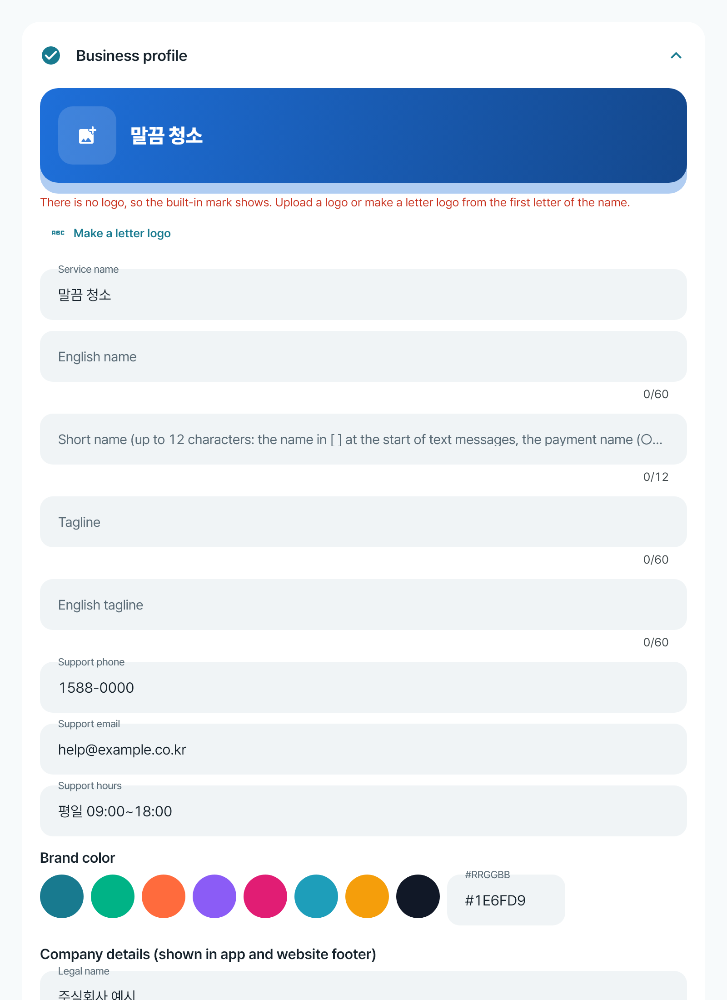
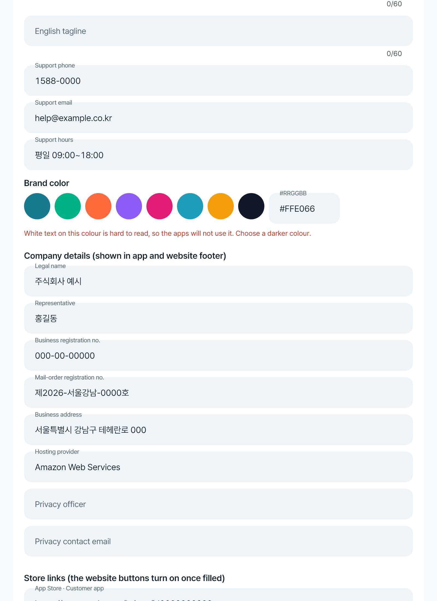
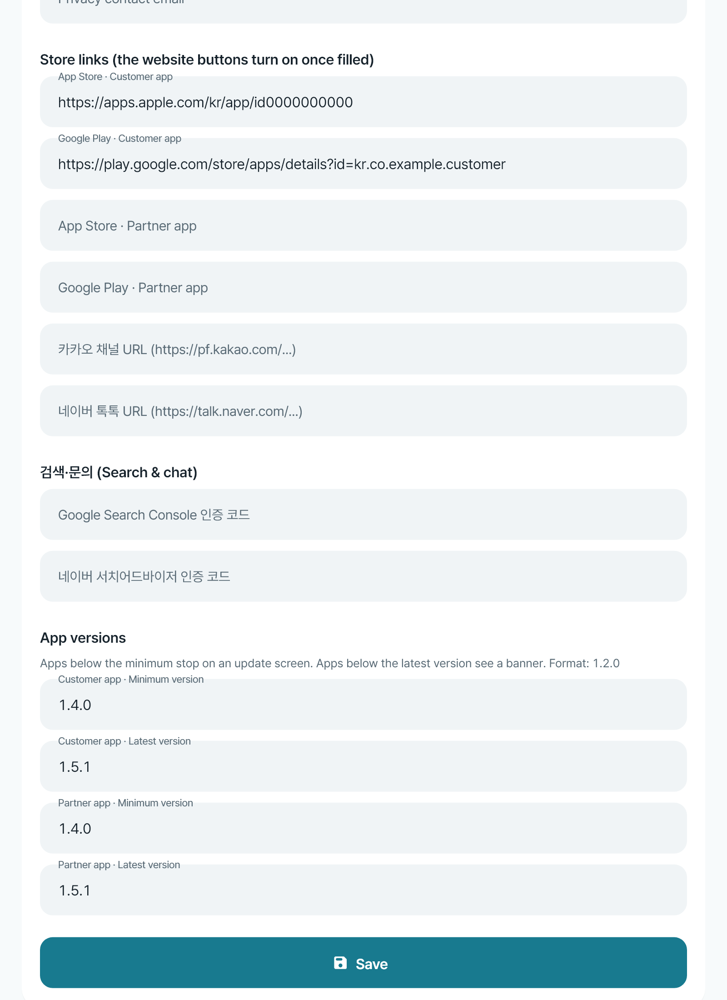
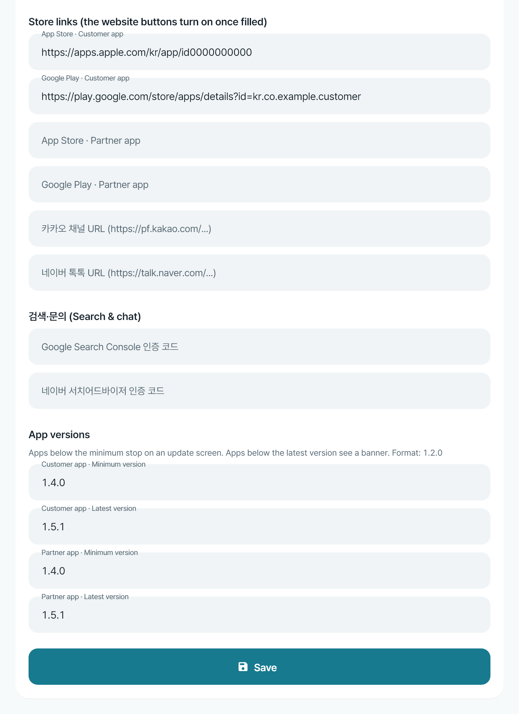
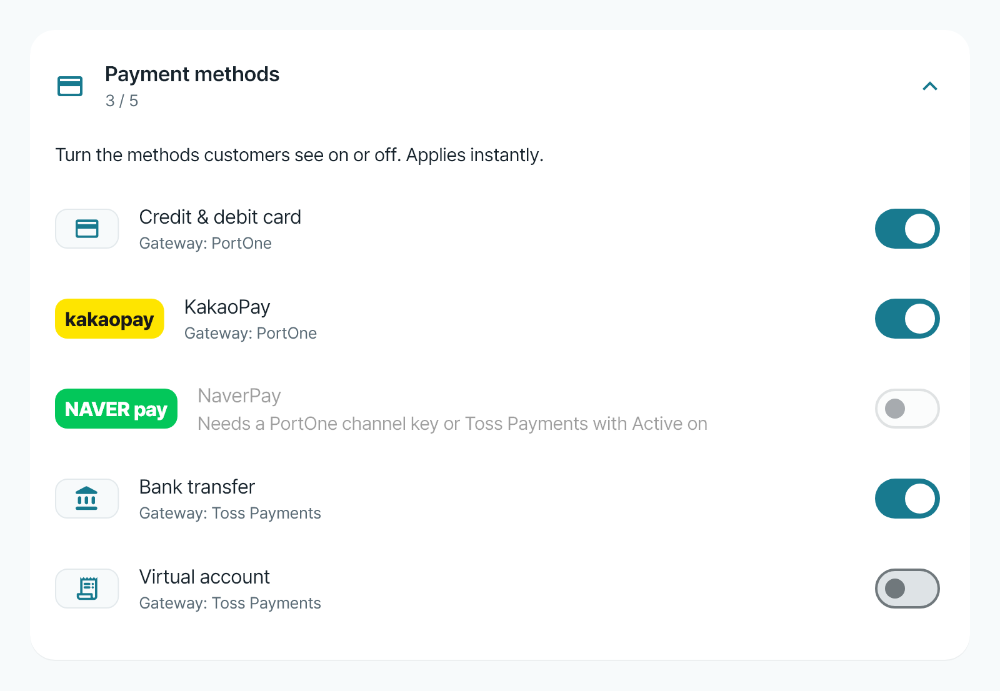

# 10. Business profile and payment methods

**In this chapter:** fill in the **Business profile** card at the top of the **[Setup]** page: service name, support contacts, logo, brand colour and company details.
You also meet the store-link and app-version boxes, and turn the customer payment methods on or off in the **Payment methods** card.

> **Before you start**
> - Business registration certificate (legal name, representative, registration number, address)
> - Mail-order business registration (its number)
> - A logo image file (JPG, PNG or WEBP; a square image looks best)
> - Support phone number, email address and support hours
> - The name of the company you rent the server from (the hosting provider, for example the company behind AWS if you installed there)
> - The person you chose as privacy officer

> **Tip** The **Business profile** card never locks. Any admin can change it and click **[Save]** at any time. No code is asked.

---

## 10.1 Open the Business profile card

1. Click **[Setup]** in the left menu.
2. Find the first card under **Get ready to launch**: **Business profile**.
3. If it is folded, click the arrow (∨) at the right to open it.

**You should now see:** a wide coloured preview strip at the top, holding a picture square and the service name, with the boxes below it.

---

## 10.2 Service name and support contacts

| Box | What to enter | Where it shows |
|---|---|---|
| **Service name** | The name customers see (required) | App header, website, notifications |
| **English name** | The name in English (up to 60 characters, may stay empty) | English screens |
| **Short name (up to 12 characters: SMS prefix, home screen label)** | A short name of 12 characters or fewer (empty means the first 12 characters of the service name) | SMS prefix, payment names, home screen app name |
| **Tagline** | Your service in one sentence (up to 60 characters) | Share image, web app description |
| **English tagline** | The tagline in English (up to 60 characters) | English screens |
| **Support phone** | The number customers call | Apps and website |
| **Support email** | The address customers write to | Apps and website |
| **Support hours** | For example `Mon–Fri 09:00–18:00` | Apps and website |

1. Click **Service name** and type the name. The name in the preview changes as you type.
2. Type the number into **Support phone**.
3. Type the address into **Support email**.
4. Type the hours into **Support hours**.

> **Note** The **English name**, **Short name**, **Tagline** and **English tagline** boxes sit right under the service name. Chapter 28, 28.2 explains where each is used.

> **Warning** With **Service name** empty, saving fails with **Please check the highlighted value**. The other boxes may stay empty. Each box takes up to 200 characters.

---

## 10.3 Upload the logo

1. Click the square picture box (a picture with a +) at the left of the preview strip. This box is called **Upload logo**.
2. A file window opens. Pick your logo file and click **[Open]**.
3. After a moment the logo shows in the picture box.
4. It is not saved yet. It reaches the apps and website only after **[Save]** (10.8).

**You should now see:** your logo in the preview strip.

> **Tip** A large image is scaled down to 1024 pixels wide when it is uploaded.

> **Tip** Without a logo file, **[Make a letter logo]** under the picture box makes a logo from the first letter of the name. When you save, the console makes 7 icons and share images from the logo (chapter 28, 28.3).

---

## 10.4 Pick the brand colour

The brand colour is the colour of buttons and headers in the customer app. The partner app uses it for highlights only (chapter 28, 28.4).

1. Under **Brand color**, click one of the 8 round swatches. The swatch gets a dark ring and the preview strip changes colour.
2. If none fits, type a colour code into the **#RRGGBB** box. Example: `#187A8F` (`#` and 6 digits or letters A–F).

**You should now see:** the preview strip in the new colour.

> **Warning** If red text under the colours says **White text on this colour is hard to read, so the apps will not use it. Choose a darker colour.**, choose a darker colour.
> If you save anyway, the apps ignore that colour. This keeps the white text on buttons readable.

> **Tip** The customer and partner apps fetch the saved colour and logo from the server. Without internet they keep the last colour they received. Chapter 28 explains what changes when.

---

## 10.5 Company details

These are the boxes under **Company details (shown in app and website footer)**. The law requires this information in the website footer and the terms. Once filled in, it appears on the website by itself.

| Box | Where to find it |
|---|---|
| **Legal name** | Legal name on the business registration |
| **Representative** | Representative on the business registration |
| **Business registration no.** | The registration number (for example `123-45-67890`) |
| **Mail-order registration no.** | The number on the mail-order registration |
| **Business address** | The business address on the registration |
| **Hosting provider** | The company you rent the server from |
| **Privacy officer** | The person you chose as privacy officer |
| **Privacy contact email** | The address customers write to about their personal data |

1. Click each box in the order of the table and type the value.
2. Copy it exactly as it appears on the document.

> **Warning** You are responsible for this information being correct. Ask a tax accountant or lawyer what you must show (to be confirmed).

---

## 10.6 Store links, chat channels and search registration

**Store links (the website buttons turn on once filled)**

Leave these empty until the apps are in the stores. Come back after chapter 25.

| Box | What to enter |
|---|---|
| **App Store · Customer app** | The customer app's Apple App Store address |
| **Google Play · Customer app** | The customer app's Google Play address |
| **App Store · Partner app** | The partner app's Apple App Store address |
| **Google Play · Partner app** | The partner app's Google Play address |
| **카카오 채널 URL (https://pf.kakao.com/...)** (Kakao channel URL) | Your KakaoTalk channel address (chat button on the website) |
| **네이버 톡톡 URL (https://talk.naver.com/...)** (Naver TalkTalk URL) | Your Naver TalkTalk address (chat button on the website) |

> **Tip** The last two box names, and the search boxes below, are shown in Korean on the English screen too.

1. Copy the address from the store page or the channel admin page.
2. Paste it into the right box. It must start with `https://`.

**You should now see:** after saving, the app download buttons on the website switch on.

**검색·문의 (Search & chat)**

Codes used to register your website with Google and Naver search. Leave them empty if you do not use them.

| Box | What to enter |
|---|---|
| **Google Search Console 인증 코드** (verification code) | The site ownership code from Google Search Console |
| **네이버 서치어드바이저 인증 코드** (verification code) | The site ownership code from Naver Search Advisor |

> **Tip** On each site's ownership page you can choose either the HTML tag method or the HTML file method.
> - HTML tag method: paste only the value inside `content="…"`.
> - HTML file method: paste the middle of the file name, without `google` (or `naver`) at the front and `.html` at the end. You need not upload the file: the server shows a file with that name for you.
> - Only letters, digits, `-` and `_` are accepted, up to 128 characters. Anything else fails on save with **Please check the highlighted value**.

---

## 10.7 App versions

Under the heading **App versions** the card says: **Apps below the minimum stop on an update screen. Apps below the latest version see a banner. Format: 1.2.0**

| Box | Meaning |
|---|---|
| **Customer app · Minimum version** | A customer app below this cannot be used until it is updated |
| **Customer app · Latest version** | A customer app below this shows an "update" banner |
| **Partner app · Minimum version** | Minimum version of the partner app |
| **Partner app · Latest version** | Latest version of the partner app |

1. Leave all four empty at first.
2. When a new app version is live in both stores, type its number into **Latest version**. Example: `1.2.0`
3. Fill in **Minimum version** only when you must block an old version.

> **Warning** Only three numbers joined by dots (`1.2.0`) are accepted. Anything else fails on save with **Please check the highlighted value**.

> **Warning** If **Minimum version** is a number not yet in the stores, customers and partners cannot use the app at all. Check the stores show the new version first.

---

## 10.8 Save

1. Scroll to the bottom of the card.
2. Click **[Save]**.
3. If you changed the logo, brand colour, service name or tagline, the **This is how it looks** window opens. Check the icons and share image it made and click **[Save]** (chapter 28, 28.6).
4. Read the **Saved. This is where it shows** window and click **[OK]**.

**You should now see:** **Saved** at the bottom of the screen, the shop picture next to the card title replaced by a tick (✔), and the count at the top one higher.

> **Warning** If you leave for another menu item without saving, what you typed is lost.

> **Note** Right under the **Business profile** card are the **Store app build** card (chapter 28, 28.7) and the **Business hours** card (chapter 17, 17.4).

---

## 10.9 The Payment methods card

Turn the payment methods in the customer app on or off. Each switch applies at once. There is no **[Save]** button.

1. Open the **Payment methods** card, under **Business profile** and right after the **Business hours** card.
2. The top line says **Turn the methods customers see on or off. Applies instantly.** The number under the card title (for example `4 / 10`) is how many are on out of all.
3. There are 10 methods: **Credit & debit card**, **KakaoPay**, **NaverPay**, **TossPay**, **PAYCO**, **Samsung Pay**, **Apple Pay**, **Bank transfer**, **Virtual account**, **Mobile bill**.
4. To turn one on, click the switch at the right of its row so it moves right.
5. To turn it off, click it again so it moves left.

**You should now see:** the switch changes at once and the number under the title updates.

**When a row has grey text under it**

| Text | Meaning | What to do |
|---|---|---|
| **Gateway: PortOne** or **Gateway: Toss Payments** | When this method is on, its payments go to that gateway. For card it is the gateway that saves cards, while one can | Nothing. To move a method from PortOne to Toss Payments, see chapter 11, 11.12 |
| **Needs a PortOne channel key or Toss Payments with Active on** | No gateway takes this method: PortOne has no channel key for it, and Toss Payments is not set up or its **Active** switch is off. It cannot be turned on (the switch is grey) | Add the channel key in the **Payments (PortOne)** card (chapter 11), or set up Toss Payments and turn its **Active** on (chapter 12) |
| **This payment channel is not connected yet, so customers can't see it. Ask whoever manages your setup.** | It is on, but no gateway takes it, so customers do not see it | Add the channel key (chapter 11) or set up Toss Payments (chapter 12), or switch it off |

> **Warning** You cannot turn every method off. Turning off the last one shows **Keep at least one payment method on. With none on, customers can't pay.** and nothing is saved.

> **Warning** While Toss Payments is set up with its **Active** switch on (chapter 12), every switched-on method without a PortOne channel key is offered to customers through Toss Payments. Before you save Toss Payments, leave on only the methods Toss Payments contracted and approved, or that PortOne has a channel key for.

> **Tip** On a new install all 10 methods are on. Customers still see only the methods some gateway takes: with PortOne only, the ones that have a channel key; with Toss Payments, every switched-on method.

---

## If something goes wrong

| What you see | Why | What to do |
|---|---|---|
| **[Save]** shows **Please check the highlighted value** | The service name is empty, a link does not start with `https://`, or a version or colour has the wrong format | Check the service name, links, versions (`1.2.0`) and colour (`#187A8F`) |
| You picked a logo but the apps do not show it | You did not click **[Save]** | Click **[Save]** at the bottom of the card |
| The logo upload fails | The file type is not supported | Use a JPG, PNG or WEBP file |
| **Could not make images from this logo. Try another PNG or JPG file.** | The console could not make icons from that logo | Use a PNG or JPG file |
| You changed the colour but the apps did not | The colour is too light for white text | Pick a darker colour (the warning goes away) and save |
| No app download buttons on the website | No store links yet | Add them after release (10.6) and save |
| A payment method switch is grey | No gateway takes that method | Add the PortOne channel key (chapter 11), or set up Toss Payments (chapter 12) |
| Customers are stuck on an "update" screen | **Minimum version** is higher than the version in the stores | Fix or empty **Minimum version** and save |
