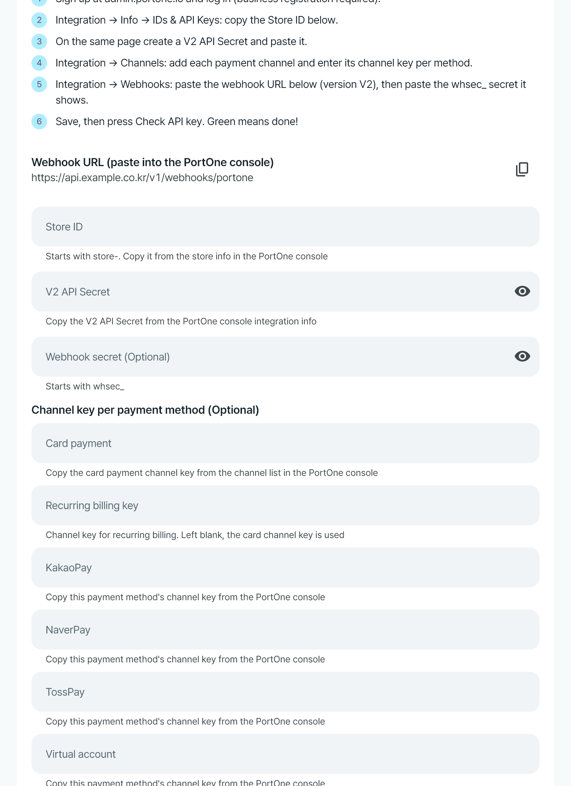
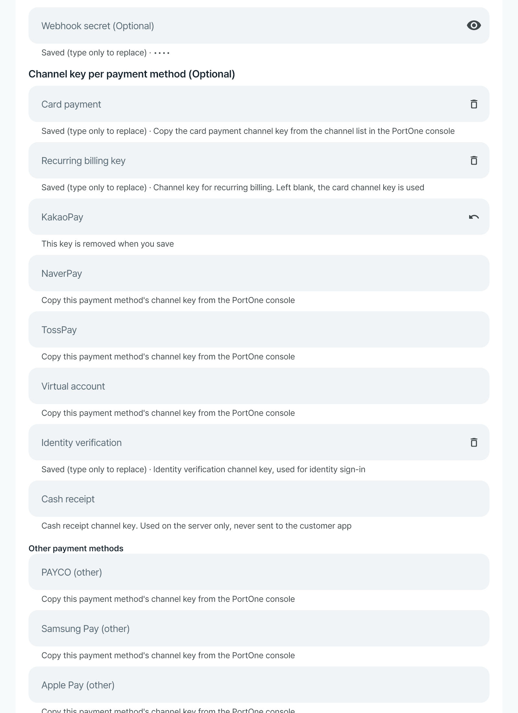

# 11. Payments (PortOne)

**In this chapter:** connect PortOne so customers can pay by card and easy-pay apps.
You take four things from the PortOne site (store ID, V2 API secret, channel keys, webhook secret), put them into the **Payments (PortOne)** card in the console, and check with a test payment.
PortOne is optional: you can use PortOne only, Toss Payments only (chapter 12), or both. Identity checks (PASS) always need PortOne.

> **Before you start**
> - Business registration certificate (needed for PortOne sign-up and the payment provider's review)
> - A PortOne account (admin.portone.io), in the company's name
> - A contract and review with the payment providers (PGs). You apply through PortOne; the provider sets the review time.
> - The owner account and authenticator app (the first save needs the owner code)
> - The card basics from chapter 9

> **Note** If you take payments with Toss Payments only, you need this card only for identity checks (PASS): fill in **Store ID**, **V2 API Secret** and the **Identity verification** channel key. How PortOne and Toss Payments share the work is in 11.12.

> **Warning** This card carries the **Needs a developer the first time** badge. For a first contract and channel setup, do it together with your developer.

> **Warning** PortOne can rename or move its menus. The PortOne screen names below are the Korean names used in the card's **How to set up** steps, with an English gloss. If the screens differ, follow PortOne's own help.

---

## 11.1 What goes where

| Console box | Value from PortOne | Looks like | Secret? |
|---|---|---|---|
| **Store ID** | Store ID (상점 아이디) | starts with `store-` | No |
| **V2 API Secret** | V2 API Secret | long text, no spaces | **Yes (server only)** |
| **Webhook secret (Optional)** | Webhook secret | starts with `whsec_` | **Yes (server only)** |
| **Channel key per payment method (Optional)** | One channel key per method | starts with `channel-key-` | No (the cash-receipt channel key is server only) |
| **Issue cash receipts (Optional)** | (a switch) | on / off | — |

> **Warning** Never show "server only" values to anyone. After saving, the console itself shows them only as `••••`.

---

## 11.2 Sign up to PortOne and apply to payment providers

1. In the console **[Setup]** page, open the **Payments (PortOne)** card. It sits right under the **Payments** heading.
2. Click **[Open site]** next to **How to set up**. admin.portone.io opens in a new window.
3. Sign up with your business registration ready, and sign in.
4. Following PortOne's instructions, apply for the providers you want (card, KakaoPay, NaverPay, TossPay and so on). While the review runs, you can fill in other cards.

---

## 11.3 Copy the store ID and the V2 API secret

**Store ID**

1. On the PortOne site go to **[결제 연동] → [연동 정보] → [식별코드 · API Keys]** (Integration → Info → IDs & API Keys).
2. Find the store ID (상점 아이디) and copy it. It starts with `store-`.
3. Paste it into the card's **Store ID** box.

**V2 API Secret**

1. On the same PortOne page click **[V2 API Secret 발급]** (create a V2 API Secret).
2. Copy the value. You may not be able to see it again, so paste it right away.
3. Paste it into the card's **V2 API Secret** box.
4. Use the eye button to check there are no spaces before or after.

**You should now see:** no red text under either box.

---

## 11.4 Add a channel key per payment method

In PortOne you create one "channel" per payment provider. Each channel has a channel key, and the console has one box per method.

1. On the PortOne site go to **[결제 연동] → [채널 관리]** (Integration → Channels).
2. Add a channel for each provider you use (card, KakaoPay, NaverPay, TossPay and so on).
3. In the console card, look at the boxes under **Channel key per payment method (Optional)**. Each box has a name and a help line.

| Box | Channel key to enter | Help line under the box |
|---|---|---|
| **Card payment** | Card payment channel | Copy the card payment channel key from the channel list in the PortOne console |
| **Recurring billing key** | Saved-card / recurring channel | Channel key for recurring billing. Left blank, the card channel key is used |
| **KakaoPay** | KakaoPay channel | Copy this payment method's channel key from the PortOne console |
| **NaverPay** | NaverPay channel | (same) |
| **TossPay** | TossPay channel | (same) |
| **Virtual account** | Virtual account channel | (same) |
| **Identity verification** | Identity verification channel | Identity verification channel key, used for identity sign-in |
| **Cash receipt** | Cash receipt channel | Cash receipt channel key. Used on the server only, never sent to the customer app |

Under the heading **Other payment methods** there are more boxes: **PAYCO (other)**, **Samsung Pay (other)**, **Apple Pay (other)**, **Bank transfer (other)**, **Phone bill (other)**.

4. Copy one channel key from the PortOne channel list. It starts with `channel-key-`.
5. Paste it into the box for the same method in the console.
6. Repeat steps 4–5 for each method you use.
7. Leave the boxes for unused methods empty.

**You should now see:** no red text under the boxes you filled.

> **Tip** A method without a channel key does not appear in the customer app. You can add it later when you add the channel (unlock, 9.5).

> **Tip** With **Cash receipt** empty, cash receipts use the bank transfer or virtual account channel key. With **Recurring billing key** empty, the **Card payment** channel key is used.

---

## 11.5 Connect the webhook

A webhook is how PortOne tells our server that a payment finished.

1. In the console card, find the row **Webhook URL (paste into the PortOne console)**. The address looks like `https://(your domain)/v1/webhooks/portone`.
2. Click the **[Copy]** button at the right of the row. **Copied** appears.
3. On the PortOne site go to **[결제 연동] → [웹훅]** (Integration → Webhooks).
4. Paste the address and choose version **V2**.
5. After saving, PortOne shows a secret starting with `whsec_`. Copy it.
6. Paste it into the card's **Webhook secret (Optional)** box.

> **Warning** The box says **(Optional)**, but fill it in. The webhook secret proves that a notice really came from PortOne. Left empty, a real business server refuses every PortOne notice (only a test-mode server accepts them).

> **Tip** A webhook never changes a payment by itself. When a notice arrives, the server asks PortOne again before acting.

> **Tip** If you later change the domain, this webhook address changes with it. The **After the move** list on the console's **Domain** card shows the new address with a copy button (chapter 28, 28.8.6).

---

## 11.6 The Issue cash receipts switch

The **Issue cash receipts (Optional)** switch starts off. The help line says: **Off means no cash receipts are issued. Test in the PortOne sandbox before turning it on.**

1. Leave it off for the first save.
2. If you will issue cash receipts, turn it on while test channel keys are in place (11.9) and check a test payment gets a receipt. While it is off no receipt is issued, so test with it on.
3. The card is locked by then, so: **[Unlock (owner code)]** → switch on → **[Save]**.
4. If the test shows a problem, turn it off again the same way.

---

## 11.7 Save (owner code)

1. Check that **Store ID** and **V2 API Secret** are filled in. These two are required.
2. Click **[Save]**.
3. The **Owner authenticator code** window opens. Type the 6 digits from your authenticator app into **6-digit code**.
4. Click **[Confirm]**.

**You should now see:** **Saved**, and the labels **Saved** and **Locked** on the card header.
Under the **Payments** heading you see **Payments go to: PortOne**. If Toss Payments is also set up and takes some methods, it reads **Payments go to: PortOne, Toss Payments**.

> **Warning** Only the owner can make the first save. It decides where payment money goes.

---

## 11.8 Check API key

1. Click **[Check API key]** at the bottom of the card. (The owner can press it on a locked card.)
2. Wait a moment.

**You should now see:** a green **Connected** label on the card header.

> **Warning** **[Check API key]** checks only the V2 API secret. A wrong store ID or channel key only shows up at the first payment. So always do the test payment in 11.9.

---

## 11.9 Make a test payment

Test with PortOne test channel keys first, then switch to the real channel keys.

1. In the **Payment methods** card (10.9), check the method you want to test is on.
2. In the customer app, make a booking and pay by card.
3. In the console under **[Bookings]**, check the booking shows as paid.
4. Make a partial refund on it (chapter 21).
5. If you will use saved cards (recurring), save a card → pay with it → delete the card, once.
6. If you will issue cash receipts, first turn the switch on (11.6). Then pay once by bank transfer or virtual account and check a receipt is issued.
7. Refund every test payment.

**You should now see:** the payments and refunds look the same in the console and on the PortOne site.

> **Note** While you test, the **PortOne test-channel payments** check on **[System status]** turns red and the alert phone gets the text **PortOne 테스트 채널로 결제가 들어왔어요** (chapter 26). That is expected with test channel keys. Test only with the test channel keys **saved on this card**: a payment or card save on a test channel whose key this server does not hold is refused, reads as failed and books nothing.

> **To be confirmed** These have not yet been checked in a real test store. Check them with your developer during testing.
> - How real card decline codes arrive
> - The shape of the cash receipt response

---

## 11.10 Switch to real payments

1. On the PortOne site, prepare the real payment channels. Follow PortOne's help on how test and real channels are separated (to be confirmed).
2. In the console, open the card and click **[Unlock (owner code)]**.
3. In **Owner authenticator code**, type the 6 digits and click **[Confirm]**.
4. Paste real channel keys only into the boxes you are changing. (Empty boxes keep their saved values.)
5. Click **[Save]** within 5 minutes.
6. Click **[Check API key]**.
7. Make one small real payment and one refund.
8. On the PortOne site, delete this store's **test** channels, so no test payment can come in any more.

**You should now see:** after the real payment, the **PortOne test-channel payments** check on **[System status]** stays at 0. (Test payments from before the switch keep it red for up to 24 hours.)

> **Warning** The PortOne card has no **Test** / **Live** label. Keep your own note of whether the saved channel keys are test or real. PortOne itself reports test channels: a payment or saved card on a test channel turns the **PortOne test-channel payments** check on **[System status]** red and sends the alert text **PortOne 테스트 채널로 결제가 들어왔어요** (chapter 26). When you are live, that means a test channel key is still saved or a test channel still exists.

---

## 11.11 Never remove the PortOne card

Even if you add Toss Payments later (chapter 12), keep the PortOne card as it is while any of the following remain.

- Refunds of payments taken through PortOne use the PortOne card.
- Cards saved through PortOne, and their recurring charges, use PortOne.
- Identity verification (PASS) always uses PortOne.

The server guards this. **[Disconnect]** is refused while PortOne still has any of these:

- payments in progress, payment windows that expired within the last day (a late payment can still arrive on them), saved cards, open subscription charges or refunds waiting: **This gateway still has payments in progress, saved cards or refunds, so it can't be disconnected. To stop new payments only, turn Toss Payments' Active off, or clear PortOne's channel key slots.**
- payments from the last year that can still be refunded: **Payments taken through this gateway can still be refunded (up to a year after payment), so it can't be disconnected: those refunds would fail. To stop new payments only, turn Toss Payments' Active off, or clear PortOne's channel key slots.**

Saving the card with **another** PortOne store's values while it is in use is refused too: **Payments, saved cards or refunds on this gateway still belong to the current account (PortOne store, Toss Payments MID), so it can't switch to another account: their lookups and refunds would go to the new one and fail. A new key from the same account is fine.** A new V2 API secret of the **same** store saves as usual.

> **Warning** Refunds of PortOne payments older than a year and identity checks (PASS) are not guarded: disconnecting makes them fail. Keep the card.

---

## 11.12 PortOne and Toss Payments together

You can take payments with PortOne only, Toss Payments only (chapter 12), or both. Customers see the methods of every gateway that is set up.

**How the two share the methods**

- A method that has a PortOne channel key goes to PortOne.
- Every other switched-on method goes to Toss Payments, while the **Active** switch on the **Payments (Toss Payments)** card is on.
- A method is never offered twice. The **Payment methods** card (10.9) shows each method's gateway, for example **Gateway: PortOne**.
- New saved cards go to PortOne when it has the **Recurring billing key** or **Card payment** channel key. Otherwise they go to Toss Payments, if it has billing keys.
- Payments, refunds, saved cards and recurring visits that already exist stay on the gateway they started on.

**Move one method from PortOne to Toss Payments**

1. Check that Toss Payments approved this method, and that the **Payments (Toss Payments)** card is saved with **Active** on (chapter 12).
2. On the PortOne card, click **[Unlock (owner code)]** and type the 6 digits.
3. Click the bin icon **Clear this slot** at the right of that method's channel key. Under the box you see **This key is removed when you save**. To keep it after all, click **Keep this slot**.

4. Click **[Save]** within 5 minutes.
5. Open **Payment methods** (10.9). The row now shows **Gateway: Toss Payments**.

**Card is different.** Cards are saved for one-tap payment on PortOne while it has the **Recurring billing key** or the **Card payment** key, and the card row shows **Gateway: PortOne** in that time. To send card to Toss Payments, clear **both** slots. Toss Payments then saves cards only when it has billing keys; without them card is paid in the payment window each time.

> **Tip** Do not click **[Disconnect]** to move methods: it removes the whole card. Clear only the slots you move.

To move the method back to PortOne, put its channel key in again (11.4).

**Identity checks (PASS)**

- PASS needs PortOne with the **Identity verification** channel key, even when every payment goes to Toss Payments.

- PASS uses the store ID and the **Identity verification** channel key saved on this card, or the ones your developer put on the server at install. Checking a result also needs the **V2 API Secret**.

---

## If something goes wrong

| What you see | Why | What to do |
|---|---|---|
| **The store ID must start with store-.** | You copied another value | Copy the value starting with `store-` from PortOne **[식별코드 · API Keys]** |
| **The V2 API secret does not look right. Paste the whole value with no spaces.** | Only part was copied, or a space slipped in | Copy the whole value again and paste it |
| **A channel key starts with channel-key-.** | That is not a channel key | Copy the channel key again from **[채널 관리]** |
| **The webhook secret must start with whsec_.** | You pasted the webhook address or another value | Copy the `whsec_` value from PortOne's webhook page |
| **Fill in every required field.** | Store ID or V2 API Secret is empty | Fill in both |
| **Only the owner can unlock** | An admin who is not the owner tried the first save | Sign in as the owner and save |
| **The key was rejected. Check the value you copied** | PortOne refused the V2 API secret | Create a new secret in PortOne, then unlock, paste, save |
| **Could not reach the service. Try again shortly** | PortOne did not answer | Check again in a few minutes |
| A payment method is missing in the customer app | No gateway takes it (no PortOne channel key, and no Toss Payments), or it is off under **Payment methods** | Add the channel key (11.4) or set up Toss Payments (chapter 12), and switch it on (10.9) |
| A method you expected on PortOne shows **Gateway: Toss Payments** | PortOne has no channel key for it | Add its channel key (11.4) |
| Card shows **Gateway: PortOne** although you cleared **Card payment** | PortOne still has the **Recurring billing key**, so cards are still saved on PortOne | Clear **Recurring billing key** too (11.12) |
| **PortOne test-channel payments** on **System status** is red after a PortOne payment | That payment or saved card went through a PortOne **test** channel | While testing, nothing to do. When live, replace the test channel keys with real ones and delete the store's test channels (11.10) |
| A payment or card save fails while you test, and nothing is booked | It went through a PortOne test channel whose key is not saved on this card | Save that test channel's key on the card (11.4), or test with the channel whose key is saved |
| **[Disconnect]** or **[Save]** is refused with **… can't be disconnected …** or **… can't switch to another account …** | PortOne still has payments, saved cards or refunds, or you pasted another store's values | Keep the card, or put back the store you used before (11.11) |
| A payment went through but the console does not show it as paid | The webhook address or secret may be wrong | Check 11.5 again and tell your developer |
