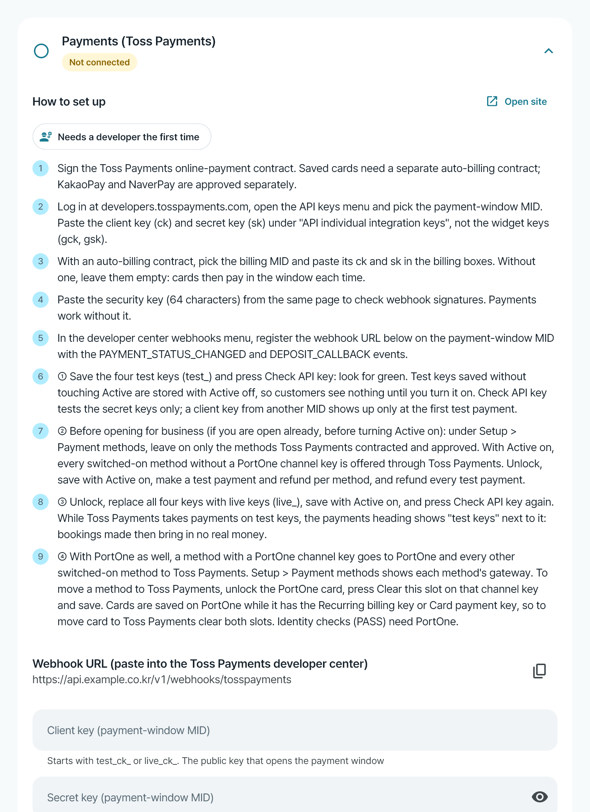
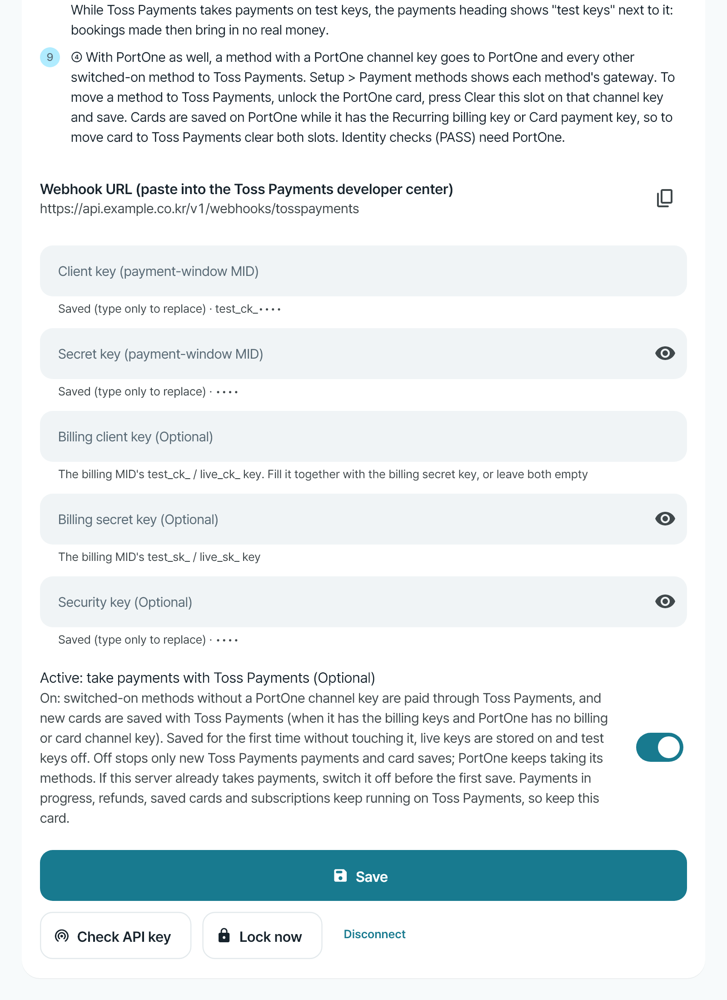
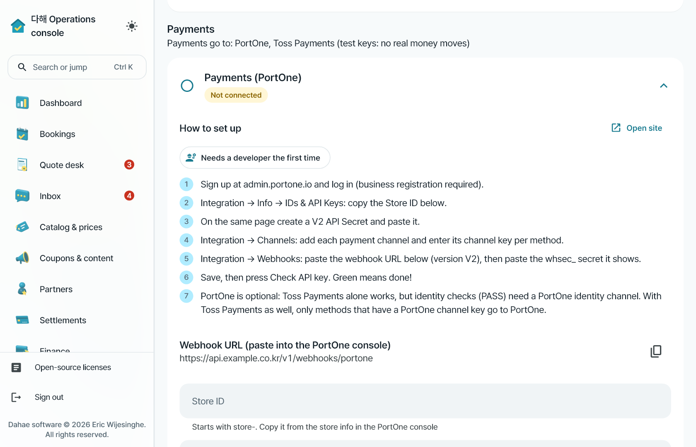

# 12. Payments (Toss Payments)

**In this chapter:** connect Toss Payments (direct integration) so customers can pay through it. This card is optional.
Toss Payments can run alone, or next to PortOne (chapter 11). Customers see the methods of every gateway you set up.
You save and test with test keys, then move to live keys. You also learn what goes where, and how to pause Toss Payments.

> **Before you start**
> - A Toss Payments **online-payment** contract (the payment-window store ID, called MID)
> - For saved cards or recurring visits, an **auto-billing** contract too (reviewed separately, with its own MID)
> - Easy-pay services such as KakaoPay and NaverPay are approved separately, one by one
> - A login for developers.tosspayments.com (the Toss Payments developer center)
> - The **Payments (PortOne)** card (chapter 11) only if you need identity checks (PASS), or if you already take payments or save cards with PortOne. If you do, never remove it.
> - Customer apps new enough to open Toss Payments (chapter 25, **App versions**)
> - The owner account and authenticator app
> - An Android phone and an iPhone for testing (to check the hand-off to payment apps and back)

> **Warning** This card carries the **Needs a developer the first time** badge. Do it with your developer the first time.

> **Warning** The Toss Payments screen names below are the ones in the card's **How to set up** steps. Toss Payments may change its screens; if they differ, follow Toss Payments' own help.

---

## 12.1 The big picture

- You can set up PortOne only, Toss Payments only, or both. You never have to pick one: customers are offered the methods of every gateway that is set up.
- With both set up, each payment method goes to one gateway. A method that has a PortOne channel key goes to PortOne. Every other switched-on method goes to Toss Payments.
- The switch **Active: take payments with Toss Payments (Optional)** at the bottom of the card decides whether Toss Payments takes new payments. If you do not touch it, the first save stores it **off** with test keys and **on** with live keys, and it keeps that value when you change keys later. Turn it off to stop new Toss payments for a while (12.10).
- Order: ① on a server that already takes payments, keep **Active** off → ② save test keys → ③ check the keys → ④ register the webhook → ⑤ choose payment methods → ⑥ turn **Active** on and test → ⑦ move to live keys. Finish testing **before** you open for business.
- You can add PortOne or Toss Payments later. 12.9 shows what changes and what stays.

---

## 12.2 What goes where

| Console box | Value from Toss Payments | Looks like | Secret? |
|---|---|---|---|
| **Client key (payment-window MID)** | API individual integration client key of the payment-window MID | starts with `test_ck_` or `live_ck_` | No |
| **Secret key (payment-window MID)** | API individual integration secret key of the payment-window MID | starts with `test_sk_` or `live_sk_` | **Yes (server only)** |
| **Billing client key (Optional)** | Client key of the auto-billing MID | `test_ck_` / `live_ck_` | No |
| **Billing secret key (Optional)** | Secret key of the auto-billing MID | `test_sk_` / `live_sk_` | **Yes (server only)** |
| **Security key (Optional)** | The security key on the same page | 64 characters, 0–9 and a–f | **Yes (server only)** |
| **Active: take payments with Toss Payments (Optional)** | (a switch; untouched, the first save stores it off with test keys, on with live keys) | on / off | — |

> **Warning** Never enter the **widget keys** (`gck`, `gsk`). Always use the **API individual integration keys** (`ck`, `sk`). Widget keys are refused when you save.

> **Warning** All four keys must be test keys (`test_`), or all live keys (`live_`). A mix cannot be saved.

> **Tip** Fill in both billing boxes, or leave both empty. Without an auto-billing contract, leave them empty: cards then pay in the payment window each time.

---

## 12.3 Copy the test keys in the developer center

1. In the console **[Setup]** page, open the **Payments (Toss Payments)** card. It is right under **Payments (PortOne)**.
2. Click **[Open site]**. developers.tosspayments.com opens in a new window. Sign in.
3. Go to the **API 키** (API keys) menu.
4. Pick the payment-window store ID (MID).
5. Under **API 개별 연동 키** (API individual integration keys), copy the client key (`test_ck_…`) and paste it into **Client key (payment-window MID)**.
6. Copy the secret key (`test_sk_…`) from the same place and paste it into **Secret key (payment-window MID)**.
7. With an auto-billing contract: switch to the auto-billing MID, and paste its `ck` into **Billing client key (Optional)** and its `sk` into **Billing secret key (Optional)**.
8. Copy the security key (64 characters) on the same page into **Security key (Optional)**. With it, webhook signatures are checked. Payments work without it.

**You should now see:** no red text under the boxes.

---

## 12.4 Save the test keys and check them

1. Look at the switch **Active: take payments with Toss Payments (Optional)**. Before the first save it shows on, but test keys are saved with it **off** unless you touch it. Leave it as it is.
   - If customers already pay on this server (through PortOne), you may also click it **off** to be sure. Nothing changes for customers until 12.7.
2. Click **[Save]**.
3. In **Owner authenticator code**, type the 6 digits and click **[Confirm]**. (Asked on the first save only.)
4. The card header shows **Saved**, **Locked** and **Test**, and the **Active** switch shows off.
5. Click **[Check API key]**.

**You should now see:** a green **Connected** label on the card header.

- **[Check API key]** checks the payment-window MID first, then the auto-billing MID.
- If only the billing keys are wrong, you see **The billing keys were rejected. Check the billing MID's keys**.

> **Warning** **[Check API key]** checks the secret keys only. A client key from another MID shows up only at the first test payment.

> **Warning** If you turn **Active** on yourself before saving and PortOne already takes payments, Toss Payments is offered **at once** for every switched-on method that has no PortOne channel key. On a new install all 10 methods are on. So leave the switch as it is (step 1), or first do 12.6.

---

## 12.5 Register the webhook

1. In the console card, find the row **Webhook URL (paste into the Toss Payments developer center)**. The address looks like `https://(your domain)/v1/webhooks/tosspayments`.
2. Click the **[Copy]** button at the right.
3. In the developer center, open the **웹훅** (Webhooks) menu.
4. Register the address on the **payment-window MID**.
5. Pick the events `PAYMENT_STATUS_CHANGED` and `DEPOSIT_CALLBACK`.
6. Save.

> **Tip** You need not register it on the auto-billing MID. Auto-billing approvals send no webhook.

> **Warning** Do not mix it up with the partner-payout webhook (`…/v1/webhooks/toss`, chapter 13). This card's address ends in `tosspayments`.

> **Tip** If you later change the domain, this webhook address changes with it. The **After the move** list on the console's **Domain** card shows the new address with a copy button (chapter 28, 28.8.6).

---

## 12.6 Choose payment methods (before turning Active on)

While **Active** is on, every switched-on method that has no PortOne channel key is offered to customers through Toss Payments. A customer who picks a method Toss has not approved gets a Toss Payments error.

1. Open the **Payment methods** card near the top of **[Setup]** (10.9).
2. Leave on only the methods that some gateway can take: the ones Toss Payments contracted and approved, and the ones PortOne has a channel key for. Turn the others off.

**You should now see:** once **Active** is on (12.7), each row has a grey line telling you its gateway, for example **Gateway: Toss Payments** or **Gateway: PortOne**. When that method is on, its payments go to that gateway.

> **Tip** With PortOne too: to move a method from PortOne to Toss Payments, press **Clear this slot** on that method's channel key on the PortOne card and save (chapter 11, 11.12).

---

## 12.7 Turn Active on and test (before opening)

Test keys leave **Active** off after 12.4, so do steps 1–4. If it is already on, skip them.

1. In the **Payments (Toss Payments)** card, click **[Unlock (owner code)]**.
2. In **Owner authenticator code**, type the 6 digits and click **[Confirm]**.
3. Click the switch **Active: take payments with Toss Payments (Optional)** to turn it on.
4. Click **[Save]** within 5 minutes.

**You should now see:** the line under the **Payments** heading names Toss Payments with a test mark:
- Toss Payments only: **Payments go to: Toss Payments (test keys: no real money moves)**
- With PortOne too: **Payments go to: PortOne, Toss Payments (test keys: no real money moves)**

> **Note** If Toss Payments is missing from that line, every switched-on method already has a PortOne channel key, so nothing goes to Toss Payments. See 12.6.

> **Warning** Bookings paid through Toss Payments in this state look paid but bring in no real money. Keep it like this only before you open. On a server that is already open, do the tests below quickly, then move to live keys (12.8) or turn **Active** off (12.10).

> **Note** Customer apps from the stores that are older than the first release with Toss Payments cannot open Toss Payments, so the server shows them only the PortOne methods. To give those customers the Toss Payments methods, publish the new apps and raise the customer app's **Minimum version** (chapter 25). The web app is always up to date.

**Test with the test keys** (no money moves on test keys)

1. Pay once with each method that goes to Toss Payments: card, each contracted easy pay, bank transfer (including the cash receipt step), virtual account.
2. Virtual account numbers start with `X`. Simulate a deposit (follow Toss Payments' help for how, to be confirmed) and check the console shows the booking as paid.
3. Fully refund one payment, and partly refund another.
4. Close the payment window, or let a payment fail, and check the app comes back to a cancelled payment.
5. If you entered billing keys and new cards are saved with Toss Payments (12.9): save a card (test code `000000`) → pay a booking with it → refund → delete the card.
6. In the developer center's webhook log, check our server answered `200`.
7. On Android and iPhone, check the hand-off to card apps, Toss and KakaoPay, and back to the app.
8. When everything passes, refund every test payment.

> **Tip** KakaoPay can only be tested with a contracted MID key, PAYCO only with live keys, and Apple Pay only in Safari.

---

## 12.8 Move to live keys

1. In the developer center, get the **live keys** (`live_ck_…`, `live_sk_…`) of the same MIDs.
2. In the console card, click **[Unlock (owner code)]** and type the 6 digits.
3. Paste live keys into **all** four key boxes (two if you do not use billing). Check that **Active** is on: it keeps the value it had.
4. Click **[Save]** within 5 minutes.
5. Click **[Check API key]**.

**You should now see:** the card label changes to **Live**, and **(test keys: no real money moves)** next to Toss Payments disappears from under the **Payments** heading.

> **Warning** If you change only one key, you get **Test and live keys can't be mixed. Use keys of one kind.** Change them all at once.

---

## 12.9 What goes where

**Who takes new payments**

| What is set up | Methods customers see | New saved cards | Line under **Payments** |
|---|---|---|---|
| Nothing | none (customers cannot pay) | not offered | **No gateway takes payments right now. Set up PortOne or Toss Payments, or turn Toss Payments' Active on.** |
| PortOne only | the switched-on methods that have a PortOne channel key | PortOne (needs the **Recurring billing key** or **Card payment** channel key) | **Payments go to: PortOne** |
| Toss Payments only, with billing keys | every switched-on method | Toss Payments | **Payments go to: Toss Payments** |
| Toss Payments only, no billing keys | every switched-on method; cards pay in the payment window each time | not offered | **Payments go to: Toss Payments** |
| Both | methods with a PortOne channel key go to PortOne; every other switched-on method goes to Toss Payments | PortOne if it can save cards, otherwise Toss Payments if it has billing keys | **Payments go to: PortOne, Toss Payments** |
| Both, Toss **Active** off | as PortOne only | PortOne | **Payments go to: PortOne** |

- A method is never offered twice. **Setup > Payment methods** shows each method's gateway (10.9).
- KakaoPay, NaverPay, TossPay and PAYCO are one-off payments on either gateway (only cards are saved). Easy-pay methods already saved through PortOne keep working.
- Card is a saved card while some gateway can save cards. While PortOne has the **Recurring billing key** or **Card payment** key, cards are saved on PortOne and the card row shows **Gateway: PortOne**. In the web app and the Windows app, card is paid in the payment window each time.
- Customers with no saved card cannot start a new recurring visit while no gateway can save cards.

**What stays where it started**

| What | Handled by |
|---|---|
| A payment already started | The gateway it started on. Adding or pausing a gateway does not move it |
| Refunds, payment lookups | The gateway that took the payment (recorded per payment) |
| Cards already saved, recurring visit charges | The gateway the card was saved with |
| Identity verification (PASS) | Always PortOne |
| Cash receipts | PortOne payments as before. Toss payments get them in the Toss window (bank transfer, virtual account), and Toss cancels them with the payment |
| Partner payouts | Unchanged (the **Partner payouts** card, chapter 13) |

**Adding the second gateway later**

- **Adding Toss Payments to PortOne:** methods PortOne already takes stay on PortOne, and so do saved cards. Toss Payments takes only the switched-on methods without a PortOne channel key. Do 12.6 first.
- **Adding PortOne to Toss Payments:** every method you give a PortOne channel key moves to PortOne for new payments. New saved cards also go to PortOne once it has the **Card payment** or **Recurring billing key** channel key. Payments and cards already on Toss Payments stay there.

> **Warning** So **keep every card you have used.** The PortOne card is needed for refunds of PortOne payments, for cards saved through PortOne and for identity checks. The Toss Payments card is needed while any Toss payments or saved cards exist. While a card still has payments in progress, saved cards or refunds waiting, **[Disconnect]** is refused with **This gateway still has payments in progress, saved cards or refunds, so it can't be disconnected. To stop new payments only, turn Toss Payments' Active off, or clear PortOne's channel key slots.** Refunds of older payments are not guarded: removing the card makes them fail and raises an alert.

### What follows by itself

- The processor table in the website privacy policy: the **토스페이먼츠** (Toss Payments) row shows **이용 중** (in use) once the card is saved. Nothing to edit by hand (chapter 28, 28.6).
- When a saved card is charged, the order name sent to the payment company uses the **Short name** from **Business profile** (for example `ShortName 예약금` for a deposit, `ShortName 잔금` for a balance). This is the same on either gateway (chapter 28, 28.2).
- The merchant name on card statements is set in the payment company's admin pages. Check the merchant name in the Toss Payments admin pages too (chapter 28, 28.9).

---

## 12.10 Pause Toss Payments

1. In the **Payments (Toss Payments)** card, click **[Unlock (owner code)]** and type the 6 digits.
2. Turn off **Active: take payments with Toss Payments (Optional)**.
3. Click **[Save]**.

**You should now see:** Toss Payments is gone from the line under **Payments**. With PortOne set up it reads **Payments go to: PortOne**. Without PortOne it reads **No gateway takes payments right now. Set up PortOne or Toss Payments, or turn Toss Payments' Active on.**, and customers cannot pay until you turn **Active** on again.

- Off stops only **new** Toss payments and **new** saved cards. Payments in progress, refunds, saved cards and recurring visit charges keep running on Toss Payments. That is why you only turn the switch off and keep the card.
- Methods that went to Toss Payments are no longer shown, unless PortOne has a channel key for them.
- Every change is recorded in the **[Activity log]**.

> **Warning** Rolling the server software back to a release from before Toss Payments is a developer's job. Before it, switch **Active** off and wait until no Toss payment is pending or awaiting deposit and no Toss refund is queued (chapter 33).

---

## If something goes wrong

| What you see | Why | What to do |
|---|---|---|
| **The client key starts with test_ck_ or live_ck_.** | A widget key (`test_gck_`) or another value | Copy the `ck` under **API individual integration keys** again |
| **The secret key starts with test_sk_ or live_sk_.** | A widget key (`gsk`) or another value | Copy the `sk` under **API individual integration keys** again |
| **The security key is 64 characters, each 0-9 or a-f. Copy it from the Toss developer center as is.** | Only part was copied, or a space slipped in | Copy all 64 characters again |
| **Test and live keys can't be mixed. Use keys of one kind.** | `test_` and `live_` keys are mixed | Make all four keys the same kind |
| **Fill in every required field.** | One payment-window key is empty, or only one billing key was entered | Fill both payment-window keys; enter both billing keys or neither |
| **The billing keys were rejected. Check the billing MID's keys** | The auto-billing MID keys are wrong | Pick the auto-billing MID in the developer center and copy its keys again |
| **The key was rejected. Check the value you copied** | The payment-window secret key is wrong | Copy the payment-window MID's `sk` again |
| Toss Payments is missing from **Payments go to** | The card was not saved, **Active** is off, or PortOne has a channel key for every switched-on method and can save cards | Save the card with **Active** on (12.7). To send a method to Toss Payments, press **Clear this slot** on its PortOne channel key (chapter 11, 11.12) |
| **(test keys: no real money moves)** stays | The keys are still test keys | Move to live keys (12.8) |
| A customer picks a method and gets a Toss Payments error | A method Toss has not approved is on | Turn it off under **Payment methods** (12.6) |
| Some customers' phones do not show the Toss Payments methods | Their store app is older than the first release with Toss Payments | Ask them to update; raise **Minimum version** (chapter 25) |
| After a server update, Toss Payments takes payments although you never turned **Active** on | The card was saved with live keys before the switch was stored; live keys saved without touching it count as on | Turn **Active** off (12.10) if Toss Payments should not take payments yet |
| After a server update, card or another method goes to PortOne instead of Toss Payments | PortOne still has that method's channel key (for card: the **Recurring billing key** or **Card payment** key) | Unlock the PortOne card, press **Clear this slot** on those keys and save (chapter 11, 11.12) |
| **This gateway still has payments in progress, saved cards or refunds, so it can't be disconnected.** | The card still has open payments, saved cards or queued refunds | Keep the card. To stop new Toss payments, turn **Active** off (12.10) |
| Customers cannot save a card | No billing keys, and PortOne cannot save cards | After the auto-billing contract, enter the keys in step 7 of 12.3 |
