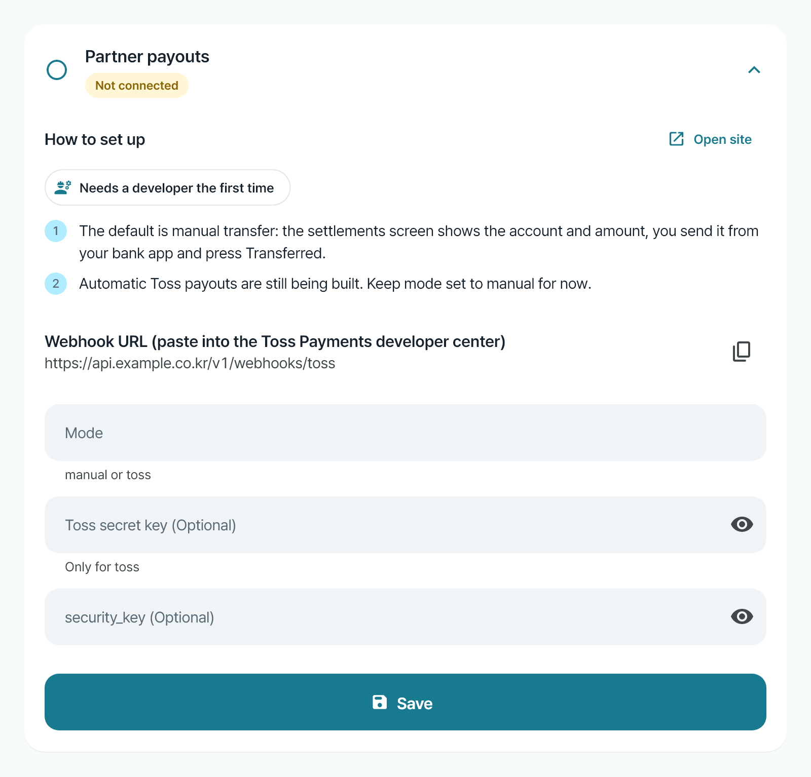

# 13. Partner payouts

**In this chapter**
You choose how partners get paid after a job.
The default is **manual transfer**: you send the money from your bank app. It needs no contract and no keys.
Automatic Toss payouts are still being built, so this chapter only shows how to trial them with your developer.

> **Before you start**
> - You can sign in to the console with an **admin** account (chapter 6).
> - Manual transfer only: nothing else.
> - Toss payout trial only: a Toss Payments **payouts contract**, a **test secret key** (`test_sk_…`) and the 64-character **security key** from the Toss developer center, the authenticator app on the owner's phone (chapter 6), and your developer.

## 13.1 Find the card

1. In the console's left menu, click **[Setup]**.
2. Scroll down to the **Partner payouts** card.
3. Click the card title to open it.

You should now see: two **How to set up** steps, **Webhook URL (paste into the Toss Payments developer center)**, and the boxes **Mode**, **Toss secret key (Optional)** and **security_key (Optional)**.

> **Note** The third box shows only its technical name, **security_key (Optional)**. It takes the Toss **security key**.

## 13.2 Use manual transfer (default, recommended)

Payouts are manual even if you never save this card. Saving it once makes it count as done in the progress bar at the top of **[Setup]**.

1. Click the **Mode** box.
2. Type `manual` (lower case, no spaces).
3. Leave the other two boxes empty.
4. Click **[Save]**.

You should now see: **Saved** under the card title, and a tick in the circle on the left. The card locks (locks are explained in chapter 9).

> **Tip** With manual transfer you don't need **[Check connection]**. There is no secret key, so it would show **Not connected**. Nothing is broken.

### How a manual payout works (short version)

Chapter 21 shows the screens. The flow is:

1. Open **[Settlements]** in the left menu.
2. On the payout, click **[Show account]**. Every view is recorded (**Viewing account details is logged**).
3. Send the amount to that account from your bank app.
4. Back in the console, click **[Mark as transferred]**.

> **Warning** Do not click **[Mark as transferred]** before the bank transfer is really sent. It records the partner as paid.

## 13.3 Toss payouts (still being built, with your developer)

As step 2 of the card's **How to set up** says, automatic Toss payouts are still being built. The server accepts mode `toss` only when **all** of these are true. Otherwise saving shows **Toss payouts aren't available yet. Use manual transfer.**

- Your developer has turned on the Toss payouts switch in the server settings (`TOSS_PAYOUTS_ENABLED=1`). You cannot turn it on from the console.
- **[Check connection]** has passed with the secret key that is saved now.

> **Warning** Toss payments (chapter 12) and Toss payouts are **separate contracts**. Whether one contract covers both is a question for your Toss sales contact (**to be confirmed**).

### Step 1: enter test keys and check them (mode stays manual)

1. In the Toss Payments developer center, copy the payouts **test secret key** (starts with `test_sk_`) and the **security key** (64 characters, each 0-9 or a-f).
2. In the console, open **[Setup]** → **Partner payouts**.
3. If the card is locked, click **[Unlock (owner code)]** and enter the 6-digit code from your authenticator app (chapter 9). You then have 5 minutes.
4. Type `manual` in **Mode**.
5. Paste the test secret key into **Toss secret key (Optional)**.
6. Paste the security key into **security_key (Optional)**.
7. Click **[Save]**.
8. Click **[Check connection]**. It only asks Toss for the balance. No money moves.

You should now see: **Connected** and **Test** under the card title.

> **Tip** If you change the key, you must check again. A pass with a test key does not cover a live key (`live_sk_`).

### Step 2: register the webhook

1. Click the copy icon next to **Webhook URL (paste into the Toss Payments developer center)**. **Copied** appears briefly.
2. Paste the URL in the webhook menu of the Toss Payments developer center. It ends in `/v1/webhooks/toss`.
3. Choose the events `payout.changed` and `seller.changed`.

> **Warning** This is not the payments webhook (`/v1/webhooks/tosspayments`, chapter 12). Don't mix them up.

### Step 3: switch mode to toss (after your developer turns the switch on)

1. Click **[Unlock (owner code)]** and enter your 6-digit code.
2. Type `toss` in **Mode**.
3. Click **[Save]**. If the card was not unlocked, the **Owner authenticator code** window opens. Enter the **6-digit code** and click **[Confirm]**.

You should now see: **Saved**, and the card locks again.

### Step 4: register partners as Toss sellers, then pay

In **[Settlements]**, click **[Register seller]** for each partner. To pay, click **[Send via Toss]**, then **[Check status]**. Chapter 21 shows the screens.

> **Warning** Before switching to a live key (`live_sk_…`), your developer must complete one seller registration and one payout end to end in the Toss test environment. The code notes this has not yet been verified against a live test environment (**to be confirmed**).

## 13.4 Go back to manual transfer

1. Click **[Unlock (owner code)]**.
2. Type `manual` in **Mode** and click **[Save]**.

> **Warning** You can't switch while a Toss payout is still in progress. You then see **This payout may already be with the bank, so it can't be changed right now. Check its status.** Use **[Check status]** in **[Settlements]** until every payout has finished, then try again.

## If something goes wrong

| You see | Do this |
|---|---|
| **Toss payouts aren't available yet. Use manual transfer.** | Ask your developer whether the server switch is on, and check that **[Check connection]** passed with the current key. Until then, keep `manual`. |
| **The secret key starts with test_sk_ or live_sk_.** | Copy the payouts secret key, not a payment-window or widget key. Remove spaces at either end. |
| **The security key is 64 characters, each 0-9 or a-f. …** | Copy the security key again from the Toss developer center. |
| **Pick a valid AI mode.** | **Mode** has something other than `manual` or `toss`. This box borrows the AI wording for that error. Type the word again in lower case. |
| **Fill in every required field.** | Mode `toss` needs both the secret key and the security key. |
| **Too many wrong codes. Try again in a few minutes** | Wait a few minutes, then enter the code your app shows **now**. |
| Buttons are grey | The card is locked. From the owner account, click **[Unlock (owner code)]** (chapter 9). |
