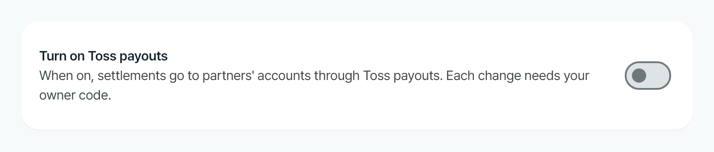

# 13. Partner payouts

**In this chapter**
You choose how partners get paid after a job.
The default is **manual transfer**: you send the money from your bank app. It needs no contract and no keys.
Automatic Toss payouts are still being built, so this chapter only shows how to trial them with your developer.

> **Before you start**
> - You can sign in to the console with an **admin** account (chapter 6).
> - Manual transfer only: nothing else.
> - Toss payout trial only: a Toss Payments **payouts contract**, a **test secret key** (`test_sk_…`) and the 64-character **security key** from the Toss developer center, the authenticator app on the owner's phone (chapter 6), and your developer.

## 13.1 Find the card

1. In the console's left menu, click **[Setup]**.
2. Scroll down to the **Partner payouts** card.
3. Click the card title to open it. A card that has never been saved is already open.

You should now see: two **How to set up** steps, **Webhook URL (paste into the Toss Payments developer center)**, and the boxes **Mode**, **Toss secret key (Optional)** and **security_key (Optional)**.

> **Note** The third box shows only its technical name, **security_key (Optional)**. It takes the Toss **security key**.

## 13.2 Use manual transfer (default, recommended)

Payouts are manual even if you never save this card. Saving it once makes it count as done in the progress bar at the top of **[Setup]**.

1. Click the **Mode** box.
2. Type `manual` (lower case, no spaces).
3. Leave the other two boxes empty.
4. Click **[Save]**.

You should now see: **Saved** under the card title, and a tick in the circle on the left. The card locks (locks are explained in chapter 9).

> **Tip** With manual transfer you don't need **[Check connection]**. There is no secret key, so it would show **Not connected**. Nothing is broken.

### How a manual payout works (short version)

Chapter 21 shows the screens. The flow is:

1. Open **[Settlements]** in the left menu.
2. On the payout, click **[Show account]**. Every view is recorded (**Viewing account details is logged**).
3. Send the amount to that account from your bank app.
4. Back in the console, click **[Mark as transferred]**.

> **Warning** Do not click **[Mark as transferred]** before the bank transfer is really sent. It records the partner as paid.

## 13.3 Toss payouts (still being built, with your developer)

As step 2 of the card's **How to set up** says, automatic Toss payouts are still being built. The server accepts mode `toss` only when **all** of these are true. Otherwise saving shows **Toss payouts aren't available yet. Use manual transfer.**

- The **Turn on Toss payouts** switch at the bottom of **[Setup]** is on (step 3 below). A switch the developer turned on in the server settings (`TOSS_PAYOUTS_ENABLED=1`) also counts as on.
- **[Check connection]** has passed with the secret key that is saved now.

> **Warning** Toss payments (chapter 12) and Toss payouts are **separate contracts**. Whether one contract covers both is a question for your Toss sales contact (**to be confirmed**).

### Step 1: enter test keys and check them (mode stays manual)

1. In the Toss Payments developer center, copy the payouts **test secret key** (starts with `test_sk_`) and the **security key** (64 characters, each 0-9 or a-f).
2. In the console, open **[Setup]** → **Partner payouts**.
3. If the card is locked, click **[Unlock (owner code)]** and enter the 6-digit code from your authenticator app (chapter 9). You then have 5 minutes, and one save locks the card again.
4. Type `manual` in **Mode**.
5. Paste the test secret key into **Toss secret key (Optional)**.
6. Paste the security key into **security_key (Optional)**.
7. Click **[Save]**.
8. Click **[Check connection]**. It only asks Toss for the balance. No money moves.

You should now see: **Connected** and **Test** under the card title.

> **Tip** If you change the key, you must check again. A pass with a test key does not cover a live key (`live_sk_`).

### Step 2: register the webhook

1. Click the copy icon next to **Webhook URL (paste into the Toss Payments developer center)**. **Copied** appears briefly.
2. Paste the URL in the webhook menu of the Toss Payments developer center. It ends in `/v1/webhooks/toss`.
3. Choose the events `payout.changed` and `seller.changed`.

> **Warning** This is not the payments webhook (`/v1/webhooks/tosspayments`, chapter 12). Don't mix them up.

> **Tip** If you later change the domain, this webhook address changes with it. The **After the move** list on the console's **Domain** card shows the new address with a copy button (chapter 28, 28.8.6).

### Step 3: turn on the Toss payouts switch (owner)

This switch used to exist only in the server settings, for the developer. Now the owner turns it on in the console.

1. Open **[Setup]** in the console with the **Owner** account.
2. Find the **Turn on Toss payouts** card at the **very bottom** of the page. It says: **When on, settlements go to partners' accounts through Toss payouts. Each change needs your owner code.**
3. Click the switch on the right.
4. The **Enter your code** window opens. Type the 6 digits from your authenticator app into **6-digit code** and click **[Continue]**.

You should now see: **Toss payouts turned on**, and the switch is on.

> **Note** The switch alone sends no money. Partners are paid through Toss only once you save mode `toss` in step 4 and **[Check connection]** shows **Connected**.

> **Tip** If you click **[Cancel]** in the code window, the switch stays as it was.

### Step 4: switch mode to toss (after the switch is on)

1. Click **[Unlock (owner code)]** and enter your 6-digit code.
2. Type `toss` in **Mode**.
3. Click **[Save]**. (Only if the card has never been saved, the first save with `toss` opens the **Owner authenticator code** window instead of the unlock. Enter the **6-digit code** and click **[Confirm]**.)
4. When the card has locked again, click **[Check connection]** **once more**.

You should now see: **Saved**, and after the second **[Check connection]**, **Connected** under the card title.

> **Warning** Every save clears the server's record of the last connection check, and Toss payouts only switch on while that record is there. So after saving `toss`, payouts stay manual until **[Check connection]** shows **Connected** again. About a minute after that, Toss payouts are on. This comes from reading the code; ask your developer to confirm it (**to be confirmed**).

### Step 5: register partners as Toss sellers, then pay

In **[Settlements]**, click **[Register seller]** for each partner. To pay, click **[Send via Toss]**, then **[Check status]**. Chapter 21 shows the screens.

> **Warning** Before switching to a live key (`live_sk_…`), your developer must complete one seller registration and one payout end to end in the Toss test environment. The code notes this has not yet been verified against a live test environment (**to be confirmed**).

## 13.4 Go back to manual transfer

1. Click **[Unlock (owner code)]**.
2. Type `manual` in **Mode** and click **[Save]**.
3. To stop using Toss payouts altogether, **after** saving `manual`, turn off the **Turn on Toss payouts** switch at the bottom of **[Setup]** and enter your authenticator code. **Toss payouts turned off** appears.

> **Warning** If you turn the switch off while **Mode** is still `toss`, you see **Something went wrong. Please try again.** and it stays on. Save `manual` first.

> **Warning** You can't switch while a Toss payout is still in progress. You then see **This payout may already be with the bank, so it can't be changed right now. Check its status.** Use **[Check status]** in **[Settlements]** until every payout has finished, then try again.

## If something goes wrong

| You see | Do this |
|---|---|
| **Toss payouts aren't available yet. Use manual transfer.** | Check that the **Turn on Toss payouts** switch is on (step 3) and that **[Check connection]** passed with the current key. Until then, keep `manual`. |
| The switch shows **Something went wrong. Please try again.** | You are not on the owner account, or you tried to turn it off while **Mode** is `toss`. Sign in as the owner, and save `manual` before turning it off. |
| **The secret key starts with test_sk_ or live_sk_.** | Copy the payouts secret key, not a payment-window or widget key. Remove spaces at either end. |
| **The security key is 64 characters, each 0-9 or a-f. …** | Copy the security key again from the Toss developer center. |
| **Pick a valid AI mode.** | **Mode** has something other than `manual` or `toss`. This box borrows the AI wording for that error. Type the word again in lower case. |
| **Fill in every required field.** | Mode `toss` needs both the secret key and the security key. |
| **Too many wrong codes. Try again in a few minutes** | Wait a few minutes, then enter the code your app shows **now**. |
| Buttons are grey | The card is locked. From the owner account, click **[Unlock (owner code)]** (chapter 9). |
