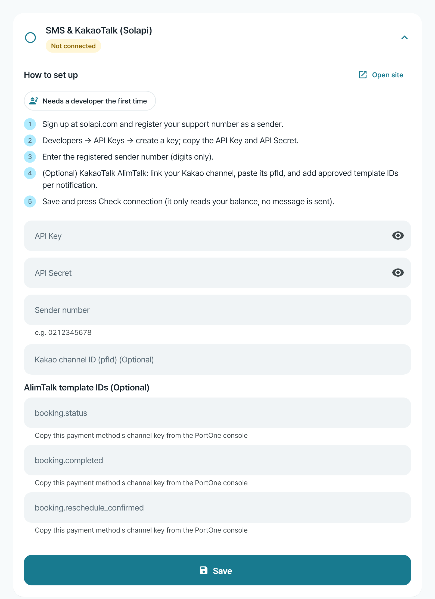
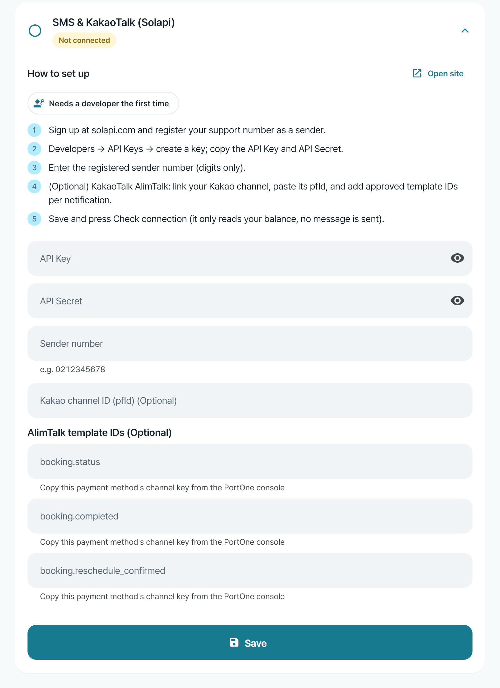

# 14. SMS and AlimTalk (Solapi)

**In this chapter**
You connect Solapi so the service can send sign-in codes and booking messages by SMS.
If you like, you also register templates so the same messages go out as Kakao **AlimTalk**.

> **Before you start**
> - A Solapi account (solapi.com)
> - Your support phone number and its **proof of telecom service** document (needed to register a sender number)
> - For AlimTalk: a **KakaoTalk channel** (needs a business registration)
> - Cost: see Solapi's price list. Each message is taken from your prepaid balance.

> **Warning** This card shows **Needs a developer the first time**. Sender registration and channel linking need documents and review the first time, which takes a while. Start early, for example while payment review is pending.

## 14.1 Get the keys from Solapi

1. Sign up and sign in at solapi.com.
2. Register your support number as a sender. Upload the proof of telecom service if asked.
3. Wait for approval. The time depends on Solapi.
4. Go to Developers → API Keys and create a new key.
5. Copy the **API Key** and **API Secret** into a notepad.


> **Warning** The API Secret is like a password. Don't send it by chat, email or photo.

## 14.2 Paste them into the console

1. In the console's left menu, click **[Setup]**.
2. Open the **SMS & KakaoTalk (Solapi)** card.
3. Paste the API Key into **API Key**.
4. Paste the API Secret into **API Secret**. The eye button on the right switches **Show** / **Hide**.
5. Type the registered number in **Sender number**, **digits only**. Example: `0212345678`
6. If you don't use AlimTalk yet, leave **Kakao channel ID (pfId) (Optional)** and **AlimTalk template IDs (Optional)** empty.
7. Click **[Save]**.

You should now see: **Saved** under the card title, and the card locks.



> **Tip** Dashes are fine; the server keeps only the digits. If there are not 8 to 12 digits you see **Please check the highlighted value**.

## 14.3 Check the connection

1. On the same card, click **[Check connection]**.
2. Read the result.

You should now see: **Connected** in green.

> **Tip** **[Check connection]** sends no message. It only reads your Solapi balance, so it costs nothing.

| Result | Meaning |
|---|---|
| **Connected** | Done. |
| **The key was rejected. Check the value you copied** | The API Key or API Secret is wrong. Unlock the card and paste them again. |
| **Could not reach the service. Try again shortly** | Solapi did not answer. Try again in a few minutes. |

## 14.4 Kakao AlimTalk (optional)

Without AlimTalk, customers still get the same messages by **SMS**. AlimTalk is usually cheaper than SMS; see Solapi's price list for exact rates.

- AlimTalk goes only to customers who use **Korean**. Customers in other languages get SMS in their language.
- If an AlimTalk message fails, the same text goes out by SMS automatically, at the SMS rate.

### Step 1: link the channel and get the pfId

1. Create a channel in the KakaoTalk channel admin center.
2. In Solapi, link the channel (Kakao channel link).
3. Copy the **channel ID (pfId)** you get after linking.

### Step 2: register the 7 templates

Register the templates in the Solapi console or the Kakao channel admin center. Use the **same body** for all 7 and give each a different **template name**.

Common body (copy as is):

```
[#{brand}] #{title}
#{body}
```

- Type the three variables `#{brand}`, `#{title}`, `#{body}` exactly, with no spaces.
- `#{brand}` is filled with the service name from **[Setup]** → business profile (chapter 10).
- Choose the **informational** category. Ads, discounts, coupons or events in the text get the template rejected.
- Kakao's review usually takes a few business days.


| Setting key | Sent when | Template name (example) |
|---|---|---|
| `booking.confirmed` | A booking is confirmed | 예약 확정 안내 |
| `partner.assigned` | A cleaning team is assigned | 청소팀 배정 안내 |
| `booking.reminder` | The day before the visit | 방문 전날 안내 |
| `booking.arrival` | The team arrives (the server does not send this yet; optional) | 기사 도착 안내 |
| `booking.completed` | The cleaning is finished | 청소 완료 안내 |
| `payment.receipt` | Payment receipt (the server does not send this yet; optional) | 결제 완료 안내 |
| `booking.cancelled` | A booking is cancelled | 예약 취소 안내 |

### Step 3: enter them in the console

1. On **[Setup]** → **SMS & KakaoTalk (Solapi)**, click **[Unlock (owner code)]** and enter your 6-digit code (chapter 9).
2. Paste the pfId into **Kakao channel ID (pfId) (Optional)**.
3. Under **AlimTalk template IDs (Optional)**, paste the "cleaning finished" template ID into the **booking.completed** box.
4. Click **[Save]**.



> **Warning** The console card currently shows only three template boxes: **booking.status**, **booking.completed** and **booking.reschedule_confirmed**. Of these, the server accepts only **booking.completed**. A value in either of the other two shows **Please check the highlighted value** and nothing is saved, so leave them empty. The other template IDs in the table (`booking.confirmed`, `partner.assigned`, `booking.reminder`, `booking.cancelled` and so on) can't be entered from the console today. Ask your developer to add them (**to be confirmed**). Once a key is saved, it appears as its own box on the card.

> **Note** Under each template box you see "Copy this payment method's channel key from the PortOne console". That hint does not belong to this card. Ignore it.

### Step 4: try it for real

1. In the customer app, make a booking with a **test phone number**. Don't use a real customer's number.
2. In the console, confirm, assign and then cancel that booking (chapter 19).
3. Watch for AlimTalk messages on the test phone.

You should now see: KakaoTalk messages shaped like `[service name] title`.

If an SMS arrives instead, check the template ID, the pfId and the variable names (`#{brand}`, `#{title}`, `#{body}`).

## 14.5 Sending advertising SMS

To send **advertising SMS** (coupons, events) through campaigns you need a separate **080 opt-out number**. Without one, the campaign screen shows **SMS needs an 080 opt-out number**. See chapter 22.

## If something goes wrong

| You see | Do this |
|---|---|
| **Please check the highlighted value** (on save) | Check the sender number has 8 to 12 digits, and that only the **booking.completed** template box is filled. |
| **Fill in every required field.** | API Key, API Secret and Sender number are all required. |
| **The key was rejected. …** | Create a new key in Solapi and paste it again. |
| Sign-in code SMS doesn't arrive | Check the sender number is approved in Solapi and the balance isn't empty. Without an approved sender, SMS and the SMS fallback both fail. |
| SMS arrives instead of AlimTalk | Check the template is approved, the template ID and pfId are right, and the variable names have no typo. |
| Template rejected | Advertising words and typos in variable names are the usual cause. Use the common body as is. |
