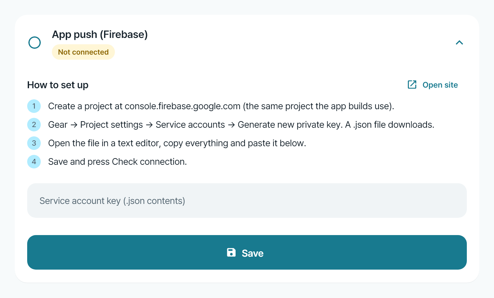
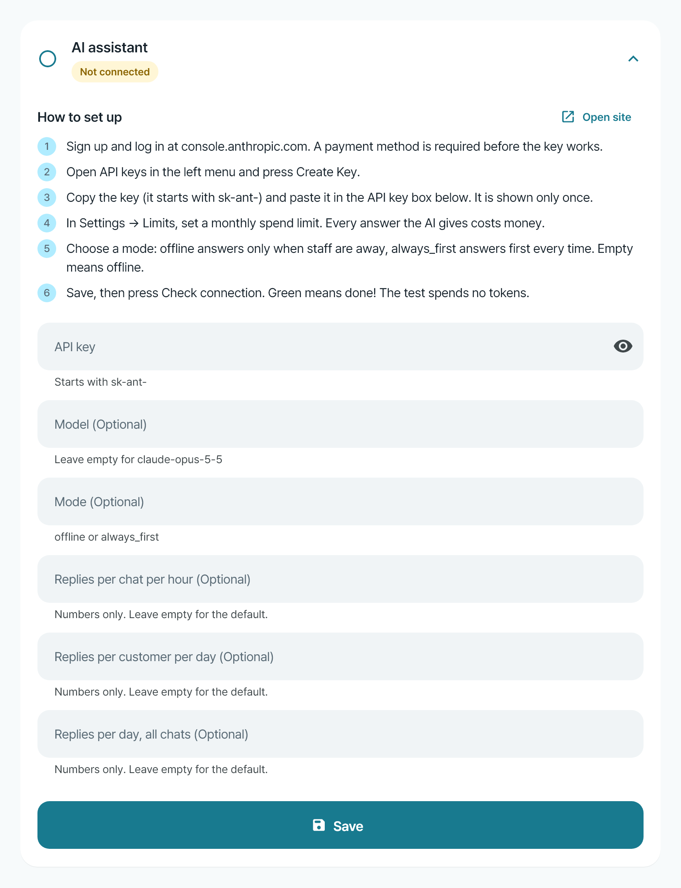
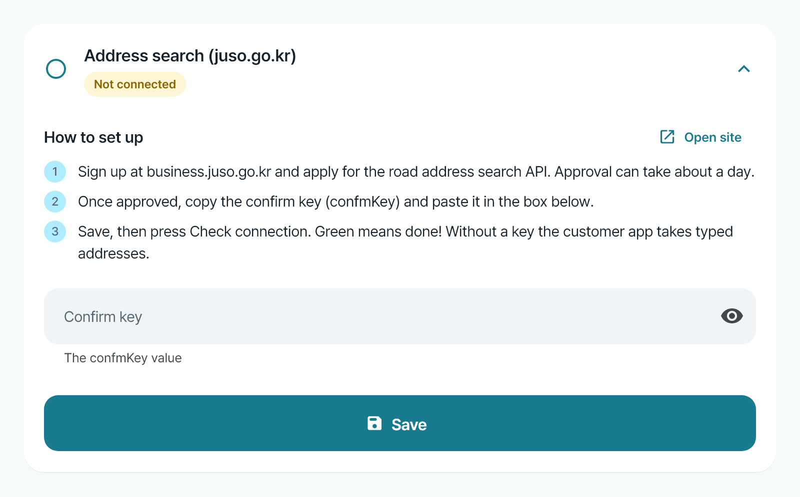

# 16. Push, AI assistant, address search

**In this chapter**
You connect three things.
**App push (Firebase)** shows notifications on phones, the **AI assistant** gives first answers in the Inbox, and **Address search (juso.go.kr)** helps customers find their address.
Each is one card, and they don't depend on each other. Do only the ones you need.

> **Before you start**
> - Push: a Google account, and **the same Firebase project the app builds use**
> - AI assistant: an Anthropic account (console.anthropic.com) and a payment method. You pay for what you use; see the provider's price list.
> - Address search: an account at business.juso.go.kr. Approval can take about a day.

## 16.1 App push (Firebase)

### At Firebase

1. Sign in at console.firebase.google.com.
2. Create a project. If your developer already made one for the apps, use **that project**. A different project means no push arrives.
3. Click the gear at the top left, then **Project settings**.
4. Click the **Service accounts** tab.
5. Click **Generate new private key**, then confirm.
6. A `.json` file downloads.

### In the console

1. Open the downloaded `.json` file in **Notepad** (right-click the file → Open with → Notepad).
2. Press `Ctrl + A` to select all and `Ctrl + C` to copy.
3. Open **[Setup]** → **App push (Firebase)**.
4. Click **Service account key (.json contents)** and press `Ctrl + V`. Everything from the first `{` to the last `}` must be there.
5. Click **[Save]**.
6. Click **[Check connection]**.

You should now see: **Connected** in green.

> **Warning** This `.json` file is a key to your server. After pasting it, delete it from Downloads or keep it only somewhere safe. Never send it by email or chat.

## 16.2 AI assistant

The AI answers customer messages in the **Inbox** first. Chapter 19 shows the Inbox.

> **Warning** Every AI answer costs money. Set the **monthly spend limit** in step 3 below.

### At Anthropic

1. Sign up and sign in at console.anthropic.com.
2. Add a payment method. The key works only after this.
3. In Settings → Limits, set a **Monthly spend limit**.
4. Open **API keys** in the left menu.
5. Click **Create Key**.
6. Copy the key (it starts with `sk-ant-`). It is shown **only once**.

### In the console

1. Open **[Setup]** → **AI assistant**.
2. Paste the key into **API key**.
3. Leave **Model (Optional)** empty. Empty means the default model (`claude-opus-5-5`).
4. Type one of these into **Mode (Optional)**:
   - `offline`: the AI answers only when staff are away, and also outside business hours (business hours: chapter 17, 17.4). This is the default if empty.
   - `always_first`: the AI always answers first; staff take over by replying or pausing the chat.
5. Leave the three limit boxes empty at first. Empty means the defaults below.
6. Click **[Save]**.
7. Click **[Check connection]**. This check spends no tokens.

You should now see: **Connected** in green.

### Reply limits

When a limit is reached the AI stops answering, but the chat stays open and staff can reply. Enter **numbers only**.

| Box | If empty | Allowed range |
|---|---|---|
| **Replies per chat per hour (Optional)** | 12 | 1 to 60 |
| **Replies per customer per day (Optional)** | 40 | 1 to 500 |
| **Replies per day, all chats (Optional)** | 1000 | 1 to 10000 |

### To pause the AI

You don't need to clear the card. In the left menu, open **[System status]** and turn off **AI assistant** under **Feature switches** (chapter 26).

## 16.3 Address search (juso.go.kr)

Without it, customers type their address by hand in the customer app. With it, they search road addresses and pick one.

### At the juso site

1. Sign up at business.juso.go.kr.
2. Apply for the **road address search API**.
3. Wait for approval. It can take about a day.
4. Once approved, copy the **confirm key (confmKey)**.

> **Note** Check on the juso site how long the key is valid and whether it is a development or production key (**to be confirmed**).

### In the console

1. Open **[Setup]** → **Address search (juso.go.kr)**.
2. Paste into **Confirm key**.
3. Click **[Save]**.
4. Click **[Check connection]**. The server runs one test address search.

You should now see: **Connected** in green.

## If something goes wrong

| You see | Do this |
|---|---|
| **The service account file isn't valid.** | Only part of the `.json` was pasted. In Notepad, press `Ctrl + A` and copy it all again. |
| Push card shows **The key was rejected. …** | Generate a new key in Firebase and paste it again (unlock needed, chapter 9). |
| No push arrives on phones | Ask your developer whether the console and the app builds use the same Firebase project. |
| **Pick a valid AI mode.** | **Mode** takes only `offline` or `always_first`, or empty. |
| **The AI model name isn't valid.** | Empty the **Model** box. |
| **Enter a number within the allowed range.** | Use a number inside the ranges in the table above. |
| AI card shows **The key was rejected. …** | Create a new key and paste it. Check a payment method is set up. |
| Address card shows **Could not reach the service. Try again shortly** | Check the key and that approval has finished. The juso site may be down for a moment; try again in a few minutes. |
