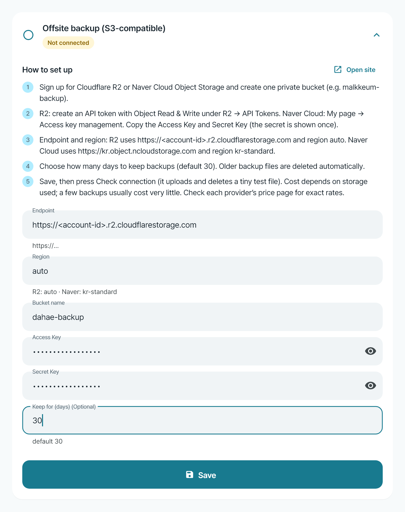
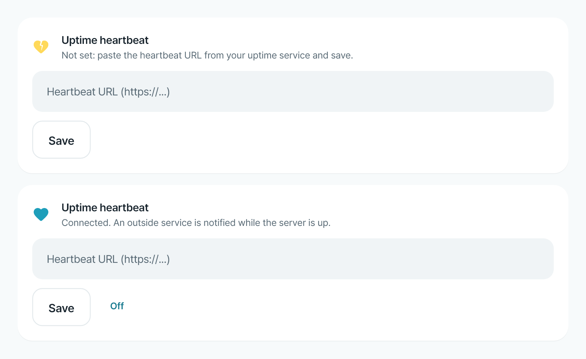
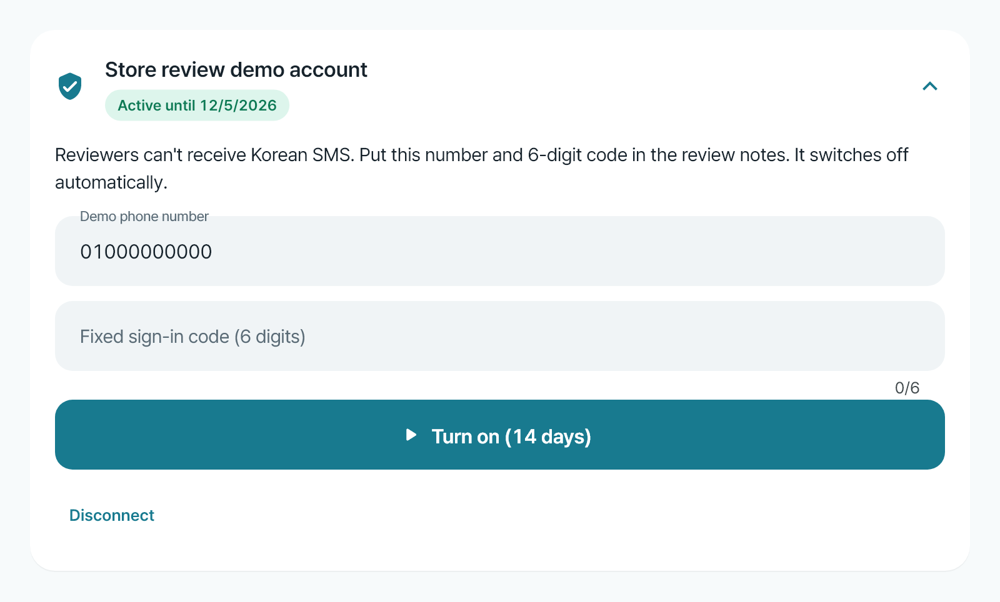

# 17. Offsite backup, heartbeat, review demo account

**In this chapter**
You turn on **offsite backup**, so your data survives even if the server breaks.
You check the **uptime heartbeat**, so an outside service tells you when the server is down.
And you learn to turn on the **store review demo account**, so app store reviewers can sign in.

> **Before you start**
> - Offsite backup: a Cloudflare account (R2) or a Naver Cloud account (Object Storage). Cost depends on storage used; see each provider's price list.
> - Heartbeat: an account with an uptime service such as healthchecks.io, and someone who can open the server terminal (your developer, or Session Manager from chapter 5)
> - Demo account: one mobile number nobody uses, and the authenticator app on the owner's phone (chapter 6)

## 17.1 Offsite backup (S3-compatible)

Every night the server makes a backup and keeps it on the server for 14 days. But if the server itself fails, those backups go with it. So you keep one more copy **outside the server**.

- The database backup and the **photo** backup both go to the same storage. No second card is needed.
- **[System status]** lists them apart: **Offsite backup (S3-compatible)** and **Offsite photo backup (S3-compatible)** (chapter 26).
- Backup files are encrypted before upload.

> **Warning** The key that opens the backups comes from the server's secret key (`DATA_KEY`). If you lose that key along with the server, the offsite backups can't be opened. Keep a **copy of the secret keys** outside the server. Chapter 27 shows how to make it (`sudo dahae keys-backup`) and how to restore.

### Which provider?

For a small business, **Cloudflare R2** or **Naver Cloud Object Storage** is simplest. Any S3-compatible storage, such as AWS S3 or Backblaze B2, fits the same boxes.

### With Cloudflare R2

1. Sign up and sign in at dash.cloudflare.com.
2. Click **R2** in the left menu.
3. Create a bucket and name it, for example `dahae-backup` (lower-case letters, digits and `-` only). Keep public access **off**.
4. In R2's **API Tokens** menu, create a new token.
5. Choose the permission **Object Read & Write**.
6. Copy the **Access Key ID** and **Secret Access Key** into a notepad. The secret is shown **only once**.
7. Also copy your **account ID**, shown on the right of the R2 page.


Now enter them in the console.

1. Open **[Setup]** → **Offsite backup (S3-compatible)**.
2. **Endpoint**: `https://<account-id>.r2.cloudflarestorage.com` (put your account ID in place of `<account-id>`)
3. **Region**: `auto`
4. **Bucket name**: the bucket you made (for example `dahae-backup`)
5. **Access Key**: the Access Key ID
6. **Secret Key**: the Secret Access Key
7. **Keep for (days) (Optional)**: empty means 30 days. Older backups are deleted automatically.
8. Click **[Save]**.
9. Click **[Check connection]**. It uploads a tiny test file and deletes it.

You should now see: **Connected** in green.



### With Naver Cloud Object Storage

1. Sign in at console.ncloud.com.
2. In **Object Storage**, create a private bucket.
3. In My page → Access key management, create an access key ID and secret key and copy them.
4. Enter them in **[Setup]** → **Offsite backup (S3-compatible)**:
   - **Endpoint**: `https://kr.object.ncloudstorage.com`
   - **Region**: `kr-standard`
   - **Bucket name**, **Access Key**, **Secret Key**: your values
5. Click **[Save]**, then **[Check connection]**.

You should now see: **Connected** in green.

> **Tip** The owner account can click **[Check connection]** on a locked card. No unlock is needed.

> **Tip** To see that offsite backups really go up every night, look at **[System status]** (chapter 26). Restoring from an offsite backup is in chapter 27.

## 17.2 Uptime heartbeat

A server can't report that it is down. So every few minutes the server sends an "I'm fine" signal to an outside service, and when the signals stop, that service alerts you by email or similar.

This card is **read-only**. You don't type anything here.

| Card text | Meaning |
|---|---|
| **Not set: ask your developer to connect the uptime heartbeat.** | Not connected yet. |
| **Connected. An outside service is notified while the server is up.** | Connected. |



### How to connect it (your developer, or anyone who can open the server terminal)

1. Sign up with an uptime service such as healthchecks.io.
2. Create a **Check** with Period **5 minutes** and Grace **15 minutes**.
3. Copy the **ping URL** it shows (`https://hc-ping.com/…`).
4. Open the server terminal (on AWS, Session Manager from chapter 5).
5. Type this and press Enter:
   ```
   sudo dahae heartbeat https://hc-ping.com/your-copied-address
   ```
6. When `✔ 외부 가동 확인을 켰어요. 테스트 핑을 보냈어요.` ("Uptime check on. Test ping sent.") appears, you are done.
7. Reload the console's **[Setup]** page.

You should now see: the card says **Connected. An outside service is notified while the server is up.**

> **Tip** The URL must start with `https://`. To turn it off, type `sudo dahae heartbeat off`.

## 17.3 Store review demo account

App store reviewers are abroad and can't receive Korean SMS codes. So you fix a **sign-in code** for **one phone number** and write both in the review notes. Chapter 25 covers the whole store release.

- **Only the owner** can turn it on or off. Both ask for the authenticator code.
- It stays on for **14 days**, then switches off by itself.
- Turning it on adds **2 sample bookings** (one upcoming, one completed) to this account, so reviewers see history without paying.

### Turn it on

1. Open **[Setup]** → **Store review demo account**.
2. In **Demo phone number**, enter a mobile number nobody uses (starting with 010).
3. In **Fixed sign-in code (6 digits)**, choose 6 digits. Don't reuse a password from elsewhere.
4. Click **[Turn on (14 days)]**.
5. The **Enter your code** window opens. Type the 6 digits from your authenticator app into **6-digit code** and click **[Continue]**.

You should now see: **Saved**, and **Active until (date)** under the card title.



6. Write the number and the 6-digit code in the store review notes (chapter 25).

> **Warning** The partner app is reviewed with the same number. A partner account sees jobs only after your team approves it. Approve the partner account for this number before you submit (chapters 25 and 20).

> **Tip** If review takes longer, click **[Turn on (14 days)]** again the same way. The 14 days start again from that day.

### Turn it off

1. Click **[Disconnect]** on the card. (It shows only while the account is on.)
2. Enter your authenticator code and click **[Continue]**.

You should now see: the date under the card title is gone.

## If something goes wrong

| You see | Do this |
|---|---|
| **The endpoint must start with https://.** | Add `https://` in front. Internal addresses and `localhost` are not allowed. |
| **The bucket name isn't valid.** | Bucket names are 3 to 63 characters: lower-case letters, digits, `-` and `.`. |
| **The region isn't valid.** | Enter `auto` for R2 or `kr-standard` for Naver exactly. |
| **The retention period is out of range.** | Enter a number from 1 to 3650, or leave it empty. |
| Backup card shows **The key was rejected. …** | Check the token has **Object Read & Write** and the keys were copied exactly. |
| Backup card shows **Please check the highlighted value** (after the check) | Uploading or deleting the test file failed. Check the bucket name and permissions. |
| Heartbeat card stays **Not set** | Ask your developer whether the command succeeded, then reload **[Setup]**. |
| **A customer, partner or staff member already uses this number. …** | Use a demo number that nobody uses. |
| Demo account shows **Please check the highlighted value** | Check the number is a mobile number (010…) and the code is exactly 6 digits. |
| The code is refused | Enter the code your app shows **now**. A used code can't be reused; wait about 30 seconds for the next one. |
