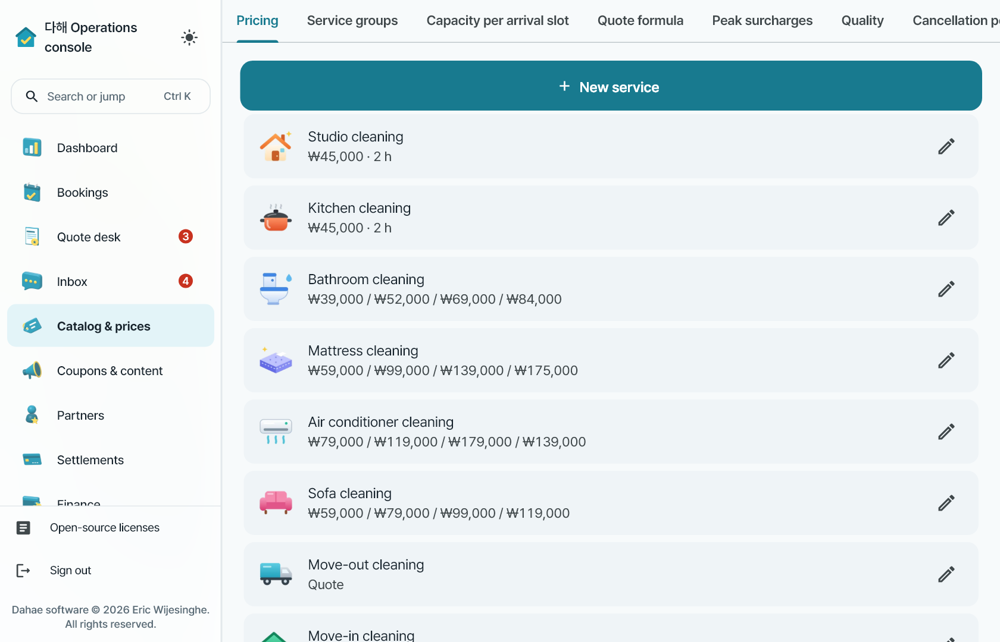
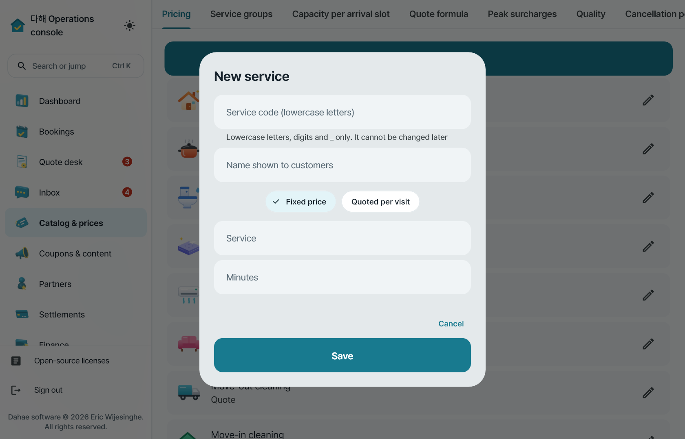
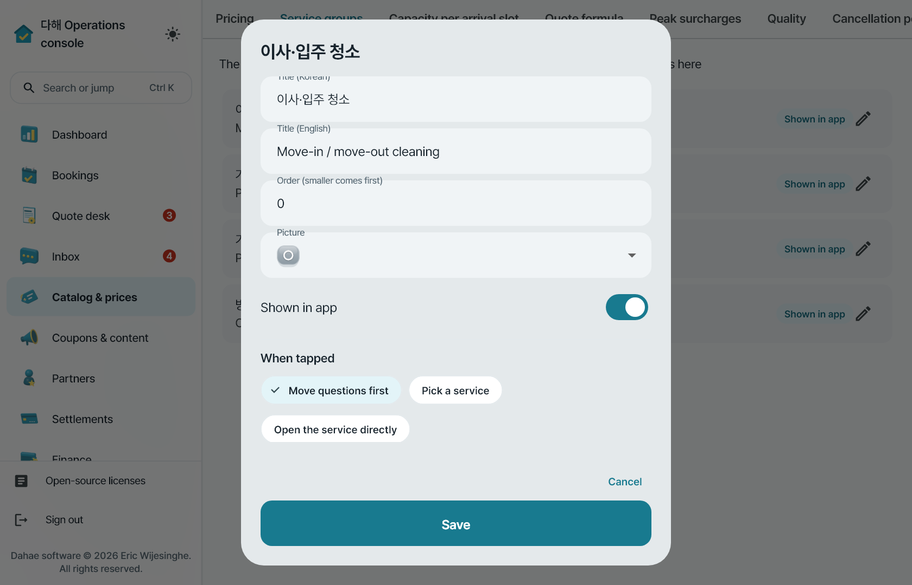
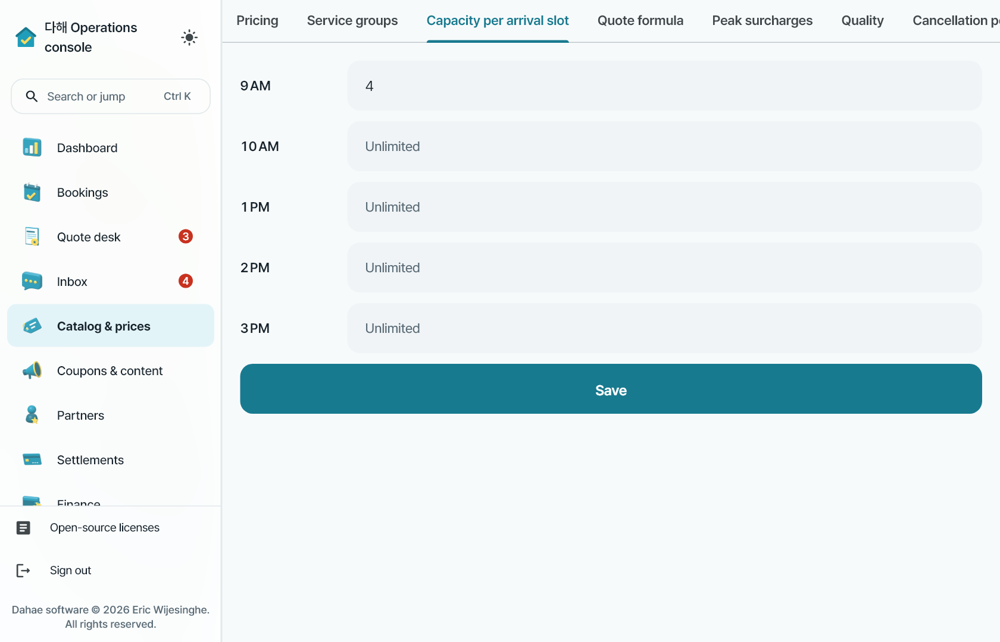
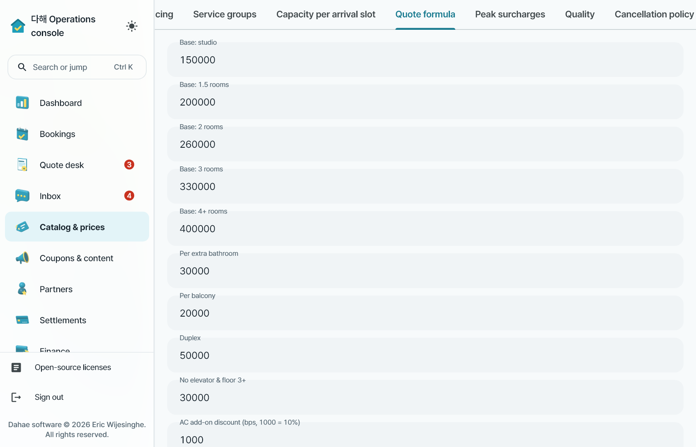
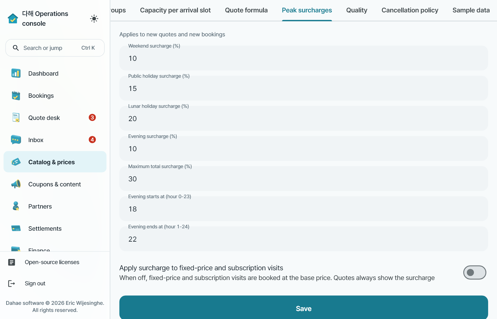
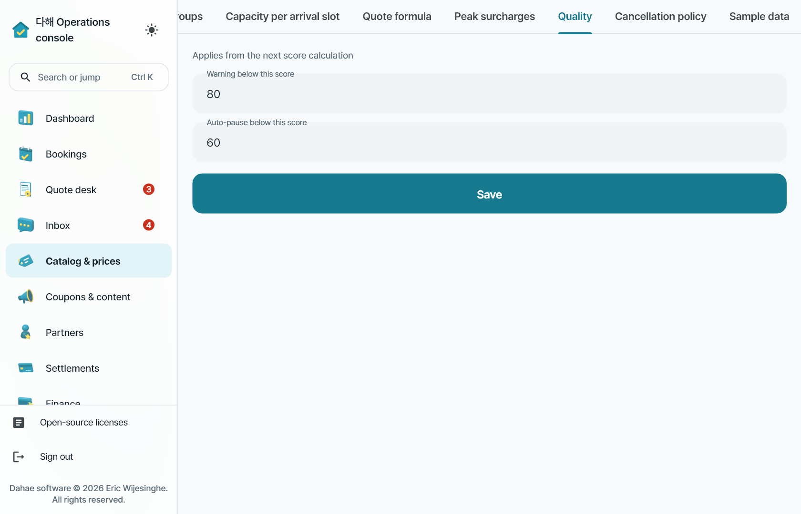
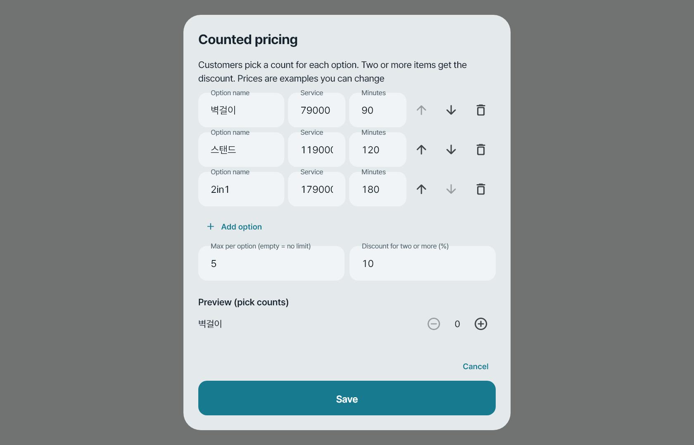
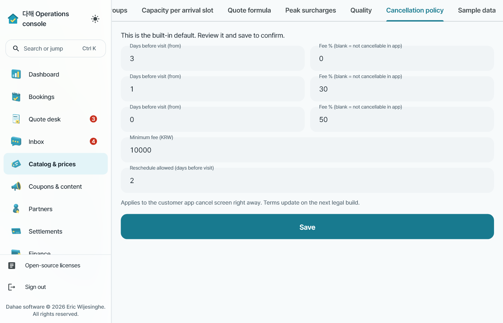

# 18. Catalog and prices

**In this chapter:** you set the services and prices customers see in the app. You also set how many bookings each arrival time can take, the move-in quote formula, weekend and evening surcharges, partner quality thresholds and cancellation fees. Last, you add and remove practice sample data.

> **Before you start**
> - You are signed in to the console with an admin account ([chapter 6](06-owner-account.md))
> - Your price list (amount and time for each service)
> - Your cancellation rules (how much you charge, how many days before the visit)
> - Only to remove sample data: your phone's authenticator app (6-digit code)

> **Warning**
> Only **admins** can change these screens. When a **consultant** taps a service, the toast **Admins only** appears and the save buttons are greyed out.

## 18.1 Open the catalog

1. In the left menu, click **[Catalog & prices]**. (On a phone, tap the menu button at the top left first.)
2. Eight tabs appear at the top: **[Pricing]**, **[Service groups]**, **[Capacity per arrival slot]**, **[Quote formula]**, **[Peak surcharges]**, **[Quality]**, **[Cancellation policy]**, **[Sample data]**.
3. Click a tab name to open it. If you cannot see every tab, swipe the tab row sideways.

You should now see: the **[Pricing]** tab is selected and the services are listed as cards.

> **Tip**
> Prices you save here reach the customer app and website right away. You do not need to publish a new app.

## 18.2 Change a service price (Pricing tab)

Each card is one service. It shows the name and a price summary (the price and the time). Quoted services show **Quote**, and services you stopped selling show **Archived**.

1. Click the **[Pricing]** tab.
2. Click the card of the service to change. A window titled with the service name opens.
3. Check the **Active** switch at the top. When it is on, customers can book the service.
4. Edit the price fields. They depend on the kind of service.
   - **Fixed-price service:** type the amount in won in **Service**, digits only (no commas, for example `45000`). Type the time in minutes in **Minutes** (for example `120` for 2 hours).
   - **Price-per-type service:** one row per type (for example wall-mounted, standing). Fill **Service** and **Minutes** on each row.
   - **Counted service** (air conditioner, sofa, mattress and similar): a different window opens. See [18.9](#189-counted-services).
   - **Quoted service:** there are no price fields. The price is set during the consultation in the [Quote desk](19-bookings-quotes-inbox.md).
5. Click **[Save]**. To stop, click **[Cancel]**.

You should now see: **Saved** briefly at the bottom, and the card shows the new price summary.

### Stop selling a service (archive)

1. Click the service card.
2. Turn off the **Active** switch. Under it you see **Off archives it. Customers stop seeing it**.
3. Click **[Save]**.

You should now see: the card shows **Archived**. To sell it again, turn the switch back on and save.

> **Warning**
> The prices in a new installation are examples. Before you open for business, change the amount and time of every service to your own prices.

## 18.3 Create a new service

1. At the top of the **[Pricing]** tab, click **[New service]**.
2. The **New service** window opens.
3. In **Service code (lowercase letters)**, type a code. Only lowercase letters, digits and `_` are allowed (for example `window_big`).
   > **Warning**
   > The service code cannot be changed later. Choose it carefully.
4. In **Name shown to customers**, type the name customers will see (for example `Large window cleaning`).
5. Pick a price type.
   - **Fixed price**: customers book at a set amount. The **Service** and **Minutes** fields appear. Fill both.
   - **Quoted per visit**: customers ask for a quote and your team sends the price.
6. Click **[Save]**.

You should now see: **Service created**, and a new card in the list.

> **Tip**
> To show the service in a big tile on the app's home screen, add it to a group in [18.4 Service groups](#184-home-screen-tiles-service-groups).

## 18.4 Home screen tiles (Service groups)

The customer app's home screen has four big tiles (groups). A new installation has move-in/move-out cleaning, home cleaning, appliance and furniture cleaning, and pest control. For each group you set the title, order, picture, what happens on tap, and the member services.

1. Click the **[Service groups]** tab.
2. At the top you see **The four big tiles on the app's home screen. Change titles, order and member services here**.
3. Each row shows the group name, **Shown in app** or **Hidden**, and the tap behaviour with the number of services, for example `Pick a service · 3 services`.
4. Click the group to edit. The group window opens.
5. Fill **Title (Korean)** and **Title (English)**, 1 to 40 characters each.
6. In **Order (smaller comes first)**, type a number from 0 to 99.
7. Under **Picture**, click one picture.
8. Use the **Shown in app** switch to show or hide the tile.
9. Under **When tapped**, pick one.
   - **Move questions first**: asks whether the home is new or old, then the home size.
   - **Open the service directly**: with one service, goes straight to its screen.
   - **Pick a service**: shows the member services as a list.
10. Under **Member services (shown in this order)**, tick the services to include. Use the up and down arrows (**Move up**, **Move down**) to change the order.
11. If you picked **Move questions first**, also pick:
    - **Service for a new home**
    - **Service for an older home**
    - **Home size choices**: at least one of **Studio or two-room**, **Apartment**, **Villa or house**
12. Click **[Save]**.

You should now see: **Group saved**, and the row shows the new details.

> **Warning**
> A service can be in one group only. A service in another group shows **In another group: (group name)**. Open that group, remove the service, save, then add it here.

Messages when saving fails, and the fix:

| Message | Fix |
|---|---|
| Titles must be 1 to 40 characters | Give both titles 1 to 40 characters |
| Order must be 0 to 99 | Change the order to a number from 0 to 99 |
| Pick at least one service | Tick at least one member service |
| Open directly needs exactly one service | With **Open the service directly**, keep only one service |
| Pick the new-home and older-home services and at least one home size | Pick all three items in step 11 |
| Pick the picture again | Click a picture again |
| A service is already in another group. Remove it there first | Do what the warning box above says |

## 18.5 Bookings per arrival time (Capacity per arrival slot)

Set how many bookings each arrival time can take, so you never book more jobs than you have teams.

1. Click the **[Capacity per arrival slot]** tab.
2. Each row has an arrival time on the left (for example 9 AM) and a number field on the right.
3. Type the most bookings you accept at that time (for example `3` if you have three teams).
4. Leave a field empty for no limit. An empty field shows a grey **Unlimited**.
5. Click **[Save]** at the bottom.

You should now see: **Saved**. A full time slot can no longer be picked in the customer app.

## 18.6 Move-in quote formula (Quote formula)

For quoted services such as move-in cleaning, the app first shows an **Estimate** calculated from the customer's answers (rooms, bathrooms, balconies and so on). This tab sets the base amounts for that calculation.

1. Click the **[Quote formula]** tab.
2. Type an amount in won in each field (no commas).

| Field | Meaning |
|---|---|
| **Base: studio** | Starting amount for a studio |
| **Base: 1.5 rooms** | Starting amount for 1.5 rooms |
| **Base: 2 rooms** | Starting amount for 2 rooms |
| **Base: 3 rooms** | Starting amount for 3 rooms |
| **Base: 4+ rooms** | Starting amount for 4 or more rooms |
| **Per extra bathroom** | Added for each extra bathroom |
| **Per balcony** | Added for each balcony |
| **Duplex** | Added for a duplex |
| **No elevator & floor 3+** | Added when there is no elevator and the home is on floor 3 or higher |
| **AC add-on discount (bps, 1000 = 10%)** | Discount when air conditioner cleaning is added. `1000` means 10% |

3. A small line under the fields shows the **Surcharge**, **How full is the home?**, VAT and **Deposit** rates. You cannot change these here. A new installation uses VAT 10% and deposit 10%.
4. Click **[Save]**.

You should now see: **Saved**. New quote requests use the new amounts.

> **Warning**
> The values in a new installation (for example 180,000 won for a studio) are test examples. Change them to your prices before you open. A studio base of 0 cannot be saved.

> **Tip**
> The estimate is a guide for your staff. The final price the customer sees is set in the [19.3 Quote desk](19-bookings-quotes-inbox.md#193-quote-desk-move-in-cleaning).

## 18.7 Weekend, holiday and evening surcharges (Peak surcharges)

1. Click the **[Peak surcharges]** tab.
2. Type a percentage in each field.

| Field | Value in a new installation |
|---|---|
| **Weekend surcharge (%)** | 10 |
| **Public holiday surcharge (%)** | 20 |
| **Lunar holiday surcharge (%)** | 30 |
| **Evening surcharge (%)** | 10 |
| **Maximum total surcharge (%)** | 50 |
| **Evening starts at (hour 0-23)** | 18 |
| **Evening ends at (hour 1-24)** | 22 |

3. Set the **Apply surcharge to fixed-price and subscription visits** switch. It starts off.
   - Off: fixed-price services and subscription visits are booked at the base price. Quotes always show the surcharge.
   - On: fixed-price bookings and subscription visits also get the surcharge.
4. Click **[Save]**.

You should now see: **Saved**. As the screen says, it **Applies to new quotes and new bookings**. Existing bookings keep their price.

> **Warning**
> With the switch on, the surcharge also counts in coupon and subscription discounts and in the partner's settlement. Subscriptions change from the next visit that is charged.

> **Tip**
> A wrong number shows **Check the numbers**. Percentages are 0 to 100, and the evening start hour must be before the end hour.

## 18.8 Partner quality thresholds

Each partner gets a **Quality score** from 0 to 100. It combines ratings, finished jobs, on-time arrival, cancellations and no-shows, and complaints. Below a threshold the partner gets a warning, or new jobs stop.

1. Click the **[Quality]** tab.
2. In **Warning below this score**, type a number. A new installation uses 75.
3. In **Auto-pause below this score**, type a number. A new installation uses 60.
4. Click **[Save]**.

You should now see: **Saved**. As the screen says, it **Applies from the next score calculation**.

> **Warning**
> The auto-pause score cannot be higher than the warning score. Both must be 100 or less.

See scores in the partner list in [20.3](20-partners-staff.md#203-quality-scores). The number of days counted is set in [Operating rules](23-rules-notify-privacy.md).

## 18.9 Counted services

Services picked **by count**, such as air conditioner, sofa, mattress, window and pest control, have a price per option. Customers pick a count for each option, and two or more items get a discount.

1. Click the **[Pricing]** tab.
2. Click the card of a counted service (for example air conditioner cleaning).
3. The **Counted pricing** window opens. The note at the top says **Customers pick a count for each option. Two or more items get the discount. Prices are examples you can change**
4. Edit each option row.
   - **Option name** (for example `Wall-mounted`)
   - **Service** (won)
   - **Minutes**
5. To add an option, click **[Add option]**. To delete one, click **Remove option** (the bin icon) on its row. Use the **Move up** / **Move down** arrows to reorder.
6. Fill **Max per option (empty = no limit)**, from 1 to 20.
7. Fill **Discount for two or more (%)**, from 0 to 50.
8. In **Preview (pick counts)**, click **One more** (+) and **One less** (−). You see how the **Total** and **Discount** come out.
9. Check the **Active** switch at the top and click **[Save]**.

You should now see: **Saved**, and the card shows each option's price separated by `/`.

When saving fails:

| Message | Fix |
|---|---|
| Add at least one option | Click **[Add option]** to make at least one row |
| Enter a name for every option | Fill the empty **Option name** fields |
| Enter a price and time above zero for every option | Make amount and minutes 1 or more |
| Max per option must be 1 to 20 | Fix the max or leave it empty |
| Discount must be 0 to 50% | Fix the discount |

## 18.10 Cancellation fees (Cancellation policy)

Set the fee charged when a customer cancels in the app.

1. Click the **[Cancellation policy]** tab.
2. If it has never been saved, the top says **This is the built-in default. Review it and save to confirm.**
3. Each row has two fields.
   - **Days before visit (from)**: the row applies from this many days before the visit
   - **Fee % (blank = not cancellable in app)**: the fee for cancelling then. 0 means free. Blank means the customer cannot cancel in the app (only through your team).
4. A new installation has these rows.

| Days before visit (from) | Fee % | Meaning |
|---|---|---|
| 2 | 0 | Free cancellation up to 2 days before |
| 1 | (blank) | The day before: no cancelling in the app |
| 0 | (blank) | The visit day: no cancelling in the app |

5. In **Minimum fee (KRW)**, type the smallest fee charged when a fee applies. 0 means no minimum.
6. In **Reschedule allowed (days before visit)**, type the last day customers may change the date in the app, from 0 to 30. A new installation uses 2.
7. Click **[Save]**.

You should now see: **Saved**, and the default banner disappears. As the screen says, it **Applies to the customer app cancel screen right away. Terms update on the next legal build.**

> **Warning**
> - Days must go down from top to bottom (for example 2 → 1 → 0), and a lower row's fee may not be smaller than the row above. Otherwise it will not save.
> - You cannot add or delete rows here, only change the numbers. To change the number of rows, ask your developer (**to be confirmed**).
> - The checkout note (**Free cancellation up to 2 days before the visit...**) is fixed text based on the default policy. Whether it follows your changed policy is **to be confirmed**.
> - The cancellation terms in the terms of service change only with a new app build. Tell your developer.

## 18.11 Practice sample data

An empty console is hard to learn on. For practice or training you can add fake customers, partners and bookings: 40 fake customers, 12 partners (with team members), and bookings, payments, chats and settlements for the last 90 days and the next 14 days. The phone numbers are fake, so no texts or alerts are sent, and no real payment is charged.

### Add

1. Click the **[Sample data]** tab.
2. Read the **Demo sample data** title and note.
3. Click **[Add sample data]**.

You should now see: **Sample data added**. The dashboard and bookings show fake data.

> **Warning**
> It cannot be added if any real booking exists: you see **Real bookings exist, so sample data cannot be added**. If it is already there, you see **Sample data is already in place**.

### Remove

1. Click the **[Sample data]** tab.
2. Click **[Remove sample data]**. A window with the same name opens.
3. Open the authenticator app on your phone and find the 6-digit code.
4. Type it in **6-digit authenticator code**.
5. Click **[Save]**. To stop, click **[Cancel]**.

You should now see: **Sample data removed**. Only the sample data is removed; real records stay.

> **Tip**
> A wrong or already used code shows **The code is wrong or already used. Enter the current code**. Wait for a new code in the app and type it again.

> **Warning**
> Remove the sample data before you start real business.

## If something goes wrong

| What happens | What to do |
|---|---|
| Tapping a service shows **Admins only** | This is a consultant account. Sign in with an admin account |
| **[Save]** is greyed out | Check that you are signed in as an admin |
| **A service with this code already exists** when creating | Use a different service code |
| **Check the service code and price** when creating | Use only lowercase letters, digits and `_` in the code, and numbers for price and time |
| **Something went wrong. Please try again.** when saving | Check the number rules (for example the cancellation row order, a studio base of 0). Refresh and try again |
| The app does not show the new price | Close the customer app completely and open it again |
| A customer cannot pick a time | Check that time in **[Capacity per arrival slot]**. It may be full |
| A service will not go into a group | Check whether another group has it, and remove it there first |
