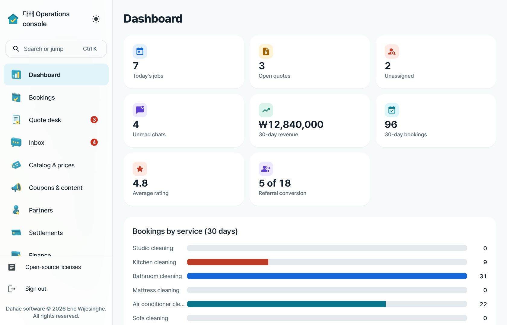
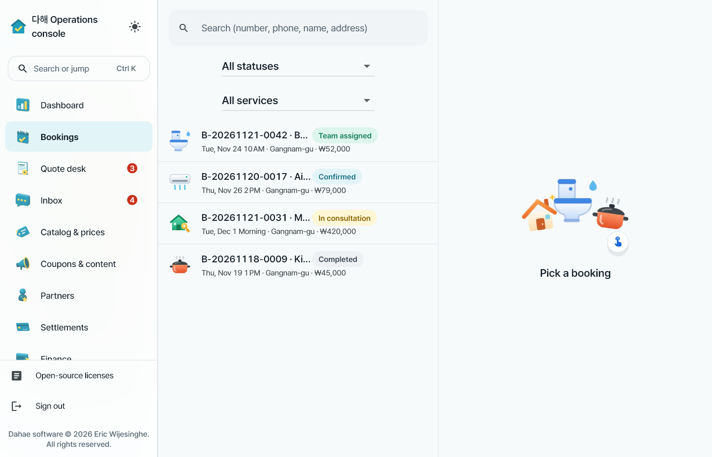
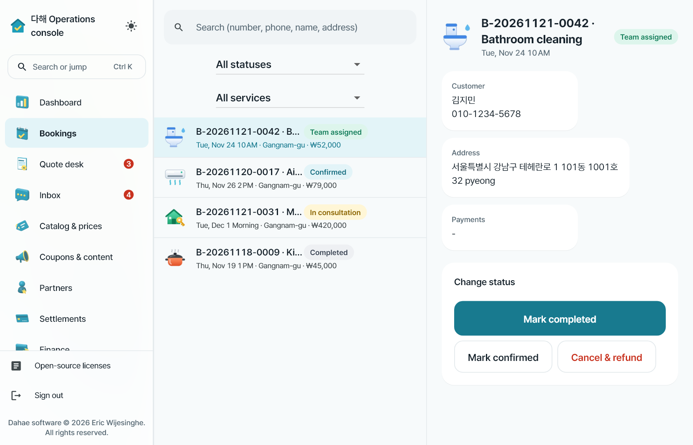
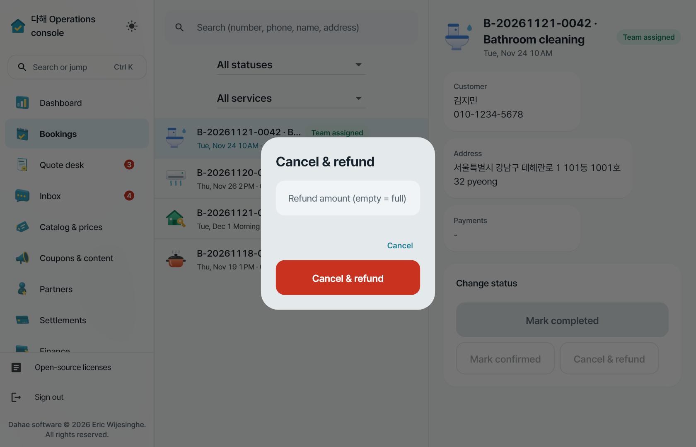
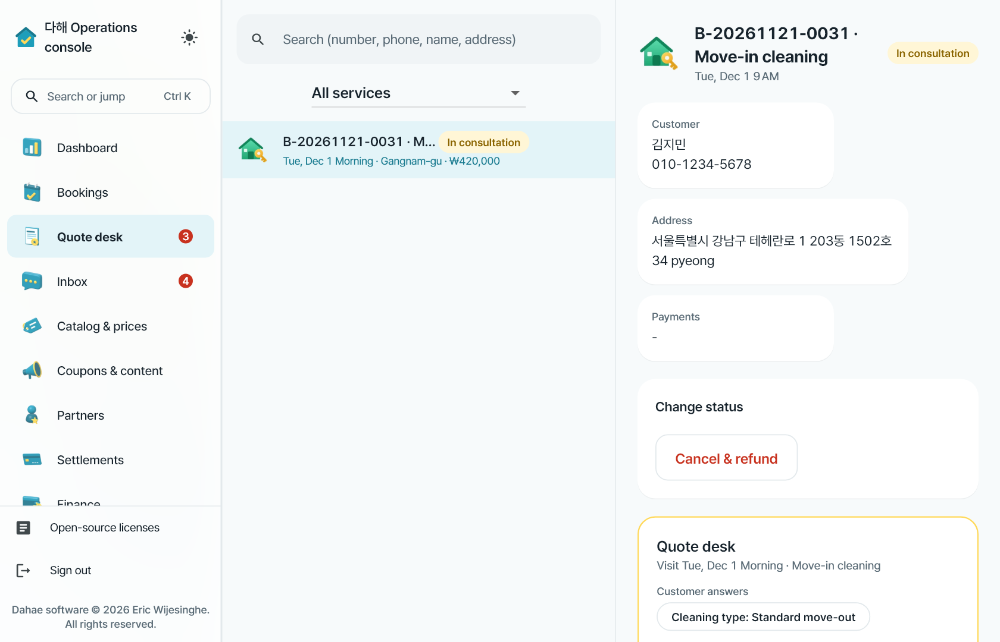
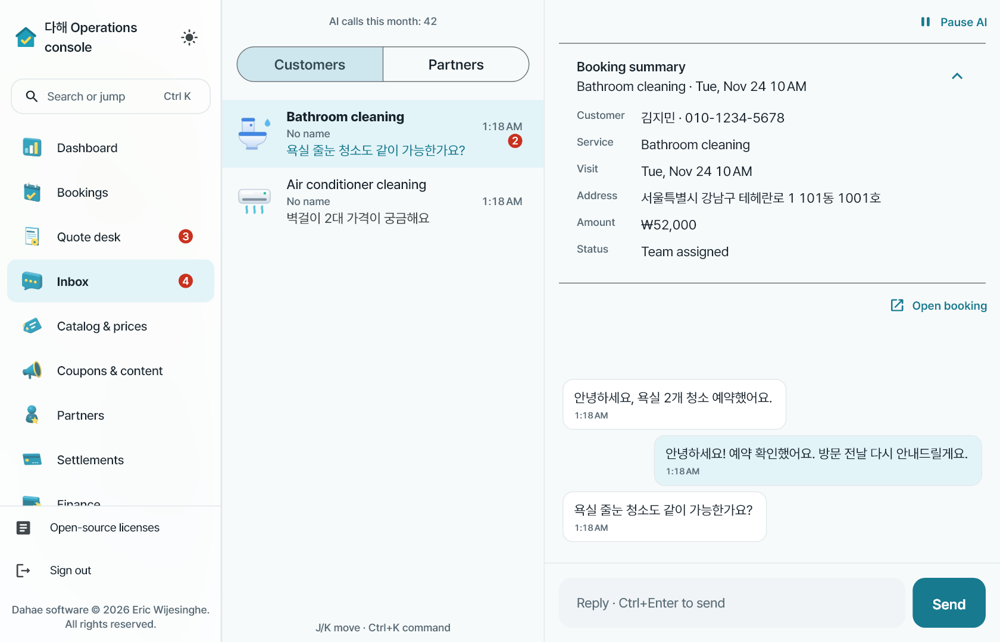
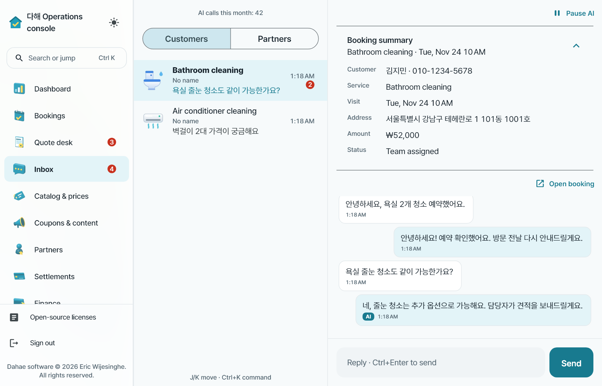
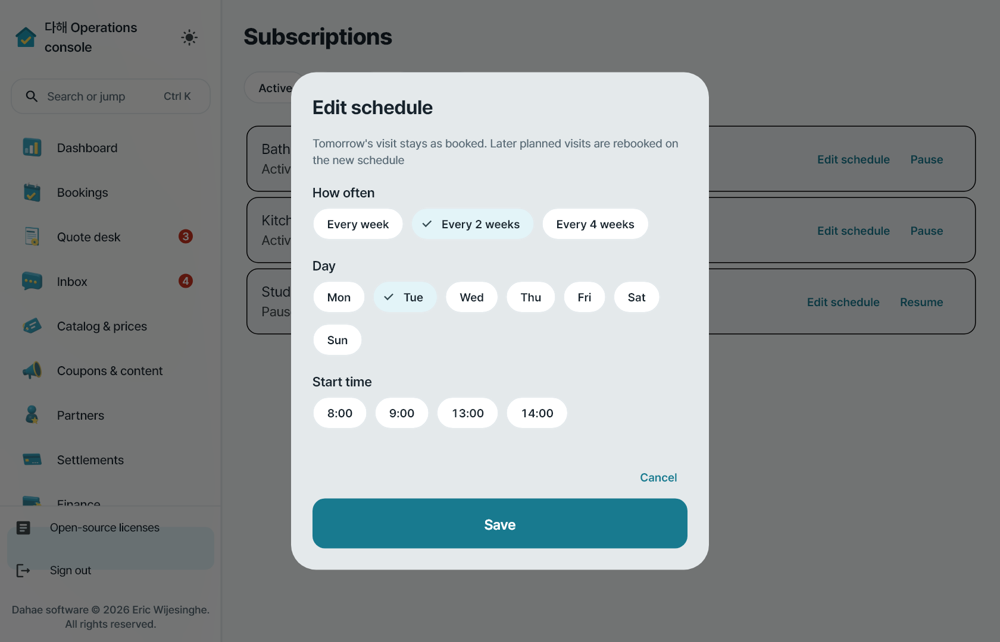

# 19. Dashboard, bookings, quotes, inbox

**In this chapter:** what to check in the console every morning. How to find a booking, change its status, and cancel and refund it. How to send a move-in cleaning quote, answer chats in the inbox, and manage subscriptions.

> **Before you start**
> - A console account (admin or consultant)
> - Payments set up ([chapter 11](11-setup-portone.md) or [chapter 12](12-setup-toss-payments.md)) — needed for refunds
> - To practise: sample data ([18.11](18-catalog-prices.md#1811-practice-sample-data))

## 19.1 Dashboard and the 5-minute morning check

### Read the dashboard

1. In the left menu, click **[Dashboard]**. It is the first screen when the console opens.
2. Read the number cards at the top.

| Card | Meaning |
|---|---|
| **Today's jobs** | Bookings with a visit today |
| **Open quotes** | Quote requests still waiting for a quote |
| **Unassigned** | Confirmed bookings with no team yet |
| **Unread chats** | Conversations waiting for a reply |
| **30-day revenue** | Money received in the last 30 days |
| **30-day bookings** | Bookings made in the last 30 days |
| **Average rating** | Average customer rating (`-` if none) |
| **Referral conversion** | Invited people who reached the reward, out of all invited |

3. Scroll down to **Bookings by service (30 days)**. The bars show which services sell most.
4. Below it is the **Booking flow (last 30 days)** card.
   - **Median time to assign a pro**: the usual time from booking to a team being set
   - **Bookings with no pro for over 24 h**: bookings to look at quickly
   - **Same-day cancellations today**: today's bookings cancelled on the day
   - **No-show rate by service**

> **Tip**
> If the numbers cannot load, an error line with **[Try again]** appears. The numbers shown are the last ones that loaded.

### The 5-minute morning check

1. On **[Dashboard]**, check **Today's jobs**, **Open quotes**, **Unassigned** and **Unread chats**.
2. If **Unassigned** is not 0, open those bookings in **[Bookings]**. Call a partner or agree a new time with the customer ([19.2](#192-find-and-handle-a-booking)).
3. If **Open quotes** is not 0, send quotes in **[Quote desk]** ([19.3](#193-quote-desk-move-in-cleaning)).
4. If **Unread chats** is not 0, reply in **[Inbox]** ([19.4](#194-inbox)). The customer's app is notified at once.

> **Tip**
> Press `Ctrl + K` to jump to a menu or booking number ([chapter 8](08-console-tour.md)).

## 19.2 Find and handle a booking

### Find a booking

1. In the left menu, click **[Bookings]**.
2. In the search field **Search (number, phone, name, address)**, type a booking number, customer phone, name or address, then press `Enter`.
3. To filter by status, click **All statuses** and pick one.
4. To filter by service, click **All services** and pick one.
5. Click a booking. The **Booking** details open on the right (on a phone, on a new screen).

You should now see: the booking number, service name, visit date and a status tag, then the **Customer**, **Address** and **Payments** cards. If nothing matches, you see **No results**.

### Booking statuses

| Status | Meaning |
|---|---|
| **In consultation** | A quoted service still being discussed. No deposit yet |
| **Confirmed** | Paid and confirmed. No team yet |
| **Team assigned** | A partner (team) is set |
| **Completed** | The job is done |
| **Cancelled** | The booking was cancelled |

### What the booking details show

- **Customer**: name and phone
- **Address**: address and size in pyeong
- **Payments**: one line per payment, for example `Deposit · (amount) · Paid`. The kind is **Deposit**, **Balance** or **Total**. The status is **Paid**, **Refunded**, **Partly refunded** or **Failed**. A partial refund shows the refunded amount in brackets.
- **Notes for the team**: notes the customer left
- **[Inbox]** button: opens this booking's customer chat

### Change the status

The **Change status** card under the details only shows the buttons that fit the current status.

**Give the job to a team that does not use the app (Assign team)**

Usually a partner accepts the job in the partner app and is assigned automatically. Do this only for a team that does not use the app.

1. Open a **Confirmed** booking.
2. Type the team name in **Assigned team** (for example `Gangnam team 2`).
3. Click **[Assign team]**.

You should now see: **Done**, and the status changes to **Team assigned**.

**The team you assigned by name has finished (Mark completed)**

1. Open the booking you assigned by team name.
2. Click **[Mark completed]**.

You should now see: the status changes to **Completed**.

> **Warning**
> Bookings assigned through the partner app do not show **[Mark completed]**. The partner finishes the job in the app with photos and a checklist, which creates the settlement.

**Remove the team and go back to Confirmed (Mark confirmed)**

1. Open a **Team assigned** booking.
2. Click **[Mark confirmed]**.

You should now see: the status goes back to **Confirmed**, and the team (or partner) is removed.

> **Warning**
> **[Mark confirmed]** removes the assignment. Use it only when the team must change.

> **Tip**
> A quote booking **In consultation** moves on only when the customer pays the deposit. Staff cannot change its status for them.

### Cancel and refund

Possible in **In consultation**, **Confirmed** and **Team assigned**. Admins and consultants can both do it.

1. Open the booking details.
2. In the **Change status** card, click the red **[Cancel & refund]**.
3. The **Cancel & refund** window opens.
4. Decide the **Refund amount (empty = full)**.
   - Full refund: leave it empty.
   - Partial refund: type the amount in won (for example `30000`).
5. Click the red **[Cancel & refund]** at the bottom of the window. To stop, click **[Cancel]**.

You should now see: **Done**, and the status is **Cancelled**. In the **Payments** card the payment shows **Refunded** or **Partly refunded**.

> **Warning**
> - Cancelling cannot be undone.
> - The refund goes back through the gateway the customer paid with (PortOne or Toss Payments). That is why you must not delete a gateway's setup card ([chapter 12](12-setup-toss-payments.md)).
> - Points the customer used come back in proportion to the refund (all of them on a full cancel).
> - The partner's settlement for this booking goes **On hold** ([chapter 21](21-payments-settlement-finance.md)).
> - Cancels and refunds are recorded in the [Activity log](23-rules-notify-privacy.md).

## 19.3 Quote desk (move-in cleaning)

Quoted services such as move-in cleaning go like this:

1. The customer answers questions in the app and asks for a quote. The app shows an **Estimate**.
2. Partners send their quotes from the partner app.
3. You (or a consultant) set the final price in **[Quote desk]** and send it.
4. The customer pays the deposit, a share of the final price (10% in a new installation, [18.6](18-catalog-prices.md#186-move-in-quote-formula-quote-formula)).
5. The partner you picked is assigned automatically.
6. After the job, the customer pays the balance.

### Send a quote

1. In the left menu, click **[Quote desk]**. The red number next to it is the number of waiting requests.
2. Click an **In consultation** request in the list.
3. Scroll down to the **Quote desk** card with the yellow border.
4. Check the **Visit** date and the service on the first line.
5. Under **Customer answers**, check what the customer chose (cleaning type, how full the home is and so on).
6. Under **Calculated estimate**, see the estimate from the formula.
7. Under **Partner quotes**, see the partners' quotes. Each line shows team name, partner name, rating (★), note and amount. If none yet, you see **No partner quotes yet**.
8. Click the quote of the partner you want. Its amount fills **Final price to customer**.
9. Change **Final price to customer** if needed (won, digits only).
10. In **Note to customer**, type a message (up to 300 characters, optional).
11. Click **[Send quote to customer]**.

You should now see: **Quote sent**. A **Quote sent** tag appears next to the card title, with a line **Quote sent · (amount) · (time)**. The quote card arrives in the customer's app chat.

> **Tip**
> - The final price must be from 10,000 to 50,000,000 won. It is rounded to the nearest 100 won.
> - You can send a price without picking a partner quote.

### When the price is far from the estimate

If the final price is under 30% or over 300% of the estimate, it is probably a typo, so the console asks again.

- **Consultant** account: **This price is far from the estimate: an admin needs to approve it** appears and nothing is sent. Ask an admin.
- **Admin** account: the **Send a quote far from the estimate** window opens. Read `Quote (amount) · estimate (amount) · (ratio)×. Send anyway?` and, if it is right, click **[Send a quote far from the estimate]**.

### Resend or revise a quote

1. Open a request with the **Quote sent** tag.
2. Next to the **Quote sent** line, click:
   - **[Resend]**: sends the same quote again. You see **Quote sent again**.
   - **[Revise]**: change the amount or note and send again. Repeat steps 8–11 of "Send a quote".

> **Warning**
> When the customer pays the deposit, the booking becomes **Confirmed** and the **Quote desk** card disappears from the details. The quote price can no longer be changed.

## 19.4 Inbox

All chats with customers and partners come here. If the AI assistant is on ([chapter 16](16-setup-push-ai-juso.md)), it answers first and people take over when needed.

### Reply

1. In the left menu, click **[Inbox]**. The red number next to it is the number of unread chats.
2. At the top, click **[Customers]** or **[Partners]**.
3. Click a conversation in the list on the left. Before you pick one, you see **Pick a conversation**.
4. If the chat is linked to a booking, a **Booking summary** card shows at the top (**Customer**, **Service**, **Visit**, **Address**, **Amount**, **Status**). **[Open booking]** takes you to the booking details.
5. Type your reply in **Reply · Ctrl+Enter to send**.
6. Click **[Send]** or press `Ctrl + Enter`.

You should now see: your reply at the bottom of the chat, and the customer's (or partner's) app is notified.

> **Tip**
> Press `J` for the next chat and `K` for the previous one. The inbox shows **J/K move · Ctrl+K command**.

### Pause or resume AI replies

Messages written by AI carry an **AI** tag. You can stop the AI in a chat you want to handle yourself.

1. Open the conversation.
2. Click **[Pause AI]** at the top right of the chat.

You should now see: **AI is paused for this chat** on the left, and the button changes to **[Resume AI]**. To hand the chat back to the AI, click **[Resume AI]**.

A line above the list shows the AI status:

- **AI calls this month: (number)**: how many times the AI answered this month
- **AI support is off**: the AI assistant is not set up ([chapter 16](16-setup-push-ai-juso.md))
- **AI replies are having trouble connecting. Please answer chats directly.**: recent AI calls failed. Answer chats yourself for now.

## 19.5 Subscriptions

Manage recurring cleaning that customers get every week, every 2 weeks or every 4 weeks.

1. In the left menu, click **[Subscriptions]**.
2. Use the status buttons at the top (**Active**, **Paused**, **Cancelled**) to filter.
3. Each row shows `service · how often` and `status · start time`. If there are none, you see **No subscriptions yet**.

### Pause and resume

1. Click **[Pause]** on the right of the subscription row.
2. The status changes to **Paused**.
3. To start again, click **[Resume]** in the same place.

### Change the schedule (admins only)

1. Click **[Edit schedule]** on the right of the subscription row.
2. Read the note in the **Edit schedule** window: **Tomorrow's visit stays as booked. Later planned visits are rebooked on the new schedule**
3. Under **How often**, pick **Every week**, **Every 2 weeks** or **Every 4 weeks**.
4. Under **Day**, pick a day.
5. Under **Start time**, pick a time.
6. Click **[Save]**.

You should now see: **Saved**, and the row shows the new frequency and time.

> **Tip**
> **Cancelled** subscriptions have no buttons. Customers cancel in the app.

## If something goes wrong

| What happens | What to do |
|---|---|
| A customer paid but says the booking is missing | Wait 1–2 minutes; payments are matched with the gateway automatically. If still missing, search **[Bookings]** for the customer's phone |
| The **[Assign team]** field is missing | It only shows on **Confirmed** bookings with no partner yet |
| **[Mark completed]** is missing | The booking was assigned through the partner app. The partner must finish it in the app |
| **The deposit must be paid first.** | A quote booking cannot change status before the customer pays the deposit |
| **The booking changed. Refresh and check the details.** | Someone changed the booking first. Refresh and look again |
| **Enter a valid amount.** | Quote price must be 10,000–50,000,000 won. A refund amount must be 0 or more |
| A consultant cannot send a quote | The price is far from the estimate. An admin must send it |
| **Something went wrong. Please try again.** | Refresh and try again. If it keeps happening, check [chapter 26, System status](26-system-status-updates.md) |
| No AI tags in the inbox | The AI assistant is off, or AI is paused in that chat |
