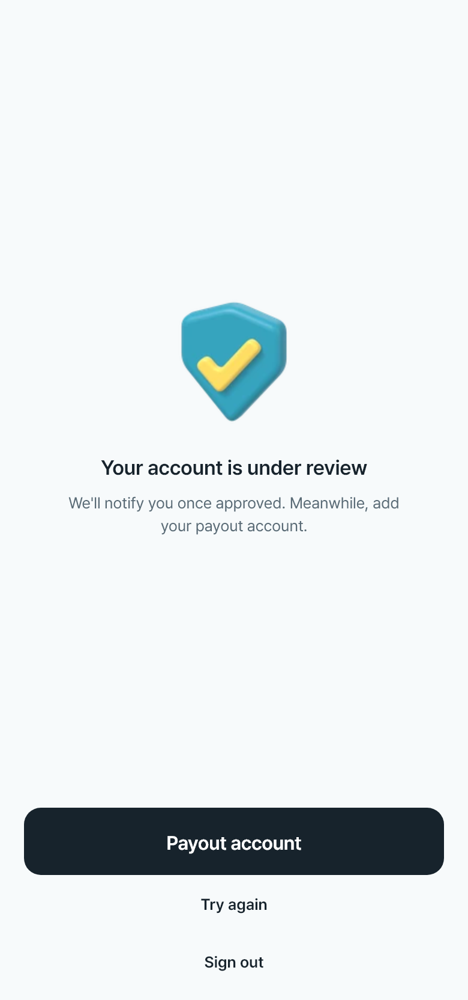
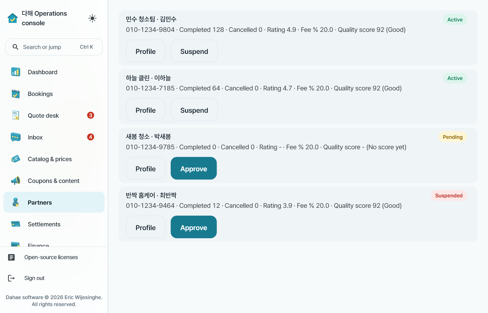
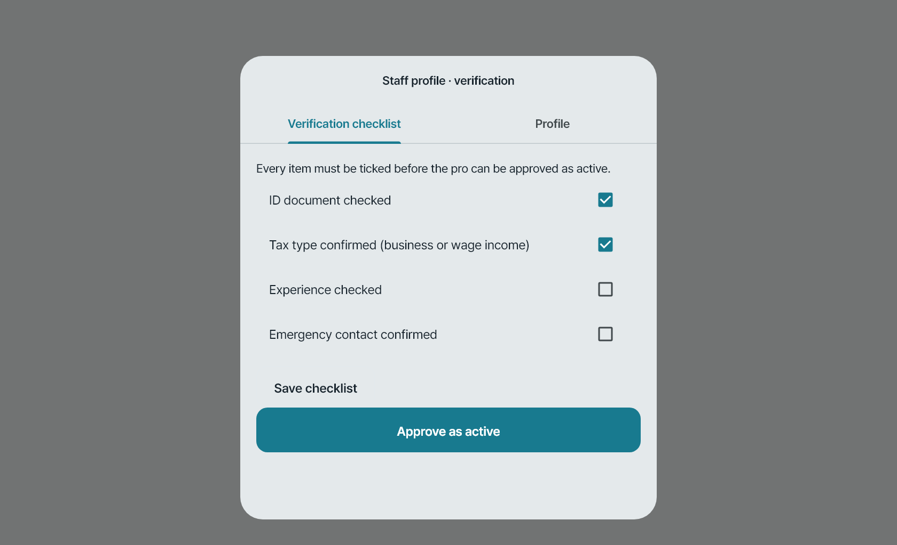
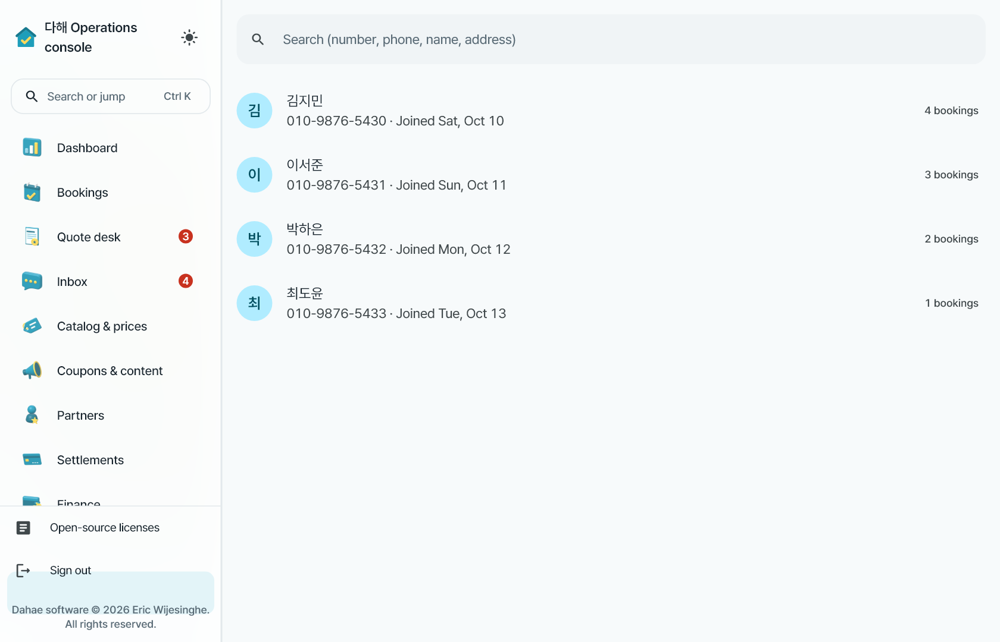
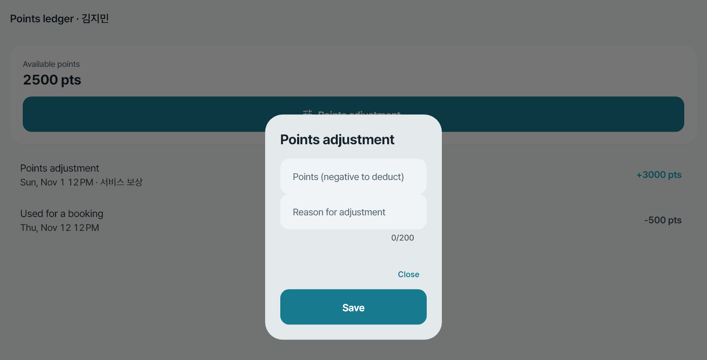
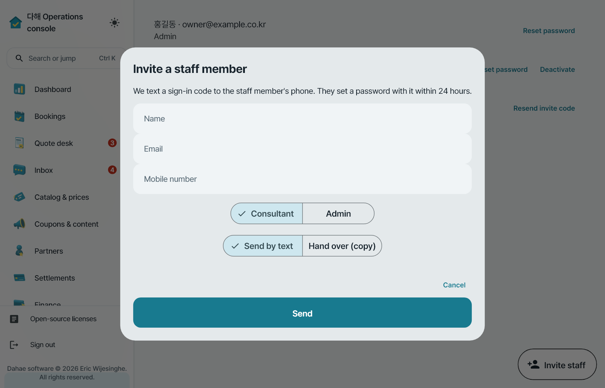
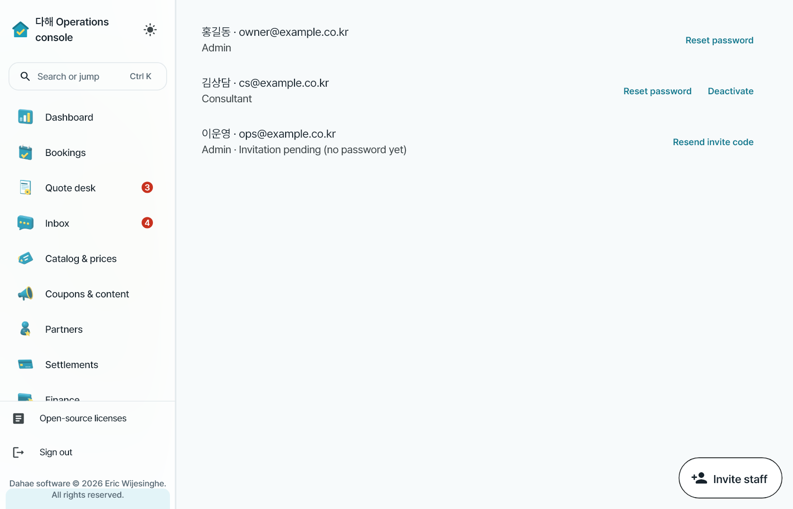

# 20. Partners, customers, staff

**In this chapter:** check and approve newly registered partners (cleaning teams). See partner profiles and quality scores, and adjust a customer's points. Invite and manage the staff who share the console with you.

> **Before you start**
> - An **admin** account (most buttons in this chapter are shown to admins only)
> - Your phone's authenticator app (6-digit code) — needed to view sensitive data and to invite an admin
> - Your partner check records (ID, tax type, experience, emergency contact)
> - To invite staff: their name, email and mobile number

## 20.1 Partner sign-up and approval

### What the partner does (partner app)

1. The partner opens the partner app and taps **[Continue with phone number]**.
2. They type their mobile number and tap **[Send code]**, then type the 6-digit code from the text and tap **[Verify]**.
3. On **Tell us about you**, they fill **Your name**, **Team name**, **Services you offer** and **Where you work**.
4. They tap **[Apply]**.
5. The **Your account is under review** screen appears. It asks them to add their **Payout account** meanwhile.

> **Tip**
> Tell partners in advance: "After you apply, please add your payout account too. You'll get a notification once you're approved."

### What you do (console)

1. In the left menu, click **[Partners]**.
2. Each row is one partner, showing `team name · owner name` and a status tag.
   - **Pending**: applied only
   - **Active**: approved and can take jobs
   - **Suspended**: stopped
3. The small text under each row shows the phone number, **Completed** jobs, **Cancelled** jobs, **Rating**, **Fee %** and **Quality score**.
4. On a **Pending** partner's row, click **[Approve]**. The **Staff profile · verification** window opens.
5. The **[Verification checklist]** tab shows: **Every item must be ticked before the pro can be approved as active.**
6. Tick only the items you have actually checked.
   - **ID document checked**
   - **Tax type confirmed (business or wage income)**
   - **Experience checked**
   - **Emergency contact confirmed**
7. If you have not checked everything yet, click **[Save checklist]** to save your progress.
8. When all four are ticked, click **[Approve as active]**.

You should now see: **Done**, and the row's status changes to **Active**. Jobs start to appear in the partner's app.

> **Warning**
> If any item is unticked, **Tick every checklist item before approving.** appears and the partner is not approved.

> **Tip**
> Partners approved before checklists existed show **Approved before checklists existed, so nothing is recorded yet. Check the items and save.** Check the items and click **[Save checklist]**.

### Stop a partner (Suspend)

1. In **[Partners]**, click **[Suspend]** on an **Active** partner's row.
2. The **Suspend** window says **Are you sure?**
3. Click **[Suspend]**. To stop, click **[Cancel]**.

You should now see: the status changes to **Suspended**. The partner cannot take new jobs.

To let them work again, click **[Approve]** on their row, check the checklist and click **[Approve as active]**.

### Approve a partner's team members

Partners can invite their team members from the partner app. A team member can see customer addresses and take jobs only after you approve them.

1. Look at the list at the very top of **[Partners]**. Each team member shows `team name · member name` and **Pending · phone**.
2. Click **[Approve]** on the row of a member you have checked.

You should now see: **Done**, and the row disappears from that list.

> **Warning**
> Before approval, the member's app shows no jobs.

## 20.2 Partner profile

1. In **[Partners]**, click **[Profile]** on the partner's row.
2. In the **Staff profile · verification** window, click the **[Profile]** tab.
3. Fill the fields you need.
   - **[Upload photo]**: the partner's photo
   - **Bio**: a short introduction customers see
   - Employment type: click **Freelance**, **Employee** or **Contract**
   - **Emergency contact**: digits and hyphens only. Stored encrypted; every view is logged.
   - **Resident or business registration number**: see "Identifier" below.
   - **Hire date**: click to pick a date. When empty it shows **Not set**.
4. Click **[Save profile]**.

You should now see: **Done**.

### Identifier (resident or business registration number)

This number is needed for the 지급명세서 (payment statement for tax).

1. First explain the purpose (the payment statement) to the partner and get their consent.
2. Type the number in **Resident or business registration number**.
3. Click **[Save profile]**.

You should now see: **On file: (number with only the last 4 digits shown)** under the field.

> **Tip**
> If you save with the field empty, the stored number stays as it is.

To see the full number:

1. Click **[Show full number (needs verification)]**.
2. When **Confirm with your authenticator** opens, type the 6-digit code from your authenticator app and click **[Confirm and continue]**.
3. The **Identifier** window shows the number, with the note **This view is logged. It cannot be shown again after you close this.**

> **Warning**
> Every view of the identifier and the emergency contact is recorded in the [Activity log](23-rules-notify-privacy.md). Look only when you must. How long to keep these numbers, and the consent wording, are **to be confirmed** with your accountant.

### Fee rate

**Fee %** in the partner list is the platform fee taken from the partner's settlement. New partners start at 20%. This version of the console has no screen to change it (**to be confirmed**; ask your developer).

## 20.3 Quality scores

1. In the **[Partners]** list, look at **Quality score**. The status is in brackets after the number.

| Shown | Meaning |
|---|---|
| **Good** | At or above the thresholds |
| **Warning** | Below the warning score. The partner gets a warning notification |
| **Paused** | Below the auto-pause score. New job offers have stopped |
| **Pause lifted** | The score is low but the owner lifted the pause |
| **No score yet** | Not enough records to score |

2. Change the thresholds in **[Catalog & prices]** > **[Quality]** ([18.8](18-catalog-prices.md#188-partner-quality-thresholds)).
3. Change how many days are counted and how many minutes late still count as on time in **[Operating rules]** ([chapter 23](23-rules-notify-privacy.md)).

> **Warning**
> This version has no console button found to lift a **Paused** status (**to be confirmed**).

## 20.4 Customers and points

### Find a customer

1. In the left menu, click **[Customers]**.
2. Type a name or phone number in the search field at the top and press `Enter`.
3. Each row shows the name, phone, **Joined** date, and **(number) bookings** on the right.

### View and adjust points (admins only)

1. Click a customer row in **[Customers]**. The **Points ledger** page opens.
2. **Available points** shows at the top.
3. The list below shows each points movement, for example **Booking cashback**, **Welcome points**, **Referral reward**, **Points returned after cancellation**, **Used for a booking**, **Expired**, **Points adjustment**. With no records you see **No points activity yet**.
4. To give or take points, click **[Points adjustment]**.
5. In **Points (negative to deduct)**, type a number: `5000` to give, `-5000` to take.
6. In **Reason for adjustment**, type why (for example `Compensation for a service issue`). It is required.
7. Click **[Save]**.

You should now see: **Points adjusted**, and a **Points adjustment** line at the top of the list.

> **Warning**
> - There is a limit per adjustment: 100,000 points in a new installation. You can lower it in **[Operating rules]** under **Most points per manual adjustment**.
> - Zero or an empty reason shows **Enter a non-zero amount and a reason**.
> - Every adjustment is recorded in the activity log.

> **Tip**
> With a consultant account, tapping a customer row does nothing. Only admins can see the points ledger.

## 20.5 Staff (people who share the console)

Staff have one of two roles.

| Role | Can do |
|---|---|
| **Consultant** | Daily work: bookings, quotes, chats |
| **Admin** | Everything a consultant does, plus every menu: setup, prices, settlements, finance, staff and more |

### Invite a staff member

1. In the left menu, click **[Staff]**.
2. Click **[Invite staff]** at the bottom right.
3. Read the note in **Invite a staff member**: **We text a sign-in code to the staff member's phone. They set a password with it within 24 hours.**
4. Fill **Name**, **Email** and **Mobile number**.
5. For the role, click **Consultant** or **Admin**.
6. Pick how to deliver the code.
   - **Send by text**: a text goes to their phone (text messaging must be set up, [chapter 14](14-setup-solapi.md)).
   - **Hand over (copy)**: the code appears on screen for you to copy and pass on.
7. Click **[Send]**.
8. Only when inviting an **Admin**: the **Enter your code** window opens. Type the 6-digit code from your authenticator app in **6-digit code** and click **[Continue]**.

You should now see:
- If sent by text: **Text sent. The staff member must enter it within 24 hours.**
- If handed over: the **Sign-in code** window shows the 6-digit code. Click **[Copy]** and give it to the staff member. You cannot see the code again after closing the window.

In the staff list, the person shows **Invitation pending (no password yet)**.

> **Warning**
> - An admin account controls the whole console, so only the **owner** can invite an admin, with an authenticator code.
> - The code works once, for 24 hours.
> - This version's console sign-in screen has no place found where the staff member enters the code and sets a password (**to be confirmed**; ask your developer).

### What you can do in the staff list

1. Click **[Staff]**. Each row shows `name · email` and the role.

2. Click the button that fits.

| Button | When | What it does |
|---|---|---|
| **[Resend invite code]** | An invited person did not set a password within 24 hours | Sends a new code |
| **[Reset password]** | A staff member forgot their password | Sends a reset code |
| **[Deactivate]** | A staff member left | They can no longer sign in |
| **[Activate]** | You want a deactivated person back | Switches the account on again |

**Resend invite code / Reset password, step by step**

1. Click the button. In the confirm window, read **Are you sure?** and click the button name again.
2. In **How to send the code**, pick **Send by text** or **Hand over (copy)**.
3. If the person has no phone number, you see **This staff member has no phone number. Enter one to save it and send the code.** Fill **Mobile number**.
4. Click **[Send]**.

You should now see: the text message note, or the **Reset code** window with the code.

> **Tip**
> Resetting the owner's own password asks for an authenticator code again. The owner's row has no **[Deactivate]** button; the owner changes only by handing the role over.

> **Tip**
> Staff also set up two-step sign-in (an authenticator app) when they sign in. It works as in [chapter 6](06-owner-account.md).

## 20.6 Handing over the owner role

Your account is the **owner**. There is only one owner. Handing it to another admin (**Hand over the owner role**), or an admin taking it when there is no owner (**Make me the owner**), is done in **[My account]**. See [chapter 8, Console tour](08-console-tour.md).

## If something goes wrong

| What happens | What to do |
|---|---|
| The partner list has no buttons | This is a consultant account. Sign in as an admin |
| **[Approve as active]** cannot be clicked | The partner is already active or a save is running. Check all four items are ticked |
| An approved partner says they get no jobs | Check whether the quality score shows **Paused**. Ask them to close and reopen the partner app |
| A team member cannot see jobs | Click **[Approve]** for them in the list at the top of **[Partners]** |
| **[Show full number (needs verification)]** says **That code does not match. Check that your phone's clock is right, then try again.** | Set your phone's clock to automatic and try with a new code |
| **Too many attempts. Wait a few minutes and try again.** | Wait a few minutes and try again |
| The staff text does not arrive | Use **Hand over (copy)**. Check text messaging in [chapter 14](14-setup-solapi.md) |
| A points adjustment fails with **Something went wrong. Please try again.** | The limit (100,000 in a new installation) was exceeded, or the reason is too long (200 characters max). Use a smaller number or shorter reason |
