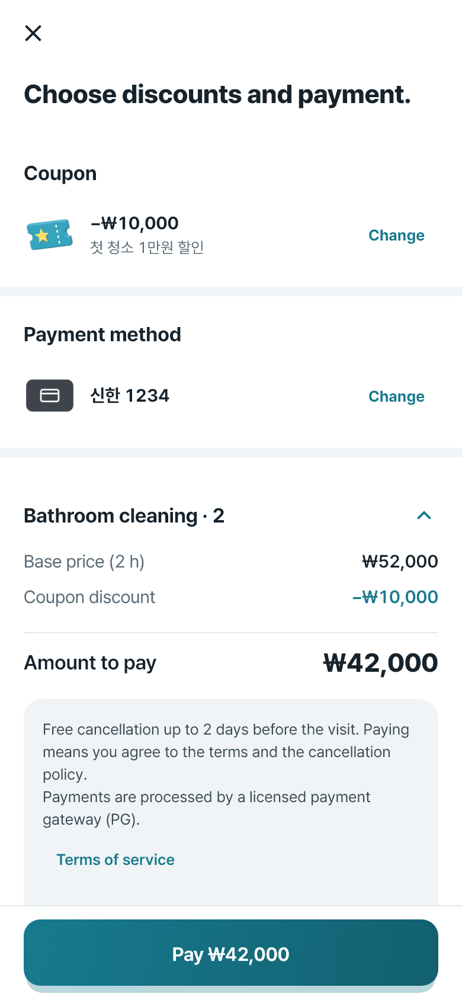
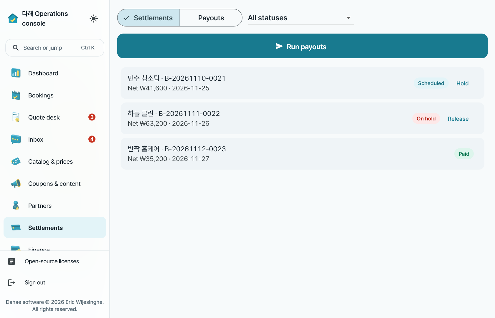
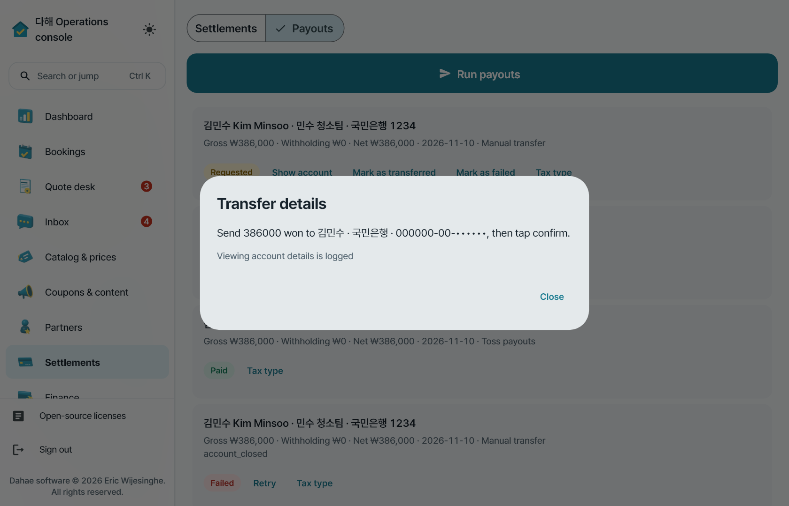
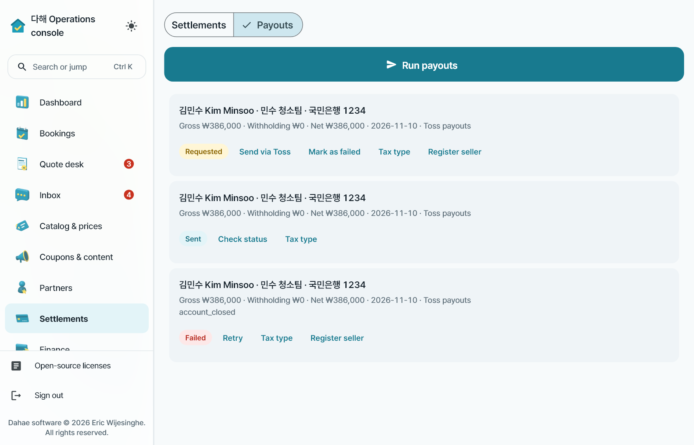
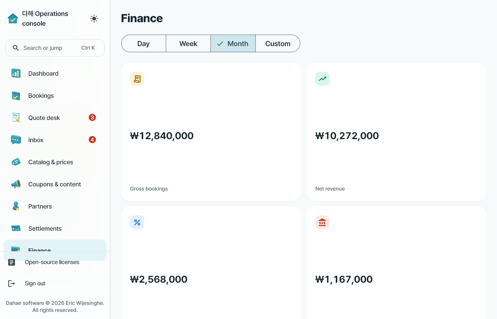
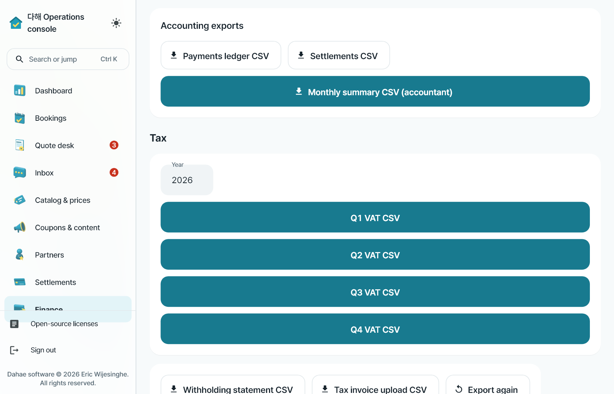
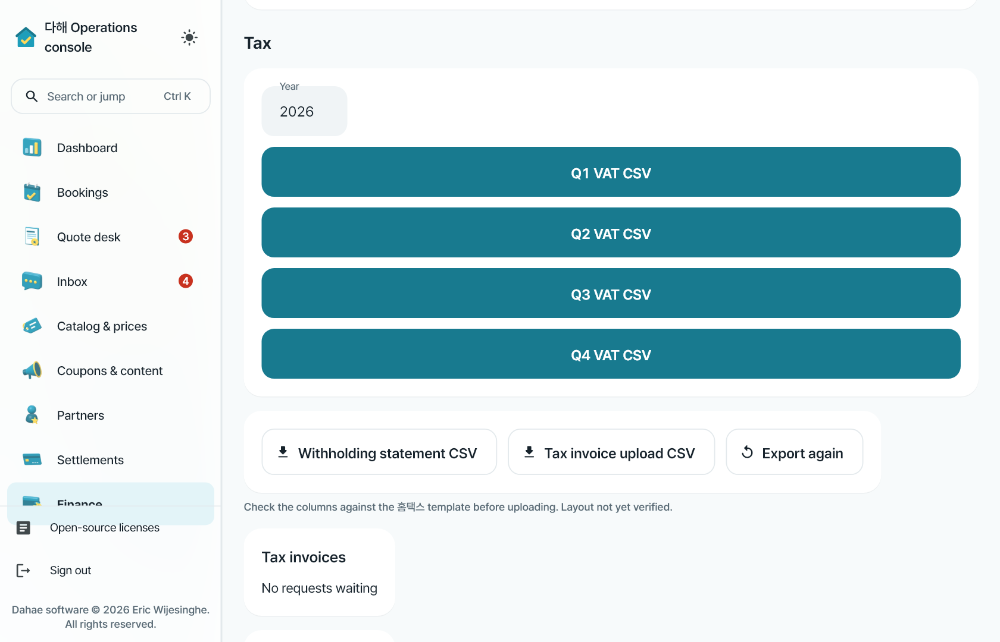

# 21. Payments, refunds, settlements, finance

**In this chapter:** how customer money comes in and goes out. How to check and pay what partners are owed (settlements). How to read the finance page and download files for your accountant.

> **Before you start**
> - An **admin** account (settlement buttons and the **[Finance]** menu are shown to admins only)
> - Your phone's authenticator app (6-digit code) — needed for payouts, showing accounts and downloads
> - Payments set up ([chapter 11](11-setup-portone.md) or [chapter 12](12-setup-toss-payments.md))
> - Partner payouts set up ([chapter 13](13-setup-payout.md)) — manual transfer or Toss payouts
> - For manual transfer: your company's banking app
> - To download CSV files: the console opened in a web browser on a PC

> **Tip**
> Sensitive actions open **Confirm with your authenticator**. Type the code in **6-digit code from your authenticator app** and click **[Confirm and continue]**. Once confirmed, it stays unlocked for 5 minutes ([chapter 8](08-console-tour.md)).

## 21.1 How customer payments flow

| Service type | When the customer pays | Name in the booking's **Payments** card |
|---|---|---|
| Fixed-price service | The full amount when booking | **Total** |
| Quoted service (move-in cleaning) | A deposit after the quote, the balance after the job | **Deposit**, **Balance** |

The deposit rate is shown under the **[Quote formula]** tab. A new installation uses 10% ([18.6](18-catalog-prices.md#186-move-in-quote-formula-quote-formula)).

### The customer app checkout

1. At the last booking step the customer sees **Choose discounts and payment.**
2. They choose a **Coupon** and **Points**. There is a limit on points per payment, and points cannot cover the whole amount.
3. The amount lines show **Base price**, **Weekend / holiday / evening surcharge**, **First-booking offer** and **Coupon discount** only when they apply, then **Amount to pay**.
4. They pick a **Payment method** and tap **[Pay (amount)]**.

- The payment methods offered (card, easy pay, bank transfer, virtual account) depend on your payment setup ([chapter 10](10-setup-business.md), [chapter 11](11-setup-portone.md)).
- With a **virtual account**, the customer app shows **Your deposit account is ready** with **Bank**, **Account number**, **Account holder**, **Amount** and the deadline. When the money arrives in time it is checked automatically and the booking is confirmed.
- If confirmation is slow right after paying, the app shows **Checking your payment**. Tell the customer not to pay again. The booking appears once it is confirmed.

> **Warning**
> The checkout note **Free cancellation up to 2 days before the visit...** is fixed text. It does not follow a changed cancellation policy. If you change the policy, ask your developer to change the text ([18.10](18-catalog-prices.md#1810-cancellation-fees-cancellation-policy)).

## 21.2 Refunds

Refunds are made in two places:

- **With a booking cancel:** **[Cancel & refund]** in the booking details ([19.2](19-bookings-quotes-inbox.md#192-find-and-handle-a-booking))
- **While handling a case (dispute):** [chapter 22](22-marketing-growth.md)

Good to know:

1. Money goes back through the gateway the customer paid with (PortOne or Toss Payments). After you switch gateways, older payments still refund through the old one, so never delete the old gateway's setup card ([chapter 12](12-setup-toss-payments.md)).
2. Cancelling a booking puts its partner settlement **On hold**.
3. A full refund automatically cancels a tax invoice request that has not been exported yet. If it was already exported or issued on 홈택스, cancel it yourself on 홈택스 with an amended tax invoice. A partial refund leaves the request as it is.
4. A cash receipt is cancelled automatically on a full refund. What to do on a partial refund is **to be confirmed** with your accountant.

> **Warning**
> If a refund fails at the gateway, **[System status]** shows **Payments to check**. Find the payment in the gateway's dashboard and refund it there ([chapter 26](26-system-status-updates.md)).

## 21.3 Partner settlements and payouts

### How a settlement is made

1. When a partner completes a job in the partner app, one **settlement** is created for that booking.
2. Settlement = job amount − platform fee (the partner's **Fee %**). The screen calls it **Net**.
   - Job amount: the pre-discount price for fixed-price services, the final quote for quoted services. Coupons and first-booking offers are not taken from the partner's share (the platform pays for them).
3. A settlement moves through these statuses:

| Status | Meaning |
|---|---|
| **Awaiting balance** | A quoted job waiting for the customer's balance |
| **Scheduled** | Ready to pay. The pay date is the Wednesday after the job (a job finished on a Wednesday is paid the next Wednesday) |
| **Paid** | The partner has been paid |
| **On hold** | You held it, or the booking was cancelled |

### See the settlements

1. In the left menu, click **[Settlements]**.
2. Of **[Settlements]** and **[Payouts]** at the top, **[Settlements]** is selected.
3. Click **All statuses** to filter by status.
4. Each row shows `team name · booking number`, **Net**, the pay date and the status.

### Hold a settlement

Hold a disputed job before it is paid.

1. On a **Scheduled** row, click **[Hold]**.

You should now see: **Done**, and the status is **On hold**. To release it, click **[Release]**.

> **Warning**
> A settlement already inside a payout cannot be held. Clicking **[Hold]** shows **The settlement can't be changed right now.** Handle it in **[Payouts]** instead.

### Create payouts (Run payouts)

1. At the top of **[Settlements]**, click **[Run payouts]**.
2. The **Pay up to date** calendar opens. Pick **today or an earlier date**. Every **Scheduled** settlement due by that date is included.
3. If **Confirm with your authenticator** opens, type the code and click **[Confirm and continue]**.

You should now see: **Created (number) payout requests**, and the screen switches to **[Payouts]**. One payout per partner is created as **Requested**.

> **Warning**
> - A future date creates nothing (**Something went wrong. Please try again.** appears). Pick today or a past date.
> - Payouts are made only for partners with a **verified payout account**. When a partner adds or changes the account in the app, it becomes unverified. This version of the console has no screen to mark an account verified (**to be confirmed**; ask your developer). So you may get 0 payouts.
> - Clicking twice does not put the same settlement in two payouts.

### Read the payouts

1. Click **[Payouts]**.
2. Each payout is a card.
   - First line: `partner name · team name · bank, last 4 digits of the account`
   - Second line: **Gross**, **Withholding**, **Net**, the pay date and the method (**Manual transfer** or **Toss payouts**). If there is a failure reason, it shows on the line below.
   - Status: **Requested**, **Sent**, **Paid**, **Failed**
3. If there are none, you see **No payouts yet**.

> **Tip**
> The money you actually send is **Net** (gross minus withholding).

### Method A: manual transfer (the default)

1. In **[Payouts]**, click **[Show account]** on a **Requested** card.
2. If asked for the authenticator code, type it and click **[Confirm and continue]**.
3. The **Transfer details** window shows the holder, bank, account number and the amount. Below it: **Viewing account details is logged**.
4. Open your company banking app and send that amount to that account.
5. Back in the console, click **[Close]**.
6. On the same card, click **[Mark as transferred]**.

You should now see: **Done**, and the card shows **Paid**. Its settlements become **Paid** too.

> **Warning**
> Click **[Mark as transferred]** only after the bank transfer has gone through. Every account view is recorded in the activity log.

**If you could not transfer (Mark as failed)**

1. On a **Requested** card, click **[Mark as failed]**.
2. In the **Failure reason** window, type why (for example `wrong account, transfer cancelled`). It is required.
3. Click **[Mark as failed]**.

You should now see: the card shows **Failed** with the reason. After fixing the problem, click **[Retry]** to make it **Requested** again.

### Method B: Toss payouts

Use this only if partner payouts are set to Toss payouts in [chapter 13](13-setup-payout.md).

**First time only: register the partner as a Toss seller**

1. On that partner's **Requested** (or **Failed**) card, click **[Register seller]**.
2. In **Register as Toss seller**, pick **Individual** or **Business**. The note says **Uses the partner's verified payout account. Enter business details only.**
3. Fill **Name**, **Settlement email** and **Phone** (10 or 11 digits). If you picked **Business**, also fill **Representative name** and **Business registration no. (10 digits)**. An empty or badly formatted field shows **Required** under it.
4. Click **[Register]**.

You should now see: **Seller status: (status)**. If the partner changed their account, registering again is safe.

**Send a payout**

1. On a **Requested** card, click **[Send via Toss]**.
2. If asked for the authenticator code, type it and click **[Confirm and continue]**.
3. The card changes to **Sent**.
4. A little later, click **[Check status]**. When Toss reports it finished, it becomes **Paid**.
5. If it becomes **Failed**, check the reason, fix it, and click **[Retry]**.

**When Toss did not answer (Check with Toss)**

If a send got no answer from Toss, nobody knows whether the money left. The card then shows **[Check with Toss]**.

1. Click **[Check with Toss]**.
2. If Toss answers, the status updates at once.
3. If you see **Toss's records don't show this payout. Check again in a few minutes, or look in the Toss dashboard yourself.**, or Toss cannot be reached, **[Confirm it was not sent]** appears on the card. First wait a few minutes and click **[Check with Toss]** again.
4. If nothing changes, before clicking **[Confirm it was not sent]**, sign in to the Toss Payments merchant dashboard and look in the payouts list for that partner and amount.
   - Not there, or shown as failed or cancelled: go to step 5.
   - Shown as requested, in progress or completed: the money left or is leaving. Do not click anything; click **[Check with Toss]** again later.
5. Click **[Confirm it was not sent]**. The **Was this payout really not sent?** window opens.
6. Tick **I checked the Toss dashboard myself**.
7. Click **[Mark as not sent]**.

You should now see: **Marked as failed. You can retry it now.** Send it again with **[Retry]**. The bookings in this payout cannot be cancelled until Toss reports how the new send ended.

> **Warning**
> **If this is wrong, the partner may be paid twice.** Always check the Toss dashboard yourself before confirming.

### Partner tax type (withholding)

1. On any of that partner's cards in **[Payouts]**, click **[Tax type]**.
2. Pick one.
   - **Freelancer (withheld)**: business income withholding is taken at payout (income tax 3% plus local tax of 10% of that).
   - **Registered business (no withholding)**: nothing is withheld.

You should now see: the new type applies from the next payout created. Existing payouts do not change.

> **Warning**
> - Partners with no type set are withheld, to be safe.
> - The withholding base (whether after the platform fee), rates and rounding are **to be confirmed** with your accountant.

## 21.4 The finance page

1. In the left menu, click **[Finance]** (admins only).
2. Pick a period at the top.
   - **[Day]**: today
   - **[Week]**: this week (Monday to Sunday)
   - **[Month]**: this month
   - **[Custom]**: pick a start and end date in the calendar (under 800 days, about 2 years)
3. Read the number cards.

| Card | Meaning |
|---|---|
| **Gross bookings** | Total customer payments |
| **Net revenue** | Gross minus refunds |
| **Platform fee** | Total fee taken from partner settlements |
| **VAT estimate** | Estimate: 10% of the platform fee |
| **Paid to partners** | Money already paid to partners |
| **Pending payouts** | Money still to pay |
| **Avg order value** | Average amount per booking |
| **Cancellation rate** | Share of bookings cancelled |
| **Monthly recurring revenue (MRR)** | Monthly revenue from subscriptions |
| **Churn** | Share of subscriptions cancelled |
| **Active subscriptions** | Subscriptions running now |
| **Recognized in period** | Revenue recognized in the chosen period |

4. Under the cards: **Estimate: 10% of the platform fee. Confirm with your accountant.**
5. Scroll down to see, in order:
   - **Trend**: a chart. Switch with **[Last 30 days]**, **[Last 90 days]**, **[Week]**, **[Month]**.
   - **Payment methods**: share by payment method
   - **Earnings by partner**: **Partner**, **Jobs**, **Settled**, **Fee**, **Net**
   - **Revenue by service**
6. A period with no records shows **No records in this period**.

> **Tip**
> If it fails to load you see **Could not load finance data** and **[Try again]**. Pulling the page down also refreshes it.

### Accounting exports (CSV)

1. In **[Finance]**, pick the period first. The files use that period.
2. Scroll to the **Accounting exports** card.
3. Click the button you need.
   - **[Payments ledger CSV]**: every payment and refund
   - **[Settlements CSV]**: every partner settlement
   - **[Monthly summary CSV (accountant)]**: a monthly summary for your accountant
4. If asked for the authenticator code, type it and click **[Confirm and continue]**.

You should now see: the browser downloads a CSV file (for example `dahae-ledger.csv`). Korean text opens correctly in Excel.

> **Warning**
> Downloads work only in the **console opened in a web browser**. Elsewhere you see **CSV download works in the web console**. A failure shows **Download failed**.

## 21.5 Tax (tax invoices, cash receipts, withholding, VAT)

This is the **Tax** section at the bottom of **[Finance]**.

> **Warning**
> The tax features have not yet been fully checked against the real tax forms and gateway tests. The screen also says **Check the columns against the 홈택스 template before uploading. Layout not yet verified.** Always check with your accountant before filing.

### Quarterly VAT file

1. In **Year**, type the year (this year by default).
2. Click the quarter you need, **[Q1 VAT CSV]** to **[Q4 VAT CSV]**.
3. If asked, type the authenticator code.

You should now see: a file such as `dahae-vat-2026-Q1.csv` downloads. It uses the chosen quarter, not the period at the top.

### Withholding statement file

1. Pick the period at the top.
2. Click **[Withholding statement CSV]**.

You should now see: a file with the paid, withheld partner payouts in that period.

### Tax invoices

When a business customer asks for a tax invoice at checkout, the request appears in the **Tax invoices** list. With none, you see **No requests waiting**.

1. Click **[Tax invoice upload CSV]**. You get only the requests not exported before.
2. Issue the tax invoices on 홈택스 with that file.
3. Back in the console, in the **Tax invoices** list, click **[Mark as issued]** on the row you issued (`company · business number`).
4. Type the 홈택스 approval number in **Approval no.**.
5. Click **Issued on** and pick the date.
6. Click **[Mark as issued]**.

> **Warning**
> - A request you downloaded does not appear in the next export (downloading the same period again gives an empty file).
> - Use **[Export again]** only if the file was lost or damaged. Click **[Export again]** once more in the confirm window. You get the already exported requests again, unchanged.

### Cash receipts

The **Cash receipts** list shows receipts customers asked for. Each row shows the purpose, the last 4 digits of the number and the status (**Pending**, **Issued**, **Failed**, **Cancelled**).

1. If a row shows **Failed**, click **[Reissue]**.

> **Tip**
> Cash receipts are issued only when the **Issue cash receipts** switch on the PortOne card is on. It starts off. Test in the PortOne sandbox before turning it on ([chapter 11](11-setup-portone.md)).

## 21.6 Payment matching (System status)

Every day the system checks that your payment records match the gateway's. Problems show in **[System status]**.

- **Payments to check**: a payment went through but automatic handling failed. Check it in the gateway's dashboard and refund there if needed.
- **Payment webhooks**: checking a gateway notification failed. Check the webhook secret on the payment setup card.
- **Payments differ from the gateway (PortOne/Toss Payments)** alert: an amount differs, or a payment exists on one side only.

Details and alert settings are in [chapter 26](26-system-status-updates.md).

## If something goes wrong

| What happens | What to do |
|---|---|
| **[Settlements]** does not load or has no buttons, or there is no **[Finance]** menu | This is a consultant account. Sign in as an admin |
| **[Run payouts]** says **Created 0 payout requests** | No **Scheduled** settlement is due yet, or the partner's account is not verified (see the warning above). Try again with today as **Pay up to date** |
| **[Run payouts]** ends with **Something went wrong. Please try again.** | You may have picked a future date. Pick today or a past date |
| **This action needs a fresh authenticator code. Confirm it, then try again.** | Type the authenticator code again. After 5 minutes it asks again |
| **The payout status changed. Refresh and check again.** | Someone handled it first. Refresh |
| **This payout may already be with the bank, so it can't be changed right now. Check its status.** | Check the status first with **[Check with Toss]** |
| **This payout method isn't available right now.** | Check the Partner payouts card in [chapter 13](13-setup-payout.md) |
| **This partner has no verified payout account yet. Verify the account first.** | Check that the partner added a payout account in the app. How to verify it is **to be confirmed** (ask your developer) |
| **Couldn't reach the service. Try again shortly.** | Toss cannot be reached. Try later, or check the Toss dashboard yourself |
| A CSV will not download | Open the console in a web browser on a PC and try again |
| The tax invoice file is empty | Those requests were already downloaded. If you lost the file, use **[Export again]** |
