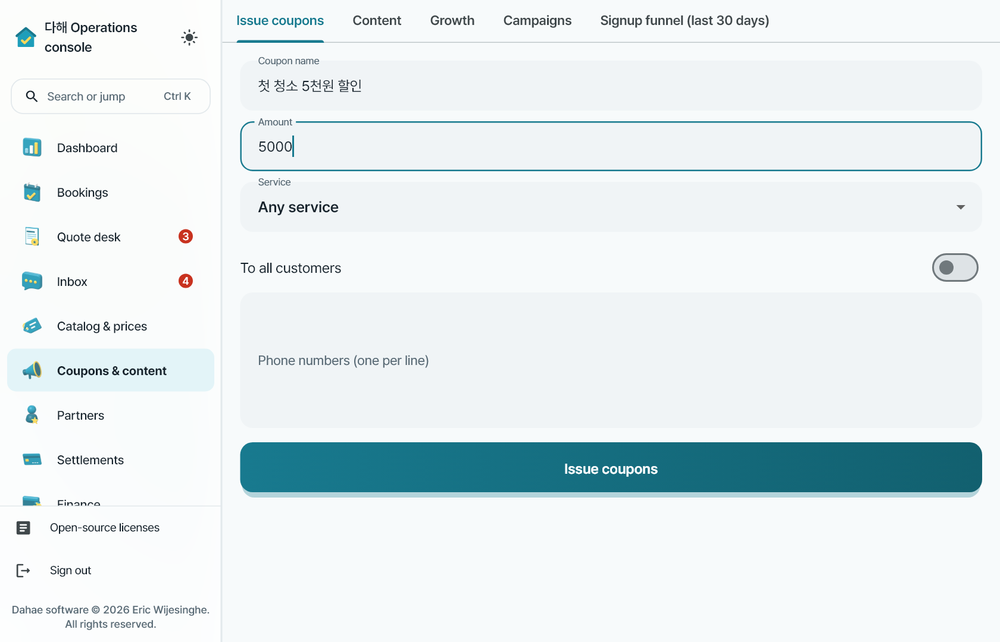
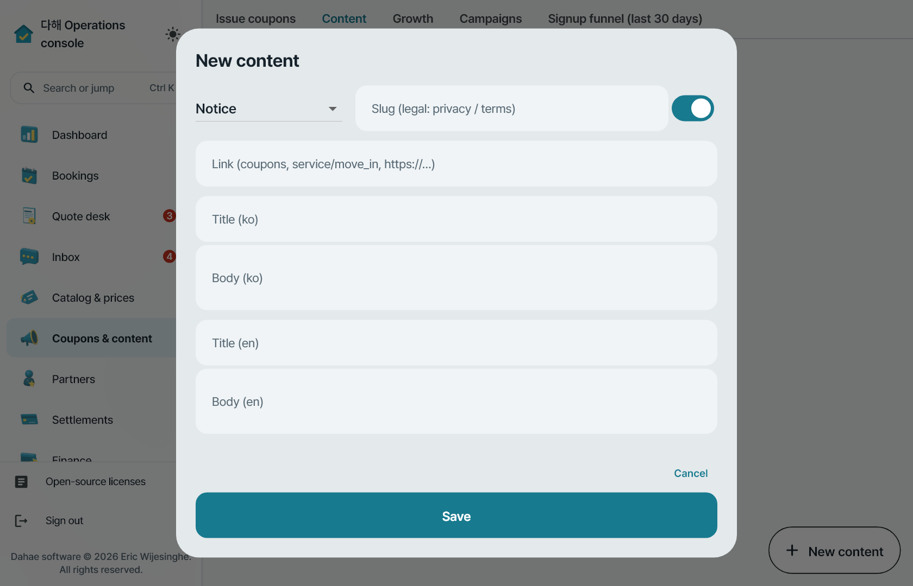
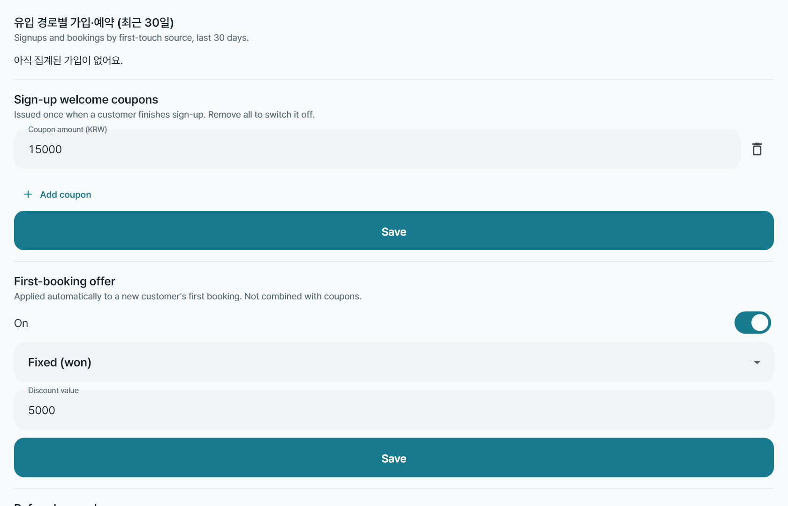
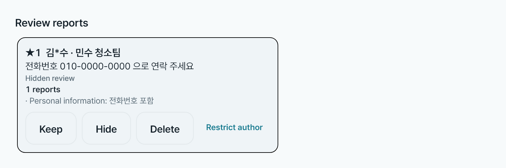
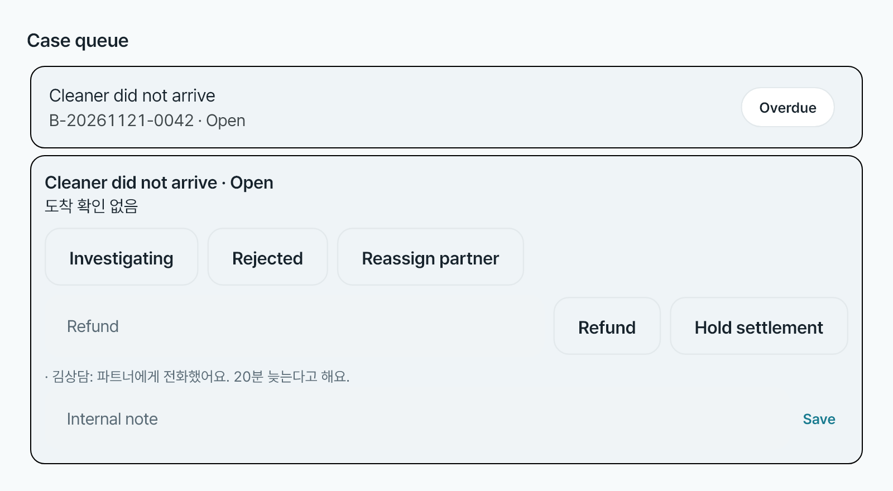
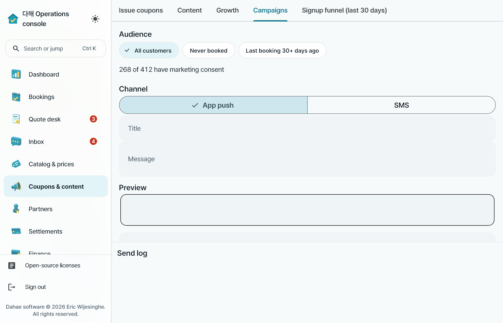
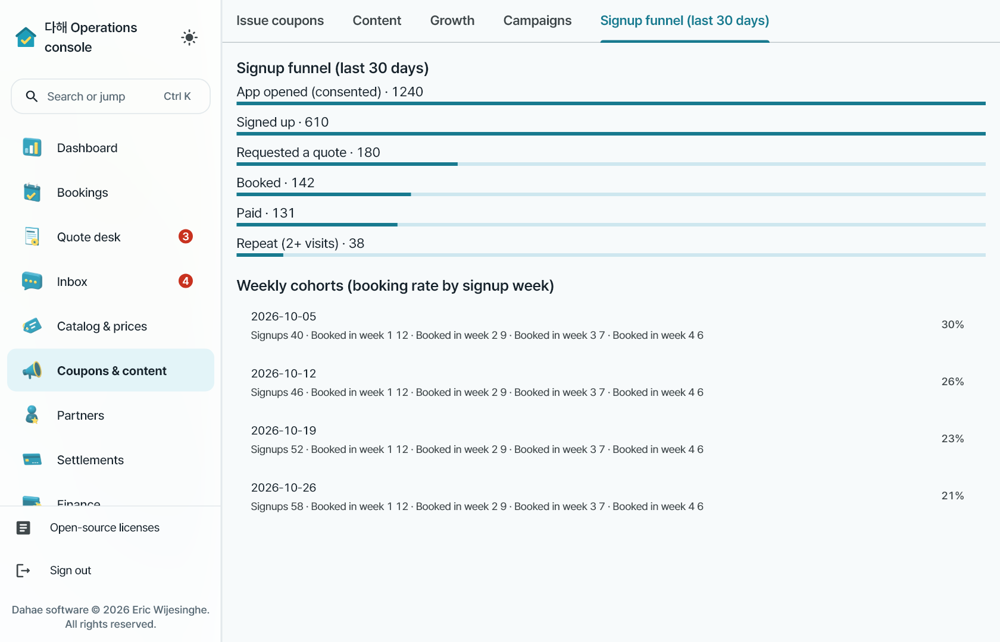

# 22. Coupons, content, growth, campaigns, cases

**In this chapter:** give customers coupons, edit the notices, banners and FAQ in the customer app, and set the new-customer offers and referral reward.
You also handle review reports and cases (damage, no-shows and other problems), send advertising campaigns and read the signup funnel.

> **Before you start**
> - You can sign in to the console with an **Admin** account (chapter 6). A **Consultant** account cannot issue coupons, save content, send campaigns or refund from a case.
> - For SMS campaigns: the SMS service (Solapi) connected (chapter 14) and an **080 opt-out number**
> - For app push campaigns: app push connected (chapter 16)
> - For a test text: your phone number saved in **[System status]** → **Alert settings** → **Phone for alerts** (chapter 26)

---

## 22.1 Find the screen

1. In the console menu on the left, click **[Coupons & content]**.
2. Five tabs show at the top: **Issue coupons**, **Content**, **Growth**, **Campaigns**, **Signup funnel (last 30 days)**.
3. Click a tab name to open it. On a narrow screen such as a phone, swipe the tab row sideways to see the other tabs.

**You should now see:** five tabs at the top, with **Issue coupons** open.

---

## 22.2 Issue coupons

Put a coupon straight into the wallet of some customers or of all customers.

1. Click the **Issue coupons** tab.
2. In **Coupon name**, type the name customers will see. Example: `Autumn thank-you coupon`
3. In **Amount**, type the discount in won, digits only. Example: `10000`
4. Click **Service** and choose where the coupon can be used.
   - **Any service**: any booking.
   - One service: only bookings of that service.
5. Choose who gets it.
   - Everyone: switch on **To all customers**.
   - A few people: leave the switch off and type their mobile numbers in **Phone numbers (one per line)**, one number per line.
6. Click the **[Issue coupons]** button at the bottom.

**You should now see:** **Issued N** at the bottom of the screen for a moment. N is the number of customers who actually got a coupon.

> **Warning** A coupon can be used for **14 days from the day it is issued**. The server sets this period; the console cannot change it.

> **Tip** Numbers that belong to no registered customer are skipped without a message. If N is smaller than the number of phones you typed, check the numbers.

> **Warning** With **To all customers** on, every customer who has not deleted their account gets the coupon at once. There is no undo. Check the amount before you click.

---

## 22.3 Content (notices, news, tips, FAQ, banners, legal)

Create and edit the notices, news, tips, FAQ, home banners and the terms and privacy texts shown in the customer app.

### Create an item

1. Click the **Content** tab. The list of items you made so far appears.
2. Click the **[New content]** button (with a + sign) at the bottom right. The **New content** dialog opens.
3. In the box at the top left, pick the kind.

   | Kind | Where it shows |
   |---|---|
   | **Notice** | Customer app **More** → **Notices**, and the **(service name) News** row on the home screen |
   | **News** | The **(service name) News** row on the home screen |
   | **Tip** | Customer app **More** → **(service name) tips**, and the **(service name) News** row on the home screen |
   | **FAQ** | Customer app **More** → **FAQ** |
   | **Banner** | The large banner card on the customer home screen (with a `service/…` link it shows in the home recommendations instead) |
   | **Legal** | Customer app **More** → **Terms of service** and **Privacy policy** |

4. Fill **Slug (legal: privacy / terms)** only for the **Legal** kind.
   - Privacy policy: type `privacy`. Terms of service: type `terms`. Lower case.
   - Leave it empty for the other kinds.
5. The switch to the right of the slug decides whether the item **shows** in the app. On shows it, off hides it.
6. **Link (coupons, service/move_in, https://…)** is where a tap on the item goes. Leave it empty if you do not need one.
   - `coupons`: the coupon screen in the app.
   - `service/` plus a service code, such as `service/move_in`: that service's screen.
   - An address starting with `https://`: that web page.
7. Type the Korean title and text in **Title (ko)** and **Body (ko)**.
8. Type the English title and text in **Title (en)** and **Body (en)**. Leave them empty if you do not use English.
9. For a **Banner**, two more fields appear per language.
   - **Banner card label (ko)**: the top line of the small card on the right of the banner. Example: `웰컴 혜택`
   - **Banner card value (ko)**: the large text on the card. Example: `15,000원`
10. Click **[Save]**.

**You should now see:** **Saved**, and the new item in the list.

> **Warning** The customer app's **Terms of service** and **Privacy policy** screens show the **Legal** items with the slugs `terms` and `privacy`. Without them the app shows **Nothing here yet**. Create both before you publish the apps. Using the same text as the website page `https://your-domain/privacy.html` is a good start; the wording itself needs legal review.

> **Tip** The link field accepts only an `https://` address or an in-app path made of letters, digits, `_` and `/`. Anything else gives an error when you save.

### Edit, hide or delete an item

1. Click the item in the list. The **Edit** dialog opens.
2. Change it and click **[Save]**.
3. To hide it for a while, switch it off in the dialog and click **[Save]**. The list shows **Cancelled** next to it, which means hidden.
4. To delete it, click the bin button (**Delete**) at the right of the item.
5. In the **Are you sure?** dialog, click **[Delete]**.

**You should now see:** the item is gone from the list.

---

## 22.4 Growth tab: sources, welcome coupons, first-booking offer, referrals

The **Growth** tab shows, from the top:

1. The signups and bookings by source table
2. **Sign-up welcome coupons**
3. **First-booking offer**
4. **Referral reward**
5. **Review reports** (22.5)
6. **Case queue** (22.6)
7. **Review moderation** (22.7)

### Signups and bookings by source

This table shows where customers who signed up through website ad links came from. Its title and column names are in Korean only: **유입 경로별 가입·예약 (최근 30일)**, with the English line *Signups and bookings by first-touch source, last 30 days.* The columns are source / medium / campaign (**출처 / 매체 / 캠페인**), signups (**가입**), customers who booked (**예약 고객**) and bookings (**예약 수**).
With no data yet it says **아직 집계된 가입이 없어요.** (no signups counted yet). It is read-only.

> **Note** The table only counts the ad tags (`utm_…`) on links when someone signs up on the website. Customers who sign up straight in the app do not appear here.

### Sign-up welcome coupons

Coupons given **once**, automatically, when a customer finishes sign-up. A new install starts with **one 15,000 won coupon for any service**.

1. Under **Sign-up welcome coupons**, each coupon has a **Coupon amount (KRW)** field.
2. To change an amount, edit the number.
3. To give one more coupon, click **[Add coupon]** and type its amount.
4. To remove a coupon, click the button at the right of its row (**Remove coupon**).
5. Click **[Save]** under this block.

**You should now see:** **Saved**. Customers who sign up from now on get the new coupons.

> **Warning** The server limits are: at most **3 coupons**, amounts in **steps of 100 won**, and **50,000 won or less** in total. Anything else gives an error when you save.

> **Tip** To switch welcome coupons off, remove them all and click **[Save]**. Welcome coupons are also valid for 14 days.

### First-booking offer

A discount added automatically to a new customer's **first booking**. It is not combined with coupons. It starts switched off.

1. Under **First-booking offer**, switch **On** on.
2. In the box below, pick **Fixed (won)** or **Percent (%)**.
3. Type the number in **Discount value**: won for fixed, percent for percent.
4. Click **[Save]** under this block.

**You should now see:** **Saved**.

> **Warning** Fixed values from **1 to 100,000 won** and percentages from **1 to 50%** are accepted.

### Referral reward

When a customer refers a friend and the friend's first booking is **completed and paid**, a reward is paid. Self-referrals and duplicate phone numbers are blocked. It starts switched off.

1. Under **Referral reward**, switch **On** on.
2. Type the amount in **Reward amount (won)** (1 to 100,000 won).
3. Click **[Save]** under this block.

**You should now see:** **Saved**.

> **Note** **Both** the referrer and the friend get a coupon of that amount (valid 14 days). If the points programme is on, they get points instead of coupons (points: chapter 20; the points amount comes from the points settings).

---

## 22.5 Review reports

Customers can tap **Report** on someone else's review in the app. When enough people report a review (3 on a new install), it appears in this queue. The review **stays visible** in the app until you act on it.

1. On the **Growth** tab, scroll down to **Review reports**.
2. **No reports waiting** means there is nothing to do.
3. Each reported review shows its text and **N reports**.
4. Read it and click one button.
   - **[Keep]**: the review is fine. It stays visible and its reports are cleared.
   - **[Hide]**: hide it in the app. The record stays.
   - **[Delete]**: delete the review.
5. If the same person keeps writing bad reviews, click **[Restrict author]**. They can no longer write reviews. To undo it, click **[Lift restriction]** in the same place.

**You should now see:** the card leaves the queue. On failure you see **Couldn't apply that. Try again.**

> **Tip** The number of reports before a review is hidden is set in **[Operating rules]** → **Business limits** → **Review reports before hiding** (chapter 23). It can only be raised from the default.

> **Warning** If a report comes in while the apps are under store review, handle it at once. Reviewers may test the report feature (chapter 25).

---

## 22.6 Case queue

Problems that customers or partners send with **Report a problem** in the apps land here. The kinds are **Damage**, **Loss**, **Complaint**, **Cleaner did not arrive**, **Safety concern** and **Payment dispute**.

1. On the **Growth** tab, scroll down to **Case queue**. With nothing open it says **No open cases**.
2. Each row shows the kind, the booking number and the status (**Open**, **Investigating**, **Resolved**, **Rejected**).
3. A case not handled within 24 hours of being filed gets an **Overdue** tag at the right. Start with those.
4. Click a row to open its detail card below. If the team recorded arrival and departure, you see **Arrived HH:MM** and **Left HH:MM**.
5. Change the status.
   - An **Open** case shows **[Investigating]** and **[Rejected]**.
   - An **Investigating** case shows **[Resolved]** and **[Rejected]**.
6. To add a note, type it in **Internal note** and click **[Save]**. Customers never see it.

### Refund and settlement hold (Admin only), reassign

1. To give money back, type the amount in won in the **Refund** field and click the **[Refund]** button next to it.
2. To stop the partner's payout for now, click **[Hold settlement]**.
3. For a **Cleaner did not arrive** case, a **[Reassign partner]** button appears. Click it to assign another partner.

> **Warning** You can refund **only once** per case. Check the amount before you click. Refunds and holds are recorded in the **[Activity log]** (chapter 23).

> **Tip** Releasing a hold and paying out are done on the **[Settlements]** screen (chapter 21).

---

## 22.7 Review moderation

**Review moderation** at the bottom of the **Growth** tab lists recent reviews with stars, booking number and customer name. With no reviews it shows **0 reviews**.

1. On the review you want to hide, click **[Hide]**. The card gets a **Hidden** tag.
2. To show it again, click **[Show again]** on the same card.

---

## 22.8 Campaigns (sending ads)

Send an ad by app push or SMS to customers who agreed to marketing messages.

### Rules set by law (the server applies them for you)

- Only customers who agreed to **Marketing messages** get it. The rest are skipped.
- No ads between 9 pm and 8 am Korean time. A send that reaches this window pauses and **continues at 8 am**.
- Each customer gets a limited number of ads per week (2 on a new install; you can only lower it in **[Operating rules]** → **Advertising**).
- SMS ads automatically start with `(광고)` and end with a `무료수신거부 080…` (free opt-out) line, as Korean law requires.
- App push ads also get `(광고)` before the title and a line on how to switch ads off at the end of the text (the preview does not show these).

### Create a campaign

1. Click the **Campaigns** tab.
2. Under **Audience**, pick one:
   - **All customers**
   - **Never booked**: signed up but never booked
   - **Last booking N+ days ago**: a **Days** field appears. Type a number (30 to start with).
3. Below it you see **N of N have marketing consent**. The people who will actually receive it are the first number (those who consented).
4. Under **Channel**, choose **App push** or **SMS**.
5. Type a **Title**. The campaign log also shows it under this name.
6. Type the text in **Message**.
7. For SMS, type your company's 080 opt-out number in **Opt-out number (080)**. If the number is wrong, **SMS needs an 080 opt-out number** shows in red. If it is empty there is no red text, but the send buttons stay off.
8. Check **Preview** to see what customers get. For SMS it shows the `(광고)` prefix and the opt-out line.

**You should now see:** with title and message filled (and a valid 080 number for SMS), the **[Send at]** and **[Send now]** buttons can be clicked.

### Send a test to your phone

1. Type your mobile number in **Send a test to my phone**.
2. Click the **[Send a test to my phone]** button.
3. Check that the text arrives on your phone. The console shows no success or error message for a test.

> **Warning** A test always goes as **SMS**, and all of these must be true:
> - The number is the same as the one saved in **[System status]** → **Alert settings** → **Phone for alerts**.
> - **Opt-out number (080)** is filled in correctly (even for an app push campaign). The field shows only when **SMS** is picked, so switch to **SMS** for a moment, type the number, then switch back to **App push**.
> - At most **5 tests per hour** per console login. Each test is a real, paid text.

### Send

- To send now, click **[Send now]**.
- To send later, click **[Send at]**. Pick a date in the calendar (today to 90 days ahead) and confirm, then pick a time in the clock and confirm. The campaign is scheduled as soon as you pick the time.

**You should now see:** **Campaign saved**.

> **Warning** **[Send now]** starts sending at once, with no confirmation dialog. Read the audience, channel and text again before you click.

### Send log

1. **Send log** at the bottom of the **Campaigns** tab lists your campaigns (name, channel, status).
2. Click a row to see **Sent N · No consent N · Failed N** for a moment.

---

## 22.9 Signup funnel (last 30 days)

1. Click the **Signup funnel (last 30 days)** tab.
2. From the top you see how many people reached each step: **App opened (consented)** → **Signed up** → **Requested a quote** → **Booked** → **Paid** → **Repeat (2+ visits)**. Look for the step where most people drop out.
3. Below, **Weekly cohorts (booking rate by signup week)** shows **Signups N** and the **Booked in week N** rates for each signup week.

> **Note** **App opened (consented)** only counts apps of customers who agreed to marketing messages, so it is lower than the real number of app opens.

---

## If something goes wrong

| You see | Do this |
|---|---|
| **[Issue coupons]** is grey | You are signed in as a **Consultant**. Sign in with an **Admin** account. |
| **Issued 0** | No registered customer has those numbers. Check them, or use **To all customers**. |
| Saving content gives an error | Check the link field for anything that is not an `https://` address, or for spaces and Korean letters. Check that you use an **Admin** account. |
| The terms screen in the app is empty | In **Content**, create a **Legal** item with slug `terms` (`privacy` for the privacy policy) and switch it on. |
| Saving welcome coupons gives an error | Use 3 coupons or fewer, steps of 100 won, 50,000 won or less in total. |
| New customers see "2 welcome coupons are in your wallet" | This message is fixed in the app. The real number of coupons follows **Sign-up welcome coupons** (**to be confirmed**: ask the developer to change the message). |
| **[Send now]** cannot be clicked | Fill title and message. For SMS, the 080 number must be 9 to 12 digits. |
| The test text does not arrive | The number must equal **Phone for alerts**, you may have passed 5 tests in an hour, or SMS is not connected (chapter 14). |
| Fewer people got the campaign than expected | Look at **No consent** in the **Send log**. Customers without consent, held by the night window or over the weekly cap are left out. |
| No **[Refund]** on a case | Only **Admin** accounts see it, and only for cases linked to a booking. |
