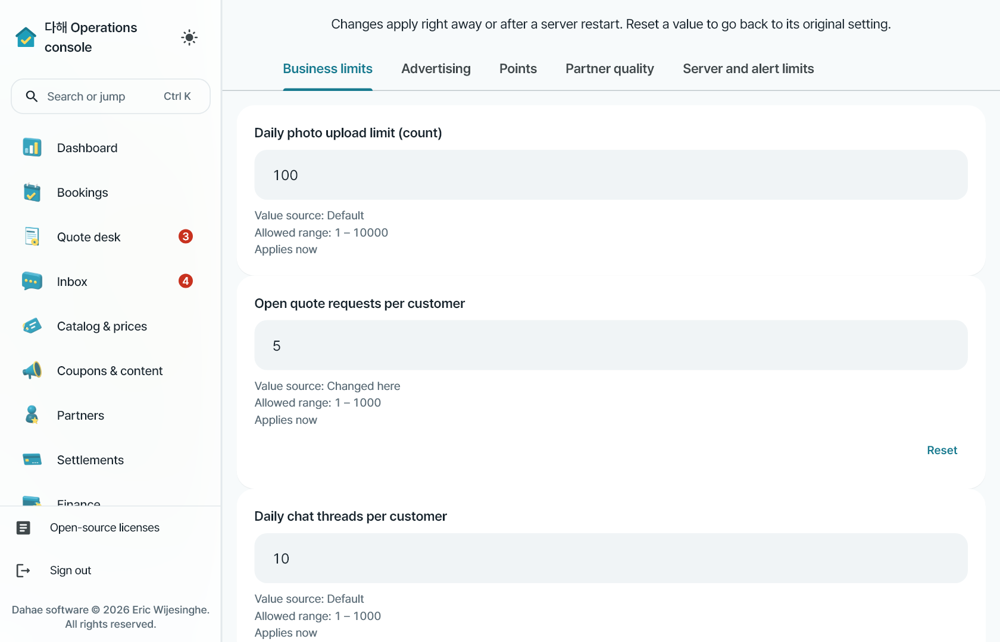
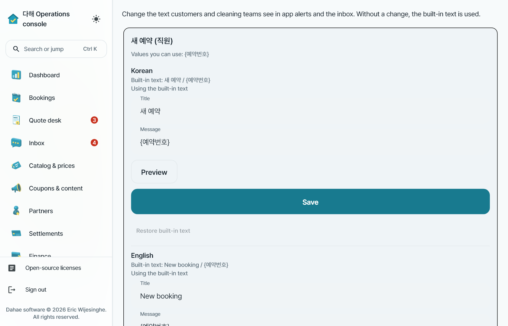
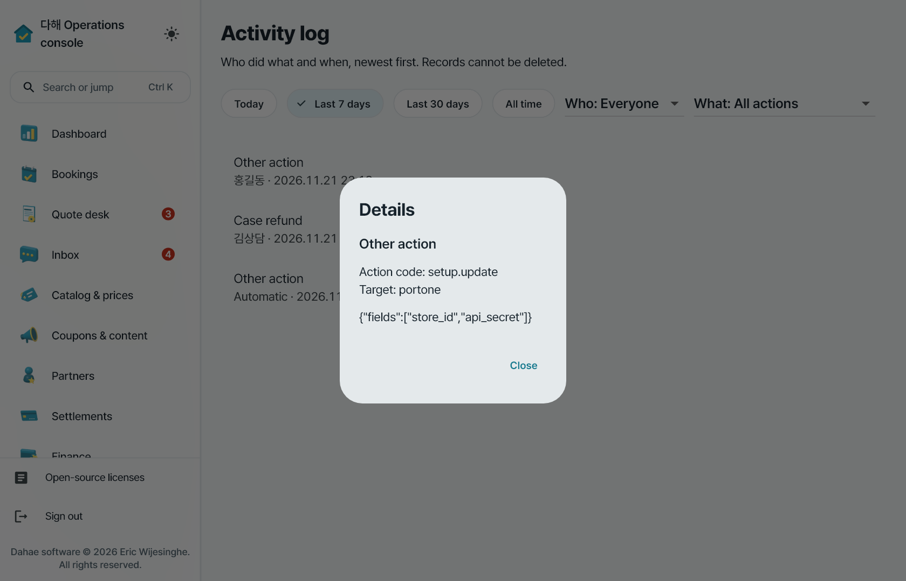
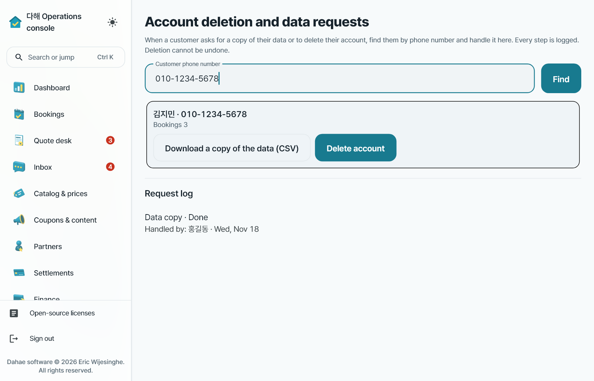
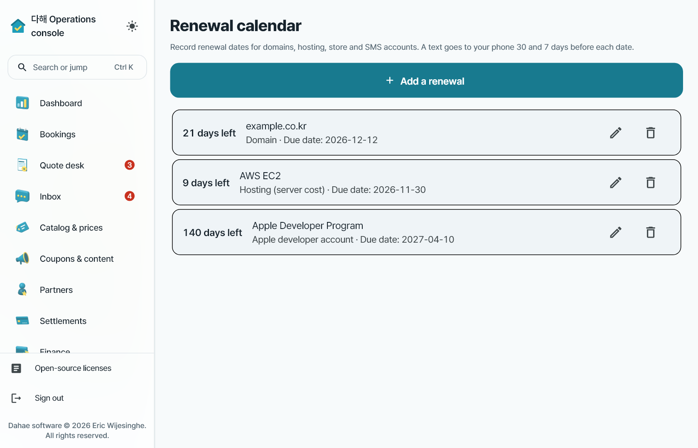

# 23. Operating rules, notification text, activity log, data requests, renewal calendar

**In this chapter:** set business limits and alert thresholds, and change the text of app notifications that customers and cleaning teams get.
You also read the record of who did what, handle a customer's request for a data copy or account deletion, and note renewal dates for your domain, server and other accounts.

> **Before you start**
> - You can sign in to the console with an **Admin** account (chapter 6). **[Operating rules]**, **[Notification text]**, **[Activity log]** and **[Renewal calendar]** show only for admins.
> - A phone with your authenticator app (the app that shows 6-digit codes). Downloading a customer's data and deleting an account ask for a code (chapter 8).
> - For renewal reminder texts: the SMS service (Solapi) connected (chapter 14) and **[System status]** → **Alert settings** → **Phone for alerts** (chapter 26)

---

## 23.1 Operating rules

The limits and thresholds you are allowed to set, in one place.

### How to read the screen

1. In the menu on the left, click **[Operating rules]**.
2. A short explanation is at the top, then five tabs: **Business limits**, **Advertising**, **Points**, **Partner quality**, **Server and alert limits**.
3. Each tab lists its settings as cards. A card shows:
   - At the top: the setting name (for example **Daily photo upload limit (count)**)
   - A field, or an on/off switch
   - **Value source**: **Default** (built-in value), **Installation setting** (set at install time) or **Changed here** (changed on this screen)
   - **Allowed range: min – max**
   - Which way it may move: **Can only be lowered from the default** or **Can only be raised from the default**
   - When it applies: **Applies now** or **Applies after a server restart**
   - Locked settings: **Cannot be changed here (ask the developer)**

### Change a value

1. Click the tab.
2. Type the new number in the card's field (or click the switch).
3. Change other settings on the same tab if you need to. They are saved together.
4. Click **[Save]** at the bottom of the tab.
5. If you changed a setting that deletes records (**AI chat retention (days)**, **Delete unlinked photos after (days)**) or the **No-show grace period (minutes)**, a confirmation dialog opens. Read it and click **[Save]** again.

**You should now see:** **Saved**, and the card's **Value source** changes to **Changed here**.

> **Tip** Clicking **[Save]** with nothing changed shows **Nothing changed**.

### Go back to the original value

1. A card whose **Value source** is **Changed here** has a **[Reset]** button at the bottom right.
2. Click **[Reset]**.
3. Click **[Save]** at the bottom of the tab.

**You should now see:** **Saved**, and the value is back to the installation setting (or the default).

### All settings at a glance

"Start value" below is the default built into the code. If a different value was set at install time, the screen shows it as **Installation setting**, and that value wins. Every setting **applies now**, except the payment reconciliation interval.

**Business limits**

| Setting | Range | Start value | Notes |
|---|---|---|---|
| **Daily photo upload limit (count)** | 1 – 10,000 | 100 | |
| **Open quote requests per customer** | 1 – 1,000 | 3 | |
| **Daily chat threads per customer** | 1 – 1,000 | 10 | |
| **Review reports before hiding** | 1 – 50 | 3 | Can only be raised |
| **No-show grace period (minutes)** | 10 – 240 | 30 | Changes when a partner counts as a no-show |
| **AI chat retention (days)** | 30 – 3,650 | 180 | Shortening it deletes older records |
| **Delete unlinked photos after (days)** | 7 – 365 | 30 | Shortening it deletes older photos |
| **Payment reconciliation interval (seconds)** | 10 – 3,600 | 60 | Cannot be changed here (ask the developer) |

**Advertising**

| Setting | Range | Start value | Notes |
|---|---|---|---|
| **Ads per customer per week** | 1 – 7 | 2 | Can only be lowered |
| **Rebooking reminder (days after visit)** | 7 – 180 | 30 | |

**Points**

| Setting | Range | Start value | Notes |
|---|---|---|---|
| **Most points per manual adjustment** | 1 – 1,000,000 | 100,000 | Can only be lowered |

**Partner quality**

| Setting | Range | Start value | Notes |
|---|---|---|---|
| **Quality score window (days)** | 7 – 365 | 90 | |
| **On-time grace period (minutes)** | 0 – 60 | 15 | |
| **Block job acceptance until partner training is complete** | On / off | Off | When on, partners who have not finished required training cannot accept jobs |

**Server and alert limits**

| Setting | Range | Start value | Notes |
|---|---|---|---|
| **Backup overdue after (hours)** | 1 – 168 | 36 | Lower only |
| **Backup late after (hours)** | 1 – 168 | 26 | Lower only. Must stay below the overdue value |
| **Disk free space red below (%)** | 1 – 50 | 10 | Raise only. Must stay below the yellow value |
| **Disk free space yellow below (%)** | 1 – 80 | 20 | Raise only |
| **Alert when a booking has no pro for (hours)** | 1 – 168 | 24 | Lower only |
| **Same-day cancel rate alert above (%)** | 5 – 100 | 30 | Lower only |
| **VAT reminder days before the filing day** | 1 – 14 | 7 | Raise only |
| **Maintenance mode (blocks new bookings)** | On / off | Off | See chapter 26 |
| **Maintenance message** | Up to 200 characters | Empty | Shown to customers in maintenance mode |

> **Warning** "Lower only" and "raise only" are safety limits. You can only send fewer ads and get alerts sooner, never the other way.

> **Warning** Switch on **Block job acceptance until partner training is complete** only after the training screens and content are ready. Otherwise partners cannot take jobs.

> **Tip** **Maintenance mode (blocks new bookings)** is a switch for short server work. Chapter 26 explains how to turn it on and off.

---

## 23.2 Notification text

Change the text customers and cleaning teams see in **app alerts** and the **in-app inbox**. Without a change, the built-in text is used.

### Change a text

1. In the menu on the left, click **[Notification text]**.
2. Each notification has its own card. The card title is the notification name. The names are shown in Korean even on the English screen, for example **새 예약 (직원)** (new booking, staff), **청소 완료 (고객)** (cleaning done, customer), **견적 선택 (청소팀)** (quote selected, cleaning team). The word in brackets is who receives it.
3. Under the name, **Values you can use: {예약번호} {업체명}** lists the values you may insert ({예약번호} = booking number, {업체명} = business name). It differs per notification; some have none.
4. Each card has a **Korean** part and an **English** part. Find the language you want to change.
5. The **Built-in text: …** line shows the current built-in text. Below it you see **Using the built-in text** or **Using your text**.
6. Edit the **Title** and **Message** fields. To insert the booking number, type it with the braces exactly: `{예약번호}`.
7. Click **[Preview]**. Under **This is how it looks**, the text appears with sample values filled in.
8. If you like it, click **[Save]**.

**You should now see:** **Saved**, and **Using your text** for that language.

> **Warning** Titles allow **40 characters** and messages **120**. Line breaks are not allowed.

> **Note** The value names stay Korean in English texts too. Write `{예약번호}`, not a translated name.

> **Note** This screen changes only app push and in-app inbox texts. KakaoTalk AlimTalk texts follow the templates Kakao approved (chapter 14).

### Restore the built-in text

1. In the language part you want to reset, click **[Restore built-in text]**.
2. In the confirmation dialog, click **[Restore built-in text]** again.

**You should now see:** **Restored to the built-in text**, and **Using the built-in text**.

---

## 23.3 Activity log

Who did what and when, newest first. Records cannot be deleted.

1. In the menu on the left, click **[Activity log]**.
2. Choose a period: **Today**, **Last 7 days**, **Last 30 days**, **All time**. It starts on **Last 7 days**.
3. Click the **Who: Everyone** box to pick who: **Staff**, **Customer**, **Partner**, **Automatic**.
4. Click the **What: All actions** box to pick a kind of action: **Cases and refunds**, **Bookings**, **Customer data**, **Staff**, **Settlements**, **Points**, **Services and prices**.
5. Click a row. The **Details** dialog shows the **Action code**, the **Target** and what was recorded.
6. Click **[Close]**.

**You should now see:** matching records, newest first. With none you see **No records match these filters**.

> **Tip** Viewing a customer's contact details (**Customer contact viewed**), refunds (**Case refund**), new staff (**Staff added**) and settlement holds (**Settlement hold changed**) all appear here. If something looks wrong, tell your installer or the developer.

---

## 23.4 Account deletion and data requests

Handle a customer's "send me a copy of my data" or "delete my account" request here. Everything is logged.

### First: confirm who is asking

Make sure the person really is that customer. The usual check is the registered mobile number.

### Find the customer

1. In the menu on the left, click **[Account deletion and data requests]**.
2. Type the number in **Customer phone number**.
3. Click **[Find]**.

**You should now see:** the customer's name · phone number and **Bookings N**, with the **[Download a copy of the data (CSV)]** and **[Delete account]** buttons below. An unknown number shows **No customer is registered with this number.**

### Give a copy of the data (CSV)

1. Click **[Download a copy of the data (CSV)]**.
2. If the code prompt opens, type the 6-digit code from your authenticator app (chapter 8).
3. The file is saved on your computer.

**You should now see:** **The copy of the data was saved.**

> **Warning** The file contains personal data. Give it **only to that customer**, then delete it from your computer.

> **Tip** CSV download works only in the console opened **in a web browser**. Elsewhere you see **CSV download works in the web console**.

### Delete the account (Admin only)

1. After finding the customer, click **[Delete account]**.
2. Read the dialog: name, contact details and other personal data are erased and this **cannot be undone**. Booking and payment records are kept as the law requires.
3. Type the customer's number again in **Type the phone number again**.
4. Click **[Delete account]** in the dialog.
5. If the code prompt opens, type the 6-digit code from your authenticator app.

**You should now see:** **The account was deleted.** If the numbers differ, you see **The phone number does not match.**

> **Warning** Deletion cannot be undone. If the customer says it was a mistake, ask them to sign up again.

> **Note** A customer with an open booking keeps some personal data until the booking closes. **Partner (cleaning team) deletion and data copies are not in the console yet.** Send partner requests to the developer.

### Request log

**Request log** at the bottom lists handled requests: the kind (**Deletion**, **Data copy**), the result (**Done**, **Failed**) and **Handled by**. With none you see **No requests have been handled yet.**

---

## 23.5 Renewal calendar

Write down dates that must be renewed every year or month (domain, server, store and SMS accounts). A text reaches your phone **30 days and 7 days before** each date.

### Add an item

1. In the menu on the left, click **[Renewal calendar]**.
2. Click **[Add a renewal]**.
3. Type a clear name in **Name (for example myshop.co.kr)** (1 to 80 characters).
4. Under **Type**, click one: **Domain**, **Old domain (alias)**, **Hosting (server cost)**, **Apple developer account**, **SMS service (Solapi)**, **Off-site backup storage**, **Other**.
5. Under **Due date**, click **[Pick a date]** and pick the date in the calendar.
6. Click **[Save]**.

**You should now see:** **Saved.**, and a new row. At the left of each row you see **N days left**, **Due today** or **Overdue**.

> **Tip** A good start: your domain, the server bill (for example AWS), the Apple developer account (yearly), Solapi, and the off-site backup storage. Look up each date in that company's own admin page.

### Edit or delete

1. Click the pencil button (**Edit**) on a row, change it and click **[Save]**. A new date starts the reminders again for that date.
2. To delete, click the bin button (**Delete**), then **[Delete]** in the dialog. The item's texts stop too.

### The automatic row: Secret key copy check

The list may show a **Secret key copy check** row. It is due one year after the last successful upload test of the secret key copy, and the date is set automatically. You cannot edit or delete it (backups: chapter 27).

> **Warning** Texts go to **[System status]** → **Alert settings** → **Phone for alerts**. If that is empty, they go to **Support phone** in **[Setup]** → **Business profile**. If both are empty, no text is sent.

---

## If something goes wrong

| You see | Do this |
|---|---|
| **[Operating rules]**, **[Notification text]**, **[Activity log]** or **[Renewal calendar]** is missing from the menu | You are signed in as a **Consultant**. Sign in with an **Admin** account. |
| **This value is past the default limit. It can only be changed toward the default.** | This setting moves one way only. Follow the **lowered / raised** line on the card. |
| **The yellow and red limits are in the wrong order. Check both values.** | For backups the late (yellow) hours must be below the overdue (red) hours. For disk the red % must be below the yellow %. |
| **This value cannot be changed here. Ask the developer.** | A locked setting such as the reconciliation interval. Ask the developer. |
| Saving rules shows **Something went wrong. Please try again.** | The value may be outside the **Allowed range** or not a number. Check the range. |
| Notification text: **A value that is not allowed is in the text. …** | Inside braces, use only the values listed on the card, such as `{예약번호}`. |
| Notification text: **The curly brackets do not match.** | Make the number of `{` and `}` equal. |
| Notification text: **Enter both a title and a message.** | Fill both fields. |
| Notification text: **Too long. …** | Keep titles within 40 characters and messages within 120. |
| Notification text: **Line breaks and control characters are not allowed.** | Remove the Enter line breaks and write it on one line. |
| **This action needs a fresh authenticator code. Confirm it, then try again.** | Type the code your authenticator app shows **now** and try again. |
| **Only an admin can delete an account.** | Sign in again with an **Admin** account. |
| The buttons on the data requests screen look broken | **To be confirmed**: a known layout problem. Send the developer a screenshot. |
| No renewal texts arrive | Check that **Phone for alerts** or **Support phone** is set and SMS is connected (chapter 14). |
| **Enter a name of 1 to 80 characters.** / **Pick a due date.** | Type a name and pick a date with **[Pick a date]**. |
