# 24. Customer and partner apps

**In this chapter:** follow what customers and cleaning teams see and tap in the customer app and the partner app.
Keep this chapter open when you answer customer questions or train your teams. At the end there is a full test run from booking to payout.

> **Before you start**
> - Two phones (or one phone with both apps): the customer app and the partner app. Before the store release, install the test builds from chapter 25 (TestFlight, Play internal testing).
> - Two different mobile numbers, one for the customer and one for the partner. Do not use the same number for both.
> - For the test run in 24.3: payments connected with **test keys** (chapters 11 and 12).

> **Note** Service names, prices, time slots, coupons and banners in the apps all come from your console settings (chapters 18 and 22). The pictures below use sample data.

---

## 24.1 Customer app

### First start and sign-in

1. The first screen has a **Continue with phone number** button.
2. Tap it. The **What's your mobile number?** screen opens. The consent items are below the number field:
   - **Terms of service** (required)
   - **Personal data collection and use** (required)
   - **Transfer of personal data abroad** (required)
   - **Marketing messages** (optional)
3. Enter the number, tick the three required items, then tap **[Send code]** at the bottom. The button stays off until the required items are ticked.
4. Enter the texted code on **Enter the 6-digit code** and tap **[Verify]**. If no text comes, tap **[Resend]**.
5. On first sign-up, type a name on **What should we call you?** and tap **[Get started]**.

**You should now see:** four tabs at the bottom: **Home**, **My bookings**, **Chat**, **More**. If welcome coupons are on, the coupons are added (chapter 22).

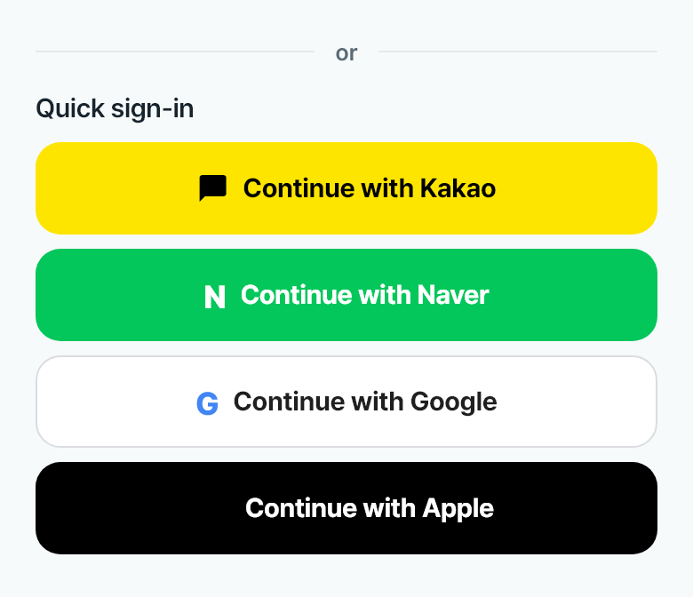

> **Note** The Kakao, Naver, Google and Apple buttons appear only after each company's setup (chapter 15) is done and the app is rebuilt with those keys. Without keys the buttons are hidden.

> **Note** Only customers who agreed to **Marketing messages** receive ad campaigns (chapter 22). Customers can change this later in **More** → **Account** → **Consent settings**.

### Browsing without signing in

Before signing in, people can still see services and prices (**See prices without signing up**). The app asks them to sign in when they try to book or chat.

### Home

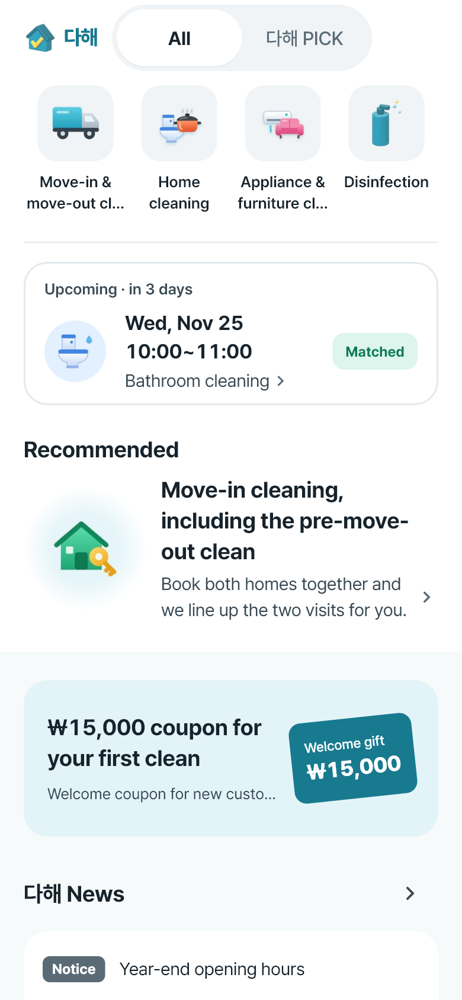

1. Top left: your logo and name. Top right: the **All** / **다해 PICK** switch (**다해 PICK** is fixed text that does not follow the service name, chapter 28).
2. Below it are four large menus (on a new install: Move-in / move-out cleaning, Living-space cleaning, Appliance and furniture cleaning, Pest control and disinfection). Their names, order and pictures come from the service groups in the console **[Catalog & prices]** (chapter 18).
3. If the customer has a booking, an upcoming booking card shows.
4. Below that come recommended services, the banner and **Dahae News**. Banners and news are made in **[Coupons & content]** → **Content** (chapter 22).

### Booking a fixed-price service

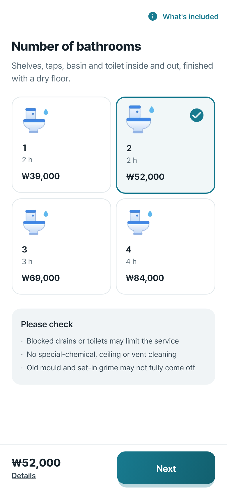

1. On Home, tap a large menu and pick a service.
2. On the service screen, read the price, **Duration**, **Included** and **Please check**. For services counted by unit (air conditioners, sofas and so on), set the number with + and −.
3. Tap **[Book now]**.
4. On **Choose the address to book.**, pick an address or add one with **[Add address]**, then tap **[Next]**.

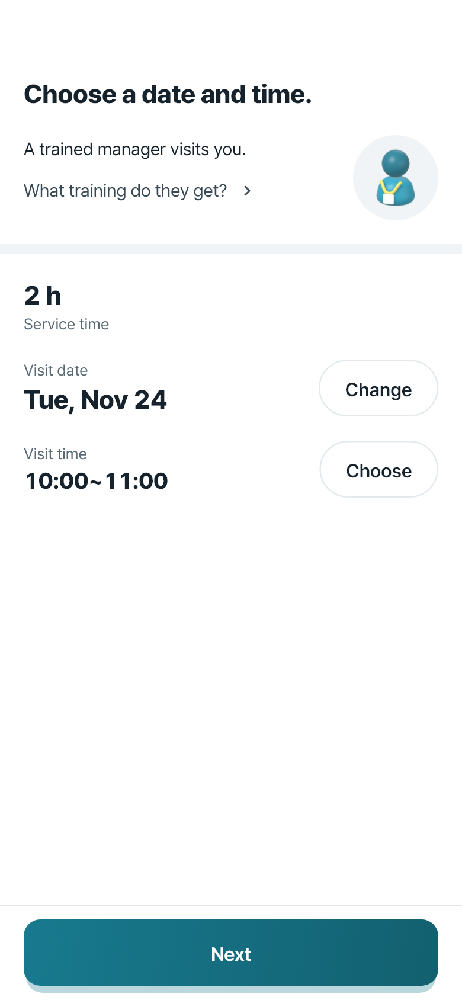

5. On **Choose a date and time.**, pick the **Visit date** and **Visit time**. Full slots say **Full**; nearly full slots say **N left**.
6. Tap **[Done]**.

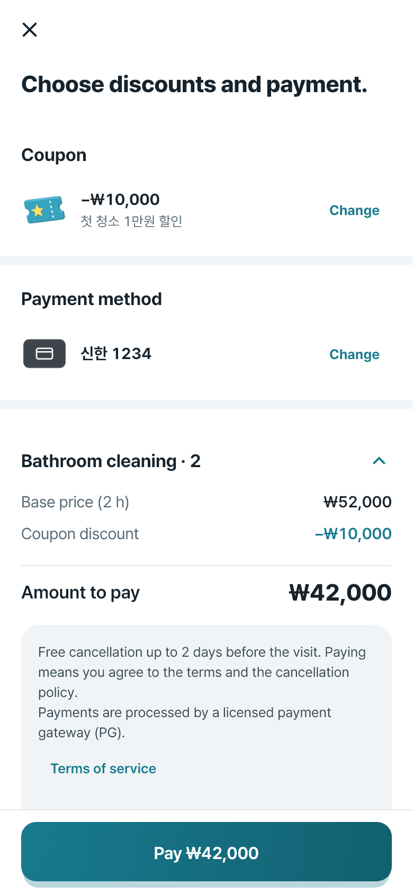

7. On **Choose discounts and payment.**, pick a **Coupon** and **Points**, and choose the **Payment method**.
8. Check the **Amount to pay** and tap **[Pay (amount)]**.
9. Finish the payment on the payment company's screen.

**You should now see:** **You're booked!** (or **Your booking is confirmed**) and the **Please have these ready** notice. **[View booking]** opens the booking.

> **Note** With bank transfer (virtual account), **Your deposit account is ready** shows the **Bank**, **Account number**, **Account holder**, **Amount** and the deadline. Once the deposit arrives in time, it is checked automatically and the booking is confirmed.

### Requesting a quote (move-in / move-out cleaning and similar)

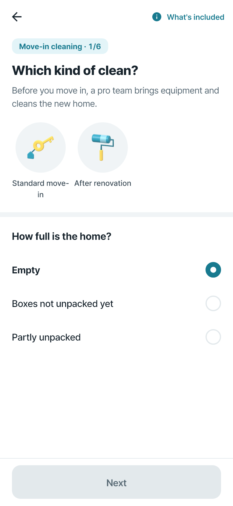

1. A quote service asks a series of questions: **Which kind of clean?**, **Tell us about the home** (**Building type**, **Layout**, **Duplex**), **A bit more about the space** (**Bathrooms**, **Balconies / utility rooms**, **Elevator**), **How full is the home?**, date and time, and address.
2. The last screen shows the **Estimated price** and the **Deposit (paid on confirmation)**. **Nothing to pay yet**.
3. Tap **[Send booking request]**.

**You should now see:** **Request received**, and a chat room for this request on the **Chat** tab.

What happens next:

1. Staff set the final price in the console **[Quote desk]** and send it (chapter 19).
2. The customer's chat room gets **Your final quote is here**.
3. The customer taps **[Pay deposit]** in the booking, and the booking is confirmed.
4. After the cleaning, the customer pays the rest with **[Pay balance]**.

### My bookings and the booking screen

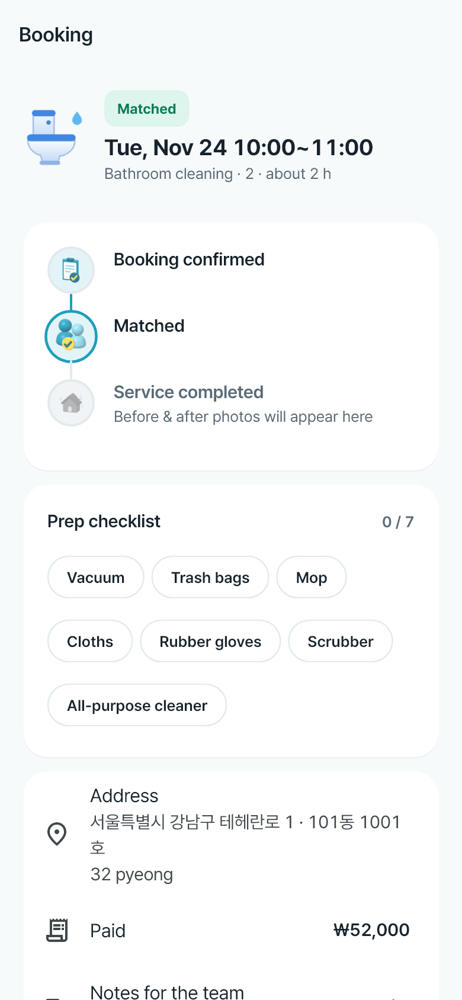

1. On the **My bookings** tab, tap a booking. The **Booking** screen opens. **Week view** / **Month view** switch the calendar layout.
2. On the booking screen the customer can:
   - **Notes for the team**: fill **How to get in (door code etc.)**, **Parking**, **Anything else**, then **[Save]**
   - **Prep checklist**
   - **[Reschedule]**: pick a new date. It changes at once (**Rescheduled**) or after the partner confirms (**Waiting for the pro to confirm**)
   - **[Cancel booking]**: see "Cancelling" below
   - **[Message our team]**, **[Report a problem]**
   - After the visit: **Before** / **After** photos, the **How did it go?** review, **[Book again]**

### Cancelling

1. On the booking screen, tap **[Cancel booking]**.
2. **Cancel this booking?** shows the cancellation fee, the refund and the **Cancellation and refund policy**. The policy follows the cancellation rules set in the console (chapter 18).
3. Pick a reason (optional) and tap **[Cancel and get (amount) back]**. To stop, tap **[Keep it]**.

> **Note** When it is too late to cancel in the app, the customer sees **This booking can no longer be cancelled in the app. Please contact our team**. Staff then handle it in the console (chapters 19 and 21).

### Chat

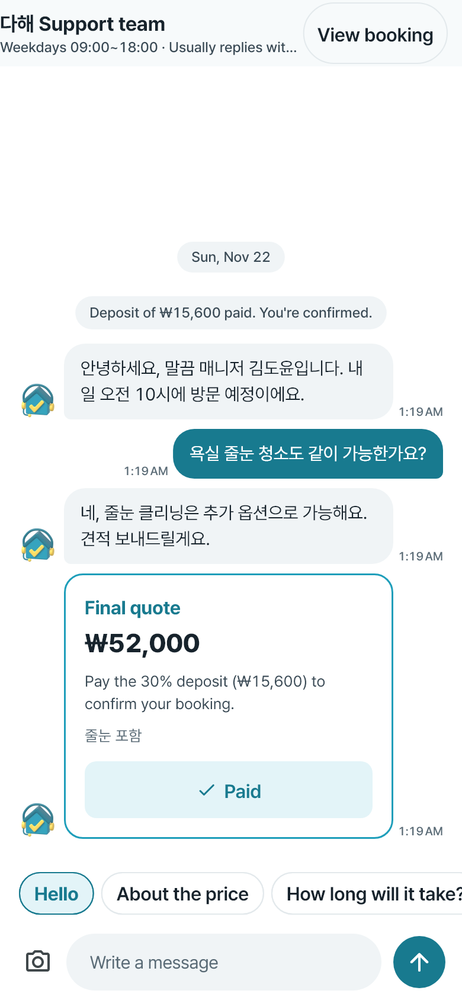

1. Tap the **Chat** tab, then **[New chat]**.
2. Pick a topic under **What's it about?**.
3. Type a message or use **Send photo**. Quick-reply buttons such as **Hello** and **About the price** are there too.
4. **Chat hours** show at the top of the chat. They follow **Support hours** in the console **[Setup]** → **Business profile** (empty means the app default **Weekdays 09:00~18:00**).

> **Note** If the AI assistant is on (chapter 16), AI may answer first. Once a staff member replies, AI steps back from that conversation. Customer messages arrive in the console **[Inbox]** (chapter 19).

### More

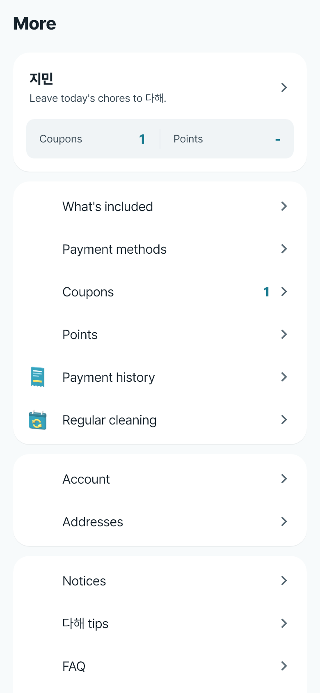

The **More** tab has **What's included**, **Payment methods**, **Coupons**, **Points**, **Payment history**, **Regular cleaning**, **Account**, **Addresses**, **Notices**, **다해 tips** (fixed text), **FAQ**, **Chat with us**, **Partnerships**, **Language**, **Theme**, **Privacy policy**, **Terms of service**, **Open-source licenses** and **Version**.

- **Regular cleaning** → **Start a subscription**: choose **How often** (**Every week**, **Every 2 weeks**, **Every 4 weeks**), **Day of week** and **Arrival time**. Each visit is charged the day before, to the saved card.
- **Account** lets the customer:
  - **Consent settings**: change marketing and other consents.
  - **Download my data**: see a copy of their own data.
  - **Sign out**
  - **Delete account**: personal data is erased and cannot be restored. Active bookings must be cancelled first.

> **Tip** If a customer cannot delete their account in the app, you can do it for them in the console **[Account deletion and data requests]** (chapter 23).

---

## 24.2 Partner (cleaning team) app

### Sign-up and approval

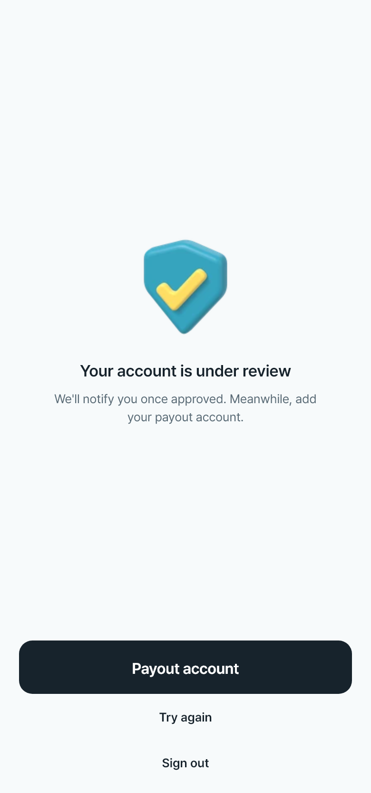

1. Open the partner app and tap **Continue with phone number**.
2. Enter the number and tap **[Send code]**, then enter the code and tap **[Verify]**.
3. On **Tell us about you**, fill **Your name**, **Team name**, **Services you offer** and **Where you work**, then tap **[Apply]**.
4. **Your account is under review** appears. It asks the partner to add a **Payout account** in the meantime.
5. You (or an admin) click **[Approve]** on that partner in the console **[Partners]**, tick every item in the **Verification checklist**, then click **[Approve as active]** (chapter 20).

**You should now see:** after approval, the partner app shows the **Jobs**, **My quotes**, **Schedule**, **Chat** and **More** tabs.

> **Note** Team members a partner invites must also be approved in the console before they can see customer addresses and take work (chapter 20). A paused account sees **Your account is paused. Please contact operations.**

### Taking jobs

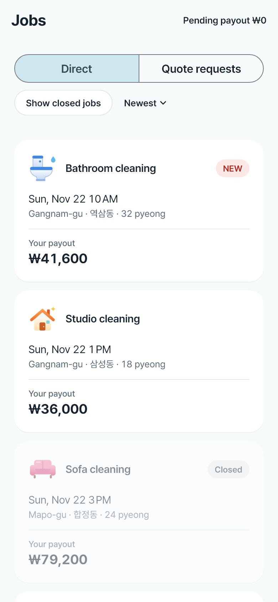

1. Tap the **Jobs** tab. **Pending payout** shows at the top.
2. Switch between **Direct** (fixed-price bookings) and **Quote requests** (requests that need a quote).
3. Sort by **Newest**, **Soonest visit** or **Highest amount**. **Show closed jobs** shows past jobs too.
4. Each card shows the **Customer estimate** and **Your payout**. The exact address and customer details appear only after accepting.

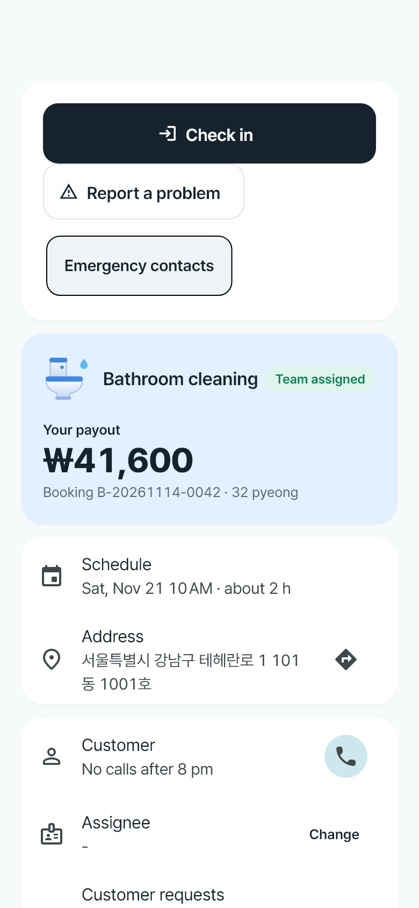

5. Tap a card to open it. Check **Service**, **N% fee** and **You receive**.
6. For a direct booking tap **[Accept job]**; for a quote request tap **[Send quote]**.

**You should now see:** once accepted, the **Address**, **[Directions]**, customer details, **Customer requests**, **Team memo (customer can't see)** and **[Chat with operations]**.

> **Note** Sent quotes are listed on the **My quotes** tab with the status **Waiting**, **Selected**, **Not selected** or **Closed**. A waiting quote can be withdrawn with **[Withdraw]**.

### On the visit day

1. On arrival, tap **[Check in]**.
2. If the booking has an entry code, tap **[Show entry code]**. It works on the visit day only.
3. If something goes wrong, tap **[Report a problem]**. It goes to the console **Case queue** (chapter 22).

### Completing the job

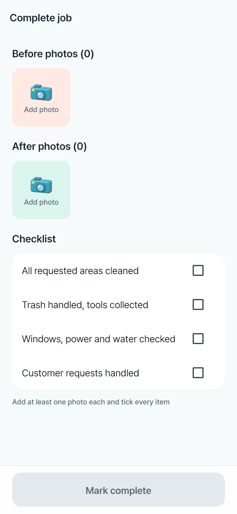

1. On the job, tap **[Complete job]**.
2. Under **Before photos** and **After photos**, add at least one photo each with **[Add photo]**.
3. Tick all four **Checklist** items (**All requested areas cleaned**, **Trash handled, tools collected**, **Windows, power and water checked**, **Customer requests handled**).
4. Tap **[Mark complete]**.

**You should now see:** **Great work!** and the payout date. If the customer still owes a balance, you see **Payout date is set after the customer pays**.

> **Tip** With a weak signal the app says **No signal. Saved, and it will send once you're back online.** Do not delete the app; open it again where there is a signal.

### Earnings and payouts

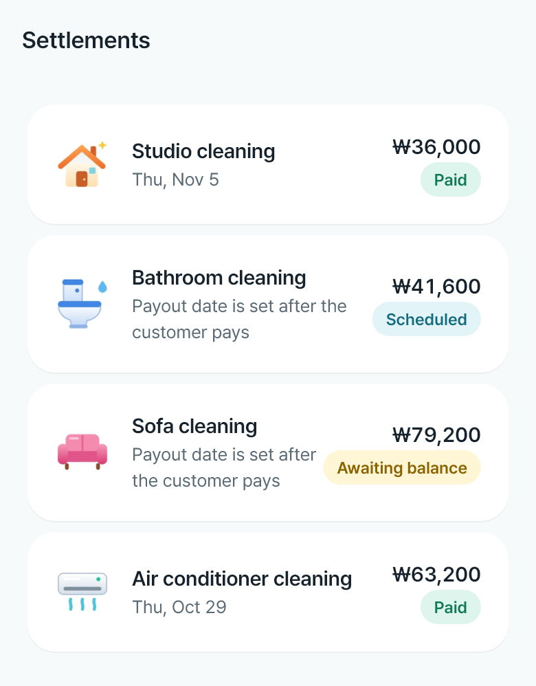

1. Tap **More** → **Earnings**.
2. Switch between **Weekly** and **Monthly**.
3. **Next payout**, **Waiting to pay**, **Paid out** and the **Settlements** list are shown. A settlement is **Awaiting balance**, **Scheduled**, **Paid** or **On hold**.
4. Partners who are not registered businesses also see **Estimated withholding (pending)**.

### More

The partner app's **More** tab has **Earnings**, **Reviews**, **Quality score**, **Services & areas**, **Work schedule**, **Payout account**, **Team**, **Notifications**, **Chat with operations**, **Language**, **Theme**, **Sign out** and **Delete account**. Deleting is refused while the partner has assigned jobs or pending payouts.

---

## 24.3 A full test run, start to finish

Run one full round yourself before you open. Do this **only with payments connected on test keys** (chapters 11 and 12).

1. **Partner sign-up**: sign up in the partner app with the partner number (24.2).
2. **Approve the partner**: in the console **[Partners]**, click **[Approve]** on that partner, fill the **Verification checklist** and click **[Approve as active]** (chapter 20).
3. **Customer booking**: sign up in the customer app with the customer number and book one fixed-price service. Pay with the payment company's **test card**.
4. **Check the console**: the new booking shows on **[Dashboard]** and **[Bookings]** (chapter 19).
5. **Partner accepts**: in the partner app **Jobs**, open the booking and tap **[Accept job]**.
6. **Act out the visit**: in the partner app, **[Check in]** → **[Complete job]** → add photos → tick the checklist → **[Mark complete]**.
7. **Customer check**: the customer's booking shows **Before** / **After** photos and lets them leave a review. If a balance is due, try **[Pay balance]** too.
8. **Payout check**: the job appears as **Scheduled** in the console **[Settlements]**. Follow chapter 21 from **[Run payouts]** onwards.
9. **Cancel and refund test**: make one more booking the same way, cancel it in the customer app with **[Cancel booking]**, and check the refund amount.

**You should now see:** booking → assignment → completion → payout runs without a break, and notifications reach both phones.

> **Warning** After switching to live keys (`live_…`), a test moves real money. If you paid by mistake, refund it in the console straight away (chapter 21).

> **Tip** Afterwards, remove the test customer in the console **[Account deletion and data requests]** (chapter 23) and click **[Suspend]** on the test partner in **[Partners]** (chapter 20).

---

## If something goes wrong

| You see | Do this |
|---|---|
| The sign-in code text does not arrive | Check the SMS connection (chapter 14) and the Solapi balance. Also look at the external services on **[System status]** (chapter 26). |
| No Kakao / Naver / Google / Apple buttons | Each sign-in key (chapter 15) must be set and the app rebuilt. Ask the developer. |
| The large home menus or prices look wrong | Fix them in **[Catalog & prices]** (chapter 18). Saved changes show in the apps at once. |
| Every time slot says **Full** | Raise the bookings allowed per time slot (chapter 18). |
| The terms or privacy screens are empty | Create **Legal** items in **Content** (chapter 22). |
| The partner app stays on **Your account is under review** | All four **Verification checklist** items must be ticked before **[Approve as active]** works (chapter 20). |
| The partner's **Jobs** list is empty (**No matching jobs right now**) | Ask the partner to widen **Services & areas** and **Work schedule**. |
| **[Mark complete]** does not work | Add at least one before and one after photo and tick all four items (**Add at least one photo each and tick every item**). |
| A customer cannot find how to delete their account | It is **More** → **Account** → **Delete account**. |
| Chat hours look wrong | Change **Support hours** in **[Setup]** → **Business profile** (chapter 10). |
