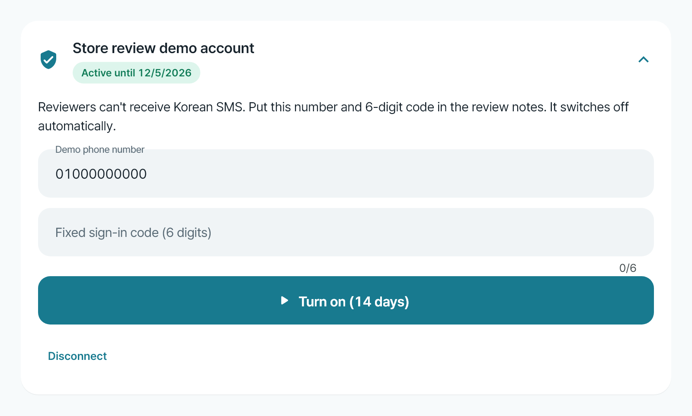
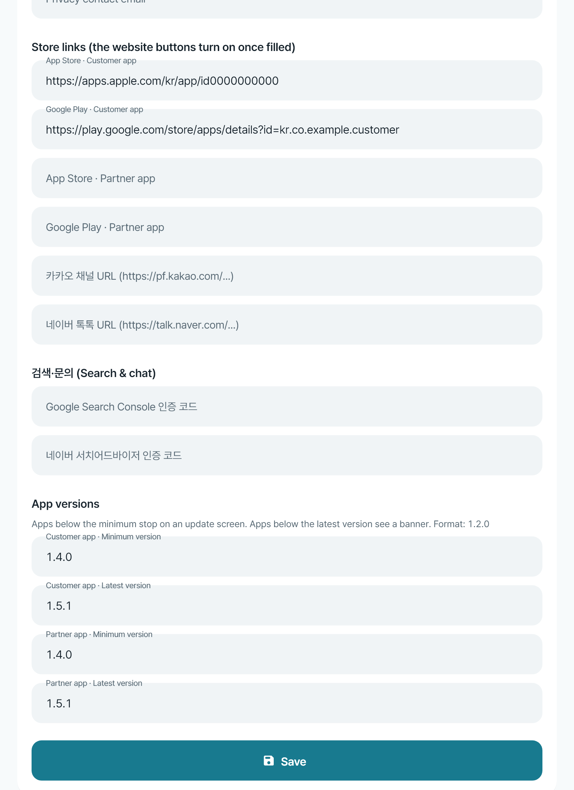
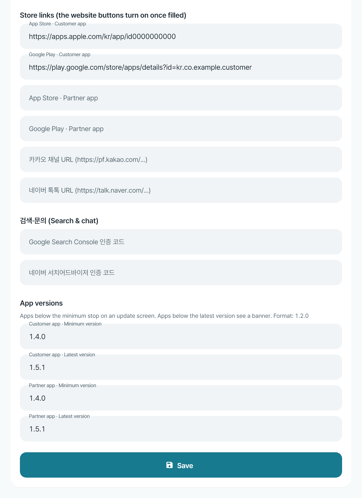

# 25. Publishing to the stores

**In this chapter:** do your part, in order, to get the customer app and the partner app onto Google Play and the App Store.
The developer builds the apps. You create the store accounts in your company's name, give the developer access and help prepare the review.

> **Before you start**
> - Your business registration certificate (the accounts are opened in the company's name)
> - A **D-U-N-S number** (a company ID number; free, but it takes a few days; both Apple and Google need it for organisation accounts)
> - A company payment card (store fees: see each store's price list; the docs give 99 USD a year for Apple)
> - The developer's Google account email and Apple ID (ask the developer)
> - Your console owner account and authenticator app (needed to switch on the store review demo account, chapter 17)
> - The server running with its domain connected (chapters 4 and 5)

> **Note** The stores change their menus and screens from time to time. If a store menu name in this chapter does not match your screen, look for the closest name.

---

## 25.1 Who does what

| Task | Who |
|---|---|
| Sign up for a Google Play developer account as an **organisation** | You |
| Join the Apple Developer Program as an **organisation**, accept the agreements, **request access** to the App Store Connect API (once) | You (only the account holder can) |
| Invite the developer to both stores as **Admin** | You invite, the developer accepts |
| Register the apps, create keys, build, upload, submit for review | The developer |
| Switch on the review demo account in the console (customer app) | You |
| Install the test builds and try them | You and the developer |
| Enter the store links in the console after approval | You |

> **Warning** Open the accounts in your **company's (business) name**. Store policy expects the app owner to be your company. A personal account shows a personal name as the seller.

> **Note** You need no Mac, no code and no build tools. The developer builds the apps online (GitHub) and uploads them to your company's store accounts.

---

## 25.2 Your tasks (once)

### Create a Google Play developer account

1. In a computer browser, go to `play.google.com/console`.
2. Sign in with the company Google account.
3. Choose **Organization** as the account type.
4. Enter the company details and D-U-N-S number, pay the registration fee and finish identity verification.

> **Warning** A **personal** account must run a closed test with 12 testers for 14 days before a public release. That is why an **organisation** account is recommended.

### Invite the developer to Google Play

1. In Play Console, click **Users and permissions** in the left menu.
2. Click the button to invite a new user.
3. Enter the developer's (Eric's) Google account email. The upload service account `eric-play-upload` is created and invited by the developer later.
4. Give the **Admin** permission.
5. Send the invitation. It is done once the developer accepts it from the email.

**You should now see:** the developer's email in the user list.

### Join the Apple Developer Program

1. In a computer browser, go to `developer.apple.com`.
2. Sign in with the company Apple ID and enrol as an **organisation**. You need the D-U-N-S number.
3. Pay the yearly fee and wait for the approval email.
4. After approval, accept the agreements. Only the account holder can.
5. In App Store Connect → **Users and Access** → **Integrations** → **App Store Connect API**, click **Request Access** once. Without it the developer cannot create the key used for automatic uploads.

> **Note** The apps are free and payments run through PortOne / Toss web payment, so App Store tax and banking details are normally not needed.

### Invite the developer to App Store Connect

1. In App Store Connect, click **Users and Access**.
2. Click the add (+) button.
3. Enter the developer's name, **Eric Wijesinghe**, and Apple ID email.
4. Choose the **Admin** role.
5. Send the invitation. It is done once the developer accepts.

**You should now see:** the developer in the user list with the **Admin** role.

### App IDs (decide before the first upload)

The built-in app IDs are below. If you publish under your own company in the stores, you can agree other IDs with the developer **before** the first upload.

| App | Built-in app ID |
|---|---|
| Customer app | `kr.co.dahae.customer` |
| Partner app | `kr.co.dahae.partner` |

If you chose other IDs, put **the same values** in two places.

1. **[Developer]** Set the new IDs in the GitHub `store` environment variables `CUSTOMER_APP_ID` and `PARTNER_APP_ID`, and register the apps in Firebase with the same IDs.
2. **[Owner]** On the console **[Setup]** → **App links** card, enter the same IDs in **Android package names (one per line)** and **iOS bundle IDs (one per line)** and click **[Save]** (chapter 15, 15.5). With the built-in IDs, leave both boxes empty.

> **Warning** An app ID **cannot be changed** once the app is in a store. A new ID is a new store app. If the ID of a published app changes, existing customers get no update to it.

### Keeping the secret files safe

The `.p8` file, the upload key (keystore) and the service account key the developer creates are like passwords.

- Never post them in a KakaoTalk group, an email body or a shared folder.
- The developer stores them only in GitHub's private store (the Secrets of the `store` environment).
- Keep a copy in a password manager. If the upload key is lost, Play updates are blocked.

---

## 25.3 What the developer does (summary)

Not your task, but good to know. Details are in chapter 33 (developer appendix).

1. Registers both apps in both stores (the app IDs above).
2. Creates the upload keys (Apple API key, Play service account, Android upload key).
3. Adds app push (Firebase) and social sign-in keys (chapters 15 and 16).
4. Runs the `store-apps` job on GitHub to build the apps. The app name on the phone's home screen (customer app: **Short name**, partner app: **(short name) 파트너**), the app icon and the colour are read from the server at build time: the values saved in the console's **Business profile** (chapter 28).
5. For Android, uploads the very first file to Play Console by hand; after that, builds go to **Internal testing** as drafts automatically.
6. For iPhone, builds go to **TestFlight**.
7. After the first upload, puts the Play app-signing fingerprints (SHA-1, SHA-256) into the Kakao and Google consoles and into your console **[Setup]** → **App links** (chapter 15).

### Install the test builds (you too)

1. **iPhone**: get the **TestFlight** app from the App Store, open the developer's invitation and install the customer and partner apps.
2. **Android**: install the apps from the Play **Internal testing** link the developer sends.
3. Do the full test run in chapter 24, section 24.3. Check sign-in (phone, Kakao, Naver, Google, Apple), photos, the payment window and notifications.

---

## 25.4 Store listing text and questionnaire answers

The text for the store pages and the answers to the stores' questions are already written. The developer enters them from these files. Read them once and check they fit your business.

| What | File |
|---|---|
| App name, short and long description, keywords (Korean / English) | `docs/store/listing-ko.md`, `docs/store/listing-en.md` |
| Store screenshots | Made by the developer and attached to the release (`docs/store/screenshots/`) |
| Google data safety answers | `docs/store/data-safety.md` |
| Google app content answers (ads, target age, rating, financial features and more) | `docs/store/play-declarations.md` |
| Apple privacy labels, age rating, export compliance | `docs/store/app-privacy.md` |
| Notes for the reviewers | `docs/store/review-notes.md` |

> **Warning** The **items that need a decision** at the end of each answer file must be checked by you and the developer before submission. For example, using the points programme changes the Google financial-features answer (`play-declarations.md` item 9).

> **Warning** The listing text makes promises such as free cancellation up to 2 days before the visit. If you changed the cancellation rules in the console (chapter 18), ask the developer to update the text too.

---

## 25.5 Preparing for review

Reviewers cannot receive Korean text messages, so one review-only number gets a fixed sign-in code.

### Switch on the review demo account

1. In the console **[Setup]**, find the **Store review demo account** card (details in chapter 17).
2. In **Demo phone number**, enter a mobile number **that nobody uses**.
3. In **Fixed sign-in code (6 digits)**, choose six digits.
4. Click **[Turn on (14 days)]**. If asked for the owner code, enter the number from your authenticator app.

**You should now see:** **Active until (date)** on the card. Signing in to the customer app with this number shows two sample bookings (one upcoming, one completed), as long as at least one service is switched on.

> **Warning** It switches off by itself after 14 days. If the review takes longer, switch it on again. A number already used by a customer, partner or staff member gives **A customer, partner or staff member already uses this number. Enter a number nobody uses.**

### Partner app review account (to be confirmed)

> **Warning** The fixed sign-in code works **only in the customer app**. In the partner app the demo number gets no text, and the fixed code is refused as a wrong code. The server blocks it on purpose.

- So today you cannot make a partner app review account from the console alone. How the partner app reviewer gets in is **to be confirmed**. Settle it with the developer before you submit.
- Do not register a partner or staff member on the demo number. If you do, saving the demo account card again gives **A customer, partner or staff member already uses this number. Enter a number nobody uses.**

### Review notes and addresses (with the developer)

1. In `docs/store/review-notes.md`, replace `<REVIEW_PHONE>`, `<REVIEW_CODE>`, `<REVIEW_GOOGLE_EMAIL>`, `<REVIEW_GOOGLE_PASSWORD>`, `<도메인>`, `<domain>` and `<API_DOMAIN>` (your domain) with the real values.
2. Paste the text into Play Console **App access** and App Store Connect **App Review Information > Notes**.
3. Privacy policy address: `https://your-domain/privacy.html`
4. Account deletion address: `https://your-domain/delete-account.html` (both pages are created automatically when the server is installed)

> **Warning** Never save the real number and code in a document file. Type them only into the submission screens.

### Last check before submission (owner checklist)

- [ ] The review demo account is on and stays on for the whole review.
- [ ] You and the developer have settled how the partner app reviewer gets in (25.5, **to be confirmed**).
- [ ] Every `<…>` in the review notes is filled.
- [ ] **[Coupons & content]** → **Growth** → **Review reports** has nothing waiting (chapter 22). Handle anything that arrives during review at once.
- [ ] The customer app's **Terms of service** and **Privacy policy** screens show text (chapter 22, **Legal** content).
- [ ] If you offer Sign in with Apple: the key (.p8) is in the console Apple card, and `https://your-domain/v1/auth/apple/notifications` is registered as the server notification address in the Apple developer account (chapter 15). One key, `Eric Sign in with Apple`, covers both apps: the server signs with it and uses each app's bundle id (`kr.co.dahae.customer`, `kr.co.dahae.partner`) as its client id.
- [ ] Name and trademark checks: trademark search (KIPRIS), Kakao channel and AlimTalk names, payment merchant name, terms-change notice 7 days ahead (chapter 28).
- [ ] The server is running. Do not stop it or turn on maintenance mode during review.

> **Note** The developer usually clicks the submit button. Your own staff can submit too if they have the same role. Review times depend on the stores.

---

## 25.6 After approval

### Enter the store links

1. In the console, open **[Setup]** → the **Business profile** card (chapter 10).
2. Find **Store links (the website buttons turn on once filled)**.
3. Paste the store addresses into the four fields: **App Store · Customer app**, **Google Play · Customer app**, **App Store · Partner app**, **Google Play · Partner app**.
4. Click **[Save]**.

**You should now see:** **Saved**, and store buttons appear on the website.

### App versions

**App versions** on the same card has **Latest version** and **Minimum version** fields for each app (format: `1.2.0`).

- Apps below the **Latest version** show an update banner.
- Apps below the **Minimum version** stop on an update screen.

> **Warning** Raise the **Minimum version** only after the new version can be downloaded from **both** stores. Raising it earlier stops the apps of customers who cannot update yet.

> **Warning** Customer apps from the stores that are older than the first release with Toss Payments cannot open Toss Payments, so methods that go to Toss Payments fail for them (no money moves). Before Toss Payments takes payments (chapter 12), publish the new apps and, once they are in both stores, raise the customer app's **Minimum version** to that release. Which version number that is, is **to be confirmed** with your developer. The web app is always up to date.

### Switch off the review demo account

After the review, click **[Disconnect]** on the **Store review demo account** card. If you leave it, it switches off by itself after 14 days.

### App updates

> **Note** If you changed the name, logo, colour, app IDs or domain in the console, the **Store app build** card on **[Setup]** lists what changed. Those values reach the apps only through a new build. Ask your developer for one, and click **[I built it]** once the new apps are in the stores (chapter 28, 28.7).

1. The developer tags a new version (for example `v1.6.1`) and runs `store-apps` again.
2. Android: check the draft in Play Console and release it. iPhone: check it in TestFlight and send it to review.
3. Once approved, customers' phones update automatically.

### Other stores

- Detailed iPhone release steps: `docs/store/ios-release.md` (for the developer)
- A Microsoft Store (Windows) submission guide is in `docs/store/microsoft-store.md`. Whether your company publishes to the Windows store is **to be confirmed**. The admin console is not a store app; you use it at its web address (`https://your-domain/admin/`).

---

## If something goes wrong

| You see | Do this |
|---|---|
| The developer cannot create the Apple API key | Check that you (the account holder) clicked **Request Access** for the **App Store Connect API**. |
| The developer did not get the invitation | Check the email spelling and invite again. Check the spam folder too. |
| Rejected because the reviewer could not sign in | The demo account may have switched off (14 days). Switch it on again and check the number and code match the review notes. |
| The reviewer could not get into the partner app | The fixed code works only in the customer app. Settle the partner app review with the developer (25.5, **to be confirmed**). |
| The reviewer asks how to delete an account | In the app: **More** → **Account** → **Delete account**. On the web: `https://your-domain/delete-account.html`. |
| Rejected over in-app purchase | Add the English text in `docs/store/review-notes.md` section 4 (cleaning is a physical service) to the review notes and resubmit. |
| Kakao or Google sign-in fails on Android | The Play app-signing SHA-1 must be registered in the Kakao and Google consoles. Tell the developer (chapter 15). |
| The developer says the build stopped because it could not read the server brand | Check that a logo (or a letter logo) is saved on the console's **Business profile**. Without a logo on the server, the build stops (chapter 28, 28.3). |
| Old apps stopped after an update | The **Minimum version** went up too early. Lower it, click **[Save]**, and raise it again once the new version is in both stores. |
