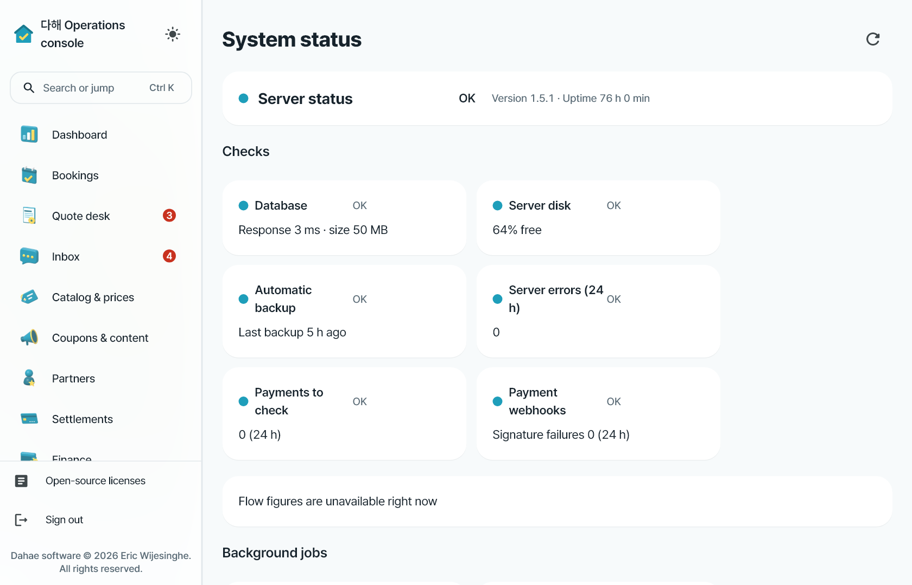
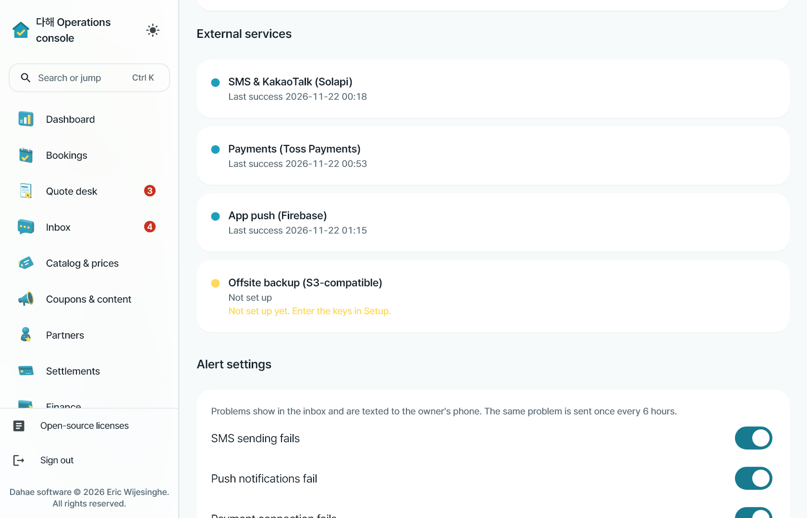
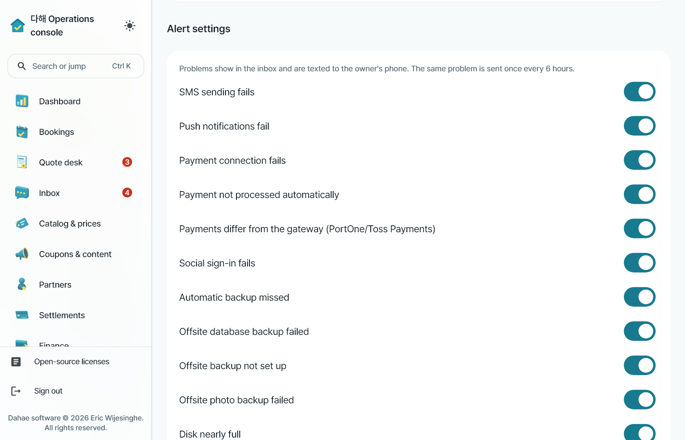
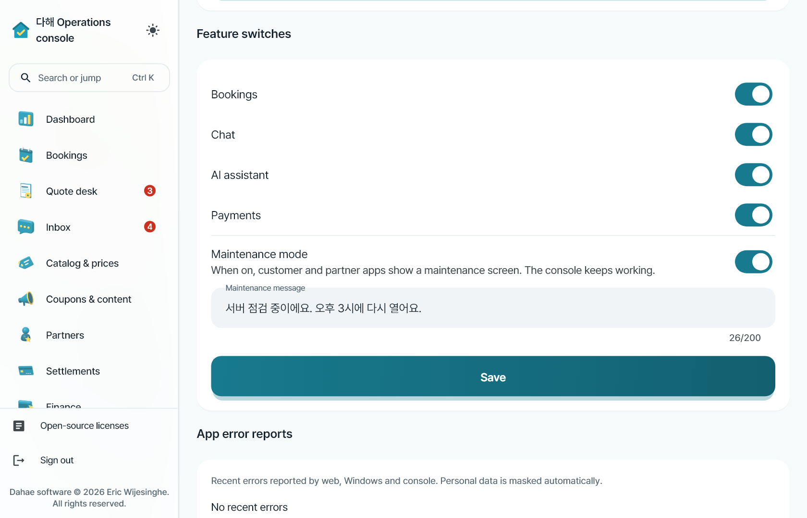
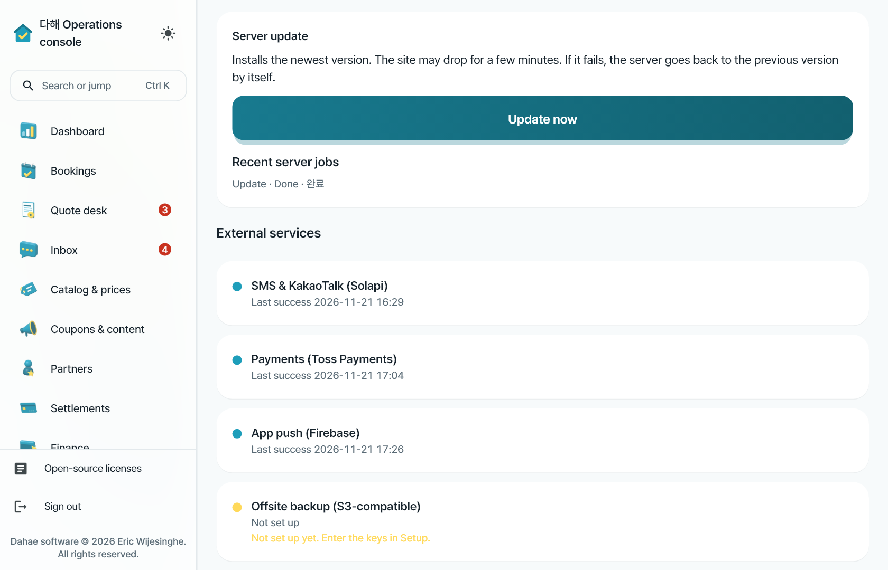
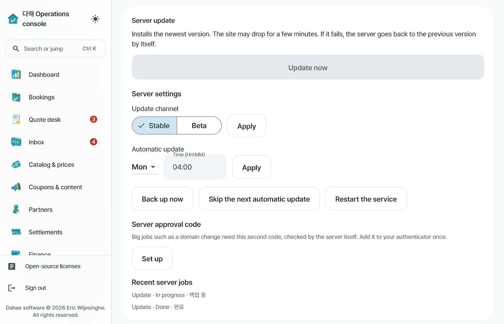

# 26. System status, alerts, updates

**In this chapter:** you learn to read the console's **[System status]** page. You set up text alerts for problems, use the feature switches and maintenance mode, and update the server with one button.

> **Before you start**
>
> - A console account you can sign in with (chapter 6). Anyone can view the page, but only an **Admin** can change switches and save.
> - To update the server: the **Owner** account and the authenticator app on your phone (chapter 6).
> - To receive alert texts, the **SMS & KakaoTalk (Solapi)** card must be connected (chapter 14).

---

## 26.1 Open the System status page

1. In the console's left menu, click **[System status]**. On a phone, tap the menu button (☰) at the top left first to open the menu.
2. The title **System status** shows at the top of the page.
3. The round arrow button to the right of the title (**Refresh**) loads the latest status. On a phone you can also pull the page down to refresh.

You should now see: the **Server status** card at the top, then **Checks**, **Background jobs**, **Server update**, **External services**, **Alert settings**, **Feature switches** and **App error reports**, in that order.

### What the colours mean

Every item on the page has a small dot in front of it. Read the colour and the word like this.

| Colour | Word on screen | Meaning | What to do |
|---|---|---|---|
| Green | **OK** | No problem | Nothing |
| Yellow | **Check** | May become a problem soon, or not set up yet | Look when you have time |
| Red | **Action needed** | Something is wrong now | Follow the red text straight away |

> **Tip** The colour of **Server status** at the top follows the **worst item on the page**. So if a service you do not use (for example Apple login) shows yellow **Not set up**, Server status can stay yellow. If the only yellow items are unused services marked **Not set up**, that is fine.

---

## 26.2 The Server status card

The top card shows four things on one line.

- **Server status**: the overall colour and word (**OK** / **Check** / **Action needed**).
- **Version**: the Dahae version installed on the server now (for example `Version 1.5.1`).
- **Uptime**: the time since the server program last restarted (for example `Uptime 52 h 10 min`).

> **Tip** An update restarts the program, so **Uptime** drops back to almost zero. If the **Version** number changed and **Uptime** is short after an update, the update went in.

---

## 26.3 Checks (six cards)

Under **Checks** there are six cards. When a card turns red, red text under it says what to do. The limits in the table are the values from a fresh install. You can make the disk and backup limits stricter under **[Operating rules]** (chapter 23).

| Card | Value shown | Turns yellow | Turns red | Red text on screen (summary) |
|---|---|---|---|---|
| **Database** | Response ○ ms · size ○ MB | - | The database cannot be reached | If it continues, contact your developer |
| **Server disk** | ○% free | Under 20% free | Under 10% free | Delete old backup files or add disk space |
| **Automatic backup** | Last backup ○ h ago | Over 26 hours | Over 36 hours, or **No backup yet** | Ask your developer to check the backup; check the offsite backup connection |
| **Server errors (24 h)** | ○ | 20 or more | 100 or more | If they keep happening, send the details to your developer |
| **Payments to check** | ○ (24 h) | - | Any at all | Check the payment in the gateway's console and refund it yourself if needed |
| **Payment webhooks** | Signature failures ○ (24 h) | 1 or 2 | 3 or more | Re-enter the webhook secret (PortOne) or the security key (Toss Payments) |

Chapter 29 explains in detail what to do when a card is red.

### The booking flow card

Under the checks is the **Booking flow (last 30 days)** card. It is the same card as on the dashboard (chapter 19). It shows **Median time to assign a pro**, **Bookings with no pro for over 24 h**, **Same-day cancellations today** and **No-show rate by service**. If the figures cannot be read it says **Flow figures are unavailable right now**. This is a short read failure, not a broken server: refresh again a little later.

---

## 26.4 Background jobs

The server keeps doing regular work out of sight. Each **Background jobs** card shows the job's name and **Last success (date time)**.

| Name on screen | What it does (plain words) |
|---|---|
| **Settings refresh** | Reads the settings you changed in the console again |
| **Payment reconciliation** | Compares the gateway's records with ours |
| **Owner alerts** | Sends the alerts in 26.6 of this chapter |
| **Payout sync** | Asks Toss again for payout results |
| **Data retention cleanup** | Deletes personal data whose keeping period ended |
| **No-show check** | Finds bookings where the pro did not arrive |
| **Points expiry** | Clears expired points |
| **Marketing sends** | Sends scheduled marketing messages |
| **Quality scores** | Works out partner quality scores |
| **Waitlist** | Handles waitlisted bookings |
| **Regular cleaning** | Creates and charges regular cleaning visits |
| **Notification outbox** | Sends booking texts and retries failures |

- Colours: green is fine, yellow means **○ errors** happened but the job keeps running, red is **Stalled**. If any job is **Stalled**, Server status at the top turns red too.
- If the **Notification outbox** card shows red text **○ texts dead-lettered**, some texts failed even after many retries. The console cannot resend them. Tell the customers who need it by phone or app message.
- **No successful run yet** means the server just restarted and the job has not run once. Refresh after a few minutes.

> **Warning** If a job stays **Stalled** for more than 30 minutes, take a screenshot and send it to your developer.

---

## 26.5 External services

Under **External services** each connected company service has one row.

Services shown: **Payments (PortOne)**, **Payments (Toss Payments)**, **SMS & KakaoTalk (Solapi)**, **App push (Firebase)**, **Kakao login**, **Naver login**, **Google login**, **Apple login**, **Offsite backup (S3-compatible)**, **Offsite photo backup (S3-compatible)**.

Read the second line of each row like this.

| Words on screen | Meaning | Colour |
|---|---|---|
| **Not set up** | No key entered in Setup yet. Under it: **Not set up yet. Enter the keys in Setup.** | Yellow |
| **No traffic yet** | A key is saved but has not been used yet | Green |
| **Last success (date time)** | The last time it worked | Green |
| **Last failure (date time) (error code)** | The last failure and a short error code | Red if it failed in the last 24 hours with no success since; yellow if a success came after the failure |

When a row is red, it says **This connection is failing. Check the keys in Setup and press Check connection.** Then:

1. Click **[Setup]** in the left menu.
2. Find the card of the service that was red.
3. If the card is locked, click **[Unlock (owner code)]** and enter the 6 digits from your authenticator app (chapter 9).
4. Click **[Check connection]**. On the Payments (PortOne) card it is **[Check API key]**.
5. If it says **Connected**, you are done. If not, copy the key again from the company's site, paste it, click **[Save]** and check again.
6. Go back to **[System status]** and refresh.

> **Tip** **Offsite photo backup (S3-compatible)** has no card of its own. Fill the one **Offsite backup (S3-compatible)** card and the database and photos both go off the server (chapter 17).

---

## 26.6 Alert settings (get a text when something goes wrong)

When something goes wrong, the server leaves an alert in the **Inbox** and texts the owner's phone. The same problem is sent once every 6 hours.

### Choose your alerts

1. Scroll down the **[System status]** page to **Alert settings**.
2. Each kind of alert has a switch. They all start on. Turn off only the ones you do not want.

| Switch | When it alerts |
|---|---|
| **SMS sending fails** | Texts fail several times in a short time |
| **Push notifications fail** | Push fails several times |
| **Payment connection fails** | The gateway connection fails several times |
| **Payment not processed automatically** | Money came in but the booking was not processed |
| **Payments differ from the gateway (PortOne/Toss Payments)** | The gateway's records and ours differ |
| **Social sign-in fails** | Kakao, Naver, Google or Apple sign-in fails several times |
| **Automatic backup missed** | No daily backup for a long time |
| **Offsite photo backup failed** | Photos could not be copied off the server |
| **Offsite database backup failed** | Data could not be copied off the server |
| **Offsite backup not set up** | Offsite backup is not connected yet |
| **Disk nearly full** | Little free space on the server disk |
| **Suspicious sign-in activity** | Many wrong passwords or codes |
| **Sign-in code sends are unusually high (SMS cost)** | Sign-in texts suddenly go out in large numbers |
| **Confirmed bookings with no pro for a long time** | A confirmed booking has had no pro for a long time |
| **High same-day cancellations** | Many same-day cancellations of today's visits |
| **VAT filing deadline approaching** | The VAT filing deadline is near |
| **Toss payout result unknown for over 30 minutes** | A Toss payout result has been unknown for over 30 minutes |

> **Warning** Do not turn off **Payment not processed automatically**, **Automatic backup missed**, **Disk nearly full** or **Offsite backup not set up**. Without them you find out late about customer money or data problems.

### Set quiet hours

Quiet hours stop texts at night. The starting value is **22:00 to 7:00** (Korea time). Problems that happen during these hours are sent in one message after they end.

1. Under **Quiet hours**, click the **From** box and choose a time (for example **22:00**).
2. Click the **To** box and choose a time (for example **7:00**).

> **Tip** If **From** and **To** are the same time, there are no quiet hours: texts come straight away, even at night.

### Phone for alerts

1. In **Phone for alerts**, enter the number that should get the texts (for example `010-1234-5678`).
2. If you leave it empty, texts go to the support number on the **Business profile** card (chapter 10). That number shows in brackets under the box.

### Save

1. Click **[Save]** at the bottom of the alert settings card.

You should now see: **Alert settings saved** briefly at the bottom of the screen. If you see **Could not save. Check the values.**, check the phone number again.

> **Tip** The alert texts in this chapter go to the number in **Alert settings** here. The **[My account]** page also has an **Alert phone** box (chapter 8), but it is stored separately. Which texts use that box is **to be confirmed**. Putting the same number in both avoids confusion.

---

## 26.7 Feature switches and maintenance mode

### Feature switches

**Feature switches** has the switches **Bookings**, **Chat**, **AI assistant** and **Payments**. They all start on. Turning one off stops that feature in the customer and partner apps.

When to use them:
- **Payments**: the gateway has a problem and you want to stop payments for a while.
- **Chat**: nobody can answer and you want to close chat for a while.
- **AI assistant**: you want to switch the AI assistant off for a while.
- **Bookings**: you want to stop taking new bookings for a while.

### Maintenance mode

When **Maintenance mode** is on, the customer and partner apps show a maintenance screen. The console keeps working. New bookings, new subscriptions and starting a booking payment are blocked. Viewing or cancelling existing bookings still works.

To turn maintenance mode on:

1. Click the **Maintenance mode** switch to turn it on.
2. In **Maintenance message**, write what customers should see (up to 200 characters). For example: `We are doing maintenance from 11 pm to midnight tonight. Please come back shortly.`
3. Click **[Save]** at the bottom of the card.
4. **Alert settings saved** shows briefly at the bottom. (This card uses the same saved message. Your switches are saved.)
5. Wait about 30 seconds, then open the customer app and check that the maintenance screen shows. The apps read changed settings within 30 seconds.

To turn maintenance mode off:

1. Click the **Maintenance mode** switch again to turn it off.
2. Click **[Save]**.
3. After 30 seconds, check that bookings work again in the customer app.

> **Warning** While maintenance mode is on, customers cannot book. Turn it off and click **[Save]** when you are done.

> **Tip** Before you restore data from a backup, turn maintenance mode on first (chapter 27).

---

## 26.8 App error reports

**App error reports** shows recent errors reported by web, Windows and console. Personal data is masked automatically.

1. Each row shows the error message and `app · version · date time`.
2. Click a row to open the full record.
3. If the same error shows many times, open that row, take a screenshot and send it to your developer.

With no errors it says **No recent errors**.

---

## 26.9 Server update (with one button)

The server updates itself to the new version **every Monday at 4:00 in the morning** (the default). It takes a backup first and, if the new version does not answer within 3 minutes, goes back to the previous version by itself. So normally you do nothing.

Update by hand, as below, only when your developer tells you a new version is out and you do not want to wait until Monday.

1. Pick a quiet time. The site may drop for a few minutes while it installs.
2. On the **[System status]** page, find the **Server update** card (right under **Background jobs**).
3. Click **[Update now]**. Only the **Owner** account sees this button.
4. The **Enter your code** window opens. Open the authenticator app on your phone.
5. In **6-digit code**, type the 6 digits your authenticator app shows now.
6. Click **[Continue]**.

You should now see: **Update started. You can follow its progress below** at the bottom of the screen, and `Update · Waiting` at the top of **Recent server jobs**. The **[Update now]** button cannot be pressed until the update ends.

7. Every 1 to 2 minutes, click the **Refresh** button at the top right to see progress. If the list does not change, click **[System status]** in the left menu again to reopen the page.
8. If the connection drops for a moment, wait a few minutes and open the console address in the browser again. If you see the sign-in screen, sign in again.

Status words in **Recent server jobs**:

| Words on screen | Meaning | What to do |
|---|---|---|
| **Waiting** | The server will start soon | Wait |
| **In progress** | Backing up, getting the new version, checking it answers. The current step may show after it | Wait |
| **Done** | The update finished | Check that **Version** at the top changed |
| **Failed** | The update did not happen | Take a screenshot and send it to your developer |
| **Failed, so it went back to the previous version** | The new version did not answer, so the server went back. The service keeps running on the previous version | Tell your developer |
| **Needs a check** | The server sent a status the console does not know | Tell your developer |

> **Warning** Each authenticator code works once. If you are told the code is wrong, wait about 30 seconds and try again with the new code in the app.

> **Tip** An update changes only the program. Data such as customers, bookings and settings stays as it is.

### If something is wrong after an update

If the update succeeded but a screen or feature looks wrong, tell your developer. The developer goes back to the previous version on the server (rollback). The console has no rollback button. A rollback does not delete data (chapter 33).

---

## 26.10 If your server is on AWS

A server installed on AWS (chapters 3–4) can use the same **[Update now]** button. On top of that, when the developer releases a new stable version it reaches the server through an automatic GitHub deploy. If DODA wants, a deploy approver can be set on GitHub; then a deploy goes in only after approval. The details are in the developer appendix (chapter 33).

- AWS servers also have the Monday 04:00 automatic update on by default. If you want updates only through GitHub deploys, ask your developer to turn the automatic update off.
- Beta versions are never deployed automatically. Servers that serve customers get stable versions only.

---

## If something goes wrong

> **If something goes wrong**
>
> - **I cannot see [Update now]** → Check that you signed in with the owner account. Other admins do not see the button.
> - **[Update now] is grey and cannot be pressed** → An update is already **Waiting** or **In progress**. Wait for it to end.
> - **The alert switches are grey** → This is a **Consultant** account. Sign in with an **Admin** account.
> - **Alert texts do not arrive** → Check **Phone for alerts** and **Quiet hours**, then click **[Check connection]** on the **SMS & KakaoTalk (Solapi)** card in **[Setup]**.
> - **Server status stays yellow** → Look for the yellow rows in **External services**. If they are unused services marked **Not set up**, that is fine.
> - **The console does not open after an update** → Wait 5 minutes and try again. If it still fails, follow "The site does not open at all" in chapter 29.
> - **The System status page does not open and shows an error** → Click refresh. If it continues, see "The console opens but every page shows an error" in chapter 29.
