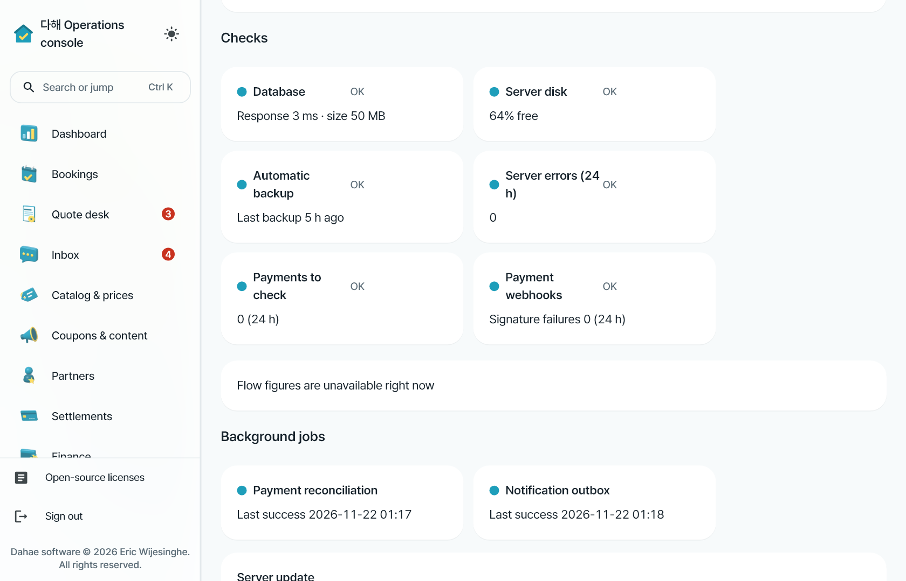

# 27. Backups and restore

**In this chapter:** you learn what is backed up, when and where. You check in the console that backups work, and keep the essential **secret key copy** off the server. You also see what you do and what you ask your developer to do when data must be put back (restore).

> **Before you start**
>
> - A console admin account (chapter 6).
> - An offsite backup store connected (the **Offsite backup (S3-compatible)** card in chapter 17). If you have not done it, read this chapter and do chapter 17 first.
> - Somewhere to keep the secret key copy: a password manager or a USB stick.
> - Restores and the key copy need commands on the server, so you need help from your **developer (installer)**.

---

## 27.1 What is backed up, when and where

The on-server backup and the offsite backup happen by themselves. There is nothing for you to press. Only the secret key copy is made by a person (27.4).

| What | When | Where | Kept for |
|---|---|---|---|
| **On-server backup** (customer and booking data + photo files) | Every day at 3:30 in the morning (Korea time). Also once right before every update, rollback and restore | The backup folder on the server disk | 14 days |
| **Offsite backup** (a copy of the on-server backup) | Right after the on-server backup | The S3-compatible store you connected in chapter 17 (for example Cloudflare R2, Naver Cloud Object Storage, AWS S3) | The card's retention (starts at 30 days, 1 to 3650 days) |
| **Secret key copy** | Not automatic. The developer makes one right after install, and again whenever the keys change | Off the server (password manager, USB stick) | Kept by you |

- Every backup file is **encrypted**. No unencrypted backup stays on the server disk either.
- Backups run once a day, so in the worst case you can lose **one day of data** (bookings that came in after the last backup).
- If backups exist only on the server disk, they are lost along with the server if it breaks completely. So **always connect the offsite backup**.

> **Warning** Offsite backups are locked with the server's **secret key (`DATA_KEY`)**. If you lose the server, you lose this key too. **Without the secret key copy, offsite backups cannot be opened, even if you have them.** Do 27.4.

---

## 27.2 Check in the console that backups work

Checking once a week is enough.

1. Click **[System status]** in the left menu.
2. Look at the **Automatic backup** card under **Checks**.

| What you see | Meaning | What to do |
|---|---|---|
| Green **OK**, **Last backup ○ h ago** (26 hours or less) | Daily backups work | Nothing |
| Yellow **Check** (over 26 hours) | Last night's backup was late or missed | Check again the next day. If still yellow, tell your developer |
| Red **Action needed** (over 36 hours) | Backups have stopped | As the screen says, ask your developer to check the backup |
| Red **No backup yet** | No backup has been recorded yet | On install day, check again after 3:30 the next morning. If it stays, tell your developer |

3. Scroll down to **External services** and look at the **Offsite backup (S3-compatible)** and **Offsite photo backup (S3-compatible)** rows.
   - **Last success (date time)** today or yesterday means it works.
   - **Not set up** means you have not filled the offsite backup card in chapter 17 yet.
   - If **Last failure …** is red, click **[Check connection]** on the card from chapter 17.

> **Tip** If the **Automatic backup missed**, **Offsite database backup failed**, **Offsite photo backup failed** and **Offsite backup not set up** switches in **Alert settings** are on, you get a text when a backup has a problem (chapter 26).

> **Tip** The backup limits (26 hours, 36 hours) can only be made shorter, under **[Operating rules]** (chapter 23).

---

## 27.3 If your server is on AWS (one more layer)

A server installed on AWS (chapters 3–4) has one more layer: **disk snapshots** taken by AWS.

| What | When | Where | Kept |
|---|---|---|---|
| Disk snapshot | Every day at 3:00 in the morning (Korea time) | AWS console **EC2 > Snapshots** | 7 |

- A snapshot is like a photo of the whole server disk. It lives in the same AWS account as the server.
- So a snapshot alone is not enough. Do the offsite backup (chapter 17) and the secret key copy (27.4) as well.
- How to restore from a snapshot is not in this manual. Talk to your developer if you need it.

---

## 27.4 Make and keep the secret key copy (do this)

Today the console cannot make or download the secret key copy. Ask your developer (installer).

1. Tell your developer: **"Please make a secret key copy."**
2. The developer makes the copy file on the server and sets a **lock password** (12 characters or more). The file name looks like `keys-date-time.env.enc`.
3. Receive the file. Do not receive it pasted into KakaoTalk or an email body. Receive the file itself, on a USB stick or through a password manager.
4. Store the file in a **password manager** or on a **USB stick**. It must be somewhere other than the server.
5. Write the lock password down in a **different place** from the file (for example the file on USB, the password in the password manager).
6. When the developer asks on the server whether you stored it off the server, tell them you have. The developer records the confirmation on the server.

You are done when: running `sudo dahae status` on the server shows `✔ 비밀 키 사본 있음` (key copy exists) and `✔ 비밀 키 사본을 서버 밖에 보관했다고 확인했어요` (stored off the server, confirmed). The server prints these lines in Korean.

> **Warning** If you lose **both** the copy file and the lock password, offsite backups cannot be opened. If someone else gets both, they can learn the server's secret key. Keep the two apart and safe.

> **Tip** In the console's **[Renewal calendar]**, click **[Add a renewal]**, choose **Type** **Other**, name it `Secret key copy check` and set a date one year ahead, so you do not forget to check it (chapter 23).

**When to make a new one:** after the developer changes the server's keys, make and store a new copy. Once a new copy exists, stop using the old one.

---

## 27.5 When data must be put back (restore)

A restore **puts the data back to the moment of a backup**. Bookings and customer changes made after that moment are **lost**. Do it only when you must.

**When:** a lot of data was deleted by mistake, data broke after an update, or the server broke and you move to a new one.

**Who:** the **developer (installer)** runs the commands on the server. The console has no restore button. You decide which moment to go back to, and stop customers from booking.

### What you do

1. Decide which moment to go back to. For example: "the backup from the early morning of 10 November". Backups are made every day at 3:30 in the morning.
2. Open **[System status]** in the left menu and turn **Maintenance mode** on. Write a **Maintenance message** and click **[Save]** (26.7). This stops new bookings while the restore runs.
3. Tell your developer:
   - what happened (for example "I deleted the price list by mistake", "bookings look wrong after the update")
   - the date and time to go back to
   - whether the on-server backups still exist, or the server broke and the offsite backup must be used
   - that maintenance mode is on
4. When the developer says it is done, open **[Bookings]** and **[Customers]** in the console and check that bookings and customers look right.
5. If all is well, turn **Maintenance mode** off and click **[Save]**.
6. If bookings came in after the backup moment, contact those customers and ask them to book again.

> **Tip** Right before a restore, the server **backs up the current state first**. So if you do not like the result, the developer can go back to that backup.

> **Warning** If the restore stops with an error, the database stays as it was before the restore. Wait for your developer's instructions. The commands the developer uses are in chapter 33.

---

## 27.6 Monthly backup check (safe on the live server)

1. Click **[Setup]** in the left menu.
2. Find the **Offsite backup (S3-compatible)** card.
3. Click **[Check connection]**. With the owner account you can click it on a locked card without unlocking. Other admins do not see this button on a locked card, so the owner does this check.
4. Green **Connected** means it works. The server uploads a small test file to the store and deletes it straight away.
5. Ask your developer: "Please check that last night's file is in the offsite backup list." The developer checks the list on the server.

A **real restore practice** is done on a **separate test server**, not the live one. Practising on the live server changes real data. The test-server practice follows the same steps as 27.7, and the developer does it. Agree with your developer how many times a year to do it.

---

## 27.7 Moving to a new server (broken server, moving provider)

These steps are for when the server broke or you move to another company's server. The developer does it; it usually takes about an hour. You only need to know the order.

1. Create a new server and install Dahae (Part 2, chapter 4 or 7).
2. (If the old server still works) make a last backup and a secret key copy on the old server.
3. Put the **secret key copy** on the new server. This needs the lock password. Give the developer the file and password you kept (by phone or another way that is not chat).
4. In the new server's console, fill the **Offsite backup (S3-compatible)** card again with the same values as before and save (chapter 17).
5. The developer puts the data back from the offsite backup.
6. Sign in with the **old owner account** (email, password, authenticator app). An account you created fresh on the new server disappears during the restore.
7. Change the domain's A record to the **new server's IP** (chapter 5).
8. Turn the old server off only after you have checked that the new server works.

> **Warning** Do not delete the old server's data until you have checked that the new server works.

---

## 27.8 If you want to change the domain

The domain (site address) is now changed on the console's **[Setup]** → **Domain** card. You do not need a new server or a restore from backup. Chapter 28, 28.8 has every step and warning.

- Before you start, clicking **[Back up now]** on the **[System status]** → **Server update** card gives you peace of mind (chapter 26).
- If the new address does not answer, the server puts the old settings back by itself.
- The old domain keeps answering, so apps installed on phones keep working.
- Change the payment webhooks, social sign-in addresses and store addresses by following the **After the move** list the console shows.

---

## If something goes wrong

> **If something goes wrong**
>
> - **The Automatic backup card is red** → Tell your developer: "The automatic backup has stopped, please check." The server disk may be full, so look at the **Server disk** card too.
> - **Offsite backup says Not set up** → Fill the **Offsite backup (S3-compatible)** card as in chapter 17.
> - **The offsite backup row is red** → In **[Setup]**, click **[Check connection]** on the offsite backup card (the owner does not need to unlock it). If it says the key is wrong, unlock the card, enter a new key made in the store and click **[Save]**.
> - **I forgot the key copy's lock password** → That copy cannot be used. While the server still works, ask your developer to make a new copy straight away.
> - **After the restore, recent bookings are missing** → That is expected. Bookings after the backup moment are lost. Contact those customers and take the bookings again.
> - **After the restore the customer app still shows the maintenance banner** → Check that you turned **Maintenance mode** off and clicked **[Save]**. Wait 30 seconds, then close the app completely and open it again.
