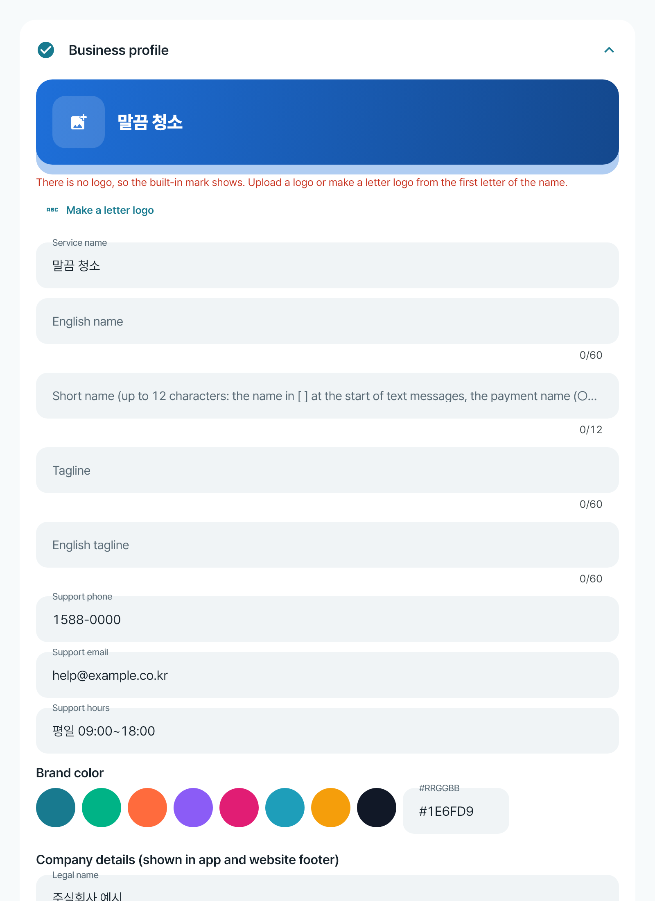
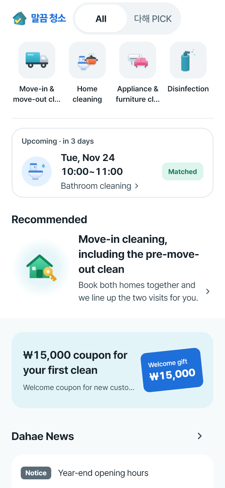

# 28. Name, logo and colours today

**In this chapter:** change the service name, logo and main colour your customers see, from the console.
Today some things change in the console and others only change when the developer rebuilds the apps. This chapter separates the two.

> **Before you start**
> - You can sign in to the console with an **Admin** account (chapter 6).
> - Your logo file (PNG or JPG recommended; iPhone photo format HEIC may not show in the apps)
> - Your main colour as a colour code (`#RRGGBB`, for example `#187A8F`). Without one, pick a colour circle in the console.
> - Your business registration certificate (copy the legal name, representative and registration number exactly)

> **Note** A **rebranding edition** that changes name, logo, colours and app names in one click is planned. Until it arrives, use this chapter.

---

## 28.1 What you can change in the console now

Everything is on the console **[Setup]** → **Business profile** card. Chapter 10 explains every field.

### Change the service name, logo and main colour

1. In the menu on the left, click **[Setup]**.
2. Click the **Business profile** card to open it.
3. Look at the preview at the top of the card. It shows how the top bar of the app will look.
4. Type the name customers should see in **Service name**.
5. Click **[Upload logo]** and pick your logo picture. The preview shows the new logo.
6. Under **Brand color**, click one of the colour circles, or type a colour code in the `#RRGGBB` field.
7. Click **[Save]** at the bottom of the card.

**You should now see:** **Saved**, and the new name, logo and colour in the preview.

> **Warning** A very light colour shows, in red: **White text on this colour is hard to read, so the apps will not use it. Choose a darker colour.** The colour is saved, but the apps ignore it and keep the previous colour. Choose a darker one.

> **Tip** The Dahae default colour on a new install is `#187A8F`. On a server where another name or colour was saved earlier, the saved values win, so save the new name and colour yourself.

### Where the changes show

| What you changed | Where it shows |
|---|---|
| **Service name** | Top of the customer app, the **More** greeting (**Leave today's chores to (name).**), **(name) tips**, **(name) PICK**, the website, `{업체명}` in notification texts, the `[name]` at the start of operations texts, `#{brand}` in AlimTalk templates |
| Logo (**[Upload logo]**) | Top of the customer app (only once a logo file is uploaded to the server) |
| **Brand color** | Buttons and highlights in the customer and partner apps |
| **Support hours** | **Chat hours** on the customer app's chat screen |
| **Company details** (legal name, representative, registration number and so on) | Website footer, terms of service, the business information screen in the customer app |

> **Note** The apps remember the last name and colour they received and switch to the new values the next time they open with an internet connection. If nothing changes right after saving, close the app fully and open it again.

> **Note** The picture uses sample data, so only the main colour and name change. A logo appears only when a real file is uploaded.

### Fill in the company details (required by law)

1. On the same card, scroll to **Company details (shown in app and website footer)**.
2. Fill **Legal name**, **Representative**, **Business registration no.**, **Mail-order registration no.**, **Business address** and **Hosting provider** exactly as on your certificate and contracts.
3. Click **[Save]**.

> **Warning** **Service name** and **Legal name** are different. If you did not change the legal name on your registration certificate, leave **Legal name** as it is on the certificate. Article 1 of the terms and the footer use this legal name.

> **Tip** Once you save a 10-digit registration number, the website footer and terms get a Fair Trade Commission business-check link (**사업자정보확인**) automatically. Click it after saving and check that your company's details appear.

---

## 28.2 What the developer must change today

These cannot be changed in the console. Ask the developer; some need the apps rebuilt and uploaded to the stores again.

| Item | Today | How it changes |
|---|---|---|
| App name and icon on the phone's home screen | 다해 / 다해 파트너 (Dahae / Dahae Partner) | The developer rebuilds the apps and uploads them (chapter 25) |
| App IDs | `kr.co.dahae.customer`, `kr.co.dahae.partner` | Cannot change once in a store |
| Store app name, listing text, store screenshots | `docs/store/listing-*.md`, store screenshots | The developer edits them and updates the stores |
| Text fixed inside the apps | **Dahae News** on Home, **Dahae Safe Booking**, the copyright line, **2 welcome coupons are in your wallet** after sign-up | The developer changes the app text and rebuilds |
| Website privacy policy and terms pages | Generated documents (service name "다해") | The developer regenerates them (`scripts/build_legal.py`) |
| Name when the console is installed as an app | 다해 관리자 | Ask the developer (**to be confirmed**) |
| Name shown in staff authenticator apps | Dahae staff | Ask the developer |

> **Warning** Changing the cancellation rules in the console (chapter 18) does not update article 5 (cancellation and refunds) of the website terms. After changing the rules, ask the developer to regenerate the terms.

### Names you change on other companies' sites

| Where | What to do |
|---|---|
| KakaoTalk channel | Change the channel profile name. Until Kakao approves it, AlimTalk messages go out under the old name. |
| AlimTalk templates | The body changes automatically through `#{brand}`. Any template with the old name typed in must be registered again and approved (chapter 14). |
| Payment companies (PortOne, Toss, Kakao Pay, Naver Pay and others) | Change the merchant name and the name shown on card statements in their admin pages. Otherwise customers' card statements show the old name. |
| Kakao, Naver, Apple, Google developer sites | Change the app name on the social sign-in consent screens (chapter 15). |

### Legal checks before the store release (do not skip)

1. **Trademark search**: search the name on KIPRIS (`https://www.kipris.or.kr`) in class 37 (cleaning), 35 (brokerage and advertising) and 9 (apps). If it clashes with a registered mark, talk to a patent attorney before you settle the name.
2. **Legal name vs service name**: decide whether the new name is the legal name on your registration certificate or only a service name.
3. **Terms-change notice**: even a name change changes the terms text. Announce it in the app's **Notices** (chapter 22, **Notice** content) and on the website at least **7 days before** it takes effect.
4. **Terms review**: legal review is recommended, especially for the cancellation and refund clause.

> **Note** The source of this checklist is `docs/REBRAND-CHECKLIST.md`.

---

## 28.3 The rebranding edition to come

A version that changes the service name, logo, colours, app names and icons and store text in one click is planned. Its timing and scope are **to be confirmed**. Until then:

- Change the name, logo, colour and company details in the console as in 28.1.
- Ask the developer for app names, icons, fixed app text and the terms pages as in 28.2.

---

## If something goes wrong

| You see | Do this |
|---|---|
| The colour changed but the apps did not | If the red contrast warning showed, the apps ignore that colour. Pick a darker one and save again. If there was no warning, close the app fully and reopen it. |
| The logo does not show in the app | Check that you clicked **[Save]** after **[Upload logo]**. If the file is HEIC, convert it to PNG or JPG and upload again. |
| **Please check the highlighted value** | Fix the field marked in red. A colour code is `#` plus six digits or letters. |
| The app name on the phone's home screen did not change | That is expected. The app name and icon change only when the developer rebuilds the apps. |
| Home still says **Dahae News** | That text is fixed in the app. Ask the developer. |
| Customers' card statements show the old name | Change the merchant display name in the payment company's admin page. |
| AlimTalk messages show the old name | Check that Kakao approved the channel name, and that no template has the old name typed in. |
