# 28. Rebranding: name, logo, colours and domain

**In this chapter:** change the service name, logo, main colour and website address (domain) your customers see, from the console.
You also learn what changes the moment you save, what waits for a new store app build, and what you change yourself on other companies' sites.

> **Before you start**
> - You can sign in to the console with an **Admin** account (chapter 6). Changing the domain and **[I built it]** need the **Owner** account.
> - Your logo file (PNG or JPG recommended; a square image looks best; do not use the iPhone photo format HEIC). Without a logo, the console makes a letter logo from the first letter of the name.
> - Your main colour as a colour code (`#RRGGBB`, for example `#187A8F`). Without one, pick a colour circle in the console.
> - Your business registration certificate (copy the legal name, representative and registration number exactly)
> - Only to change the domain: a sign-in for the DNS page of the company you bought the new domain from (Gabia, Cloudflare and so on), and the authenticator app on the owner's phone

---

## 28.1 At a glance: what changes when

Name, logo and colour all live on one card: **[Setup]** → **Business profile**. When you click **[Save]**, the console shows you this same list (28.6).

| When | What | What the console says |
|---|---|---|
| Right away | The `[name]` at the start of SMS and AlimTalk, payment names (the order name on card statements), search pages | **Right away: SMS, AlimTalk and payment names, search pages** |
| Next time they open | Website, privacy policy and terms pages, browser tab icon, share image | **Next time they open: website, legal pages, icons, share image** |
| On their next request | Customer app, partner app, admin console (opened on the web and installed on phones) | **On their next request: customer, partner and console apps (web and installed)** |
| After a new store build | App name on the phone's home screen, app icon, app IDs | **After a store build: app name, icon, app IDs (Store app build card)** |
| By you | Payment company (PG) merchant name, Kakao channel name, store listings | **By hand: PG merchant name, Kakao channel name, store listings** |

> **Note** Every time an app asks the server something, it also checks whether the brand changed. It checks again when the app comes back to the screen. So after saving, close and reopen the app once, or move to another screen, and the new name and colour appear.

> **Note** Dahae sends customers no emails. Notifications go by SMS, AlimTalk and app push, so there is no email text to change.

---

## 28.2 Change the name

1. In the menu on the left, click **[Setup]**.
2. Click the **Business profile** card at the top to open it.
3. Look at the coloured preview strip at the top of the card. It shows how the top bar of the app will look.
4. Fill in these boxes in order.

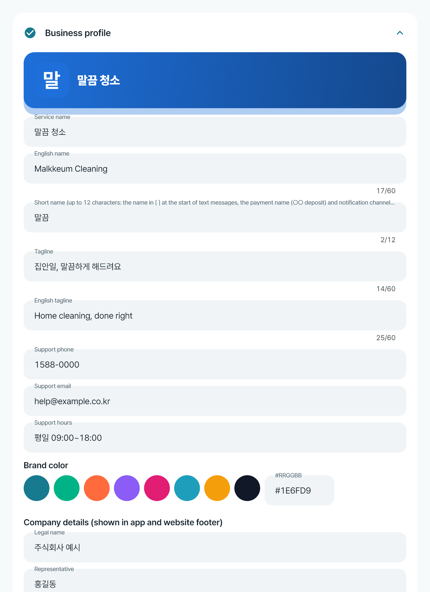

| Box | What to enter | Where it is used |
|---|---|---|
| **Service name** | The name customers see (required) | App header, website, `{업체명}` in notification texts, `#{brand}` in AlimTalk, console title (**(name) Operations console**) |
| **English name** | The name in English (for example `Banjjak Clean`), up to 60 characters | Apps and notifications in English. Empty means **Service name** is used |
| **Short name (up to 12 characters: SMS prefix, home screen label)** | A short name of 12 characters or fewer | The `[short name]` at the start of SMS, payment names (for example `ShortName 예약금`), the app name on the phone's home screen (from the next store build), the app push notification channel name. Empty means the first 12 characters of **Service name** |
| **Tagline** | Your service in one sentence (for example `Vetted cleaners, booked in a minute`), up to 60 characters | The share image (the picture shown when someone sends your link in KakaoTalk and similar apps), the web app description |
| **English tagline** | The tagline in English, up to 60 characters | English screens |

5. Click **[Save]** at the bottom of the card (28.6).

**You should now see:** the new name in the preview strip.

> **Warning** A **Short name** longer than 12 characters is not saved and shows **Please check the highlighted value**. **English name**, **Tagline** and **English tagline** take up to 60 characters.

> **Warning** **Service name** and **Legal name** in the company details are different. If you did not change the legal name on your registration certificate, leave **Legal name** as it is on the certificate. The terms and the website footer use the legal name.

> **Tip** Shorter is better for the SMS prefix and payment names. Payment companies limit the length of order names, which is why the short name stops at 12 characters.

---

## 28.3 Change the logo (upload it once)

Upload **one** logo. When you save, the console makes the 7 sizes the system needs from it and uploads them too: browser tab icon, app icon, home screen icon, share image (1200×630), store icon (1024×1024) and so on.

### When you have a logo file

1. On the **Business profile** card, click the square picture box (a picture with a +) at the left of the preview strip. This box is called **Upload logo**.
2. In the file window, pick your logo file and click **[Open]**.
3. The logo shows in the picture box. It is not saved yet.
4. Click **[Save]** at the bottom of the card, then follow 28.6.

### When you have no logo file (letter logo)

Without a logo, the built-in Dahae logo shows. That logo belongs to the Dahae copyright holder, so if you trade under another name, replace it.

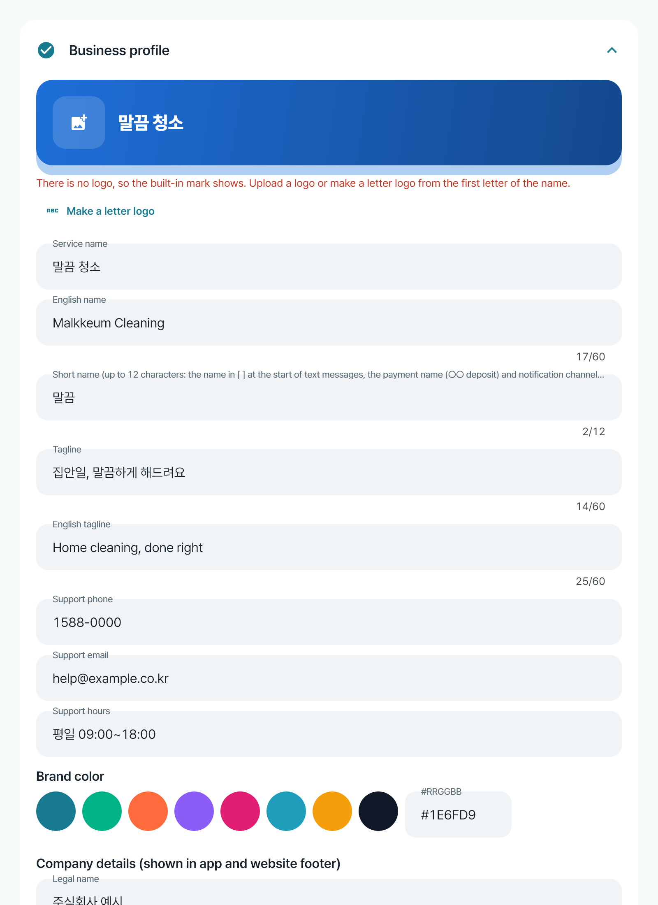

1. First type the name into **Service name**. With the name empty, the next button cannot be clicked.
2. Under the preview strip, red text says **There is no logo, so the built-in mark shows. Upload a logo or make a letter logo from the first letter of the name.**
3. Click **[Make a letter logo]** under it.
4. The picture box shows a logo with the first letter of the name in white on your main colour.
5. Click **[Save]** at the bottom of the card (28.6).

> **Tip** Pick the main colour first, then click **[Make a letter logo]**. The letter logo uses the colour at the moment you click. If you change the colour afterwards, click it again.

> **Warning** With no logo (and no letter logo) at all, no icons or share image are made. A store app build also stops when the server has no logo (chapter 25). Save a logo before you go to the stores.

---

## 28.4 Change the main colour

1. On the same card, under **Brand color**, click one of the 8 round colours, or type a colour code into the **#RRGGBB** box on the right.
2. The preview strip changes to that colour.
3. Click **[Save]** (28.6).

| App | Where the main colour is used |
|---|---|
| Customer app | The main colour of buttons and headers |
| Partner app | Highlights only. The partner app keeps its own dark navy base, so partners never mix it up with the customer app |
| Admin console | The console's main colour |
| Website | Highlights on the website and the legal pages |

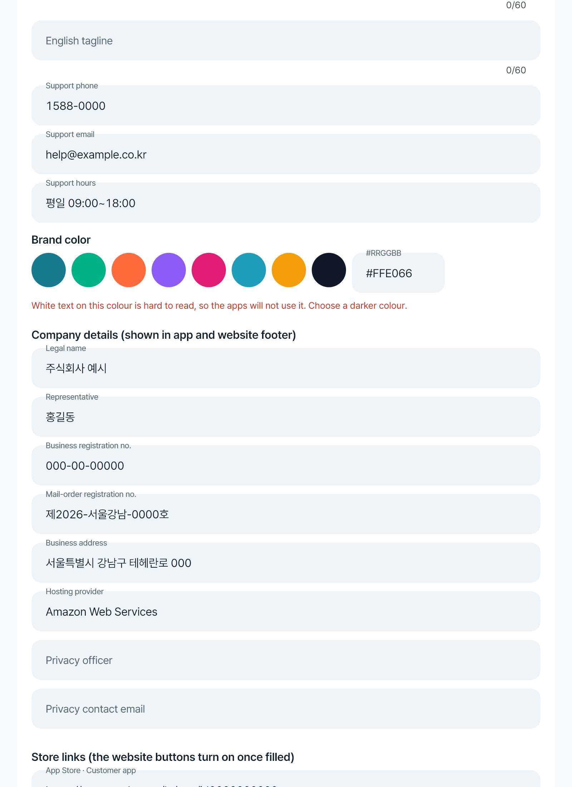

> **Warning** A very light colour shows, in red: **White text on this colour is hard to read, so the apps will not use it. Choose a darker colour.** The colour is saved, but the apps ignore it and use the default colour. Choose a darker one.

> **Tip** The Dahae default colour on a new install is `#187A8F`.

---

## 28.5 Company details (required by law)

1. On the same card, scroll to **Company details (shown in app and website footer)**.
2. Fill **Legal name**, **Representative**, **Business registration no.**, **Mail-order registration no.**, **Business address**, **Hosting provider** and **Privacy officer** exactly as on your documents (chapter 10 explains each box).
3. In **Privacy contact email**, type the address customers write to about their personal data. The server is ready to send this value to the website, but where it appears on the privacy policy page is **to be confirmed**.
4. Click **[Save]** (28.6).

> **Tip** Once you save a 10-digit registration number, the website footer and terms get a Fair Trade Commission business-check link (**사업자정보확인**) automatically. Click it after saving and check that your company's details appear.

---

## 28.6 Save: the preview and the "where it shows" list

1. Click **[Save]** at the bottom of the card.
2. If you changed the logo, main colour, service name or tagline, **Making the images** shows briefly under **[Save]**.
3. The **This is how it looks** window opens. At the top it says **Saving uploads these images and applies them on every screen at once.**, and below are the images it made, each labelled: **Browser tab**, **App icon**, **Home screen icon**, **Share card**.

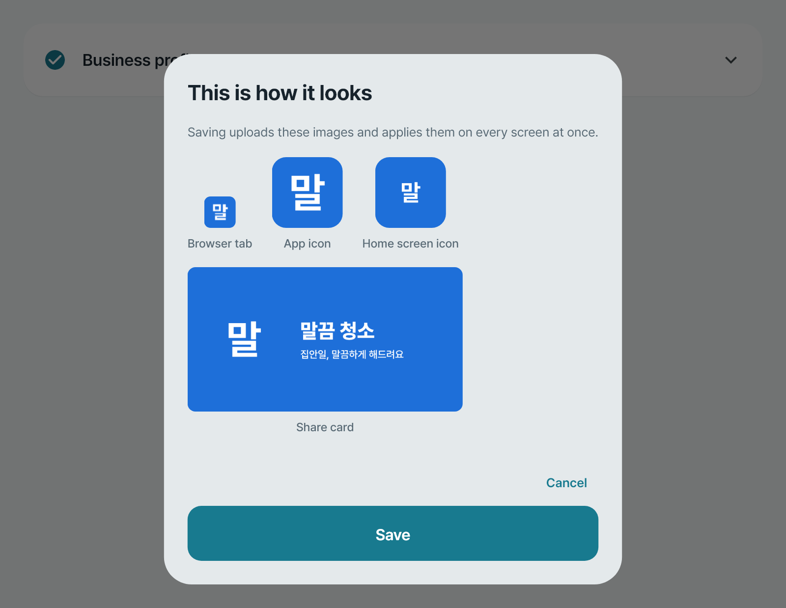

4. Look at each picture. If the logo is cut off or too small, click **[Cancel]** and start again at 28.3 with another logo file. **[Cancel]** saves nothing.
5. If they look right, click **[Save]**.
6. Under **[Save]** you see the upload count, starting at **Uploading images (0/7)**; the first number goes up with each image. Wait until the line disappears. Do not leave the page.
7. **Saved** shows at the bottom of the screen and the **Saved. This is where it shows** window opens. It holds the same list as the table in 28.1.

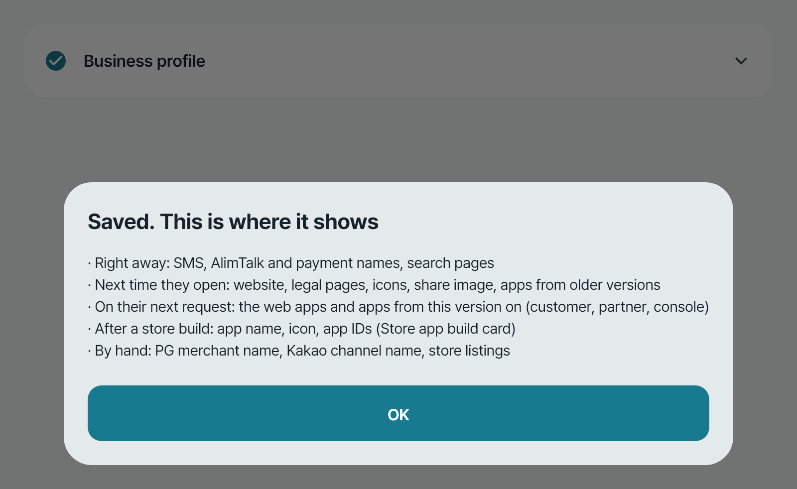

8. When you have read it, click **[OK]**.

**You should now see:** the title at the top left of the console reads **(new name) Operations console**, and the console uses the new main colour. Right below, the **Store app build** card lists what changed (28.7).

> **Note** If you only changed a phone number or company details, steps 2 to 6 are skipped and you go straight to step 7. The images are made again only when the logo, colour, name or tagline changes.

> **Note** The brand texts inside the apps follow the service name too. For example **(name) News**, **(name) PICK** and **(name) Safe Booking** on Home, **(name) tips** and the greeting **Leave today's chores to (name).** in More, and the partner app title **(name) Partner**.

### The website and the legal pages

The server fills in the current values every time someone opens the website or the privacy policy and terms pages, so nothing has to be rebuilt.

- The service name, company details, main colour, icons and share image go in.
- The cancellation and refund table in the terms follows the cancellation rules in the console (chapter 18).
- The processor table in the privacy policy shows **이용 중** (in use) or **현재 이용하지 않음** (not in use) for each service, following the cards you saved in **[Setup]**.
- If you publish **Legal** content (identifier `terms` or `privacy`) in **[Coupons & content]** → **Content**, the website shows that text as well (chapter 22).

> **Warning** The terms text changes, so even a name change must be announced in the app's **Notices** (chapter 22) and on the website at least **7 days before** it takes effect (28.9).

---

## 28.7 The Store app build card

Store apps installed on phones have some values built into the app file. Those change only when the developer builds the apps again and uploads them. The **Store app build** card tells you what changed and so needs a new build.

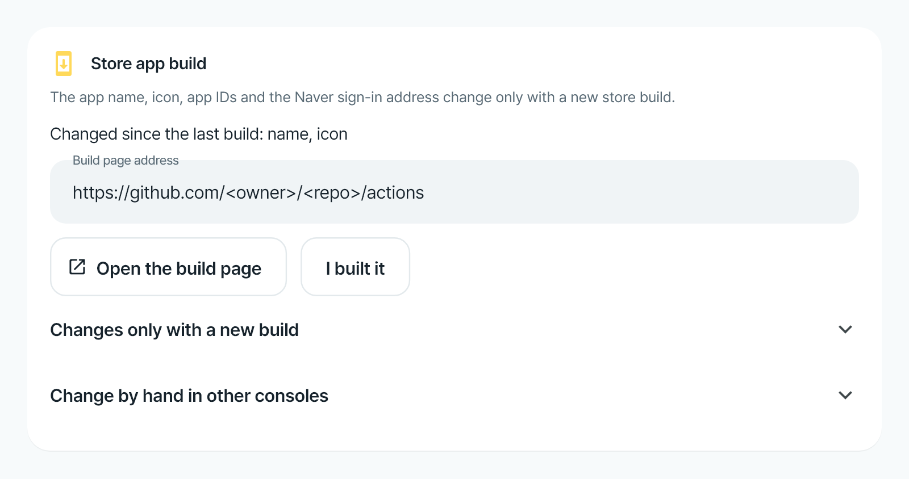

1. On **[Setup]**, find the **Store app build** card right under **Business profile**.
2. The card says: **The app name, icon, app IDs and the Naver sign-in address change only with a new store build.**
3. Read the line under it.

| Screen text | Meaning | What to do |
|---|---|---|
| **Nothing has changed since the last build** (green tick) | No new build needed | Nothing |
| **Changed since the last build: name, icon, …** (yellow icon) | The listed items differ from the store apps | Ask the developer for a new store build (chapter 25) |

Five items can show as changed.

| Item | When it shows |
|---|---|
| **name** | You changed **Service name** or **Short name** |
| **icon** | You changed the logo, or the colour, name or tagline, so the store icon was made again |
| **colour** | You changed **Brand color** |
| **app IDs** | You changed the app ID boxes on the **App links** card (chapters 15 and 25) |
| **domain** | You moved the domain (28.8) or retired an old one |

4. When the developer has finished the new build, paste the build page address they give you (starting with `https://`) into **Build page address**. You may leave it empty.
5. Click **[I built it]**. It is recorded only when the **Owner** account clicks it.

**You should now see:** **Recorded as built**, and the card changes to **Nothing has changed since the last build** with **Last build recorded: (date time)**.

- **[Open the build page]** works only when **Build page address** holds an `https://` address. It opens that page in a new window.
- Click **Changes only with a new build** at the bottom of the card to see the full list: app IDs, home screen name, launcher icon and launch screen, store listing text, screenshots and privacy URLs, signing keys and Apple team, Firebase config files, Kakao, Naver and Google app keys, app link hosts (Naver sign-in), the first server address, the built-in brand shown on first open, the languages built into the app.
- Click **Change by hand in other consoles** to see: merchant name on card statements (PortOne, Toss), Kakao channel name and AlimTalk wording, SMS sender number registration, app name on social sign-in consent screens, store listing names (28.9).

> **Tip** The card takes the values at the moment it first opens as the "last build". So on a server that is already running it starts with **Nothing has changed since the last build**.

> **Note** **[I built it]** only keeps a record. It does not build or upload anything. Click it after the new apps are really in the stores.

---

## 28.8 Change the domain (website address)

The domain is the address customers type to reach your website (for example `example.co.kr`). You can move the domain chosen at install time to a new one from the console.

Know this first:

- The service pauses for **about 30 seconds** during the move. Do it at a quiet time.
- If the new address does not answer, the server **puts the old settings back by itself**. Nothing is left half-broken.
- **The old domain keeps answering.** Apps installed on phones, payment confirmations and sign-in returns keep working on the old address. Only website pages move on to the new address.
- Afterwards the outside services (payments, sign-in, search, stores) need the new address. The console shows the values to paste, with copy buttons (28.8.6).
- Retire the old domain only **after** the new store apps are out and the minimum app version is raised (28.8.7).

### 28.8.1 Once, first: set up the server approval code

Big jobs such as a domain change need a **server approval code** on top of your owner code. It is a second 6-digit code that the server checks itself. You add it to your authenticator app once. If you already did, go to 28.8.2.

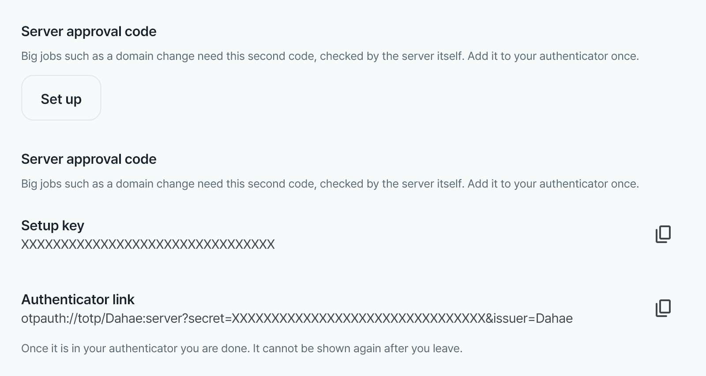

1. Sign in to the console with the **Owner** account.
2. In the menu on the left, click **[System status]**.
3. Find the **Server update** card (chapter 26, 26.9).
4. Inside the card, below **Server settings**, find **Server approval code**. It says: **Big jobs such as a domain change need this second code, checked by the server itself. Add it to your authenticator once.**
5. Click **[Set up]**.
6. The **Enter your code** window opens. Type the owner 6 digits your authenticator app shows now into **6-digit code**, then click **[Continue]**.
7. The button changes to **The server is making the code**. Wait about a minute.
8. Two lines appear: **Setup key** and **Authenticator link**, each with a copy button on the right.
9. On your phone, open the authenticator app and tap the add button (usually **+**).
10. Choose **Enter a setup key** (the wording differs between apps, for example "Enter key").
11. Give it a name you will recognise (for example `Server approval`).
12. Type the console's **Setup key** into the key box exactly, without spaces. If there is a key type, choose **Time based**.
13. Tap **Add** in the authenticator app.

**You should now see:** **one more** 6-digit number in the authenticator app. The console says **Once it is in your authenticator you are done. It cannot be shown again after you leave.**

> **Warning** Your authenticator app now has **two** 6-digit numbers: your usual code for sign-in and owner checks, and the server approval code. Name them so you do not mix them up. If you paste the **Authenticator link** into an app such as 1Password, the entry is named `(your domain):server`.

> **Warning** Once the **Setup key** is in the authenticator app, do not keep it on paper or in notes. It cannot be shown again after you leave the page. Each server makes its approval code only once. If you lose the phone and need a new one, ask the developer to reset the server approval code (`sudo dahae owner-reset`, chapter 33).

> **Tip** If **Could not set it up: (reason)** appears, capture the screen and send it to the developer. An approval code that already exists cannot be made again; in that case keep using the code you set up before.

### 28.8.2 Add the DNS records for the new domain

1. Open the DNS page at the company you bought the new domain from (Gabia, Cloudflare, Route 53 and so on). It works as in chapter 5.
2. Make an **A record** for the new domain with **this server's IP** as the value. The IP also appears in the check result in 28.8.3.
3. Add an A record with the same IP for `www.<new domain>` too.
4. **Do not delete the old domain's A record.** Keep it until you retire the old domain (28.8.7).
5. If the new domain has an **AAAA record** (IPv6), delete it or point it to this server.
6. Wait a few minutes to a few hours (chapter 5, 5.4).

### 28.8.3 Check the DNS

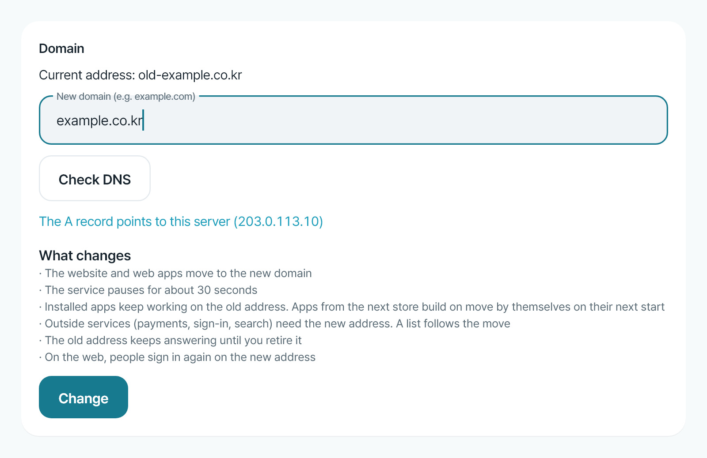

1. On **[Setup]**, find the **Domain** card (right under the **App links** card).
2. At the top it shows **Current address: (current domain)**.
3. Click **[Change domain]**.
4. Type the new domain into **New domain (e.g. example.com)**. Type only the name, such as `myshop.co.kr`, without `https://` or `/`.
5. Click **[Check DNS]**. The button changes to **Checking DNS** while the server checks the DNS itself.
6. Read the result line.

| Screen text | Meaning | What to do |
|---|---|---|
| **The A record points to this server (IP)** (green) | Ready | Go to step 7 |
| **Point the A record to this server's IP (IP). Now: (value)** (red) | The new domain does not point to this server yet. **none** means no record is visible yet | Check 28.8.2, wait, then click **[Check DNS]** again |
| **The AAAA record points elsewhere. Remove it or point it to this server.** (red) | An IPv6 record is in the way | Delete or fix the AAAA record, then check again |
| **Not a domain name, or the same as the current one** (red, under the box) | A typo, or the same as the current domain | Type it again |

7. When it is green with no red line, the **What changes** list and the **[Change]** button appear. Read the whole list.
   - The website and web apps move to the new domain
   - The service pauses for about 30 seconds
   - Installed apps keep working on the old address. Versions after 1.x move by themselves on their next start
   - Outside services (payments, sign-in, search) need the new address. A list follows the move
   - The old address keeps answering until you retire it
   - On the web, people sign in again on the new address

> **Note** Which version "after 1.x" on the screen means exactly is **to be confirmed**. Older apps keep working on the old address, so there is nothing to worry about.

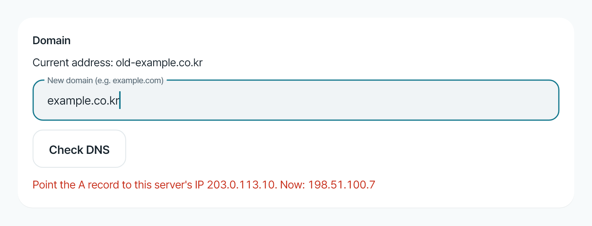

### 28.8.4 Change (owner code + server approval code)

1. Make sure it is a quiet time.
2. Click **[Change]**.
3. The **Enter your code** window opens. Type the **owner** 6 digits from your authenticator app and click **[Continue]**.
4. The card says **Changing. The service pauses for about 30 seconds.**
5. Soon the **Server approval code** window opens: **Enter the 6 digits of the server approval entry in your authenticator. It is not your owner code.**
6. Type the **server approval** 6 digits you set up in 28.8.1 into **6-digit code** and click **[Continue]**.
7. The server changes the address and waits for the new address to answer. This can take up to 5 minutes. Leave the page open.

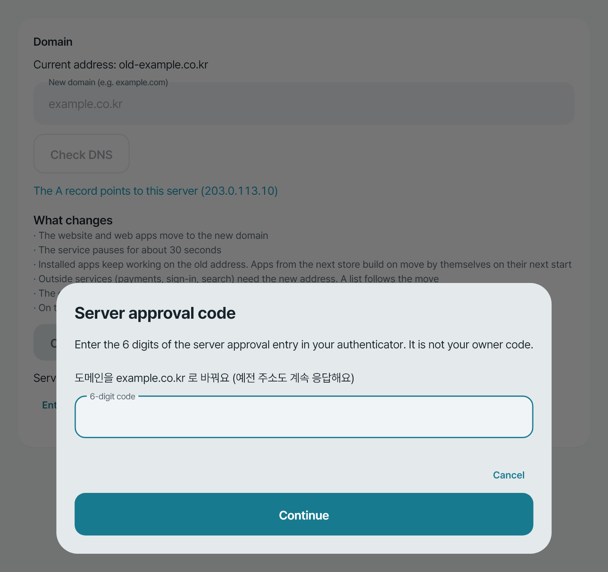

**You should now see:** **Moved to (new domain)** and **[Open on the new address]** on the card. **Current address** shows the new domain, and the old domain is listed under **Old addresses (still answer)**.

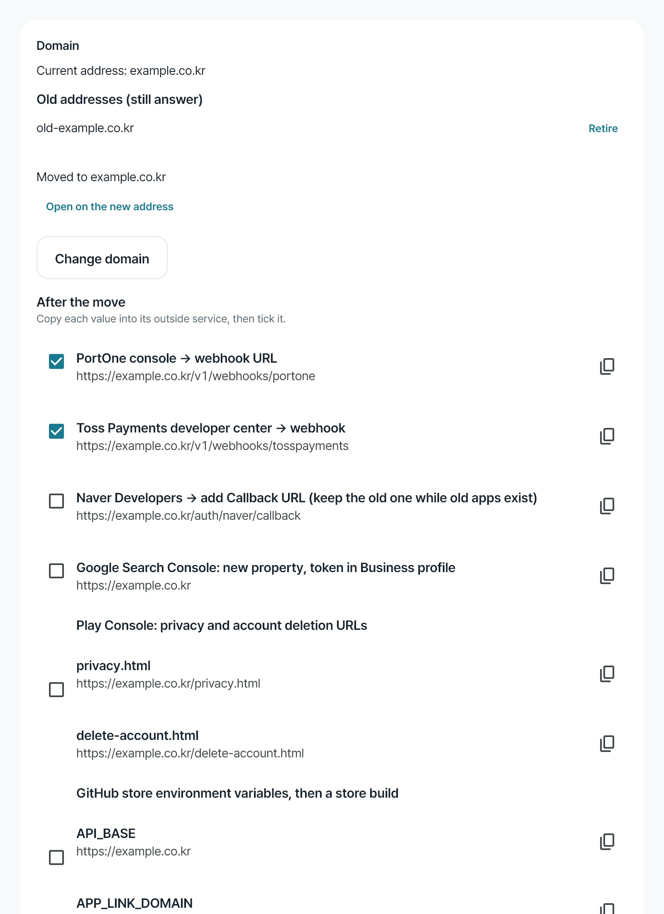

8. Click **[Open on the new address]**. The console on the new address (`https://<new domain>/admin/`) opens.
9. Sign in again on the new address. Bookmark this address from now on.

> **Warning** Enter the server approval code **within 10 minutes**. A wrong code opens the window again. After 5 wrong codes the job is cancelled. After 10 wrong codes in one hour, approvals lock for an hour.

> **Tip** If you clicked **[Cancel]** in the server approval code window, the card still shows **Server approval code** with **[Enter approval code]**. Click it within 10 minutes to try again. If you closed the console window in the meantime, wait 10 minutes and start again at 28.8.3.

> **Tip** When the job starts, the owner's phone gets the text **서버 작업이 요청됐어요: 도메인 바꾸기. 본인이 요청하지 않았다면 바로 확인하세요.** ("A server job was requested: domain change. If it was not you, check at once.") when Solapi is connected. Progress also shows under **Recent server jobs** on the **[System status]** → **Server update** card, for example `Domain change · In progress`.

### 28.8.5 If it did not work (it rolls back by itself)

| Screen text (red) | Meaning | What to do |
|---|---|---|
| **Rolled back: (reason)** | The new address did not answer within 5 minutes, so the server put the old settings back. The service keeps running on the old address | Check the new domain's A record and that ports 80 and 443 are open in the server firewall, then try again |
| **The server refused: 서버 승인 코드가 없어요. 설정에서 먼저 만들어 주세요** (no server approval code yet) | You have not set up the server approval code | Do 28.8.1 first |
| **The server refused: 틀린 승인 코드가 많아서 승인이 잠겨 있어요 (1시간 뒤에 풀려요)** (too many wrong codes, locked for an hour) | Too many wrong approval codes | Try again in an hour |
| **The server refused: 다른 작업이 서버 승인을 기다리고 있어요** (another job is waiting for approval) | A job you started earlier is still waiting for approval | Wait 10 minutes, then try again |
| **The server agent is out of date. Re-run the install line once, then try again.** | The server was installed before this feature | Ask the developer to run the install line once more (your data stays) |
| **Could not change it: (reason)** | Any other failure, including a job cancelled after 5 wrong approval codes | Capture the screen and send it to the developer |

> **Note** The **(reason)** text is a Korean sentence sent by the server. It stays in Korean on the English screen too.

### 28.8.6 After the move (the checklist)

At the bottom of the **Domain** card is the **After the move** list: **Copy each value into its outside service, then tick it.** Each line has the value to paste and a copy button. When you have done one, click the box on the left to tick it. Ticks are saved on the server, so other admins see them. A new domain move clears all ticks and fills in the new values.

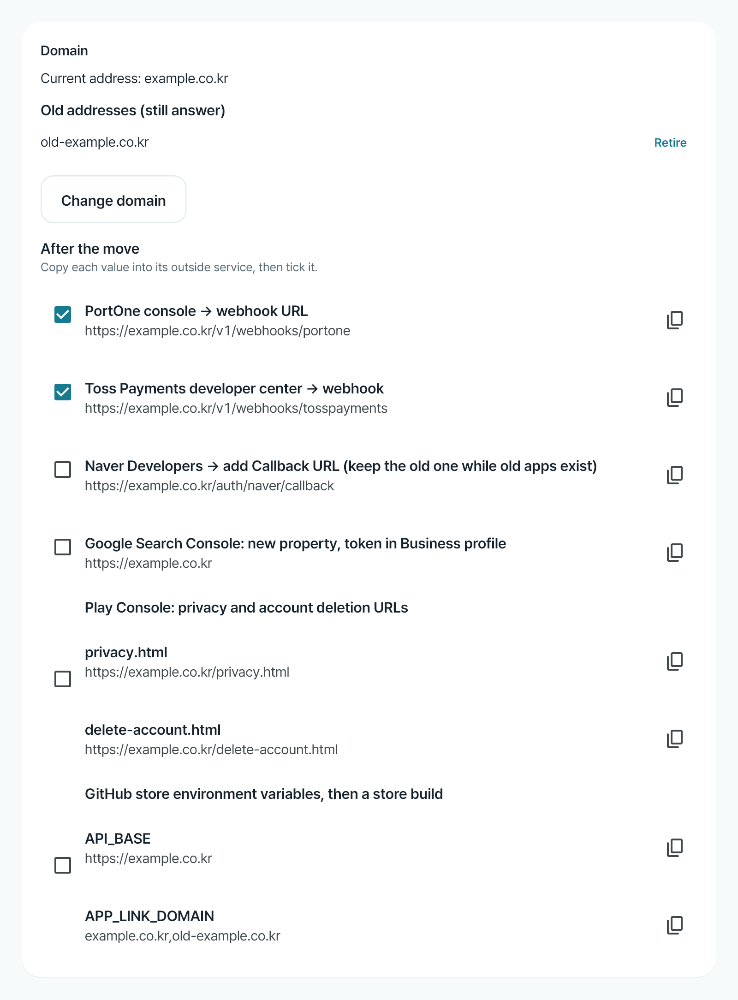

| Screen line | Value to paste (example new domain `new.co.kr`) | Why |
|---|---|---|
| **PortOne console → webhook URL** | `https://new.co.kr/v1/webhooks/portone` | PortOne payment results come to the new address (chapter 11, 11.5). Skip it if you do not use PortOne |
| **Toss Payments developer center → webhook** | `https://new.co.kr/v1/webhooks/tosspayments` | Toss Payments results and virtual-account deposit notices (chapter 12, 12.5). Skip it if you do not use Toss Payments |
| **Toss payouts webhook** | `https://new.co.kr/v1/webhooks/toss` | Only if you use Toss payouts (chapter 13) |
| **Site URL in the PG contract (may be reviewed again)** | `https://new.co.kr` | The site address in the payment company contract. The payment company may review it again; whether it really does differs by company and is **to be confirmed**. Ask their sales contact first |
| **Naver Developers → add Callback URL (keep the old one while old apps exist)** | `https://new.co.kr/auth/naver/callback` | Where Naver sign-in returns. Do **not** delete the old address; **add** the new one. Whether Naver accepts several addresses is **to be confirmed** (chapter 15) |
| **Naver Developers → service URL** | `https://new.co.kr` | The service address in the Naver sign-in app details |
| **Kakao Developers → Platform → Web (if registered)** | `https://new.co.kr` | Only if you registered a website domain at Kakao (chapter 15) |
| **Google Cloud consent screen: homepage and privacy links (if set)** | `https://new.co.kr/privacy.html` | Only if you put addresses on the Google sign-in consent screen (chapter 15) |
| **Google Search Console: new property, token in Business profile** | `https://new.co.kr` | Register the new address as a new property in Google search, and put its verification code into **Google Search Console 인증 코드** on **Business profile** (chapter 10, 10.6) |
| **Naver Search Advisor: new site, token in Business profile** | `https://new.co.kr` | Register the new site in Naver search, verification code into **네이버 서치어드바이저 인증 코드** (chapter 10, 10.6) |
| **App Store Connect: privacy and support URLs** | `https://new.co.kr/privacy.html` and `https://new.co.kr/delete-account.html` | The addresses in the Apple store listing (chapter 25) |
| **Play Console: privacy and account deletion URLs** | The same two addresses | The addresses in the Google Play listing (chapter 25) |
| **Microsoft Partner Center: privacy and support URLs** | The same two addresses | Only if you are in the Windows store |
| **GitHub store environment variables, then a store build** | `API_BASE=https://new.co.kr` and `APP_LINK_DOMAIN=new.co.kr,(old domain)` | **[Developer]** The developer changes them and makes a new store build (chapters 25 and 33) |
| **AlimTalk templates with web link buttons (need approval again)** | `https://new.co.kr` | If an AlimTalk template has a web link button, change it to the new address and get Kakao's approval again (chapter 14) |
| **Keep the old A/AAAA records until retiring; add www.<new>** | The old domain and `www.new.co.kr` | On the DNS page: keep the old domain's records and check that `www.<new domain>` has a record (28.8.2) |
| **After the new store builds are live: raise the minimum app version in Business profile** | (no value) | Once apps built with the new address are out in both stores, raise **Minimum version** under **Business profile** → **App versions** to that version (chapter 10, 10.7) |

> **Warning** Do the three webhook lines (PortOne, Toss Payments, Toss payouts) **first**. Webhooks still arrive on the old address, but they stop the moment you retire the old domain.

### 28.8.7 Retire the old domain (last, strictly in this order)

> **Warning** After you retire the old domain, apps that use it **no longer reach the server.** Old apps on phones use the address they were installed with. So retire it only when **all** of this is done:
> 1. New customer and partner apps built with the new address are out in both stores.
> 2. **Minimum version** is raised to that new version (chapter 10, 10.7), so people on old apps are sent to the update screen.
> 3. All webhooks and sign-in addresses point to the new address (28.8.6).
>
> There is no button to bring a retired address back.

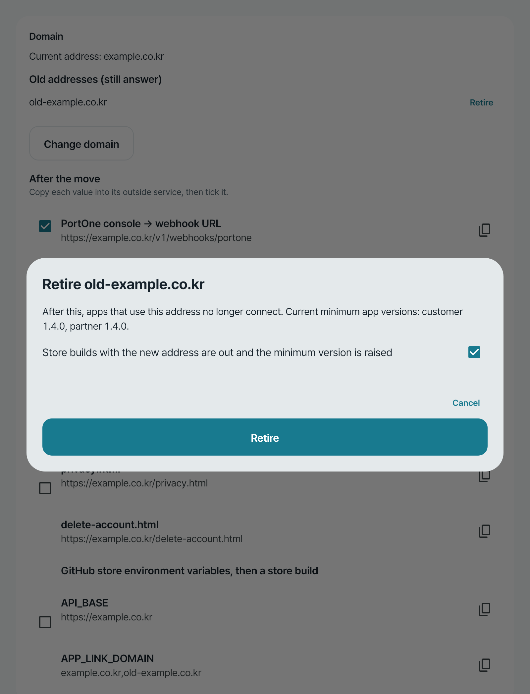

1. On the **Domain** card, under **Old addresses (still answer)**, click **[Retire]** to the right of the address.
2. The **Retire (old domain)** window opens. Read **After this, apps that use this address no longer connect. Current minimum app versions: customer (version), partner (version).** A `-` means no minimum version is set yet. In that case click **[Cancel]** and do step 2 above first.
3. Tick **Store builds with the new address are out and the minimum version is raised**. **[Retire]** works only once it is ticked.
4. Click **[Retire]**.
5. In the **Enter your code** window, type the owner 6 digits and click **[Continue]**.

**You should now see:** **Old address retired**, and the address disappears from the old addresses list.

6. Now you may delete the old domain's A/AAAA records on the DNS page.

### 28.8.8 If you use the console app installed on a PC

On a console where you typed the server address yourself, such as the console app installed on a PC, a strip at the top says after the move: **The server moved to (new address). Change this app's server address too.**

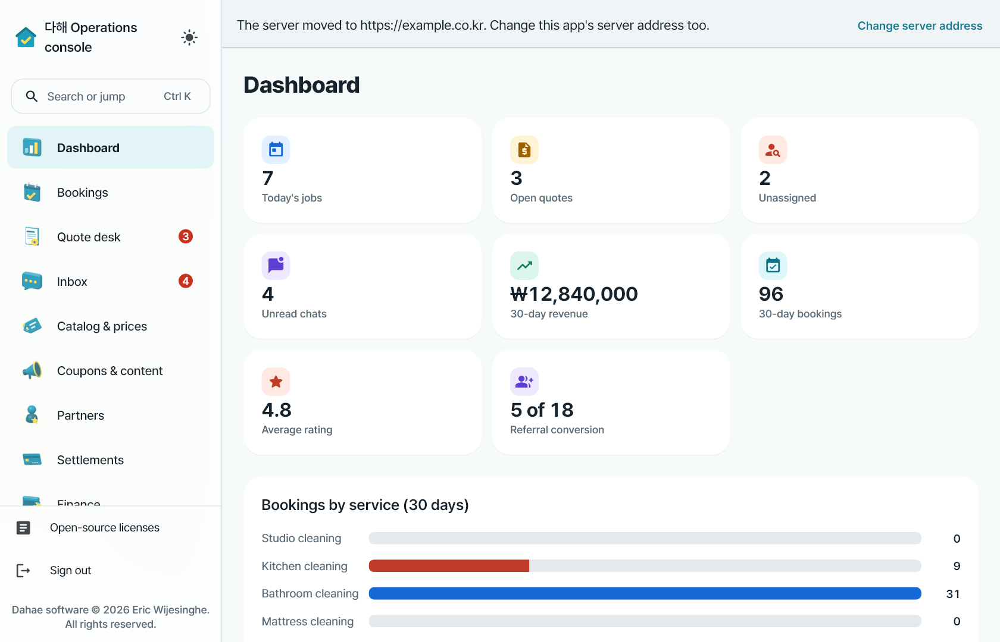

1. Click **[Change server address]**.
2. Enter the new address and sign in again.

> **Note** This is advice only. Until you retire the old domain, the old address keeps working too.

---

## 28.9 What you change on other companies' sites

The console cannot change these names. Change them in each company's admin pages.

| Where | What to do |
|---|---|
| Payment companies (PortOne, Toss, Kakao Pay, Naver Pay and others) | Change the merchant name and the name shown on card statements in their admin pages. Otherwise customers' card statements show the old merchant name. |
| KakaoTalk channel | Change the channel profile name. Until Kakao approves it, AlimTalk messages go out under the old channel name. |
| AlimTalk templates | `#{brand}` in the body changes by itself. Any template with the old name or address typed in must be registered again and approved (chapter 14). |
| SMS sender number | If the sender number registration (company name and so on) changed, update it at Solapi (chapter 14). |
| Kakao, Naver, Apple, Google developer sites | Change the app name on the social sign-in consent screens (chapter 15). |
| App Store Connect, Play Console | Change the store app name, listing text and screenshots (chapter 25). |

### Legal checks before the store release (do not skip)

1. **Trademark search**: search the name on KIPRIS (`https://www.kipris.or.kr`) in class 37 (cleaning), 35 (brokerage and advertising) and 9 (apps). If it clashes with a registered mark, talk to a patent attorney before you settle the name.
2. **Legal name vs service name**: decide whether the new name is the legal name on your registration certificate or only a service name.
3. **Terms-change notice**: even a name change changes the terms text. Announce it in the app's **Notices** (chapter 22, **Notice** content) and on the website at least **7 days before** it takes effect.
4. **Terms review**: legal review is recommended, especially for the cancellation and refund clause.

> **Note** The source of this checklist is `docs/REBRAND-CHECKLIST.md`.

---

## 28.10 What does not change

| What | Why |
|---|---|
| The software credit on every page, **다해 소프트웨어 © 2026 Eric Wijesinghe** | A licence condition, so it stays (chapter 0) |
| The install ID of the console installed as an app | Changing it would split already installed consoles in two. The visible name follows: **(name) 관리자**, short name **(short name) 관리** |
| The name of staff two-step sign-in entries already in authenticator apps | An authenticator keeps the name it was given. Staff who set up from now on see **(name) staff** |
| Service area (Seoul), booking start time, holidays, currency (won), languages (Korean and English), time zone (Korea) | These need program changes. Ask the developer |

---

## If something goes wrong

| You see | Do this |
|---|---|
| The colour changed but the apps did not | If the red contrast warning showed, the apps ignore that colour. Pick a darker one and save again. If there was no warning, close the app fully and reopen it. The partner app changes only its highlights. |
| **Could not make images from this logo. Try another PNG or JPG file.** | The logo file could not be read. Convert it to PNG or JPG and start again at 28.3. |
| **[Save]** does not open the **This is how it looks** window | You did not change the logo, colour, name or tagline, or there is no logo at all. Without a logo, use **[Make a letter logo]** in 28.3. |
| **[Make a letter logo]** is grey | **Service name** is empty. Type the name first. |
| **Please check the highlighted value** | **Service name** is empty, **Short name** is longer than 12 characters, or another box is too long. A colour code is `#` plus six digits or letters. |
| The app name and icon on the phone's home screen did not change | That is expected. They change only with a new store build. Check the **Store app build** card and ask the developer (28.7). |
| **[I built it]** shows an error | You are not on the owner account, or **Build page address** does not start with `https://`. |
| Customers' card statements show the old name | Change the merchant display name in the payment company's admin page (28.9). |
| AlimTalk messages show the old name | Check that Kakao approved the channel name, and that no template has the old name typed in. |
| **[Check DNS]** stays red | The DNS may not have spread yet. Click it again in about 30 minutes. If the value is **none**, check the spelling of the domain the A record was added to. |
| The server approval code window keeps coming back | Enter the **server approval** 6 digits, not your owner code. Look for the entry you added in 28.8.1. |
| After the move, a payment went through but the booking stays waiting for payment | A payment company webhook still points to the old address or is wrong. Do the webhook lines in 28.8.6 first. |
| After the move, Naver sign-in does not return to the app | Check that you **added** the new Callback URL at Naver Developers. Apps return to the new address once the new store build is out. |
