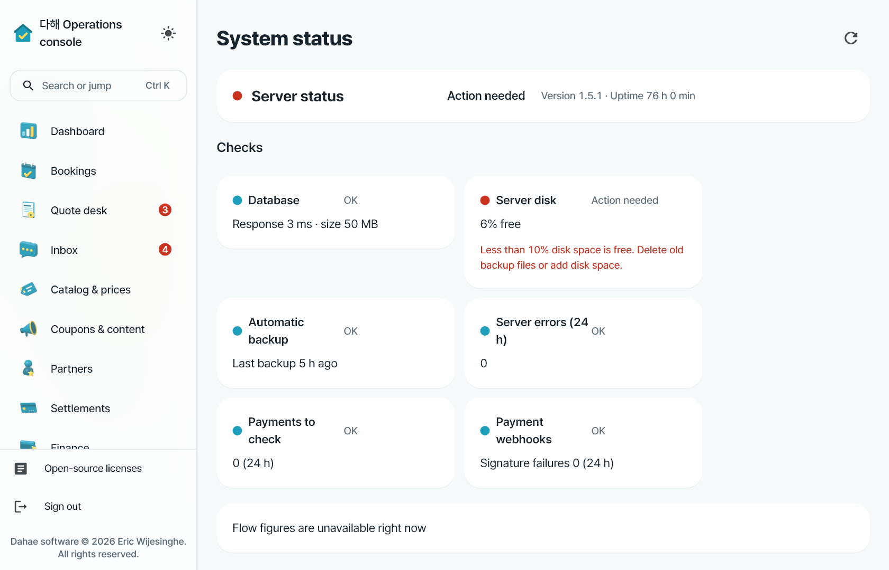

# 29. FAQ and fixes

**In this chapter:** when something goes wrong, find the symptom and fix it. Each entry says **who** does it (you / the developer) and **where** (console / server / the company's site). Do what you can yourself first; if that does not work, hand it to your developer.

> **Before you start**
>
> - A console admin account and the authenticator app on your phone (chapter 6).
> - Your developer's (installer's) contact details.
> - A way to take screenshots (PC: `Windows key + Shift + S`; phone: power + volume down buttons).

---

## 29.1 When something goes wrong, first (2 minutes)

1. Open **[System status]** in the console's left menu (chapter 26).
2. Find the red (**Action needed**) items. If there is red text with instructions, follow it.

3. Find the symptom in 29.3–29.9 below.
4. If you are not sure, take a screenshot and send it to your developer. If the console does not open, ask your developer: "Please look at `sudo dahae status` and `sudo dahae logs` on the server."

---

## 29.2 How to open the server screen (only when the developer asks)

Your developer normally types the server commands. Do it yourself only when the developer asks you to type a command on the server screen.

- **AWS server:** AWS console **EC2 > Instances** → select the server → **Connect** → **Session Manager** tab → **Connect** (chapter 5, 5.5).
- **Other clouds:** a button like **Connect via browser SSH** on the server company's screen (chapter 7).

When the black screen opens:

1. Paste the command the developer gave you exactly. Commands always start with `sudo`.
2. Press Enter.
3. Take a screenshot of the text that appears and send it to the developer.

> **Tip** `sudo dahae logs` keeps moving. It is not broken; it is following the log. Press `Ctrl + C` to stop it.

Reading `sudo dahae status` (the server prints Korean; the meaning is on the right):

| Text on screen | Meaning |
|---|---|
| `✔ 앱 정상` | The server program runs fine |
| `! 앱 응답 없음 — 'dahae logs' 로 확인하세요` | The server program does not answer. The developer must check |
| `✔ HTTPS 정상: https://domain/admin/` | The security certificate is fine |
| `! HTTPS 인증서가 아직 없어요. …` | The domain link (A record) is not ready yet (29.3) |
| `! 외부 가동 확인이 없어요 — …` | The uptime heartbeat is not connected (chapter 17) |
| `! 최근 외부 백업이 없어요 — …` | No offsite backup, or it failed (chapters 17, 27) |
| `! 비밀 키 사본이 없어요 — …` | The secret key copy has not been made yet (27.4) |

---

## 29.3 The site and connecting

### The site does not open at all

- **Who:** you for steps 1–2, the developer from step 3
- **Where:** browser, server company's screen, server

1. Try on mobile data (Wi-Fi off). If it opens there, the problem is your own internet.
2. On the server company's screen (on AWS, **EC2 > Instances**), check that the server is **running**. If it is off, start it and wait 1–2 minutes. The service comes back when the server starts.
3. The developer checks `sudo dahae status`. If it shows `✔ 앱 정상` but the site still does not open, it is a certificate or domain problem (see "Not secure" below).
4. If this started right after an update, tell your developer. They can go back to the previous version (29.8).

### The browser says "Not secure"

- **Who:** you (waiting, checking DNS), the developer (checking the server)
- **Where:** the domain company's screen (Cloudflare, Gabia and so on), server

1. If you installed recently, **wait 10–30 minutes** and try again. The domain link takes time to spread.
2. On the domain company's screen, check that the A record equals the **server's public IP** (chapter 5).
3. If you use Cloudflare, check that the cloud on that row is **grey (DNS only)**. If it is orange, click it to make it grey.
4. If it still fails, the developer checks that ports 80 and 443 are open on the server firewall.

> **Warning** Even if the same error keeps showing, do not restart the server again and again. Certificate requests pile up. Fix once, then wait.

> **Tip** If only `www.domain` fails, there is no `www` A record. The main address is not affected (chapter 5).

### The site shows only a "maintenance" page and the app says it cannot reach the server

- **Who:** you (steps 1–2), the developer (from step 3)
- **Where:** console, server

1. Check whether the console (`https://domain/admin/`) opens.
2. If it opens, check whether **Maintenance mode** is on under **[System status]**. If it is, turn it off and click **[Save]** (26.7). After 30 seconds, close the app completely and open it again.
3. If the console does not open either, the server program has stopped. Tell your developer. They find the cause with `sudo dahae status` and `sudo dahae logs`. The disk may be full, or a recent update may be the cause.

### The console opens but every page shows an error

1. Click **[Sign out]** at the very bottom of the left menu and sign in again.
2. Close the browser completely and open it again.
3. If it is still the same, look at the **Database** card in **[System status]**. If it is red, contact your developer.

### Settings I changed in the console (colour, text, switches) do not show in the app

1. Wait about 30 seconds, then close the app completely and open it again. The server sends out changed settings within 30 seconds, and the app reads them when it opens.
2. The apps remember the last main colour and logo, so these may change the next time the app opens (chapter 28).

---

## 29.4 Sign-in and accounts

### The setup code is not accepted (**That setup code is not right**)

- **Who:** you
- **Where:** the first screen (`https://domain/admin/`)

1. Look at the code again. The setup code has 12 characters in the form `XXXX-XXXX-XXXX`.
2. The setup code never contains the digits `0` or `1` or the letters `I`, `L` or `O`. If you see something like `0`, it is not a letter O, and so on. Ask your developer again about any character you are unsure of.
3. If your developer made a new code, the old one no longer works. Get the new code.

### The setup code expired (**This setup code expired (valid for 7 days). …**)

- **Who:** the developer
- **Where:** server

1. Ask your developer for a new setup code.
2. The developer makes one on the server with `sudo dahae setup-code --renew` and gives it to you.
3. Create the owner account with the new code (chapter 6).

> **Tip** If you only lost the code and 7 days have not passed, the developer can show the same code again with `sudo dahae setup-code`. Once the owner account exists, the setup code is not used any more.

### The two-step code does not match (**That code does not match. Check that your phone's clock is right, then try again.**)

1. On your phone, open **Settings > Date & time** and turn on **automatic**. A clock off by even tens of seconds makes codes fail.
2. Enter the **newest** 6 digits in the authenticator app. Codes change every 30 seconds.
3. If the app has several Dahae entries, check you are using the one for the account you are signing in to.

### "Too many attempts. Wait a few minutes and try again." appears

- Too many wrong passwords or codes locked the account for a short time. Wait about 15 minutes and try again.
- The owner is told through the **Suspicious sign-in activity** alert in **[System status]**. If it was not you, see 29.9.

### "Sign-in expired. Start again from the password step." appears

This shows if you did not enter the code within 5 minutes of the password. Sign in again from the start.

### "That code was already used. …" appears

Each 6-digit code works once. Wait about 30 seconds and enter the new code from the app.

### I lost my phone (no authenticator app)

- **Who:** you (if you have recovery codes), the developer (if you do not)
- **Where:** sign-in screen, server

**If you have your recovery codes:**

1. On the sign-in screen, enter your email and password and click **[Sign in]**.
2. On the code screen, click **[Use a recovery code instead]**.
3. Enter **one unused code** from the 10 recovery codes you wrote down. Each recovery code works once.
4. Once signed in, go straight to **[My account]** → **[Make new recovery codes]**, and write the new codes on paper (chapter 8). The old codes stop working.
5. How to register the authenticator app on a new phone is **to be confirmed**. Do it together with your developer.

**If you have no recovery codes either:**

1. Contact your developer.
2. The developer makes a **one-hour reset code** on the server. With this code and your password you can set up two-step sign-in again.
3. The console has no screen to enter the reset code yet, so the developer has to help (**to be confirmed**).

> **Warning** Without the owner's authenticator app you cannot use owner functions such as unlocking payment cards or updating the server. Always keep your recovery codes on paper in a safe place (chapter 32).

### A staff member forgot their password

- **Who:** an admin
- **Where:** console **[Staff]**

1. Click **[Staff]** in the left menu.
2. On that staff member's row, click **[Reset password]**.
3. Continue in the confirmation window. The staff member is signed out everywhere.
4. Under **How to send the code**, choose **Send by text** or **Hand over (copy)**.
5. The staff member sets a new password with the code **within 24 hours**. The code works once.

Chapter 20 has the details.

### I can see only a few menu items

A **Consultant** account does not see **[Setup]**, **[Staff]**, **[Finance]**, **[Operating rules]**, **[Notification text]**, **[Activity log]**, **[Renewal calendar]** or **[My account]**. Sign in with an admin account (chapter 8).

---

## 29.5 Setup cards

### "This card is locked. The owner must unlock it to change it" appears

- **Who:** the owner (you)
- **Where:** console **[Setup]**

1. Sign in with the owner account.
2. Click **[Unlock (owner code)]** on that card.
3. Enter the 6 digits from the authenticator app.
4. When the card shows **Locks in ○ min**, make your change and click **[Save]** within 5 minutes.
5. When you are done, click **[Lock now]**.

If you see **Only the owner can unlock**, this account is not the owner. Chapter 9 has the details.

### "That code is not right. Enter the code your app shows now" / "Too many wrong codes. …"

1. Set your phone's time to **automatic**.
2. Enter the code the app shows now.
3. If too many wrong codes locked it, wait a few minutes and try again.

### "The key was rejected. Check the value you copied"

1. Copy the key again from the company's site (the card's **[Open site]**).
2. Paste it with no space before or after. Pasting it into Notepad first helps you check.
3. Check that you did not mix test keys and live keys.
4. If the card is locked, unlock it first (above), then **[Save]** → **[Check connection]** (on the payment cards, **[Check API key]**).

### "Could not reach the service. Try again shortly"

The company's service is not answering for a moment. Click **[Check connection]** again after 5–10 minutes. If it continues, tell your developer.

### "Saved · confirm by signing in from the app"

Some cards, such as the social sign-in cards, cannot be tested from the server. Sign in with that method in the customer app yourself (chapter 15).

### A format error appears when saving

| Text on screen | How to fix |
|---|---|
| **The store ID must start with store-.** | Copy the PortOne store ID again, starting from `store-` |
| **A channel key starts with channel-key-.** | Copy the PortOne channel key again, starting from `channel-key-` |
| **The V2 API secret does not look right. Paste the whole value with no spaces.** | Paste the whole value again with no spaces |
| **The webhook secret must start with whsec_.** | Copy it again, starting from `whsec_` |
| **The secret key starts with test_sk_ or live_sk_.** | Copy the Toss secret key again |
| **The client key starts with test_ck_ or live_ck_.** | Copy the Toss client key again |
| **The security key is 64 characters, each 0-9 or a-f. Copy it from the Toss developer center as is.** | Copy the security key again from the Toss developer center, as it is |
| **Test and live keys can't be mixed. Use keys of one kind.** | Use keys that are all `test_` or all `live_` |
| **The endpoint must start with https://.** | Put `https://` in front of the offsite backup address |
| **The bucket name isn't valid.** | Use only lowercase letters, digits, `-` and `.`, 3 to 63 characters |
| **The region isn't valid.** | For example, R2 uses `auto` |
| **The retention period is out of range.** | A number from 1 to 3650 |
| **The service account file isn't valid.** | Paste the content of the file from Firebase again, as it is |
| **Fill in every required field.** | Fill the empty boxes |
| **Keep at least one payment method on. With none on, customers can't pay.** | Turn at least one method on in the **Payment methods** card |

---

## 29.6 Payments, refunds, payouts

### "Payment webhooks" in System status is yellow or red (signature failures)

- **Who:** the owner (you)
- **Where:** console **[Setup]**, the PortOne or Toss screen

1. Check that the webhook address entered on the gateway's screen matches the address shown on the card **character for character**.
   - PortOne: `https://domain/v1/webhooks/portone`
   - Toss Payments (payments): `https://domain/v1/webhooks/tosspayments`
2. Copy the secret (security key) again on the gateway's screen.
3. In the console's **[Setup]**, unlock that card, paste it and click **[Save]**.
   - PortOne: the webhook secret on the **Payments (PortOne)** card
   - Toss Payments (payments): the security key on the **Payments (Toss Payments)** card
4. If the gateway's screen can **resend** failed notifications, use it. The server handles the same notification twice safely.

> **Tip** This card counts only PortOne and Toss Payments payment notifications. Signature failures on Toss payout notifications (`https://domain/v1/webhooks/toss`, the security key on the **Partner payouts** card) do not show here. If payout results are late, see "A partner payout failed" below.

### "Payments to check" in System status is red / a customer paid but there is no booking

- **Who:** you
- **Where:** console, the PortOne or Toss Payments admin screen

1. Wait about 3 minutes. Every minute the server compares with the gateway, finds payments older than 2 minutes that have no booking, and creates the booking.
2. In the console's **[Bookings]**, search by the customer's phone number.
3. If it is still missing, check in the gateway's admin screen that the payment is **paid**.
4. If it is paid but there is no booking, **refund it yourself** in the gateway's admin screen and tell the customer.
5. If the booking never appears, or you refunded it yourself, send the payment number and time to your developer.

### Many customers say payment does not work

1. **[Setup]** → the **Payments (PortOne)** card → **[Check API key]** (if you use Toss Payments, **[Check API key]** on the **Payments (Toss Payments)** card).
2. In **[System status]** → **Feature switches**, check that **Payments** is on and **Maintenance mode** is off.
3. In **[Setup]** → the **Payment methods** card, check that the method the customer wants is on (chapter 10).
4. If the payment row in **External services** shows an error code, take a screenshot and send it to your developer.

### A partner payout failed

- **Who:** you
- **Where:** console **[Settlements]**, the **Payouts** tab (chapter 21)

1. Look at the payout's status: **Requested**, **Sent**, **Paid**, **Failed**.
2. If it is **Sent**, **do not click [Retry].** The money may already be with the bank. Click **[Check status]** first.
3. With **Manual transfer**: if you sent it from the bank, click **[Mark as transferred]**; if not, click **[Mark as failed]** and write the reason.
4. With **Toss payouts**, if the result is unknown: only after you checked yourself in the Toss dashboard that nothing was sent, click **[Confirm it was not sent]** → tick **I checked the Toss dashboard myself** → **[Mark as not sent]**. After that you can **[Retry]**.
5. If a payout button asks for your authenticator code, enter the 6 digits.

> **Warning** If you click **[Mark as not sent]** when you are not sure, the same money may go out twice. If you are not sure, ask your developer first.

---

## 29.7 Texts, push and social sign-in

### Sign-in codes or booking texts do not arrive

- **Who:** you
- **Where:** console **[Setup]**, the Solapi site

1. **[Setup]** → the **SMS & KakaoTalk (Solapi)** card → **[Check connection]**.
2. On the Solapi site, check that there is **balance** left.
3. On Solapi, check that the **sender number** and the AlimTalk **templates** are approved (chapter 14). Nothing is sent before approval.
4. If **[System status]** → **Background jobs** → **Notification outbox** shows **○ texts dead-lettered**, those texts cannot be resent. Tell the customers by phone or in the app.
5. If the connection check passes but texts keep failing, tell your developer.

### App push notifications do not arrive

1. In **[System status]** → **External services**, look at the **App push (Firebase)** row.
2. If it says **Not set up**, fill the card as in chapter 16.
3. If it is red, put the service account file in the card from chapter 16 again and click **[Check connection]**.
4. If only iPhones get nothing, it may be the Apple push key built into the app. Tell your developer.
5. Also ask the customer whether app notifications are turned off in their phone's settings.

### Kakao, Naver, Google or Apple sign-in does not work

1. In **[System status]** → **External services**, look at the error code on that sign-in row.
2. Check the key again on that sign-in card in **[Setup]** and click **[Save]** (chapter 15).
3. Sign in with that method in the customer app yourself.
4. If only Kakao or Google sign-in fails on Android, the store app's signing fingerprint is often missing from the Kakao or Google developer screen. Tell your developer.
5. If the app does not come back after Naver sign-in, it is an **App links** setting (chapter 15). Check it with your developer.

---

## 29.8 Server, disk, backups, updates

### "Server disk" is yellow or red (disk nearly full)

- **Who:** the developer
- **Where:** server

1. Tell your developer: "The server disk is nearly full."
2. The developer checks what uses the space and cleans up, or makes the server disk bigger.

> **Warning** The server's `.env` file, files starting with `keys-`, and backup files that have no offsite copy must never be deleted. Do not delete files on the server yourself.

### "Automatic backup" is yellow or red

Follow 27.2 and "If something goes wrong" in chapter 27.

### Screens or features look wrong after an update

- **Who:** the developer
- **Where:** server (on AWS, also from GitHub)

1. Take a screenshot of **Recent server jobs** in **[System status]**.
2. Write down what looks wrong and send it to your developer.
3. The developer goes back to the previous version (rollback). Data is not deleted.
4. Even after a rollback, the next Monday automatic update may install the new version again. Agree with your developer when to update again.

### Recent server jobs shows "Failed" or "Failed, so it went back to the previous version"

- **Failed, so it went back to the previous version**: the service runs fine on the previous version. It is not urgent. Tell your developer.
- **Failed**: take a screenshot and send it to your developer. They check the server log.

### I want to know straight away when the server goes down

A server cannot report that it is down by itself. Connect an **uptime heartbeat** and an outside service watches it and tells you. If the **Uptime heartbeat** card in **[Setup]** says **Not set**, ask your developer to connect it (chapter 17).

---

## 29.9 Security incidents

### A secret key or password may have leaked

**Signs:** sign-ins you do not recognise, the **Suspicious sign-in activity** alert, a sudden rise in payment webhook signature failures, unknown transactions reported by a gateway.

**What you do straight away (in this order):**

1. **[My account]** → **[Sign out everywhere]**. Enter your authenticator code.
2. **[My account]** → **[Change password]** to change your password.
3. In **[Staff]**, do **[Reset password]** for each staff member. **[Deactivate]** anyone who has left.
4. For every key that may have leaked (payments, SMS, push, social sign-in, Toss security key, offsite backup), **issue a new key** on that company's site and **revoke** the old one there.
5. Put the new key in each card in **[Setup]**, then **[Save]** → **[Check connection]** (on the payment cards, **[Check API key]**).
6. In **[Activity log]**, look at recent sign-ins and setting changes, and take screenshots of anything you do not recognise.
7. **Always contact your developer.** The keys inside the server (sign-in token key, data key, database passwords) must be changed by the developer, not by you. After the keys change, make a new secret key copy too (27.4).

> **Warning** Do not edit the server's `.env` file yourself. A wrong edit stops every connection and can make backups impossible to open.

### A customer asks to delete their account or see or delete their data

Follow the **[Account deletion and data requests]** steps in chapter 23. Partner (pro) account deletion and data copies cannot be done in the console yet. Send those to your developer.

---

## 29.10 What to send when you contact your developer

Sending these makes the fix faster.

1. When it started (date and time)
2. What you were doing when it happened
3. A screenshot of **[System status]** (with the red items visible)
4. A screenshot of the screen with the error text
5. For payment problems: the payment number, amount and time
6. What you already tried (for example "I clicked Check connection and it said the key was rejected")

> **Warning** Never write passwords, keys or recovery codes in a chat or an email body (chapter 32).

---

## If something goes wrong

> **If something goes wrong**
>
> - **My symptom is not in this chapter** → Start from 29.1 and send your developer the items in 29.10.
> - **The developer asks me to type a command on the server** → Open the server screen as in 29.2 and paste the command exactly as given.
> - **I think I fixed it, but System status has not changed** → Click **Refresh** at the top right. An External services row turns green only after the service records its next success.
