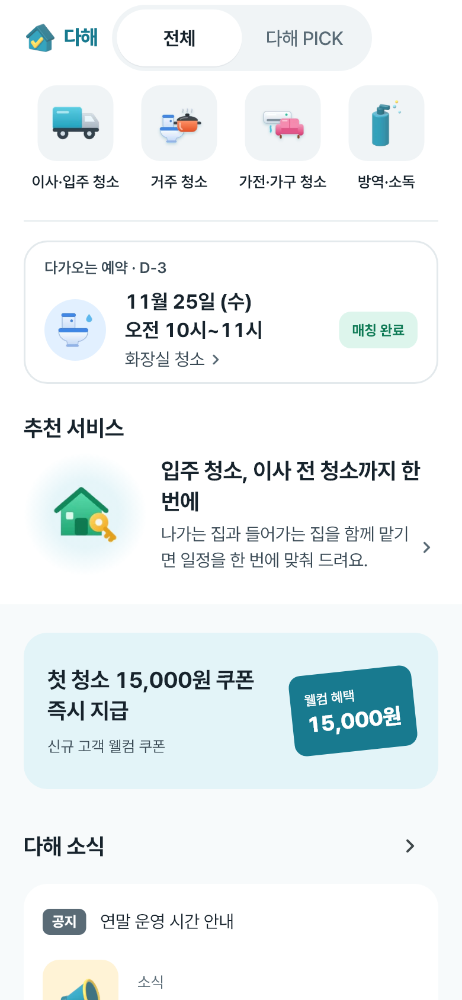
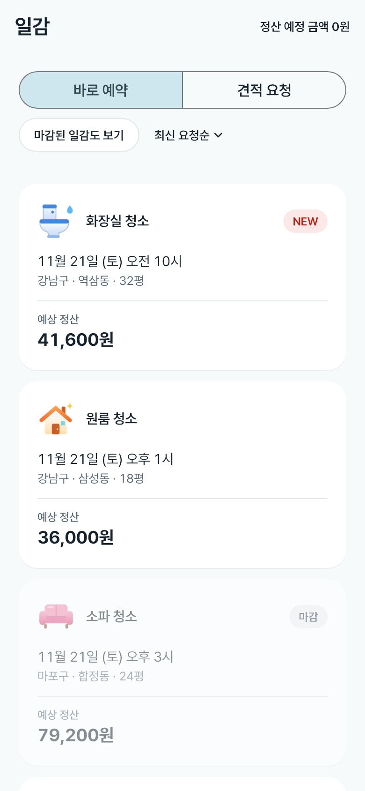
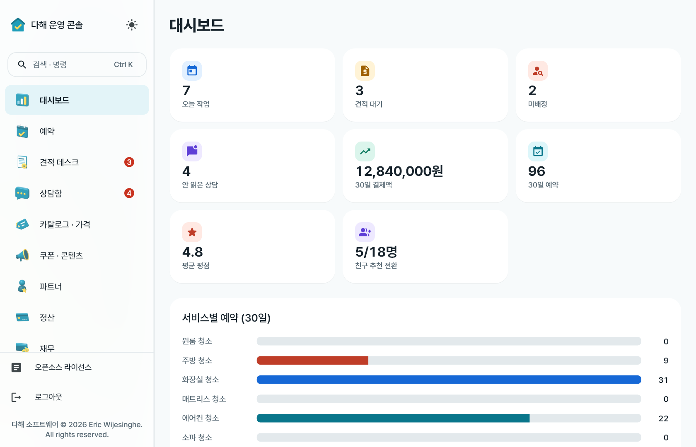

# 01. 다해는 무엇인가요

## 이 장에서 할 일

다해가 어떤 프로그램인지, 어떤 부분으로 이루어져 있는지, 누가 무엇을 볼 수 있는지 알아봐요. 아직 아무것도 누르지 않아도 돼요. 읽기만 하세요.

## 준비물

- 없어요. 이 장은 읽기만 해요.

## 1.1 한 줄 소개

다해는 **예약, 결제, 파트너 정산, 백업까지** 한 번에 하는 집청소 플랫폼이에요. 집청소 회사를 운영하는 사장님이 **자기 서버에 직접 설치**해서 써요. 고객 데이터는 사장님이 고른 서버에 저장돼요.

| 대상 | 얻는 것 |
|---|---|
| **고객** | 앱에서 서비스와 가격을 보고, 날짜를 고르고, 결제하고, 청소가 어디까지 왔는지 봐요. 채팅으로 상담도 해요 |
| **파트너 (청소 기사)** | 배정된 일감을 보고, 현장에서 출근 체크인을 하고, 정산 내역을 확인해요. 팀원도 전화번호로 초대할 수 있어요 |
| **사장님** | 웹 콘솔에서 견적과 예약을 처리하고, 파트너를 배정하고, 결제와 정산을 확인해요. 백업과 자동 업데이트는 서버가 알아서 해요 |

## 1.2 다해를 이루는 부분

다해는 다섯 부분으로 되어 있어요. 모두 **도메인 하나**(예: `example.co.kr`)로 들어가요.

| 부분 | 누가 쓰나요 | 어디서 여나요 |
|---|---|---|
| **서버** | 모든 앱이 여기에 연결돼요. 사람이 직접 쓰지는 않아요 | 클라우드(AWS 등)의 서버 1대 |
| **관리자 콘솔** | 사장님, 관리자, 상담원 | `https://example.co.kr/admin/` (PC · 휴대폰 브라우저, 앱처럼 설치 가능) |
| **고객 앱** | 고객 | 안드로이드 · 아이폰 앱. 웹 버전은 `https://example.co.kr/app/` |
| **파트너 앱** | 청소 기사와 팀원 | 안드로이드 · 아이폰 앱 |
| **웹사이트** | 처음 찾아온 손님 | `https://example.co.kr/` (회사 소개, 이용약관, 개인정보 처리방침) |

### 서버 안에는 무엇이 있나요

서버 1대 안에 모든 것이 들어가요. 데이터베이스를 따로 빌리지 않아요.

| 구성 | 하는 일 |
|---|---|
| 웹 서버 (Caddy) | 밖에서 들어오는 연결을 받아요. HTTPS 보안 인증서를 자동으로 받고 갱신해요. 웹 연결은 80, 443 포트로 받아요 |
| API | 고객 앱, 파트너 앱, 콘솔이 쓰는 두뇌예요. 예약, 결제, 정산, 채팅을 처리해요 |
| 데이터베이스 (PostgreSQL 17) | 모든 기록을 저장해요. 서버 안에서만 접속돼요 |
| 백업 | 매일 새벽 3시 30분 서버 안에 백업을 만들어요 (14일 보관). 외부 저장소로도 보낼 수 있어요 (17장) |

### 바깥 회사와 연결되는 것

다해는 아래 회사 서비스와 연결돼요. 연결은 콘솔의 **[설정]** 에서 해요 (3부). 지금 유일한 나라별 팩인 **한국 팩**의 서비스예요. 다른 나라는 그 나라 팩이 나올 때 그 나라 서비스를 써요.

| 연결 | 하는 일 | 연결하는 장 |
|---|---|---|
| PortOne V2 | 결제, 본인확인 | 11장 |
| 토스페이먼츠 | 결제 (선택), 파트너 정산 자동 지급 (선택) | 12장, 13장 |
| Solapi | 문자, 카카오 알림톡 | 14장 |
| 카카오 · 네이버 · 구글 · 애플 | 간편 로그인 | 15장 |
| Firebase | 앱 푸시 알림 | 16장 |
| S3 호환 저장소 (Cloudflare R2 등) | 외부 백업 | 17장 |

## 1.3 누가 무엇을 볼 수 있나요 (역할)

| 역할 | 화면 표시 | 쓰는 곳 | 할 수 있는 일 |
|---|---|---|---|
| 소유자 (사장님) | **소유자** | 콘솔 | 모든 메뉴. 결제 카드(PortOne · 토스페이먼츠)를 처음 저장하고 잠금을 푸는 일은 소유자만 해요 |
| 관리자 | **관리자** | 콘솔 | 모든 메뉴 (소유자만 하는 일은 빼고) |
| 상담원 | **상담원** | 콘솔 | 아래 표에서 "모두" 로 적힌 메뉴만 보여요 |
| 파트너 · 팀원 | - | 파트너 앱 | 자기에게 배정된 일감과 자기 정산만 봐요 |
| 고객 | - | 고객 앱 | 자기 예약, 결제, 채팅만 봐요 |
| 개발자 (라이선스 제공자) | - | 서버, 빌드 | 서버 설치, 앱 빌드, 배포, 유지보수를 해요. 사장님이 **[직원]** 에서 관리자 계정을 만들어 주면 콘솔에도 들어가요 |

> **주의** 사장님 계정(소유자)은 **사장님이 직접** 만들어야 해요 (6장). 소유자 계정의 인증 앱이 결제 카드를 지키는 열쇠라서, 다른 사람이 만들면 그 열쇠가 다른 사람 휴대폰에 생겨요.

### 콘솔 메뉴와 볼 수 있는 사람

콘솔 왼쪽 메뉴의 순서 그대로예요. 메뉴마다 자세한 사용법은 8장과 4부에 있어요.

| 메뉴 | 볼 수 있는 사람 |
|---|---|
| **[대시보드]** | 모두 |
| **[예약]** | 모두 |
| **[견적 데스크]** | 모두 |
| **[상담함]** | 모두 |
| **[카탈로그 · 가격]** | 모두 |
| **[쿠폰 · 콘텐츠]** | 모두 |
| **[파트너]** | 모두 |
| **[정산]** | 모두 |
| **[재무]** | 관리자 · 소유자 |
| **[정기 청소 구독]** | 모두 |
| **[고객]** | 모두 |
| **[직원]** | 관리자 · 소유자 |
| **[내 계정]** | 관리자 · 소유자 |
| **[설정]** | 관리자 · 소유자 |
| **[운영 규칙]** | 관리자 · 소유자 |
| **[알림 문구]** | 관리자 · 소유자 |
| **[시스템 상태]** | 모두 |
| **[활동 기록]** | 관리자 · 소유자 |
| **[탈퇴·개인정보 요청]** | 모두 |
| **[갱신 일정]** | 관리자 · 소유자 |

("모두" = 소유자, 관리자, 상담원)

## 1.4 주요 기능 둘러보기

### 예약
- 서비스마다 정해진 가격, 카탈로그 기준 가격 계산
- 개수로 고르는 서비스(에어컨 · 소파 등)는 옵션별 개수와 다중 할인으로 계산
- 이사 · 입주 청소는 견적을 받고, 예약금(견적의 10%)을 먼저 받아요
- 예약 일정 변경과 취소 (취소 정책에 따른 환불 계산)
- 대기 명단, 정기 구독과 자동 갱신, 성수기 요금, 팁

### 결제와 정산
- PortOne V2 결제: 카드, 간편결제, 계좌이체, 가상계좌 (채널 설정에 따라 켜고 꺼요)
- 토스페이먼츠 결제 (선택: PortOne, 토스페이먼츠, 또는 둘 다 쓸 수 있어요. 고객에게는 설정한 결제사 모두의 결제 방법이 보여요)
- 맞지 않는 결제를 찾아 주는 결제 대사
- 현금영수증과 세금계산서 발행
- 포인트와 쿠폰
- 파트너 정산: 기본은 사장님이 은행 앱으로 직접 이체하고 완료를 기록해요. 토스페이먼츠 지급대행을 연결하면 자동 지급도 돼요
- 부가세와 원천징수 내보내기 (CSV)

### 직원과 품질
- 직원 계정과 2단계 인증 (휴대폰 인증 앱)
- 파트너 팀원 초대 (전화번호로 초대하고, 배정된 일감만 보여요)
- 평점과 품질 기록, 노쇼 관리
- 활동 기록

### 보안과 개인정보
- 연동 키와 민감한 값은 암호화해서 보관해요
- 로그인 시도와 인증 코드 요청 횟수를 제한하고, 실패가 반복되면 점점 길게 잠가요
- 개인정보 열람 · 삭제 요청 처리, 탈퇴할 때 간편 로그인 연결 해제
- 보관 기간 설정, 유출된 비밀번호 검사

### 백업과 운영
- 매일 새벽 3시 30분 서버 백업 (14일 보관)
- 외부 저장소(S3 호환)에 암호화 백업
- 매주 월요일 새벽 4시 자동 업데이트. 먼저 백업하고, 새 버전이 응답하지 않으면 이전 버전으로 자동으로 되돌려요
- 보안 인증서(HTTPS) 자동 발급 · 갱신
- 한국어와 영어 화면 (문자와 알림도 받는 사람의 언어로 보내요)

### 대화와 알림
- 고객, 파트너, 사장님 사이 실시간 채팅과 견적 카드
- 앱 푸시, 문자, 카카오 알림톡
- **상담 도우미 (선택 기능):** 직원이 없을 때, 또는 설정에 따라 항상 먼저 고객 채팅에 답해요. 설정에서 끌 수 있어요 (16장)

> **주의** 상담 도우미를 켜면 고객이 채팅에 쓴 내용이 외부 응답 API 제공사(개인정보 처리방침에 미국 법인으로 적혀 있어요)로 전송돼요. 그래서 고객은 가입할 때 국외 이전에 동의해요. 동의 철회는 아직 앱에서 할 수 없어요.

## 자주 생기는 문제

| 이런 일이 있으면 | 이렇게 하세요 |
|---|---|
| 콘솔에 메뉴가 몇 개 안 보여요 | 상담원 계정으로 로그인했을 수 있어요. 위 메뉴 표의 "관리자 · 소유자" 메뉴는 관리자만 보여요 |
| 결제 카드를 저장할 수 없어요 | 결제 카드는 소유자 계정만 처음 저장할 수 있어요 (9장, 11장) |
| 우리 회사에 필요한 기능이 위 목록에 없어요 | 이 책에 없는 기능은 아직 없는 기능이에요. 개발자에게 문의하세요 |
