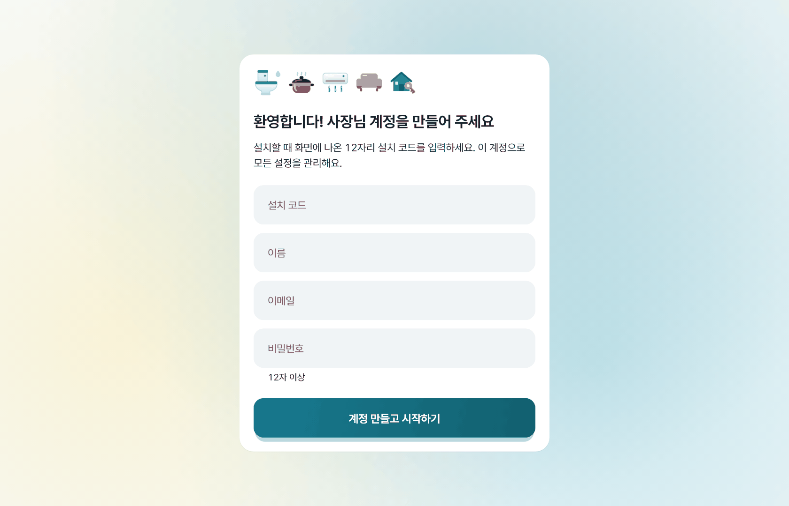
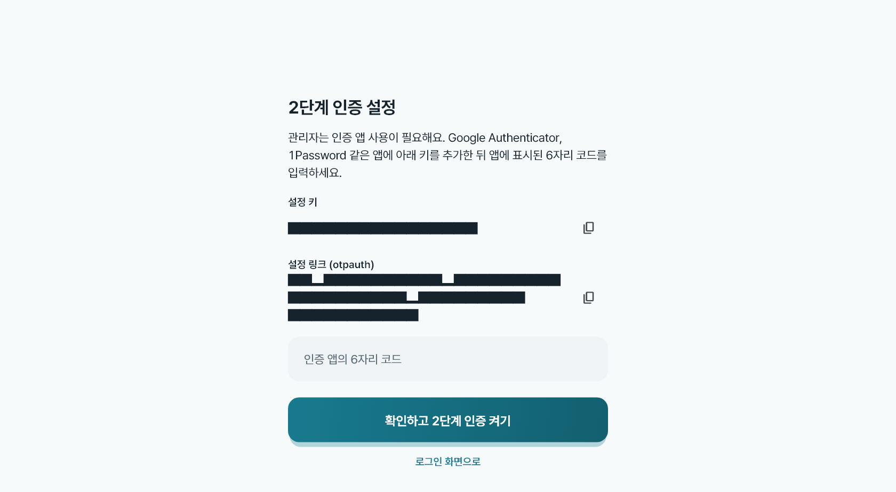
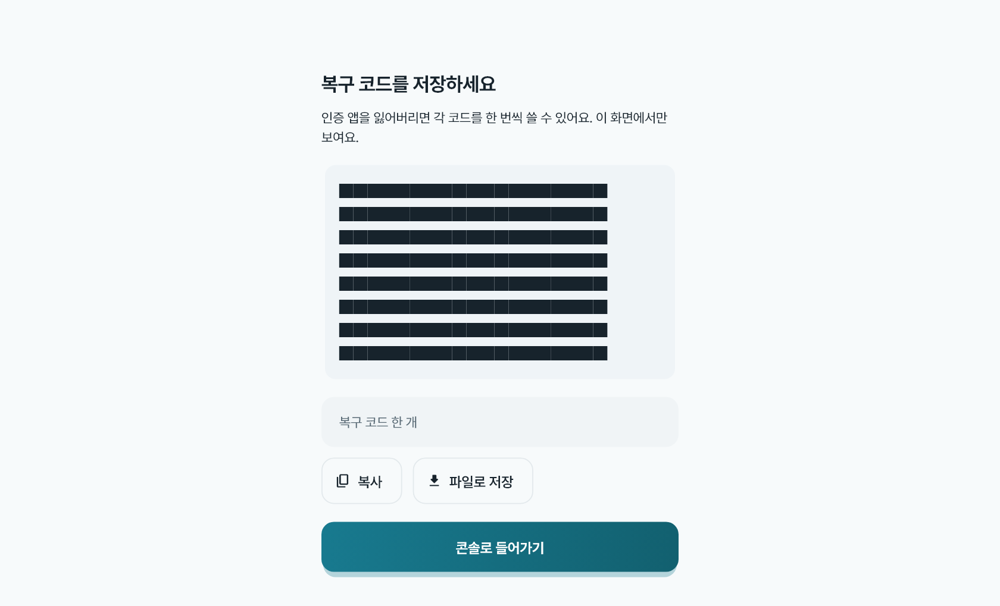
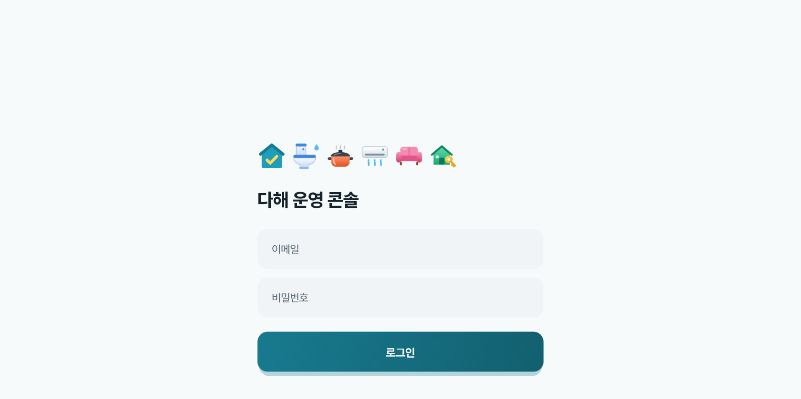
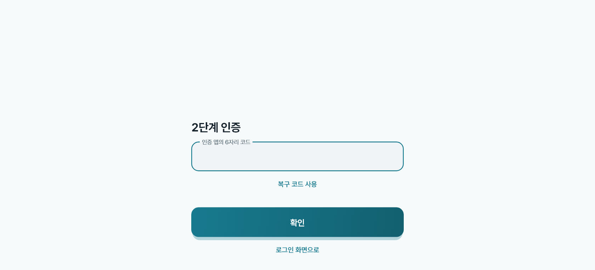

# 06. 사장님 계정과 2단계 인증

## 이 장에서 할 일

**[사장님]** 설치 코드로 콘솔에 **사장님 계정(소유자)** 을 만들고, 휴대폰 인증 앱으로 **2단계 인증**을 켜고, **복구 코드**를 안전하게 보관해요. 마지막으로 콘솔을 PC 와 휴대폰에 앱처럼 설치해요.

## 준비물

- **설치 코드** 12자리 (`XXXX-XXXX-XXXX` 모양, 6.1)
- 인증 앱이 설치된 **사장님 휴대폰** (2.1)
- 컴퓨터와 브라우저 (Chrome 또는 Edge 권장)
- 사장님 계정으로 쓸 **이메일 주소**
- 비밀번호 관리 앱, 종이와 펜 (복구 코드 보관용)
- 시간: 약 15분

## 6.1 왜 사장님이 직접 만들어야 하나요

> **주의** 사장님 계정은 **꼭 사장님이 직접** 만드세요. 개발자에게 대신 만들어 달라고 하지 마세요.

- 사장님 계정을 만든 사람의 휴대폰에 **소유자 인증 앱 코드**가 생겨요.
- 이 코드는 결제 카드(PortOne · 토스페이먼츠)를 처음 저장하거나 잠금을 풀 때 필요해요 (9장).
- 개발자가 만들면 이 열쇠가 개발자 휴대폰에 생겨요. 그래서 개발자가 통화로 안내하고, 입력은 사장님이 해요.
- 개발자에게는 나중에 **[직원]** 메뉴에서 관리자 계정을 따로 만들어 줄 수 있어요 (20장).

## 6.2 설치 코드 받기

설치 코드는 12자리이고 `ABCD-2345-EFGH` 같은 모양이에요. 설치한 방법에 따라 받는 곳이 달라요.

| 설치 방법 | 설치 코드가 있는 곳 |
|---|---|
| AWS 명령 한 줄 (4장) | 서버 화면에서 명령으로 봐요 (아래 순서) |
| 설치 페이지 (7장) | 설치 페이지의 **3. 설치 인증 코드** 에 나온 코드 |
| 검은 화면 한 줄 설치 (7장) | 설치가 끝난 화면의 `설치 코드:` 줄 |

### AWS 로 설치한 경우

보통 개발자가 통화 중에 서버에서 코드를 확인해 불러 줘요. 사장님이 직접 볼 때는 이렇게 해요.

1. 5.5 의 순서로 Session Manager 검은 화면을 열어요.
2. 아래 줄을 붙여 넣고 Enter 를 눌러요.

   ```
   sudo dahae setup-code
   ```

3. `XXXX-XXXX-XXXX` 모양의 코드가 한 줄 나와요. 종이에 적어요.

**이렇게 보이면 성공:** 12자리 코드가 한 줄 보여요.

> **참고** 설치 코드는 **설치한 때부터 7일 동안** 쓸 수 있어요. 7일이 지나면 서버 화면에서 `sudo dahae setup-code --renew` 를 입력해 새 코드를 받아요. (예전 안내서 일부에 "2시간"이라고 적혀 있지만, 실제 프로그램은 7일이에요.) 사장님 계정을 만든 뒤에는 코드가 더 이상 쓰이지 않아요.

## 6.3 사장님 계정 만들기

1. 컴퓨터 브라우저에서 `https://example.co.kr/admin/` 을 열어요 (내 도메인으로 바꿔서).
2. **환영합니다! 사장님 계정을 만들어 주세요** 화면이 나와요.



3. **설치 코드** 칸에 12자리 코드를 입력해요. 줄표(-)는 넣어도 되고 빼도 돼요. 대문자 · 소문자도 상관없어요.
4. **이름** 칸에 사장님 이름을 입력해요.
5. **이메일** 칸에 사장님 계정으로 쓸 이메일을 입력해요. 로그인할 때 이 이메일을 써요.
6. **비밀번호** 칸에 **12자 이상** 비밀번호를 입력해요. 비밀번호 관리 앱으로 만들고 바로 저장하세요.
7. **[계정 만들고 시작하기]** 를 눌러요.

**이렇게 보이면 성공:** 바로 **2단계 인증 설정** 화면으로 넘어가요. 따로 로그인하지 않아도 돼요.

> **팁** 너무 흔한 비밀번호(유출된 비밀번호 목록에 있는 것)는 거절돼요. 그때는 **입력값을 확인해 주세요** 가 나와요. 다른 비밀번호를 쓰세요.

## 6.4 2단계 인증 켜기

관리자 계정은 반드시 인증 앱을 써야 해요. 이 화면에는 QR 코드가 없고, **설정 키**를 인증 앱에 직접 넣어요.



1. 화면의 **설정 키** 오른쪽 복사 아이콘을 눌러 키를 복사해요. 또는 키 글자를 종이에 그대로 옮겨 적어요.
2. 휴대폰에서 인증 앱을 열어요.
3. 인증 앱에서 계정 추가 버튼(보통 **+**)을 눌러요.
4. **설정 키 입력** (앱에 따라 "키 입력", "Enter a setup key" 등)을 골라요.
5. 계정 이름에 알아보기 쉬운 이름을 입력해요 (예: `다해 콘솔`).
6. 키 칸에 콘솔 화면의 **설정 키**를 입력해요. 띄어쓰기 없이 정확히 넣으세요.
7. 키 종류가 있으면 **시간 기준** 을 골라요.
8. 인증 앱에서 **추가** 를 눌러요.
9. 인증 앱에 **6자리 숫자**가 나와요. 숫자는 30초마다 바뀌어요.
10. 콘솔로 돌아와 **인증 앱의 6자리 코드** 칸에 지금 보이는 6자리 숫자를 입력해요.
11. **[확인하고 2단계 인증 켜기]** 를 눌러요.

**이렇게 보이면 성공:** **복구 코드를 저장하세요** 화면으로 넘어가요.

> **팁** 1Password 같은 비밀번호 관리 앱은 **설정 링크 (otpauth)** 를 복사해 붙여 넣는 방식도 받아요. 잘 모르겠으면 설정 키를 쓰세요.

> **주의** **설정 키**는 인증 앱에 넣은 뒤 종이나 메모에 남겨 두지 마세요. 이 키가 있으면 누구나 사장님 6자리 코드를 만들 수 있어요.

## 6.5 복구 코드 저장하기

휴대폰을 잃어버리거나 인증 앱이 지워졌을 때, 복구 코드 하나로 한 번 로그인할 수 있어요. 코드는 **10개**이고 **이 화면에서만** 보여요.



1. **[파일로 저장]** 을 눌러 컴퓨터에 파일로 저장해요. 저장이 안 되는 기기면 **[복사]** 를 눌러 비밀번호 관리 앱에 붙여 넣어요.
2. 종이에도 코드를 모두 옮겨 적어요.
3. 종이는 금고처럼 서버와 휴대폰 밖의 안전한 곳에 보관해요.
4. **복구 코드 한 개** 칸에 방금 받은 코드 중 **아무거나 하나**를 입력해요. 잘 보관했는지 확인하는 단계예요. (이 코드는 여기서 쓰여 없어지지 않아요.)
5. **[콘솔로 들어가기]** 를 눌러요.

**이렇게 보이면 성공:** 콘솔 첫 화면(대시보드)과 왼쪽 메뉴가 보여요.

> **주의** 이 확인을 마쳐야 소유자 기능(결제 카드 저장 등)을 쓸 수 있어요. 확인이 실패하면 **[내 계정]** 화면에서 다시 할 수 있어요 (8장).

> **주의** 복구 코드를 사진으로 찍어 휴대폰 앨범에 두거나 카카오톡으로 보내지 마세요.

## 6.6 다음부터 로그인하기

1. `https://example.co.kr/admin/` 을 열어요.
2. **다해 운영 콘솔** 로그인 화면이 나와요. (이 제목의 "다해" 는 회사 이름을 바꿔도 그대로예요.)



3. **이메일** 에 사장님 계정 이메일을 입력해요.
4. **비밀번호** 를 입력해요.
5. **[로그인]** 을 눌러요.
6. **2단계 인증** 화면이 나와요.



7. 휴대폰 인증 앱을 열고 지금 보이는 6자리 숫자를 **인증 앱의 6자리 코드** 칸에 입력해요.
8. **[확인]** 을 눌러요.

**이렇게 보이면 성공:** 콘솔 대시보드가 보여요.

### 휴대폰이 없을 때 (복구 코드로 로그인)

1. 2단계 인증 화면에서 **[복구 코드 사용]** 을 눌러요.
2. **복구 코드** 칸에 보관해 둔 코드 하나를 입력해요.
3. **[확인]** 을 눌러요.

- 쓴 복구 코드는 다시 쓸 수 없어요. 종이에서 지워 두세요.
- 로그인한 뒤 **[내 계정]** 에서 **[복구 코드 다시 만들기]** 로 새 코드를 받으세요 (8장).
- 인증 앱 코드로 돌아가려면 **[인증 앱 코드 사용]** 을 눌러요. 처음 화면으로 가려면 **[로그인 화면으로]** 를 눌러요.

### "서버 주소 입력" 화면이 나올 때

콘솔은 웹 전용이라 브라우저와 6.8 처럼 설치한 콘솔에서는 서버 주소를 묻지 않아요. 이 화면은 개발자가 따로 만든 설치형 콘솔 프로그램에서만 나와요.

1. **서버 주소 입력** 화면에 `https://example.co.kr` 처럼 `https://` 로 시작하는 서버 주소를 입력해요.
2. **[저장하고 계속]** 을 눌러요.
3. 주소를 바꿔야 하면 로그인 화면 아래 **[서버 주소 변경]** 을 눌러요.

## 6.7 비밀 키 사본 만들기 (꼭 하세요)

> **주의** 서버의 비밀 키 파일(`/opt/malkkeum/.env`)이 없으면 **외부 백업을 되살릴 수 없어요.** 서버를 잃으면 키도 함께 잃기 때문에, 키 사본을 서버 밖에 꼭 보관해야 해요.

비밀 키 사본은 방금 만든 소유자 계정으로 콘솔에서 직접 만들어요.

1. 왼쪽 메뉴에서 **[시스템 상태]** 를 누르고 아래로 내려 **서버 업데이트** 카드를 찾아요.
2. **복구** → **비밀 키 사본 내려받기** 의 **잠금 비밀번호 (12자 이상)** 칸에 12자 이상의 **잠금 비밀번호** 를 넣고, **잠금 비밀번호 한 번 더** 칸에 같은 것을 넣어요.
3. **[만들고 내려받기]** 를 누르고 사장님 코드를 넣은 뒤 **[계속]** 을 눌러요.
4. 브라우저가 `dahae-keys-날짜-시각.env.enc` 같은 이름의 파일을 내려받아요. USB 나 비밀번호 관리 앱에 보관해요.
5. 잠금 비밀번호는 **파일과 다른 곳**(비밀번호 관리 앱 등)에 따로 적어 둬요.
6. **서버 밖에 보관했어요** 창에서 **[서버 밖에 보관했어요]** 를 눌러요.

**이렇게 보이면 성공:** 카드 아래에 **서버 밖에 보관했다고 기록했어요.** 가 보여요. 모든 단계와 안내 글은 26장 (복구: 비밀 키 사본 내려받기) 과 27장 27.4 에 있어요.

> **주의** 키 사본 파일과 잠금 비밀번호를 카카오톡이나 이메일 본문에 붙여 넣지 마세요.

## 6.8 콘솔을 앱처럼 설치하기

콘솔은 따로 설치할 프로그램 없이 브라우저에서 열고, **앱처럼 설치**할 수 있어요. 설치하면 "다해 관리자" 아이콘이 생겨요.

> **참고** 아래 브라우저 버튼 이름은 아직 모든 기기에서 확인하지 못했어요 (**확인 필요**). 브라우저 버전에 따라 조금 다를 수 있어요.

### Windows PC (Edge 또는 Chrome)

1. **Edge** 나 **Chrome** 으로 `https://example.co.kr/admin/` 을 열어요.
2. 주소창 오른쪽 끝의 **앱 설치** 아이콘(⊕ 모양)을 눌러요.
3. **설치** 를 눌러요.
4. 아이콘이 없으면 브라우저 메뉴(⋯ 또는 ⋮) > **앱** (또는 **앱 설치**) > **이 사이트를 앱으로 설치** 를 눌러요.


**이렇게 보이면 성공:** 시작 메뉴와 작업 표시줄에 **다해 관리자** 아이콘이 생겨요.

### 안드로이드 휴대폰 (Chrome)

1. **Chrome** 으로 콘솔 주소를 열어요.
2. 오른쪽 위 **⋮** 을 눌러요.
3. **앱 설치** (또는 **홈 화면에 추가**) 를 눌러요.

### 아이폰 (Safari)

1. **Safari** 로 콘솔 주소를 열어요.
2. 아래쪽 **공유** 버튼을 눌러요.
3. **홈 화면에 추가** 를 눌러요.

**이렇게 보이면 성공:** 휴대폰 홈 화면에 콘솔 아이콘(짧은 이름 "다해 관리" 로 보일 수 있어요)이 생기고, 누르면 로그인 화면이 열려요.

> **팁** 업데이트 뒤에는 설치한 콘솔 앱을 한 번 닫았다가 다시 여세요.

## 자주 생기는 문제

| 화면에 나온 말 | 뜻과 해결 |
|---|---|
| **설치 코드가 맞지 않아요** | 코드를 다시 확인하세요. 숫자 0 · 1 과 글자 O · I · L 은 코드에 쓰지 않아요. 비슷해 보이면 다른 글자예요 |
| 서버 화면의 `sudo dahae setup-code` 가 **설치 코드 기간(7일)이 지났어요. 새로 받으려면: dahae setup-code --renew** 를 보여요 | `sudo dahae setup-code --renew` 를 입력해 새 코드를 받으세요 |
| **설치 코드 유효 기간(7일)이 지났어요. …** | 서버 화면에서 `sudo dahae setup-code --renew` 로 새 코드를 받거나, 개발자에게 새 코드를 부탁하세요 |
| **비밀번호는 12자 이상이어야 해요** | 비밀번호를 12자 이상으로 늘리세요 |
| **입력값을 확인해 주세요** | 이메일 모양이 맞는지, 이름을 비우지 않았는지, 너무 흔한 비밀번호가 아닌지 확인하세요 |
| **이메일 또는 비밀번호가 맞지 않아요** (계정 만들 때) | 이미 사장님 계정이 만들어져 있어요. 로그인 화면에서 로그인하세요 |
| **코드가 맞지 않아요. 휴대폰 시간이 맞는지 확인하고 다시 입력하세요.** | 휴대폰 설정에서 날짜와 시간을 **자동** 으로 바꾸고, 새 숫자가 나오면 바로 입력하세요. 설정 키를 잘못 넣었을 수도 있어요 |
| **시도가 너무 많아요. 몇 분 뒤에 다시 시도하세요.** | 몇 분 기다렸다가 다시 하세요 |
| **로그인 시간이 지났어요. 비밀번호부터 다시 입력하세요.** | **[로그인 화면으로]** 를 누르고 이메일과 비밀번호부터 다시 하세요 |
| **입력한 코드가 방금 받은 복구 코드와 맞지 않아요** | 방금 화면에 나온 10개 중 하나를 띄어쓰기 없이 정확히 입력하세요 |
| **이 기기에서 파일을 저장할 수 없어요. 복사해서 보관하세요.** | **[복사]** 를 눌러 비밀번호 관리 앱에 붙여 넣으세요 |
| 휴대폰도 복구 코드도 잃어버렸어요 | 혼자 해결할 수 없어요. 개발자에게 연락하세요 (**확인 필요**: 소유자 계정 복구 절차) |
