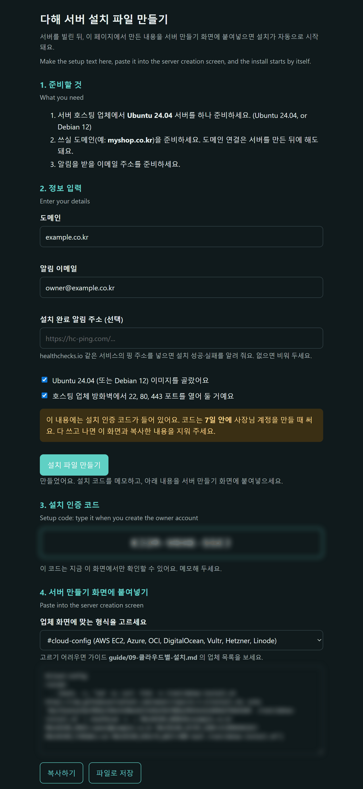

# 07. 다른 클라우드에 설치하기 (간단히)

## 이 장에서 할 일

AWS 명령 한 줄(4장) 대신 다른 서버 회사(네이버 클라우드, Lightsail, Google, Azure, Vultr 등)에 다해를 설치하는 방법을 짧게 알아봐요. 가장 쉬운 방법은 **설치 페이지**에서 만든 내용을 서버 만들기 화면에 붙여 넣는 거예요. 검은 화면에 명령을 입력하지 않아요.

> **참고** AWS 로 설치했다면 이 장은 건너뛰고 8장으로 가세요.

## 준비물

- 서버 회사 계정 (결제 수단 등록 완료)
- 도메인과 그 도메인의 DNS 관리 화면 로그인 정보 (5장)
- 알림을 받을 이메일
- 개발자에게 받은 **설치 파일 만들기 페이지** 파일 (`dahae-install-page.html`)
- (선택) 설치 완료 알림을 받을 주소 (healthchecks.io 같은 서비스의 핑 주소)
- 시간: 약 30분 + 설치 대기 10–30분

## 7.1 서버 사양 고르기

| 항목 | 고를 것 |
|---|---|
| 운영체제 | **Ubuntu 24.04 LTS** (Ubuntu 22.04, Debian 12 도 돼요. Amazon Linux, Oracle Linux, CentOS 는 안 돼요) |
| 사양 (권장) | **CPU 2개(2 vCPU), 메모리 4 GB** |
| 사양 (최소) | 메모리 1 GB. 2 GB 보다 작으면 설치 프로그램이 디스크로 메모리를 보충(스왑 2 GB)하지만 느려요. 손님을 받는 서버는 권장 사양으로 고르세요 |
| 디스크 | 50 GB 면 충분해요 (새로 설치할 때 빈 공간 5 GB 이상 필요) |
| 지역 | 서울(한국) |
| CPU 종류 | x86_64(amd64) 또는 arm64 |
| 열어 둘 포트 | **22** (서버 접속), **80** · **443** (인증서와 웹, 꼭 필요) |

- 가능하면 **고정 IP** 를 붙이세요. IP 가 바뀌면 A 레코드를 다시 고쳐야 해요.
- 관리형 데이터베이스(RDS 등)는 필요 없어요. 데이터베이스는 서버 안에서 돌아가요.

## 7.2 설치 페이지로 설치 내용 만들기

1. 개발자에게 받은 `dahae-install-page.html` 파일을 컴퓨터에 저장해요.
2. 파일을 두 번 눌러 브라우저(Chrome 또는 Edge)로 열어요.
3. **다해 서버 설치 파일 만들기** 페이지가 열려요.
4. **2. 정보 입력** 의 **도메인** 칸에 내 도메인(예: `example.co.kr`)을 입력해요.
5. **알림 이메일** 칸에 이메일을 입력해요.
6. (선택) **설치 완료 알림 주소 (선택)** 칸에 핑 주소를 넣어요. 없으면 비워 둬요. 넣으면 설치 성공 · 실패를 알려 줘요.
7. **Ubuntu 24.04 (또는 Debian 12) 이미지를 골랐어요** 를 체크해요.
8. **호스팅 업체 방화벽에서 22, 80, 443 포트를 열어 둘 거예요** 를 체크해요.
9. **[설치 파일 만들기]** 를 눌러요.
10. **3. 설치 인증 코드** 에 나온 12자리 코드를 종이에 적어요. 이 코드는 **이 화면에서만** 볼 수 있어요. 6장에서 사장님 계정을 만들 때 써요.
11. **4. 서버 만들기 화면에 붙여넣기** 의 **업체 화면에 맞는 형식을 고르세요** 에서 내 서버 회사에 맞는 형식을 골라요 (7.3 표).
12. **[복사하기]** 를 눌러요. (파일로 남기려면 **[파일로 저장]**.)



**이렇게 보이면 성공:** 버튼 아래에 "만들었어요. 설치 코드를 메모하고, 아래 내용을 서버 만들기 화면에 붙여넣으세요." 가 보이고, 아래 칸에 설치 내용이 채워져 있어요.

> **주의** 설치 내용에는 설치 인증 코드가 들어 있어요. 코드는 **7일 안에** 사장님 계정을 만들 때 써요. 계정을 만든 뒤에는 이 페이지와 복사한 내용을 지워 주세요.

## 7.3 서버 회사별로 붙여 넣는 칸

서버 회사의 **서버 만들기** 화면에서 아래 칸을 찾아 7.2 에서 복사한 내용을 붙여 넣어요. 화면 이름은 회사가 자주 바꾸니, 이름이 다르면 비슷한 이름을 찾으세요.

| 서버 회사 | 붙여 넣는 칸 | 고를 형식 | 확인 정도 |
|---|---|---|---|
| AWS Lightsail | 시작 스크립트 (Launch script) | `#!/bin/bash` | 중간 (화면 이름 확인 필요) |
| AWS EC2 | 고급 세부 정보 › 사용자 데이터 | `#cloud-config` | 높음 |
| Google Compute Engine | 관리 › 시작 스크립트 (Startup script) | `#!/bin/bash` | 중간 |
| Microsoft Azure | 고급 › 사용자 지정 데이터 (Custom data) | `#cloud-config` | 중간 |
| Oracle Cloud (OCI) | 고급 옵션 표시 › cloud-init 스크립트 붙여넣기 | `#cloud-config` | 중간 |
| DigitalOcean | 고급 옵션 › User data | `#cloud-config` | 중간 |
| Vultr | Additional Features › User data | `#cloud-config` | 중간 |
| Hetzner | Cloud config | `#cloud-config` | 중간 |
| Linode (Akamai) | Add User Data | `#cloud-config` | 낮음~중간 |
| 네이버 클라우드 | 서버 › 초기화 스크립트 (Init Script) | `#!/bin/bash` | 중간 |
| NHN Cloud | 사용자 스크립트 (User script) | **확인 필요** | 낮음 |
| 카카오 클라우드, KT 클라우드, 가비아, 카페24 | 확인된 칸이 없어요 | 브라우저 SSH 한 줄 (7.4) | - |

붙여 넣은 뒤 이렇게 해요.

1. 운영체제가 **Ubuntu 24.04** 인지 다시 확인해요.
2. 방화벽(보안 그룹, 방화벽 규칙, ACG)에서 **22, 80, 443** 을 열어요.
3. 서버 만들기(생성) 버튼을 눌러요.
4. 서버의 **공인 IP** 를 메모해요. 가능하면 고정 IP 를 붙여요.
5. 5장처럼 A 레코드(`@`, `www`)를 그 IP 로 넣어요.
6. **10–30분** 기다려요. 설치는 서버 안에서 혼자 진행돼요.
7. 브라우저에서 `https://example.co.kr/health` 를 열어요.

**이렇게 보이면 성공:** `{"ok":true` 로 시작하는 글자가 보여요. 6장으로 가서 사장님 계정을 만드세요.

> **주의** **Google Compute Engine** 의 시작 스크립트는 서버를 켤 때마다 실행돼요. 설치가 끝나면 이 칸을 비워 주세요.

> **참고** DigitalOcean 처럼 서버를 만든 뒤 칸을 고칠 수 없는 회사도 있어요. 실수했다면 서버를 지우고 새로 만드세요.

## 7.4 붙여 넣는 칸이 없을 때: 브라우저 SSH 한 줄

1. 7.2 의 **업체 화면에 맞는 형식을 고르세요** 에서 **브라우저 SSH 한 줄** 을 골라요.
2. **[복사하기]** 를 눌러요.
3. 서버 회사 화면에서 Ubuntu 24.04 서버를 만들어요. 방화벽 22, 80, 443 을 열어요.
4. 서버 화면의 **브라우저에서 SSH 연결** (또는 "콘솔 접속") 버튼을 눌러 검은 화면을 열어요.
5. 복사한 한 줄을 붙여 넣고 Enter 를 눌러요. 설치 코드와 도메인이 이미 들어 있어요.
6. 기다려요. 새 서버는 처음에 10분쯤 걸릴 수 있어요.

### 설치 중에 "도메인이 아직 이 서버를 가리키지 않아요" 가 나오면

- 화면에 `A 레코드   example.co.kr   →   3.38.12.34` 처럼 **넣어야 할 값**이 나와요.
- 5장처럼 DNS 화면에서 그대로 고치고, 몇 분 뒤 검은 화면에서 **Enter** 를 누르면 다시 확인해요.
- 나중에 하려면 `s` 를 입력해요. 설치는 계속되고, 도메인이 연결되면 인증서가 자동으로 발급돼요.

### 설치가 끝난 화면

설치가 끝나면 아래와 같은 화면이 나와요.


```
✔ 설치가 끝났어요!   (채널: stable)

1) 브라우저에서 이 주소를 여세요:   https://example.co.kr/admin/
2) 설치 코드를 입력하고 사장님 계정을 만드세요:

       설치 코드:  ABCD-2345-EFGH

3) [설정] 메뉴에서 결제·문자·로그인 연동을 차례로 연결하세요.
```

- `앱은 정상이에요. HTTPS 인증서는 아직이에요.` 라고 나오면 도메인 연결이 아직 반영되지 않은 거예요. 몇 분 뒤 `sudo dahae status` 로 "HTTPS 정상" 을 확인하세요.
- 화면 아래의 "비밀 키 사본을 꼭 만들어 서버 밖에 보관하세요" 안내는 6.7 에서 해요.

## 7.5 설치 뒤 서버가 알아서 하는 일

| 무엇 | 언제 |
|---|---|
| 서버 안 백업 (14일 보관) | 매일 새벽 3시 30분 |
| 자동 업데이트 (먼저 백업하고, 새 버전이 응답하지 않으면 이전 버전으로 자동으로 되돌려요) | 매주 월요일 새벽 4시 |
| 보안 인증서(HTTPS) 발급 · 갱신 | 자동 |

설치 명령을 다시 실행해도 안전해요. 설정과 데이터는 그대로 두고 업데이트만 해요.

## 자주 생기는 문제

| 이런 일이 있으면 | 이렇게 하세요 |
|---|---|
| `https://도메인/health` 가 안 열려요 | 10–30분 기다렸는지, A 레코드가 서버 IP 와 같은지 (https://dnschecker.org) 확인하세요 |
| 80, 443 이 막혀 있어요 | 서버 회사 방화벽(보안 그룹, 방화벽 규칙)에서 80, 443 을 열었는지 확인하세요 |
| Amazon Linux 나 다른 운영체제가 설치됐어요 | 서버를 지우고 **Ubuntu 24.04** 로 새로 만드세요 |
| 붙여 넣는 칸이 없어요 | 7.4 의 브라우저 SSH 한 줄 방법을 쓰세요 |
| "관리자 권한이 필요해요" | 명령을 페이지에서 만든 그대로 붙여 넣었는지 확인하세요 (`sudo` 가 들어 있어야 해요) |
| "80/443 포트를 다른 프로그램이 쓰고 있어요" | 서버에 다른 웹 서버가 깔려 있어요. 개발자에게 알려 주세요 |
| "남은 디스크가 … 최소 5 GB 가 필요해요" | 디스크가 더 큰 서버를 고르세요 |
| "서비스가 시작되지 않았어요" | `sudo dahae logs` 화면을 캡처해 개발자에게 보내세요 (멈추려면 Ctrl+C). 설치를 다시 실행해도 안전해요 |
| 설치가 실패했어요 | 설치 완료 알림 주소를 넣었다면 알림을 확인하고, `sudo dahae logs` 화면을 개발자에게 보내세요 |
