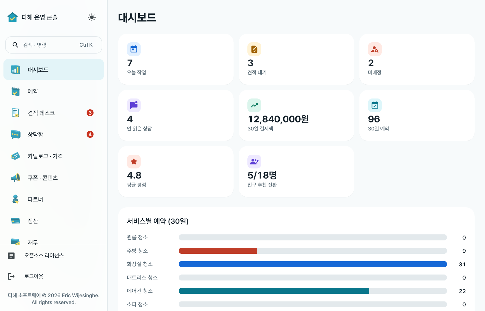
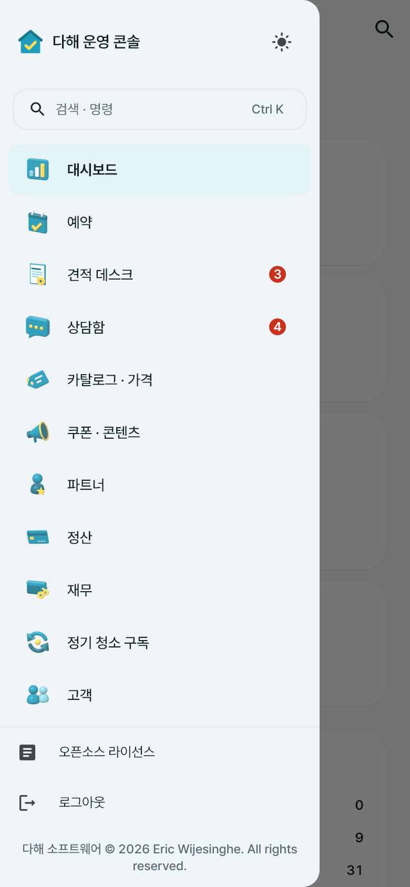
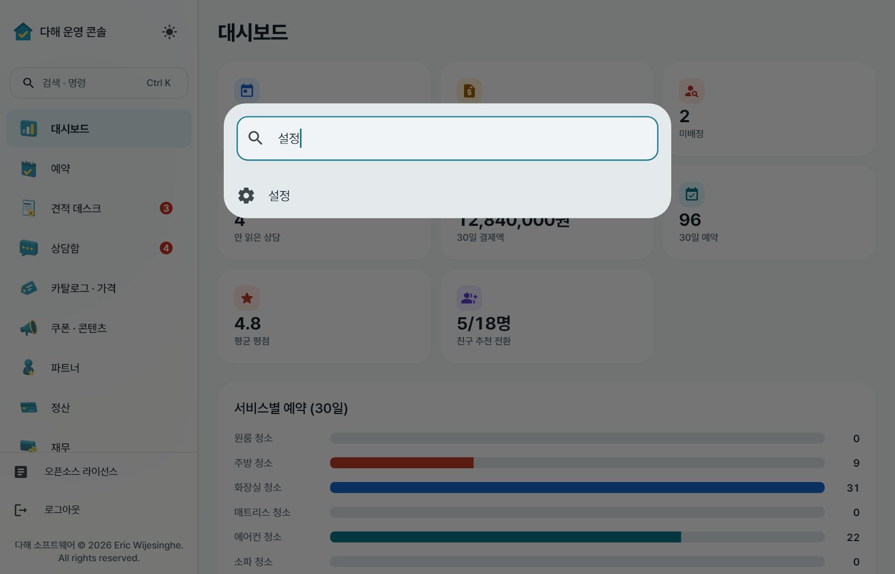
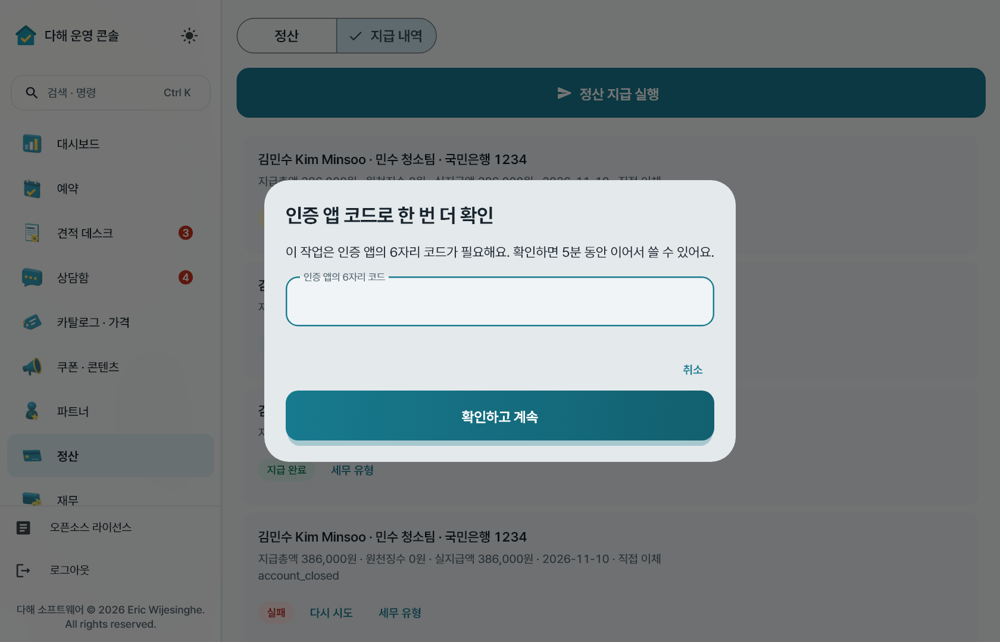
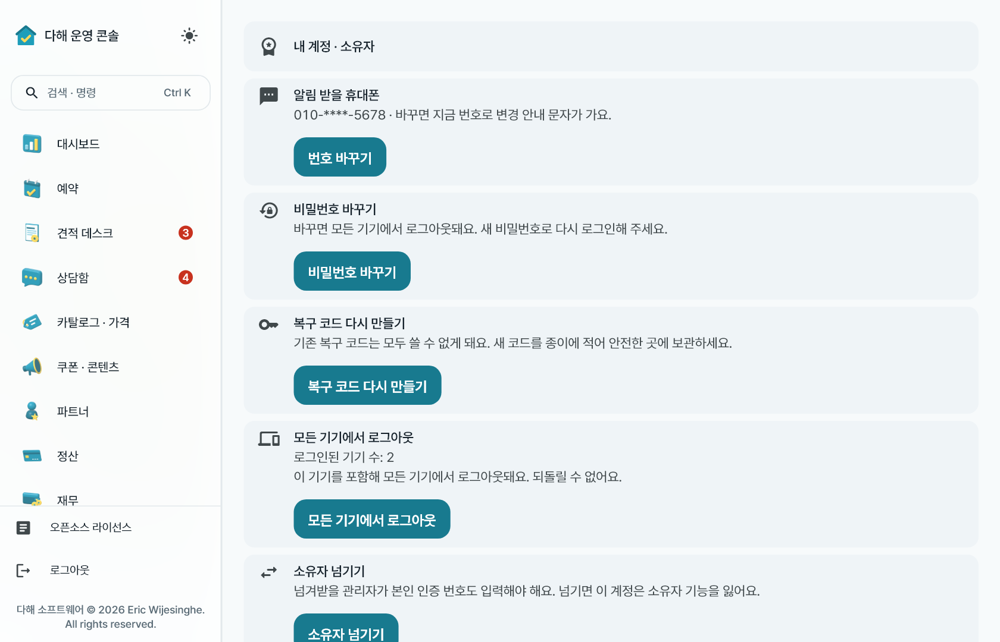

# 08. 콘솔 둘러보기

**이 장에서 할 일:** 관리자 콘솔 화면이 어떻게 생겼는지, 메뉴마다 무엇을 하는지 알아봐요.
빠르게 이동하는 단축키, 중요한 작업 전에 뜨는 인증 코드 창, **[내 계정]** 화면도 함께 살펴봐요.

> **준비물**
> - 6장에서 만든 사장님(소유자) 계정의 이메일과 비밀번호
> - 2단계 인증을 등록한 휴대폰의 인증 앱 (6자리 코드가 나오는 앱)
> - 컴퓨터의 크롬(Chrome) 또는 엣지(Edge) 브라우저. 휴대폰 브라우저로도 열 수 있어요.

---

## 8.1 화면 구성

콘솔은 화면 폭에 따라 두 가지 모양으로 보여요.

**컴퓨터 (넓은 화면)**

1. 콘솔 주소(예: `https://example.co.kr/admin/`)를 열고 6장에서 한 대로 로그인해요.
2. 화면 왼쪽을 봐요. 맨 위에 **다해 운영 콘솔** 이라는 제목과 밝기 모드 단추가 있어요. 제목 앞부분은 **사업장 정보** 의 서비스 이름을 따라 바뀌어요 (28장). 이 단추 그림은 지금 모드에 따라 자동(A)·해·달 모양으로 바뀌어요.
3. 그 아래에 **[검색 · 명령]** 칸이 있어요. 오른쪽 끝에 `Ctrl K` 라고 적혀 있어요.
4. 그 아래로 메뉴 목록이 세로로 이어져요. 지금 보고 있는 메뉴는 색이 칠해져 있어요.
5. 메뉴 목록 맨 아래에 **[오픈소스 라이선스]**, **[로그아웃]**, 저작권 문구가 있어요.
6. 화면 오른쪽 넓은 곳에 고른 메뉴의 내용이 나와요.

**이렇게 보이면 성공:** 왼쪽에 메뉴 목록, 오른쪽에 **[대시보드]** 내용이 보여요.

**휴대폰 (좁은 화면)**

1. 맨 위 줄 왼쪽의 줄 세 개(☰) 단추를 눌러요.
2. 왼쪽에서 메뉴 서랍이 열려요. 내용은 컴퓨터의 왼쪽 메뉴와 같아요.
3. 메뉴를 하나 누르면 서랍이 저절로 닫히고 그 화면으로 바뀌어요.
4. 맨 위 줄 가운데에는 지금 보고 있는 메뉴 이름이 보여요.
5. 맨 위 줄 오른쪽의 돋보기 단추는 아래 8.3의 **[검색 · 명령]** 창을 열어요.

> **팁** 화면 밝기 모드는 맨 위 밝기 모드 단추(**[테마 바꾸기]**)로 바꿔요. **[시스템 설정]**, **[라이트]**, **[다크]** 중에서 골라요.

> **팁** 콘솔 언어는 따로 고르는 단추가 없어요. 컴퓨터(브라우저) 언어가 영어면 영어로, 그 밖의 언어면 한국어로 보여요.

---

## 8.2 메뉴 하나씩 알아보기

메뉴는 아래 순서로 보여요. "누가 보나요" 칸이 **관리자만** 이면 상담원 계정에는 그 메뉴가 아예 보이지 않아요.
사장님(소유자)은 관리자이기도 해서 20개 메뉴가 모두 보여요.

| 순서 | 메뉴 이름 | 무엇을 하나요 | 누가 보나요 | 자세히 |
|---|---|---|---|---|
| 1 | **[대시보드]** | 오늘 작업, 견적 대기, 안 읽은 상담 같은 숫자를 한눈에 봐요 | 모두 | 19장 |
| 2 | **[예약]** | 예약 목록과 예약 상세를 보고 처리해요 | 모두 | 19장 |
| 3 | **[견적 데스크]** | 견적 요청을 보고 답해요. 열린 견적 수가 빨간 숫자로 붙어요 | 모두 | 19장 |
| 4 | **[상담함]** | 고객 상담 대화를 봐요. 안 읽은 대화 수가 빨간 숫자로 붙어요 | 모두 | 19장 |
| 5 | **[카탈로그 · 가격]** | 서비스와 가격을 만들고 고쳐요 | 모두 | 18장 |
| 6 | **[쿠폰 · 콘텐츠]** | 쿠폰, 콘텐츠, 성장·캠페인 기능 | 모두 | 22장 |
| 7 | **[파트너]** | 파트너(청소 전문가) 목록과 프로필 | 모두 | 20장 |
| 8 | **[정산]** | 파트너 정산과 지급 | 모두 | 21장 |
| 9 | **[재무]** | 재무 현황, 세금 자료, 자료 내려받기 | 관리자만 | 21장 |
| 10 | **[정기 청소 구독]** | 정기 방문 구독 목록 | 모두 | 19장 |
| 11 | **[고객]** | 고객 목록과 포인트 | 모두 | 20장 |
| 12 | **[직원]** | 콘솔 직원(관리자·상담원) 초대와 관리 | 관리자만 | 20장 |
| 13 | **[내 계정]** | 내 보안 설정, 소유자 넘기기 | 관리자만 | 8.5 |
| 14 | **[설정]** | 서비스 시작 준비: 사업장 정보, 결제, 문자, 로그인 등 연결 | 관리자만 | 9–17장 |
| 15 | **[운영 규칙]** | 사업장 한도, 광고 발송, 포인트, 파트너 품질, 서버·알림 기준 같은 숫자 규칙 | 관리자만 | 23장 |
| 16 | **[알림 문구]** | 고객과 청소팀이 앱 알림과 알림함에서 보는 문구 | 관리자만 | 23장 |
| 17 | **[시스템 상태]** | 서버 상태, 외부 서비스 연결 상태, 업데이트 | 모두 | 26장 |
| 18 | **[활동 기록]** | 누가 언제 무엇을 바꿨는지 기록 | 관리자만 | 23장 |
| 19 | **[탈퇴·개인정보 요청]** | 고객 전화번호로 찾아 자료 사본(CSV)을 주거나 탈퇴를 처리해요 | 모두 (탈퇴 처리는 관리자만) | 23장 |
| 20 | **[갱신 일정]** | 도메인, 호스팅, 앱 스토어, 문자 계정의 갱신 날짜. 기한 30일 전과 7일 전에 문자로 알려줘요 | 관리자만 | 23장 |

> **주의** 상담원 계정은 관리자 메뉴 8개가 빠져서 12개 메뉴만 보여요. 그래서 상담원 화면에서는 메뉴 번호(아래 단축키 번호)가 사장님 화면과 달라요.

---

## 8.3 빠르게 이동하기: 검색 · 명령 창

**메뉴로 이동하기**

1. 키보드에서 `Ctrl` 을 누른 채 `K` 를 눌러요. (맥에서는 `⌘ Command` + `K` 도 돼요.)
   마우스로 왼쪽 위 **[검색 · 명령]** 칸을 눌러도 돼요.
2. 가운데에 입력 칸이 있는 창이 떠요. 칸 안에 **메뉴 이름이나 예약번호를 입력하세요** 라고 흐리게 적혀 있어요.
3. 가고 싶은 메뉴 이름의 일부를 입력해요. 예: `정산`
4. 아래 목록에 맞는 메뉴만 남아요. 맨 위 메뉴로 가려면 `Enter` 를 누르고, 다른 메뉴는 마우스로 눌러요.

**이렇게 보이면 성공:** 창이 닫히고 고른 메뉴 화면이 열려요.

**예약번호로 바로 열기**

1. `Ctrl` + `K` 로 창을 열어요.
2. 예약번호를 3글자 이상 입력해요. 메뉴 이름과 맞는 것이 없으면 목록에 **예약 열기: (입력한 번호)** 가 나와요.
3. 그 줄을 누르거나 `Enter` 를 눌러요.

**이렇게 보이면 성공:** **[예약]** 메뉴로 바뀌고 그 예약의 상세 화면이 열려요.

**숫자 단축키**

- `Ctrl` + `1` ~ `Ctrl` + `9` 를 누르면 메뉴 목록의 1번째 ~ 9번째 메뉴로 바로 가요.
- 검색 · 명령 창의 목록 오른쪽에 `Ctrl 1` 같은 번호가 적혀 있어서 확인할 수 있어요.
- 사장님 화면 기준: `Ctrl` + `1` 대시보드, `Ctrl` + `2` 예약, `Ctrl` + `3` 견적 데스크, `Ctrl` + `4` 상담함 … `Ctrl` + `9` 재무.

---

## 8.4 로그아웃과 중요한 작업 전 확인 코드

**[로그아웃]**

1. 왼쪽 메뉴(휴대폰은 ☰ 메뉴 서랍) 맨 아래로 내려가요.
2. **[로그아웃]** 을 눌러요.

**이렇게 보이면 성공:** 로그인 화면으로 돌아가요.

> **주의** 여러 사람이 같이 쓰는 컴퓨터에서는 일이 끝나면 꼭 **[로그아웃]** 하세요.

**중요한 작업 전에 뜨는 창: "인증 앱 코드로 한 번 더 확인"**

돈이나 개인정보를 다루는 일부 작업은 로그인한 상태여도 인증 앱 코드를 한 번 더 물어봐요.
예: 파트너 계좌 정보 보기, 파트너 식별번호 전체 보기, 지급 실행, 재무 자료 내려받기, 개인정보 내보내기·삭제.

1. 작업 단추를 누르면 **인증 앱 코드로 한 번 더 확인** 창이 떠요.
2. 휴대폰에서 인증 앱을 열어 6장에서 등록한 콘솔 항목의 6자리 숫자를 봐요.
3. 창의 **인증 앱의 6자리 코드** 칸에 그 숫자를 입력해요.
4. **[확인하고 계속]** 을 눌러요.

**이렇게 보이면 성공:** 창이 닫히고 원래 하려던 작업이 이어서 진행돼요.
한 번 확인하면 5분 동안은 같은 창이 다시 뜨지 않아요.

> **팁** 콘솔에는 비슷한 코드 창이 세 가지 있어요. 모두 같은 인증 앱의 6자리 숫자를 넣으면 돼요.
> - **인증 앱 코드로 한 번 더 확인**: 위의 중요한 작업 전
> - **인증 번호 입력**: **[내 계정]** 화면의 작업 전 (8.5)
> - **사장님 인증 코드**: **[설정]** 화면의 잠금 해제와 결제 카드 첫 저장 전 (9장)

---

## 8.5 내 계정

1. 왼쪽 메뉴에서 **[내 계정]** 을 눌러요.
2. 맨 위 카드 제목이 **내 계정 · 소유자** 이면 지금 계정이 사장님(소유자)이에요.

**이렇게 보이면 성공:** 아래로 **알림 받을 휴대폰**, **[비밀번호 바꾸기]**, **[복구 코드 다시 만들기]**, **[모든 기기에서 로그아웃]**, **[소유자 넘기기]** 카드가 차례로 보여요.

> **주의** 맨 위 카드에 **2단계 인증 설정과 복구 코드 저장을 마쳐야 소유자 기능을 쓸 수 있어요.** 가 보이면 6장의 2단계 인증과 복구 코드 저장을 먼저 끝내세요.
> 복구 코드를 받고 아직 확인하지 않았다면 **[복구 코드를 종이에 적어 보관했어요]** 카드가 보여요. 그 단추를 누르고, 적어 둔 복구 코드 한 개를 입력해요.

이 화면의 단추는 누를 때마다 **인증 번호 입력** 창이 떠요. 인증 앱의 6자리 숫자를 **인증 번호 6자리** 칸에 넣고 **[계속]** 을 눌러요. 한 번 쓴 숫자는 다시 쓸 수 없어요.

### 알림 받을 휴대폰

중요한 알림을 문자로 받을 사장님 휴대폰 번호예요. 아직 없으면 **아직 없어요. 등록하면 중요한 알림을 문자로 받아요.** 라고 보여요.

1. **알림 받을 휴대폰** 카드의 **[번호 바꾸기]** 를 눌러요.
2. **010으로 시작하는 휴대폰 번호** 칸에 번호를 입력해요.
3. 창 아래 **[번호 바꾸기]** 를 눌러요.
4. **인증 번호 입력** 창에 6자리 숫자를 넣고 **[계속]** 을 눌러요.

**이렇게 보이면 성공:** 화면 아래에 **알림 번호를 바꿨어요** 가 잠깐 떠요. 원래 번호로는 변경 안내 문자가 가요.

### 비밀번호 바꾸기

1. **[비밀번호 바꾸기]** 카드의 **[비밀번호 바꾸기]** 단추를 눌러요.
2. **현재 비밀번호** 와 **새 비밀번호** 를 입력해요. 새 비밀번호는 12자 이상이어야 해요.
3. 창 아래 **[비밀번호 바꾸기]** 를 눌러요.
4. **인증 번호 입력** 창에 6자리 숫자를 넣고 **[계속]** 을 눌러요.

**이렇게 보이면 성공:** **비밀번호를 바꿨어요. 다시 로그인해 주세요.** 가 뜨고 로그인 화면으로 돌아가요. 모든 기기에서 로그아웃돼요.

### 복구 코드 다시 만들기

휴대폰을 잃어버렸을 때 쓰는 복구 코드를 새로 받아요. 예전 복구 코드는 모두 못 쓰게 돼요.

1. **[복구 코드 다시 만들기]** 단추를 눌러요.
2. **정말 진행할까요?** 창에서 **[복구 코드 다시 만들기]** 를 눌러요.
3. **인증 번호 입력** 창에 6자리 숫자를 넣고 **[계속]** 을 눌러요.
4. **새 복구 코드** 창에 코드 목록이 나와요. 종이에 모두 옮겨 적어요. (**[복사]** 단추로 복사도 돼요.)
5. **[복구 코드를 종이에 적어 보관했어요]** 를 눌러요.
6. **저장 확인** 창의 **복구 코드 한 개** 칸에 방금 적은 코드 중 하나를 입력하고 **[계속]** 을 눌러요.

**이렇게 보이면 성공:** **복구 코드 저장을 확인했어요** 가 떠요.

### 모든 기기에서 로그아웃

휴대폰이나 컴퓨터를 잃어버렸을 때 써요. 카드에 **로그인된 기기 수** 가 보여요.

1. **[모든 기기에서 로그아웃]** 단추를 눌러요.
2. **정말 진행할까요?** 창에서 **[모든 기기에서 로그아웃]** 을 눌러요.
3. **인증 번호 입력** 창에 6자리 숫자를 넣고 **[계속]** 을 눌러요.

**이렇게 보이면 성공:** **다시 로그인해 주세요** 가 뜨고 지금 기기도 로그아웃돼요. 되돌릴 수 없어요.

### 소유자 넘기기

소유자 역할을 다른 관리자에게 넘겨요. 넘기면 지금 계정은 소유자 기능을 잃어요.

1. 넘겨받을 사람이 먼저 **[직원]** 메뉴에 관리자로 등록돼 있고, 2단계 인증을 마쳤는지 확인해요. (20장)
2. **[소유자 넘기기]** 단추를 눌러요.
3. **넘겨받을 관리자** 목록에서 그 사람을 골라요.
4. 넘겨받을 사람에게 그 사람 휴대폰의 인증 앱 6자리 숫자를 불러 달라고 해요.
5. **넘겨받을 사람의 인증 번호** 칸에 그 숫자를 넣고 **[소유자 넘기기]** 를 눌러요.
6. **인증 번호 입력** 창에는 **내** 인증 앱의 6자리 숫자를 넣고 **[계속]** 을 눌러요.

**이렇게 보이면 성공:** **소유자를 넘겼어요. 이 계정은 더 이상 소유자 기능을 쓸 수 없어요.** 가 떠요.

> **주의** 다른 관리자가 없으면 **넘겨받을 수 있는 다른 관리자가 없어요** 가 뜨고 넘길 수 없어요.

### 관리자(소유자 아님)로 로그인했을 때

맨 위 카드에 **소유자만 계정 보안과 서버 설정을 바꿀 수 있어요.** 가 보여요.
소유자가 아무도 없으면 **소유자 지정** 카드와 **[내가 소유자 되기]** 단추가 보여요.
2단계 인증과 복구 코드 저장을 마친 관리자만 이 단추를 누를 수 있어요.

---

## 자주 생기는 문제

| 이런 일이 생기면 | 이유 | 이렇게 해요 |
|---|---|---|
| 메뉴에 **[설정]**, **[직원]**, **[재무]** 가 없어요 | 상담원 계정으로 로그인했어요 | 관리자 계정으로 다시 로그인해요 |
| 코드를 넣었더니 **코드가 맞지 않아요. 휴대폰 시간이 맞는지 확인하고 다시 입력하세요.** | 숫자가 바뀌었거나 휴대폰 시계가 틀렸어요 | 휴대폰 설정에서 날짜·시간을 "자동"으로 바꾸고 새 숫자를 넣어요 |
| **시도가 너무 많아요. 몇 분 뒤에 다시 시도하세요.** | 틀린 코드를 여러 번 넣었어요 | 몇 분 기다렸다가 다시 해요 |
| **로그인 시간이 지났어요. 비밀번호부터 다시 입력하세요.** | 로그인이 끝났어요 | 로그아웃하고 다시 로그인해요 |
| **이 인증 번호는 이미 썼어요. 30초쯤 뒤 새로 나온 번호를 입력해 주세요** | 같은 숫자를 두 번 넣었어요 | 인증 앱에 새 숫자가 나올 때까지 기다려요 |
| 콘솔이 영어로 나와요 | 브라우저 언어가 영어예요 | 브라우저 언어를 한국어로 바꾸고 새로고침해요 |
| **[내 계정]** 화면이 잘 안 보이거나 단추가 이상하게 보여요 | 화면 모양 문제일 수 있어요 (확인 필요) | 브라우저 창을 넓혀 보고, 계속되면 개발자에게 알려요 |
