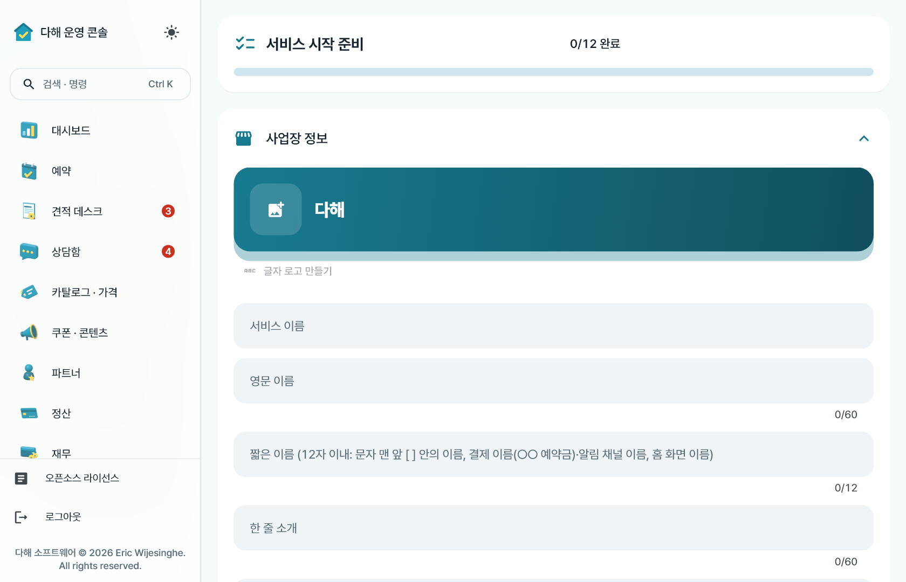
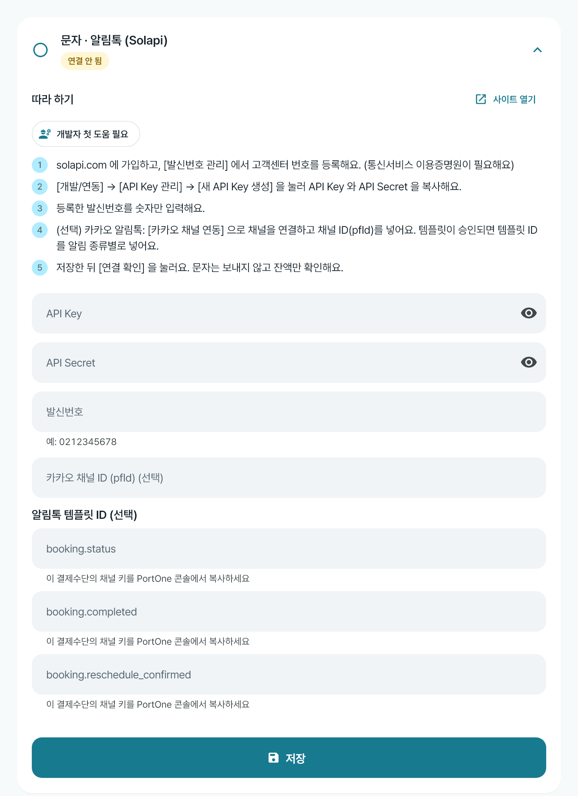
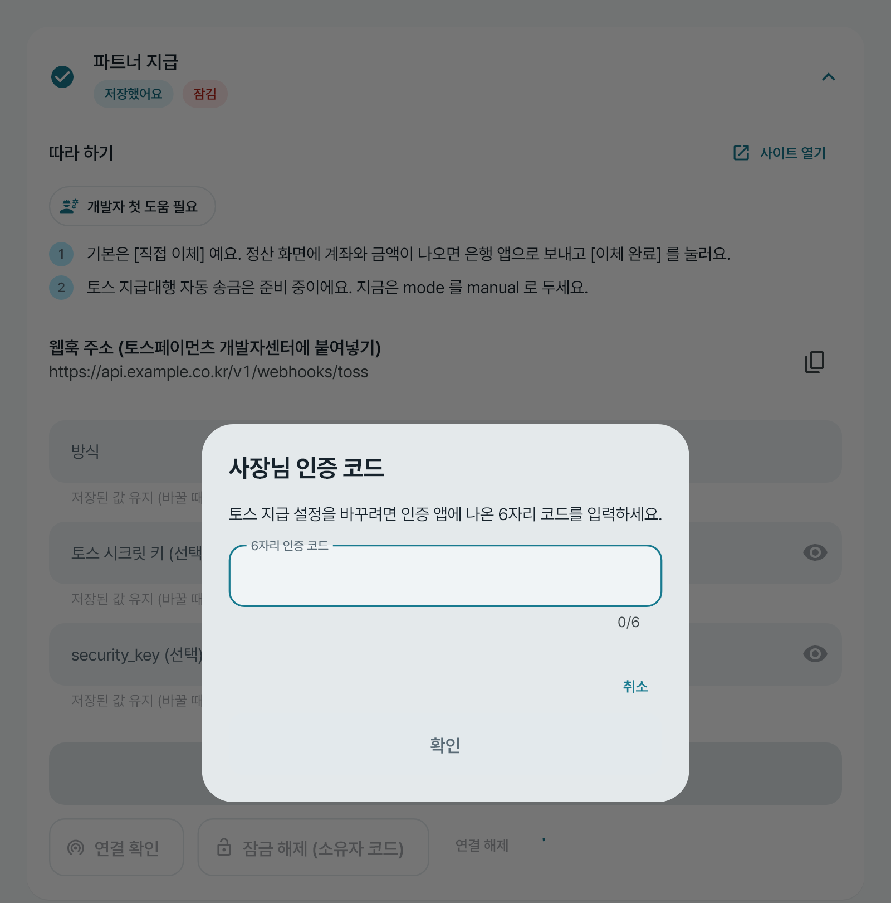
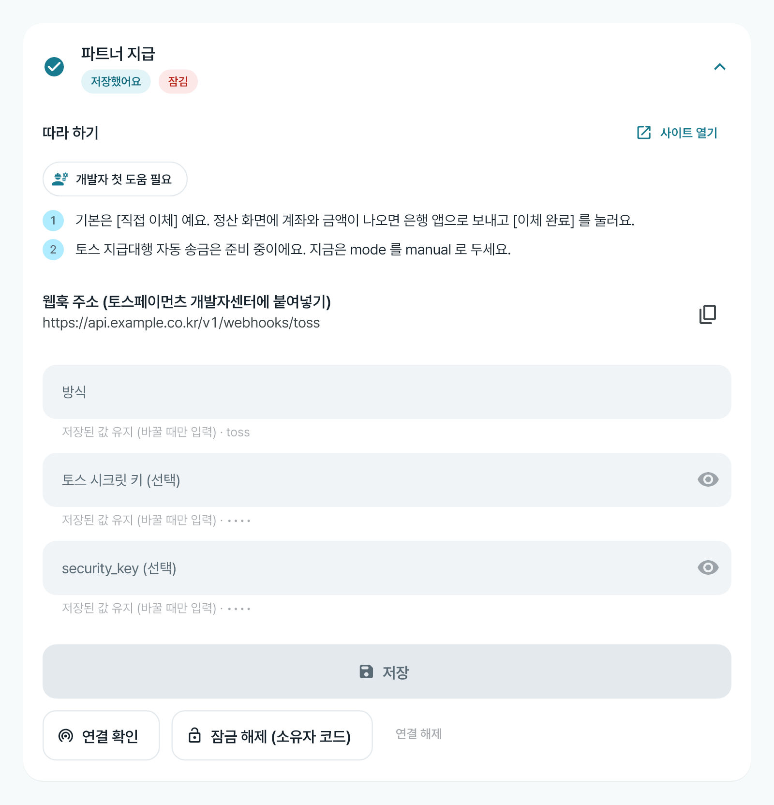
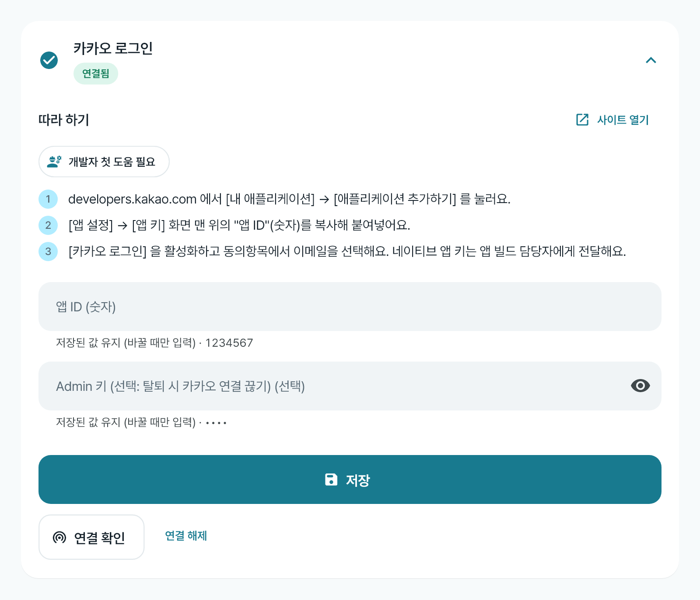
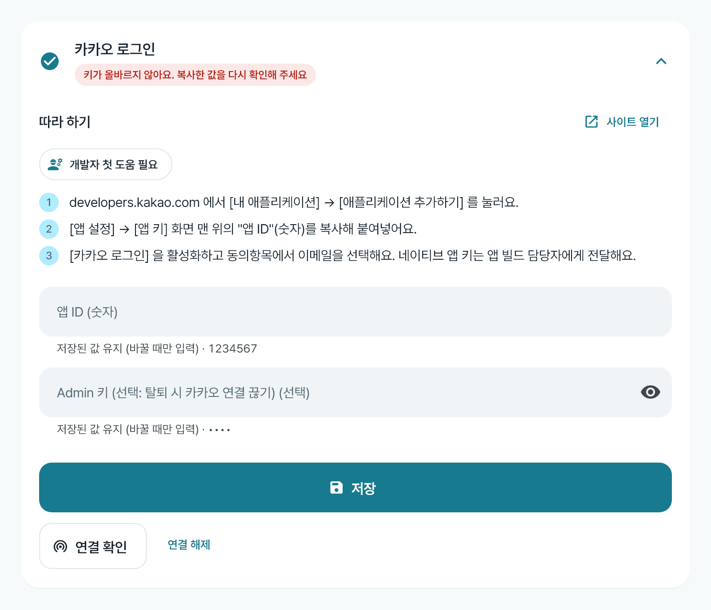

# 09. 설정 화면 사용법

**이 장에서 할 일:** **[설정]** 화면의 카드가 어떻게 생겼는지, 값을 넣고 저장하는 법, 저장한 카드가 잠기는 이유와 잠금을 푸는 법, 연결 확인 결과를 읽는 법을 배워요.
10장부터 17장까지는 카드마다 무엇을 넣는지 설명해요. 이 장의 방법은 모든 카드에 똑같이 써요.

> **준비물**
> - 사장님(소유자) 계정으로 콘솔에 로그인한 상태 (6장)
> - 2단계 인증을 등록한 휴대폰의 인증 앱
> - 각 서비스에서 받은 키를 잠깐 붙여넣어 둘 메모장 (일이 끝나면 지워요)

> **주의** 키(비밀번호 같은 값)는 카카오톡, 문자, 이메일로 주고받지 마세요. 서비스 사이트에서 복사해 콘솔 칸에 바로 붙여넣는 것이 가장 안전해요.

---

## 9.1 설정 화면 열기

1. 왼쪽 메뉴에서 **[설정]** 을 눌러요. (관리자에게만 보이는 메뉴예요.)
2. 맨 위 카드의 제목이 **서비스 시작 준비** 예요.
3. 제목 오른쪽에 **0/13 완료** 처럼 진행 숫자가 보이고, 아래에 진행 막대가 있어요.

**이렇게 보이면 성공:** **서비스 시작 준비** 제목, 진행 숫자, 그 아래 **사업장 정보** 카드가 보여요.

- 진행 숫자는 **사업장 정보** 1개와 외부 서비스 카드 12개, 모두 13개를 세요. 서비스 이름을 저장하거나 카드에 값을 저장하면 하나씩 올라가요. 연결 확인을 통과했는지와는 상관없어요. 서버 설치 때 값이 들어간 카드도 세요.
- 13개가 모두 끝나면 제목이 **모든 준비가 끝났어요!** 로 바뀌어요.
- 모든 카드를 다 채워야 영업할 수 있는 것은 아니에요. 9.8의 "꼭 할 것, 나중에 해도 되는 것"을 보세요.

> **주의** 진행 막대 아래에 **테스트 모드예요. 실제 결제·문자는 나가지 않아요** 가 보이면, 서버가 시험용으로 켜져 있는 거예요. 실제 영업용 서버에서 이 문구가 보이면 개발자에게 알려 주세요.

---

## 9.2 카드 순서

설정 화면은 위에서 아래로 이런 순서예요.

| 순서 | 카드 이름 | 설명하는 장 |
|---|---|---|
| 1 | **사업장 정보** | 10장 |
| 2 | **결제 수단** | 10장 |
| 3 | **스토어 심사용 데모 계정** | 17장 |
| 4 | **업타임 하트비트** (보기 전용) | 17장 |
| 5 | **앱 링크** | 15장 |
| — | **결제 연결** (제목 줄) | 11–12장 |
| 6 | **결제 (PortOne)** | 11장 |
| 7 | **결제 (토스페이먼츠)** | 12장 |
| 8 | **문자 · 알림톡 (Solapi)** | 14장 |
| 9 | **앱 푸시 알림 (Firebase)** | 16장 |
| 10 | **카카오 로그인** | 15장 |
| 11 | **네이버 로그인** | 15장 |
| 12 | **구글 로그인** | 15장 |
| 13 | **애플 로그인** | 15장 |
| 14 | **AI 상담원** | 16장 |
| 15 | **외부 백업 (S3 호환)** | 17장 |
| 16 | **파트너 지급** | 13장 |
| 17 | **주소 검색 (도로명주소)** | 16장 |

6번부터 17번까지가 "외부 서비스 카드"예요. 이 장의 9.3–9.7은 이 12개 카드의 사용법이에요.
1–5번 카드는 모양이 조금 달라서 각 장에서 따로 설명해요.

---

## 9.3 카드 한 장 읽는 법

**카드 머리 (접혀 있어도 보이는 부분)**

- 왼쪽 동그라미: 값이 저장돼 있으면 체크 표시(✔), 아직이면 빈 동그라미예요.
- 카드 이름 아래의 작은 표시(상태 표시)는 이런 뜻이에요.

| 표시 | 뜻 |
|---|---|
| **연결 안 됨** | 아직 아무 값도 없어요 |
| **저장했어요** | 저장은 됐고, 아직 연결 확인은 안 했어요 |
| **연결됨** (초록) | 연결 확인에 통과했어요 |
| 빨간 표시 (예: **키가 올바르지 않아요. 복사한 값을 다시 확인해 주세요**) | 연결 확인에 실패했어요. 9.6을 보세요 |
| **이전에 통과한 확인을 계속 쓰고 있어요** | 방금 확인은 실패했지만, 그전에 통과한 확인이 있어요 |
| **서버 설정 사용 중** | 서버 설치 때 넣은 값을 쓰고 있어요. 바꾸려면 개발자에게 문의하세요 |
| **잠김** | 저장해서 잠긴 카드예요 (9.5) |
| **N분 후 잠겨요** 또는 **잠금 해제됨** | 사장님이 잠금을 푼 상태예요 (9.5) |
| **테스트** / **실거래** | 토스 키가 시험용인지 실제 돈이 오가는 키인지예요 (토스 키를 넣은 카드에만: **결제 (토스페이먼츠)**, **파트너 지급**) |

- 오른쪽 끝의 꺾쇠(∧ / ∨)를 누르면 카드가 펼쳐지고 접혀요. 아직 연결 안 된 카드는 처음부터 펼쳐져 있어요.

**카드 안 (펼치면 보이는 부분)**

1. **따라 하기**: 그 서비스 사이트에서 무엇을 하면 되는지 번호 순서대로 적혀 있어요.
2. **[사이트 열기]**: 누르면 그 서비스 사이트가 새 창으로 열려요.
3. **개발자 첫 도움 필요**: 이 표시가 있는 카드는 처음 한 번은 계약이나 승인 때문에 개발자나 회사 계정 담당자의 도움이 필요해요.
4. **웹훅 주소** 줄 (결제·지급 카드에만): 서비스 사이트에 붙여넣을 주소예요. 오른쪽 겹친 네모 단추(**[복사]**)를 누르면 복사되고 **복사했어요** 가 떠요.
5. 입력 칸: 칸 이름 뒤에 **(선택)** 이 붙은 칸은 비워 둬도 돼요. 나머지는 꼭 채워요.
   - 칸 아래 회색 글씨는 그 값을 어디서 복사하는지 알려줘요.
   - 비밀 값 칸 오른쪽의 눈 모양 단추(**[보기]** / **[숨기기]**)로 입력한 글자를 보이거나 가려요.
   - 형식이 틀리면 칸 아래에 빨간 글씨가 바로 떠요. 저장하기 전에 고쳐요.
6. 아래쪽 단추들: **[저장]**, **[연결 확인]**(결제 카드는 **[API 키 확인]**), **[잠금 해제 (소유자 코드)]**, **[잠그기]**, **[연결 해제]**. 상황에 맞는 단추만 보여요.

---

## 9.4 처음 저장하기

1. 카드를 펼쳐요.
2. **따라 하기** 1번부터 차례로 읽어요. **[사이트 열기]** 로 서비스 사이트를 열어 따라 해요.
3. 서비스 사이트에서 값을 복사해요.
4. 콘솔로 돌아와 알맞은 칸을 한 번 눌러요.
5. `Ctrl` + `V` 로 붙여넣어요. (휴대폰은 칸을 길게 눌러 **[붙여넣기]**.)
6. 눈 모양 단추를 눌러 앞뒤에 빈칸 없이 들어갔는지 확인하고, 다시 눌러 가려요.
7. 칸 아래에 빨간 글씨가 없는지 봐요.
8. 꼭 채워야 하는 칸을 모두 채웠으면 **[저장]** 을 눌러요.
9. **결제 (PortOne)**, **결제 (토스페이먼츠)** 카드, 그리고 토스로 보내는 **파트너 지급** 카드는 처음 저장할 때 **사장님 인증 코드** 창이 떠요.
   인증 앱의 6자리 숫자를 **6자리 인증 코드** 칸에 넣고 **[확인]** 을 눌러요.

**이렇게 보이면 성공:** 화면 아래에 **저장했어요** 가 잠깐 뜨고, 카드 머리에 **저장했어요** 와 **잠김** 표시가 붙어요.
입력 칸은 비워지고, 칸 아래에 **저장된 값 유지 (바꿀 때만 입력) · ••••** 처럼 보여요. 비밀 값은 다시 보여주지 않아요.

> **팁** 사장님 인증 코드 창에는 "토스 지급 설정을 바꾸려면…"이라고 적혀 있지만, 다른 카드에서도 같은 창을 써요. 그대로 인증 앱 숫자를 넣으면 돼요.

> **주의** 돈이 움직이는 카드(결제·지급)는 처음 저장도 사장님(소유자) 계정만 할 수 있어요. 다른 관리자가 저장하면 **소유자만 잠금을 풀 수 있어요** 가 떠요.
> 다른 카드는 관리자 누구나 처음 저장할 수 있어요. 하지만 저장한 뒤에는 모두 잠기고, 사장님만 풀 수 있어요.

---

## 9.5 저장한 카드 바꾸기: 잠금 해제

저장한 카드는 바로 **잠김** 상태가 돼요. 다른 사람이 실수로나 몰래 결제 키를 바꾸지 못하게 하려는 거예요.
잠긴 카드는 입력 칸과 스위치가 회색으로 막혀 있고 **[저장]** 단추도 눌리지 않아요.

**잠금 풀고 값 바꾸기 (사장님만)**

1. 바꿀 카드를 펼쳐요.
2. 아래쪽 **[잠금 해제 (소유자 코드)]** 를 눌러요.
3. **사장님 인증 코드** 창에 인증 앱의 6자리 숫자를 넣고 **[확인]** 을 눌러요.
4. 카드 머리의 **잠김** 표시가 사라지고 **5분 후 잠겨요** 같은 표시가 생겨요.
5. 바꿀 칸에만 새 값을 붙여넣어요. 비워 둔 칸은 저장된 값이 그대로 남아요.
6. **[저장]** 을 눌러요. (잠금을 푼 상태라 코드를 다시 묻지 않아요.)

**이렇게 보이면 성공:** **저장했어요** 가 뜨고, 카드가 곧바로 다시 **잠김** 이 돼요.

- 잠금 해제는 **5분** 동안만, **저장 한 번** 만 돼요. 저장하거나 5분이 지나면 저절로 다시 잠겨요.
- 바꾸지 않고 바로 잠그려면 **[잠그기]** 를 눌러요.
- 잠금을 푼 사장님만 그 카드를 저장할 수 있어요. 다른 관리자에게는 남은 시간도 보이지 않아요.
- 잠금, 잠금 해제, 저장, 실패한 해제 시도는 모두 **[활동 기록]** 에 남아요. 값 자체는 기록되지 않아요.

---

## 9.6 연결 확인

저장한 값으로 그 서비스에 실제로 접속이 되는지 확인해요. 값은 새로 받지 않고 저장된 값만 써요.

1. 카드를 펼쳐요.
2. **[연결 확인]** 을 눌러요. 결제 카드(PortOne, 토스페이먼츠)는 이름이 **[API 키 확인]** 이에요.
3. 단추 옆에 작은 동그라미가 돌다가 멈출 때까지 기다려요.

**이렇게 보이면 성공:** 카드 머리에 초록색 **연결됨** 이 붙어요.

- 잠긴 카드에서도 사장님은 잠금을 풀지 않고 확인할 수 있어요.
- 다른 관리자에게는 잠긴 카드의 확인 단추가 보이지 않아요.
- 값을 바꿔 저장하면 이전 확인 결과는 지워져요. 다시 확인을 눌러요.

**결과 문구 읽기**

| 결과 | 뜻 | 할 일 |
|---|---|---|
| **연결됨** | 통과 | 끝이에요 |
| **저장됨 · 앱에서 로그인해 확인하세요** | 로그인 카드는 서버에서 확인할 수 없어요 | 앱에서 실제로 그 방법으로 로그인해 봐요 (15장) |
| **키가 올바르지 않아요. 복사한 값을 다시 확인해 주세요** | 서비스가 키를 거절했어요 | 서비스 사이트에서 다시 복사해 잠금 해제 → 붙여넣기 → 저장 |
| **자동결제(빌링) 키가 올바르지 않아요. 빌링 MID의 키를 확인해 주세요** | 토스 자동결제 키만 틀렸어요 | 12장을 보세요 |
| **서비스에 연결할 수 없어요. 잠시 후 다시 시도해 주세요** | 그 서비스가 응답하지 않았어요 | 몇 분 뒤 다시 눌러요. 계속되면 개발자에게 알려요 |
| **연결 안 됨** | 저장된 값이 없어요 | 먼저 저장해요 |

---

## 9.7 연결 해제

카드에 저장된 값을 모두 지워요. 잘 쓰지 않아요.

1. 9.5대로 잠금을 풀어요.
2. **[연결 해제]** 를 눌러요.

**이렇게 보이면 성공:** 카드 머리가 **연결 안 됨** 으로 바뀌어요.

> **주의** 연결 해제한 카드는 빈 채로 **잠김** 상태로 남아요. 다시 값을 넣으려면 잠금을 풀어야 하는데, 그런데 지금 콘솔은 콘솔에서 저장한 값이 있는 카드에만 **[잠금 해제 (소유자 코드)]** 단추를 보여줘요. 그래서 연결 해제한 카드에는 이 단추가 보이지 않고, 콘솔에서 다시 값을 넣을 수 없어요. 그러면 개발자에게 문의하세요. 연결 해제는 꼭 필요할 때만 하세요.

> **주의** 결제 카드(PortOne, 토스페이먼츠)는 연결 해제하지 마세요. 그 결제사로 받은 결제의 환불과 저장된 카드 결제가 실패해요. 자세한 내용은 11장과 12장에 있어요.

---

## 9.8 꼭 할 것, 나중에 해도 되는 것

결제사 심사처럼 오래 걸리는 일은 미리 신청해 두고, 기다리는 동안 다른 카드를 먼저 채우세요.

| 순서 | 카드 | 필요한 것 | 걸리는 시간 | 언제 |
|---|---|---|---|---|
| 1 | **사업장 정보** | 사업자등록증, 통신판매업 신고증, 로고 이미지 | 10분 | 꼭, 가장 먼저 |
| 2 | **결제 (PortOne)** | 사업자등록, PortOne 가입과 PG사 심사 | 심사 기간 (회사 기준) | 꼭 (결제를 받으려면) |
| 2-1 | **결제 (토스페이먼츠)** | 토스페이먼츠 전자결제 계약 (저장 카드는 자동결제 계약도) | 심사 기간 (회사 기준) | 선택 |
| 3 | **문자 · 알림톡 (Solapi)** | 발신번호 등록 서류 | 회사 기준 | 꼭 |
| 4 | **앱 푸시 알림 (Firebase)** | 구글 계정 | 10분 | 앱 출시 전 |
| 5 | **카카오 / 네이버 / 구글 / 애플 로그인** | 각 개발자 계정 | 각 10~20분 | 앱 출시 전 |

- **파트너 지급**: 설정하지 않으면 직접 이체 방식이라 나중에 해도 돼요 (13장).
- **외부 백업**, **AI 상담원**, **주소 검색**: 16장과 17장을 보고 정하세요.
- **스토어 심사용 데모 계정**, **앱 링크**: 앱을 스토어에 올릴 때 해요 (15장, 17장, 25장).

---

## 자주 생기는 문제

| 이런 일이 생기면 | 이유 | 이렇게 해요 |
|---|---|---|
| **[저장]** 단추가 회색이라 안 눌려요 | 카드가 잠겨 있어요 | 9.5대로 잠금을 풀어요 (사장님만) |
| **잠긴 카드예요. 소유자가 잠금을 풀어야 바꿀 수 있어요** | 잠긴 카드를 저장하려 했어요 | 9.5대로 잠금을 풀어요 |
| **소유자만 잠금을 풀 수 있어요** | 소유자가 아닌 관리자 계정이에요 | 사장님 계정으로 로그인해요 |
| **인증 코드가 맞지 않아요. 앱에 지금 나온 코드를 입력해 주세요** | 숫자가 바뀌었거나 휴대폰 시계가 틀렸어요 | 휴대폰 날짜·시간을 "자동"으로 하고 새 숫자를 넣어요 |
| **잘못된 코드가 여러 번 입력됐어요. 잠시 후 다시 시도해 주세요** | 틀린 코드를 여러 번 넣었어요 | 몇 분 기다렸다가 다시 해요 |
| **이 인증 번호는 이미 썼어요. 30초쯤 뒤 새로 나온 번호를 입력해 주세요** | 같은 숫자를 두 번 썼어요 | 인증 앱에 새 숫자가 나오면 넣어요 |
| **2단계 인증과 복구 코드 저장을 먼저 마쳐 주세요** | 2단계 인증이나 복구 코드 확인이 안 끝났어요 | 6장과 8.5를 마쳐요 |
| **필수 항목을 모두 입력해 주세요.** | **(선택)** 이 없는 칸을 비워 뒀어요 | 빈 칸을 채워요 |
| **입력값을 확인해 주세요** | 값 형식이 맞지 않아요 | 칸 아래 설명대로 다시 복사해요 |
| 연결 해제한 카드에 **[잠금 해제 (소유자 코드)]** 단추가 없어요 | 9.7의 알려진 문제예요 | 개발자에게 문의해요 |
| 5분 안에 저장을 못 했어요 | 잠금 해제 시간이 끝났어요 | 다시 **[잠금 해제 (소유자 코드)]** 를 눌러요 |
