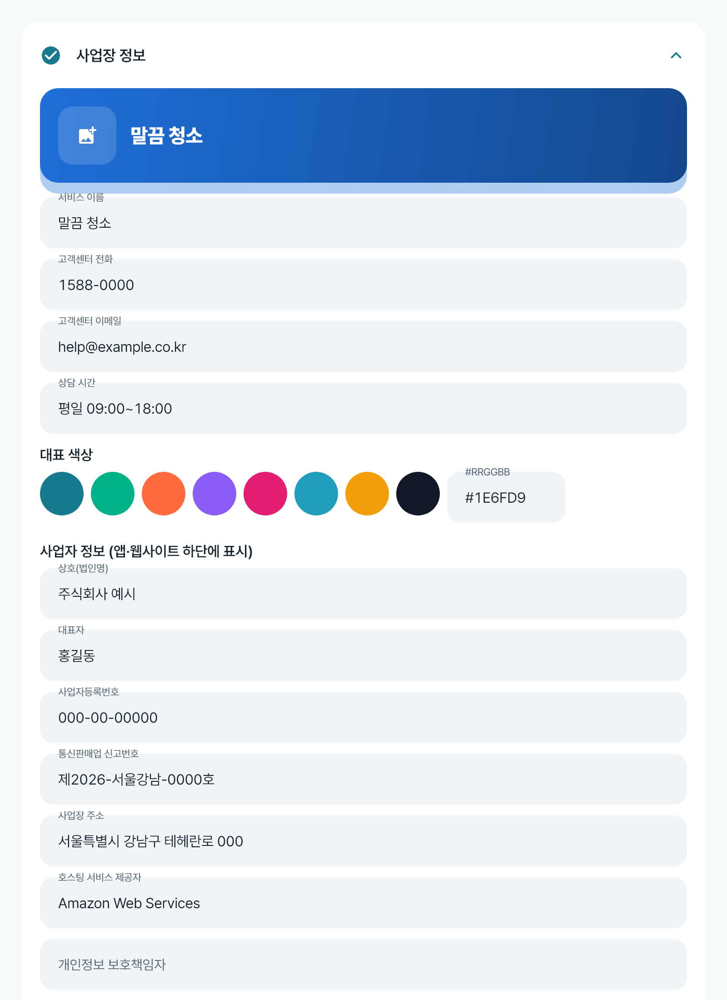
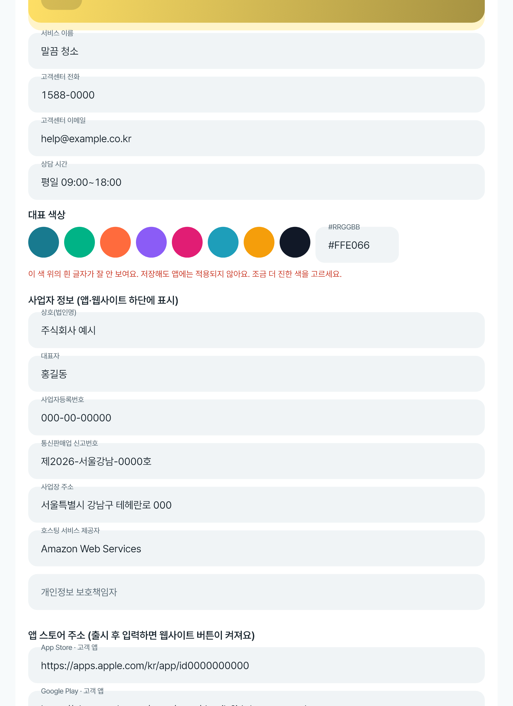
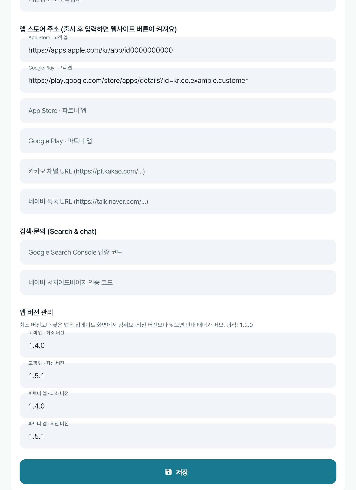
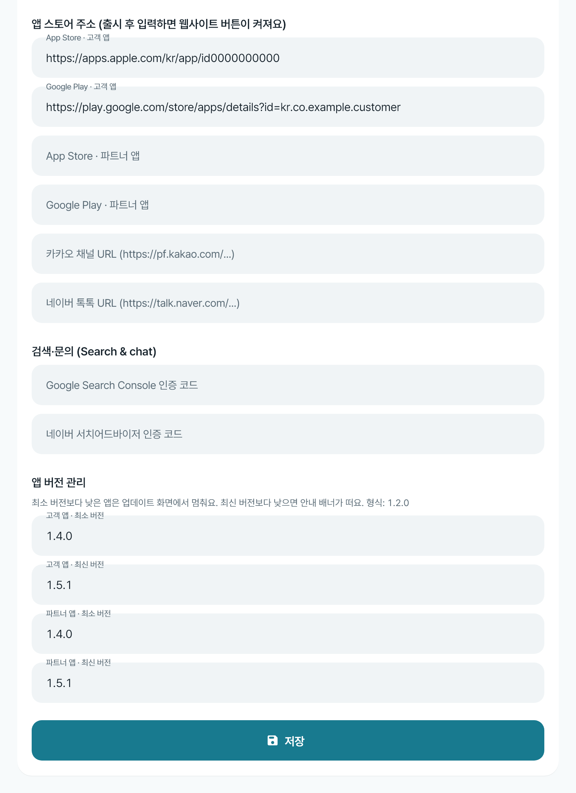
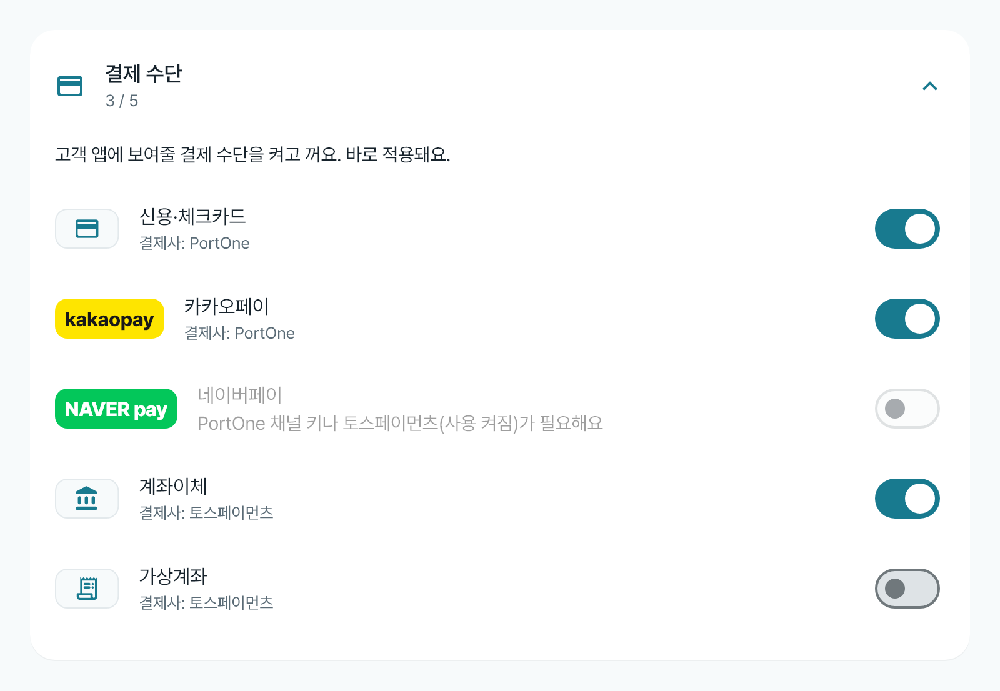

# 10. 사업장 정보와 결제 수단

**이 장에서 할 일:** **[설정]** 화면 맨 위의 **사업장 정보** 카드에 서비스 이름, 고객센터 연락처, 로고, 대표 색상, 사업자 정보를 넣어요.
앱 스토어 주소와 앱 버전 관리 칸도 알아보고, **결제 수단** 카드에서 고객에게 보여줄 결제 방법을 켜고 꺼요.

> **준비물**
> - 사업자등록증 (상호, 대표자, 사업자등록번호, 사업장 주소)
> - 통신판매업 신고증 (신고번호)
> - 로고 그림 파일 (JPG, PNG, WEBP 중 하나. 정사각형이면 보기 좋아요)
> - 고객센터 전화번호, 이메일, 상담 시간
> - 서버를 빌린 회사 이름 (호스팅 서비스 제공자. 예: AWS로 설치했다면 그 회사 이름)
> - 개인정보 보호책임자로 정한 사람

> **팁** **사업장 정보** 카드는 잠기지 않아요. 관리자라면 누구나 언제든 고치고 **[저장]** 할 수 있어요. 인증 코드도 묻지 않아요.

---

## 10.1 사업장 정보 카드 열기

1. 왼쪽 메뉴에서 **[설정]** 을 눌러요.
2. **서비스 시작 준비** 아래 첫 번째 카드 **사업장 정보** 를 봐요.
3. 접혀 있으면 오른쪽 꺾쇠(∨)를 눌러 펼쳐요.

**이렇게 보이면 성공:** 맨 위에 색이 칠해진 넓은 미리보기 띠가 있고, 그 안에 그림 칸과 서비스 이름이 보여요. 그 아래로 입력 칸이 이어져요.

---

## 10.2 서비스 이름과 고객센터

| 칸 이름 | 넣을 값 | 어디에 보이나요 |
|---|---|---|
| **서비스 이름** | 고객이 보는 서비스 이름 (꼭 넣어야 해요) | 앱 머리말, 웹사이트, 알림 |
| **영문 이름** | 영어 이름 (60자까지, 비워도 돼요) | 영어 화면 |
| **짧은 이름 (12자 이내: 문자 앞머리, 홈 화면 이름)** | 12자 이내의 짧은 이름 (비우면 서비스 이름 앞 12자) | 문자 앞머리, 결제 이름, 홈 화면 앱 이름 |
| **한 줄 소개** | 서비스를 한 문장으로 (60자까지) | 공유 이미지, 웹 앱 설명 |
| **영문 한 줄 소개** | 영어 한 줄 소개 (60자까지) | 영어 화면 |
| **고객센터 전화** | 고객이 전화할 번호 | 앱·웹사이트 |
| **고객센터 이메일** | 고객이 메일을 보낼 주소 | 앱·웹사이트 |
| **상담 시간** | 예: `평일 09:00–18:00` | 앱·웹사이트 |

1. **서비스 이름** 칸을 누르고 이름을 입력해요. 위쪽 미리보기의 이름이 바로 바뀌어요.
2. **고객센터 전화** 칸에 번호를 입력해요.
3. **고객센터 이메일** 칸에 주소를 입력해요.
4. **상담 시간** 칸에 시간을 입력해요.

> **참고** **영문 이름**, **짧은 이름**, **한 줄 소개**, **영문 한 줄 소개** 칸은 서비스 이름 바로 아래에 있어요. 각 칸이 어디에 쓰이는지는 28장 28.2 에 자세히 있어요.

> **주의** **서비스 이름** 을 비우면 저장이 안 되고 **입력값을 확인해 주세요** 가 떠요. 다른 칸은 비워도 저장돼요. 한 칸에는 200자까지 넣을 수 있어요.

---

## 10.3 로고 올리기

1. 미리보기 띠 왼쪽의 네모난 그림 칸(그림과 + 표시)을 눌러요. 이 칸의 이름이 **로고 올리기** 예요.
2. 컴퓨터의 파일 고르기 창이 열려요. 로고 파일을 골라 **[열기]** 를 눌러요.
3. 잠깐 기다리면 그림 칸에 로고가 보여요.
4. 이 단계에서는 아직 저장되지 않았어요. 10.8의 **[저장]** 까지 해야 앱과 웹사이트에 적용돼요.

**이렇게 보이면 성공:** 미리보기 띠의 그림 칸에 로고가 보여요.

> **팁** 큰 그림은 올릴 때 가로 1024픽셀 크기로 줄여서 올라가요.

> **팁** 로고 파일이 없으면 그림 칸 아래 **[글자 로고 만들기]** 로 이름 첫 글자 로고를 만들 수 있어요. 저장할 때 콘솔이 로고로 아이콘과 공유 이미지 7가지를 만들어요 (28장 28.3).

---

## 10.4 대표 색상 고르기

대표 색상은 고객 앱의 버튼과 머리말 색이에요. 파트너 앱에서는 강조 색으로만 쓰여요 (28장 28.4).

1. **대표 색상** 아래 동그란 색 8개 중 하나를 눌러요. 고른 색에 진한 테두리가 생기고 미리보기 띠 색이 바뀌어요.
2. 원하는 색이 없으면 오른쪽 **#RRGGBB** 칸에 색 번호를 직접 입력해요. 예: `#187A8F` (`#` 과 숫자·영문 6글자)

**이렇게 보이면 성공:** 미리보기 띠가 고른 색으로 바뀌어요.

> **주의** 색 아래에 빨간 글씨로 **이 색 위의 흰 글자가 잘 안 보여요. 저장해도 앱에는 적용되지 않아요. 조금 더 진한 색을 고르세요.** 가 뜨면 더 진한 색을 고르세요.
> 그대로 저장해도 앱은 그 색을 쓰지 않아요. 버튼 위 흰 글자가 잘 보이게 하려는 거예요.

> **팁** 고객 앱과 파트너 앱은 저장된 색과 로고를 서버에서 받아 써요. 인터넷이 끊겨도 마지막으로 받은 색으로 보여요. 무엇이 언제 바뀌는지는 28장에 있어요.

---

## 10.5 사업자 정보

제목 **사업자 정보 (앱·웹사이트 하단에 표시)** 아래 칸들이에요. 법에 따라 웹사이트 하단과 약관에 보여야 하는 정보예요. 입력하면 웹사이트에 저절로 나타나요.

| 칸 이름 | 어디서 보나요 |
|---|---|
| **상호(법인명)** | 사업자등록증의 상호 |
| **대표자** | 사업자등록증의 대표자 |
| **사업자등록번호** | 사업자등록증의 번호 (예: `123-45-67890`) |
| **통신판매업 신고번호** | 통신판매업 신고증의 번호 |
| **사업장 주소** | 사업자등록증의 사업장 소재지 |
| **호스팅 서비스 제공자** | 서버를 빌린 회사 이름 |
| **개인정보 보호책임자** | 개인정보 보호책임자로 정한 사람 |
| **개인정보 문의 이메일** | 고객이 개인정보 문의를 보낼 이메일 주소 |

1. 위 표의 순서대로 칸을 하나씩 눌러 입력해요.
2. 서류에 적힌 그대로 옮겨 적어요.

> **주의** 이 정보가 맞는지는 사장님이 책임져야 해요. 무엇을 꼭 표시해야 하는지는 세무사나 법률 전문가에게 확인하세요 (확인 필요).

---

## 10.6 앱 스토어 주소, 상담 채널, 검색 등록

**앱 스토어 주소 (출시 후 입력하면 웹사이트 버튼이 켜져요)**

앱을 스토어에 올리기 전에는 비워 두세요. 출시한 뒤 25장을 마치고 돌아와서 넣어요.

| 칸 이름 | 넣을 값 |
|---|---|
| **App Store · 고객 앱** | 애플 앱 스토어의 고객 앱 주소 |
| **Google Play · 고객 앱** | 구글 플레이의 고객 앱 주소 |
| **App Store · 파트너 앱** | 애플 앱 스토어의 파트너 앱 주소 |
| **Google Play · 파트너 앱** | 구글 플레이의 파트너 앱 주소 |
| **카카오 채널 URL (https://pf.kakao.com/...)** | 카카오톡 채널 주소 (웹사이트 상담 단추) |
| **네이버 톡톡 URL (https://talk.naver.com/...)** | 네이버 톡톡 주소 (웹사이트 상담 단추) |

1. 스토어 앱 화면이나 채널 관리 화면에서 주소를 복사해요.
2. 알맞은 칸에 붙여넣어요. 주소는 꼭 `https://` 로 시작해야 해요.

**이렇게 보이면 성공:** 저장한 뒤 웹사이트의 앱 내려받기 단추가 켜져요.

**검색·문의 (Search & chat)**

구글과 네이버 검색에 웹사이트를 등록할 때 쓰는 확인 코드예요. 쓰지 않으면 비워 두세요.

| 칸 이름 | 넣을 값 |
|---|---|
| **Google Search Console 인증 코드** | Google Search Console의 사이트 소유 확인 코드 |
| **네이버 서치어드바이저 인증 코드** | 네이버 서치어드바이저의 사이트 소유 확인 코드 |

> **팁** 각 사이트의 소유 확인 화면에서 HTML 태그 방식과 HTML 파일 방식 중 무엇을 골라도 돼요.
> - HTML 태그 방식: `content="…"` 안의 값만 붙여넣어요.
> - HTML 파일 방식: 파일 이름에서 앞의 `google`(네이버는 `naver`)과 뒤의 `.html` 을 뺀 가운데 부분만 붙여넣어요. 파일은 올리지 않아도 돼요. 서버가 그 이름의 파일을 대신 보여줘요.
> - 영문, 숫자, `-`, `_` 만 128글자까지 받아요. 다른 글자가 있으면 저장할 때 **입력값을 확인해 주세요** 가 떠요.

---

## 10.7 앱 버전 관리

제목 **앱 버전 관리** 아래에 이런 설명이 있어요: **최소 버전보다 낮은 앱은 업데이트 화면에서 멈춰요. 최신 버전보다 낮으면 안내 배너가 떠요. 형식: 1.2.0**

| 칸 이름 | 뜻 |
|---|---|
| **고객 앱 · 최소 버전** | 이보다 낮은 고객 앱은 업데이트하기 전에는 쓸 수 없어요 |
| **고객 앱 · 최신 버전** | 이보다 낮은 고객 앱에 "업데이트하세요" 안내가 떠요 |
| **파트너 앱 · 최소 버전** | 파트너 앱의 최소 버전 |
| **파트너 앱 · 최신 버전** | 파트너 앱의 최신 버전 |

1. 처음에는 모두 비워 둬요.
2. 새 앱 버전이 두 스토어에 모두 올라간 뒤에 **최신 버전** 칸에 그 번호를 넣어요. 예: `1.2.0`
3. 옛 버전을 꼭 막아야 할 때만 **최소 버전** 을 넣어요.

> **주의** 숫자 세 개를 점으로 이은 형식(`1.2.0`)만 받아요. 틀리면 저장할 때 **입력값을 확인해 주세요** 가 떠요.

> **주의** **최소 버전** 을 스토어에 아직 없는 번호로 넣으면 고객과 파트너가 앱을 아예 쓸 수 없게 돼요. 스토어에 새 버전이 보이는지 먼저 확인하세요.

---

## 10.8 저장하기

1. 카드 맨 아래로 내려가요.
2. **[저장]** 을 눌러요.
3. 로고, 대표 색, 서비스 이름, 한 줄 소개를 바꿨다면 **이렇게 보여요** 창이 열려요. 만든 아이콘과 공유 이미지를 보고 **[저장]** 을 눌러요 (28장 28.6).
4. **저장했어요. 이렇게 적용돼요** 창을 읽고 **[확인]** 을 눌러요.

**이렇게 보이면 성공:** 화면 아래에 **저장했어요** 가 잠깐 뜨고, 카드 제목 왼쪽의 가게 모양 그림이 체크 표시(✔)로 바뀌어요. 맨 위 진행 숫자가 하나 올라가요.

> **주의** 저장하지 않고 다른 메뉴로 가면 입력한 내용이 사라져요.

> **참고** **사업장 정보** 카드 바로 아래에는 **스토어 앱 빌드** 카드(28장 28.7)와 **영업시간** 카드(17장 17.4)가 있어요.

---

## 10.9 결제 수단 카드

고객 앱에 보여줄 결제 방법을 켜고 꺼요. 스위치를 누르는 즉시 적용돼요. **[저장]** 단추가 따로 없어요.

1. **사업장 정보** 아래 **영업시간** 카드 바로 다음의 **결제 수단** 카드를 펼쳐요.
2. 맨 위에 **고객 앱에 보여줄 결제 수단을 켜고 꺼요. 바로 적용돼요.** 가 보여요. 카드 제목 아래 숫자(예: `4 / 10`)는 켜진 수 / 전체 수예요.
3. 결제 방법은 10가지예요: **신용·체크카드**, **카카오페이**, **네이버페이**, **토스페이**, **페이코**, **삼성페이**, **애플페이**, **계좌이체**, **가상계좌**, **휴대폰 결제**.
4. 켜려면 그 줄 오른쪽 스위치를 눌러 오른쪽으로 옮겨요.
5. 끄려면 다시 눌러 왼쪽으로 옮겨요.

**이렇게 보이면 성공:** 스위치가 바로 바뀌고, 제목 아래 숫자가 달라져요.

**줄 아래 회색 글씨가 있을 때**

| 글씨 | 뜻 | 할 일 |
|---|---|---|
| **결제사: PortOne** 또는 **결제사: 토스페이먼츠** | 이 방법을 켜 두면 결제는 그 결제사로 가요. 카드는 카드를 저장할 수 있는 동안 카드를 저장하는 결제사예요 | 할 일 없어요. PortOne에서 토스페이먼츠로 옮기려면 11장 11.12를 보세요 |
| **PortOne 채널 키나 토스페이먼츠(사용 켜짐)가 필요해요** | 이 방법을 받을 결제사가 없어요. PortOne에 채널 키가 없고, 토스페이먼츠는 설정 안 됐거나 **사용** 이 꺼져 있어요. 그래서 켤 수 없어요 (스위치가 회색) | 11장대로 **결제 (PortOne)** 카드에 채널 키를 넣거나, 12장대로 토스페이먼츠를 설정하고 **사용** 을 켜요 |
| **결제 채널이 아직 연결되지 않아 고객에게 보이지 않아요. 설정 담당자에게 문의해 주세요.** | 켜져 있지만 받을 결제사가 없어서 고객에게 안 보여요 | 채널 키를 넣거나(11장) 토스페이먼츠를 설정하거나(12장), 이 스위치를 꺼요 |

> **주의** 모든 결제 방법을 끌 수는 없어요. 마지막 하나를 끄면 **결제 수단을 하나 이상 켜 주세요. 모두 끄면 고객이 결제할 수 없어요.** 가 뜨고 저장되지 않아요.

> **주의** 토스페이먼츠를 설정하고 **사용** 을 켜 두면(12장), PortOne 채널 키가 없는 켜진 결제 방법이 모두 토스페이먼츠로 고객에게 보여요. 토스페이먼츠를 저장하기 전에 토스페이먼츠와 계약·승인된 방법이나 PortOne 채널 키가 있는 방법만 켜 두세요.

> **팁** 처음 설치하면 10가지가 모두 켜져 있어요. 그래도 받을 결제사가 있는 방법만 고객에게 보여요. PortOne만 쓰면 채널 키가 있는 방법만, 토스페이먼츠를 쓰면 켜진 방법 모두예요.

---

## 자주 생기는 문제

| 이런 일이 생기면 | 이유 | 이렇게 해요 |
|---|---|---|
| **[저장]** 하면 **입력값을 확인해 주세요** | 서비스 이름이 비었거나, 주소가 `https://` 로 시작하지 않거나, 버전·색 형식이 틀렸어요 | 서비스 이름, 링크, 버전(`1.2.0`), 색(`#187A8F`)을 다시 봐요 |
| 로고를 골랐는데 앱에 안 보여요 | **[저장]** 을 안 눌렀어요 | 카드 맨 아래 **[저장]** 을 눌러요 |
| 로고를 올리다 오류가 나요 | 지원하지 않는 파일이에요 | JPG, PNG, WEBP 파일로 다시 해요 |
| **로고로 이미지를 만들지 못했어요. 다른 PNG나 JPG 파일로 해 보세요.** | 콘솔이 그 로고로 아이콘을 만들지 못했어요 | PNG 나 JPG 파일로 다시 해요 |
| 색을 바꿨는데 앱 색이 그대로예요 | 흰 글자가 잘 안 보이는 밝은 색이에요 | 경고가 사라지는 더 진한 색을 골라 저장해요 |
| 웹사이트에 앱 내려받기 단추가 없어요 | 스토어 주소를 아직 안 넣었어요 | 출시 뒤 10.6대로 넣고 저장해요 |
| 결제 수단 스위치가 회색이라 안 켜져요 | 그 방법을 받을 결제사가 없어요 | 11장대로 PortOne 채널 키를 넣거나, 12장대로 토스페이먼츠를 설정하고 **사용** 을 켜요 |
| 고객이 "업데이트" 화면에서 멈춰요 | **최소 버전** 이 스토어에 있는 버전보다 높아요 | **최소 버전** 칸을 고치거나 비우고 저장해요 |
