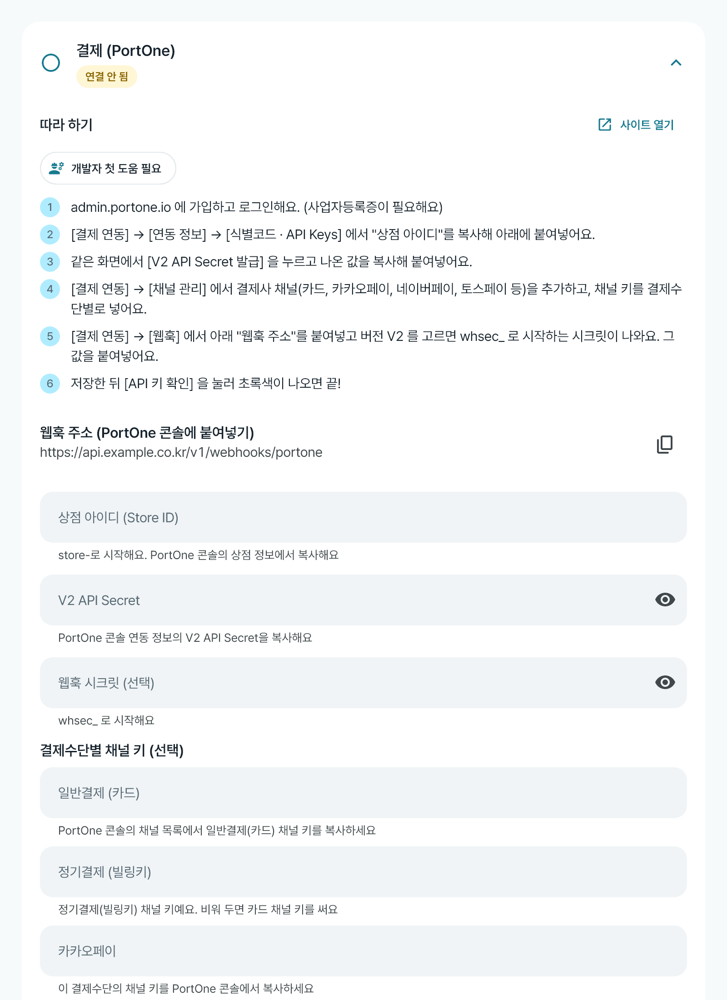
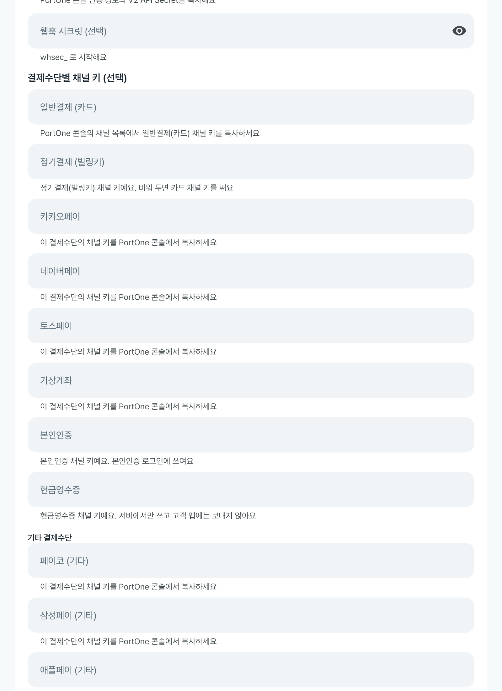
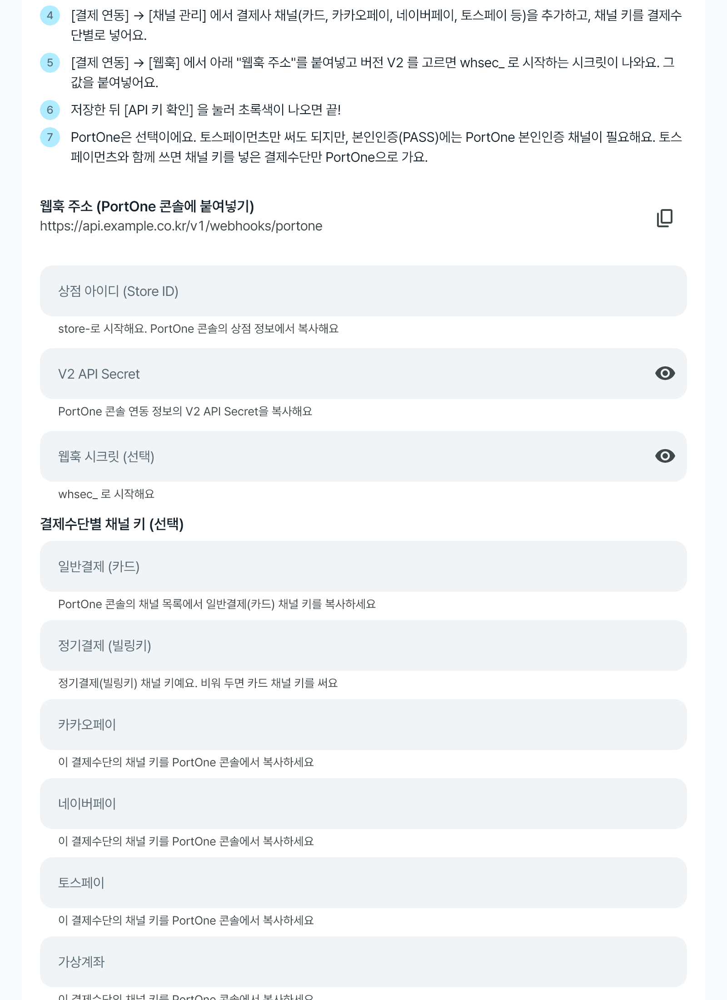
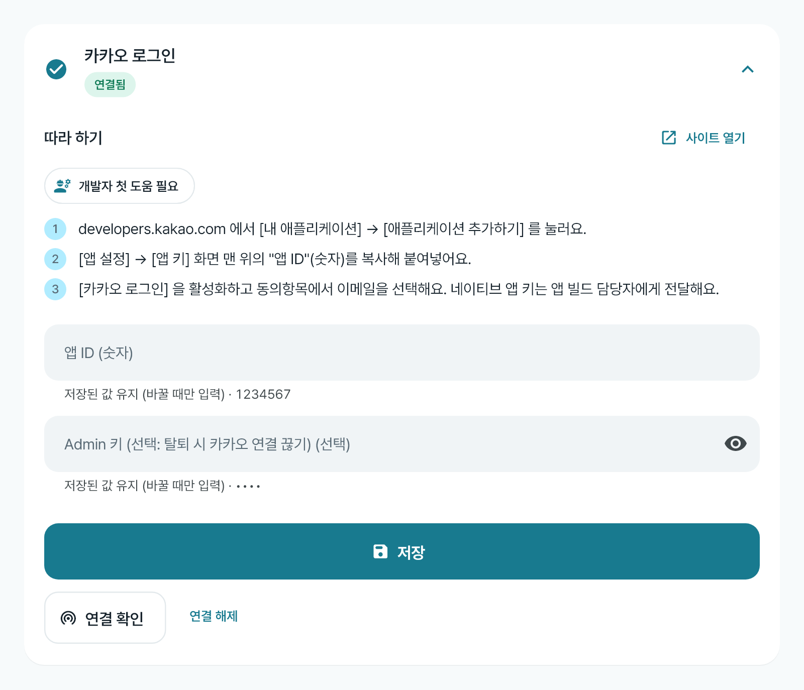

# 11. 결제 (PortOne)

**이 장에서 할 일:** 고객이 앱에서 카드·간편결제로 돈을 낼 수 있게 PortOne(포트원)을 연결해요.
PortOne 사이트에서 값 네 가지(상점 아이디, V2 API Secret, 채널 키, 웹훅 시크릿)를 받아 콘솔의 **결제 (PortOne)** 카드에 넣고, 테스트 결제로 확인해요.

> **준비물**
> - 사업자등록증 (PortOne 가입과 결제사 심사에 필요해요)
> - PortOne 계정 (admin.portone.io). 회사 명의로 만들어요.
> - 결제사(PG사) 계약과 심사. PortOne을 통해 신청하고, 심사 기간은 결제사가 정해요.
> - 사장님 계정과 인증 앱 (처음 저장할 때 사장님 인증 코드가 필요해요)
> - 9장의 카드 사용법

> **주의** 이 카드는 **개발자 첫 도움 필요** 표시가 있어요. 계약과 채널 설정이 처음이라면 개발자와 같이 하세요.

> **주의** PortOne 사이트의 메뉴 이름과 위치는 PortOne이 바꿀 수 있어요. 아래 PortOne 화면 이름은 콘솔 카드의 **따라 하기** 에 적힌 이름이에요. 화면이 다르면 PortOne 고객센터 안내를 따르세요.

---

## 11.1 무엇을 어디에 넣나요

| 콘솔 칸 이름 | PortOne에서 가져올 값 | 모양 | 비밀인가요 |
|---|---|---|---|
| **상점 아이디 (Store ID)** | 상점 아이디 | `store-` 로 시작 | 아니요 |
| **V2 API Secret** | V2 API Secret | 긴 글자, 빈칸 없음 | **예 (서버에만)** |
| **웹훅 시크릿 (선택)** | 웹훅 시크릿 | `whsec_` 로 시작 | **예 (서버에만)** |
| **결제수단별 채널 키 (선택)** | 결제수단마다 채널 키 | `channel-key-` 로 시작 | 아니요 (현금영수증 채널 키는 서버에만) |
| **현금영수증 발급 (선택)** | (스위치) | 켜기 / 끄기 | — |

> **주의** "서버에만" 값은 다른 사람에게 보여주지 마세요. 저장한 뒤에는 콘솔에서도 `••••` 로만 보여요.

---

## 11.2 PortOne 가입과 결제사 신청

1. 콘솔 **[설정]** 에서 **결제 (PortOne)** 카드를 펼쳐요. **결제 연결** 제목 바로 아래에 있어요.
2. **따라 하기** 오른쪽 **[사이트 열기]** 를 눌러요. admin.portone.io 가 새 창으로 열려요.
3. 사업자등록증을 준비해 가입하고 로그인해요.
4. PortOne 안내에 따라 쓰고 싶은 결제사(카드, 카카오페이, 네이버페이, 토스페이 등)를 신청해요. 심사가 끝날 때까지 기다리는 동안 다른 카드를 먼저 채워도 돼요.

---

## 11.3 상점 아이디와 V2 API Secret 복사하기

**상점 아이디**

1. PortOne 사이트에서 **[결제 연동] → [연동 정보] → [식별코드 · API Keys]** 로 가요.
2. "상점 아이디"를 찾아 복사해요. `store-` 로 시작해요.
3. 콘솔 카드의 **상점 아이디 (Store ID)** 칸에 붙여넣어요.

**V2 API Secret**

1. 같은 PortOne 화면에서 **[V2 API Secret 발급]** 을 눌러요.
2. 나온 값을 복사해요. 이 값은 다시 볼 수 없을 수 있으니 바로 붙여넣어요.
3. 콘솔 카드의 **V2 API Secret** 칸에 붙여넣어요.
4. 칸 오른쪽 눈 모양 단추로 앞뒤에 빈칸이 없는지 확인해요.

**이렇게 보이면 성공:** 두 칸 아래에 빨간 글씨가 없어요.

---

## 11.4 결제수단별 채널 키 넣기

PortOne에서는 결제사마다 "채널"을 만들어요. 채널마다 채널 키가 있고, 콘솔에는 결제수단별 칸에 하나씩 넣어요.

1. PortOne 사이트에서 **[결제 연동] → [채널 관리]** 로 가요.
2. 쓰려는 결제사 채널(카드, 카카오페이, 네이버페이, 토스페이 등)을 추가해요.
3. 콘솔 카드의 **결제수단별 채널 키 (선택)** 아래 칸들을 봐요. 칸마다 이름과 설명이 있어요.

| 칸 이름 | 넣을 채널 키 | 칸 아래 설명 |
|---|---|---|
| **일반결제 (카드)** | 카드 결제 채널 | PortOne 콘솔의 채널 목록에서 일반결제(카드) 채널 키를 복사하세요 |
| **정기결제 (빌링키)** | 카드 저장·정기결제 채널 | 정기결제(빌링키) 채널 키예요. 비워 두면 카드 채널 키를 써요 |
| **카카오페이** | 카카오페이 채널 | 이 결제수단의 채널 키를 PortOne 콘솔에서 복사하세요 |
| **네이버페이** | 네이버페이 채널 | (위와 같음) |
| **토스페이** | 토스페이 채널 | (위와 같음) |
| **가상계좌** | 가상계좌 채널 | (위와 같음) |
| **본인인증** | 본인인증 채널 | 본인인증 채널 키예요. 본인인증 로그인에 쓰여요 |
| **현금영수증** | 현금영수증 채널 | 현금영수증 채널 키예요. 서버에서만 쓰고 고객 앱에는 보내지 않아요 |

그 아래 **기타 결제수단** 제목 밑에 **페이코 (기타)**, **삼성페이 (기타)**, **애플페이 (기타)**, **계좌이체 (기타)**, **휴대폰 결제 (기타)** 칸이 더 있어요.

4. PortOne 채널 목록에서 채널 키를 하나 복사해요. `channel-key-` 로 시작해요.
5. 콘솔에서 같은 결제수단 칸에 붙여넣어요.
6. 쓰는 결제수단마다 4–5번을 되풀이해요.
7. 쓰지 않는 결제수단 칸은 비워 둬요.

**이렇게 보이면 성공:** 넣은 칸 아래에 빨간 글씨가 없어요.

> **팁** 채널 키가 없는 결제수단은 고객 앱에 보이지 않아요. 나중에 채널을 추가하면 그때 넣어도 돼요 (9.5 잠금 해제).

> **팁** **현금영수증** 칸이 비어 있으면 계좌이체·가상계좌 채널 키로 현금영수증을 발급해요. **정기결제 (빌링키)** 칸이 비어 있으면 **일반결제 (카드)** 채널 키를 써요.

---

## 11.5 웹훅 연결하기

웹훅은 결제가 끝났을 때 PortOne이 우리 서버에 알려주는 통로예요.

1. 콘솔 카드에서 **웹훅 주소 (PortOne 콘솔에 붙여넣기)** 줄을 찾아요. 주소는 `https://(내 도메인)/v1/webhooks/portone` 모양이에요.
2. 줄 오른쪽 **[복사]** 단추를 눌러요. **복사했어요** 가 떠요.
3. PortOne 사이트에서 **[결제 연동] → [웹훅]** 으로 가요.
4. 웹훅 주소 칸에 붙여넣고, 버전은 **V2** 를 골라요.
5. 저장하면 PortOne 화면에 `whsec_` 로 시작하는 시크릿이 나와요. 복사해요.
6. 콘솔 카드의 **웹훅 시크릿 (선택)** 칸에 붙여넣어요.

> **주의** 칸 이름에 **(선택)** 이 붙어 있지만 꼭 넣으세요. 웹훅 시크릿으로 PortOne에서 온 알림이 진짜인지 확인해요. 비워 두면 실제 영업 서버는 PortOne 알림을 모두 거절해요 (테스트 모드 서버만 받아요).

> **팁** 웹훅은 결제 상태를 바로 바꾸지 않아요. 알림을 받으면 서버가 PortOne에 다시 물어보고 확인해요.

> **팁** 나중에 도메인을 바꾸면 이 웹훅 주소도 새 도메인으로 바뀌어요. 콘솔 **도메인** 카드의 **옮긴 뒤 할 일** 목록이 새 주소를 복사 단추와 함께 보여 줘요 (28장 28.8.6).

---

## 11.6 현금영수증 발급 스위치

**현금영수증 발급 (선택)** 스위치는 처음에 꺼져 있어요. 칸 아래 설명: **꺼 두면 현금영수증을 발급하지 않아요. 켜기 전에 결제사 테스트 환경에서 먼저 확인하세요.**

1. 처음 저장할 때는 꺼 둬요.
2. 현금영수증을 쓸 거라면, 테스트 채널 키가 들어 있는 동안(11.9) 스위치를 켜고 테스트 결제로 발급되는지 확인해요. 꺼 두면 발급되지 않으니 켠 채로 시험해야 해요.
3. 켤 때는 카드가 잠겨 있으니 **[잠금 해제 (소유자 코드)]** → 스위치 켜기 → **[저장]** 순서로 해요.
4. 테스트에서 문제가 있으면 같은 순서로 다시 꺼요.

---

## 11.7 저장하기 (사장님 인증 코드)

1. **상점 아이디 (Store ID)** 와 **V2 API Secret** 이 채워졌는지 확인해요. 이 두 칸은 꼭 넣어야 해요.
2. **[저장]** 을 눌러요.
3. **사장님 인증 코드** 창이 떠요. 인증 앱의 6자리 숫자를 **6자리 인증 코드** 칸에 넣어요.
4. **[확인]** 을 눌러요.

**이렇게 보이면 성공:** **저장했어요** 가 뜨고, 카드 머리에 **저장했어요** 와 **잠김** 이 붙어요.
**결제 연결** 제목 아래에 **새 결제를 받는 곳: PortOne** 이 보여요.

> **주의** 처음 저장은 사장님(소유자) 계정만 할 수 있어요. 결제 금액이 어디로 들어갈지 정하는 일이라서예요.

---

## 11.8 API 키 확인

1. 카드 아래쪽 **[API 키 확인]** 을 눌러요. (잠긴 상태여도 사장님은 그대로 누를 수 있어요.)
2. 잠깐 기다려요.

**이렇게 보이면 성공:** 카드 머리에 초록색 **연결됨** 이 붙어요.

> **주의** **[API 키 확인]** 은 V2 API Secret만 확인해요. 상점 아이디나 채널 키가 틀린 것은 첫 결제를 해 봐야 드러나요. 그래서 11.9의 테스트 결제를 꼭 하세요.

---

## 11.9 테스트 결제 해 보기

PortOne 테스트용 채널 키로 먼저 시험한 뒤 실제 채널 키로 바꿔요.

1. **결제 수단** 카드(10.9)에서 테스트할 결제 방법이 켜져 있는지 확인해요.
2. 고객 앱에서 예약을 하나 만들고 카드로 결제해요.
3. 콘솔 **[예약]** 에서 그 예약이 결제 완료로 보이는지 확인해요.
4. 그 예약을 부분 환불해 봐요 (21장).
5. 카드 저장(정기결제)을 쓸 거라면 카드 저장 → 그 카드로 결제 → 카드 삭제까지 한 번 해 봐요.
6. 현금영수증을 쓸 거라면 먼저 11.6대로 스위치를 켜요. 그다음 계좌이체나 가상계좌로 한 번 결제해 발급되는지 봐요.
7. 테스트 결제는 모두 환불해요.

**이렇게 보이면 성공:** 결제와 환불이 콘솔과 PortOne 사이트 양쪽에 똑같이 보여요.

> **확인 필요** 아래 항목은 아직 실제 테스트 상점에서 확인하지 않았어요. 개발자와 함께 테스트할 때 같이 확인하세요.
> - 실제 카드 거절 코드가 어떻게 오는지
> - 현금영수증 발급 응답의 모양

---

## 11.10 실제 결제로 바꾸기

1. PortOne 사이트에서 실제 결제용 채널을 준비해요. 테스트용 채널과 실제 채널을 어떻게 나누는지는 PortOne 안내를 따르세요 (확인 필요).
2. 콘솔 카드를 펼치고 **[잠금 해제 (소유자 코드)]** 를 눌러요.
3. **사장님 인증 코드** 창에 6자리 숫자를 넣고 **[확인]** 을 눌러요.
4. 바꿀 채널 키 칸에만 실제 채널 키를 붙여넣어요. (다른 칸은 비워 두면 저장된 값이 남아요.)
5. 5분 안에 **[저장]** 을 눌러요.
6. **[API 키 확인]** 을 눌러요.
7. 작은 금액으로 실제 결제 1번과 환불 1번을 해 봐요.

> **주의** PortOne 카드에는 **테스트** / **실거래** 표시가 없어요. 지금 넣은 채널 키가 테스트용인지 실제용인지는 사장님이 직접 기록해 두세요.

---

## 11.11 PortOne 카드는 지우지 마세요

나중에 토스페이먼츠로 새 결제를 받더라도(12장) PortOne 카드는 그대로 둬요.

- PortOne으로 받은 결제의 환불은 PortOne 카드를 써요.
- PortOne으로 저장한 카드와 그 정기 방문 결제도 PortOne을 써요.
- 본인인증(PASS)은 항상 PortOne을 써요.

> **주의** PortOne 카드에서 **[연결 해제]** 를 누르면 위 일들이 모두 실패해요.

---

## 자주 생기는 문제

| 이런 일이 생기면 | 이유 | 이렇게 해요 |
|---|---|---|
| **상점 아이디는 store-로 시작해야 해요.** | 다른 값을 복사했어요 | PortOne **[식별코드 · API Keys]** 에서 `store-` 로 시작하는 값을 복사해요 |
| **V2 API Secret 형식이 맞지 않아요. 공백 없이 전체를 붙여넣어 주세요.** | 일부만 복사했거나 빈칸이 들어갔어요 | 전체를 다시 복사해 붙여넣어요 |
| **채널 키는 channel-key-로 시작해야 해요.** | 채널 키가 아닌 값을 넣었어요 | **[채널 관리]** 에서 채널 키를 다시 복사해요 |
| **웹훅 시크릿은 whsec_로 시작해야 해요.** | 웹훅 주소나 다른 값을 넣었어요 | PortOne 웹훅 화면의 `whsec_` 값을 복사해요 |
| **필수 항목을 모두 입력해 주세요.** | 상점 아이디나 V2 API Secret이 비었어요 | 두 칸을 채워요 |
| **소유자만 잠금을 풀 수 있어요** | 사장님이 아닌 관리자가 처음 저장하려 했어요 | 사장님 계정으로 로그인해 저장해요 |
| **키가 올바르지 않아요. 복사한 값을 다시 확인해 주세요** | PortOne이 V2 API Secret을 거절했어요 | PortOne에서 새 Secret을 발급해 잠금 해제 → 붙여넣기 → 저장 |
| **서비스에 연결할 수 없어요. 잠시 후 다시 시도해 주세요** | PortOne이 응답하지 않았어요 | 몇 분 뒤 다시 확인해요 |
| 고객 앱에 결제 방법이 안 보여요 | 그 방법의 채널 키가 없거나, **결제 수단** 에서 꺼져 있어요 | 11.4대로 채널 키를 넣고 10.9에서 켜요 |
| 결제는 됐는데 콘솔에 결제 완료로 안 바뀌어요 | 웹훅 주소나 웹훅 시크릿이 틀렸을 수 있어요 | 11.5를 다시 확인하고 개발자에게 알려요 |
