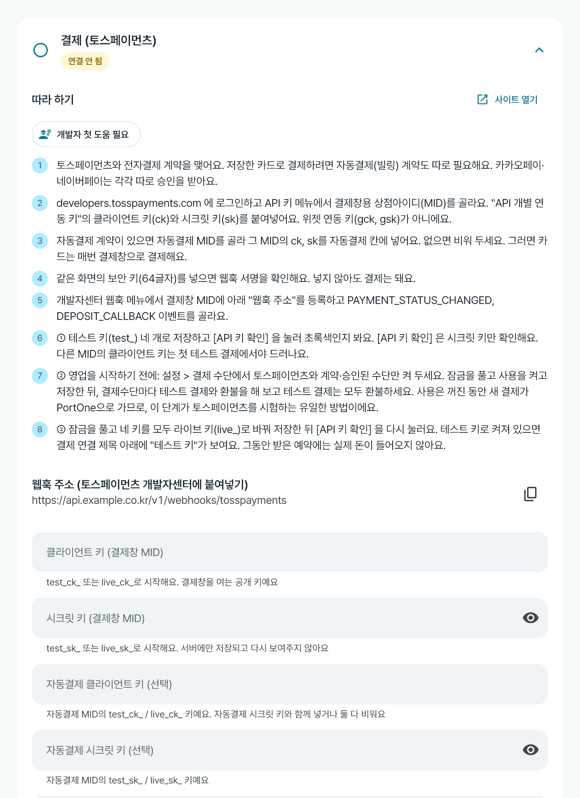
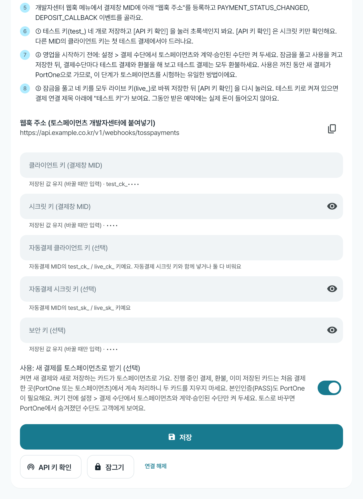
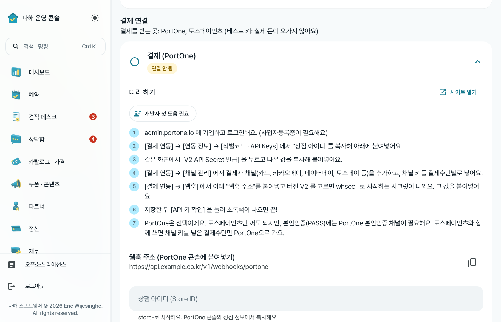

# 12. 결제 (토스페이먼츠)와 결제사 바꾸기

**이 장에서 할 일:** PortOne은 그대로 둔 채, **새 결제** 를 토스페이먼츠(직접 연동)로 받도록 바꾸는 방법을 배워요. 이 카드는 선택이에요.
테스트 키로 저장하고 시험한 뒤 라이브 키로 바꾸는 순서, 무엇이 어디로 가는지, 다시 PortOne으로 되돌리는 법까지 다뤄요.

> **준비물**
> - 토스페이먼츠 **전자결제** 계약 (결제창용 상점아이디, MID)
> - 저장한 카드로 결제하거나 정기 방문을 쓰려면 **자동결제(빌링)** 계약도 (따로 심사하고, MID도 결제창과 달라요)
> - 카카오페이·네이버페이 같은 간편결제는 결제사마다 따로 승인을 받아요
> - developers.tosspayments.com (토스페이먼츠 개발자센터) 로그인 계정
> - 11장대로 연결된 **결제 (PortOne)** 카드 (지우면 안 돼요)
> - 사장님 계정과 인증 앱
> - 시험용 안드로이드 폰, 아이폰 (결제 앱으로 넘어갔다 돌아오는지 확인해요)

> **주의** 이 카드는 **개발자 첫 도움 필요** 표시가 있어요. 처음에는 개발자와 같이 하세요.

> **주의** 아래 토스페이먼츠 화면 이름은 콘솔 카드의 **따라 하기** 에 적힌 이름이에요. 토스페이먼츠가 화면을 바꿀 수 있으니, 다르면 토스페이먼츠 안내를 따르세요.

---

## 12.1 큰 그림

- 카드 맨 아래 스위치 **사용: 새 결제를 토스페이먼츠로 받기 (선택)** 가 꺼져 있으면 새 결제는 모두 PortOne으로 가요.
- 그래서 토스페이먼츠 시험은 스위치를 **켠 채로, 테스트 키로** 해야 해요. 이 시험은 영업을 시작하기 **전에** 끝내세요.
- 순서: ① 테스트 키 저장 → ② 키 확인 → ③ 웹훅 등록 → ④ 결제 수단 고르기 → ⑤ 켜고 시험 → ⑥ 라이브 키로 바꾸기. 되돌리기는 12.10에 있어요.

---

## 12.2 무엇을 어디에 넣나요

| 콘솔 칸 이름 | 토스페이먼츠에서 가져올 값 | 모양 | 비밀인가요 |
|---|---|---|---|
| **클라이언트 키 (결제창 MID)** | 결제창 MID의 API 개별 연동 클라이언트 키 | `test_ck_` 또는 `live_ck_` 로 시작 | 아니요 |
| **시크릿 키 (결제창 MID)** | 결제창 MID의 API 개별 연동 시크릿 키 | `test_sk_` 또는 `live_sk_` 로 시작 | **예 (서버에만)** |
| **자동결제 클라이언트 키 (선택)** | 자동결제 MID의 클라이언트 키 | `test_ck_` / `live_ck_` | 아니요 |
| **자동결제 시크릿 키 (선택)** | 자동결제 MID의 시크릿 키 | `test_sk_` / `live_sk_` | **예 (서버에만)** |
| **보안 키 (선택)** | 같은 화면의 보안 키 | 0~9, a~f 로 된 64글자 | **예 (서버에만)** |
| **사용: 새 결제를 토스페이먼츠로 받기 (선택)** | (스위치) | 켜기 / 끄기 | — |

> **주의** **위젯 연동 키**(`gck`, `gsk`)는 넣지 마세요. 꼭 **API 개별 연동 키**(`ck`, `sk`)를 넣어요. 위젯 키를 넣으면 저장할 때 거절돼요.

> **주의** 키 네 개는 모두 테스트 키(`test_`)이거나 모두 라이브 키(`live_`)여야 해요. 섞으면 저장이 안 돼요.

> **팁** 자동결제 키 두 칸은 함께 넣거나 함께 비워요. 자동결제 계약이 없으면 둘 다 비워 두세요. 그러면 카드는 매번 결제창으로 결제해요.

---

## 12.3 개발자센터에서 테스트 키 복사하기

1. 콘솔 **[설정]** 에서 **결제 (토스페이먼츠)** 카드를 펼쳐요. **결제 (PortOne)** 바로 아래에 있어요.
2. **[사이트 열기]** 를 눌러요. developers.tosspayments.com 이 새 창으로 열려요. 로그인해요.
3. **API 키** 메뉴로 가요.
4. 결제창용 상점아이디(MID)를 골라요.
5. **API 개별 연동 키** 에서 클라이언트 키(`test_ck_…`)를 복사해 콘솔 **클라이언트 키 (결제창 MID)** 칸에 붙여넣어요.
6. 같은 곳의 시크릿 키(`test_sk_…`)를 복사해 **시크릿 키 (결제창 MID)** 칸에 붙여넣어요.
7. 자동결제 계약이 있으면: MID를 자동결제 MID로 바꿔 고르고, 그 MID의 `ck` 를 **자동결제 클라이언트 키 (선택)**, `sk` 를 **자동결제 시크릿 키 (선택)** 에 붙여넣어요.
8. 같은 화면의 보안 키(64글자)를 복사해 **보안 키 (선택)** 에 붙여넣어요. 넣으면 웹훅 서명을 확인해요. 넣지 않아도 결제는 돼요.
9. **사용: 새 결제를 토스페이먼츠로 받기 (선택)** 스위치는 **꺼 둔 채** 로 둬요.

**이렇게 보이면 성공:** 칸 아래에 빨간 글씨가 없어요.

---

## 12.4 테스트 키로 저장하고 확인하기

1. **[저장]** 을 눌러요.
2. **사장님 인증 코드** 창에 인증 앱의 6자리 숫자를 넣고 **[확인]** 을 눌러요. (처음 저장할 때만 물어요.)
3. 카드 머리에 **저장했어요**, **잠김**, **테스트** 표시가 붙어요.
4. **[API 키 확인]** 을 눌러요.

**이렇게 보이면 성공:** 카드 머리에 초록색 **연결됨** 이 붙어요.

- **[API 키 확인]** 은 결제창 MID 키를 먼저, 그다음 자동결제 MID 키를 확인해요.
- 자동결제 키만 틀리면 **자동결제(빌링) 키가 올바르지 않아요. 빌링 MID의 키를 확인해 주세요** 가 떠요.

> **주의** **[API 키 확인]** 은 시크릿 키만 확인해요. 다른 MID의 클라이언트 키를 넣었다면 첫 테스트 결제에서야 드러나요.

---

## 12.5 웹훅 등록하기

1. 콘솔 카드에서 **웹훅 주소 (토스페이먼츠 개발자센터에 붙여넣기)** 줄을 찾아요. 주소는 `https://(내 도메인)/v1/webhooks/tosspayments` 모양이에요.
2. 오른쪽 **[복사]** 단추를 눌러요.
3. 개발자센터의 **웹훅** 메뉴로 가요.
4. **결제창 MID** 에 그 주소를 등록해요.
5. 이벤트는 `PAYMENT_STATUS_CHANGED` 와 `DEPOSIT_CALLBACK` 를 골라요.
6. 저장해요.

> **팁** 자동결제 MID에는 웹훅을 등록하지 않아도 돼요. 자동결제 승인은 웹훅이 오지 않아요.

> **주의** 파트너 지급용 웹훅 주소(`…/v1/webhooks/toss`, 13장)와 헷갈리지 마세요. 이 카드는 끝이 `tosspayments` 예요.

> **팁** 나중에 도메인을 바꾸면 이 웹훅 주소도 새 도메인으로 바뀌어요. 콘솔 **도메인** 카드의 **옮긴 뒤 할 일** 목록이 새 주소를 복사 단추와 함께 보여 줘요 (28장 28.8.6).

---

## 12.6 결제 수단 고르기 (켜기 전에)

토스페이먼츠로 바꾸면 PortOne에서 채널 키가 없어 숨겨졌던 결제 방법도, 켜져 있으면 고객에게 보여요. 승인 안 된 방법을 고른 고객은 토스페이먼츠 오류를 봐요.

1. **[설정]** 화면 위쪽 **결제 수단** 카드를 펼쳐요 (10.9).
2. 토스페이먼츠와 계약·승인된 결제 방법만 켜 두고 나머지는 꺼요.

---

## 12.7 켜고 테스트하기 (영업 전에)

1. **결제 (토스페이먼츠)** 카드에서 **[잠금 해제 (소유자 코드)]** 를 눌러요.
2. **사장님 인증 코드** 창에 6자리 숫자를 넣고 **[확인]** 을 눌러요.
3. **사용: 새 결제를 토스페이먼츠로 받기 (선택)** 스위치를 눌러 켜요.
4. 5분 안에 **[저장]** 을 눌러요.

**이렇게 보이면 성공:** **결제 연결** 제목 아래가 **새 결제를 받는 곳: 토스페이먼츠 (테스트 키: 실제 돈이 오가지 않아요)** 로 바뀌어요.

> **주의** 이 상태에서 받은 예약은 결제 완료로 보여도 실제 돈이 들어오지 않아요. 영업 전에만 이 상태로 두세요.

**테스트 키로 확인할 것** (테스트 키에서는 돈이 움직이지 않아요)

1. 결제 방법마다 한 번씩 결제해요: 카드, 계약된 간편결제, 계좌이체(현금영수증 단계까지), 가상계좌.
2. 가상계좌는 번호가 `X` 로 시작해요. 입금 시뮬레이션을 해 보고(방법은 토스페이먼츠 안내를 따르세요, 확인 필요), 콘솔에서 결제 완료로 바뀌는지 봐요.
3. 결제 1건은 전액 환불, 1건은 부분 환불해요.
4. 결제창을 닫거나 결제가 실패했을 때 앱이 결제 취소로 돌아오는지 봐요.
5. 자동결제 키를 넣었다면: 카드 저장(테스트 인증번호 `000000`) → 그 카드로 예약 결제 → 환불 → 카드 삭제.
6. 개발자센터의 웹훅 기록에서 우리 서버가 `200` 으로 답했는지 봐요.
7. 안드로이드와 아이폰에서 카드사 앱, 토스, 카카오페이로 넘어갔다가 앱으로 잘 돌아오는지 봐요.
8. 모두 통과하면 테스트 결제를 모두 환불해요.

> **팁** 카카오페이는 계약된 MID 키로만, 페이코는 라이브 키로만, 애플페이는 사파리(Safari)에서만 시험할 수 있어요.

---

## 12.8 라이브 키로 바꾸기

1. 개발자센터에서 같은 MID들의 **라이브 키**(`live_ck_…`, `live_sk_…`)를 준비해요.
2. 콘솔 카드에서 **[잠금 해제 (소유자 코드)]** 를 누르고 6자리 숫자를 넣어요.
3. 키 칸 네 개(자동결제를 안 쓰면 두 개)를 **모두** 라이브 키로 붙여넣어요.
4. 5분 안에 **[저장]** 을 눌러요.
5. **[API 키 확인]** 을 눌러요.

**이렇게 보이면 성공:** 카드 머리의 표시가 **실거래** 로 바뀌고, **결제 연결** 제목 아래 **(테스트 키: 실제 돈이 오가지 않아요)** 가 사라져요.

> **주의** 키를 하나만 바꾸면 **테스트 키와 라이브 키를 섞을 수 없어요. 같은 종류의 키를 넣어 주세요.** 가 떠요. 한 번에 모두 바꿔요.

---

## 12.9 무엇이 어디로 가나요

| 대상 | 처리하는 곳 |
|---|---|
| 새 결제 | 지금 켜진 곳. 토스페이먼츠 카드가 저장돼 있고 **사용** 이 켜져 있을 때만 토스페이먼츠 |
| 이미 시작한 결제 | 시작한 곳. 결제 도중 바꿔도 PortOne에서 시작한 결제는 PortOne에서 끝나요 |
| 환불, 결제 조회 | 결제한 곳 (결제마다 기록돼 있어요) |
| 새로 저장하는 카드 | 지금 켜진 곳. 토스페이먼츠는 카드만, 자동결제 키가 있을 때만 |
| 이미 저장한 카드, 정기 방문 결제 | 카드를 저장한 곳 |
| 본인인증 (PASS) | 항상 PortOne |
| 현금영수증 | PortOne 결제는 지금처럼. 토스페이먼츠 결제는 결제창(계좌이체·가상계좌)에서 바로 발급되고, 결제를 취소하면 토스페이먼츠가 함께 취소해요 |
| 파트너 지급 | 바뀌지 않아요 (**파트너 지급** 카드, 13장) |

- 토스페이먼츠에서는 카카오페이·네이버페이·토스페이·페이코를 저장 수단으로 쓸 수 없어요 (토스 자동결제는 카드만). 고객 앱에서는 이 방법들이 1회 결제로 보여요. 이미 PortOne으로 저장한 간편결제는 그대로 써요.
- 자동결제 계약이 없으면 토스페이먼츠 상태에서 카드를 저장할 수 없어요. PortOne으로 저장한 카드가 없는 고객은 새 정기 방문을 만들 수 없어요.

> **주의** 그래서 **두 카드 모두 지우지 마세요.** PortOne 카드는 PortOne 결제의 환불, PortOne으로 저장한 카드, 본인인증에 필요해요. 토스페이먼츠 카드도 토스페이먼츠 결제나 저장 카드가 남아 있는 동안 필요해요. 지우면 그 환불이 실패하고 알림이 와요.

### 결제사를 바꾸면 저절로 따라 바뀌는 것

- 웹사이트 개인정보처리방침의 처리 위탁 표: 저장한 카드에 맞춰 **토스페이먼츠** 줄이 **이용 중** 으로 바뀌어요. 따로 고칠 필요 없어요 (28장 28.6).
- 저장한 카드로 결제할 때 결제사에 보내는 주문 이름은 **사업장 정보** 의 **짧은 이름** 을 써요 (예: `짧은이름 예약금`, `짧은이름 잔금`). 결제사를 바꿔도 같아요 (28장 28.2).
- 카드 명세서의 가맹점 이름은 결제사 관리 화면에서 정해요. 토스페이먼츠 관리 화면에서도 가맹점 이름을 확인하세요 (28장 28.9).

---

## 12.10 PortOne으로 되돌리기

1. **결제 (토스페이먼츠)** 카드에서 **[잠금 해제 (소유자 코드)]** 를 누르고 6자리 숫자를 넣어요.
2. **사용: 새 결제를 토스페이먼츠로 받기 (선택)** 스위치를 꺼요.
3. **[저장]** 을 눌러요.

**이렇게 보이면 성공:** **결제 연결** 제목 아래가 **새 결제를 받는 곳: PortOne** 으로 바뀌어요.

- 바꿀 때마다 **[활동 기록]** 에 남아요.
- 토스페이먼츠로 이미 받은 결제의 환불은 계속 토스페이먼츠로 처리돼요. 그래서 카드는 지우지 않고 스위치만 꺼요.

> **주의** 서버 프로그램을 토스페이먼츠 이전 버전으로 되돌리는 일은 개발자의 일이에요. 그 전에 **사용** 을 끄고, 진행 중이거나 입금을 기다리는 토스페이먼츠 결제와 대기 중인 토스 환불이 하나도 없을 때까지 기다려야 해요 (33장).

---

## 자주 생기는 문제

| 이런 일이 생기면 | 이유 | 이렇게 해요 |
|---|---|---|
| **클라이언트 키는 test_ck_ 또는 live_ck_로 시작해야 해요.** | 위젯 키(`test_gck_`)나 다른 값을 넣었어요 | **API 개별 연동 키** 의 `ck` 를 다시 복사해요 |
| **시크릿 키는 test_sk_ 또는 live_sk_로 시작해야 해요.** | 위젯 키(`gsk`)나 다른 값을 넣었어요 | **API 개별 연동 키** 의 `sk` 를 다시 복사해요 |
| **보안 키는 0~9, a~f 글자 64개예요. 토스 개발자센터에서 그대로 복사해 붙여넣어 주세요.** | 일부만 복사했거나 빈칸이 들어갔어요 | 64글자 전체를 다시 복사해요 |
| **테스트 키와 라이브 키를 섞을 수 없어요. 같은 종류의 키를 넣어 주세요.** | `test_` 와 `live_` 가 섞였어요 | 네 키를 모두 같은 종류로 넣어요 |
| **필수 항목을 모두 입력해 주세요.** | 결제창 키 두 개 중 하나가 비었거나, 자동결제 키를 한 개만 넣었어요 | 결제창 키 두 개를 채우고, 자동결제 키는 둘 다 넣거나 둘 다 비워요 |
| **자동결제(빌링) 키가 올바르지 않아요. 빌링 MID의 키를 확인해 주세요** | 자동결제 MID 키가 틀렸어요 | 개발자센터에서 자동결제 MID를 골라 그 키를 다시 복사해요 |
| **키가 올바르지 않아요. 복사한 값을 다시 확인해 주세요** | 결제창 MID 시크릿 키가 틀렸어요 | 결제창 MID의 `sk` 를 다시 복사해요 |
| 스위치를 켰는데 **새 결제를 받는 곳** 이 그대로예요 | 잠금을 풀지 않았거나 **[저장]** 을 안 눌렀어요 | 12.7을 처음부터 다시 해요 |
| **(테스트 키: 실제 돈이 오가지 않아요)** 가 계속 보여요 | 아직 테스트 키예요 | 12.8대로 라이브 키로 바꿔요 |
| 고객이 결제 방법을 골랐더니 토스페이먼츠 오류가 나요 | 토스페이먼츠에서 승인 안 된 방법이 켜져 있어요 | 12.6대로 **결제 수단** 에서 그 방법을 꺼요 |
| 토스페이먼츠 상태에서 고객이 카드를 저장할 수 없어요 | 자동결제 키가 없어요 | 자동결제 계약 후 12.3의 7번 키를 넣어요 |
