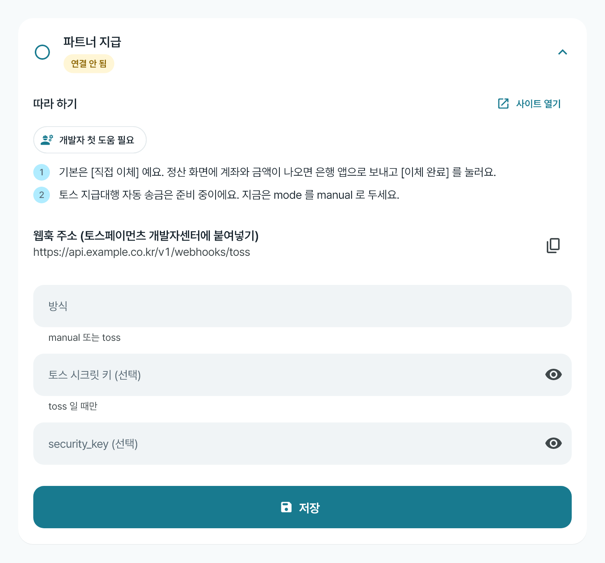

# 13. 파트너 지급

**이 장에서 할 일**
청소를 마친 파트너에게 돈을 어떻게 보낼지 정해요.
기본은 사장님이 은행 앱으로 직접 보내는 **직접 이체**예요. 계약이나 키가 없어도 바로 쓸 수 있어요.
토스페이먼츠 지급대행(자동 송금)은 아직 준비 중이라, 이 장에서는 개발자와 함께 시험하는 방법만 알려 드려요.

> **준비물**
> - 콘솔에 **관리자** 계정으로 로그인할 수 있어야 해요 (6장).
> - 직접 이체만 쓸 때: 더 필요한 것 없어요.
> - 토스 지급대행을 시험할 때만: 토스페이먼츠 **지급대행 계약**, 토스 개발자센터의 **테스트 시크릿 키**(`test_sk_…`)와 **보안 키**(64자리), 사장님 휴대폰의 인증 앱(6장), 그리고 개발자의 도움.

## 13.1 카드 찾기

1. 콘솔 왼쪽 메뉴에서 **[설정]** 을 눌러요.
2. 화면을 아래로 내려 **파트너 지급** 카드를 찾아요.
3. 카드 제목을 누르면 카드가 펼쳐져요. 아직 한 번도 저장하지 않은 카드는 처음부터 펼쳐져 있어요.

이렇게 보이면 성공: 카드 안에 **따라 하기** 단계 두 개, **웹훅 주소 (토스페이먼츠 개발자센터에 붙여넣기)**, 그리고 **방식**, **토스 시크릿 키 (선택)**, **security_key (선택)** 칸이 보여요.

> **참고** 세 번째 칸은 화면에 한글 이름 없이 **security_key (선택)** 로 나와요. 토스의 **보안 키**를 넣는 칸이에요.

## 13.2 직접 이체로 쓰기 (기본, 추천)

카드를 저장하지 않아도 지급 방식은 직접 이체예요. 다만 카드를 한 번 저장해 두면 **[설정]** 맨 위 진행 막대에 완료로 세어져요.

1. **방식** 칸을 눌러요.
2. `manual` 을 입력해요. (소문자, 띄어쓰기 없이)
3. 다른 두 칸은 비워 둬요.
4. **[저장]** 을 눌러요.

이렇게 보이면 성공: 카드 제목 아래에 **저장했어요** 표시가 나오고, 왼쪽 동그라미에 체크 표시가 생겨요. 카드는 잠겨요 (잠금은 9장).

> **팁** 직접 이체만 쓸 때는 **[연결 확인]** 을 누르지 않아도 돼요. 시크릿 키가 없으니 눌러도 **연결 안 됨** 이 나와요. 고장이 아니에요.

### 직접 이체로 돈 보내는 순서 (요약)

자세한 화면은 21장에 있어요. 큰 흐름만 보면:

1. 왼쪽 메뉴 **[정산]** 을 열어요.
2. 보낼 정산 건에서 **[계좌 보기]** 를 눌러요. 계좌 정보를 볼 때마다 기록이 남아요 (**계좌 정보는 조회 기록에 남아요**).
3. 은행 앱에서 화면에 나온 계좌로 금액을 보내요.
4. 콘솔로 돌아와 **[이체 완료로 표시]** 를 눌러요.

> **주의** 은행 앱에서 실제로 보내기 전에는 **[이체 완료로 표시]** 를 누르지 마세요. 누르면 파트너에게 지급이 끝난 것으로 기록돼요.

## 13.3 토스 지급대행 (준비 중, 개발자와 함께)

카드의 **따라 하기** 2번에도 적혀 있듯이, 토스 지급대행 자동 송금은 아직 준비 중이에요. 서버는 아래 조건이 **모두** 맞을 때만 `toss` 방식을 받아들여요. 하나라도 빠지면 저장할 때 **토스 지급대행은 아직 연결할 수 없어요. 직접 이체를 써 주세요.** 가 나와요.

- 개발자가 서버 설정에서 토스 지급대행 스위치(`TOSS_PAYOUTS_ENABLED=1`)를 켰어요. 사장님이 콘솔에서 켤 수 없어요.
- 지금 넣은 시크릿 키로 **[연결 확인]** 이 성공했어요.

> **주의** 토스 결제(12장)와 토스 지급대행은 **계약이 따로**예요. 같은 계약인지 여부는 토스 영업 담당에게 물어봐야 해요 (**확인 필요**).

### 1단계: 테스트 키 넣고 확인하기 (방식은 아직 manual)

1. 토스페이먼츠 개발자센터에서 지급대행용 **테스트 시크릿 키**(`test_sk_` 로 시작)와 **보안 키**(0~9, a~f 로 된 64글자)를 복사해 둬요.
2. 콘솔 **[설정]** → **파트너 지급** 카드를 펼쳐요.
3. 카드가 이미 잠겨 있으면 **[잠금 해제 (소유자 코드)]** 를 누르고 인증 앱의 6자리 코드를 넣어요 (9장). 5분 동안 바꿀 수 있고, 한 번 저장하면 바로 다시 잠겨요.
4. **방식** 칸에 `manual` 을 넣어요.
5. **토스 시크릿 키 (선택)** 칸에 테스트 시크릿 키를 붙여넣어요.
6. **security_key (선택)** 칸에 보안 키를 붙여넣어요.
7. **[저장]** 을 눌러요.
8. **[연결 확인]** 을 눌러요. 토스에 잔액만 물어보고, 돈은 움직이지 않아요.

이렇게 보이면 성공: 카드 제목 아래에 **연결됨** 과 **테스트** 표시가 나와요.

> **팁** 키를 바꾸면 확인을 처음부터 다시 해야 해요. 테스트 키로 통과해도 실거래 키(`live_sk_`)는 따로 확인해야 해요.

### 2단계: 웹훅 주소 등록하기

1. 카드의 **웹훅 주소 (토스페이먼츠 개발자센터에 붙여넣기)** 오른쪽 복사 아이콘을 눌러요. **복사했어요** 가 잠깐 떠요.
2. 토스페이먼츠 개발자센터의 웹훅 메뉴에 그 주소를 붙여넣어요. 주소 끝은 `/v1/webhooks/toss` 예요.
3. 받을 이벤트로 `payout.changed` 와 `seller.changed` 를 골라요.

> **주의** 결제용 웹훅(`/v1/webhooks/tosspayments`, 12장)과 주소가 달라요. 헷갈려서 바꿔 넣지 마세요.

### 3단계: 방식을 toss 로 바꾸기 (개발자가 스위치를 켠 뒤)

1. **[잠금 해제 (소유자 코드)]** 를 누르고 6자리 코드를 넣어요.
2. **방식** 칸에 `toss` 를 입력해요.
3. **[저장]** 을 눌러요. (카드를 한 번도 저장하지 않은 상태에서 처음 `toss` 로 저장할 때는 잠금 해제 대신 **사장님 인증 코드** 창이 떠요. 그때는 **6자리 인증 코드** 를 넣고 **[확인]** 을 눌러요.)
4. 카드가 다시 잠기면 **[연결 확인]** 을 **한 번 더** 눌러요.

이렇게 보이면 성공: **저장했어요** 가 나온 뒤, **[연결 확인]** 을 다시 누르면 카드 제목 아래에 **연결됨** 이 나와요.

> **주의** 저장할 때마다 서버는 지난 연결 확인 기록을 지워요. 그런데 토스 지급대행은 그 기록이 있어야 실제로 켜져요. 그래서 `toss` 로 저장한 뒤 **[연결 확인]** 을 다시 눌러 **연결됨** 을 받기 전까지는 지급이 직접 이체로 처리돼요. **연결됨** 이 나오고 1분쯤 지나면 토스 지급대행이 켜져요. 이 동작은 코드에서 확인한 것이니, 개발자에게도 한 번 확인해 달라고 하세요 (**확인 필요**).

### 4단계: 파트너를 토스 판매자로 등록하고 보내기

**[정산]** 화면에서 파트너마다 **[판매자 등록]** 을 하고, 보낼 때 **[토스로 지급 요청]**, 보낸 뒤 **[상태 확인]** 을 눌러요. 자세한 화면은 21장에 있어요.

> **주의** 실거래 키(`live_sk_…`)로 바꾸기 전에 개발자가 토스 테스트 환경에서 판매자 등록과 지급을 끝까지 한 번 성공시켜야 해요. 코드에는 아직 실제 테스트 환경에서 확인하지 않았다고 적혀 있어요 (**확인 필요**).

## 13.4 다시 직접 이체로 돌아가기

1. **[잠금 해제 (소유자 코드)]** 를 눌러요.
2. **방식** 칸에 `manual` 을 입력하고 **[저장]** 을 눌러요.

> **주의** 토스로 보내는 중인 지급이 남아 있으면 바꿀 수 없어요. 그때는 **이 정산은 이미 송금되었을 수 있어 지금 바꿀 수 없어요. 상태를 확인해 주세요.** 가 나와요. **[정산]** 에서 **[상태 확인]** 으로 모든 지급이 끝난 뒤 다시 해 보세요.

## 자주 생기는 문제

| 이렇게 나와요 | 이렇게 해요 |
|---|---|
| **토스 지급대행은 아직 연결할 수 없어요. 직접 이체를 써 주세요.** | 개발자가 서버 스위치를 켰는지, 지금 키로 **[연결 확인]** 이 성공했는지 확인해요. 그 전에는 `manual` 로 두세요. |
| **시크릿 키는 test_sk_ 또는 live_sk_로 시작해야 해요.** | 결제창 키나 위젯 키가 아니라 지급대행 시크릿 키를 그대로 복사해요. 앞뒤 공백도 지워요. |
| **보안 키는 0~9, a~f 글자 64개예요. …** | 토스 개발자센터의 보안 키를 다시 복사해요. |
| **AI 응답 모드를 다시 골라 주세요.** | **방식** 칸에 `manual` 또는 `toss` 가 아닌 글자가 들어갔어요. 이 칸의 오류 문구가 AI 문구로 나와요. 소문자로 정확히 다시 입력해요. |
| **필수 항목을 모두 입력해 주세요.** | `toss` 로 바꿀 때는 시크릿 키와 보안 키가 둘 다 있어야 해요. |
| **잘못된 코드가 여러 번 입력됐어요. 잠시 후 다시 시도해 주세요** | 몇 분 기다린 뒤 인증 앱에 **지금** 나온 코드를 넣어요. |
| 버튼이 회색이라 눌리지 않아요 | 카드가 잠겨 있어요. 사장님 계정으로 **[잠금 해제 (소유자 코드)]** 를 눌러요 (9장). |
