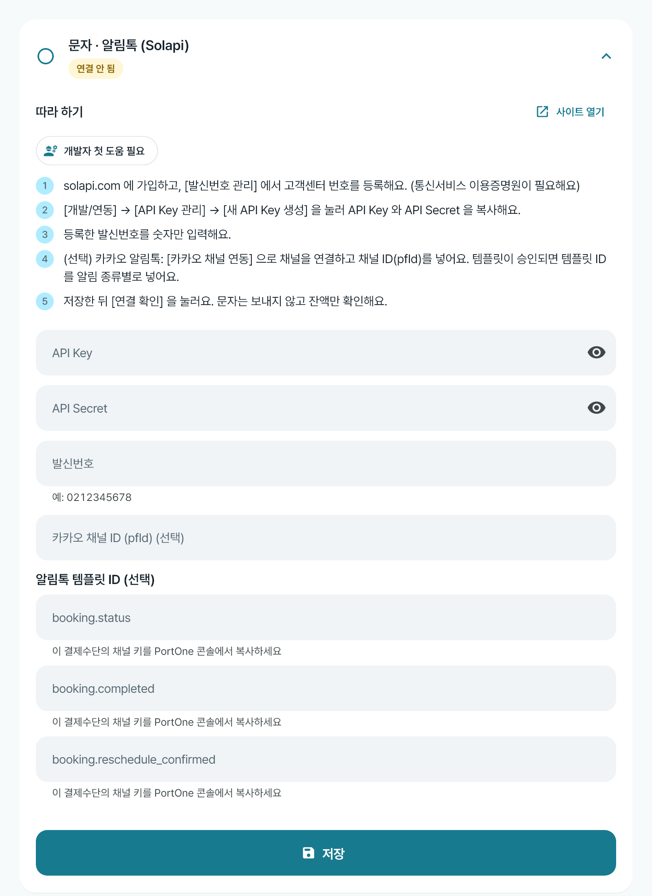
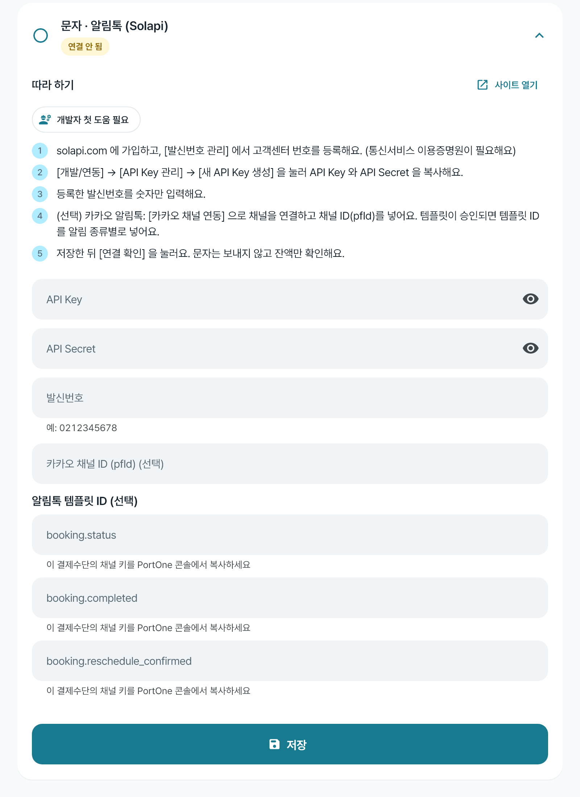

# 14. 문자 · 알림톡 (Solapi)

**이 장에서 할 일**
로그인 인증번호와 예약 안내 문자를 보내도록 Solapi(솔라피)를 연결해요.
원하면 같은 안내를 카카오 **알림톡**으로 보내도록 템플릿도 등록해요.

> **준비물**
> - Solapi 계정 (solapi.com)
> - 발신번호로 쓸 고객센터 전화번호와 **통신서비스 이용증명원** (발신번호 등록에 필요해요)
> - 알림톡까지 쓸 때: **카카오톡 채널**(사업자 등록 필요)
> - 요금: Solapi 요금표를 확인하세요. 문자를 보낼 때마다 충전한 잔액에서 빠져요.

> **주의** 이 카드에는 **개발자 첫 도움 필요** 표시가 있어요. 발신번호 등록과 채널 연동은 처음 한 번 서류와 심사가 필요해서 시간이 걸려요. 결제 심사를 기다리는 동안 먼저 시작하세요.

## 14.1 Solapi 에서 키 받기

1. 인터넷 창에서 solapi.com 에 가입하고 로그인해요.
2. **[발신번호 관리]** 에서 고객센터 번호를 등록해요. 통신서비스 이용증명원을 올리라고 하면 올려요.
3. 등록 승인을 기다려요. 기간은 Solapi 기준이에요.
4. **[개발/연동]** → **[API Key 관리]** → **[새 API Key 생성]** 을 눌러요.
5. 나온 **API Key** 와 **API Secret** 을 메모장에 복사해 둬요.


> **주의** API Secret 은 비밀번호와 같아요. 카카오톡, 메일, 사진으로 남에게 보내지 마세요.

## 14.2 콘솔에 붙여넣기

1. 콘솔 왼쪽 메뉴에서 **[설정]** 을 눌러요.
2. **문자 · 알림톡 (Solapi)** 카드를 펼쳐요.
3. **API Key** 칸에 API Key 를 붙여넣어요.
4. **API Secret** 칸에 API Secret 을 붙여넣어요. 칸 오른쪽 눈 모양 버튼으로 **보기** / **숨기기** 를 바꿀 수 있어요.
5. **발신번호** 칸에 등록한 번호를 **숫자만** 입력해요. 예: `0212345678`
6. 알림톡을 아직 안 쓰면 **카카오 채널 ID (pfId) (선택)** 와 **알림톡 템플릿 ID (선택)** 칸은 비워 둬요.
7. **[저장]** 을 눌러요.

이렇게 보이면 성공: 카드 제목 아래에 **저장했어요** 가 나오고 카드가 잠겨요.



> **팁** 발신번호는 하이픈(-)을 넣어도 서버가 숫자만 남겨요. 숫자가 8~12자리가 아니면 **입력값을 확인해 주세요** 가 나와요.

## 14.3 연결 확인

1. 같은 카드에서 **[연결 확인]** 을 눌러요.
2. 결과를 봐요.

이렇게 보이면 성공: **연결됨** 이 초록색으로 나와요.

> **팁** **[연결 확인]** 은 문자를 보내지 않아요. Solapi 잔액만 조회해요. 그래서 비용이 들지 않아요.

| 결과 | 뜻 |
|---|---|
| **연결됨** | 끝났어요. |
| **키가 올바르지 않아요. 복사한 값을 다시 확인해 주세요** | API Key 나 API Secret 이 틀렸어요. 잠금을 풀고 다시 붙여넣어요. |
| **서비스에 연결할 수 없어요. 잠시 후 다시 시도해 주세요** | Solapi 쪽이 잠시 응답하지 않아요. 몇 분 뒤 다시 눌러요. |

## 14.4 카카오 알림톡 (선택)

알림톡을 설정하지 않아도 고객은 같은 안내를 **문자(SMS)** 로 받아요. 알림톡은 보통 문자보다 싸서 쓰는 거예요. 정확한 요금은 Solapi 요금표를 보세요.

- 알림톡은 **한국어를 쓰는 고객**에게만 가요. 다른 언어 고객은 자기 언어로 된 문자를 받아요.
- 알림톡이 실패하면 같은 내용을 문자로 자동으로 보내요. 이때는 문자 요금이 나와요.

### 1단계: 채널 연결하고 pfId 받기

1. 카카오톡 채널 관리자 센터에서 채널을 만들어요.
2. Solapi 에서 **[카카오 채널 연동]** 으로 채널을 연결해요.
3. 연동하면 나오는 **채널 ID(pfId)** 를 복사해요.

### 2단계: 템플릿 7개 등록하기

Solapi 콘솔이나 카카오 채널 관리자 센터에서 템플릿을 등록해요. 7개 모두 **본문을 똑같이** 쓰고, **템플릿 이름**만 다르게 붙여요.

공통 본문 (그대로 복사):

```
[#{brand}] #{title}
#{body}
```

- 변수 세 개 `#{brand}`, `#{title}`, `#{body}` 를 띄어쓰기 없이 정확히 넣어요.
- `#{brand}` 에는 **[설정]** → 사업장 정보의 서비스 이름이 자동으로 들어가요 (10장).
- 카테고리는 **정보성**으로 골라요. 광고, 할인, 쿠폰, 이벤트 문구를 넣으면 심사에서 떨어져요.
- 심사는 카카오 기준으로 보통 영업일 며칠이 걸려요.


| 설정 키 | 언제 보내요 | 템플릿 이름 (예) |
|---|---|---|
| `booking.confirmed` | 예약이 확정됐을 때 | 예약 확정 안내 |
| `partner.assigned` | 청소팀이 배정됐을 때 | 청소팀 배정 안내 |
| `booking.reminder` | 방문 전날 | 방문 전날 안내 |
| `booking.arrival` | 청소팀이 현장에서 도착 체크를 했을 때 | 기사 도착 안내 |
| `booking.completed` | 청소가 끝났을 때 | 청소 완료 안내 |
| `payment.receipt` | 고객 결제가 끝났을 때 | 결제 완료 안내 |
| `booking.cancelled` | 예약이 취소됐을 때 | 예약 취소 안내 |

### 3단계: 콘솔에 넣기

1. **[설정]** → **문자 · 알림톡 (Solapi)** 카드에서 **[잠금 해제 (소유자 코드)]** 를 누르고 6자리 코드를 넣어요 (9장).
2. **카카오 채널 ID (pfId) (선택)** 칸에 pfId 를 붙여넣어요.
3. **알림톡 템플릿 ID (선택)** 아래 칸 중 **booking.completed** 칸에 "청소 완료 안내" 템플릿 ID 를 붙여넣어요.
4. **[저장]** 을 눌러요.



> **주의** 지금 콘솔 카드에는 템플릿 칸이 **booking.status**, **booking.completed**, **booking.reschedule_confirmed** 세 개만 보여요. 이 중 서버가 받는 이름은 **booking.completed** 하나예요. 나머지 두 칸에 값을 넣으면 **입력값을 확인해 주세요** 가 나오고 저장되지 않아요. 그 두 칸은 비워 두세요. 위 표의 다른 템플릿 ID(`booking.confirmed`, `partner.assigned`, `booking.reminder`, `booking.cancelled` 등)는 지금 콘솔에서 넣을 수 없어요. 개발자에게 넣어 달라고 요청하세요 (**확인 필요**). 한 번 저장된 이름은 그 뒤로 카드에 칸으로 보여요.

> **참고** 템플릿 칸 아래에 "이 결제수단의 채널 키를 PortOne 콘솔에서 복사하세요" 라는 안내가 보여요. 이 카드와 관계없는 문구예요. 무시하세요.

### 4단계: 실제로 받아 보기

지금 콘솔에서 넣을 수 있는 템플릿은 `booking.completed`(청소 완료) 하나뿐이라, **청소 완료** 안내로 시험해요.

1. 고객 앱에서 **테스트용 휴대폰 번호**로 예약을 하나 만들어요. 실제 고객 번호는 쓰지 마세요. 고객 앱 언어는 **한국어**로 둬요.
2. 콘솔에서 그 예약을 확정하고 청소팀을 배정해요 (19장).
3. 파트너 앱에서 그 일을 전후 사진과 함께 **완료**까지 진행해요 (24장).
4. 테스트 휴대폰에 알림톡이 오는지 봐요.

이렇게 보이면 성공: 카카오톡으로 `[서비스 이름] 청소가 끝났어요` 모양의 알림이 와요. 확정, 배정 안내는 해당 템플릿 ID 가 들어가기 전까지 **문자**로 와요. 고장이 아니에요.

알림톡 대신 문자가 왔다면 템플릿 ID, pfId, 변수 이름(`#{brand}`, `#{title}`, `#{body}`)을 다시 확인해요.

## 14.5 광고 문자를 보낼 때

쿠폰, 이벤트 같은 **광고 문자**를 캠페인으로 보내려면 **080 수신거부 번호**가 따로 필요해요. 없으면 캠페인 화면에 **문자 발송에는 080 수신거부 번호가 필요해요** 가 나와요. 자세한 내용은 22장에 있어요.

## 자주 생기는 문제

| 이렇게 나와요 | 이렇게 해요 |
|---|---|
| **입력값을 확인해 주세요** (저장할 때) | 발신번호 숫자가 8~12자리인지 봐요. 템플릿 칸은 **booking.completed** 만 채웠는지 봐요. |
| **필수 항목을 모두 입력해 주세요.** | API Key, API Secret, 발신번호 세 칸은 꼭 있어야 해요. |
| **키가 올바르지 않아요. …** | Solapi 에서 키를 새로 만들어 다시 붙여넣어요. |
| 인증번호 문자가 안 와요 | 발신번호가 Solapi 에서 승인됐는지, 잔액이 남았는지 확인해요. 발신번호가 인증되지 않으면 문자도, 알림톡 대신 보내는 문자도 실패해요. |
| 알림톡 대신 문자가 와요 | 템플릿 심사가 끝났는지, 템플릿 ID 와 pfId 가 맞는지, 변수 이름에 오타가 없는지 확인해요. |
| 템플릿 심사 반려 | 광고 문구, 변수 이름 오타가 흔한 원인이에요. 공통 본문을 그대로 쓰세요. |
