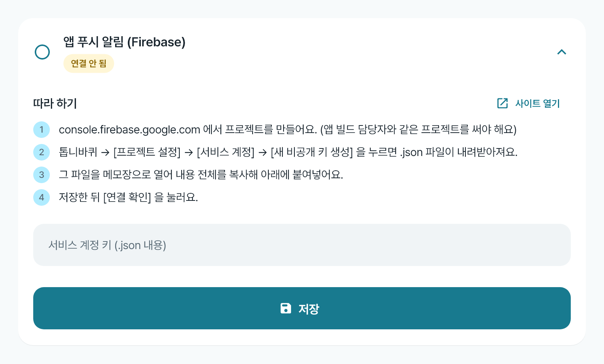
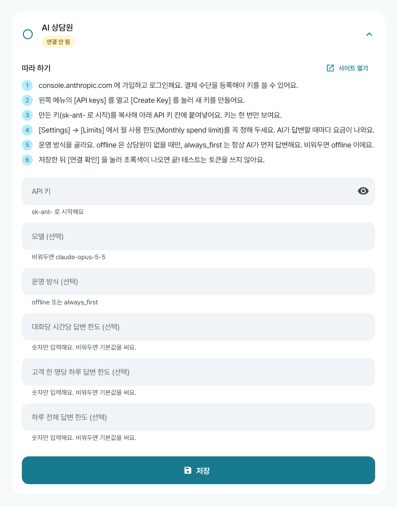
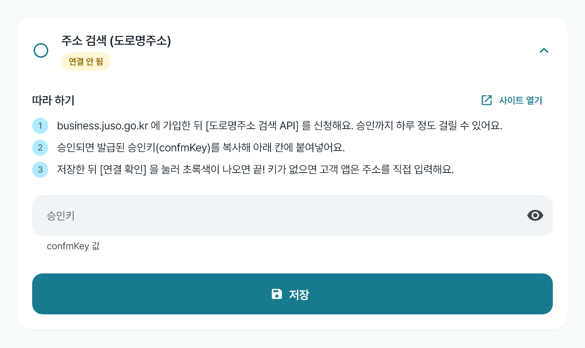

# 16. 앱 푸시, AI 상담원, 주소 검색

**이 장에서 할 일**
세 가지를 연결해요.
**앱 푸시 알림 (Firebase)** 로 휴대폰에 알림을 띄우고, **AI 상담원** 으로 상담함의 첫 답변을 맡기고, **주소 검색 (도로명주소)** 로 고객이 주소를 쉽게 찾게 해요.
셋 다 카드 하나씩이고, 서로 관계없어요. 필요한 것만 하세요.

> **준비물**
> - 푸시: 구글 계정, 그리고 **앱 빌드 담당자와 같은 Firebase 프로젝트**
> - AI 상담원: Anthropic 계정(console.anthropic.com)과 결제 수단. 요금은 사용량만큼 나와요. 정확한 요금은 그 회사 요금표를 보세요.
> - 주소 검색: business.juso.go.kr 계정. 승인까지 하루 정도 걸릴 수 있어요.

## 16.1 앱 푸시 알림 (Firebase)

### Firebase 에서 할 일

1. console.firebase.google.com 에 로그인해요.
2. 프로젝트를 만들어요. 이미 개발자가 앱용으로 만든 프로젝트가 있으면 **그 프로젝트**를 써요. 다른 프로젝트를 쓰면 푸시가 오지 않아요.
3. 왼쪽 위 톱니바퀴를 누르고 **[프로젝트 설정]** 을 눌러요.
4. **[서비스 계정]** 탭을 눌러요.
5. **[새 비공개 키 생성]** 을 누르고, 확인 창에서 한 번 더 눌러요.
6. `.json` 파일이 내려받아져요.

### 콘솔에서 할 일

1. 내려받은 `.json` 파일을 **메모장**으로 열어요. (파일을 오른쪽 클릭 → 연결 프로그램 → 메모장)
2. `Ctrl + A` 로 전체를 고르고 `Ctrl + C` 로 복사해요.
3. 콘솔 **[설정]** → **앱 푸시 알림 (Firebase)** 카드를 펼쳐요.
4. **서비스 계정 키 (.json 내용)** 칸을 누르고 `Ctrl + V` 로 붙여넣어요. 맨 앞 `{` 부터 맨 끝 `}` 까지 모두 들어가야 해요.
5. **[저장]** 을 눌러요.
6. **[연결 확인]** 을 눌러요.

이렇게 보이면 성공: **연결됨** 이 초록색으로 나와요.

> **주의** 이 `.json` 파일은 서버 열쇠와 같아요. 콘솔에 붙여넣은 뒤에는 내려받기 폴더에서 지우거나 안전한 곳에만 보관하세요. 메일이나 메신저로 보내지 마세요.

## 16.2 AI 상담원

**상담함** 에서 고객 메시지에 AI 가 먼저 답하게 하는 기능이에요. 상담함 화면 사용법은 19장에 있어요.

> **주의** AI 가 답할 때마다 요금이 나와요. 아래 3단계의 **월 사용 한도**를 꼭 정하세요.

### Anthropic 에서 할 일

1. console.anthropic.com 에 가입하고 로그인해요.
2. 결제 수단을 등록해요. 등록해야 키가 작동해요.
3. **[Settings]** → **[Limits]** 에서 **월 사용 한도(Monthly spend limit)** 를 정해요.
4. 왼쪽 메뉴의 **[API keys]** 를 열어요.
5. **[Create Key]** 를 눌러 새 키를 만들어요.
6. 만든 키(`sk-ant-` 로 시작)를 복사해요. 키는 **한 번만** 보여요.

### 콘솔에서 할 일

1. 콘솔 **[설정]** → **AI 상담원** 카드를 펼쳐요.
2. **API 키** 칸에 키를 붙여넣어요.
3. **모델 (선택)** 칸은 비워 둬요. 비우면 기본 모델(`claude-opus-5-5`)을 써요.
4. **운영 방식 (선택)** 칸에 둘 중 하나를 입력해요.
   - `offline`: 상담원이 없을 때만 AI 가 답해요. 비워 두면 이것이에요.
   - `always_first`: 언제나 AI 가 먼저 답하고, 직원이 답장하거나 대화를 멈추면 직원이 넘겨받아요.
5. 한도 세 칸은 처음에는 비워 둬요. 비우면 아래 기본값을 써요.
6. **[저장]** 을 눌러요.
7. **[연결 확인]** 을 눌러요. 이 확인은 요금(토큰)을 쓰지 않아요.

이렇게 보이면 성공: **연결됨** 이 초록색으로 나와요.

### 답변 한도

한도에 닿으면 AI 는 답하지 않지만, 대화는 그대로 이어지고 직원이 답할 수 있어요. 칸에는 **숫자만** 넣어요.

| 칸 이름 | 비워 두면 | 넣을 수 있는 범위 |
|---|---|---|
| **대화당 시간당 답변 한도 (선택)** | 12 | 1 ~ 60 |
| **고객 한 명당 하루 답변 한도 (선택)** | 40 | 1 ~ 500 |
| **하루 전체 답변 한도 (선택)** | 1000 | 1 ~ 10000 |

### AI 를 잠깐 끄고 싶을 때

카드를 지우지 않아도 돼요. 왼쪽 메뉴 **[시스템 상태]** 의 **기능 스위치** 에서 **AI 상담** 을 끄면 돼요 (26장).

## 16.3 주소 검색 (도로명주소)

설정하지 않으면 고객 앱에서 주소를 직접 입력해요. 설정하면 도로명주소 검색으로 고를 수 있어요.

### juso 사이트에서 할 일

1. business.juso.go.kr 에 가입해요.
2. **[도로명주소 검색 API]** 를 신청해요.
3. 승인을 기다려요. 하루 정도 걸릴 수 있어요.
4. 승인되면 나오는 **승인키(confmKey)** 를 복사해요.

> **참고** 승인키의 사용 기간이나 종류(개발용/운영용)는 juso 사이트에서 확인하세요 (**확인 필요**).

### 콘솔에서 할 일

1. 콘솔 **[설정]** → **주소 검색 (도로명주소)** 카드를 펼쳐요.
2. **승인키** 칸에 붙여넣어요.
3. **[저장]** 을 눌러요.
4. **[연결 확인]** 을 눌러요. 서버가 시험 삼아 주소 하나를 검색해 봐요.

이렇게 보이면 성공: **연결됨** 이 초록색으로 나와요.

## 자주 생기는 문제

| 이렇게 나와요 | 이렇게 해요 |
|---|---|
| **서비스 계정 파일이 올바르지 않아요.** | `.json` 의 일부만 붙여넣었어요. 메모장에서 `Ctrl + A` 로 전체를 다시 복사해요. |
| 푸시 카드가 **키가 올바르지 않아요. …** | Firebase 에서 키를 새로 만들어 다시 붙여넣어요 (잠금 해제 필요, 9장). |
| 푸시가 휴대폰에 안 와요 | 콘솔의 Firebase 프로젝트와 앱 빌드의 프로젝트가 같은지 개발자에게 물어봐요. |
| **AI 응답 모드를 다시 골라 주세요.** | **운영 방식** 칸에는 `offline` 또는 `always_first` 만 넣어요. 비워도 돼요. |
| **AI 모델 이름이 올바르지 않아요.** | **모델** 칸을 비워요. |
| **한도는 정해진 범위 안의 숫자로 입력해 주세요.** | 위 표의 범위 안 숫자만 넣어요. |
| AI 카드가 **키가 올바르지 않아요. …** | 키를 다시 만들어 붙여넣어요. 결제 수단이 등록됐는지도 봐요. |
| 주소 카드가 **서비스에 연결할 수 없어요. …** | 승인키가 맞는지, 승인이 끝났는지 봐요. juso 사이트가 잠시 멈췄을 수도 있어요. 몇 분 뒤 다시 눌러요. |
