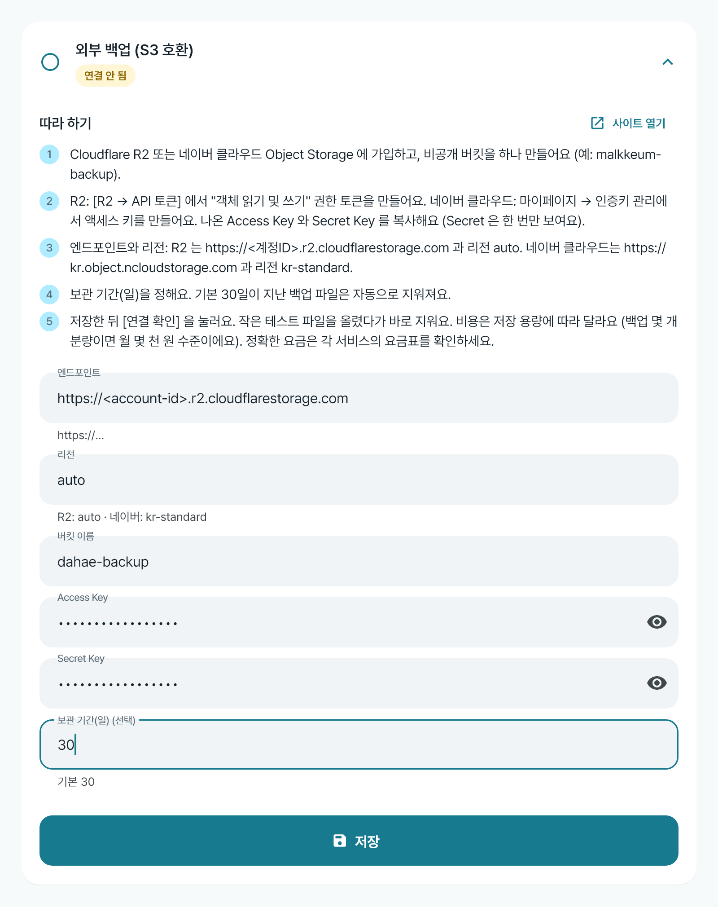
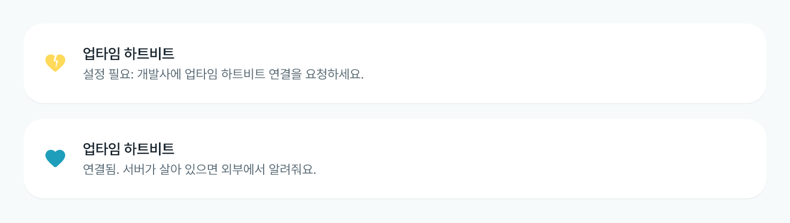
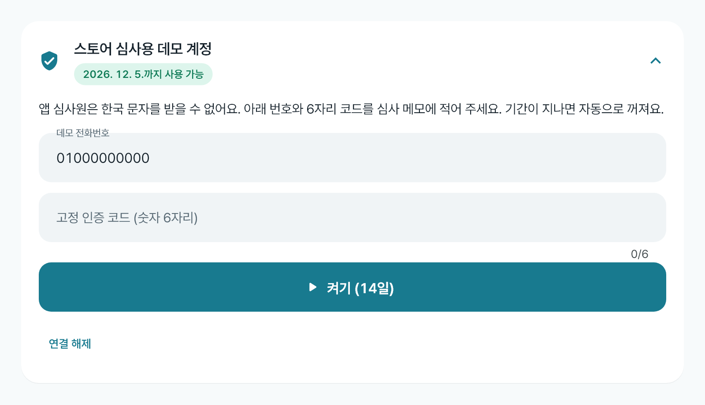
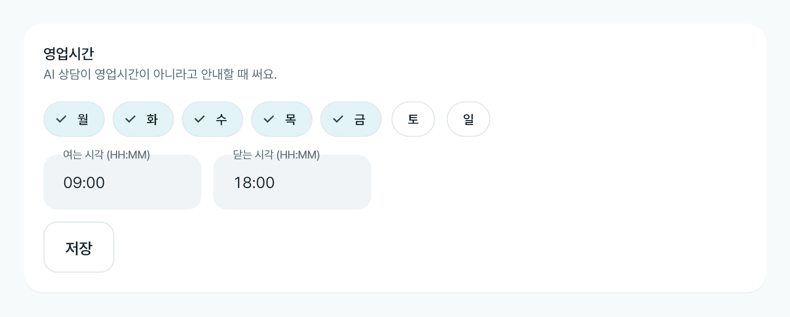

# 17. 외부 백업, 업타임 하트비트, 심사용 데모 계정, 영업시간

**이 장에서 할 일**
서버가 망가져도 자료를 되찾을 수 있게 **외부 백업**을 켜요.
서버가 꺼지면 바깥 서비스가 알려 주도록 **업타임 하트비트**를 연결해요.
앱 스토어 심사원이 로그인할 수 있게 **스토어 심사용 데모 계정**을 켜는 방법과, AI 상담원이 쓰는 **영업시간**을 정하는 방법도 알아봐요.

> **준비물**
> - 외부 백업: Cloudflare 계정(R2) 또는 네이버 클라우드 계정(Object Storage). 요금은 저장 용량에 따라 달라요. 정확한 요금은 각 회사 요금표를 보세요.
> - 하트비트: healthchecks.io 같은 가동 확인 서비스 계정, 소유자 계정과 인증 앱
> - 데모 계정: 아무도 쓰지 않는 휴대폰 번호 하나, 사장님 휴대폰의 인증 앱(6장)

## 17.1 외부 백업 (S3 호환)

서버는 매일 새벽 스스로 백업을 만들어 서버 안에 14일 동안 보관해요. 그런데 서버 자체가 고장 나면 그 백업도 함께 사라져요. 그래서 **서버 밖 저장소**에 한 부 더 보관하는 거예요.

- 데이터베이스 백업과 **사진** 백업이 모두 같은 저장소로 올라가요. 따로 카드를 만들 필요 없어요.
- **[시스템 상태]** 에서는 둘이 따로 보여요: **외부 백업 (S3 호환)**, **사진 외부 백업 (S3 호환)** (26장).
- 백업 파일은 암호화돼서 올라가요.

> **주의** 백업을 푸는 열쇠는 서버의 비밀 키(`DATA_KEY`)에서 나와요. 서버와 함께 이 키를 잃으면 외부 백업도 열 수 없어요. **비밀 키 사본**을 꼭 서버 밖에 따로 보관하세요. 만드는 방법(`sudo dahae keys-backup`)과 복원 방법은 27장에 있어요.

### 어디를 고를까요?

작은 사업장이면 **Cloudflare R2** 또는 **네이버 클라우드 Object Storage** 가 간단해요. AWS S3, Backblaze B2 처럼 S3 호환 저장소면 같은 칸에 넣을 수 있어요.

### Cloudflare R2 로 하기

1. dash.cloudflare.com 에 가입하고 로그인해요.
2. 왼쪽 메뉴에서 **R2** 를 눌러요.
3. **버킷 만들기**를 누르고 이름을 정해요. 예: `dahae-backup` (영어 소문자, 숫자, `-` 만). 공개 설정은 **끈 채로** 둬요.
4. R2 화면의 **API 토큰** 메뉴에서 새 토큰을 만들어요.
5. 권한은 **객체 읽기 및 쓰기**(Object Read & Write)로 골라요.
6. 만들면 나오는 **Access Key ID** 와 **Secret Access Key** 를 메모장에 복사해요. Secret 은 **한 번만** 보여요.
7. R2 화면 오른쪽에 있는 **계정 ID** 도 복사해요.

이제 콘솔에 넣어요.

1. 콘솔 **[설정]** → **외부 백업 (S3 호환)** 카드를 펼쳐요.
2. **엔드포인트** 칸: `https://<계정ID>.r2.cloudflarestorage.com` (`<계정ID>` 자리에 복사한 계정 ID)
3. **리전** 칸: `auto`
4. **버킷 이름** 칸: 만든 버킷 이름 (예: `dahae-backup`)
5. **Access Key** 칸: Access Key ID
6. **Secret Key** 칸: Secret Access Key
7. **보관 기간(일) (선택)** 칸: 비워 두면 30일이에요. 이 날짜가 지난 백업은 자동으로 지워져요.
8. **[저장]** 을 눌러요.
9. **[연결 확인]** 을 눌러요. 작은 시험 파일을 올렸다가 바로 지워요.

이렇게 보이면 성공: **연결됨** 이 초록색으로 나와요.

### 네이버 클라우드 Object Storage 로 하기

1. console.ncloud.com 에 로그인해요.
2. **Object Storage** 에서 버킷을 만들어요 (비공개).
3. **마이페이지** → **인증키 관리** 에서 액세스 키 ID 와 시크릿 키를 만들어 복사해요.
4. 콘솔 **[설정]** → **외부 백업 (S3 호환)** 카드에 넣어요.
   - **엔드포인트**: `https://kr.object.ncloudstorage.com`
   - **리전**: `kr-standard`
   - **버킷 이름**, **Access Key**, **Secret Key**: 만든 값
5. **[저장]** 을 누르고 **[연결 확인]** 을 눌러요.

이렇게 보이면 성공: **연결됨** 이 초록색으로 나와요.

> **팁** 사장님 계정은 잠긴 카드에서도 **[연결 확인]** 을 누를 수 있어요. 잠금을 풀 필요 없어요.

> **팁** 외부 백업이 실제로 매일 올라가는지는 **[시스템 상태]** 에서 봐요 (26장). 외부 백업에서 되돌리는 방법은 27장에 있어요.

## 17.2 업타임 하트비트

서버는 자기가 꺼진 것을 스스로 알릴 수 없어요. 그래서 서버가 몇 분마다 바깥 서비스에 "잘 돌고 있어요" 신호를 보내고, 신호가 끊기면 그 서비스가 메일 등으로 알려 줘요.

이제 이 카드에서 바로 주소를 넣을 수 있어요. 서버 검은 화면은 필요 없어요. **소유자** 계정으로 해요.

| 카드 문구 | 뜻 |
|---|---|
| **설정 필요: 업타임 서비스에서 받은 하트비트 주소를 넣고 저장하세요.** | 아직 연결 안 됐어요. |
| **연결됨. 서버가 살아 있으면 외부에서 알려줘요.** | 연결됐어요. |

### 연결하는 방법

1. healthchecks.io 같은 가동 확인 서비스에 가입해요.
2. **체크(Check)** 를 하나 만들어요. 주기(Period) **5분**, 유예(Grace) **15분**으로 정해요.
3. 화면에 나오는 **핑 주소**(`https://hc-ping.com/…`)를 복사해요.
4. 콘솔 **[설정]** 에서 **업타임 하트비트** 카드를 찾아요.
5. **하트비트 주소 (https://...)** 칸에 복사한 주소를 붙여넣어요.
6. **[저장]** 을 눌러요.
7. **인증 번호 입력** 창이 열려요. 인증 앱에 보이는 6자리를 **인증 번호 6자리** 칸에 넣고 **[계속]** 을 눌러요.
8. **요청했어요. 최근 서버 작업에서 볼 수 있어요** 가 떠요. 서버가 주소를 저장하고 테스트 신호를 한 번 보내요.
9. 1분쯤 뒤 **[설정]** 화면을 새로 고쳐요.

이렇게 보이면 성공: 카드가 **연결됨. 서버가 살아 있으면 외부에서 알려줘요.** 로 바뀌어요. healthchecks.io 화면에도 첫 신호가 들어와 있어요.

> **팁** 주소는 `https://` 로 시작해야 해요. 아니면 **https:// 로 시작하는 주소를 넣어 주세요** 가 떠요.

> **팁** 끄려면 카드의 **[끄기]** 를 누르고 인증 앱 코드를 넣어요. **[끄기]** 는 연결돼 있을 때만 보여요.

> **참고** 진행 상황은 **[시스템 상태]** → **서버 업데이트** 카드의 **최근 서버 작업** 에 `하트비트 · 완료` 처럼 보여요 (26장). 개발자는 서버 검은 화면에서 `sudo dahae heartbeat https://…` 로도 같은 일을 할 수 있어요.

## 17.3 스토어 심사용 데모 계정

앱 스토어 심사원은 외국에 있어서 한국 문자 인증번호를 받을 수 없어요. 그래서 **번호 하나**에만 **고정 인증 코드**를 정해 두고, 그 번호와 코드를 심사 메모에 적어요. 스토어에 앱을 올리는 전체 순서는 25장에 있어요.

- **사장님 계정만** 켜고 끌 수 있어요. 켤 때와 끌 때 인증 앱 코드를 물어봐요.
- 켜면 **14일** 동안 쓸 수 있고, 지나면 자동으로 꺼져요.
- 켜면 이 계정에 결제 없이 볼 수 있는 **샘플 예약 2건**(예정 1건, 완료 1건)이 들어가요. 콘솔에 판매 중인 서비스가 하나도 없거나, 이 번호에 이미 예약이 있으면 넣지 않아요.

### 켜기

1. 콘솔 **[설정]** → **스토어 심사용 데모 계정** 카드를 펼쳐요.
2. **데모 전화번호** 칸에 아무도 쓰지 않는 휴대폰 번호를 넣어요 (010 으로 시작하는 번호).
3. **고정 인증 코드 (숫자 6자리)** 칸에 숫자 6자리를 정해 넣어요. 다른 곳에 쓰는 비밀번호는 쓰지 마세요.
4. **[켜기 (14일)]** 을 눌러요.
5. **인증 번호 입력** 창이 떠요. 인증 앱에 보이는 6자리를 **인증 번호 6자리** 칸에 넣고 **[계속]** 을 눌러요.

이렇게 보이면 성공: **저장했어요** 가 뜨고, 카드 제목 아래에 **(날짜)까지 사용 가능** 이 나와요.

6. 그 번호와 6자리 코드를 스토어 심사 메모에 적어요 (25장).

> **주의** 스토어 심사 안내 문서에는 파트너 앱도 같은 번호로 심사받고, 제출 전에 이 번호의 파트너 계정을 승인해 두라고 적혀 있어요 (25장). 그런데 지금 서버는 이 번호로 **파트너 계정이나 직원 계정이 생기면** 그때부터 고정 코드를 쓰지 않고 실제 문자 인증번호를 보내요. 그러면 고객 앱, 파트너 앱 모두 심사원이 다시 로그인할 수 없어요. 다시 **[켜기 (14일)]** 를 눌러도 **이미 고객, 파트너 또는 직원이 쓰는 번호예요. …** 가 나와요. 파트너 앱 심사를 어떻게 할지는 제출 전에 개발자와 꼭 정하세요 (**확인 필요**).

> **팁** 심사가 길어지면 같은 방법으로 다시 **[켜기 (14일)]** 을 눌러요. 그날부터 14일이 다시 시작돼요.

### 끄기

1. 카드의 **[연결 해제]** 를 눌러요. (켜져 있을 때만 보여요)
2. 인증 앱 코드를 넣고 **[계속]** 을 눌러요.

이렇게 보이면 성공: 카드 제목 아래의 날짜 표시가 사라져요.

## 17.4 영업시간

**영업시간** 카드는 AI 상담원(16장)이 "지금은 영업시간이 아니에요" 하고 안내할 때 써요. 카드 설명: **AI 상담이 영업시간이 아니라고 안내할 때 써요.**

1. 콘솔 **[설정]** 에서 **사업장 정보** 아래 **영업시간** 카드를 찾아요.
2. 요일 단추(**월**, **화**, **수**, **목**, **금**, **토**, **일**) 중 문을 여는 요일을 눌러요. 고른 요일은 색이 칠해져요. 다시 누르면 빠져요.
3. **여는 시각 (HH:MM)** 칸에 여는 시각을 넣어요. 예: `09:00`
4. **닫는 시각 (HH:MM)** 칸에 닫는 시각을 넣어요. 예: `18:00`
5. **[저장]** 을 눌러요.

이렇게 보이면 성공: 화면 아래에 **저장했어요** 가 떠요.

- 시각은 한국 시간이에요. 24시간 형식으로 두 자리씩 넣어요 (`9:00` 이 아니라 `09:00`).
- 닫는 시각은 여는 시각보다 늦어야 해요. 밤을 넘기는 영업시간(예: `22:00`~`02:00`)은 넣을 수 없어요.
- 처음에는 요일이 하나도 골라져 있지 않고 `09:00`, `18:00` 이 들어 있어요. 아직 저장되지 않은 상태예요.

> **참고** AI 상담원의 **운영 방식** 이 `offline`(기본)이면, AI 는 상담원이 아무도 접속해 있지 않을 때나 영업시간이 아닐 때 답해요. 영업시간을 한 번도 저장하지 않았으면 언제나 "영업시간이 아님"으로 봐요 (16장).

> **팁** 이 카드는 관리자라면 누구나 바꿀 수 있어요. 상담원 계정에서는 **[저장]** 이 눌리지 않아요.

## 자주 생기는 문제

| 이렇게 나와요 | 이렇게 해요 |
|---|---|
| **엔드포인트는 https://로 시작해야 해요.** | 엔드포인트 앞에 `https://` 를 붙여요. 회사 내부 주소나 `localhost` 는 안 돼요. |
| **버킷 이름이 올바르지 않아요.** | 버킷 이름은 영어 소문자, 숫자, `-`, `.` 으로 3~63글자예요. |
| **리전 값이 올바르지 않아요.** | R2 는 `auto`, 네이버는 `kr-standard` 를 그대로 넣어요. |
| **보관 기간 값이 범위를 벗어났어요.** | 1 ~ 3650 사이 숫자를 넣거나 비워 둬요. |
| 백업 카드가 **키가 올바르지 않아요. …** | 토큰 권한이 **객체 읽기 및 쓰기**인지, 키를 정확히 복사했는지 봐요. |
| 백업 카드가 **서비스에 연결할 수 없어요. …** | 저장소에 닿지 않았거나, 저장소가 시험 파일을 거절했어요. 엔드포인트의 계정 ID 와 버킷 이름이 정확한지(버킷을 실제로 만들었는지) 보고, 몇 분 뒤 다시 눌러요. |
| 백업 카드가 **입력값을 확인해 주세요** (연결 확인 뒤) | 시험 파일 올리기나 지우기가 실패했어요. 버킷 이름과 권한을 다시 확인해요. |
| 하트비트 카드가 계속 **설정 필요** | **[시스템 상태]** 의 **최근 서버 작업** 에서 `하트비트` 작업이 **완료** 인지 보고, **[설정]** 화면을 새로 고쳐요. **실패** 면 주소를 다시 복사해 넣어요. |
| 영업시간 **요일을 하나 이상 고르고, 닫는 시각을 여는 시각보다 늦게 넣어 주세요.** | 요일을 하나 이상 고르고, `09:00` 처럼 두 자리 시각을 넣고, 닫는 시각을 더 늦게 넣어요. |
| **이미 고객, 파트너 또는 직원이 쓰는 번호예요. …** | 데모 전화번호를 아무도 안 쓰는 번호로 바꿔요. |
| 데모 계정 **입력값을 확인해 주세요** | 번호가 010 등 휴대폰 번호인지, 코드가 숫자 6자리인지 봐요. |
| 인증 번호가 틀렸다고 나와요 | 인증 앱에 **지금** 나온 번호를 넣어요. 한 번 쓴 번호는 다시 못 써요. 30초쯤 뒤 새 번호로 해요. |
