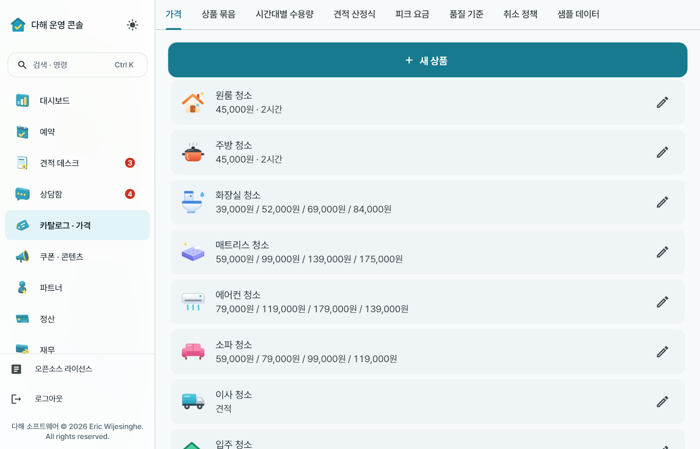
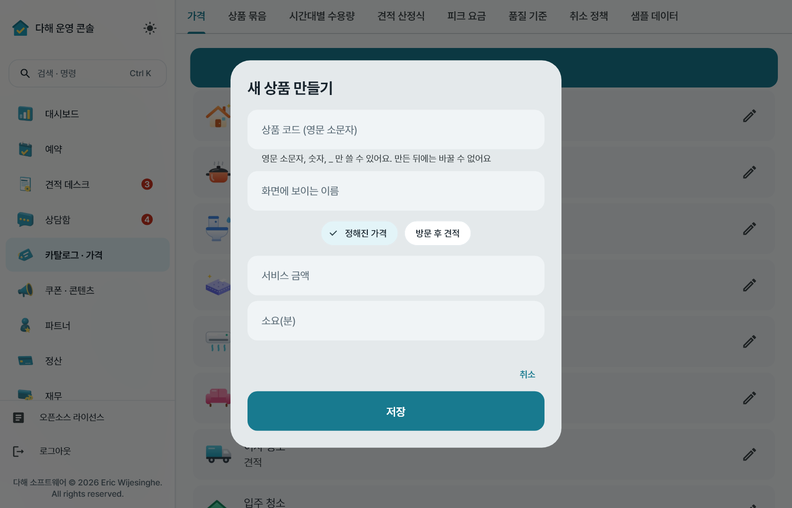
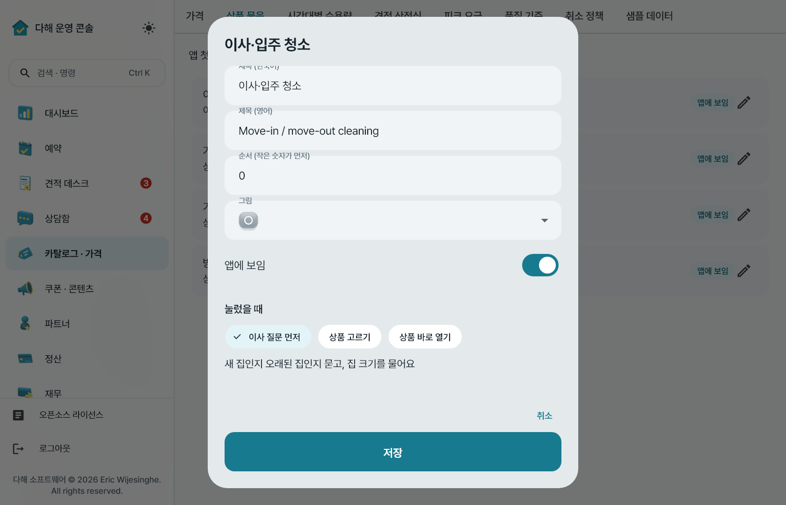
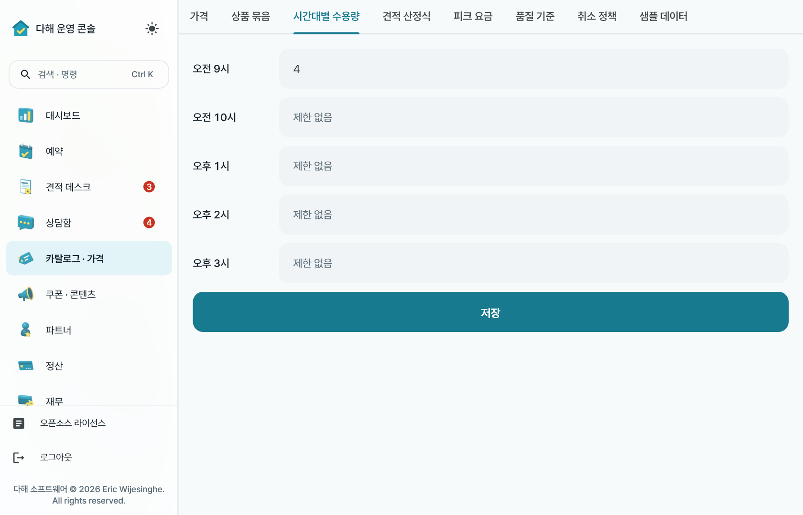
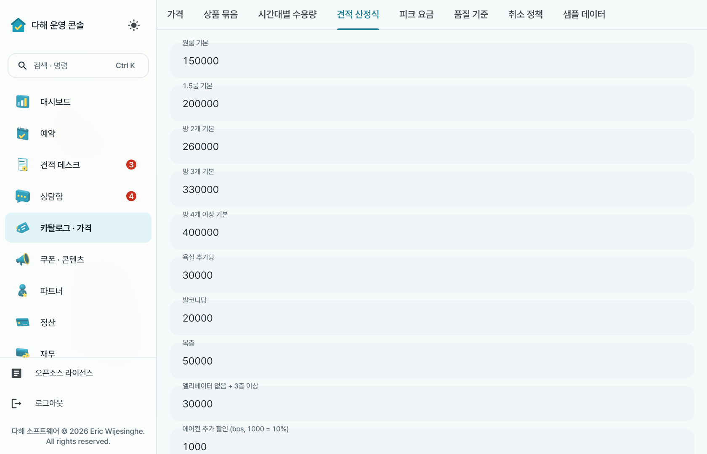
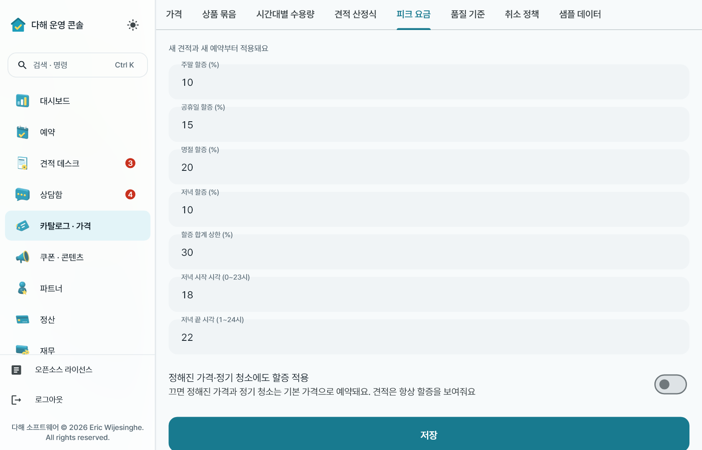
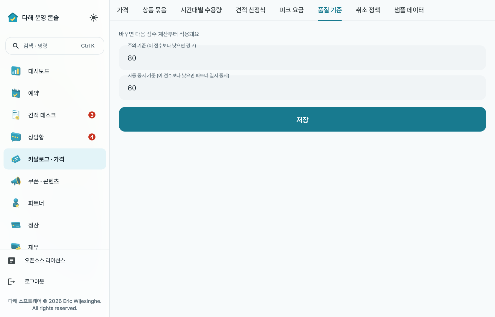
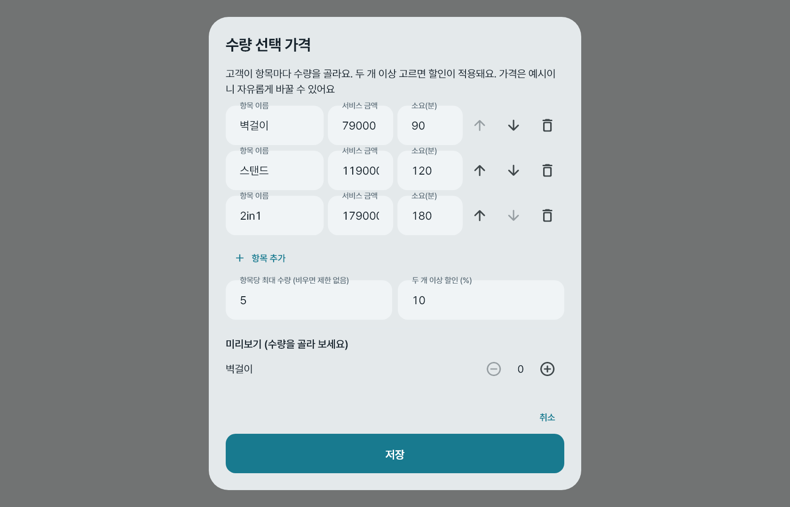
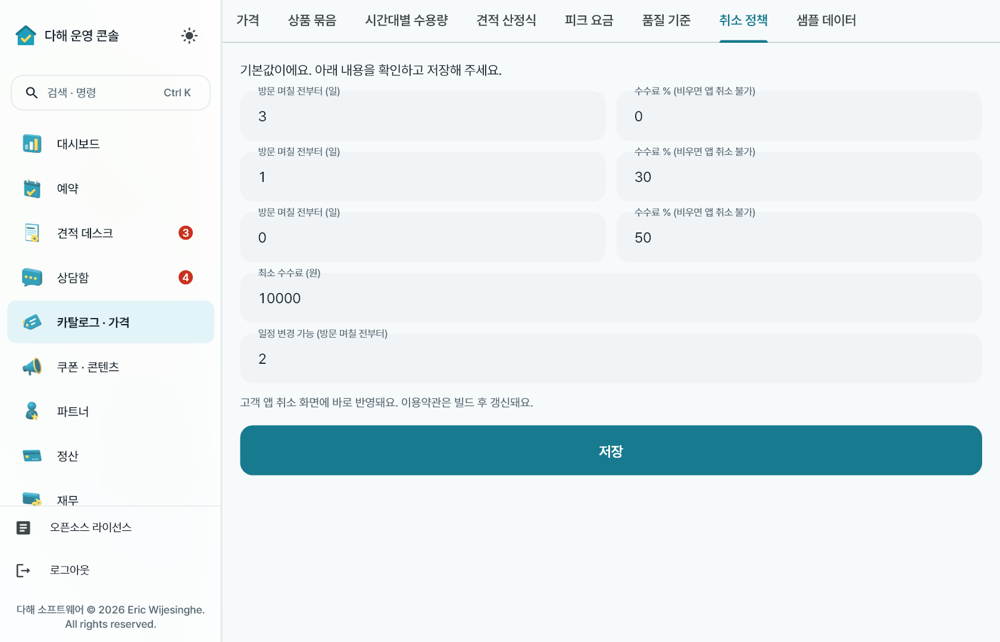

# 18. 서비스와 가격

**이 장에서 할 일:** 고객 앱에 보이는 상품과 가격을 정해요. 시간대별로 받을 수 있는 예약 수, 이사·입주 청소 견적 공식, 주말·저녁 할증, 파트너 품질 기준, 취소 수수료도 여기서 정해요. 마지막으로 연습용 샘플 데이터를 넣고 지우는 방법을 알아봐요.

> **준비물**
> - 관리자 계정으로 콘솔에 로그인한 상태 ([6장](06-owner-account.md))
> - 우리 회사의 가격표 (상품별 금액, 걸리는 시간)
> - 취소 수수료 규정 (며칠 전 취소하면 몇 % 받을지)
> - 샘플 데이터를 지울 때만: 휴대폰 인증 앱 (6자리 코드)

> **주의**
> 이 장의 화면은 **관리자**만 바꿀 수 있어요. **상담원** 계정으로 상품을 누르면 **관리자만 할 수 있어요** 라는 알림이 뜨고, 저장 버튼이 흐리게 보여요.

## 18.1 카탈로그 화면 열기

1. 왼쪽 메뉴에서 **[카탈로그 · 가격]** 을 눌러요. (휴대폰에서는 왼쪽 위 메뉴 버튼을 먼저 눌러요.)
2. 화면 위에 탭 8개가 보여요: **[가격]**, **[상품 묶음]**, **[시간대별 수용량]**, **[견적 산정식]**, **[피크 요금]**, **[품질 기준]**, **[취소 정책]**, **[샘플 데이터]**.
3. 탭 이름을 누르면 그 화면으로 바뀌어요. 탭이 다 안 보이면 탭 줄을 옆으로 밀어요.

이렇게 보이면 성공: **[가격]** 탭이 선택되어 있고, 아래에 상품 목록이 카드로 보여요.

> **팁**
> 여기서 저장한 가격은 고객 앱과 웹사이트에 바로 반영돼요. 앱을 새로 올릴 필요가 없어요.

## 18.2 상품 가격 바꾸기 (가격 탭)

목록의 카드 한 장이 상품 하나예요. 카드에는 상품 이름과 가격 요약(금액과 시간)이 보여요. 견적 상품은 **견적** 이라고 보이고, 판매를 멈춘 상품에는 **보관됨** 표시가 붙어요.

1. **[가격]** 탭을 눌러요.
2. 바꿀 상품의 카드를 눌러요. 상품 이름이 제목인 창이 열려요.
3. 맨 위 **판매 중** 스위치를 확인해요. 켜져 있으면 고객이 예약할 수 있어요.
4. 가격 칸을 고쳐요. 상품 종류마다 칸이 달라요.
   - **정해진 가격 상품:** **서비스 금액** 칸에 원 단위 숫자만 적어요(쉼표 없이, 예: `45000`). **소요(분)** 칸에는 걸리는 시간을 분으로 적어요(예: 2시간이면 `120`).
   - **종류별 가격 상품:** 종류(예: 벽걸이, 스탠드)마다 한 줄씩 있어요. 줄마다 **서비스 금액** 과 **소요(분)** 을 적어요.
   - **수량 선택 상품** (에어컨, 소파, 매트리스 같은 상품): 다른 창이 열려요. [18.9](#189-수량으로-고르는-상품-가격) 를 보세요.
   - **방문 후 견적 상품:** 가격 칸이 없어요. 금액은 상담 중에 [견적 데스크](19-bookings-quotes-inbox.md)에서 정해요.
5. **[저장]** 을 눌러요. 그만두려면 **[취소]** 를 눌러요.

이렇게 보이면 성공: 화면 아래에 **저장했어요** 가 잠깐 뜨고, 카드의 가격 요약이 새 값으로 바뀌어요.

### 상품 판매 멈추기 (보관)

1. 상품 카드를 눌러요.
2. **판매 중** 스위치를 꺼요. 스위치 아래에 **끄면 보관돼요. 고객 화면에서 사라져요** 라고 적혀 있어요.
3. **[저장]** 을 눌러요.

이렇게 보이면 성공: 카드에 **보관됨** 표시가 붙어요. 다시 팔려면 스위치를 켜고 저장하면 돼요.

> **주의**
> 처음 설치했을 때 들어 있는 가격은 예시 값이에요. 문을 열기 전에 모든 상품의 금액과 시간을 우리 회사 가격으로 바꿔 주세요.

## 18.3 새 상품 만들기

1. **[가격]** 탭 맨 위의 **[새 상품]** 을 눌러요.
2. **새 상품 만들기** 창이 열려요.
3. **상품 코드 (영문 소문자)** 칸에 코드를 적어요. 영문 소문자, 숫자, `_` 만 쓸 수 있어요(예: `window_big`).
   > **주의**
   > 상품 코드는 만든 뒤에 바꿀 수 없어요. 천천히 정해 주세요.
4. **화면에 보이는 이름** 칸에 고객이 볼 이름을 적어요(예: `큰 창문 청소`).
5. 가격 방식을 하나 골라요.
   - **정해진 가격**: 미리 정한 금액으로 바로 예약돼요. 고르면 **서비스 금액** 과 **소요(분)** 칸이 나와요. 두 칸을 채워요.
   - **방문 후 견적**: 고객이 견적을 요청하고, 상담팀이 금액을 정해 보내요.
6. **[저장]** 을 눌러요.

이렇게 보이면 성공: **상품을 만들었어요** 가 뜨고, 목록에 새 상품 카드가 생겨요.

> **팁**
> 앱 첫 화면의 큰 메뉴에 이 상품을 넣으려면 [18.4 상품 묶음](#184-앱-첫-화면의-큰-메뉴-상품-묶음)에서 묶음에 넣어 주세요.

## 18.4 앱 첫 화면의 큰 메뉴 (상품 묶음)

고객 앱 첫 화면에는 큰 메뉴(묶음) 4개가 있어요. 처음 설치하면 이사·입주 청소, 거주 청소, 가전·가구 청소, 방역·소독이 들어 있어요. 묶음마다 제목, 순서, 그림, 누르면 어떻게 열릴지, 들어가는 상품을 정할 수 있어요.

1. **[상품 묶음]** 탭을 눌러요.
2. 맨 위에 **앱 첫 화면의 큰 메뉴 4개예요. 제목, 순서, 들어가는 상품을 여기서 바꿀 수 있어요** 라는 안내가 보여요.
3. 줄마다 묶음 이름, **앱에 보임** 또는 **숨김**, 그리고 `상품 고르기 · 상품 3개` 처럼 열리는 방식과 상품 수가 보여요.
4. 고칠 묶음을 눌러요. 묶음 편집 창이 열려요.
5. **제목 (한국어)** 와 **제목 (영어)** 를 적어요. 1~40자예요.
6. **순서 (작은 숫자가 먼저)** 에 0~99 사이 숫자를 적어요.
7. **그림** 에서 그림 하나를 눌러 골라요.
8. **앱에 보임** 스위치로 앱에 보일지 정해요.
9. **눌렀을 때** 에서 하나를 골라요.
   - **이사 질문 먼저**: 새 집인지 오래된 집인지 묻고, 집 크기를 물어요.
   - **상품 바로 열기**: 상품이 하나뿐일 때 바로 그 상품 화면으로 가요.
   - **상품 고르기**: 들어가 있는 상품 목록을 보여줘요.
10. **들어가는 상품 (누른 순서대로 보여요)** 에서 넣을 상품을 눌러 체크해요. 순서를 바꾸려면 상품 옆 위·아래 화살표(**위로 옮기기**, **아래로 옮기기**)를 눌러요.
11. **이사 질문 먼저** 를 골랐다면 세 가지를 더 골라요.
    - **새 집(신축)일 때 상품**
    - **오래된 집(구축)일 때 상품**
    - **집 크기 선택지**: **원룸·투룸**, **아파트**, **빌라·주택** 중 하나 이상
12. **[저장]** 을 눌러요.

이렇게 보이면 성공: **묶음을 저장했어요** 가 뜨고, 목록의 줄이 새 내용으로 바뀌어요.

> **주의**
> 한 상품은 한 묶음에만 들어갈 수 있어요. 다른 묶음에 있는 상품은 이름 옆에 **다른 묶음: (묶음 이름)** 이 보여요. 먼저 그 묶음을 열어 상품을 빼고 저장한 뒤에 넣어 주세요.

저장이 안 될 때 뜨는 말과 고치는 법:

| 화면에 뜨는 말 | 고치는 법 |
|---|---|
| 제목은 1~40자로 적어 주세요 | 한국어·영어 제목을 모두 1~40자로 적어요 |
| 순서는 0~99 사이로 적어 주세요 | 순서 칸을 0~99 숫자로 고쳐요 |
| 상품을 하나 이상 골라 주세요 | 들어가는 상품을 하나 이상 체크해요 |
| 바로 열기는 상품을 하나만 골라 주세요 | **상품 바로 열기** 일 때는 상품을 하나만 남겨요 |
| 새 집과 오래된 집 상품, 집 크기 선택지를 골라 주세요 | 11번의 세 가지를 모두 골라요 |
| 그림을 다시 골라 주세요 | 그림을 다시 눌러 골라요 |
| 상품이 다른 묶음에 들어 있어요. 그 묶음에서 먼저 빼 주세요 | 위 주의 상자대로 해요 |

## 18.5 시간대별로 받을 예약 수 (시간대별 수용량)

같은 도착 시각에 예약을 몇 건까지 받을지 정해요. 팀 수보다 예약을 많이 받지 않게 막아 줘요.

1. **[시간대별 수용량]** 탭을 눌러요.
2. 줄마다 왼쪽에 도착 시각(예: 오전 9시)이 있고, 오른쪽에 숫자 칸이 있어요.
3. 그 시각에 받을 최대 예약 수를 숫자로 적어요(예: 팀이 3팀이면 `3`).
4. 제한을 두지 않을 시각은 칸을 비워 둬요. 빈 칸에는 흐리게 **제한 없음** 이 보여요.
5. 맨 아래 **[저장]** 을 눌러요.

이렇게 보이면 성공: **저장했어요** 가 떠요. 가득 찬 시각은 고객 앱에서 고를 수 없게 돼요.

## 18.6 이사·입주 청소 견적 공식 (견적 산정식)

이사·입주 청소처럼 견적으로 받는 상품은 고객이 답한 내용(방 수, 욕실, 발코니 등)으로 **예상 금액** 을 먼저 계산해 보여줘요. 그 계산에 쓰는 기본 금액을 여기서 정해요.

1. **[견적 산정식]** 탭을 눌러요.
2. 칸마다 원 단위 금액을 적어요(쉼표 없이).

| 칸 이름 | 뜻 |
|---|---|
| **원룸 기본** | 원룸일 때 시작 금액 |
| **1.5룸 기본** | 1.5룸일 때 시작 금액 |
| **방 2개 기본** | 방 2개일 때 시작 금액 |
| **방 3개 기본** | 방 3개일 때 시작 금액 |
| **방 4개 이상 기본** | 방 4개 이상일 때 시작 금액 |
| **욕실 추가당** | 욕실이 하나 늘 때마다 더하는 금액 |
| **발코니당** | 발코니 하나마다 더하는 금액 |
| **복층** | 복층이면 더하는 금액 |
| **엘리베이터 없음 + 3층 이상** | 엘리베이터 없이 3층 이상이면 더하는 금액 |
| **에어컨 추가 할인 (bps, 1000 = 10%)** | 에어컨 청소를 같이 맡길 때 할인. `1000` 을 적으면 10% 할인이에요 |

3. 칸 아래 작은 글씨 한 줄에 **할증**, **짐은 어떤 상태인가요?**, VAT, **예약금** 비율이 보여요. 이 값들은 이 화면에서 바꿀 수 없어요. 처음 설치 값은 VAT 10%, 예약금 10%예요.
4. **[저장]** 을 눌러요.

이렇게 보이면 성공: **저장했어요** 가 떠요. 새로 들어오는 견적 요청부터 새 금액으로 계산돼요.

> **주의**
> 처음 설치 값(예: 원룸 기본 180,000원)은 시험용 예시예요. 실제 영업 전에 꼭 우리 가격으로 바꿔 주세요. 원룸 기본이 0이면 저장되지 않아요.

> **팁**
> 예상 금액은 상담원이 참고하는 값이에요. 고객에게 보내는 최종 금액은 [19.3 견적 데스크](19-bookings-quotes-inbox.md#193-견적-데스크-이사입주-청소)에서 정해요.

## 18.7 주말·공휴일·저녁 할증 (피크 요금)

1. **[피크 요금]** 탭을 눌러요.
2. 칸마다 퍼센트(%) 숫자를 적어요.

| 칸 이름 | 처음 설치 값 |
|---|---|
| **주말 할증 (%)** | 10 |
| **공휴일 할증 (%)** | 20 |
| **명절 할증 (%)** | 30 |
| **저녁 할증 (%)** | 10 |
| **할증 합계 상한 (%)** | 50 |
| **저녁 시작 시각 (0~23시)** | 18 |
| **저녁 끝 시각 (1~24시)** | 22 |

3. **정해진 가격·정기 청소에도 할증 적용** 스위치를 정해요. 처음에는 꺼져 있어요.
   - 꺼 두면: 정해진 가격 상품과 정기 청소는 기본 가격으로 예약돼요. 견적은 항상 할증을 보여줘요.
   - 켜면: 정해진 가격 예약과 정기 청소에도 할증이 붙어요.
4. **[저장]** 을 눌러요.

이렇게 보이면 성공: **저장했어요** 가 떠요. 화면의 안내대로 **새 견적과 새 예약부터 적용돼요.** 이미 받은 예약 금액은 바뀌지 않아요.

> **주의**
> 스위치를 켜면 할증분은 쿠폰·정기 할인 계산에도 들어가고, 파트너 정산액에도 반영돼요. 정기 청소는 다음에 결제되는 회차부터 바뀌어요.

> **팁**
> 숫자를 잘못 넣으면 **숫자를 다시 확인해 주세요** 가 떠요. 퍼센트는 0~100, 저녁 시작 시각은 끝 시각보다 작아야 해요.

## 18.8 파트너 품질 기준

파트너마다 0~100점 **품질 점수** 가 계산돼요. 평점, 맡은 일을 끝까지 했는지, 제시간에 도착했는지, 취소·노쇼, 불만 접수를 함께 봐요. 기준보다 점수가 낮으면 경고가 가거나 새 일감 배정이 멈춰요.

1. **[품질 기준]** 탭을 눌러요.
2. **주의 기준 (이 점수보다 낮으면 경고)** 에 숫자를 적어요. 처음 값은 75예요.
3. **자동 중지 기준 (이 점수보다 낮으면 파트너 일시 중지)** 에 숫자를 적어요. 처음 값은 60이에요.
4. **[저장]** 을 눌러요.

이렇게 보이면 성공: **저장했어요** 가 떠요. 화면 안내대로 **바꾸면 다음 점수 계산부터 적용돼요.**

> **주의**
> 자동 중지 기준은 주의 기준보다 클 수 없어요. 둘 다 100 이하로 적어요.

파트너 목록에서 점수를 보는 방법은 [20.3](20-partners-staff.md#203-품질-점수-보기)에 있어요. 점수를 몇 일 치로 셀지는 [운영 규칙](23-rules-notify-privacy.md)에서 바꿔요.

## 18.9 수량으로 고르는 상품 가격

에어컨, 소파, 매트리스, 창문, 방역·소독처럼 **개수로 고르는 상품** 은 항목(옵션)마다 가격이 있어요. 고객이 항목마다 수량을 고르고, 두 개 이상 고르면 할인이 들어가요.

1. **[가격]** 탭을 눌러요.
2. 수량 선택 상품의 카드(예: 에어컨 청소)를 눌러요.
3. **수량 선택 가격** 창이 열려요. 위에 안내가 있어요: **고객이 항목마다 수량을 골라요. 두 개 이상 고르면 할인이 적용돼요. 가격은 예시이니 자유롭게 바꿀 수 있어요**
4. 항목 줄마다 고쳐요.
   - **항목 이름** (예: `벽걸이`)
   - **서비스 금액** (원)
   - **소요(분)**
5. 항목을 더하려면 **[항목 추가]** 를 눌러요. 지우려면 줄 오른쪽 **항목 삭제** (휴지통 모양)를 눌러요. 순서는 **위로 옮기기** / **아래로 옮기기** 화살표로 바꿔요.
6. **항목당 최대 수량 (비우면 제한 없음)** 을 적어요. 1~20 사이예요.
7. **두 개 이상 할인 (%)** 을 적어요. 0~50 사이예요.
8. 아래 **미리보기 (수량을 골라 보세요)** 에서 **하나 더하기** (+), **하나 줄이기** (−)를 눌러 봐요. **합계** 와 **할인** 이 어떻게 나오는지 확인할 수 있어요.
9. 맨 위 **판매 중** 스위치를 확인하고 **[저장]** 을 눌러요.

이렇게 보이면 성공: **저장했어요** 가 뜨고, 카드에 항목별 가격이 `/` 로 나뉘어 보여요.

저장이 안 될 때:

| 화면에 뜨는 말 | 고치는 법 |
|---|---|
| 항목을 하나 이상 넣어 주세요 | **[항목 추가]** 를 눌러 한 줄 이상 만들어요 |
| 모든 항목에 이름을 적어 주세요 | 빈 **항목 이름** 칸을 채워요 |
| 모든 항목의 가격과 시간을 0보다 크게 적어 주세요 | 금액과 분을 1 이상으로 적어요 |
| 최대 수량은 1~20 사이로 적어 주세요 | 최대 수량을 고치거나 비워요 |
| 할인은 0~50% 사이로 적어 주세요 | 할인 %를 고쳐요 |

## 18.10 취소 수수료 (취소 정책)

고객이 앱에서 예약을 취소할 때 받을 수수료를 정해요.

1. **[취소 정책]** 탭을 눌러요.
2. 한 번도 저장하지 않았다면 맨 위에 **기본값이에요. 아래 내용을 확인하고 저장해 주세요.** 가 보여요.
3. 줄마다 칸이 두 개 있어요.
   - **방문 며칠 전부터 (일)**: 이 줄이 적용되는 시작 날짜
   - **수수료 % (비우면 앱 취소 불가)**: 그때 취소하면 받는 수수료. 0이면 무료 취소예요. 비우면 고객이 앱에서 취소할 수 없어요(상담으로만 취소).
4. 처음 값은 이렇게 되어 있어요.

| 방문 며칠 전부터 | 수수료 % | 뜻 |
|---|---|---|
| 2 | 0 | 방문 2일 전까지는 무료 취소 |
| 1 | (비움) | 방문 하루 전에는 앱에서 취소 불가 |
| 0 | (비움) | 방문 당일에는 앱에서 취소 불가 |

5. **최소 수수료 (원)** 에 수수료가 붙을 때의 최소 금액을 적어요. 0이면 최소 금액이 없어요.
6. **일정 변경 가능 (방문 며칠 전부터)** 에 고객이 앱에서 날짜를 바꿀 수 있는 마지막 날을 적어요. 0~30 사이예요. 처음 값은 2예요.
7. **[저장]** 을 눌러요.

이렇게 보이면 성공: **저장했어요** 가 뜨고, 위의 기본값 안내가 사라져요. 화면 안내대로 **고객 앱 취소 화면에 바로 반영돼요. 이용약관은 빌드 후 갱신돼요.**

> **주의**
> - 줄은 위에서 아래로 날짜가 줄어들어야 해요(예: 2 → 1 → 0). 아래 줄의 수수료는 위 줄보다 낮으면 안 돼요. 이 규칙에 맞지 않으면 저장되지 않아요.
> - 이 화면에서는 줄을 더하거나 지울 수 없어요. 있는 줄의 숫자만 바꿀 수 있어요. 줄 수를 바꾸려면 개발사에 문의하세요(**확인 필요**).
> - 고객 결제 화면의 안내 문구(**방문 2일 전까지 무료로 취소할 수 있어요...**)는 처음 설치 값 기준의 고정 문구예요. 정책을 바꾼 뒤 이 문구도 바뀌는지는 **확인 필요** 예요.
> - 이용약관 문서에 적힌 취소 규정은 앱을 새로 빌드해야 바뀌어요. 개발사에 알려 주세요.

## 18.11 연습용 샘플 데이터 넣고 지우기

화면이 비어 있으면 써 보기 어려워요. 연습이나 교육용으로 가짜 고객, 파트너, 예약을 넣을 수 있어요. 가짜 고객 40명, 파트너 12곳(팀원 포함), 최근 90일과 앞으로 14일의 예약·결제·채팅·정산이 들어가요. 가짜 전화번호라 문자나 알림이 나가지 않고, 결제도 실제로 청구되지 않아요.

### 넣기

1. **[샘플 데이터]** 탭을 눌러요.
2. **데모용 샘플 데이터** 제목과 설명을 읽어요.
3. **[샘플 데이터 넣기]** 를 눌러요.

이렇게 보이면 성공: **샘플 데이터를 넣었어요** 가 떠요. 대시보드와 예약 화면에 가짜 데이터가 보여요.

> **주의**
> 실제 예약이 하나라도 있으면 넣을 수 없어요. 이때는 **실제 예약이 있어서 샘플 데이터를 넣을 수 없어요** 가 떠요. 이미 넣었다면 **샘플 데이터가 이미 들어 있어요** 가 떠요.

### 지우기

1. **[샘플 데이터]** 탭을 눌러요.
2. **[샘플 데이터 지우기]** 를 눌러요. 같은 이름의 창이 열려요.
3. 휴대폰의 인증 앱을 열어 6자리 코드를 확인해요.
4. **인증 앱 6자리 코드** 칸에 코드를 적어요.
5. **[저장]** 을 눌러요. 그만두려면 **[취소]** 를 눌러요.

이렇게 보이면 성공: **샘플 데이터를 지웠어요** 가 떠요. 샘플 데이터만 지워지고 실제 기록은 그대로 남아요.

> **팁**
> 코드가 틀리거나 이미 쓴 코드면 **코드가 맞지 않아요. 새 코드를 입력하세요** 가 떠요. 인증 앱에서 새 숫자가 나올 때까지 기다렸다가 다시 적어요.

> **주의**
> 실제 영업을 시작하기 전에 샘플 데이터를 꼭 지워 주세요.

## 자주 생기는 문제

| 이런 일이 생기면 | 이렇게 해 보세요 |
|---|---|
| 상품을 누르면 **관리자만 할 수 있어요** 가 떠요 | 상담원 계정이에요. 관리자 계정으로 다시 로그인해요 |
| **[저장]** 버튼이 흐려서 눌리지 않아요 | 관리자 계정인지 확인해요 |
| 새 상품을 만들 때 **같은 코드의 상품이 이미 있어요** | 다른 상품 코드를 적어요 |
| 새 상품을 만들 때 **상품 코드나 가격을 다시 확인해 주세요** | 코드는 영문 소문자·숫자·`_` 만, 가격과 시간은 숫자로 적어요 |
| 저장할 때 **문제가 생겼어요. 잠시 후 다시 시도해 주세요.** | 숫자 범위를 확인해요(예: 취소 정책 줄 순서, 견적 산정식의 원룸 기본 0). 그래도 안 되면 새로고침 후 다시 해요 |
| 앱에 가격이 바로 안 바뀌어요 | 고객 앱을 완전히 닫았다가 다시 열어요 |
| 고객이 특정 시간을 못 고른다고 해요 | **[시간대별 수용량]** 에서 그 시각 숫자를 확인해요. 이미 가득 찼을 수 있어요 |
| 상품이 묶음에 안 들어가요 | 다른 묶음에 들어 있는지 확인하고 거기서 먼저 빼요 |
