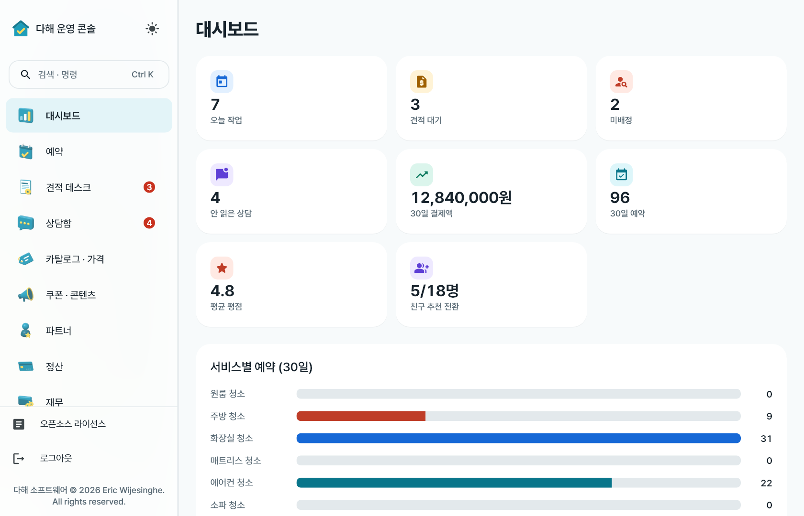
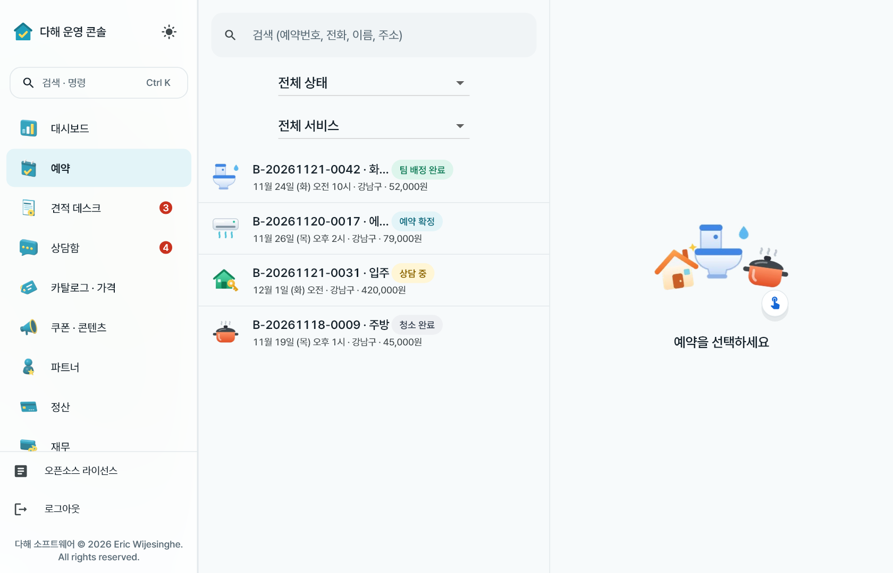
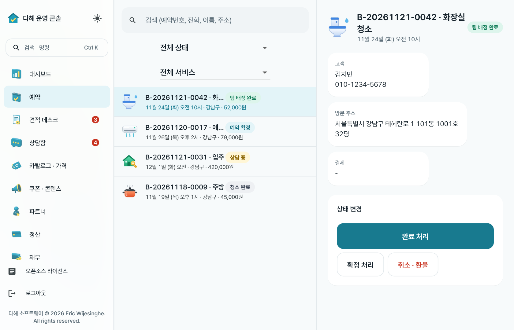
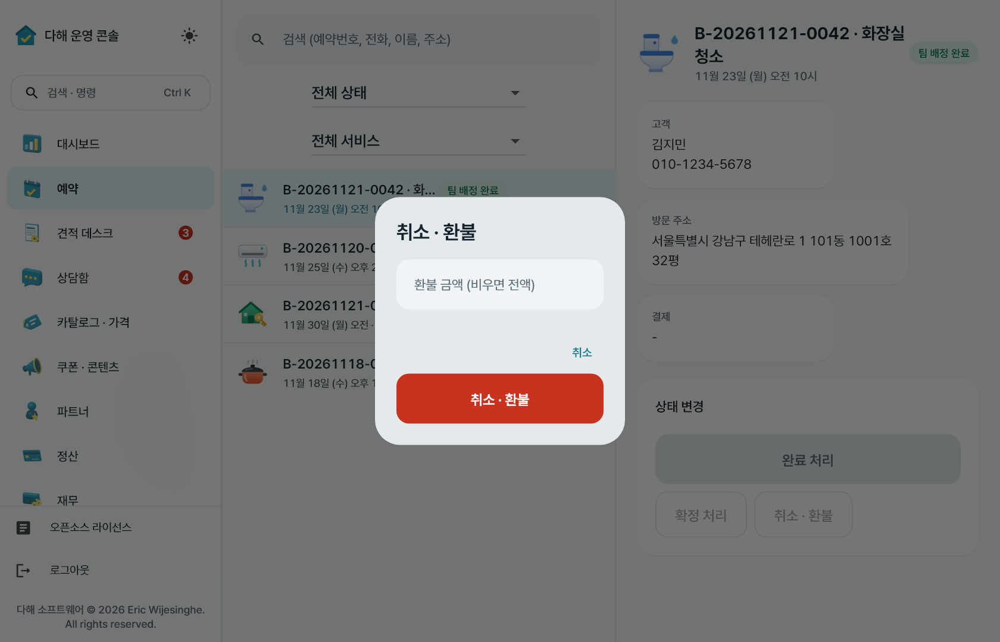
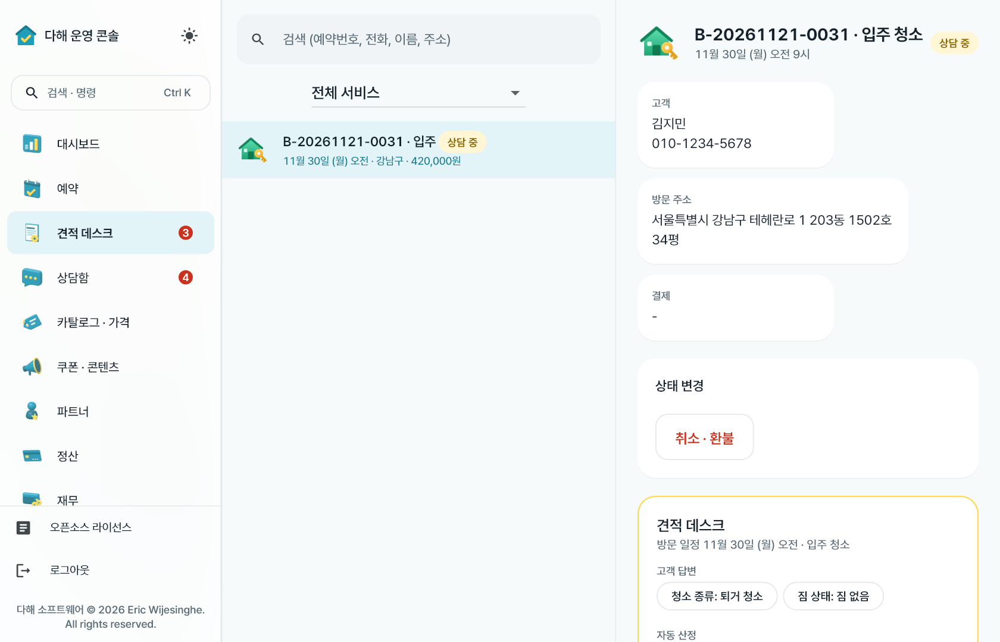
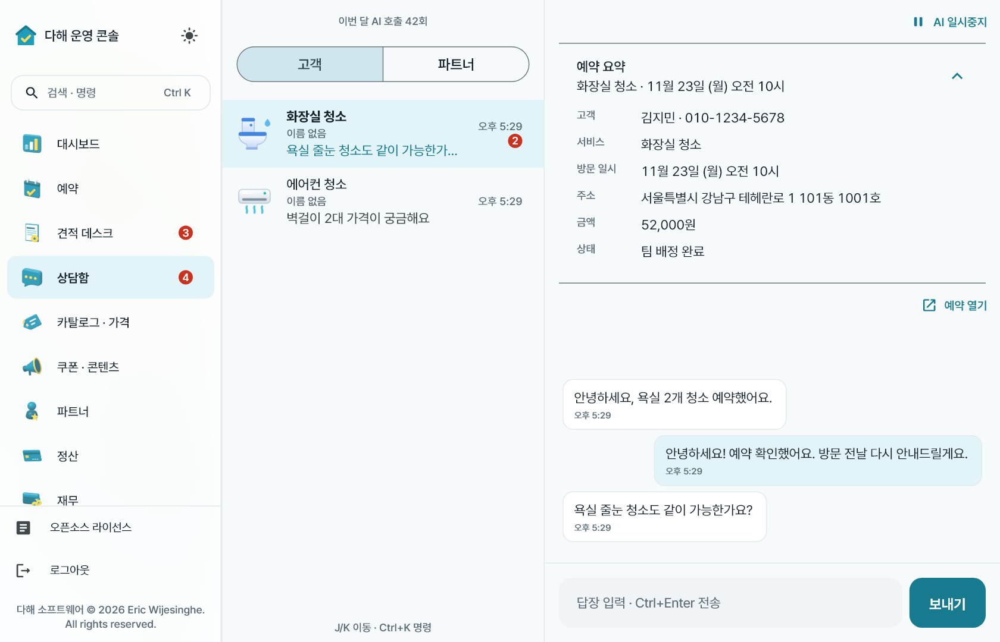
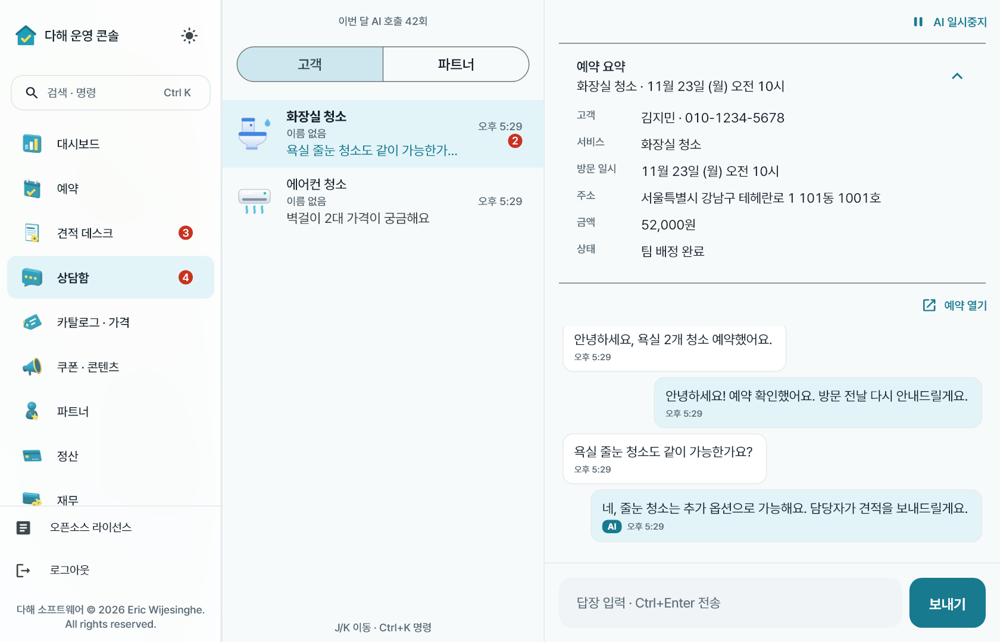
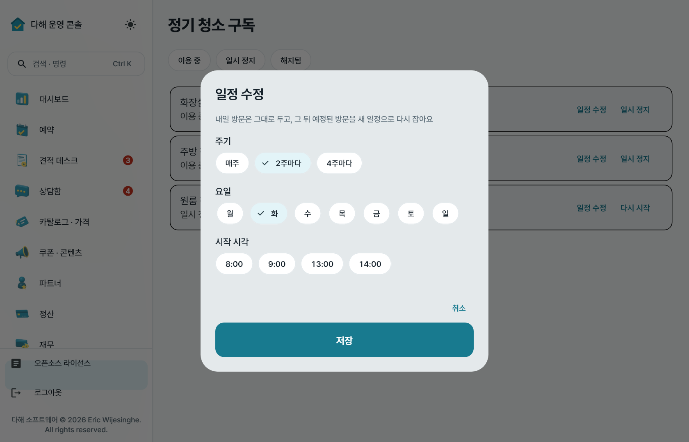

# 19. 대시보드, 예약, 견적, 상담

**이 장에서 할 일:** 매일 아침 콘솔에서 무엇을 보면 되는지 알아봐요. 예약을 찾고, 상태를 바꾸고, 취소·환불하는 법을 익혀요. 이사·입주 청소 견적을 고객에게 보내고, 상담함에서 답장하고, 정기 청소 구독을 관리해요.

> **준비물**
> - 콘솔 계정 (관리자 또는 상담원)
> - 결제 설정이 끝난 상태 ([11장](11-setup-portone.md) 또는 [12장](12-setup-toss-payments.md)) — 환불하려면 필요해요
> - 연습해 보려면 샘플 데이터 ([18.11](18-catalog-prices.md#1811-연습용-샘플-데이터-넣고-지우기))

## 19.1 대시보드와 매일 아침 5분

### 대시보드 읽기

1. 왼쪽 메뉴에서 **[대시보드]** 를 눌러요. 콘솔을 열면 처음 보이는 화면이에요.
2. 위쪽 숫자 카드를 차례로 봐요.

| 카드 | 뜻 |
|---|---|
| **오늘 작업** | 오늘 방문하는 예약 수 (취소된 예약은 빼고) |
| **견적 대기** | **상담 중** 인 견적 요청 수. 견적을 보냈지만 고객이 아직 예약금을 내지 않은 요청도 들어가요 |
| **미배정** | 확정됐지만 아직 팀이 정해지지 않은 예약 수 |
| **안 읽은 상담** | 직원이 아직 읽지 않은 메시지가 있는 대화 수 |
| **30일 결제액** | 최근 30일 동안 받은 금액에서 환불을 뺀 금액 |
| **30일 예약** | 최근 30일 동안 들어온 예약 수 |
| **평균 평점** | 고객 평점의 평균 (없으면 `-`) |
| **친구 추천 전환** | 초대한 사람 중 보상까지 간 사람 수 |

3. 아래로 내리면 **서비스별 예약 (30일)** 막대가 보여요. 어떤 상품이 많이 팔리는지 알 수 있어요.
4. 그 아래 **예약 흐름 (최근 30일)** 카드가 있어요.
   - **기사님 배정까지 걸린 시간 (중앙값)**: 예약이 들어온 뒤 팀이 정해지기까지 보통 걸린 시간
   - **24시간 넘게 기사님이 없는 예약**: 빨리 챙겨야 하는 예약 수
   - **오늘 당일 취소**: 오늘 예약 중 당일에 취소된 수
   - **서비스별 미도착(노쇼) 비율**

> **팁**
> 숫자를 불러오지 못하면 위에 오류 줄과 **[다시 시도]** 버튼이 나와요. 이때 보이는 숫자는 마지막으로 불러온 값이에요.

### 매일 아침 5분 순서

1. **[대시보드]** 에서 **오늘 작업**, **견적 대기**, **미배정**, **안 읽은 상담** 숫자를 확인해요.
2. **미배정** 이 0이 아니면 **[예약]** 에서 그 예약을 열어요. 파트너에게 연락하거나 고객과 일정을 다시 맞춰요([19.2](#192-예약-찾고-처리하기)).
3. **견적 대기** 가 0이 아니면 **[견적 데스크]** 에서 견적을 보내요([19.3](#193-견적-데스크-이사입주-청소)).
4. **안 읽은 상담** 이 0이 아니면 **[상담함]** 에서 답장해요([19.4](#194-상담함)). 답장하면 고객 앱에 바로 알림이 가요.

> **팁**
> 키보드의 `Ctrl + K` 를 누르면 메뉴 이름으로 화면을 바로 찾을 수 있어요. 예약번호는 **[예약]** 의 검색 칸에서 찾아요([8장](08-console-tour.md)).

## 19.2 예약 찾고 처리하기

### 예약 찾기

1. 왼쪽 메뉴에서 **[예약]** 을 눌러요.
2. 맨 위 검색 칸 **검색 (예약번호, 전화, 이름, 주소)** 에 예약번호, 고객 전화번호, 이름, 주소 중 아는 것을 적고 키보드의 `Enter` 를 눌러요.
3. 상태로 거르려면 **전체 상태** 를 눌러 하나를 골라요.
4. 상품으로 거르려면 **전체 서비스** 를 눌러 하나를 골라요.
5. 목록에서 예약을 눌러요. 오른쪽(휴대폰에서는 새 화면)에 **예약 상세** 가 열려요.

이렇게 보이면 성공: 오른쪽에 예약번호와 상품 이름, 방문 날짜, 상태 표시가 보이고, 아래에 **고객**, **방문 주소**, **결제** 카드가 보여요. 맞는 예약이 없으면 **결과가 없어요** 가 보여요.

### 예약 상태의 뜻

| 상태 | 뜻 |
|---|---|
| **상담 중** | 견적 상품의 상담 단계. 예약금을 아직 안 받았어요 |
| **예약 확정** | 결제가 끝나 예약이 확정됐어요. 아직 팀이 없어요 |
| **팀 배정 완료** | 파트너(팀)가 정해졌어요 |
| **청소 완료** | 작업이 끝났어요 |
| **취소됨** | 취소된 예약이에요 |

### 예약 상세에서 볼 수 있는 것

- **고객**: 이름과 전화번호
- **방문 주소**: 주소와 평수
- **결제**: 결제마다 한 줄. 예: `예약금 · 42,000원 · 결제 완료`. 결제 종류는 **예약금**, **잔금**, **결제 금액**, 상태는 **결제 완료**, **환불됨**, **부분 환불**, **실패** 로 보여요. 일부 환불이 있으면 괄호 안에 환불 금액이 보여요.
- **방문 요청사항**: 고객이 남긴 메모
- **[상담함]** 버튼: 이 예약의 고객 대화를 바로 열어요. 대화가 있는 예약에만 보여요.

### 상태 바꾸기

예약 상세 아래 **상태 변경** 카드에 지금 상태에서 할 수 있는 버튼만 보여요.

**앱을 쓰지 않는 팀에게 맡길 때 (팀 배정)**

보통은 파트너가 파트너 앱에서 일감을 받아 자동으로 배정돼요. 앱을 쓰지 않는 팀에게 직접 맡길 때만 이렇게 해요.

1. **예약 확정** 상태의 예약을 열어요.
2. **배정 팀 이름** 칸에 팀 이름을 적어요(예: `강남 2팀`). 비워 두면 **문제가 생겼어요. 잠시 후 다시 시도해 주세요.** 가 뜨고 배정되지 않아요.
3. **[팀 배정]** 을 눌러요.

이렇게 보이면 성공: **처리했어요** 가 뜨고 상태가 **팀 배정 완료** 로 바뀌어요.

**직접 맡긴 팀의 작업이 끝났을 때 (완료 처리)**

1. 위에서 팀 이름으로 배정한 예약을 열어요.
2. **[완료 처리]** 를 눌러요.

이렇게 보이면 성공: 상태가 **청소 완료** 로 바뀌어요.

> **주의**
> 파트너 앱으로 배정된 예약에는 **[완료 처리]** 버튼이 보이지 않아요. 파트너가 앱에서 사진과 체크리스트를 올려 완료해야 정산이 만들어져요.

**배정을 풀고 다시 '예약 확정'으로 돌리기 (확정 처리)**

1. **팀 배정 완료** 상태의 예약을 열어요.
2. **[확정 처리]** 를 눌러요.

이렇게 보이면 성공: 상태가 **예약 확정** 으로 돌아가고, 배정된 팀(또는 파트너)이 빠져요.

> **주의**
> **[확정 처리]** 는 배정을 없애는 버튼이에요. 팀이 바뀌어야 할 때만 눌러요.

> **팁**
> **상담 중** 인 견적 예약은 고객이 예약금을 내야 다음 단계로 넘어가요. 직원이 상태를 대신 바꿀 수 없어요.

### 취소하고 환불하기

**상담 중**, **예약 확정**, **팀 배정 완료** 상태에서 할 수 있어요. 관리자와 상담원 모두 할 수 있어요.

1. 예약 상세를 열어요.
2. **상태 변경** 카드의 빨간 **[취소 · 환불]** 을 눌러요.
3. **취소 · 환불** 창이 열려요.
4. **환불 금액 (비우면 전액)** 칸을 정해요.
   - 전액 환불: 칸을 비워 둬요.
   - 일부만 환불: 돌려줄 금액을 원 단위 숫자로 적어요(예: `30000`).
5. 창 아래의 빨간 **[취소 · 환불]** 을 눌러요. 그만두려면 **[취소]** 를 눌러요.

이렇게 보이면 성공: **처리했어요** 가 뜨고, 상태가 **취소됨** 으로 바뀌어요. **결제** 카드의 결제 줄이 **환불됨** 또는 **부분 환불** 로 바뀌어요.

> **주의**
> - 취소는 되돌릴 수 없어요.
> - 환불은 고객이 결제한 곳(PortOne 또는 토스페이먼츠)으로 돌아가요. 그래서 결제사 설정 카드를 지우면 안 돼요([12장](12-setup-toss-payments.md)).
> - 고객이 쓴 포인트는 환불된 비율만큼 돌아가요(전액 취소면 전부).
> - 전액 환불이면 고객이 쓴 쿠폰도 돌아가요.
> - 이 예약의 파트너 정산은 **보류** 로 바뀌어요([21장](21-payments-settlement-finance.md)). 정산이 이미 송금 중이면 **이 예약의 정산이 송금 중이라 취소할 수 없어요.** 가 뜨고 취소되지 않아요.
> - 취소·환불은 [활동 기록](23-rules-notify-privacy.md)에 남아요.

## 19.3 견적 데스크 (이사·입주 청소)

이사·입주 청소처럼 견적으로 받는 상품은 이렇게 흘러가요.

1. 고객이 앱에서 질문에 답하고 견적을 요청해요. 앱이 **예상 금액** 을 계산해 보여줘요.
2. 파트너들이 파트너 앱에서 견적을 내요.
3. 사장님(또는 상담원)이 **[견적 데스크]** 에서 최종 금액을 정해 보내요.
4. 고객이 예약금을 결제해요. 예약금은 최종 금액의 일정 비율이에요(처음 설치 값 10%, [18.6](18-catalog-prices.md#186-이사입주-청소-견적-공식-견적-산정식)).
5. 견적을 보낼 때 파트너 견적을 골랐다면, 예약금이 들어올 때 그 파트너에게 자동 배정돼요. 고르지 않았다면 **예약 확정** 상태로 남아요.
6. 작업이 끝나면 고객이 잔금을 결제해요.

### 견적 보내기

1. 왼쪽 메뉴에서 **[견적 데스크]** 를 눌러요. 메뉴 옆 빨간 숫자가 기다리는 요청 수예요.
2. 목록에서 **상담 중** 요청을 눌러요.
3. 오른쪽 아래 노란 테두리의 **견적 데스크** 카드로 내려가요.
4. 맨 위 줄에서 **방문 일정** 과 상품을 확인해요.
5. **고객 답변** 에서 고객이 고른 내용(청소 종류, 짐 상태 등)을 확인해요.
6. **자동 산정** 에서 공식으로 계산한 예상 금액을 봐요.
7. **파트너 견적** 에서 파트너들이 낸 견적을 봐요. 한 줄에 팀 이름, 파트너 이름, 평점(★), 메모, 금액이 보여요. 아직 없으면 **아직 받은 견적이 없어요** 가 보여요.
8. 맡길 파트너의 견적을 눌러요. 그 금액이 **고객 최종 금액** 칸에 자동으로 들어가요.
9. 필요하면 **고객 최종 금액** 을 고쳐요(원 단위 숫자만).
10. **고객에게 보낼 메모** 에 고객에게 전할 말을 적어요(최대 300자, 안 적어도 돼요).
11. **[고객에게 견적 보내기]** 를 눌러요.

이렇게 보이면 성공: **견적을 보냈어요** 가 떠요. 카드 제목 옆에 **견적 발송** 표시가 붙고, **견적 발송됨 · (금액) · (시각)** 줄이 보여요. 고객 앱 대화창에 견적 카드가 도착해요.

> **팁**
> - 최종 금액은 10,000원 이상 50,000,000원 이하여야 해요. 100원 단위로 맞춰져요.
> - 파트너 견적을 고르지 않고 금액만 적어 보내도 돼요.

### 예상 금액과 차이가 클 때

최종 금액이 예상 금액의 30%보다 작거나 300%보다 크면 오타일 가능성이 커서 한 번 더 확인해요.

- **상담원** 계정: **예상 금액과 차이가 커서 관리자 승인이 필요해요** 가 뜨고 보내지지 않아요. 관리자에게 부탁하세요.
- **관리자** 계정: **예상 금액과 크게 다른 견적 보내기** 창이 열려요. `견적 (금액) · 예상 금액 (금액) · (배)배. 그래도 보낼까요?` 를 읽고, 맞으면 **[예상 금액과 크게 다른 견적 보내기]** 를 눌러요.

### 보낸 견적 다시 보내기, 고치기

1. **견적 발송** 표시가 있는 요청을 열어요.
2. **견적 발송됨** 줄 옆 버튼을 눌러요.
   - **[재발송]**: 같은 견적을 다시 보내요. **견적을 다시 보냈어요** 가 떠요.
   - **[수정]**: 금액이나 메모를 바꿔 새로 보내요. 위의 "견적 보내기" 8~11번을 다시 해요.

> **주의**
> 고객이 예약금을 내면 예약이 **예약 확정** 으로 바뀌고, 예약 상세에서 **견적 데스크** 카드가 사라져요. 그 뒤에는 견적 금액을 고칠 수 없어요.

## 19.4 상담함

고객과 파트너의 대화가 모두 여기에 모여요. AI 상담원을 켰다면([16장](16-setup-push-ai-juso.md)) AI가 먼저 답하고, 사람은 필요할 때 이어서 답해요.

### 답장하기

1. 왼쪽 메뉴에서 **[상담함]** 을 눌러요. 메뉴 옆 빨간 숫자가 안 읽은 대화 수예요.
2. 맨 위에서 **[고객]** 또는 **[파트너]** 를 눌러 누구와의 대화를 볼지 골라요.
3. 왼쪽 목록에서 대화를 눌러요. 처음에는 **대화를 선택하세요** 가 보여요.
4. 예약과 연결된 대화라면 위에 **예약 요약** 카드가 보여요(**고객**, **서비스**, **방문 일시**, **주소**, **금액**, **상태**). **[예약 열기]** 를 누르면 그 예약 상세로 가요.
5. 아래 **답장 입력 · Ctrl+Enter 전송** 칸에 답장을 적어요.
6. **[보내기]** 를 누르거나 `Ctrl + Enter` 를 눌러요.

이렇게 보이면 성공: 답장이 대화 맨 아래에 보이고, 고객(또는 파트너) 앱에 알림이 가요.

> **팁**
> 키보드의 `J` 는 다음 대화, `K` 는 이전 대화로 옮겨 가요. 상담함 화면에도 **J/K 이동 · Ctrl+K 명령** 이라고 적혀 있어요.

### AI 답변 멈추기, 다시 켜기

AI가 쓴 말에는 **AI** 표시가 붙어요. 사람이 직접 응대하고 싶은 대화는 AI를 멈출 수 있어요.

1. 대화를 열어요.
2. 대화 위 오른쪽 **[AI 일시중지]** 를 눌러요.

이렇게 보이면 성공: 왼쪽에 **AI가 이 대화에 답변하지 않아요** 가 보이고, 버튼이 **[AI 재개]** 로 바뀌어요. 다시 AI에게 맡기려면 **[AI 재개]** 를 눌러요.

목록 위 한 줄에 AI 상태가 보여요.

- **이번 달 AI 호출 (숫자)회**: 이번 달 AI가 답한 횟수
- **AI 상담원이 꺼져 있어요**: AI 상담원 설정이 안 되어 있어요([16장](16-setup-push-ai-juso.md))
- **AI 답변 연결에 문제가 있어요. 상담원이 직접 응대해 주세요.**: 최근 AI 연결이 실패했어요. 그동안 사람이 직접 답해 주세요.

## 19.5 정기 청소 구독

고객이 매주, 2주마다, 4주마다 받는 정기 청소를 관리해요.

> **주의**
> 이 화면은 **관리자** 만 쓸 수 있어요. 메뉴는 상담원에게도 보이지만, 상담원 계정으로 열면 **구독 목록을 불러오지 못했어요** 가 떠요.

1. 왼쪽 메뉴에서 **[정기 청소 구독]** 을 눌러요.
2. 위의 상태 버튼(**이용 중**, **일시 정지**, **해지됨**)을 눌러 거를 수 있어요.
3. 목록 한 줄에 `상품 · 주기`, `상태 · 시작 시각` 이 보여요. 아직 없으면 **아직 정기 청소가 없어요** 가 보여요.

### 잠시 멈추기, 다시 시작하기

1. 구독 줄 오른쪽 **[일시 정지]** 를 눌러요.
2. 상태가 **일시 정지** 로 바뀌어요.
3. 다시 시작하려면 같은 자리의 **[다시 시작]** 을 눌러요.

### 일정 바꾸기 (관리자만)

1. 구독 줄 오른쪽 **[일정 수정]** 을 눌러요.
2. **일정 수정** 창의 안내를 읽어요: **내일 방문은 그대로 두고, 그 뒤 예정된 방문을 새 일정으로 다시 잡아요**
3. **주기** 에서 **매주**, **2주마다**, **4주마다** 중 하나를 골라요.
4. **요일** 에서 요일 하나를 골라요.
5. **시작 시각** 에서 시각을 골라요.
6. **[저장]** 을 눌러요.

이렇게 보이면 성공: **저장했어요** 가 뜨고, 목록의 주기와 시각이 바뀌어요.

> **팁**
> **해지됨** 구독에는 버튼이 없어요. 해지는 고객이 앱에서 해요.

## 자주 생기는 문제

| 이런 일이 생기면 | 이렇게 해 보세요 |
|---|---|
| 고객이 결제했는데 예약이 안 보인다고 해요 | 1~2분 기다려요. 결제사와 자동으로 맞춰 봐요. 그래도 없으면 **[예약]** 검색에 고객 전화번호를 적어요 |
| **[팀 배정]** 칸이 안 보여요 | **예약 확정** 상태이고 아직 파트너가 없는 예약에서만 보여요 |
| **[완료 처리]** 가 안 보여요 | 파트너 앱으로 배정된 예약이에요. 파트너가 앱에서 완료해야 해요 |
| **예약금을 먼저 받아야 해요.** | 견적 예약은 고객이 예약금을 내기 전에 상태를 바꿀 수 없어요 |
| **예약 내용이 바뀌었어요. 새로고침 후 다시 확인해 주세요.** | 다른 사람이 같은 예약을 먼저 바꿨어요. 화면을 새로고침하고 다시 봐요 |
| **금액을 올바르게 입력해 주세요.** | 견적 금액을 10,000원~50,000,000원 사이 숫자로 적어요. 환불 금액은 0 이상으로 적어요 |
| 상담원이 견적을 못 보내요 | 예상 금액과 차이가 커요. 관리자가 보내야 해요 |
| 저장·처리할 때 **문제가 생겼어요. 잠시 후 다시 시도해 주세요.** | 새로고침 후 다시 해 봐요. 계속되면 [26장 시스템 상태](26-system-status-updates.md)를 확인해요 |
| 상담함에 AI 표시가 없어요 | AI 상담원이 꺼져 있거나 그 대화는 AI가 멈춰 있어요 |
