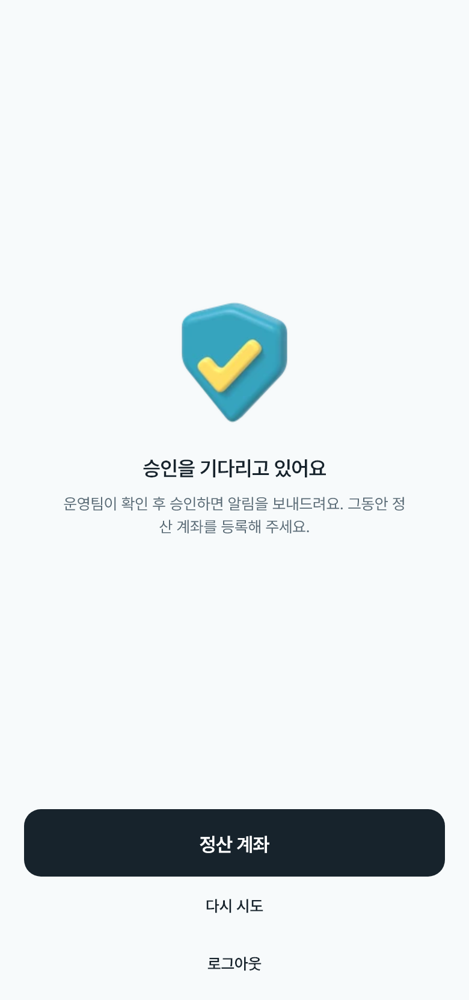
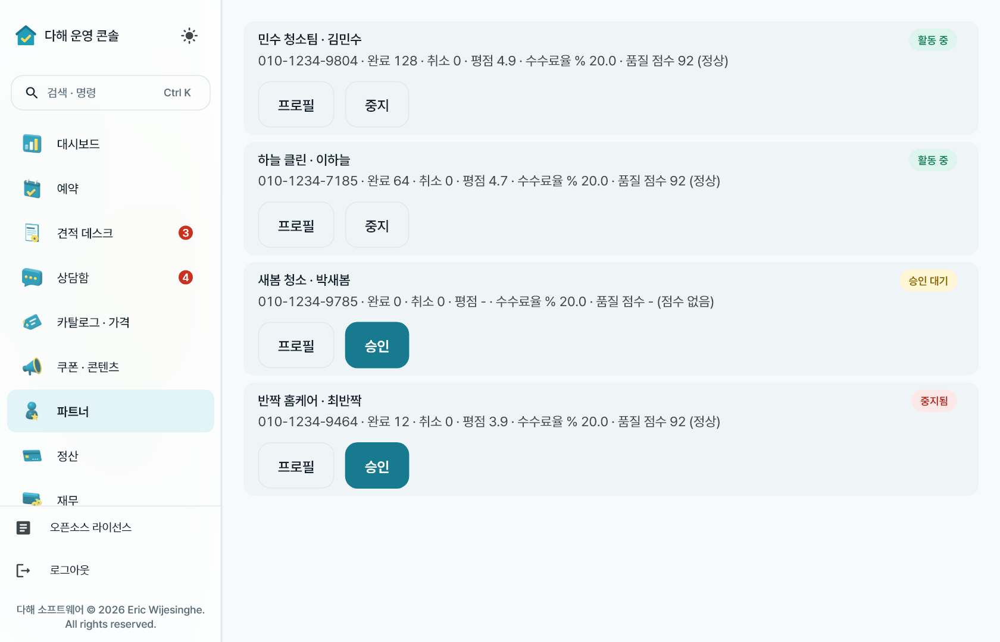
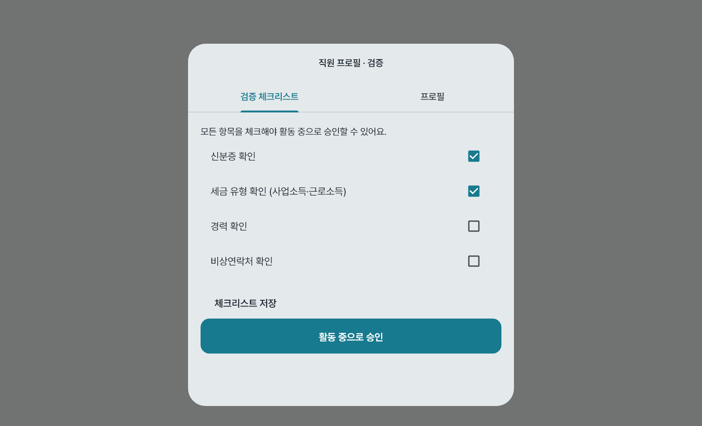
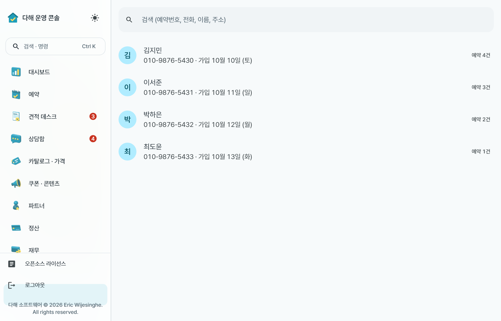
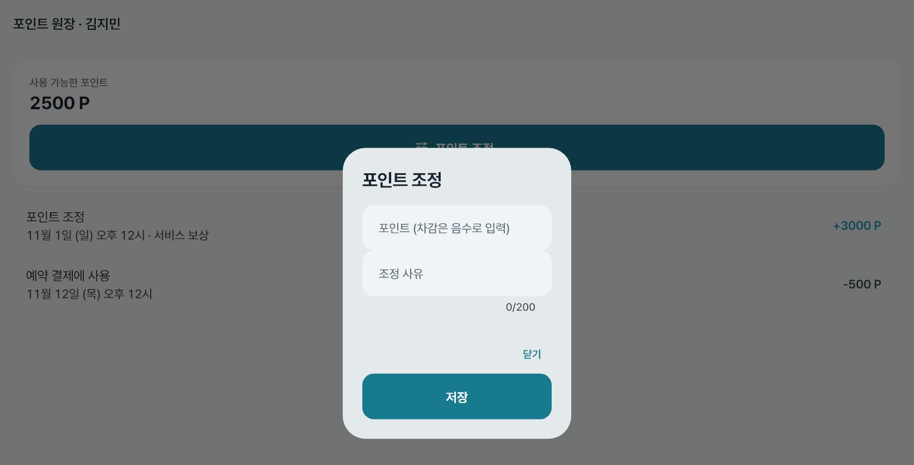
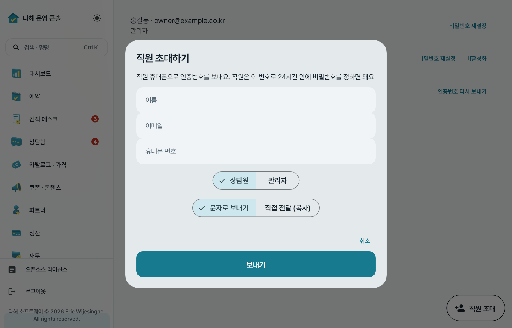
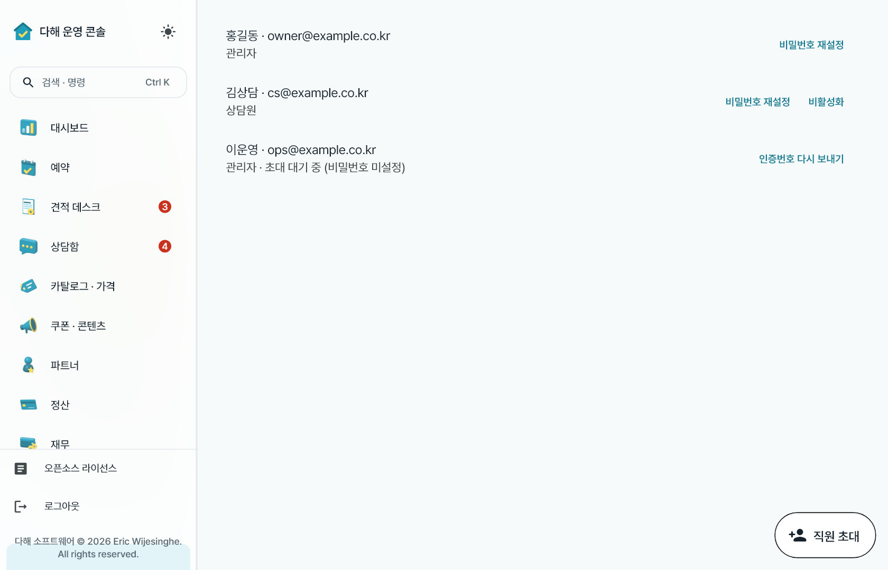

# 20. 파트너, 고객, 직원

**이 장에서 할 일:** 새로 가입한 파트너(청소팀)를 확인하고 승인해요. 파트너 프로필과 품질 점수를 보고, 고객의 포인트를 조정해요. 콘솔을 함께 쓸 직원을 초대하고 관리해요.

> **준비물**
> - **관리자** 계정 (이 장의 버튼 대부분은 관리자에게만 보여요)
> - 휴대폰 인증 앱 (6자리 코드) — 민감한 정보를 볼 때, 관리자 직원을 초대할 때 필요해요
> - 파트너 확인 서류 (신분증, 세금 유형, 경력, 비상연락처를 확인한 기록)
> - 직원을 초대하려면: 직원의 이름, 이메일, 휴대폰 번호

## 20.1 파트너 가입과 승인

### 파트너가 하는 일 (파트너 앱)

1. 파트너가 파트너 앱을 열고 **[휴대폰 번호로 시작하기]** 를 눌러요.
2. 휴대폰 번호를 적고 **[인증번호 받기]** 를 눌러요. 문자로 온 6자리를 적고 **[확인]** 을 눌러요.
3. **파트너 정보를 알려주세요** 화면에서 **대표자 이름**, **팀 이름**, **할 수 있는 서비스**, **활동 지역** 을 채워요.
4. **[가입 신청]** 을 눌러요.
5. **승인을 기다리고 있어요** 화면이 보여요. 이때 **정산 계좌** 를 등록해 두라고 안내해요.

> **팁**
> 파트너에게 미리 알려 주세요: "가입 신청 후 정산 계좌까지 등록해 주세요. 확인이 끝나면 알림이 가요."

### 사장님이 하는 일 (콘솔)

1. 왼쪽 메뉴에서 **[파트너]** 를 눌러요.
2. 목록 한 줄이 파트너 하나예요. `팀 이름 · 대표자 이름` 과 상태 표시가 보여요.
   - **승인 대기**: 가입 신청만 한 상태
   - **활동 중**: 승인되어 일감을 받을 수 있어요
   - **중지됨**: 일을 멈춘 상태
3. 줄 아래 작은 글씨에 전화번호, **완료** 건수, **취소** 건수, **평점**, **수수료율 %**, **품질 점수** 가 보여요.
4. **승인 대기** 파트너 줄의 **[승인]** 을 눌러요. **직원 프로필 · 검증** 창이 열려요.
5. **[검증 체크리스트]** 탭이 보여요. 안내: **모든 항목을 체크해야 활동 중으로 승인할 수 있어요.**
6. 실제로 확인한 항목만 체크해요.
   - **신분증 확인**
   - **세금 유형 확인 (사업소득·근로소득)**
   - **경력 확인**
   - **비상연락처 확인**
7. 아직 다 확인하지 못했다면 **[체크리스트 저장]** 을 눌러 중간 저장해요.
8. 네 항목을 모두 체크했다면 **[활동 중으로 승인]** 을 눌러요.

이렇게 보이면 성공: **처리했어요** 가 뜨고, 목록의 상태가 **활동 중** 으로 바뀌어요. 파트너 앱에 일감이 보이기 시작해요.

> **주의**
> 체크하지 않은 항목이 있으면 **체크리스트를 모두 채워야 승인할 수 있어요.** 가 뜨고 승인되지 않아요.

> **팁**
> 체크리스트가 생기기 전에 승인된 파트너는 **이전에 승인된 직원이라 체크 기록이 없어요. 항목을 확인하고 저장해 주세요.** 가 보여요. 항목을 확인하고 **[체크리스트 저장]** 을 눌러 주세요.

### 파트너 일 멈추기 (중지)

1. **[파트너]** 에서 **활동 중** 파트너 줄의 **[중지]** 를 눌러요.
2. **중지** 창에 **정말 진행할까요?** 가 보여요.
3. **[중지]** 를 눌러요. 그만두려면 **[취소]** 를 눌러요.

이렇게 보이면 성공: 상태가 **중지됨** 으로 바뀌어요. 그 파트너는 새 일감을 받을 수 없어요.

다시 일하게 하려면 그 줄의 **[승인]** 을 눌러 체크리스트를 확인하고 **[활동 중으로 승인]** 을 눌러요.

### 파트너의 팀원 승인

파트너는 자기 팀원을 파트너 앱으로 초대할 수 있어요. 팀원은 사장님이 승인해야 고객 주소를 보고 작업을 받을 수 있어요.

1. **[파트너]** 화면 맨 위의 목록을 봐요. 팀원마다 `팀 이름 · 팀원 이름` 과 **승인 대기 · 전화번호** 가 보여요.
2. 확인이 끝난 팀원 줄의 **[승인]** 을 눌러요.

이렇게 보이면 성공: **처리했어요** 가 뜨고 그 줄이 목록에서 사라져요.

> **주의**
> 승인 전에는 팀원 앱에 작업이 보이지 않아요.

## 20.2 파트너 프로필

1. **[파트너]** 에서 파트너 줄의 **[프로필]** 을 눌러요.
2. **직원 프로필 · 검증** 창이 열리면 **[프로필]** 탭을 눌러요.
3. 필요한 칸을 채워요.
   - **[사진 올리기]**: 파트너 사진
   - **소개**: 고객에게 보일 짧은 소개
   - 고용 형태: **프리랜서**, **직원**, **위탁** 중 하나를 눌러요
   - **비상연락처**: 숫자와 `-` 만 적어요. 암호화되어 저장되고, 볼 때마다 기록이 남아요.
   - **주민등록번호 또는 사업자등록번호**: 아래 "식별번호" 를 보세요.
   - **입사일**: 눌러서 날짜를 골라요. 비어 있으면 **입력 안 함** 이 보여요.
4. **[프로필 저장]** 을 눌러요.

이렇게 보이면 성공: **처리했어요** 가 떠요.

### 식별번호 (주민등록번호 또는 사업자등록번호)

지급명세서(세무 신고)에 필요한 번호예요.

1. 먼저 파트너에게 사용 목적(지급명세서 작성)을 설명하고 동의를 받아요.
2. **주민등록번호 또는 사업자등록번호** 칸에 번호를 적어요.
3. **[프로필 저장]** 을 눌러요.

이렇게 보이면 성공: 칸 아래에 **등록됨: (뒤 4자리만 보이는 번호)** 가 보여요.

> **팁**
> 칸을 비워 두고 저장하면 이미 등록된 번호는 그대로 남아요.

전체 번호를 봐야 할 때:

1. **[원본 보기 (본인 인증 필요)]** 를 눌러요.
2. **인증 앱 코드로 한 번 더 확인** 창이 뜨면, 인증 앱의 6자리 코드를 적고 **[확인하고 계속]** 을 눌러요.
3. **식별번호** 창에 번호가 보여요. 안내: **열람 기록이 남았어요. 화면을 닫은 뒤에는 다시 볼 수 없어요.**

> **주의**
> 식별번호와 비상연락처는 볼 때마다 [활동 기록](23-rules-notify-privacy.md)에 남아요. 꼭 필요할 때만 보세요. 수집·보관 기간과 동의 문구는 세무사와 **확인 필요** 예요.

### 수수료율

파트너 목록의 **수수료율 %** 는 파트너 정산에서 빼는 플랫폼 수수료예요. 새 파트너는 20%로 시작해요. 이 버전의 콘솔에는 수수료율을 바꾸는 화면이 없어요(**확인 필요**, 개발사에 문의).

## 20.3 품질 점수 보기

1. **[파트너]** 목록에서 **품질 점수** 를 봐요. 숫자 옆 괄호 안에 상태가 있어요.

| 표시 | 뜻 |
|---|---|
| **정상** | 기준 이상이에요 |
| **주의** | 주의 기준보다 낮아요. 파트너에게 경고 알림이 가요 |
| **배정 중지** | 자동 중지 기준보다 낮아 새 일감 배정이 멈췄어요 |
| **중지 해제** | 점수는 낮지만 사장님이 중지를 풀었어요 |
| **점수 없음** | 아직 계산할 기록이 없어요 |

2. 기준 점수는 **[카탈로그 · 가격]** > **[품질 기준]** 에서 바꿔요([18.8](18-catalog-prices.md#188-파트너-품질-기준)).
3. 점수를 며칠 치로 셀지, 정시 도착을 몇 분까지 봐줄지는 **[운영 규칙]** 에서 바꿔요([23장](23-rules-notify-privacy.md)).

> **주의**
> 이 버전의 콘솔에는 파트너 한 명의 **배정 중지** 를 푸는 버튼이 없어요(**확인 필요**, 개발사에 문의). 급하면 **[품질 기준]** 의 자동 중지 기준을 낮출 수 있어요. 다음 점수 계산부터 모든 파트너에게 적용되니 조심해서 써요.

## 20.4 고객과 포인트

### 고객 찾기

> **주의**
> **[고객]** 화면은 **관리자** 만 쓸 수 있어요. 메뉴는 상담원에게도 보이지만, 상담원 계정으로는 목록이 불러와지지 않아요.

1. 왼쪽 메뉴에서 **[고객]** 을 눌러요.
2. 맨 위 검색 칸(**검색 (예약번호, 전화, 이름, 주소)**)에 이름이나 전화번호를 적고 `Enter` 를 눌러요.
3. 줄마다 이름, 전화번호, **가입** 날짜, 오른쪽에 **예약 (숫자)건** 이 보여요.

### 포인트 내역 보기, 조정하기 (관리자만)

1. **[고객]** 목록에서 고객 줄을 눌러요. **포인트 원장** 화면이 열려요.
2. 위에 **사용 가능한 포인트** 가 보여요.
3. 아래 목록에 포인트가 들고 난 기록이 보여요. 예: **예약 적립**, **가입 환영 포인트**, **친구 추천 보상**, **취소로 돌려받은 포인트**, **예약 결제에 사용**, **기간 만료로 소멸**, **포인트 조정**. 기록이 없으면 **아직 포인트 내역이 없어요** 가 보여요.
4. 포인트를 주거나 빼려면 **[포인트 조정]** 을 눌러요.
5. **포인트 (차감은 음수로 입력)** 칸에 숫자를 적어요. 주려면 `5000`, 빼려면 `-5000` 처럼 적어요.
6. **조정 사유** 칸에 이유를 적어요(예: `서비스 불편 보상`). 꼭 적어야 해요.
7. **[저장]** 을 눌러요.

이렇게 보이면 성공: **포인트를 조정했어요** 가 뜨고, 목록 맨 위에 **포인트 조정** 줄이 생겨요.

> **주의**
> - 한 번에 줄 수 있는 포인트에는 한도가 있어요. 처음 설치 값은 100,000점이에요. **[운영 규칙]** 의 **포인트 한 번에 지급·차감할 최대 점수** 에서 낮출 수 있어요.
> - 0이거나 사유가 비어 있으면 **0이 아닌 포인트와 사유를 입력해 주세요** 가 떠요.
> - 포인트 조정은 활동 기록에 남아요.

## 20.5 직원 (콘솔을 같이 쓰는 사람)

직원에게는 권한이 두 가지 있어요.

| 권한 | 할 수 있는 일 |
|---|---|
| **상담원** | 예약, 견적, 상담 같은 일상 업무 |
| **관리자** | 상담원이 하는 일 + 설정, 가격, 정산, 재무, 직원 관리 등 모든 메뉴 |

### 직원 초대하기

1. 왼쪽 메뉴에서 **[직원]** 을 눌러요.
2. 오른쪽 아래 **[직원 초대]** 를 눌러요.
3. **직원 초대하기** 창의 안내를 읽어요: **직원 휴대폰으로 인증번호를 보내요. 직원은 이 번호로 24시간 안에 비밀번호를 정하면 돼요.**
4. **이름**, **이메일**, **휴대폰 번호** 를 적어요.
5. 권한에서 **상담원** 또는 **관리자** 를 눌러요.
6. 인증번호를 전할 방법을 골라요.
   - **문자로 보내기**: 직원 휴대폰으로 문자가 가요(문자 설정이 필요해요, [14장](14-setup-solapi.md)).
   - **직접 전달 (복사)**: 화면에 번호가 나오면 복사해서 직접 전해요.
7. **[보내기]** 를 눌러요.
8. **관리자** 로 초대할 때만: **인증 번호 입력** 창이 떠요. 인증 앱의 6자리 번호를 **인증 번호 6자리** 칸에 적고 **[계속]** 을 눌러요.

이렇게 보이면 성공:
- 문자로 보냈다면: **문자를 보냈어요. 직원은 24시간 안에 입력해야 해요.**
- 직접 전달이면: **인증번호** 창에 6자리 번호가 보여요. **[복사]** 를 눌러 직원에게 전해요. 이 창을 닫으면 번호를 다시 볼 수 없어요.

직원 목록에 그 직원이 **초대 대기 중 (비밀번호 미설정)** 으로 보여요.

> **주의**
> - 관리자 계정은 콘솔 전체를 다룰 수 있어서, **소유자** 만 인증 앱 번호로 관리자를 초대할 수 있어요.
> - 인증번호는 한 번만 쓸 수 있고 24시간 동안 유효해요.
> - 직원이 인증번호를 넣고 비밀번호를 정하는 화면은 이 버전의 콘솔 로그인 화면에서 찾지 못했어요(**확인 필요**, 개발사에 문의).

### 직원 목록에서 할 수 있는 일

1. **[직원]** 을 눌러요. 줄마다 `이름 · 이메일` 과 권한이 보여요.

2. 상황에 맞는 버튼을 눌러요.

| 버튼 | 언제 | 하는 일 |
|---|---|---|
| **[인증번호 다시 보내기]** | 초대한 직원이 24시간 안에 비밀번호를 못 정했을 때 | 새 인증번호를 보내요 |
| **[비밀번호 재설정]** | 직원이 비밀번호를 잊었을 때 | 재설정용 인증번호를 보내요 |
| **[비활성화]** | 직원이 그만뒀을 때 | 그 계정으로 더 이상 로그인할 수 없어요 |
| **[활성화]** | 비활성화한 직원을 다시 쓸 때 | 계정을 다시 켜요 |

**인증번호 다시 보내기 / 비밀번호 재설정 순서**

1. 버튼을 눌러요. 같은 이름의 확인 창에서 **정말 진행할까요?** 를 읽고 다시 버튼 이름을 눌러요.
2. **인증번호 전달 방법** 창에서 **문자로 보내기** 또는 **직접 전달 (복사)** 를 골라요.
3. 직원에게 휴대폰 번호가 없으면 **이 직원은 휴대폰 번호가 없어요. 번호를 입력하면 저장하고 인증번호를 보내요.** 가 보여요. **휴대폰 번호** 를 적어요.
4. **[보내기]** 를 눌러요.

이렇게 보이면 성공: 문자 안내가 뜨거나, **재설정 인증번호** 창에 번호가 보여요.

> **팁**
> 소유자(사장님) 본인의 비밀번호를 재설정할 때는 인증 앱 번호를 한 번 더 물어봐요. 소유자 줄에는 **[비활성화]** 버튼이 없어요. 소유자는 역할을 넘겨야만 바뀌어요.

> **팁**
> 직원도 로그인할 때 2단계 인증(인증 앱)을 설정해요. 방법은 [6장](06-owner-account.md)과 같아요.

## 20.6 소유자 넘기기

사장님 계정은 **소유자** 예요. 소유자는 한 명뿐이에요. 다른 관리자에게 넘기거나(**소유자 넘기기**), 소유자가 없을 때 관리자가 맡는 방법(**내가 소유자 되기**)은 **[내 계정]** 에 있어요. 순서는 [8.5 내 계정](08-console-tour.md#85-내-계정)을 보세요.

## 자주 생기는 문제

| 이런 일이 생기면 | 이렇게 해 보세요 |
|---|---|
| 파트너 목록에 버튼이 하나도 없어요 | 상담원 계정이에요. 관리자 계정으로 로그인해요 |
| **[활동 중으로 승인]** 이 눌리지 않아요 | 이미 활동 중이거나 처리 중이에요. 네 항목을 모두 체크했는지도 확인해요 |
| 승인한 파트너가 일감을 못 받는다고 해요 | 품질 점수가 **배정 중지** 인지 확인해요. 파트너 앱을 완전히 닫았다가 다시 열게 해요 |
| 팀원이 작업을 못 봐요 | **[파트너]** 맨 위 목록에서 그 팀원을 **[승인]** 해요 |
| **[원본 보기 (본인 인증 필요)]** 에서 **코드가 맞지 않아요. 휴대폰 시간이 맞는지 확인하고 다시 입력하세요.** | 휴대폰 시계를 자동 시간으로 맞추고 새 코드로 다시 해요 |
| **시도가 너무 많아요. 몇 분 뒤에 다시 시도하세요.** | 몇 분 기다렸다가 다시 해요 |
| 직원 문자가 안 가요 | **직접 전달 (복사)** 로 보내요. 문자 설정은 [14장](14-setup-solapi.md)에서 확인해요 |
| 포인트 조정이 **문제가 생겼어요. 잠시 후 다시 시도해 주세요.** 로 실패해요 | 한 번에 줄 수 있는 한도(처음 값 100,000점)를 넘었어요. 숫자를 줄여 다시 해요 |
| **[고객]** 목록이 안 보여요 | 상담원 계정이에요. 관리자 계정으로 로그인해요 |
